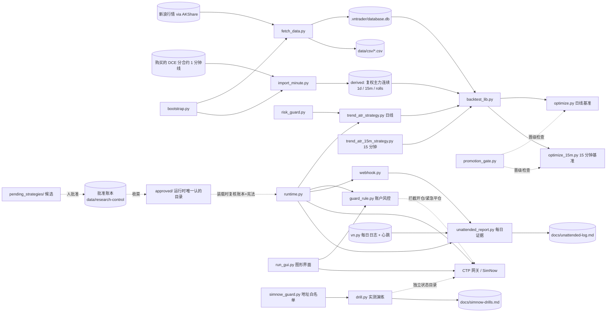
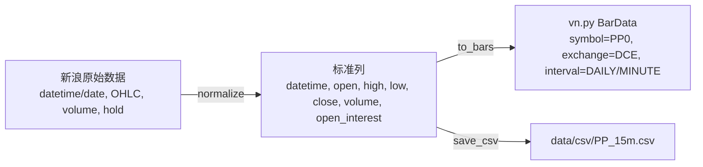
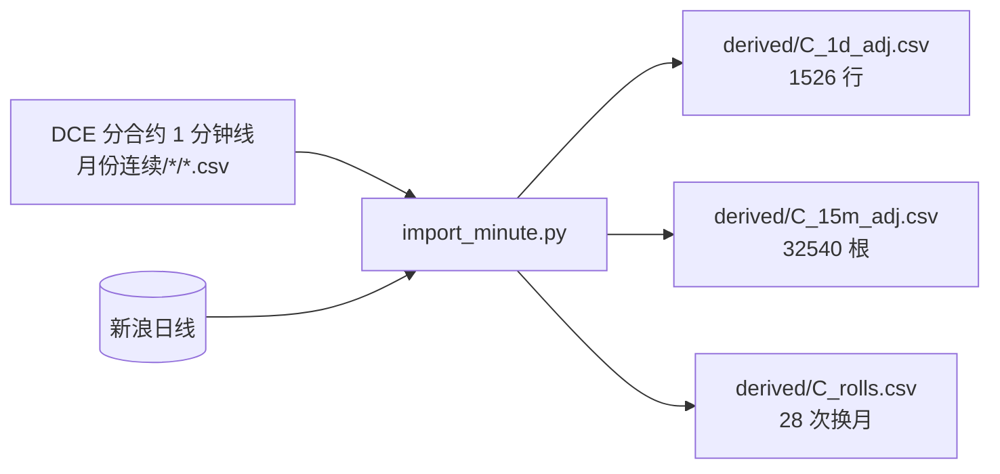
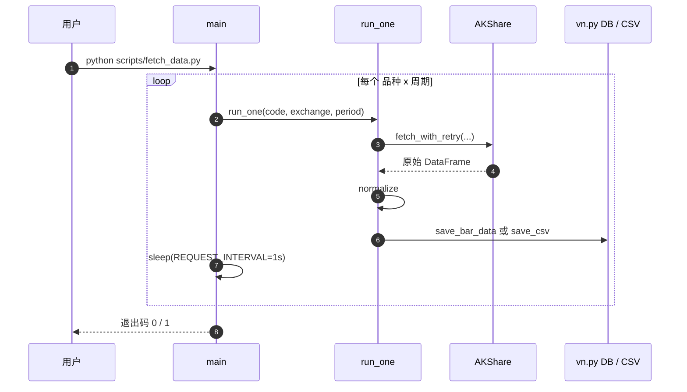

# PROJECTWIKI.md

> 项目知识库(单一可信源),与 `README.md`(怎么用)、`docs/`(ADR / 手册 / 路线图)互链。
> **拆分说明**(2026-11-11):目标架构与路线图 → `docs/roadmap.md`;研究方法论映射 → `docs/methodology-mapping.md`;模块详细文档 → `docs/modules.md`。
> **当前状态**(测试数与覆盖率以 `CHANGELOG.md` 与测试输出为准,不在此处写死):
> - 工程基线(原 Phase 0–5)代码完成并通过离线端到端测试;SimNow 上主机端与 Docker 容器内均已跑通真实 CTP 启动管道。
>   **2026-11-12 夜盘:`scripts/drill.py` 六个演练场景全部通过**(夜盘归属、成交回报延迟、行情停更、**真实切断网络**的断线与自动重连、当日熔断、累计死线硬锁定),见 `docs/simnow-drills.md`。
> - 路线图当前处于**阶段一(SimNow 验收闭环)**,**尚未退出**:演练六场景已通过;行情录制已在交易时段验收并加了「已连接却不订阅」的卡住检测;通知器有落盘待补发队列,Telegram 送达已验证。未完成:连续 ≥5 个交易日无人值守、行情录制的 DSH 重启实测、国信测试环境、废单文本补采。**两个未解决的问题**:退出登出(`logout_ctp`)在重连后出现过一次原生段错误(待复现);`latency` 演练在行情清淡时 30 秒未成交(不稳定)。
> - **策略结论为负面**:日线与 15 分钟两条基准都没有发现可延续的优势(见 ADR),当前策略只用于**管道测试**;15 分钟基准的测试段(2024-01 ~ 2026-06)已被使用一次,
>   不能再用于新候选的最终确认,新候选需要 2026-06 之后的分钟线或模拟盘/小额实盘记录。
> - 连接**生产 API** 需要实盘准入批准(晋级门槛全部通过才会写出,见 `docs/adr/20261111-discipline-enforcement.md`);穿透式认证与实盘准入是人工步骤,见 `docs/live-readiness.md`。
> - **研究沙盒与毕昇外层(已提前部署,偏离原定时序,见 ADR `20261112-research-sandbox-groundwork`)**:沙盒 CLI + HTTP 网关 + 容器隔离(内部网络无外网、只读根文件系统、控制目录只读)、候选声明 `param_grid` 的服务端选参 + 晋级门槛评估(选参窗口与验证窗口不重叠)、滚动 24 小时最多提交 5 个候选的服务端迭代上限、确定性中文报告、先看代码再批准均已实现;毕昇本机部署(仅 127.0.0.1),工作流 v3 已建,**需要 LLM 的节点因模型额度用完待联调**;无人值守的连续迭代(4c)未放开。
> - **研究入口已接到 DSH**(Issue [#22](https://github.com/laiyinyizao007/invest/issues/22),ADR `20261113-dsh-research-entry-and-out-of-band-approval`):DSH 里用 `research` Preset 发起研究、查进度、请求人工批准;批准在本机 `127.0.0.1` 的一次性网页里由人完成(输入候选**完整 64 位 sha256**,填错可改正重试),**模型不能自己批准**——批准页地址与哈希不进模型可见通道(网关响应剥哈希 / 毕昇 tip 模板不回显 / CLI 的 stdout 不返回值哈希 / MCP 输出再脱敏,共四层);**本机绝对路径也不进模型通道**(网关的清洗收在 `handle` 的**唯一出口** `_scrub`,五条模型可见出口一个不漏;MCP 的 `redact_for_model` 同样盖掉);批准页地址**连磁盘都不落盘**(批准进程自己开浏览器,URL 只活在它的内存里)。批准只能在**交互式终端或浏览器**里做出:页面 POST 须带浏览器来源标记(只挡跨站浏览器 CSRF,挡不住本机程序——真正的屏障是 192 位一次性 URL 令牌 + 页面 CSRF 令牌 + 完整 64 位哈希三件套),`review`/`--confirm-reviewed` 在非 TTY 下拒绝。毕昇开放 API(含续跑协议)已实测可用。研究侧代码不 `import bootstrap`(网关是最后一个去掉的组件),**筛查/批准/编排/网关/MCP 进程**不再 import vnpy、不加载 `.env` 的交易凭据(⚠️ **回测子进程仍 import vnpy**,回测要 import `strategies.*`)。CI 关卡 `.github/workflows/research-guard.yml`(compileall + ruff + **研究侧测试,含边界不变量**,不装交易环境)。
> 跟踪 Issue:[#1](https://github.com/laiyinyizao007/invest/issues/1)、Batch B [#12](https://github.com/laiyinyizao007/invest/issues/12)、行情录制与增量副线 [#13](https://github.com/laiyinyizao007/invest/issues/13)
> 阶段一期间已锁定行情基础设施副线：官方 `vnpy_datarecorder` 写入独立 `.vntrader_record/database.db`，DSH 只调度短任务 `ensure`/`watchdog`；dsh-cron 长任务 timeout 与 Windows 进程语义的事实、限制和待实测项见 [`docs/adr/20261111-market-recording-and-dsh-orchestration.md`](docs/adr/20261111-market-recording-and-dsh-orchestration.md)。

## 1. 项目概述
- **目标**:用代码自动交易国内商品期货,把"盈亏比纪律"固化为策略层风控,杜绝盘中手动干预。
- **账户约束**:本金 1 万元,单笔最大亏损 300 元(3%),固定 1 手;主测品种玉米(C),甲醇(MA)作对照。已下载 PP/L/EB 的数据,但 1 万元预算下它们的止损只有日波动的 15% 左右,不适合。
- **背景**:放弃自研底层,采用开源框架 vn.py(CTA 策略 + CTP 网关),先在 SimNow 模拟盘验证,再走期货公司穿透式认证上实盘。
- **范围**:数据下载与存储、CTA 策略与回测、策略层风控、SimNow 模拟盘、Webhook 监控、Docker 部署。
- **非目标**:高频交易;手机 app 自动化(adb)下单(无可靠成交回报、合规风险);美股(Alpaca)暂列后续备选。
- **运行环境**:开发 Windows 11 + Python 3.13;实盘与穿透测试运行在**另一台 Windows 机器**上直接用 Python 运行(不用 Docker,见 `docs/live-readiness.md` C2);Docker + x86_64 Linux 保留为备选。
  树莓派 5(ARM64)不可行:CTP 官方库只有 x86_64,`vnpy_ctp` 在 PyPI 上也只有 win_amd64 wheel 与源码包。
- **实盘切换需用户另行明确授权**;当前不连接任何实盘。
- **上手入口**:`README.md`(面向"这个项目在干嘛、怎么用");本文件是模块级的单一可信源,两者互链。

## 2. 架构设计

> 分层依赖图、磁盘状态归属表、隔离机制与**已知局限台账**见 [`docs/architecture.md`](docs/architecture.md)。

### 2.1 现状数据流(代码已实现;**各节点的真实验证程度见下表**,不要把"代码完成"读成"已验证")

| 节点 | 代码路径 | 状态 |
|---|---|---|
| FD | `scripts/fetch_data.py` | 完成 |
| BS | `scripts/bootstrap.py` | 完成 |
| IM / DER | `scripts/import_minute.py` → `C:\Dev\data\invest\derived\` | 完成(玉米实测交叉验证通过) |
| DB / CSV | 运行时生成,均已 `.gitignore` | 完成 |
| BL | `scripts/backtest_lib.py` | 完成 |
| OPT / O15 | `scripts/optimize.py`、`scripts/optimize_15m.py` | 完成(两者结论均为负面) |
| ST / ST15 | `strategies/trend_atr_strategy.py`、`trend_atr_15m_strategy.py`、`random_entry_strategy.py`、`instruments.py` | 完成 |
| RG / PG | `risk/risk_guard.py`、`risk/promotion_gate.py` | 完成 |
| RT / GR | `trading/runtime.py`、`trading/guard_rule.py`、`trading/safe_risk.py` | 完成(仅假网关离线测试;**未在真实 CTP 上验证**) |
| WH | `notify/webhook.py` | 完成 |
| 批准目录 | `risk/approval_ledger.py`(只读账本)、`risk/approved_guard.py`(装载五道校验 + 第四层指纹比对 + 类级校验)、`scripts/research_collect.py`(收菜 CLI,本机人工触发) | 完成(2026-11-15,Issue [#34](https://github.com/laiyinyizao007/invest/issues/34);第 1 轮 codex 复核 32/50 后修了四处):**批准终于成为真正的授权**——运行时装载复核账本与宪法,不过即拒绝启动(`EXIT_STARTUP_FAILED`),绝不降级到默认策略。收菜不新增网关端点(网关 import 不到它)。`approved/` 不入库 |
| 断耦演练 | `scripts/decoupling_drill.py` | 完成(2026-11-15):三项全过——内层不 import 研究侧、外层容器环境无 `CTP_*`、外层停掉时内层心跳与策略照跑。证据见 `docs/decoupling-drill.md`。**不连真 CTP**:证明的是断耦,不是实盘可用性 |
| CTP | `scripts/run_headless.py`(无头入口)、`Dockerfile`、`docker-compose.yml` | **部分**:主机端与容器内均跑通完整启动管道(2026-11-10);废单文本、撤单失败、断线重连、夜盘跨日**未在真实 CTP 验证** |
| GUI | `scripts/run_gui.py` | 完成(人工观察用,非无人值守) |
| SG / DR | `scripts/simnow_guard.py`、`scripts/drill.py` | 代码完成,**演练从未实跑**(`docs/simnow-drills.md` 尚不存在,首次实跑时由脚本生成);阶段一,见 §2.4 |
| UR | `scripts/unattended_report.py` | 完成(离线自检通过,真实 webhook 待配,probe 未通过;连续 5 天证据未攒齐);纯逻辑在 `evidence/logstats.py` |
| 状态页 | `dashboard/`(含 `dashboard/evolution.py`)、`scripts/status_server.py`、`requirements-dashboard.txt`、`tools/build_static_manifest.py` | **后端阶段①已实现并有测试**(2026-11-12/13):只读、仅回环、令牌鉴权(令牌在专属目录 `data/dashboard/`,不在交易侧目录树)、全 GET/HEAD、缺失/过期/损坏永不显示为正常。**前端未构建**(占位页)。**G8 审查:两轮都已确认过线**——codex 那轮经十六轮复核到 **46.0/50**;Gemini 那轮 **45/50**(其发现的『提示语说详见服务端日志却没记日志』已修)。**连续段口径**(用户 2026-11-13 拍板):只有严重事件才打断,警告不打断但必须数出来(`streak_warning_count`);无法判断的日子与缺日志的工作日仍打断。**复核过程中的关键教训**:校验规则必须与产出规则同源(曾因另写一份键集,导致所有真实回测被判成损坏);测试必须走到被守的那条分支(容差与缓存都可能让断言恒真);样例必须是『服务器真能产出的』,否则前端会照着学一条不存在的规则

### 2.2 目标架构与演进路线(已迁出)
- 详见 [`docs/roadmap.md`](docs/roadmap.md)(原 §2.2 目标分层架构、§2.4 差距与路线、§2.5 规划位登记表,编号沿用)。
- **一句话**:两层架构——**内层 = vn.py 流程引擎**(确定性内核:`trading/`、`risk/`、`strategies/`、研究脚本、`notify/`、Docker,即上图全部已实现部分);**外层 = Bisheng 流程编排**(AI 策略研究员,**规划位,零代码**)。边界铁律:外层只经研究沙盒 API 白名单端点交互;`promotion_gate` 是候选策略唯一闸门;LLM 产出只落 `pending_strategies/`,装载永远人工。
- 路线图四个阶段:**一** SimNow 验收闭环(当前)→ **二** 调度/换月/日历/真实费率 → **三** 月度滚动优化引擎化 + 研究沙盒 API(触发条件驱动,不排日期)→ **四** Bisheng 接入与 Alpha Factory(远期)。
- 每个阶段的验收都只是通道/能力验收,**不是策略准入**;实盘切换需用户另行明确授权。

### 2.3 研究方法论 → 系统映射(已迁出)
- 详见 [`docs/methodology-mapping.md`](docs/methodology-mapping.md):研究资料条目 → 状态 → 实现文件的映射表(34 行),以及研究文档自身的矛盾与证据强度——本项目的采纳口径。

## 3. 架构决策记录(ADR)
- 目录:`docs/adr/`,MADR 格式;各 ADR 的「已知局限」汇总与状态见 [`docs/architecture.md`](docs/architecture.md) §4
  - [`20261109-use-vnpy.md`](docs/adr/20261109-use-vnpy.md):采用 vn.py,不自研
  - [`20261109-china-timezone.md`](docs/adr/20261109-china-timezone.md):进程统一为中国时区
  - [`20261109-account-risk-budget.md`](docs/adr/20261109-account-risk-budget.md):1 万元 / 300 元预算,超预算则不交易,主测玉米
  - [`20261109-negative-backtest-result.md`](docs/adr/20261109-negative-backtest-result.md):如实记录"未发现优势"与方法学纪律
  - [`20261109-promotion-gate.md`](docs/adr/20261109-promotion-gate.md):策略晋级门槛(9 条;第 9 条 DSR 见 [`20261113-evolution-engine.md`](docs/adr/20261113-evolution-engine.md))
  - [`20261109-account-risk-lock.md`](docs/adr/20261109-account-risk-lock.md):账户级双层熔断、平仓永远放行、紧急平仓防重复下单
  - [`20261109-deployment-and-live-mode.md`](docs/adr/20261109-deployment-and-live-mode.md):实盘模式策略、运行时对账、通知、容器化
  - [`20261110-baseline-15m.md`](docs/adr/20261110-baseline-15m.md):15 分钟基准的事前方案、成绩单与"测试段已被使用"的约束
  - [`20261110-ctp-error-code-and-watchdog-policy.md`](docs/adr/20261110-ctp-error-code-and-watchdog-policy.md):错误码优先的废单三级分类、假死强撤开仓单、断线连接状态机与无积压补发证据
  - [`20261110-walk-forward-optimizer.md`](docs/adr/20261110-walk-forward-optimizer.md):Walk-Forward 滚动窗口方法学、测试段三层隔离护栏、预算弃单率口径与负面结果记录
  - [`20261110-bisheng-ai-researcher.md`](docs/adr/20261110-bisheng-ai-researcher.md):两层架构——外层 Bisheng AI 策略研究员经研究沙盒 API 与内层 vn.py 确定性内核隔离;LLM 产出只落 pending 目录、装载永远人工、外层可整体替换

  - [`20261111-discipline-enforcement.md`](docs/adr/20261111-discipline-enforcement.md):纪律机制补缺——解锁冷却与历史、非策略委托检测(只告警计数)、实盘准入检查(生产 API 必须有晋级门槛批准)
  - [`20261111-risk-floor-immutability.md`](docs/adr/20261111-risk-floor-immutability.md):风控底线不可优化(预算是约束不是变量)、明确不做清单、本地止损依赖进程存活的已接受风险

  - [`20261111-broker-test-compliance.md`](docs/adr/20261111-broker-test-compliance.md):国信程序化测试合规——阈值触达预警(走 Webhook、按指标节流)、手动暂停开仓(标志文件)、证据与报告
  - [`20261111-market-recording-and-dsh-orchestration.md`](docs/adr/20261111-market-recording-and-dsh-orchestration.md):行情录制采用官方 DataRecorder 与独立数据库；DSH 采用短任务 `ensure`/`watchdog` + wrapper，不直接承载长期前台录制
  - [`20261112-research-sandbox-config-and-approval.md`](docs/adr/20261112-research-sandbox-config-and-approval.md):研究沙盒配置集中化与人工批准的带外边界
  - [`20261112-research-sandbox-groundwork.md`](docs/adr/20261112-research-sandbox-groundwork.md):研究沙盒 API(CLI + HTTP 网关 + 容器隔离)与参数平原
  - [`20261112-candidate-evaluation.md`](docs/adr/20261112-candidate-evaluation.md):候选评估——晋级门槛只用滚动验证段,测试段留作最终确认
  - [`20261112-status-dashboard.md`](docs/adr/20261112-status-dashboard.md):独立进程的只读状态页(不做交易终端式前端)
  - [`20261113-dsh-research-entry-and-out-of-band-approval.md`](docs/adr/20261113-dsh-research-entry-and-out-of-band-approval.md):DSH 研究入口与带外人工批准(模型只能请求,不能授予)
  - [`20261113-evolution-engine.md`](docs/adr/20261113-evolution-engine.md):进化引擎的不可变宪法(静态/运行时类/参数/实例/指纹/行情六层)
  - [`20261115-approved-sandbox-closure.md`](docs/adr/20261115-approved-sandbox-closure.md):闭合沙盒状态机——`approved/` 目录、收菜动作与运行时装载的 fail-closed(批准终于成为真正的授权)

  - [`20261114-consequence-domain-tiers.md`](docs/adr/20261114-consequence-domain-tiers.md):**流程按后果域分档**（研究档 / 执行档），不按改动规模——研究与生产的规模一样，但研究的产物可重跑、失败只影响结论。分档判据由 `tools/check_domain.py` 执行（默认拒绝），清单由 `tools/verdict_graph.py` 的**函数级** AST 分析**实测**得出（谁拥有 `check_gate` / `record_approval` / `screen_source` 等判定点）。**不削弱任何代码内的防线，也不改阈值**——只减少改动的审批成本

## 4. 设计决策 & 技术债务
> 只保留**未解决**的条目。已处理或重复的行已归档到 `docs/roadmap.md` §2.7;各条目的阶段归属见 `docs/roadmap.md` §2.4 末尾的去向表。
| 项 | 说明 | 优先级 |
|---|---|---|
| 分钟线历史很浅 | 新浪每个周期只返回最近约 1023 根(1 分钟≈5 个交易日,15 分钟≈2.5 个月),须每天/每周增量运行脚本积累 | 高 |
| **未在真实 CTP/SimNow 上验证** | 启动管道已在真实 SimNow(第一套)跑通一次(2026-11-10);但废单文本、持仓回报时序、撤单失败、断线重连、SHFE/INE 平今平昨、夜盘跨日、kill -9 重启、熔断演练都只在离线假网关上验证;须按 `docs/runbook-simnow.md` 第 5 节实测并回填 | **最高** |
| **演练脚本已就绪但未实跑** | `scripts/drill.py` 把第 5 节的第 3/4/6/7/8/9 项做成了可重复执行的场景,但**还没有在 SimNow 上真跑过**,结论仍为空 | **最高** |
| **飞书的"失败也返回 HTTP 200"** | 通知器只看 HTTP 状态码会把 `{"code":19001}` 当成发送成功 → 告警静默丢失。现已解析响应体,业务码非 0 一律算失败并重试;但**真实飞书 webhook 仍未验证过**(`.env` 的 `WEBHOOK_URL` 是空的) | **高** |
| 无人值守只跑了 1 天 | 第 6 节要求连续 ≥ 5 个交易日,目前证据表(`docs/unattended-log.md`)只有 2026-11-10 一天,且心跳已停 | 高 |
| 废单关键词表只覆盖 2 条实测文本 | 已在 SimNow 实测到"该交易席位未连接到交易所"(硬拒绝);越界价格、无持仓平仓、超大手数、资金不足四类因 SimNow 反复登录触发 4097 冷却尚未采到,见 `docs/reject-texts-simnow.md` | 高 |
| 图形界面不是运行方式 | `run_gui.py` 无对账、无看门狗、无 Webhook,只能人工观察;不得用于无人值守 | 中 |
| 主力合约换月需人工更新 | `LIVE_VT_SYMBOL` 指向具体合约,换月与持仓移仓未实现 | 高 |
| 本地止损依赖进程存活 | vn.py 停止单是引擎本地触发的、不是交易所委托,断线或进程退出时不执行;进程退出时若有持仓会发 FATAL,但无法替代交易所端条件单。实盘须跑在稳定机器上并有行情停更检测。**已接受的风险**,见 `docs/adr/20261111-risk-floor-immutability.md` | 高 |
| 交易日不处理法定节假日 | 长假前后的当日熔断边界需人工留意 | 中 |
| 复权数据历史较短 | 新浪分合约日线只到 2018-05;更早需交易所逐日合约数据(大连 2005 起、郑州 2010-08 起,约几千次请求) | 高 |
| 分钟线历史不足 | 已购买并导入(DCE 玉米分合约 1 分钟线,约 5.9 年);**只到 2026-06-15**,新候选需要更新数据 | 高 |
| **15 分钟基准的测试段已被使用一次** | 2024-01 ~ 2026-06 已被 `optimize_15m.py --test` 使用,再用于新候选会产生多重检验偏差;新候选只能用训练/验证段筛选,最终确认需要 2026-06 之后的分钟线或模拟盘记录 | **高** |
| 15 分钟夏普口径与日线不同 | vn.py 按**日历日**分组逐日盈亏、夜盘与次日日盘被拆成两条记录,年化因子固定 240(日线口径);15 分钟夏普**不可与日线夏普直接比大小**,只有收益率/净盈亏/回撤金额可靠(详见 ADR 的"事后补充") | 高 |
| 回测结论统计效力不足 | 日线选定参数在验证段 10 笔往返(复权数据重做);15 分钟基准测试段 91 笔往返,均低于 150 的门槛;结论只能是"无法证明优势" | 高 |
| 预算约束不了跳空 | 默认参数回测有 4 笔单笔亏损超 300 元,最大 700 元(未计成本) | 中 |
| 日线内高低点先后未知 | 移动止损按当根极值收紧、下一根生效,属日线固有近似 | 中 |
| 测试段"只看一次"登记仅覆盖 optimize*.py | 已由 `config/test_segment_usage.json` 持久化;但登记文件可被手工改写,约束依赖 git 历史可审计 | 低 |
| `DailyLossGuard` 对日线策略无意义 | 同一天几乎不会连亏两笔,仅对未来日内策略有效 | 低 |
| 回测成本是假设值 | 每边 1 tick + 3 元/手,实盘前须换成期货公司真实费率 | 高 |
| 5/15 分钟线只存 CSV | vn.py 无对应 `Interval`;回测时需自行加载,或由 1 分钟线合成 | 中 |
| 数据源 OHLC 偶有矛盾 | 已修复(取 OHLC 极值),实测 PP 2020-08-06、L 2007-07-31 各 1 行 | 低 |
| `turnover` 恒为 0 | 新浪不提供成交额 | 低 |
| 缺少自动化调度 | 增量下载目前需手动运行 | 中 |
| **`parameter_on_plateau` 无计算来源** | 晋级门槛第 8 条由调用方传入布尔值,仓库内没有代码计算它;计算落地前该项靠人工判断(见 `docs/roadmap.md` §2.6) | 高 |
| **非策略委托检测的前提未实测** | 假设"外部终端下的单会以 reference 为空的回报出现";codex 审阅源码认为外部会话的委托可能收不到事件。须按 runbook 第 5 节第 11 项在 SimNow 实测,两种结果都要记录(`docs/adr/20261111-discipline-enforcement.md`) | **高** |
| 实盘准入批准文件可被手写 | 它是防误操作的闸门,不防有写权限的人 | 低 |
| **进程内执行不受信代码做不到安全** | 候选仍能从第三方模块(如 `numpy`)的**帧**里拿到真实内建——实测确认(Issue #26,ADR 第 22 轮补记);能力隔离(受限内建、按路径的导入裁决)只是纵深防御的**一层**,不是边界。真正的边界是**人工审批 + 容器隔离**;容器一旦改成可写挂载或放开网络,这层就名存实亡 | 高 |
| **沙盒的 G8 第二轮复核:第 25 轮 31/50、第 26 轮 33/50(同一处代码,两轮都低于 45 的可发布线)** | 第 25 轮 codex CLI 第二轮给 `scripts/research_sandbox.py` 打了 **31/50**、第 26 轮 **33/50**(低于 45 的可发布线,结论都是"禁止发布")。第 26 轮报告里的 Critical 1-3 / High 1,2 / Medium 1,2,3 / Low 1,2,3 已逐条用**动态探针**复现并修复,各配双向回归用例(`tests/test_sandbox_round26_rules.py` 37 条,15 处变异全部被抓到);**但第 26 轮 codex 第二轮复核又报出 2 条 HIGH(linked worktree 下 `.git/config` 根本没进指纹;`__pycache__/*.pyc` 能盖过已核对过的源码)——两条都已在本轮补修并补了回归用例,而补修之后**没有再跑第三轮 codex,新分数未知**。合并前须补这一轮(ADR 第 26 轮补记之二) | **高** |
| **受信目录的完整性基准要求那个目录在 git 仓库里** | 跨轮次逃逸(Critical 1)的修法是拿**仓库提交**当基准(快照每次重拍,挡不住"上一轮写、这一轮导");取不到基准就 fail-closed 拒掉导入。后果:在**非仓库目录**里跑候选(比如部署机上直接拷一份代码)这条路整体不可用。另外,**容器里 `/app` 只读**这条保护**依赖部署配置**而非代码——谁把 `/app` 改成可写,容器路径就没有提交基准可依(容器里也没有 `.git`)。见 ADR 第 25 轮补记 | 中 |
| **沙盒的 G8 第二轮复核(第 27~43 轮):第 39 轮 36/50、第 40 轮 34/50、第 43 轮 38/50,均低于 45 的可发布线** | 第 43 轮 codex G8 第二轮给 **38/50**(需改进),分数仍**未达 45 的可发布线**。**本分支已冻结功能改动**——只接受"补规则与用例"的修复,功能性的一律转 Issue #29(候选独立进程 + 只读挂载)。第 40 轮补修三件事:①**规则层**:封住"按名求值的执行器"这一族(`typing.get_type_hints` 实测能读到真环境变量 `ANTHROPIC_AUTH_TOKEN`;`typing.ForwardRef._evaluate` 实测能把真 `PATH` 的值经异常消息带出——载荷藏在字符串字面量里,静态筛查零告警,只有**事件层按触发帧**才判得住;实测过两种"看代码对象"的判据都不成立,已如实记进 ADR);②**守卫层**:守卫自己没守住的形状补上(**冻结正则**与**受保护映射**原先从来没被比对过),危险来源从手写名单改成**派生**(第 39 轮记的"修后 0 个可达"**是错的**,实测仍有 6 项可达);③**一致性层**:两把互不相干的锁合并成一把(并发"批准+重置"能静默丢掉一条已批准记录)、人工重置不许**悄悄**把 N 变小(N 变小 = DSR 分母变小 = 去通胀失效)。**如实登记的残余**:同进程里"按名求值"一族**不可能穷举**;**读侧整体未收口**(`self.load_bar` 能读任意区间含测试段);候选仍能经真 `sqlite3` 写**被豁免**的 vnpy 库文件(与 `framework_exempt` docstring 里"不豁免写"**矛盾**,以本条为准);`window_denials()` **没有生产消费者**。回归用例 `tests/test_fs_capability_closure.py` 增至 **165 条**(第 42~43 轮又加 17 条)。**第 43 轮 codex G8 第二轮 38/50 的 must-close 已逐条收口**(详见下一行),但**分数仍未达 45 的可发布线** |
| **第 41~43 轮的收口与新登记的残余(锚点无密钥 + 守卫噪音)** | 第 41 轮:一条用例自己会**空转**且是**假绿**(`inspect.getsource` 按行号切块,文件被改写后返回别的函数块 ⇒ 否定式断言看着绿);第 43 轮改成 **AST** 判据。第 42 轮:锁的"重入"必须按**线程**判(第一版按进程,把同进程**另一个线程**的真并发误判成重入,6 线程并发批准用例直接打挂)。第 43 轮(codex 第二轮 **38/50**)逐条收口:**锚点记累计次数**(`<seq> <hash> <total>`)⇒ 删行在**读侧**就 fail-closed、人工重置的"丢了多少次"**精确可算**(此前基准会跟着缩水、"缩小"检不出来、丢失被洗白);**执行器名单按值的来源判**(`typing_extensions.get_type_hints` 此前放行,只是被别的规则兜着);**取不到 `exec` 触发帧 ⇒ fail-closed**;**锁的陈旧判据改成"持有者还在不在"**(此前"年龄到了就抢"会抢活人的锁)且同一把锁**统一口径**(批准路径 60 秒 vs 维护入口 30 秒,锁的是同一个文件);**错误消息按 `reason` 分情形说**(把"重入"说成"被其他进程占用"是**说错话**);**更正 sqlite 豁免的表述**(它只覆盖 connect 事件,连上后的 SQL 写事件层发不出带路径的事件)。**新登记的残余**:**锚点仍无密钥**(账本与锚点都能被同一写权限的人改,本轮把"删行"从完全不可见变成精确可见,但"同时改两边"仍在);**宪法守卫的噪音**(同一处漂移按历史提交重复报、每次重解析全部提交)——新开 **#44** | **高** |
| **第 44 轮:核心防线套件**在 CI 上一次都没跑过**(闸门配了,但没跑)** | 本 issue 的两份核心套件(`tests/test_fs_capability_closure.py` 165 条、`tests/test_merge_main_sandbox_union.py` 76 条)此前**在 ruff 清单里却不在任何一条 pytest 调用里**——两份文件头的 `import bootstrap` 会拖进 vnpy,研究侧 CI 收集阶段就 ModuleNotFoundError ⇒ **规则再对,不跑就是零**(第 7 轮 codex 的 High 同族)。本轮已接线:守卫式导入 + 逐条 `@requires_trading_stack` + CI 单跑一步 + 两条守卫断言(接线守卫、标记纪律守卫,均做过变异验证)。**残余**:那 32 条需要交易栈的用例在 CI 上仍不跑(**能力收口的另一半在 CI 上没有覆盖**);本轮在 Windows 实测、CI 的 runner 是 Linux;研究侧还有 4 份沙盒规则套件没进 CI(#46);仓库层面仍无跑全套测试的 CI job | **高** |
| **第 45 轮:维护入口把"链坏了"说成"被其他进程占用"**(第 42 轮修过的那一族,这一边漏了)** | `risk/ledger_admin._ledger_lock` 把**整个临界区**圈在 `try` 里,于是临界区**内部**抛的 `LedgerChainError`(reason=`chain`:锚点写失败/链对不上)也被翻译成"账本被其他进程占用,拒绝维护"——**那句话是错的**:被占用 ⇒ 该稍后重试;链坏了 ⇒ 重试没用,得人工处理。操作员会一直重试、永远出不来。这与第 42 轮在 `scripts/research_sandbox._approvals_lock` 修掉的是**同一个问题**(那一轮只改了沙盒侧)。已修:只翻译"拿不到锁"、临界区内部失败原样抛;两处消息函数把 `occupancy` 从兜底分支里单独拎出来(占用 ⇒ "暂态占用,**请稍后重试**";未知 reason ⇒ 只说"锁获取失败(reason=...)",**不替未知原因编原因**)。**顺带**:此前"默认的 30 秒"是只有不传参的人才用的**暗口径**,现三个调用方都显式传 `stale_seconds`(安全口径,同一把锁必须同值)与 `timeout`(调用方策略,人工维护 5 秒 vs 写入路径 30 秒,**故意不同**)。**残余**:本轮只改消息与口径显式化,**没改任何判定逻辑**,错误仍 fail-closed;第一轮 G8 外部审查(Gemini)因免费配额耗尽 429 **未跑完**,外部意见在第 45 轮缺席,待配额恢复后补跑 | **中** |
| **第 46~47 轮:CI 接线本身没有守卫,以及合并 main 之后清单失准**(codex 第 2 轮复核 40/50) | **「闸门配好了,实际没跑」的最后一族**:在 `tests/test_fs_capability_closure.py` 顶部加一行 `pytestmark = pytest.mark.skipif(True)`,实测就是 **169 skipped、pytest 退出码 0**,CI 那一步照样绿;当时两条守卫都抓不到(接线守卫只查 workflow 里有没有那行 pytest,标记纪律守卫只看**函数级** decorator,模块级 `pytestmark` 不在视野里)。已补三条守卫(模块级 `pytestmark` 不许有 skip/skipif;除 `@requires_trading_stack` 外不许有任何 `skipif`,`skipif(True)` 与裸 `pytest.mark.skip` 一律拒绝;被标记的用例集合必须与显式名单 `TRADING_STACK_MARKED`(31 条)完全一致),并加 `PLATFORM_SKIPS`(4 条平台差异)逐条写理由;CI 侧再加 `--junitxml` 兜底(从 XML 读 `tests/skipped/failures`,`t==0`/`k==t`/`f>0` 都红——**pytest 的退出码分不出「全跑了」与「全跳过了」**)。**纪律守卫的判据两次收紧**:旧的「候选源码字符串提到 vnpy」会被候选样板满足(实测 88 条只抓住 84 条);第 46 轮换成「对着生产代码核对过的硬依赖」;第 47 轮再收紧为「那次生产入口调用**不能被 try/except 或 pytest.raises 包住**」——被包住说明用例期待的是入口**拒绝**,生产代码里那句 vnpy import 根本没走到(实测那 4 条「样板型」用例在无 vnpy 环境里全绿)。**第 47 轮合并 main 后两条全仓不变量变红**(本分支引入的三个新模块与两个新/改用例不在后果域清单里)⇒ 清单补登 5 条 + 每条配一条变异(**全是收紧,不放松任何防线**)。**残余**:codex 的 M5/M6/M7 本轮未做(M6 属功能改动 → Issue #29);**G8 第一轮外部审查(Gemini)因免费配额 429 仍缺席** | **中** |
| **受信目录里的字节码缓存(`.pyc`)曾是提交基准的旁路** | 第 26 轮 codex 第二轮实测:提交基准核对的是源码,而 CPython 导入时优先用 `.pyc`(只校验头部里的 mtime+size,候选能伪造)→ 守卫放行、导入机制执行伪造字节码。已修:核对完源码就清掉该 `.pyc`,让导入从刚核对过的源码重新编译。残余:清理与导入之间的极小窗口(多线程候选)、以及只读挂载那一支不做清理(那里不可写,不进清理分支)。见 ADR 第 26 轮补记之二 | 中 |
| **仓库元数据指纹的覆盖面有限** | 指纹只记 `.git/config`、`.git/info/attributes`(在 **common dir**)与 `HEAD`(在 per-worktree gitdir);`.git/index` 不再记(提交基准从不读它,记它只换来"别人提交一次就全部误杀")。git 二进制已钉死绝对路径、git 子命令有白名单(`rev-parse`/`ls-tree`/`cat-file`)。残余:候选运行期间**别人**提交一次会让 HEAD 变 → 本轮受信导入被 fail-closed 拒掉(方向安全、代价是误杀),见 ADR 第 26 轮补记之二 | 中 |

## 5. 模块索引
> 每个模块一行;详细职责、约束与修复经过见 [`docs/modules.md`](docs/modules.md)(按下列路径查找小节)。纪律机制与穿透式监管工具的决策见 `docs/adr/20261111-*.md`。

**数据**
- `scripts/bootstrap.py`:所有脚本的统一启动入口(固定工作目录与中国时区,须先于 `vnpy.trader.database` 导入)。
- `scripts/fetch_data.py`:新浪行情下载→清洗→存 vn.py 数据库/CSV(分钟线只返回最近约 1023 根,须定期增量运行)。
- `scripts/record_market_data.py`、`scripts/record_market_data_wrapper.py`:官方 DataRecorder 行情录制与独立子进程生命周期管理；连行情前置，并受限地连交易前置（仅认证+查合约，发单/撤单/查资金/查持仓在代码层硬性禁止）。**验证程度**：SimNow 第二套 7x24 前置已验证认证/登录/合约/订阅/tick/优雅停止，但该环境行情时间不可信，正式库 0 行；SimNow 第一套前置交易时段录制已验收（2026-11-12 夜盘：Tick/1 分钟 K 线入正式库、数据自洽、自动重连正常），**DSH 重启实测与国信测试环境未验证；「连接成功但长时间不订阅」已加 `stalled` 检测与 watchdog 重启**，详见 runbook「验收记录」与 ADR 修订。
- `scripts/record_market_incremental.py`:DSH 调用的有界、可重入增量任务；通过锁、超时和结果状态文件保护定时补数。
- `docs/runbook-market-recording.md`:行情录制、增量任务、离线检查与生命周期验收手册。
- `scripts/import_minute.py`:购买的 DCE 分合约 1 分钟线 → 复权主力连续(日线/15 分钟/换月表,派生文件不入库)。
- `scripts/build_continuous.py`:新浪日线构造主力连续并存库,供运行时预热。

**策略与研究**
- `strategies/trend_atr_strategy.py`:日线趋势 + ATR 止损策略,含实盘模式(Tick→日线合成、信号次日发单、状态持久化)。
- `strategies/trend_atr_15m_strategy.py`、`intraday_demo_strategy.py`、`random_entry_strategy.py`、`instruments.py`:15 分钟基准、日内演示(仅研究/回测)、随机入场对照、品种参数。
- 研究沙盒(阶段四 4a/4b 的内层部分):`scripts/research_api.py`(CLI:`data`/`approve`/`review`/`backtest`/`gate`/`evaluate`/`results`)、`scripts/research_sandbox.py`(路径限制、静态筛查、环境白名单、批准账本)、`scripts/research_gate.py`(门槛评估与选参编排)、`scripts/research_grid.py`(候选参数网格寻优)、`scripts/research_config.py` + `config/research_sandbox.json`(全部可调参数,严格校验)、`scripts/research_gateway.py`(HTTP 网关,标准库实现;容器见 `docker-compose.research.yml`、`docker/research/`);纯逻辑:`risk/diagnosis.py`、`risk/plateau.py`、`risk/candidate_eval.py`、`risk/report.py`。威胁模型与限制见文件头及 ADR `20261112-research-sandbox-*`。毕昇工作流脚本在 `tools/bisheng/`。
- **准入门与装载门**(Issue [#37](https://github.com/laiyinyizao007/invest/issues/37)):
  两份独立记录——`data/state/promotion_approval.json`(连生产 API 的前置)与
  `data/state/approved_promotion.json`(`approved/` 装载的前置,绑定**品种 + 字节 + 那次评估**)。
  写它:`scripts/record_promotion.py --metrics … --sha256 <64位> --run-id <评估run_id>`;
  品种从那次评估的结果文件里取。**今天没有任何候选过门槛 → 装载门记录不存在 → 那条路关着。**
- 批准目录与收菜(阶段四 4a 收尾 + 4c 前置,Issue [#34](https://github.com/laiyinyizao007/invest/issues/34)):`risk/approval_ledger.py`(批准账本**只读**访问;写入口唯一在 `research_sandbox.record_approval`;
      注意**读**这一半**不核哈希链**——核链的是**研究侧**的读法(`research_sandbox._load_approvals`;
      批准 `research_api.py` 与**收菜 `research_collect.py`** 都走它——第 52 轮起收菜也核链了),
      仍不核链的是**运行侧**那条(`risk/approved_guard.py` 装载时的那次读),
      两者口径的差异已登记在 ADR `20261113-evolution-engine` 第 51/52 轮与 Issue #29)、`risk/approved_guard.py`(从 `approved/` 装载策略:位置/授权/合规/同一性四道校验 + 第四层指纹比对)、`scripts/research_collect.py`(收菜 CLI,本机交互式终端触发,**网关 import 不到**)、`scripts/decoupling_drill.py`(断耦演练)。运行时侧:`trading/runtime.py` 的 `RuntimeConfig.approved_file` 等四项(全为 `None` 时行为与从前完全一致)与 `scripts/run_headless.py` 的 `--approved` 等四个参数。见 ADR `20261115-approved-sandbox-closure.md`。
- DSH 研究入口与带外批准(Issue [#22](https://github.com/laiyinyizao007/invest/issues/22),ADR `20261113-dsh-research-entry-and-out-of-band-approval`):`tools/research_mcp/server.py`(MCP 服务,只有 `start_research`/`research_status`/`request_approval` 三个工具,经毕昇开放 API 编排)、`scripts/research_approval_server.py`(**只监听 127.0.0.1 的一次性批准网页,批准记录的两个合法入口之一**;低层写入者只有 `research_sandbox.record_approval`,另一个入口是等价 CLI `research_api approve/review`);人输入候选文件**完整 64 位 sha256** 才写,后端自己重算哈希并把**刚核对过的那个哈希**写进账本,页面源码经 `dashboard/safe.scrub_text` 脱敏并标为不可信数据)、`tools/research_mcp/dsh-research-preset.patch.yml`(DSH `research` Preset 模板,只挂 persona 与该 MCP,不含任何文件读写/命令/网页/子 Agent 工具)、`scripts/research_console.py`(研究侧 CLI 的 stdout/stderr 重配成 utf-8 + `errors="replace"`;原先这项是 `import bootstrap` 的副作用带来的,研究侧不 import bootstrap 后就丢了,Windows 的 cp1252 控制台会直接把中文输出打成 `UnicodeEncodeError`)、`requirements-research.txt`(MCP SDK 与交易环境隔离;该文件**不是**完整运行环境——需要 vnpy 的**只有回测子进程**,筛查/批准/编排/网关/MCP 都是纯 AST 与标准库,隔离的含义是「mcp 不装进交易 venv / 交易镜像」)。**模型只能请求批准,不能授予批准**:批准页地址与 sha256 **不进模型可见的任何通道**,四层防线(网关响应剥掉哈希 / 毕昇 tip 模板不回显工具输出与批准命令 / CLI 的 stdout 不返回值哈希 / MCP 输出再脱敏);**本机绝对路径同样不出模型通道**(网关的清洗收在 `handle` 的**唯一出口** `_scrub`——`_data`/`_candidates`/三种 `view`/`_results`/`_feedback` 五条出口一个不漏;散落在各端点就会漏,漏一条等于边界没守住;MCP 侧 `redact_for_model` 一并盖掉),**批准页地址连磁盘都不落盘**(批准进程自己开浏览器,URL 只活在它的内存里;此前写 `.local/research-mcp/approval-page.txt` 的做法依赖「模型没有本地文件工具」这个未经验证的前提,已废止);候选名以文件系统增量为准(不以模型散文为准);**没有进行中的研究时不得请求批准**(否则模型能把候选目录里任意旧文件推给人批);批准须由人在交互式终端或浏览器完成(非 TTY 拒绝,页面 POST 须带浏览器来源标记——它只挡跨站浏览器 CSRF,挡不住本机程序;真正的屏障是 192 位一次性 URL 令牌 + 页面 CSRF 令牌 + 完整 64 位哈希,脱敏不可用则 fail-closed);无人值守连续迭代(4c)仍不开。毕昇工作流 `1194f8540b9944fea4353b07f0493cbf` 已用改后的 `build_v3.py` 重建(tip 模板不再回显哈希与批准命令)。CI 关卡 `.github/workflows/research-guard.yml`:全仓库 compileall(告警即失败)+ 研究侧 ruff + **研究侧测试(含边界不变量)**,**不安装交易环境**也能跑——研究栈已与交易栈解耦(窗口常量抽到 `scripts/segment_windows.py` 纯数据模块,`scripts/segment_ledger.py` 不再 import bootstrap),需要 vnpy 的用例在没有交易栈时**跳过**而不是失败;闸门**分两步**跑(先单跑边界不变量那一份,再跑其余):同一个 pytest 调用里只要有一个文件在收集阶段报错,整轮就中止、**一个测试都不会跑**;**网关的 `_feedback` 会返回现存候选名**(不含路径、不含源码),供工作流续跑时避让同名(同名会让毕昇把 409 变成 `api_call_fail` 并中止整条工作流);**模型可见通道的脱敏连自由文本也盖**:任意 64 位十六进制串与批准命令行都替换为占位符(不只剥 `sha256` 形状的键),路径脱敏另覆盖 UNC / `\\?\` 扩展长度 / 单段 POSIX 绝对路径;清洗已收成**共享内核** `research_sandbox.scrub_text`(网关、MCP、CLI 三侧共用),并新增**凭据形态**规则(密钥赋值 / `Authorization:` 头 / `Bearer` / `CTP_*`)与批准页 URL 形态;**CLI 的 stdout 同样是模型可见通道**,统一过 `rs.scrub_model_visible`(交互提示语与哈希只在 stderr);**候选的静态筛查用能力白名单而不是模块黑名单**(黑名单漏了 `zipfile` 这类「自己 import 了 os」的模块,候选一句 `import zipfile` 就能拿到 `zipfile.os.system`),另加「取模块危险属性(`X.os`)」的静态规则——**这是纵深防御,不是沙盒**:候选仍以当前用户权限运行,真正的硬保障是「人读过源码 + 批准带外」;**第 9~10 轮的边界收紧**:能力白名单自身会泄漏 `os`/`sys`(实测 `statistics.sys`、`enum.sys`、`random._os`、`collections._sys`、`dataclasses.inspect`、`pandas.io.pickle` 等),候选一句 `import statistics` + `statistics.sys.exit()` 就能逃出沙盒而筛查零告警——现为**静态层(任意深度属性链 + `from X import os` 形态)+ 运行期(`_GuardedModule` 代理挡住危险属性、`guarded_scope()` 退出时恢复原模块)+ 配置准入审计**三道防线;清洗内核补齐 `Authorization: Bearer` 与 JSON 形态 `CTP_*` 两种凭据形态(顺序:赋值 → Bearer → 头 → CTP);CI 关卡升到 **python 3.12**(3.11 上 `-W error::SyntaxWarning` 对无效转义只是 DeprecationWarning,是空操作),compileall 覆盖 `dashboard`/`notify`/`risk` 等研究闭包目录,新增 `concurrency` 组;MCP 侧「不许写 approvals」改为与边界测试**共用同一个 AST 判定器**(原先是子串匹配),Preset 结构断言 key 与 value 都扫;新增固定路径负向用例、「常驻研究进程不得 import 交易栈」的 AST 不变量、批准写入者按引用计数判定;研究侧测试共 **566 项**(模拟 CI 无交易栈时 **546 通过 + 20 跳过**),**G8 双轮评审第 2~16 轮(第 15 轮中断、无报告)均未达 45/50 的发布线**(最新第 16 轮:A 38/50 与 B 40/50);**第 11 轮的边界收紧**:①静态层认得「异常回溯帧」这一类逃逸(`e.__traceback__.tb_frame.f_globals` 指向 numpy 内部帧的**真全局命名空间**,上一轮筛查**零告警**)——`__traceback__`/`tb_frame`/`f_globals`/`__globals__`/`__code__` 等一律进禁用名单(裸名 + 字符串 + 模板形态),单下划线私有属性也按能力入口判,**运行期**那一半(代理不包裹函数与类)仍需靠容器隔离(4b/4c)兜底;②MCP 侧补上**按值**脱敏(原先只有网关有,「网关盖住、MCP 不盖」就是一条漏的通道);③`redact_paths` 盖住 JSON/repr 形态的 Windows 路径(原先泄露盘符 + 用户名 + 文件名)且不再误伤正则字面量;④边界测试的三个 walker **收敛成一个带作用域栈的**——原先「例外函数只被 `*_child` 调用」那条断言**空转**(`_call_sites` 对整个 `research_api.py` 返回 0 个调用点),复合语句里的 import 与调用根本看不见;⑤动态导入(`importlib.import_module`/`__import__`)也纳入不变量;⑥Preset 白名单的两个通用分支补上 7 条参数化负向用例(原先一次都没被走到);⑦CI 第二步加 `--continue-on-collection-errors`,宪法守卫改为只扫 **git 跟踪集**(临时 `.py` 不再把守卫弄红);⑧解耦带出的一处**导入顺序回归**(本分支引入,已修):`tests/test_constitution_round11.py` 与 `round12.py` **合跑**会失败 10 项(`bootstrap 必须先于 vnpy.trader.database 导入`)——这两份用例经 `const.snapshot_protected_state()` 预加载 `vnpy_ctastrategy.backtesting`,连带加载了 `vnpy.trader.database`,而「bootstrap 先于它导入」原先是靠 `conftest → segment_ledger → bootstrap` **间接兜底**的,登记文件与交易栈解耦后那层兜底消失;修法是两份文件在导入期显式 `import bootstrap`(不把 bootstrap 塞回 `scripts/segment_ledger.py`,那会把交易栈拖回研究侧),修完合跑 **92 项全过**;另在研究侧边界测试里钉成一条**可跑在研究 CI 上**的 AST 断言(两份文件必须在模块导入期 import bootstrap);**第 12 轮的边界收紧**(A 36/50、B 36/50,均未达 45 的发布线,无新的 Critical):①**本机路径的清洗改成「扫描式」**——原先三条正则各有一个可复现的漏(盘符前紧贴 ASCII 字母时整条绝对路径原样出去、用户目录里带空格的显示名只盖掉前半段导致 **OS 用户名残留**、UNC 主机名不允许空格),现在空格算不算路径的一部分看**它后面的词是不是紧跟分隔符**,路径旁边的句子照旧保留;②**静态层认得「常量拼接」出来的禁用名**(`'{0.__gl' + 'obals__}'` 一行拼接原先即绕过),`FORBIDDEN_SUBSTRINGS` 补齐成 `FORBIDDEN_ATTRS` 的子集;③**CLI 这条模型可见通道补上按值脱敏**(原先只有网关与 MCP 有,「网关盖住、CLI 不盖」就是一条漏的通道);④**私有属性的静态口径与运行期对齐**(`self._state` 这类候选自己的私有字段原先被直接拒掉);⑤清洗规则的三个边界(64 位摘要藏在更长十六进制串里、批准页地址不带 scheme、Cookie 头只隐去第一个值);⑥凭据读不到时在 stderr 留痕(原先是静默降级);⑦交易栈侧的导入顺序改用 `find_spec` 守卫(不再用 `try/except ImportError` 吞异常);⑧CI 关卡:`compileall` 补 `.github`、依赖从 `requirements-research.txt` 装;⑨**如实登记的遗留**:交易栈侧的 92 项宪法回归与 `test_segment_ledger` 在任何 CI job 里都不会执行(研究侧闸门刻意不装交易环境),已用一条**纯 AST 的断言**顶住最关键的导入顺序约束。**第 13 轮的边界收紧**(A 40/50、B 40/50,均未达 45 的发布线,无 Critical / High):①**路径清洗按「段」推进**——带空格的 Windows 路径原先在空格处就断,目录名只盖掉前半段(**OS 用户名残留**),现改为一串「空格 + 不含分隔符的词」连续推进到真正的终止符,`C:\Users\John Doe\file.py` 这类「空格后面还跟文件段」的形态也一并盖掉(另修:新规则曾多吃一个散文词、`\n` 转义被 UNC 规则误判);②**批准写入者判定器补三条取函数的形态**(`rs.__dict__.get(...)` / `.items()` / `import *` 后裸用 `record_approval`),原先都判不出来;③**`file://` 形态的本机路径不再原样出去**;④**CLI 的按值脱敏降级会往 stderr 留痕**(原先静默降级),与 MCP 侧口径一致;⑤**常量折叠再折 `"".join([...])` 与 `bytes` 两种拼法**(纵深防御层变厚,**不是**可利用绕过的封堵);⑥**研究侧闸门不再每个 PR 都红**——第 12 轮把 CI 依赖改成「从 `requirements-research.txt` 装」之后该文件漏了测试需要的 numpy / pandas,现已补上并标注仅测试期需要;⑦**宪法守卫不再 fail-open**(git 视角取不到跟踪集时,退路是扫全文件系统,而不是「判没问题」);⑧**契约测试锁住守卫的「谓词」而不只是「守卫的存在」**——原先「vnpy 须在 bootstrap 之后」那半截恒空转,把 `is not None` 改成 `is None` 断言照样绿;⑨**模块级 import 收集器补齐 `async with` / `match` / `except*`**;⑩**测试数据里不写本机绝对路径**;⑪**残留第 9 条被更正**(原先称 tmp_path 的 PermissionError「本机未复现」,该结论已被实测推翻:本机可复现,但取决于进程拿到的权限,CI 是 Linux 不受影响);⑫**未做并如实登记**:交易栈侧的导入顺序守卫仍散在两个测试文件里,彻底的做法是下沉到一个共享 helper(ADR 残留第 10 条);⑬**数字口径统一重算**——复核期间工作树被并发改动,六处文档的条数当场作废,现已统一为 539 项(519 通过 + 20 跳过),**今后改动测试条数都要重跑一次 collect**(数字随树变)。**第 14 轮的边界收紧**(A 38/50、B 38.5/50,均未达 45 的发布线,无 Critical / High):①**路径清洗的正斜杠形态也按「段」推进**(第 13 轮那条规则只认 `\`,`Path.as_posix()` 写出来的 `C:/Documents and Settings/x.txt` 原先只盖掉前半段,目录名与文件名残留),并给散文里的相对路径留了判据(前一个词像文件名就不算路径的一部分);②**批准写入者判定器认得「变量中转模块字典」**(`_D = rs.__dict__` 之后 `_D["record_approval"](…)` 原先整条漏掉),`rs.__dict__` / `.copy()` / `vars(rs)` / `dict(rs.__dict__.items())` 四种形态都收;③**三条模型可见通道共用同一份「按值凭据清单」**(原先只有 MCP 侧盖毕昇密钥,CLI 与网关只盖网关令牌——而 ADR 写的是「凭据清单也共享」),清单抽成 `research_config.known_secret_values()`,网关侧也改走 `rs.scrub_text`(长度门槛 ≥8 三侧一致);④**路径清洗的四个边界**:中文句末标点进终止符集(不再把「。后面」整句吃掉)、`Users` 目录规则不再多吃散文词、多词段前瞻上限 4 → 8、POSIX 绝对路径带空格也按段推进;⑤**「直接写批准记录」的判定改成调用图口径**(原先是**作用域**口径,拆成两个函数就能绕过去),沿**同文件**的调用链往下追 2 层;⑥**常量折叠再折 `f-string` / `%` / `str.format`**(剩下三种折不出属纵深防御层,已登记为 ADR 残留第 11 条);⑦**四个 import walker 语义统一**并钉上对照用例(把 `except*` / `match` / `async with` 的 import 植入临时文件、断言四个 walker 都看得见)——这条用例当场逮住 `async with` 在 `_module_level_imports` 里的 `AttributeError`;⑧**研究侧不再依赖进程 CWD**:`scripts/segment_ledger.py` 不再 import bootstrap,顺带取消了 bootstrap 的 `os.chdir(ROOT)` 副作用(pytest 会话的 CWD 不再被强制切到仓库根),于是研究栈里不许出现 `os.chdir` / `os.getcwd`、路径锚点必须 `.resolve()` 成绝对路径(**交易侧不受影响**:那边的脚本自己 import bootstrap);⑨**残留第 9 条按实测重写**(原结论与实测相反:「整批 setup ERROR」不是确定现象,本机直接跑全过;原先给的 `--basetemp` 绕法不成立——pytest 对指定的 `--basetemp` 同样执行 `mkdir(mode=0o700)`;「mode 在 Windows 上落成 DACL」经实测不成立);⑩**「仓库里」改成「入库集(git 跟踪集)」**,并把 `find_spec` 守卫的爆炸半径(交易栈装了但装坏 ⇒ 收集阶段中止 ⇒ 整轮一个用例都不跑)如实登记;⑪**数字口径再次重算**——研究侧九份测试共 **566 项**(546 通过 + 20 跳过)。
- `notify/webhook.py`:非阻塞、带重试、去重、脱敏的 Webhook 通知(generic/feishu/telegram);**落盘待补发队列**(`WEBHOOK_OUTBOX`,默认 `data/state/webhook_outbox.jsonl`):发送最终失败的告警写入 JSONL,网络恢复后补发(【补发】前缀、保留原始时间、积压 INFO 合并成摘要),进程重启后继续。
- `scripts/segment_ledger.py`、`config/test_segment_usage.json`:测试段使用登记，`optimize.py`/`optimize_15m.py` 的 `--test` 先查后登记，重复使用即拒绝（无强制开关）。
- `scripts/backtest_lib.py`:回测公共库(统一成本、内存 K 线回放、异常哨兵)。
- `scripts/optimize.py`、`optimize_15m.py`、`walk_forward_optimizer.py`:日线/15 分钟网格与三段验证;Walk-Forward 滚动优化(测试段物理隔离)。

**风控(纯逻辑在 `risk/`,vn.py 集成在 `trading/`)**
- `risk/risk_guard.py`:单笔预算闸、只收紧的移动止损、策略层连亏熔断。
- 候选文件读写能力收口(Issue [#31](https://github.com/laiyinyizao007/invest/issues/31),ADR `20261113-evolution-engine`「候选文件读写能力收口」):`scripts/research_sandbox.py::candidate_window`(候选导入期/运行期的审计钩子,拒写模式 open 越出临时目录、pickle.find_class、进程创建、ctypes/socket;**纵深防御,不是边界**,同进程根因见 #29)、`risk/ledger_chain.py`/`risk/ledger_admin.py`/`scripts/research_ledger.py`(试验账本与批准账本的哈希链 + 外置锚点 `data/ledger_anchor/`,人工 `status|migrate|reset`;**升级后须先 migrate 一次**)。numpy/pandas 不再在候选默认白名单里,经 `screening.allowed_modules` 追加。残余:只拦写不拦读、候选可吞钩子异常、窗口外回调不受限(靠宪法 `__del__` 禁令兜底)、对 fd 的写无审计事件、哈希链无密钥、锚点靠文件名里的 sha256 短哈希而非目录分离。对象层按 `__module__` 判来源,白名单模块的再导出(如 `importlib.import_module`)曾可绕过——已系统性扫描并补规则,升级 vnpy 后须重跑扫描;sqlite3 无 `open` 事件已单独处置;**读侧整体未收口**(显式放行 numpy 后 `np.loadtxt` 仍可读含测试段的派生 CSV;唯一解是 #29 独立进程 + 只读挂载),仍有若干无法裁决的原语(见 ADR)。对象层只判模块成员的来源,**不判函数返回值/实例属性**;库读原语按名字模式收口(模块级成员),引擎/数据库基类不可达(活动数据库句柄因此曾可经 `get_database()` 取得,已按"不给句柄"处置;sqlite 的 ATTACH/VACUUM INTO 事件层判不了)。
**第 40 轮(codex G8 第二轮 34/50)的补修**:本分支**冻结功能改动**,只补规则与用例。①**"按名求值的执行器"这一族**(对象层 `EVALUATOR_MEMBERS`,规则名 `按名求值的执行器`):候选不需要 `eval` 本身,只要能调用一个**替它按名字求值**的函数,那个函数命名空间里的**真内建**就等于递到了候选手上——实测 `typing.get_type_hints` 能读到真环境变量 `ANTHROPIC_AUTH_TOKEN`;`typing.ForwardRef._evaluate`(实例方法,实例可以**不出现 `ForwardRef` 这个名字**就拿到)能把真 `PATH` 的值经异常消息带出。②这一族**静态层看不见载荷**(藏在字符串字面量里,静态筛查零告警),因此加**事件层**判据:`exec` 审计事件按"**谁触发的这次 exec**"判(`FORBIDDEN_EVAL_FRAMES`,规则名 `audit:forward-ref-eval`),静态层另按名字拒 `_evaluate`/`_eval_type`(候选必须写出这个名字才能调它,`getattr`/`type`/`__dict__` 一律已被禁)。实测过两种"看代码对象"的判据(`dis` 末条指令、`co_consts[-1] is None`)**都不成立**,已如实记进 ADR。放行方向已钉住:`typing.Optional["int"]` 只 compile 不 exec、`collections.namedtuple`/`dataclasses`/`enum`/`typing.NamedTuple` 全部照旧跑通。③**守卫自己没守住的形状**:`DATA_PRIMITIVE_PATTERN` 是编译出来的正则、`AUDIT_PATH_MUTATION_EVENTS` 是映射,原先的提取器只认字符串集合 ⇒ 这两种形状**从来没被比对过**;现按**冻结正则**与**受保护映射**登记。④**危险来源改成派生**(第 39 轮"修后 0 个可达"**是错的**,实测仍有 6 项可达)。⑤**两把锁合并成一把**(并发"批准+重置"能静默丢掉一条已批准记录)、人工重置不许**悄悄**把 N 变小(N 变小 = DSR 分母变小)。⑥**导入顺序的不变量写进代码**(候选窗口打开**之前**显式预载交易栈,`import_candidate` 内),并**更正**一条此前的说法:此前记的"它只是碰巧没发生"**不准确**——实测窗口打开之前交易栈**早就**被载入了(经 `backtest_lib` 与宪法的受保护模块预载**间接**载入),显式预载是**纵深防御**、不依赖别的包的内部行为;用例拆成"窗口边界不变式"与"隔离(关掉间接那层)"两条,**第一版那条是空转的**(删掉预载照样绿)。残余见风险表;本轮回归用例 `tests/test_fs_capability_closure.py` 增至 **148 条**(`tests/test_research_sandbox.py` +2、`tests/test_research_api.py` +3);第 42~43 轮又加到 **165 条**。**第 41 轮**:补一条用例自身的守卫——`inspect.getsource` 是**按行号**从磁盘上的当前文件切块的,模块导入之后文件被改写(行号位移)就会返回**别的**源码块,曾让上面那条用例在全量运行里误报(单跑绿、全量红);**不是产品的顺序依赖**。现在断言前先核对"拿到的确实是这个函数的源码块",否则否定式断言会**假绿**。**第 42~43 轮(codex G8 第二轮 38/50 的 must-close 收口)**:①**锁的"重入"按**线程**判而不是按进程**——锁文件里除 PID 外再写一个**每线程**的 token(`threading.local()`);第一版按进程分组,把同进程里**另一个线程**的**真并发**误判成重入并立刻失败,6 线程并发批准的用例直接打挂;同时把"**取锁**失败"与"**临界区内部**的链错误"分开(此前两者都被说成"被其他进程占用",后者那句话是错的)。②**锚点记累计次数**(`<seq> <hash> <total>`):删掉账本中间几行此前**既不改长度也不改哈希链**,读侧看不出来,人工重置的基准还会跟着缩水 ⇒ "缩小"完全检不出来、丢失被洗白;现在读侧 `verify()` 核对前 `seq` 行的 `count` 合计与锚点 `total`,对不上即 fail-closed,人工重置的基准取 `max(文件自称, 锚点记的)`,**丢了多少次精确可算**⇒ 必须 `--add-trials <丢失数>` 补回或显式 `--allow-reduce-n --reason`,重置记录另写 `lost` 与 `anchor_seq`。③**"按名求值的执行器"按**值的来源**判**(`__module__`+`__name__`)——此前只按**访问路径**判,`typing_extensions.get_type_hints`(与 `typing.get_type_hints` 同一个函数对象)放行,它此前只是被"别的规则"兜着才没出事。④**取不到 `exec` 的触发帧 ⇒ fail-closed**(规则名 `audit:eval-origin-unknown`;此前是 fail-open)。⑤**锁的陈旧判据改成"持有者还在不在"**(Windows 用 `OpenProcess`,**不能**用 `os.kill(pid,0)`——那会 TerminateProcess),持有者活着就**哪怕锁很老也不抢**;同一把锁**统一口径**(批准路径此前 60 秒、维护入口 30 秒,锁的却是同一个 `approvals.json.chainlock` ⇒ 统一为 `DEFAULT_STALE_SECONDS = 30.0`)。⑥**错误消息按 `reason` 分情形说**(`occupancy`/`reentrancy`/`permission`/`chain`)——把"本进程同一线程重入"说成"被其他进程占用"是**说错话**。⑦**更正 sqlite 豁免的表述**:那条窄豁免**只覆盖 connect 事件**,连上之后的 SQL 写(`UPDATE`/`ATTACH`/`VACUUM`)在事件层**发不出带路径的事件**;候选今天改不动那个库文件靠的是**能力层**,**不是**这条豁免(#43)。⑧源码断言改成 **AST**(`ast.parse` + 按名字取节点 + `ast.unparse`;注意 `ast.unparse` 把引号归一化成单引号)。⑨实测放行 numpy/pandas 后被对象层拦下的公开成员只有 **3 个**(`numpy.ctypeslib`/`numpy.f2py`/`pandas.errors`)⇒ "过度拦截"的担心**不成立**,已固化成回归扫描用例。本轮 8 项变异全部红。回归用例 `tests/test_fs_capability_closure.py` 增至 **165 条**。**残余**:**锚点仍无密钥**(同时改账本与锚点骗得过读侧;本轮把"删行"从完全不可见变成精确可见)、**宪法守卫的噪音**(同一处漂移按历史提交重复报、每次重解析全部提交)——新开 **#44**、`window_denials()` 无生产消费者(#41)、读侧整体未收口(#42)、sqlite 豁免与写(#43)。**第 44 轮(把核心防线**真的接进 CI**——闸门配了,但从没跑过)**:查 `.github/workflows/research-guard.yml` 的**实际调用面**(不是看注释)发现:本 issue 的两份核心套件(`tests/test_fs_capability_closure.py` 165 条、`tests/test_merge_main_sandbox_union.py` 76 条)**在 ruff 清单里,却不在任何一条 pytest 调用里**——根因是两份都写 `import bootstrap`,而 `scripts/bootstrap.py` 在**导入期**就 `from vnpy.trader.setting import SETTINGS` ⇒ 研究侧 CI(只装 numpy/pandas/mcp/pyyaml)上**整份文件在收集阶段就 ModuleNotFoundError**。这正是第 7 轮 codex 的 High 说过的那句话原样又发生一次("写成了测试,却没有 job 会跑它")。第 40~43 轮修的是"规则对不对",本轮修的是"**规则会不会被跑到**":规则再对,不跑就是零。**修法三步(只改测试与 CI 配置,没动生产代码)**:①`import bootstrap` 改成仓库**既有惯例**的守卫写法(`if importlib.util.find_spec("vnpy") is not None: import bootstrap`,与 `tests/test_constitution_round11.py` 同款,那条惯例旁边本来就有守卫断言在盯谓词没被写反);②需要交易栈的用例**逐条**标 `@requires_trading_stack`(判据 `find_spec("vnpy_ctastrategy")`,**环境驱动**:本机照跑、CI 跳过并打印原因;**漏标记不会被静默吞掉**——没标记又要交易栈的用例在 CI 上会**直接失败**);③CI 里**单跑一步**(收集失败必须整步红,不被 `--continue-on-collection-errors` 吞掉)。**两条守卫断言**放进本来就在 CI 上跑的 `tests/test_research_boundary.py`:**接线守卫**(workflow 里必须有一行 `python -m pytest` 指向这两份套件)与**标记纪律守卫**(标了"需要交易栈"必须直接引用交易栈,或登记在显式清单 `TRADING_STACK_INDIRECT` 并写明理由;不许一刀切整份跳过,也不许多标一条把 CI 覆盖偷掉;清单不许有陈旧条目)。**动态探针**:"需要交易栈的用例集合"是**实测**出来的(先改守卫式导入,在无 vnpy 的干净环境跑,取实际失败集再逐条标记)。**变异验证 2 项全红**:删掉 workflow 里的 pytest 调用 → 红(接线守卫);给一条不依赖交易栈的用例加上标记 → 红(标记纪律守卫)。**验证**:无 vnpy 环境 `test_fs_capability_closure.py` **133 passed / 32 skipped / 0 failed**、`test_merge_main_sandbox_union.py` **74 passed / 2 skipped**(那 2 条要真模块才判得了准入审计);研究侧 CI 的整条命令面(8 份 + 本轮两份)同一环境 **598 passed / 55 skipped / 0 failed**;本机(装了 vnpy)同一批 **327 passed**——**标记一条都没让本地少跑**。**残余**:本轮在 Windows 上实测、CI 的 runner 是 Linux;那 32 条需要交易栈的用例在 CI 上仍然不跑(**能力收口的另一半在 CI 上没有覆盖**);研究侧还有 4 份沙盒规则套件没进 CI(候选源码要 `import strategies` 模板,真需要交易栈)——新开 **#46**;仓库层面仍没有跑全套测试的 CI job。
**第 45 轮(维护入口把"链坏了"说成"被其他进程占用"——第 42 轮修过的那一族,这一边漏了)**:自查(第一轮外部审查因 Gemini 免费配额耗尽 429 未跑完)里翻出 `risk/ledger_admin._ledger_lock` 把**整个临界区**圈在 `try` 里,临界区**内部**的链错误(reason=`chain`)被说成"被其他进程占用"——**说错话**(被占用⇒该重试;链坏了⇒重试没用)。已修:只翻译"拿不到锁",内部失败原样抛;两处消息函数把 `occupancy` 单独拎出来(占用⇒"暂态占用,**请稍后重试**"),未知 reason 只说"锁获取失败(reason=...)"。**顺带**把 `stale_seconds`(安全口径,同一把锁必须同值)与 `timeout`(调用方策略,人工维护 5 秒 vs 写入路径 30 秒,**故意不同**,不该被抹平)的分工写进代码与 ADR,此前"默认 30 秒"是只有不传参的人才用的**暗口径**,现三个调用方都**显式**传参。**变异验证 5 项全红**(删 occupancy 分支 / 改回整段圈住 / 回到本轮之前的完整原状 / 删沙盒侧分支 / 删显式 `stale_seconds`)。回归用例 `tests/test_fs_capability_closure.py` 增至 **169 条**;`test_research_boundary.py`+`test_merge_main_sandbox_union.py` **162 passed**;全量默认顺序 **3325 passed / 3 failed / 5 errors**(失败与错误全在本分支未触及的 dashboard/drill 既有失败)。**第 46 轮(codex 第 2 轮复核 40/50 的 must-close 收口)**:核心防线的 CI 步骤本身加了守卫(模块级 `pytestmark` 一刀切跳过、裸 `pytest.mark.skip`、未登记的 `skipif`、标记名单与实际不一致,四种都会让 CI 红),并加 `--junitxml` 兜底(「一条没跑」与「全被跳过」都不许绿);标记纪律的判据换成**对着生产代码核对**的版本(不再认候选源码字符串里的 vnpy);求值帧这族规则补了**不经生产入口**的沙盒层用例,在研究侧 CI 上**真跑**(此前覆盖率 0)。回归用例 `tests/test_fs_capability_closure.py` 增至 **171 条**,`tests/test_research_boundary.py` **90 条**。**第 47 轮**:本分支的三个新模块(`risk/ledger_chain.py`/`risk/ledger_admin.py`/`scripts/research_ledger.py`)与两个新/改用例补登进后果域不可降级清单(执行域改动,每条配一条变异);纪律守卫再收紧一层(生产入口的那次调用不能被 `try/except`/`pytest.raises` 包住)。**第 47 轮之三(静态复读翻出来的两处缺陷)**:同一文件里同名函数被定义了**两遍**(弱的那份是死代码,行为正确但离危险很近——动态检查发现不了,只有读文件才看得见);「被包住」的判定漏了 `with raises(...)`(不带 `pytest.` 前缀)与 `except*`(`ast.TryStar` 不是 `ast.Try` 的子类)两种形态,**漏判方向危险**(会让守卫被绕过)⇒ 已补齐,并给这个判定自己加了探针(六种形态)+ 3 条变异(实测 3/3 红)。- `risk/promotion_gate.py`:策略晋级门槛(9 条,含 DSR ≥ 0.95),纯函数;`risk/dsr.py`、`risk/trial_ledger.py`:DSR 与试验次数账本(Issue #15)。
- `scripts/calc_ladder_eta.py`:梯子式量化的**汇报步长 η** 的标定脚本(阶段 3 前置,纯数据 + 纯统计,不碰交易接口)。η = 1.5 × SE(配对日盈亏差),下限 0.25;在**池化验证段**(2022-07-01 ~ 2023-12-31,n=367 交易日)上用分块自助(块长 5 日,2000 次)标定,SE 中位数 0.7297 → **η = 1.10 夏普**(已登记进 ADR,早于任何候选生成);同一方法在 W1 训练段上得 η = 1.010,相差 8%,说明不是单一窗口的偶然。η 是**汇报阈值**(阶梯何时更新汇报值),**不是晋级门槛**,与 DSR 0.95 互相独立。标定**没有**碰测试段——测试段(2024-01-01 起)全程未触碰。
- `risk/constitution.py` + `config/immutable_constitution.json`:不可变宪法(Issue #16)——候选能改什么、不能改什么的机器可校验清单。三层防线:提交时的静态 AST 筛查、执行前的运行时类校验、请求时的参数校验;清单文件只能追加(相对历史提交只增不减,由 `.github/workflows/constitution-guard.yml` 保证:`fetch-depth: 0` 拉全历史后逐个历史版本比对;仓库是浅克隆时该检查直接失败而不是跳过),文件缺失/非法即 fail-closed。三个子进程入口统一走 `research_api.import_candidate()`,一处不漏。G8:第 1 轮外部复核无 Critical/High;codex 已审 5 轮,第 4 轮(31/50)的 6 项发现逐条复现后修复并各配了会在修复前失败的测试;**第 5 轮已跑完**(`gpt-5.6-sol` 40.5/50 与另一轮独立复核 `MiniMax-M3` 33/50,两轮都未通过),阻塞项已逐条复现后修复并配了回归测试:①**框架的"按名 setter"绕过**(`self.update_setting(dict(risk_budget=1e12))` 能在三层防线全绿时把单笔风险预算从 300 改成 1e12——模板 `parameters` 里就有四个受保护参数),现整体禁用按名 setter 并拦受保护参数作关键字参数;②**内置保护的历史守卫形同虚设**(`BUILTIN_PROTECTED_NAMES` 是 BinOp,提取器只认字面量,删掉受保护成员后 CI 照样全绿),现改为常量表达式求值 + fail-closed,并把沙盒的三个 deny set 一并纳入;③隐藏子入口只复查了设置字典,`--random-runs`/`--prior-trials`/`--key`/`--segment`/`--file` 现在各自复查(其中 `--prior-trials` 为负会放松 DSR 门槛)。修复后补跑第 6 轮(独立复核 32/50,仍不通过),它又报出一条前两轮都没报出的活绕过 `__builtins__['setattr']`(静态层与沙盒层当时都返回空列表,底线照样从 300 被改成 1e12)——现已修(受禁属性名的裸名与字符串形式一律拒);同一轮还查出**宪法守卫在 CI 上收集即失败**(根 conftest 依赖 vnpy),守卫已抽成独立脚本 `tools/check_constitution_history.py`(只用标准库 + git),CI 直接跑它;三轮复核的发现均已逐条复现后修复并配了回归测试。第 7 轮(codex `gpt-5.6-sol` 与独立复核各一轮)结论不一致:gpt 指出前面封的是**已知写法**而不是**能力**——实测经异常回溯拿到 `frame.f_builtins.setattr`、以及 `unittest.mock.patch.object` 两条都放行(gpt 是对的);现已改为**执行时能力隔离**:候选执行时拿到的内建集合里没有 `setattr`/`getattr`/`eval`/`open` 这些,`__import__` 换成受限导入器,无论怎么绕都改不了实例属性。容器隔离与"运行前由人读过代码"仍是真正的边界。第 8 轮(codex CLI 深度分析,36/50,未通过)又报出两条**实测可复现**的 Critical:①候选可以**调用**模板的风控执行点(`self._send_entry(...)` 绕开了同在 `_try_enter()` 体内的预算与熔断判定),②静态层只看赋值的**末段属性名**,不看整条属性路径(`self.guard.max_losses=999` 让熔断失效、`self.cta_engine.size=0.001` 把回撤缩成 -0 元从而让两道回撤门槛同时失效),两条当时三层校验全绿——现静态层新增**受保护执行点**与**受保护状态对象**清单(引用即拦,连别名与读都不许)、按**整条属性路径**判定,并新增**运行时第三层** `check_instance_state()`:回测跑完之后核对实例上的 `risk_budget`/`atr_window`/`max_daily_losses`/`guard.max_losses`/`cta_engine.size`,不一致即 fail-closed(比对基准是回测开始前的快照)。同轮还修了历史守卫"只守常量不守执行点"、网格与参数层的口径裂缝、`check_params` 不查嵌套、受禁 dunder 名单不全、`__slots__` 漏扫。**第 9 轮(codex CLI 深度分析,34/50,需改进)**又报出一条 Critical:候选可以**改写模块对象上的风控函数**(`import risk.risk_guard as rg; rg.risk_per_trade = lambda *a, **k: 0.0`),四层防线全部放行——静态层按整条属性路径判定在这里失效(路径的根是候选自起的别名),而**枚举写法枚举不完**。现新增**运行期第四层:受保护对象的身份指纹**——候选执行前后各拍一张(`risk`/`strategies`/`vnpy_ctastrategy` 三个受保护包下所有已加载模块的公开属性与每个类的成员;容器取副本、函数与类比身份),被替换/被删除/被往已存在的类上新增成员即 fail-closed;接点在 `import_candidate` 的导入期前后与 `backtest_lib` 两条回测入口的回测前后,且**快照必须预加载模板模块**(否则模板是候选自己 import 的,改写它不被记录)。同轮还修了:`__new__` 早于快照(构造期改写结构性不可见)直接禁掉、ADR 保留字表补全并把 `listed()` 扩展到全部宪法名单、`risk` 包加入禁用模块清单(不含 `strategies`——候选要 import 模板)、历史守卫不再对每个历史版本重复解析当前源码。**第 10 轮(codex CLI 深度分析,37/50,未通过)**又报出一条 Critical 并由本地自查抓到另一条独立 Critical,两条都不是"写法"问题:①第 9 轮的"身份指纹"只比**身份**,而函数对象可以**就地改写**(`within_budget.__defaults__ = (0.0,)` → 单笔风险金额恒为 0,300 元预算形同虚设);②候选可以在**实例**上遮蔽模板方法(`self.get_size = lambda: 0.001` → 合约乘数 10 变成 0.001,预算判定恒真)——两者当时四层防线全部放行。现改为:静态层禁 `__defaults__` 等函数状态 dunder + 新增"不得读风控对象"名单 + `get_size` 进受保护成员;第四层对函数比**状态**(函数对象/`__code__`/默认参数/闭包内容)而不是只比身份;第三层加"实例上不许遮蔽模板方法"、家族判定改按 **MRO**(不再用可被改写的 `isinstance`);指纹的 dunder 覆盖从"跳过全部"改为显式忽略清单;第四层的"回测前"基准前移到构造实例之前;历史守卫新增 `CALL_SITE_REGISTRY` 守第四层的两个接点。**第 11 轮(codex CLI 深度分析,43/50,需改进,不建议发布)**逐条复核了第 9/10 轮的 10 条修复(9 条确认真堵住,1 条只半堵),新报出 2 条 High / 3 条 Medium / 2 条 Low,逐条修复:①**High**:受保护容器只挡"写/取别名"、不挡"变更型方法调用"(`self.am.update_bar(fake_bar)` 四层全绿而回测结果被完全改写),新增容器变更型方法名单(路径经过 `am`/`bg` 且调用变更型方法一律拒,只读调用照常放行,裸局部名 `am`/`bg` 降级为路径保护);②**High**:第四层执行点守卫只数名字不看语义(同名影子/自己比自己/死分支/新执行入口四种改法都能让守卫 exit 0),现升级为**调用形态**核对 + **完备性检查**(谁执行候选谁就必须走第四层);③**Medium**:`self.trading_day` 的第 10 轮新误报、运行期新加载的受保护模块看不见、vnpy 核心对象只靠"按名 import"的巧合被覆盖(改为按点号路径显式纳入)、numpy 原地改写看不见;④**Low**:裸局部 `am`/`bg` 误报、运行期给类打补丁看不见(新增类字典比对;仓库自己的演示策略与测试替身不受候选规矩约束)。指纹范围扩到约 4600 键(第 12 轮重测约 8 毫秒/张,实测 7.3–10.1、中位 8.2),真实回测与候选导入前后零虚假 diff;新增 `tests/test_constitution_round11.py`(22 条回归)。**第 12 轮(codex CLI 深度分析,38.5/50,需改进,不建议发布)**端到端实测报出 2 条 High / 2 条 Medium / 2 条 Low,逐条修复:①**High**:容器规则只挡"写/取别名"、不挡"numpy 视图 / dunder 写入口 / bg 别名"(`self.am.close[:]`、`self.am.close.__setitem__(...)`、`x = self.bg` 再 `x.update_bar(fake)` 四层防线全绿,ATR 被从 40 压到 2.86,¥300 单笔风险预算被架空)——静态层新增容器**视图型方法**名单、变更型方法补 dunder 写入口、新增"**交出引用**"检查(存进名字/传参/返回/装容器一律拒,容器只许就地使用);并新增**运行期第五层** `check_market_data_integrity`(回测后把行情容器与引擎真正喂过的 K 线逐值比对:根数不得多于喂入根数、四个价格数组必须逐值相等)——**不依赖静态分析**,未枚举出的写路径一并兜住;②**High**:第四层执行点守卫仍能被"形态"绕过(比对挪进死函数 / 第二个实参语义相同 / 注释冒充 / `eval(compile(...))` 入口 / 只 import 已覆盖模块,五种改法都能让守卫 exit 0),守卫升级为**数据流 + 作用域 + 可达性 + AST 覆盖**(第二个实参必须就是一次 `snapshot_protected_state()` 调用、快照与比对同作用域、所在函数必须被调用过、执行入口按 AST 识别),另加 `check_constitution_module_is_clean`(宪法模块自身不得出现裸 `exec`/`eval`/`compile`);修复过程中自己踩到两个坑也已修正并记入 CHANGELOG:第五层的基准拍在 **`on_init` 之前**、预热的合法根数只认引擎 `load_bar` 实际交出的那些(日线族 `on_init` 会先加载历史日线做预热,不剥出来会把预热误判成"凭空多出来的 K 线",实测让 14 条既有回测测试同时变红;而把基准拍在预热之后会让候选在 `on_init` 里塞的假 K 线变成"基线",第 13 轮自查已改正),"仓库自己的类"的豁免判据改为**类体里自己的代码落在哪个文件**(就地定义的测试替身豁免,伪造 `__module__` 的候选不豁免);③**Medium**:裸局部名 `am.append(...)` 仍被误拒(受保护容器判定改为**路径级**,作用域段须在接收者路径第 2 段及以后)、伪造 `__module__` 能买"仓库自己的类"豁免(豁免改为判定"该类确实由那个模块定义",`vars(sys.modules[module]).get(name) is klass`);④**Low**:保留字表补齐(容器视图型方法与 dunder 写入口)、文档三处不实断言按实现更正。新增 `tests/test_constitution_round12.py`(34 条回归)。**第 13 轮(codex CLI 深度分析,38.0/50,需改进,不建议发布)**:确认单笔 ¥300 底线没有被突破(被判定的 `dist` 与 `pending_dist` 同源),但统计口径可被伪造——①**Critical**:第五层只比末态,"改→用→改回"的瞬时改写看不见(ATR 40.00→5.07、成交 30 笔往返,五层全绿),静态层也漏了 `[:, None]`/`[...]`/`[None]`/`.swapaxes()` 等视图写法;现静态层认出 numpy 全部基本索引视图,运行期改为 `MarketDataWatch` **逐根核对**(终态比对保留),并扩到成交量/成交额/持仓量;②**High**:历史守卫验形态不验效果(结论被扔掉 / 比对挪进 lambda / 执行点挂在别的函数上),现要求结论被用掉、lambda 算作用域、执行点同函数体内自己成对取快照并比对;③**Medium**:仓库类豁免可被候选买断(现只认类体里自己函数的 `co_filename`,且至少有一个)、`pending_dir` 与沙盒口径不一致(现做同一套校验);④G8 第一轮的外部专家验证因 Gemini 配额耗尽没跑成,修复发生在 codex 第 13 轮审查的提交之后,**需第 14 轮复核**。回归用例增至 56 条。**第 14 轮(codex CLI 深度分析,38.5/50,需改进,不建议发布)**:第 13 轮 Critical 真堵住,无 Critical,新报 2 High / 3 Medium / 4 Low:①**High**:`am.count` 被当成模式开关,候选让计数落后即可永久关闭第五层强核对(ATR 31.54→14.51、成交 0→12 笔,运行期各层全绿)——改为把"每根 K 线容器恰好更新一次"当成被核对的契约(由模板受保护的 `on_bar`/`_process_daily_bar` 决定),并更正了 ADR "第五层不依赖静态分析"的过头表述;②**High**:守卫仍只验形态(基准挪到执行之后、结论只被 print、嵌套死函数、条件表达式吞结论五种一行改法 exit 0)——新增时序检查与结论流向决策检查;③**Medium**:嵌套类买断豁免、`pending_dir` 大小写与盘符(宪法与沙盒两边)、终态核对读活的 size,均已修;④删除了掩盖真缺陷的全局 conftest fixture。三轮分数 38.5/38.0/38.5 基本持平:每轮修的都是写法、下一轮总有新的,**继续逐条堵没有理由认为能收敛到 ≥45**,真正可能改变趋势的是收能力(候选拿到只读视图),需经用户确认后再改模板与 ADR。回归用例增至 69 条。结果见 `CHANGELOG.md`。
- **候选逃逸:按路径的导入裁决**(Issue [#26](https://github.com/laiyinyizao007/invest/issues/26),ADR `20261113-evolution-engine`「第 22 轮补记」):本轮结论全部来自**动态探针**(真的写文件、真的 import、真的看结果),不是静态推理——静态推理一定漏。实测**五条**候选能拿到**真实内建**的路,都不经过禁用名单:①候选写一个辅助模块(`.py`)再 import 它(辅助模块在 import 机制里执行,拿到真实内建);②候选模块的 `__loader__.exec_module(m)`;③`e.__traceback__.tb_frame.f_builtins`(拿到我们自己模块帧里的真实内建);④`from <包> import <子模块>`——子模块的 import 在**导入机制内部**完成,**不经过**候选那层的守卫,而 `scripts/` 这种没有 `__init__.py` 的目录是**命名空间包**(origin 为 `None`),实测 `from scripts import research_api` 拿到带 `subprocess` 的框架模块,等于任意命令执行。处置:规则改成**按路径**裁决(`scripts/research_sandbox.py::RepoImportGuard`)——仓库内只允许 `strategies/` 里**且在候选开始运行之前就已存在、此后没被改过**的模块,仓库外(标准库、站点包)也必须"运行之前就存在"(站点包在宿主机上通常可写);候选模块不再挂 `__spec__`/`__loader__`;受限导入器用自己造的一帧并在 except 块**之外**抛干净异常;**`from` 形式另外裁决**——先裁包位置(`RepoImportGuard.check_package`,通配符 `from 包 import *` 会导入包位置下所有子模块,逐项裁决管不到),再逐个裁 fromlist 里的子模块。白名单 `ALLOWED_REPO_IMPORT_DIRS` 登记进宪法历史守卫(只减不增)。**如实记录的残余**:第三方模块(如 `numpy`)的帧里**仍然是真实内建**——所以"进程内执行不受信代码"做不到安全,能力隔离是纵深防御的一层、**不是边界**;真正的边界仍是**人工审批 + 容器隔离**。ADR 里"把能力收走"那句已就地更正为"收走的是候选自己那些帧里的能力"。第五条:`from <包> import *`(通配符)——逐项裁决对 `"*"` 无能为力,而导入机制自己会按包的 `__all__` 去 import 那些子模块、整条路不经过守卫;探针实证(自造带 `__all__` 的包):候选写的辅助模块**确实在导入机制里执行了**(它用真内建写出了标记文件)。仓库里 `strategies/__init__.py` 目前没有 `__all__`,这条在当前仓库里是**潜伏**的,探针用自造的包把它逼出来。处置:通配符这一路改成**扫目录**(仓库内:包内每个 `.py` 都必须在快照里、此后没被改过;仓库外:同样要过"运行之前就存在"这一关——站点包可写,而包自己的 `__all__` 可能列着某个现写的模块)。用例 **111 条**(`tests/test_helper_module_escape.py` 13 条 + `tests/test_candidate_escape_production_path.py` 40 条 + `tests/test_sandbox_module_view.py` 58 条;后两者走生产入口 `import_candidate`),**20 个变异全部被抓住**。**一条方法教训**:变异验证里有个变异**没被抓住**,查下来是那条用例**根本没走到它想走的那条路**(没把假仓库插到 `sys.path` 最前面,包名解析到了真仓库那个包,import 因“找不到模块”而失败,断言照样绿)——**断言“被拒绝了”不够,还要断言“是被哪一条规则拒绝的”**。第六类逃逸(ADR「第 23 轮补记」):`runpy`/`code`/`pkgutil`/`zipimport` 这类**执行原语**根本不经过 `__import__`,所以第 22 轮那套按路径的导入裁决对它们**完全无效**——对照实验:同一个运行期写出的模块,`import` 被路径规则拒,`runpy.run_path` 却直接执行了(辅助模块在真实内建下跑起来,探针靠标记文件证明)。处置:这类只能按**名字**堵,七个执行原语进 `FORBIDDEN_MODULES`(静态层与运行期层两道独立的闸)。**但名单式封堵不收敛**:实测 `numpy.ctypeslib` 把 `ctypes` 再导出一遍,而 `numpy` 是候选正当需要的包,于是 `CDLL("kernel32")` 能直接调原生代码——路径裁决、内建限制、受保护对象指纹全都管不着;这条路堵不住,边界仍是**人工审批 + 容器隔离**。新增纪律:"规则管得到的那条路"不等于"只有那条路"。
- `risk/account_guard.py`:账户级双层熔断(当日 600 / 累计 2000)、原子落盘、解锁冷却与历史、非策略委托计数。
- `risk/order_policy.py`:CTP 错误码优先的废单三级分类与有限重试策略。
- `risk/live_admission.py`:生产 API 的实盘准入检查(需晋级门槛批准文件)。
- `trading/guard_rule.py`、`trading/safe_risk.py`:挂在 vnpy_riskmanager 发单链上的账户风控规则(拦开仓放平仓、废单分类、紧急平仓状态机、非策略委托检测)。

**运行时与运维**
- `trading/runtime.py`、`scripts/run_headless.py`:无头运行入口——启动对账、看门狗、连接状态机、退出码语义、准入检查。
- `scripts/unlock_account.py`、`scripts/record_promotion.py`、`scripts/pause_trading.py`:人工解锁(冷却/强制/历史)、实盘准入批准记录、手动暂停/恢复新开仓(标志文件,平仓放行)。
- `trading/graceful_exit.py`:退出前向交易/行情前置发 `ReqUserLogout`(vnpy_ctp 的 `close()` 只断开连接),供运行时与脚本共用。
- `notify/webhook.py`:非阻塞 Webhook 通知(通用/飞书/Telegram),发送前脱敏。
- `scripts/run_gui.py`:图形界面(人工观察用,含算法单/价差应用,不得用于无人值守)。

**验证与接入工具**
- `scripts/simnow_guard.py`:SimNow 前置机地址白名单(演练/采集脚本共用)。
- `scripts/drill.py`:SimNow 实测演练(第 5 节做成可重复执行的场景,状态与实盘隔离)。
- `scripts/collect_reject_texts.py`:采集 SimNow 真实废单文本,校准关键词表。
- `scripts/unattended_report.py`:无人值守每日证据表与验收清单、Webhook 连通性自检。
- `scripts/collect_terminal_info.py`、`scripts/penetration_check.py`:穿透式监管的终端信息采集与看穿式测试环境演练(脱敏报告)。
- **纪律闸门(自己也有洞,所以每个都配了变异验证)**:
  - `tools/check_ci_ran.py` + `tests/guard_roster.json`:CI 侧的「**真的跑了吗**」闸门。
    pytest 的退出码分不出「全跑了」与「整份被跳过」,所以每个关键步骤都出 `--junitxml`,
    再由这个工具核对:一条没跑 / 全被跳过 / 有失败 ⇒ 红;**名单里点名的用例**没出现在报告里、
    或出现了却是 skipped ⇒ 红。名单是机器可读的(`must_run`:套件路径 → 用例名),
    守卫侧(`tests/test_research_boundary.py`)与 CI 侧共读同一份,三个方向互相校验
    (陈旧 / 漏登记 / 登记了却会被跳过)。**新增或改名关键用例必须同步这份名单**。
    **点名的那份套件不在名单里(或名单里那一条是空的)⇒ 红**(静默降级:点名核对一条都
    做不了 ⇒ 闸门只剩「看总数」);确实不需要名单的套件必须**显式**加
    `--allow-unlisted-suite`(并集回归那份就是)——但「允许不做点名核对」
    **不等于**「允许这份没跑」:第 53 轮起,名单外的套件**也必须真的出现在报告里**,
    且不能整份被跳过。
    **计数一律按报告的「内容」数出来**(第 53 轮):总数=`<testcase>` 元素数、
    跳过=`<skipped>` 数、失败=`<failure>`+`<error>` 数;
    `<testsuite>` 上的属性是**自述**,只校验是不是整数,**不再作为计数依据**
    (此前读属性 ⇒ 报告写 `failures="0"` 而实际带着 `<failure>` 时闸门会放行)。
    名单里有**七份**套件(第 54 轮起):两份核心防线套件 + **三份「守卫工具自己」的用例**
    (分档器 / 「真的跑了吗」闸门 / 变异脚手架)+ **两份真钱链路上的关口**
    (批准账本只读模块 / 收菜)——后五份此前不在名单里 ⇒
    整份被跳过、或某条守卫用例被删掉,CI 都看不出来。
    名单分**两段**(第 54 轮):`must_run` = 必须出现**且不能被跳过**;
    `allow_skipped` = 必须出现、**允许被跳过**(如「本地没有账本就跳过」那种
    **数据依赖**的跳过)。两段不许重叠,也不许悬空。
  - `tools/check_guard_mutations.py`:纪律守卫**自己的**变异验证——在仓库副本上逐个施加 35 种
    变异(模块级一刀切跳过 / 别名跳过 / 无条件跳过 / **裸跳过** / 名单被摘 /
    conftest 改收集 / **守卫视野变窄** / **名单采集漏条件块** /
    **CI 接线那一族**(闸门后接恒真后缀 / `set +e` / `exit 0` /
    `continue-on-error: true` / job 级 `if: false` / 点名换成别的套件 /
    少跑一份套件 / `rm -f` 挪进注释或 `if false`)/ …),
    每种都必须让**钉死的见证用例**变红(第 49 轮:此前只数「红了几条」⇒ 走错原因的红也算数);
    其中两条是**无害改动**(改注释、把 `python -m pytest` 写成 `python3 -m pytest`),
    必须**保持绿**且**通过数与基线相同**
    (证明脚本不是「永远红」,空转的见证不算见证)。基线不绿或变异把文件改到收集阶段报错 ⇒ 退出码 2
    (环境/规格问题,与「守卫有洞」分开说)。每条变异**只跑见证那一条** ⇒ 37 次 pytest、约一分钟。
  - `tests/test_check_guard_mutations.py`:上面那个脚手架**自己的**守卫(34 条):标签唯一 /
    **两侧归一化后必须相等**(标签**可以**带单个 `*`——`except*` 是语法的一部分)/
    每条锚点在当前仓库唯一命中 / **每条变异都钉了见证用例**且见证指向的函数真的存在 /
    **跨行锚点**能落地(钉死脚本第一版那个洞)/ CRLF 与 LF 各自保持 /
    **真实 ADR 表与脚本标签逐条对上**(秒级关卡:整套变异要十几分钟,标签对不上却在第 0 秒
    就能发现——上一版就是拖到跑完全部变异才暴露的)/
    **`main()` 的判定路径**(第 52 轮之二:此前这条**唯一决定结论**的路径**零覆盖**——
    拦截侧/放行侧/无见证三头各一条,绿对照**保持绿**与**变红**各一条)/
    **两套脚手架共用同一份判定与同一份复制**(同一个问题不许两个答案)/
    共用的复制**必须把 `.github/` 带过去**(否则接线守卫读不到 workflow ⇒ 假绿)。
  - `tools/check_mutations.py`:分档清单的变异验证(`--verify` 还会核对 ADR 表格里的变异集合)。
    **第 50 轮**:它与上面那个脚手架是**同族工具**,此前却对同一件事给了两个答案——
    ①**临时副本清理**:上面那套是「重试 3 次 → 强制改权限 → 报出路径」,这套还是老的
    `ignore_errors=True`(Windows 上照样堆积整份仓库副本);②**pytest 的结果**:上面那套
    **既数 FAILED 又看退出码**,这套**只数 FAILED** ⇒ 变异把文件改成语法错误时 pytest 在
    **收集阶段**就炸(一条 FAILED 都没有)⇒ 被算成「探针没抓住」(退出码 1),实际是
    **变异规格写错了**(应退出码 2)。现改为**共用同一份**:`cleanup_temp_dir`(清理)与
    `run_outcome`(退出码分类 `ok` / `spec_broken`;第 52 轮之二起**公开**——纪律那套也改用它、自己那套关键词启发式已删)与 `copy_repo`(仓库复制;分档那套的复制清单第 52 轮之二起**也带上 `.github/`**);用例钉住「两边共用同一份」与
    「收集失败必须归到 spec_broken」(**实测**校准,不靠静态推理)。
  - **CI 接线守卫**(`tests/test_research_boundary.py` 里的那一族,第 53~54 轮):
    闸门要成立,前提是三件事同时为真——①pytest 真的把报告写出来了
    (写之前必须先 `rm -f` 掉上一轮残留,否则 pytest 崩在写文件之前时,
    闸门读到的是**陈旧报告**);②闸门读的是**同一份**报告;③点名的套件
    **真的**在那一步里跑了,而不是拿同一份报告里**别的**套件顶替。
    这三条此前**全靠人记**,改一行 workflow 没有任何用例会红。
    现在这些判据**机器可判**:按**切词 + 结构判定**(不是子串匹配——
    子串匹配会把 `echo noop # rm -f "$X"`、`if false; then rm -f "$X"; fi`
    也算成「删了」),并且**只认命令位置**:
    ruff 清单里列着 `tools/check_ci_ran.py` ≠ 那条命令在跑闸门。
    另有一族「**判红了也不算失败**」的旁路必须挡住:
    闸门后接恒真后缀、闸门前 `set +e`、闸门后 `exit 0`、
    这一步或这个 job 带 `continue-on-error: true`、这一步或这个 job 带 `if:`
    (`if: false` 在 YAML 里是**布尔 False**,不能被 `or ""` 吞成空串——
    这条是第 54 轮变异验证当场打出来的洞)。
- `scripts/broker_test.py`、`scripts/broker_evidence.py`、`scripts/broker_report.py`:国信测试报告的取证运行器(18 项,证据渲染成图;每次运行向 `connection.json` 留痕实际连接的环境)、证据模型与渲染、docx 报告生成器(lxml 填国信原模板,不默认勾通过,不碰国信填写区)。
  取证运行器的硬约束:**发单前统一过空仓闸门**(有持仓一笔不发)、演示委托用唯一价格(不污染重复报单计数)、测试前置地址靠人工确认(脚本无法判别)、异常也清场(解除暂停标志、还原阈值)。
- 标记区重写约定(演练/采集/无人值守报告共用):见 `docs/modules.md`「标记区重写的共同约定」。

## 6. API 手册(脚本内部接口)
| 函数 | 签名 | 说明 |
|---|---|---|
| `fetch_with_retry` | `(func, **kwargs) -> DataFrame` | 指数退避重试,间隔 2s/4s/8s;`TypeError/KeyError/AttributeError` 立即抛出不重试 |
| `normalize` | `(raw, period) -> DataFrame` | 统一列名;分钟线时间前推一个周期;丢弃 NaN/非正价格;修复 OHLC 矛盾;去重排序 |
| `to_bars` | `(df, code, exchange, interval) -> list[BarData]` | 时间带 `DB_TZ`;`symbol=f"{code}0"`;`turnover=0` |
| `save_csv` | `(df, code, period) -> DataFrame` | 与旧 CSV 合并;先写 `.csv.tmp` 再 `os.replace` 原子替换 |
| `run_one` | `(code, exchange, period) -> None` | 单任务:下载→清洗→存储 |
| `main` | `() -> int` | 命令行入口,全部成功返回 0,否则 1 |

命令行参数:`--symbols`(PP/L/EB/C/MA,默认全部)、`--periods`(d/1/5/15,默认全部)。

`python scripts/optimize.py --symbol {C|MA} [--test]`:日线网格优化;加 `--test` 才查看测试段,且只应运行一次。

`python scripts/optimize_15m.py [--test]`:15 分钟基准(数据在 `C:\Dev\data\invest\derived\C_15m_adj.csv`);加 `--test` 才查看测试段,只应运行一次。

| 函数 | 签名 | 说明 |
|---|---|---|
| `load_bars_csv` | `(path, symbol, exchange, interval=MINUTE) -> list[BarData]` | 读 `import_minute.py` 输出的 K 线 CSV(时间戳为开始时间) |
| `run_engine_bars` | `(strategy_class, setting, key, bars, capital=10000, interval=MINUTE, cost_multiplier=1.0) -> BacktestingEngine` | 直接回放内存 K 线;滑点 × `cost_multiplier`;策略异常转 `RuntimeError` |
| `run_backtest_bars` | `(同上) -> (stats, df, trades)` | 上者 + 绩效统计 |

`python scripts/walk_forward_optimizer.py [--workers N] [--data 路径] [--output 路径]`:Walk-Forward 滚动优化;
无 `--test` 开关,任何越界窗口在 `_assert_pre_test` 直接 `ValueError`。

| 函数 | 签名 | 说明 |
|---|---|---|
| `build_windows` | `() -> list[Window]` | 3 个滚动窗口(训练 24 月/验证 6 月/步长 6 月),构造即过隔离断言 |
| `grid` | `() -> list[dict]` | fast/slow 二维 31 组,固定 `atr_mult=1.5`,无 `risk_budget` 键 |
| `rank` | `(rows) -> list[dict]` | fills≥100 门槛;夏普↓→回撤↓→fills↓→fast↑→slow↑ 确定性排序 |
| `_backtest_one` | `(data_file, params, start_iso, end_iso, cost_multiplier=1.0) -> dict` | 模块级可 pickle worker;含 `skipped_by_budget` 与 `budget_skip_rate` |
| `map_backtests` | `(data_file, jobs, workers, executor=None) -> list[dict]` | workers=1 串行;否则进程池;executor 仅供测试注入 |
| `run_window` | `(data_file, window, workers, executor=None) -> dict` | 训练网格→Top5→验证外推;不足 5 组标 `insufficient` |
| `summarize` | `(results) -> dict` | 第一名验证夏普均值/中位数、正夏普窗口占比、最差回撤、预算弃单率 |

## 7. 数据模型

第 24 轮(ADR 第 24 轮补记)又实测出**第七类逃逸**并把第 23 轮的结论更正了一半:
守卫自己那一帧的 `f_globals` 里原先放着**真导入器**,候选顺着 ImportError 的异常链走到那一帧
(`tb_frame.f_globals["real_import"]`)就拿到任意命令执行——探针实测标记文件被写出来;
现在真导入器搬进**闭包单元**,那一帧的 `f_globals` 换成干净的新字典。
同时落地**模块视图**(候选拿到的不是模块而是视图:`logging.sys` 这类递出危险模块的属性一律不给)、
**能力按对象来源判定**(`__module__` 落在 `ctypes`/`subprocess` 的对象一律不给,于是"换个名字再递一次"骗不过它;
`numpy` 的三个危险角落按**全名**禁:`numpy.ctypeslib`/`numpy.f2py`(import 即执行 f2py 主程序,实测)/`numpy.distutils`)、
**走栈禁令**(静态层禁 `__traceback__`/`tb_frame`/`f_globals`/`f_locals`/`__closure__`/`__getattribute__`),
以及三处 fail-closed 加严(`stat` 失败一律拒、快照加 sha256、调用点显式传白名单)。
新增纪律:**守卫自己那一帧也是攻击面**。
残余如实记录:**能读 `f_locals` 的候选仍能拿到闭包单元**(Python 3.13 实测),
运行期只保证 `f_globals` 干净——挡住它的是静态层禁令 + 人工审批 + 容器隔离;
第三方模块的帧里仍是真实内建(继续成立)。
G8 第一轮自查又带出两处**小修**(已改):①**模块视图缓存原来永不回收**——视图强引用模块,把弱键托住了,
现改弱引用持有模块(教训:弱引用缓存的 value 里不能有指向 key 的强引用);
②**危险模块短名 `os`/`sys`/`nt`/`posix` 原本是全局禁字符串**,会误伤"恰好等于这些词的普通字符串",
现挪进 `FORBIDDEN_KEY_STRINGS`,**只按语境拦"按键取"这个动作**(下标键/字典取值方法参数/关键字参数名)——
要封的洞(`f_globals["os"]`)正是"按键取",不是这些字符本身。

- **时间语义**:新浪分钟线时间戳是 K 线**结束**时间,入库统一为**开始**时间(vn.py 约定);日线为交易日 00:00。
- 合约:`PP0` / `L0` / `EB0`(新浪主力连续),交易所 `DCE`。
- CSV 日期格式固定为 `%Y-%m-%d %H:%M:%S`。

**购买数据与派生产物(仓库之外,`C:\Dev\data\invest\`)**

- 派生文件**不入库**(购买数据有授权限制,派生产物体积大),换机器需重新导入。
- 复权方式:差额法(换月价差取换月前最后共同交易日收盘价之差),主力按**前一交易日**持仓量选,只向更远月换月。
- 分钟线时间戳是**开始**时间;交易日归属:夜盘(≥20 时)归下一交易日,日历之外返回 NaT 并丢弃。

## 8. 核心流程

## 9. 依赖图谱
直接依赖见 `requirements.txt`(未锁定版本,安装时实测版本如下):
| 包 | 实测版本 | 用途 |
|---|---|---|
| vnpy | 4.5.0 | 框架核心(会拉入 PySide6 等 GUI 依赖,体积大) |
| vnpy_ctp | 6.7.11.4 | CTP 网关(仅 win_amd64 wheel) |
| vnpy_ctastrategy / vnpy_ctabacktester / vnpy_riskmanager / vnpy_sqlite | — | CTA、回测、风控、SQLite |
| akshare | 1.20.36 | 行情下载 |
| pandas | 3.1.1 | 数据清洗 |
| pillow | 已安装 | 界面里点"微信"二维码对话框需要,缺它会让整个界面崩溃 |
| pytest / pytest-cov | — | 测试 |
- 许可证:vn.py、akshare 等为宽松开源协议,**尚未逐包核验**;CTP 底层库为上期技术专有二进制,实盘前需确认条款。
- 潜在冲突:Python 3.13 与部分依赖的兼容性已通过导入验证,尚未跑完整回测。

## 10. 维护建议
- **每天/每周运行一次 `fetch_data.py`**,否则分钟线历史会因 1023 根上限而断档且无法回补。
- **购买数据在 `C:\Dev\data\invest\`,派生文件在 `derived\`;两者都不入库**。换机器或数据更新后重新运行 `scripts/import_minute.py` 重建派生文件。
- 所有新脚本第一行业务导入前先 `import bootstrap`。**例外:研究侧(`scripts/research_*.py` 与 `tools/research_mcp/`)一律不 import bootstrap**——
  它会把 vnpy 交易栈与 `.env` 的交易凭据拖进研究进程,与「研究侧不碰交易侧」的边界冲突;研究侧改为按文件位置推断代码根并自行 `sys.path` 注入。
  边界测试 `tests/test_research_boundary.py` 用 AST 检查锁住这条(植入违规会被抓住)。
- 部署到 Docker/VPS 时设置 `TZ=Asia/Shanghai`;`.env` 通过挂载注入,不入库。
- **改动前先分档**:`python tools/check_domain.py --diff origin/main`(仓库根 `CLAUDE.md` 的流程按**后果域**
  分研究档/执行档,不是按改动规模)。研究域(只影响研究产物)走轻流程,执行域(可能影响真实委托/
  持仓/资金、风控底线、实盘准入批准链、凭据、部署)走全套。**默认拒绝**:不在研究白名单里的
  一律执行域。要把新文件放进研究域,改 `tools/check_domain.py` 的白名单——那是需要 codex 复核的
  代码改动,不是随手一句话。白名单由 `tools/verdict_graph.py` 的函数级 AST 分析盯着:
  任何自己拥有判定点(`check_gate` / `record_approval` / `screen_source` 等)的文件都必须判为
  不可降级,新增此类文件会让 `tests/test_check_domain.py` 的全仓不变量立刻变红。
- **纪律守卫改了就跑变异验证**:`python tools/check_guard_mutations.py --verify`
  (守卫松了必须被抓;它同时核对 ADR 里的变异集合)与 `python tools/check_mutations.py --verify`
  (分档清单同上)。两者都在**仓库副本**上做,真工作树不动,但**慢**(各跑二十来次 pytest)——
  这是「规则可复算」的价格。改动 `tests/test_research_boundary.py`、`tests/guard_roster.json`
  或两份核心套件的用例集合后,必须重跑并同步 ADR 与 `tests/guard_roster.json`。
  改了 `tools/check_guard_mutations.py` 里的**标签**必须同步 ADR 表格那一行(逐字一致,
  且标签里不许带 `*` 或反引号——ADR 核对会先去掉它们)。
- 临时文件:pip 异常中断会在 `%TEMP%` 残留 `pip-unpack-*`,可手动清理。
- **本机网络**:走本地代理(127.0.0.1:7897)下载 PyPI/Docker 镜像这类大文件只有约 20 KB/s,直连约 4.7 MB/s。pip 安装与镜像拉取应绕过代理(`NO_PROXY=*`;WSL 里还要 `unset http_proxy https_proxy` 并忽略 pip 的旧代理配置)。
- 运行与部署:见 `docs/runbook-simnow.md`、`docs/live-readiness.md`、`docker-compose.yml`;宿主机挂载目录需让 uid 1000 可写。
- Windows 控制台输出中文时设置 `PYTHONUTF8=1`。
- **测试不得比较 vn.py 枚举的 `.value` 字符串**(`Direction.LONG.value` 等会随 `LANG` 环境变量在 `'Long'`/`'多'` 间变化),一律用枚举成员比较。
  验证方法:`env -u LANG -u LC_ALL -u LANGUAGE ... pytest tests`。
- 升级 vn.py 后须确认 `backtest_lib.py` 依赖的异常哨兵(`Traceback` / `回测终止`)仍有效(`tests/test_strategy_backtest.py` 覆盖)。
- `vnpy_ctp` 在 PyPI 上近几个版本只有 Windows 预编译包与源码包,Linux/Docker 须从源码编译(需 g++ 与 Python 头文件),容器内编译与导入已于 2026-11-10 实测通过(`docs/runbook-simnow.md` §10)。

## 11. 术语表和缩写
- **CTP**:综合交易平台(上期技术),国内期货事实标准接口。
- **SimNow**:上期技术提供的官方模拟环境。
- **穿透式监管认证**:实盘接入前由期货公司登记程序、发放 AppID/AuthCode 的流程。
- **主力连续**:把各月份主力合约拼接成的连续序列,换月处有价差跳空。
- **CTA**:vn.py 中的单品种策略引擎。
- **MADR**:Markdown 架构决策记录模板。

## 12. 变更日志
- 参见 [`CHANGELOG.md`](CHANGELOG.md)。提交与本文件同步更新,提交信息引用对应 Issue。
- 2026-11-14:**流程按后果域分档**(Issue [#35](https://github.com/laiyinyizao007/invest/issues/35)):新增仓库根 `CLAUDE.md`,
  研究域只影响研究产物(可重跑、不动钱)走轻流程,执行域走全套;判据由 `tools/check_domain.py` 执行(默认拒绝),
  清单由 `tools/verdict_graph.py` 的函数级 AST 分析实测得出。**代码内的防线与 CI 闸门一个都没动**。
  详见 ADR `20261114-consequence-domain-tiers`。
- 2026-11-14:**合并 main #22 进 #26 分支(PR #27)**:沙盒"导入门"取两边并集——黑名单 → 全名禁用 → 按路径裁决(#26)→ 导入白名单(main)→ 配置追加模块准入审计(main);候选拿到的代理同时带名字层(main)与对象层(#26)规则;`matplotlib`/`psutil` 两边口径冲突按更严一侧处理并记录。详见 ADR `20261113-evolution-engine`「合并 main #22 的取舍」。
- 2026-11-12:**夜盘实测日**:演练六场景全部通过(含真实切网);行情录制第一套前置验收与卡住检测;`drill.py --trace` 诊断埋点定位 `td_api.close()` 段错误并重写 `disconnect` 场景;通知器落盘待补发队列(起因:断网期间的告警恢复后也没送到);研究沙盒 CLI/网关/容器/选参评估/迭代上限/报告/审阅;毕昇本机部署与工作流 v3(LLM 联调待额度)。详见 `CHANGELOG.md`。
- 2026-11-11:国信测试报告取证与自动生成(Issue #9):`broker_test.py`/`broker_evidence.py`/`broker_report.py`,模板不入库;`docs/live-readiness.md` 补 C2b。
- 2026-11-11:**拆分与瘦身**(Issue #7):原 §2.2/§2.4/§2.5 → `docs/roadmap.md`;原 §2.3 → `docs/methodology-mapping.md`(扩充至 34 行并新增矛盾与证据强度一节);原 §5 → `docs/modules.md`(原文未删改),§5 改为模块索引;§4 只留未解决条目(已处理/重复的 4 行归档到 `docs/roadmap.md` §2.7,新增 3 条技术债);修正过期事实(运行环境、测试数、阶段命名);新增 ADR 索引 2 条。
- 2026-11-11:纪律机制补缺(Issue #6):解锁冷却与历史、非策略委托检测、实盘准入检查;新增 ADR `20261111-discipline-enforcement.md`、`20261111-risk-floor-immutability.md`。
- 2026-11-10:穿透式监管接入工具(Issue #5):新增 `collect_terminal_info.py`/`penetration_check.py` 与 `docs/broker-filing.md`;`docs/live-readiness.md` 补 C2/C3。
- 2026-11-10:报备能力面补齐(Issue #4):日内演示策略、算法单/价差应用页与多账户能力说明。
- 2026-11-10:目标分层架构(两层)、研究方法论映射、四阶段路线与规划位登记表、ADR `20261110-bisheng-ai-researcher.md`(现位于 `docs/roadmap.md`/`docs/methodology-mapping.md`)。
