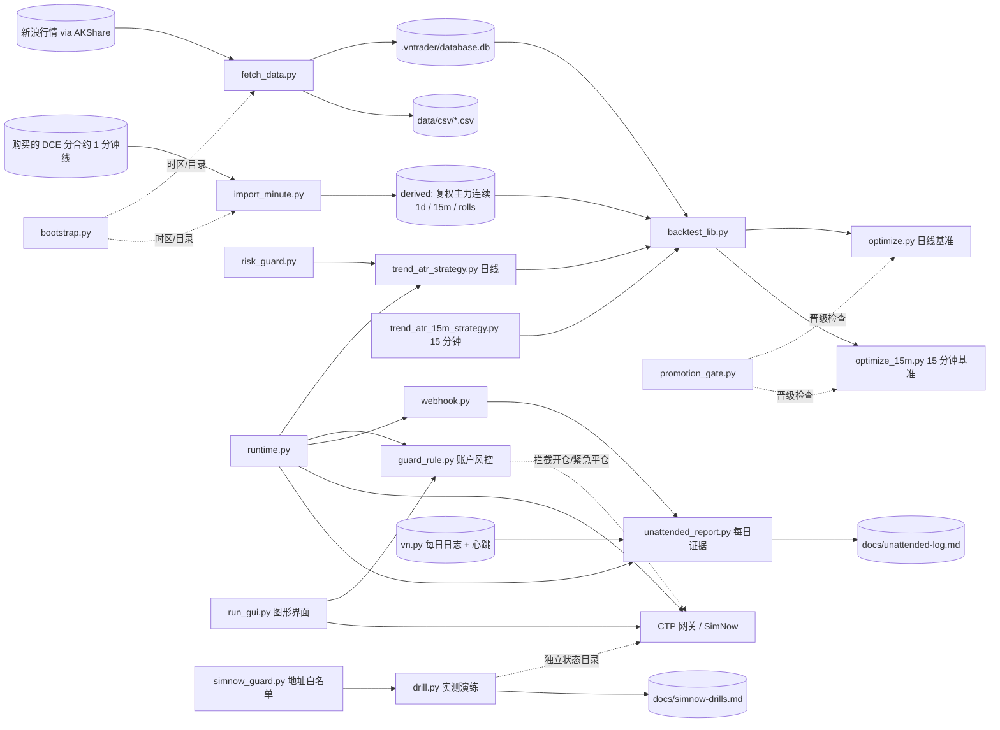
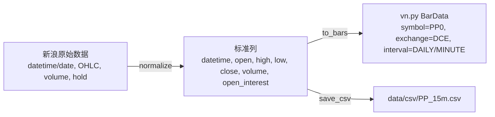
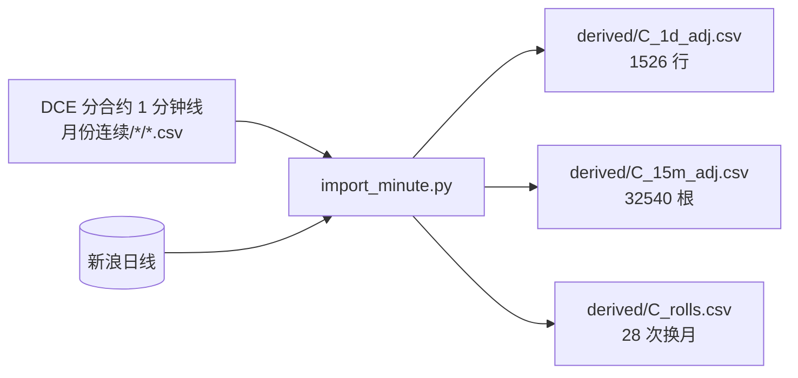
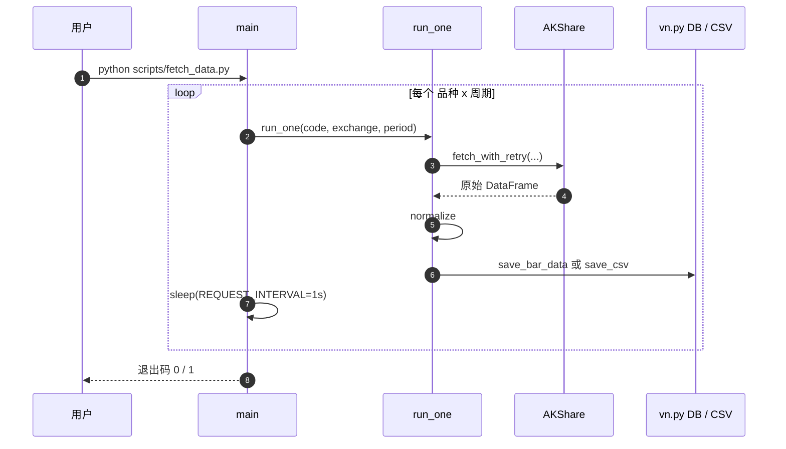

# PROJECTWIKI.md

> 项目知识库(单一可信源)。状态:**Phase 0–5 的代码均已完成并通过离线端到端测试(467 个测试,覆盖率 86%)**;
> SimNow 上已跑通一次真实 CTP 启动管道(2026-11-10),**Docker 容器内也已完整跑通**(见 `docs/runbook-simnow.md` §10),
> 但**撤单/废单/断线/重启等实测项尚未完成**(见该手册第 5 节)。
> 第 5 节中可自动化的 6 项已做成演练脚本 `scripts/drill.py`,第 6 节的"无人值守证据"已做成 `scripts/unattended_report.py`,
> 两者都**待在交易时段/夜盘实跑**。
> Phase 6(期货公司穿透式认证与实盘准入)是人工步骤,见 `docs/live-readiness.md`。
> **策略结论为负面:日线与 15 分钟两条基准都没有发现可延续的优势**(见 ADR);因此当前策略只用于**管道测试**,不应连接真实资金。
> **研究数据状态**:15 分钟基准的测试段(2024-01 ~ 2026-06)已被使用一次,**不能再用于新候选的最终确认**,新候选需要 2026-06 之后的分钟线或模拟盘/小额实盘记录。
> 跟踪 Issue:[#1](https://github.com/laiyinyizao007/invest/issues/1)

## 1. 项目概述
- **目标**:用代码自动交易国内商品期货,把"盈亏比纪律"固化为策略层风控,杜绝盘中手动干预。
- **账户约束**:本金 1 万元,单笔最大亏损 300 元(3%),固定 1 手;主测品种玉米(C),甲醇(MA)作对照。已下载 PP/L/EB 的数据,但 1 万元预算下它们的止损只有日波动的 15% 左右,不适合。
- **背景**:放弃自研底层,采用开源框架 vn.py(CTA 策略 + CTP 网关),先在 SimNow 模拟盘验证,再走期货公司穿透式认证上实盘。
- **范围**:数据下载与存储、CTA 策略与回测、策略层风控、SimNow 模拟盘、Webhook 监控、Docker 部署。
- **非目标**:高频交易;手机 app 自动化(adb)下单(无可靠成交回报、合规风险);美股(Alpaca)暂列后续备选。
- **运行环境**:开发 Windows 11 + Python 3.13;部署目标 x86_64 Linux(已有 RackNerd VPS)。
  树莓派 5(ARM64)不能直接跑 CTP:PyPI 上 `vnpy_ctp` 最新版只有 win_amd64 wheel 与源码包。
- **实盘切换需用户另行明确授权**;当前不连接任何实盘。

## 2. 架构设计

| 节点 | 代码路径 | 状态 |
|---|---|---|
| FD | `scripts/fetch_data.py` | 完成 |
| BS | `scripts/bootstrap.py` | 完成 |
| IM / DER | `scripts/import_minute.py` → `C:\Dev\data\invest\derived\` | 完成(玉米实测交叉验证通过) |
| DB / CSV | 运行时生成,均已 `.gitignore` | 完成 |
| BL | `scripts/backtest_lib.py` | 完成 |
| OPT / O15 | `scripts/optimize.py`、`scripts/optimize_15m.py` | 完成(两者结论均为负面) |
| ST / ST15 | `strategies/trend_atr_strategy.py`、`trend_atr_15m_strategy.py`、`random_entry_strategy.py`、`instruments.py` | 完成 |
| RG / PG | `risk/risk_guard.py`、`risk/promotion_gate.py` | 完成 |
| RT / GR | `trading/runtime.py`、`trading/guard_rule.py`、`trading/safe_risk.py` | 完成(离线测试) |
| WH | `notify/webhook.py` | 完成 |
| CTP | `scripts/run_headless.py`(无头入口)、`Dockerfile`、`docker-compose.yml` | 主机端与**容器内**均已跑通完整 SimNow 启动管道 |
| GUI | `scripts/run_gui.py` | 完成(人工观察用,非无人值守) |
| SG / DR | `scripts/simnow_guard.py`、`scripts/drill.py` | 完成(待交易时段/夜盘实跑) |
| UR | `scripts/unattended_report.py` | 完成(离线自检通过,真实 webhook 待配) |

## 3. 架构决策记录(ADR)
- 目录:`docs/adr/`,MADR 格式
  - [`20261109-use-vnpy.md`](docs/adr/20261109-use-vnpy.md):采用 vn.py,不自研
  - [`20261109-china-timezone.md`](docs/adr/20261109-china-timezone.md):进程统一为中国时区
  - [`20261109-account-risk-budget.md`](docs/adr/20261109-account-risk-budget.md):1 万元 / 300 元预算,超预算则不交易,主测玉米
  - [`20261109-negative-backtest-result.md`](docs/adr/20261109-negative-backtest-result.md):如实记录"未发现优势"与方法学纪律
  - [`20261109-promotion-gate.md`](docs/adr/20261109-promotion-gate.md):策略晋级门槛(8 条)
  - [`20261109-account-risk-lock.md`](docs/adr/20261109-account-risk-lock.md):账户级双层熔断、平仓永远放行、紧急平仓防重复下单
  - [`20261109-deployment-and-live-mode.md`](docs/adr/20261109-deployment-and-live-mode.md):实盘模式策略、运行时对账、通知、容器化
  - [`20261110-baseline-15m.md`](docs/adr/20261110-baseline-15m.md):15 分钟基准的事前方案、成绩单与"测试段已被使用"的约束

## 4. 设计决策 & 技术债务
| 项 | 说明 | 优先级 |
|---|---|---|
| 分钟线历史很浅 | 新浪每个周期只返回最近约 1023 根(1 分钟≈5 个交易日,15 分钟≈2.5 个月),须每天/每周增量运行脚本积累 | 高 |
| 旧回测基于未复权数据 | 已量化(换月价差玉米中位 44 点、甲醇 75 点)并**在复权数据上重做**:玉米训练段夏普为正仅 11%、选出的参数训练/验证均为负;甲醇无法开仓。旧结论作废,新结论仍是"无法证明优势" | 已处理 |
| **未在真实 CTP/SimNow 上验证** | 启动管道已在真实 SimNow(第一套)跑通一次(2026-11-10);但废单文本、持仓回报时序、撤单失败、断线重连、SHFE/INE 平今平昨、夜盘跨日、kill -9 重启、熔断演练都只在离线假网关上验证;须按 `docs/runbook-simnow.md` 第 5 节实测并回填 | **最高** |
| **演练脚本已就绪但未实跑** | `scripts/drill.py` 把第 5 节的第 3/4/6/7/8/9 项做成了可重复执行的场景,但**还没有在 SimNow 上真跑过**,结论仍为空 | **最高** |
| **飞书的"失败也返回 HTTP 200"** | 通知器只看 HTTP 状态码会把 `{"code":19001}` 当成发送成功 → 告警静默丢失。现已解析响应体,业务码非 0 一律算失败并重试;但**真实飞书 webhook 仍未验证过**(`.env` 的 `WEBHOOK_URL` 是空的) | **高** |
| 无人值守只跑了 1 天 | 第 6 节要求连续 ≥ 5 个交易日,目前证据表(`docs/unattended-log.md`)只有 2026-11-10 一天,且心跳已停 | 高 |
| 废单关键词表只覆盖 2 条实测文本 | 已在 SimNow 实测到"该交易席位未连接到交易所"(硬拒绝);越界价格、无持仓平仓、超大手数、资金不足四类因 SimNow 反复登录触发 4097 冷却尚未采到,见 `docs/reject-texts-simnow.md` | 高 |
| 容器内连通 SimNow 未验证 | **已于 2026-11-10 实测通过**(连接→授权→登录→结算确认→合约表→策略初始化→订阅→healthy→优雅退出 0);关键前提是镜像里必须有 `zh_CN.GB18030` locale,见下一行 | 已处理 |
| 容器必须自带 `zh_CN.GB18030` locale | `vnpy_ctp` 的 `toUtf()` 硬编码 `std::locale("zh_CN.GB18030")`;slim 镜像默认没有该 locale,CTP 回调线程会抛异常并 abort 整个进程(无 CTP 错误日志)。Dockerfile 已加 `locales` + `localedef -i zh_CN -f GB18030 zh_CN.GB18030`;详见 `docs/runbook-simnow.md` §10.1 | 已处理 |
| 图形界面不是运行方式 | `run_gui.py` 无对账、无看门狗、无 Webhook,只能人工观察;不得用于无人值守 | 中 |
| 主力合约换月需人工更新 | `LIVE_VT_SYMBOL` 指向具体合约,换月与持仓移仓未实现 | 高 |
| 本地止损依赖进程存活 | vn.py 停止单是引擎本地触发的;进程退出时若有持仓会发 FATAL,但无法替代交易所端条件单 | 高 |
| 交易日不处理法定节假日 | 长假前后的当日熔断边界需人工留意 | 中 |
| 复权数据历史较短 | 新浪分合约日线只到 2018-05;更早需交易所逐日合约数据(大连 2005 起、郑州 2010-08 起,约几千次请求) | 高 |
| 分钟线历史不足 | 已购买并导入(DCE 玉米分合约 1 分钟线,约 5.9 年);**只到 2026-06-15**,新候选需要更新数据 | 高 |
| **15 分钟基准的测试段已被使用一次** | 2024-01 ~ 2026-06 已被 `optimize_15m.py --test` 使用,再用于新候选会产生多重检验偏差;新候选只能用训练/验证段筛选,最终确认需要 2026-06 之后的分钟线或模拟盘记录 | **高** |
| 15 分钟夏普口径与日线不同 | vn.py 按**日历日**分组逐日盈亏、夜盘与次日日盘被拆成两条记录,年化因子固定 240(日线口径);15 分钟夏普**不可与日线夏普直接比大小**,只有收益率/净盈亏/回撤金额可靠(详见 ADR 的"事后补充") | 高 |
| 回测结论统计效力不足 | 日线选定参数在验证段仅 1 笔往返;15 分钟基准测试段 91 笔往返,均低于 150 的门槛;结论只能是"无法证明优势" | 高 |
| 预算约束不了跳空 | 默认参数回测有 4 笔单笔亏损超 300 元,最大 700 元(未计成本) | 中 |
| 日线内高低点先后未知 | 移动止损按当根极值收紧、下一根生效,属日线固有近似 | 中 |
| 测试段"只看一次"靠人工纪律 | `--test` 未持久化记录使用次数 | 低 |
| `DailyLossGuard` 对日线策略无意义 | 同一天几乎不会连亏两笔,仅对未来日内策略有效 | 低 |
| 回测成本是假设值 | 每边 1 tick + 3 元/手,实盘前须换成期货公司真实费率 | 高 |
| 停止单是引擎本地触发 | vn.py CTA 停止单不是交易所委托,断线时不执行;实盘须跑在稳定服务器并加行情停更检测 | 高 |
| 5/15 分钟线只存 CSV | vn.py 无对应 `Interval`;回测时需自行加载,或由 1 分钟线合成 | 中 |
| 数据源 OHLC 偶有矛盾 | 已修复(取 OHLC 极值),实测 PP 2020-08-06、L 2007-07-31 各 1 行 | 低 |
| `turnover` 恒为 0 | 新浪不提供成交额 | 低 |
| 缺少自动化调度 | 增量下载目前需手动运行 | 中 |

## 5. 模块文档
### `scripts/bootstrap.py`
- **职责**:所有脚本的统一启动入口,须在导入 `vnpy.trader.database` 之前 `import bootstrap`(否则抛 `RuntimeError`)。
- **做的事**:`chdir` 到项目根并确保 `.vntrader/` 存在(vn.py 据此把数据库放在项目内);设置 `TZ=CST-8` 与 `database.timezone=Asia/Shanghai`;`NO_PROXY` 默认 `*`(新浪为国内源,绕开系统代理)。
- **风险**:导入顺序是隐式约定,由运行时检查兜底。

### `scripts/fetch_data.py`
- **职责**:AKShare(新浪源)→ 清洗 → vn.py 数据库(日线/1 分钟)或 CSV(5/15 分钟)。
- **入口**:`python scripts/fetch_data.py [--symbols PP L EB] [--periods d 1 5 15]`,在项目根目录运行。
- **关键函数**:`fetch_with_retry`、`normalize`、`to_bars`、`save_csv`、`run_one`、`main`。
- **幂等**:数据库 upsert;CSV 按时间戳去重,新数据覆盖旧数据;重复运行安全。
- **失败隔离**:单个品种/周期失败不影响其余,最终退出码为 1。
- **测试**:`tests/test_fetch_data.py`,32 个用例。全仓库 417 个测试,覆盖率约 92%(目标 85%),在英文/中文 vn.py 语言环境下均通过。

### `scripts/import_minute.py`(购买的分钟线 → 复权主力连续)
- **职责**:读取仓库之外的分合约 1 分钟线(`<数据根>/<交易所>/<品种>/月份连续/*/*.csv`),按交易日归属汇总成日线,用新浪日线补齐数据结束日之后的缺口,复用 `build_continuous` 的换月规则与价差,对分钟线做差额复权,合成 N 分钟线(默认 15,时间戳为开始时间)。
- **入口**:`python scripts/import_minute.py --root C:/Dev/data/invest --exchange DCE_大连商品交易所 --folder C_玉米 --product C`,输出到 `<数据根>/derived/`(`C_15m_adj.csv`、`C_1d_adj.csv`、`C_rolls.csv`,**不入库**——购买数据与派生产物都不进仓库)。
- **交易日归属**:日盘归当天;夜盘(≥20 时)归下一个有日盘的交易日;日历之外的夜盘所属日未知,返回 NaT 并丢弃,绝不硬塞进最后一天。
- **起点裁剪**:购买数据从合约上市日起算,起点附近只有远月合约,挑出的"主力"成交冷清。`trim_illiquid_start` 从第一段"连续 5 个交易日成交量不低于全序列中位数 50%"的日子开始。
- **缺口**:分钟线只到购买数据的最后一天;其后的交易日只有日线(新浪),不伪造分钟线。
- **验证**(玉米实测):分钟线合成日线与新浪日线对比,收盘/最高/最低 99% 以上一致,成交量总和比值 1.000;输出的分钟线逐日收盘/最高/最低与日线序列完全一致。
- **测试**:`tests/test_import_minute.py`,21 个用例(合成数据)。

### `risk/risk_guard.py`(纯 Python,覆盖率 100%)
- `stop_distance` / `risk_per_trade` / `within_budget`:单笔风险预算,超预算则放弃交易(不缩小止损)。
- `TrailingStop`:只收紧不放松的移动止损(多头 max、空头 min),ATR 变大也不放松。
- `DailyLossGuard`:当日连亏熔断,换日重置。

### `risk/promotion_gate.py`(纯 Python,覆盖率 100%)
- `sharpe_standard_error` / `sharpe_ci`:夏普的统计误差(Lo 2002 近似)。
- `check_gate(CandidateMetrics, GateThresholds)`:8 条晋级门槛,返回未通过项。接入真实回测流程尚未实现。

### `strategies/trend_atr_strategy.py`
- 日线双均线(金叉做多/死叉做空,仅空仓入场)+ ATR 移动止损,1 手;可选固定止盈(保守:收盘后触及目标则下一根开盘附近离场)。
- 可优化参数 3 个:`fast_window` / `slow_window` / `atr_mult`;`atr_window=14`、`risk_budget=300` 固定。
- 所有委托价按 `pricetick` 取整(止损取"更紧"一侧);信号收盘后产生、下一根成交,无前视偏差。
- `random_entry_strategy.py`:出场与预算相同、入场随机的对照策略。`instruments.py`:品种参数与成本假设。

### `scripts/build_continuous.py`
- 用分合约日线构建差价法向前复权的主力连续合约(`python scripts/build_continuous.py --symbol C|MA`),输出 `data/results/{品种}_continuous_adj.csv` 与 `_rolls.csv`。
- 主力 = 前一交易日持仓量最大且只向更远月换月(无前视、不回头);主力停牌不换月,到期强制换月;换月价差取换月前最后共同交易日收盘价之差,无共同日时近似并告警。
- 取数缓存:已到期合约永久缓存(含确认不存在),未到期合约缓存 24 小时,网络错误不缓存,原子写入;单合约失败不输出残缺序列。
- 局限:仅 1/5/9 月合约;新浪分合约日线只覆盖 2018-05 之后;差价法可能产生非正价格(会告警)。

### `trading/`(账户风控与运行时)
- `guard_rule.py`:挂在 vnpy_riskmanager 发单链上的 `AccountGuardRule`。拦截锁定期间的**开仓**,平仓永远放行;每秒读权益推进双层熔断
  (当日 600 元 / 距最高点 2000 元);撤超时开仓单;废单延迟分类(CTP 先推回报后写错误日志);紧急平仓状态机(按成交量对账、
  终态后才重试、状态未知不重发、持仓回报滞后时主动查询);`emergency_flatten()` 供运行时看门狗调用。
- `safe_risk.py`:`SafeRiskEngine` 让平仓单跳过计数类内置规则(每日上限/活动委托/重复报单),并加载上面的规则与项目默认配置。
- `runtime.py`:`TradingRuntime` 串起网关、风控、CTA 引擎与通知。启动顺序与对账、看门狗(策略被异常停止/行情停更/心跳)、退出码语义见 ADR。
- **退出时的 FATAL 要留出发送时间**(2026-11-10 codex 三轮修复):`shutdown()` 在关闭通知器前会发
  "退出时仍有持仓"的 FATAL —— 那是无人值守最后的兜底,慢一点的对端就会把它一起丢掉。
  关闭通知器的默认预算是 10 秒,而一条消息的最坏耗时是 (1+重试次数) × 单次超时 + 全部退避(默认 34 秒),
  所以现在按通知器自己的 `drain_timeout`(排空整个队列的总预算)来关,而不是默认的 10 秒。
  `Notifier` 协议里的 `close()` 形参统一叫 `drain_timeout`,与"单条上限"的 `flush_timeout` 属性区分开。
- `events.py`:自定义事件(账户告警、硬锁定)。
- **废单日志级别(2026-11-10 SimNow 实测)**:`vnpy_ctp` 的 `write_error()` 实际调用 `write_log()`,
  所以 CTP 的"交易委托失败,代码：21,信息：…"是以 **INFO 级别**写出来的。只认 `log.level >= ERROR`
  会漏掉全部拒单文本 → 废单分类永远拿不到原因(一律按硬拒绝)→ 紧急平仓单的有限重试永远用不上。
  现在按**精确措辞** `REJECT_LOG_MARKERS = ("交易委托失败", "交易撤单失败", "状态更新")` 识别;
  措辞必须精确——宽泛的"失败"会把"行情订阅失败""登录失败"也收进来,真废单日志迟到时
  就会拿这些无关文本去分类,把可重试的软拒绝误判成硬拒绝。
  第三个措辞"状态更新"覆盖**交易所级拒单**:CTP 的交易所拒单走 `onRtnOrder`
  (`vnpy_ctp/gateway/ctp_gateway.py:673-684` 把状态映射成 REJECTED),原因在 StatusMsg 里,
  日志措辞是"委托 {委托号} 状态更新，{原因}"(同文件 713-719);这条路径**不经过** `onRspOrderInsert`,
  少了它交易所拒单的原因永远是"未知"→ 一律硬拒 → 平仓单被提前升级为人工处理。
  `trading/runtime.py` 的告警另用宽措辞 `GATEWAY_ERROR_MARKERS`(只是给人看,分类错误没有后果)。
  `tests/fakes.py` 的假网关也改成 INFO 级别,免得掩盖这个缺陷。关键词表以**实测文本**为准,
  见 `docs/reject-texts-simnow.md`。
- **废单原因按网关归属**(2026-11-10):`_errors` 记下来源网关,`_error_text_near(ts, gateway_name)`
  只在同网关的日志里找,并且**优先取废单回报之后**到达的那条(实测 CTP 顺序就是先回报后日志)。

### `risk/account_guard.py` 与 `risk/order_policy.py`(纯 Python,100% 覆盖)
- `AccountGuard`:权益驱动的双层熔断状态机,原子持久化,损坏即硬锁定,权益 ≤0/NaN 视为无效采样,日初基准取上次采样。
- `trading_day()`:夜盘归属下一交易日,周末顺延(不处理法定节假日)。
- `order_policy`:废单关键词分类(未知按硬拒绝)、紧急平仓重试节奏 1/3/5 秒、废单风暴检测、超时开仓委托识别。

### `scripts/collect_reject_texts.py`(SimNow 真实废单文本采集)
- **只连已知 SimNow 地址**:白名单 `SIMNOW_TD_ADDRESSES`(官网公布的第一套 30001/30002/30003 / 第二套 40001)。
  `--confirm-simnow` 只是布尔开关,挡不住"配置写错连上真券商";地址不在表内直接拒绝连接,
  确有别的模拟环境才用 `--allow-any-address` 强制放行(会打警告)。
  第二套官网只公布了 40001(行情 40011),**40002/40003 没有官方背书** —— 按第一套的编号规律外推出来的地址不收。
  地址先经 `normalize_address()` 归一化(去掉 `tcp://` 前缀、首尾空格、路径),避免"长得不一样"被误判成非 SimNow。
- 故意触发几个**必定被拒**的委托(不存在的合约、越界价格、无持仓平仓、超大手数、非交易时段开仓),
  把 CTP 的真实错误文本收进 `docs/reject-texts-simnow.md`,用于校准 `HARD_KEYWORDS/SOFT_KEYWORDS`。
- 安全:
  - 交易时段内运行时,所有"价格合法"的场景改用越界价(不可能成交)并跳过时段场景;
  - **发单前先查持仓**(`symbol_has_position`):"无持仓时平仓"场景发的是平仓单,账户上本来有持仓
    的话那张单会真的把仓位平掉 → 账户上有任何持仓都中止(退出码 5)。
    查询**必须等满整个窗口并查两轮**(默认 15 秒 + 7.5 秒):CTP 的持仓回报是异步的,
    看到别的合约有持仓就早退会漏掉本合约还没到达的回报;而且 CTP 对空账户**不推送任何持仓事件**,
    "没收到回报"既可能是真空仓也可能是回报没到,只查一轮在 SimNow 高负载下会误判。
    交易连接断开(查不准)同样中止;
  - 跑完主动查持仓,发现非零持仓就告警并以非零码退出;
  - 所有价格按 `price_tick` 对齐。
- 已知约束:
  - CTP 先推订单回报、后写错误日志,采集脚本必须**等**错误日志到达再取(`Collector.wait_error`);
  - 每个场景用 `Collector.error_index()` 记下起始条数,只在本次新增的错误里找,避免场景间串味;
  - 交易时段按"所有品种的并集"保守判断(含 CFFEX 的 13:00 下午盘),宁可少采一个场景;
    法定节假日判断不了,假日休市委托只会被拒不会成交,误判方向是安全的;
  - 引擎关闭走 `close_engine()` 限时关闭(CTP 原生线程在断连风暴下不返回),`__main__` 用 `os._exit` 兜底;
  - SimNow 对短时间反复登录敏感(4097),不要连续重跑;第一套环境 16:00 左右关闭。
  - **第二套(7x24)对新注册账号不可用**(2026-11-10 实测):交易登录回"代码：3,信息：CTP:不合法的登录",
    新账号要到第三个交易日才能用。脚本检测到登录失败会立刻退出(退出码 6),不再白等超时。

### `notify/webhook.py`
- 非阻塞(有界队列 + 后台线程)、失败重试 1/3/5 秒、60 秒去重(FATAL 不去重)、发送前脱敏(含 URL 路径里的 token)、generic/飞书/Telegram 三种格式。
- **飞书的"失败也返回 HTTP 200"**:机器人接口出错时状态码仍是 200,错误信息在 JSON 体的 `code`(旧版 `StatusCode`)字段里。
  只看状态码会把"根本没送达"算成发送成功 → 告警静默丢失,而验收标准恰恰是"告警全部到达手机"。
  `_body_error()` 解析响应体,业务码非 0 一律算失败并重试;业务码可能是字符串 `"0"`,比较时用 `int()` 安全转换。
  **响应体不是 JSON(代理/网关回 HTML 2xx)、不是 JSON 对象、或没有业务码 → 同样判为失败**:
  真实的飞书一定回 JSON 并给业务码,拿不到就说明消息没被接收,按成功处理就是静默丢告警。
  业务码**无法确认**时(`None` / 空串 / 非数字)同样判失败(fail-closed)——
  `bool(None)` 是 False,按成功处理就是把"没送达"记成"已送达"。
- **脱敏在结构上做**(2026-11-10 codex 二轮修复):`redact_obj()` 逐个字符串脱敏 dict/list/标量。
  不能"先序列化成 JSON 字符串再 `str.replace`"—— 序列化时引号、换行已经被转义,`replace` 找不到原样的密钥,
  密钥会留在 `extra` 里发出去;而密钥本身含 JSON 语法字符时,替换还可能把整条 JSON 弄坏。
- **脱敏要覆盖键与非 JSON 标量**(2026-11-10 codex 三轮修复):两处漏洞都会让密钥原样发出去 ——
  ① dict 的**键**也可能是密码(`{"pwd": 1}` 的键名),只脱敏值等于没脱敏,现在键名同样走 `redact()`;
  ② 非 JSON 标量(datetime、Decimal、自定义对象)最终会被 `json.dumps(default=str)` 转成字符串,
  **先序列化再脱敏**就来不及了 —— `str(obj)` 里带的密码会原样发出去,
  所以现在在 `redact_obj()` 里**先转成字符串再脱敏**(数字/布尔/None 原样保留,转成字符串会改变语义)。
- **等队列排空的时间**:`flush_timeout` 是**单条**消息的最坏耗时(重试次数 × 单次超时 + 全部退避);
  `drain_timeout` = 单条 × (队列剩余条数 + **正在发送中的那条**)。`close(drain_timeout=...)` 的参数是**总预算**
  (2026-11-10 codex 三轮修复:参数原名 `flush_timeout` 与"单条上限"的属性同名,极易被误当成单条预算,已改名):
  停止哨兵追加在队列末尾,后台线程退出时队列必然已排空,所以只要给够时间就能把最后几条也发出去;
  只按单条算,队列里有多条时 close() 会提前返回,`sent` 仍偏小 —— 慢端被误判成"没送达"。
  **正在发送中的那条不在 `qsize()` 里**(worker 已经把它取走了),漏掉它就会少等一条 ——
  退出时最后那条 FATAL 告警会随进程一起消失,所以单独维护 in-flight 计数。
- **排空有上限,FATAL 优先**:`close()` 的实际等待封顶 `MAX_DRAIN_TIMEOUT`(300 秒)——
  队列上限 200、单条最坏耗时约 34 秒,不设上限时对端持续超时会把交易进程吊在退出阶段接近两小时;
  关闭前把 FATAL 提到队首,退出时最重要的告警("还有持仓")不该排在几十条 INFO 后面。
  取舍:宁可丢一部分非 FATAL 告警,也不能让退出流程拖住。
- 计数器(`sent`/`failed`/`dropped`)由发送线程与后台线程同时写,`+=` 不是原子操作 → 用独立的 `_counter_lock` 保护。

### `scripts/simnow_guard.py`(SimNow 前置机地址白名单)
- `SIMNOW_TD_ADDRESSES`:官网公布的第一套 `182.254.243.31:30001` / `:30002` / `:30003` 与第二套 `:40001`。
  **第二套官网只公布了 40001**(行情 40011)—— 40002/40003 是按第一套编号规律外推出来的,没有官方背书,不收。
- `normalize_address(td_address)`:去掉 `tcp://` 前缀、首尾空格、路径部分,归一化成 `host:port`。
  不归一化就会因为"长得不一样"被误判成非 SimNow,逼人用逃生舱,反而削弱了防线。
- `check_simnow_address(td_address, allow_any)`:地址不在表内**默认拒绝连接** —— `--confirm-simnow` 只是布尔开关,
  挡不住"配置写错"；CTP 的"柜台环境=实盘"是 SimNow 与期货公司生产 API 共用的,**只能靠前置机地址区分**。
  `--allow-any-address` 是逃生舱,会打出"可能连上真实资金账户"的醒目警告。
- 被 `scripts/collect_reject_texts.py` 与 `scripts/drill.py` 共用。

### `scripts/drill.py`(SimNow 实测演练:把运行手册第 5 节做成可重复执行)
- 场景:`latency`(成交→持仓回报延迟)、`tick-stale`(行情断流→看门狗告警)、`disconnect`(交易连接断开→告警与自动重连)、
  `daily-loss`(当日熔断链路)、`hard-lock`(累计死线→平仓→退出码 0)、`overnight`(夜盘首根 Tick 的交易日归属)。
- **状态隔离**:演练用独立的 `.vntrader_drill/` 目录(策略数据、日志、心跳)与独立的 `account_guard.json`,
  演练里的熔断/硬锁定**不会污染实盘状态** `data/state/account_guard.json`。
  vn.py 4.5 没有 `SETTINGS["data_path"]`,真正决定落盘位置的是 `vnpy.trader.utility.TEMP_DIR`,演练改的就是它。
- **只在模拟盘上跑**:复用 `simnow_guard` 的地址白名单 + `--confirm-simnow`。
  逃生舱再加一道:`--allow-any-address` 只表示"我确认过地址",而 `latency`/`daily-loss`/`hard-lock`
  **会真的发委托**(`REAL_ORDER_SCENARIOS`),在非白名单地址上跑必须再加 `--confirm-any-address-trades`;
  用了逃生舱的警告会写进结果文件当审计记录,不能只打在终端上。
- **告警的"本次场景"语义**:`RecordingNotifier` 提供 `mark()`(记下当前告警条数)与 `find/wait_for(..., since)`。
  断线/停更这类告警可能在场景动作之前就发过,不设下界会把旧告警当成本次场景的结果(假阳性)。
  **标记必须在动作之前取** —— 熔断场景的守卫定时器线程随时可能在注入权益的瞬间就发出告警,
  顺序反了会让那条告警落在标记之前被过滤掉(假阴性)。
- **"发出"与"送达"必须分开记**(2026-11-10 codex 二轮修复):底层 `send()` 返回 False(去重/级别过滤/队列满/渠道未配置)
  时手机端并没有响,却会被原实现记成"已送达"。现在每条告警带 `delivered` 标记,
  `delivery_summary()` 区分「发出 / 底层接受 / 未送达」,并把**渠道没配**(`enabled == False`)与
  **送达失败**分开报 —— 前者是"没地方可送",后者是"告警丢了",混在一起会误判。
- **权益注入**:`inject_equity()` 只替换本进程内权益的**来源**,守卫判定、撤单、告警、状态落盘全都照常跑,
  真实账户权益不受影响,场景结束 `restore_equity()` 换回真实查询。
- **未成交立刻撤单**:否则那张单会一直挂着,演练结束后才成交,仓位留到下一次运行里(演练污染实盘状态)。
- **撤单是异步的,撤单后必须确认账户确实干净**(2026-11-10 codex 二轮修复):CTP 的撤单请求发出前后订单仍然可能成交,
  "没等到成交回报"≠"没有仓位"。撤单后用 `wait_flat(close_timeout, baseline)` 确认净持仓回到 baseline;
  仍有残留(撤单与成交撞车)→ 平掉它 + 发 FATAL 告警 + 场景判失败,不能当作"没成交"轻轻放过。
- **只动演练自己开的仓**:`latency` 进场前先记 `baseline = net_position()`,
  平仓量 = **当前净持仓 − baseline**(不是按账户净持仓一刀切),平仓方向按 delta 正负取反(空头用 BUY 平)。
  进场前净持仓 ≠ 0 → **直接拒绝演练**:分不清哪一手是演练开的,强行平仓会误伤别人的仓。
- **进场前按"总手数"拒绝,不能只看净额**(2026-11-10 codex 三轮修复):多空锁仓(各 1 手)的**净持仓是 0**,
  只看净额会被骗过去 —— 收尾平仓时会动到演练之前就存在的仓位。
  现在进场前要求该合约**一手都不能有**(`gross_position()` > 0 就拒绝演练),
  并把进场时的总手数记进 `gross_baseline`,收尾用 `at_baseline()` 同时核对净额**与**总手数:
  方向不明的仓位(`Direction.NET`,净持仓账户)与锁仓都不体现在净额里,
  只看净额会把"还留着仓"当成"已经平干净"。
  `net_position()` 里 `Direction.NET` **单列处理**(既不算多也不算空),不能当成空头去平。
- **平仓价要挂在交易的那一侧**(2026-11-10 codex 三轮修复):平多(卖出)挂**买一** `bid_price`,
  平空(买入)挂**卖一** `ask_price`。原先一律用 `bid_price`,
  平空时挂在对手价上永远等不到成交 —— 演练会变成"平仓超时",还容易误判成"平不掉"。
- **平仓用 `Offset.CLOSETODAY`**:上期所/能源中心用普通平仓会被交易所拒单(演练开的是当日仓)。
- **平不掉就是失败**:`latency` 场景平仓失败会发 FATAL 告警并让场景判失败 —— "演练通过"却把仓位留在模拟账户里,
  后面的对账与无人值守证据全部失真。
- **硬锁定必须落盘**:`hard-lock` 场景会读风控状态文件确认 `hard_locked` 已写盘,不落盘的话"重启后拒绝交易"只是文档里的说法。
- **前置条件**:看门狗只在交易时段检查行情停更,夜盘首根 Tick 只在夜盘出现 → 前提不满足时场景标记为**跳过(⏭)**而不是判失败。
  时段窗口直接取自策略的 `ENTRY_SESSIONS`(与运行时的 `_in_trading_session` 同一份),两处不一致会让看门狗不触发、场景假失败。
- **⚠ 必须在容器里跑**:运行时的"是否处于交易时段"判断用 `datetime.now()`(系统本地时区),宿主机是 UTC-8、容器是 `TZ=Asia/Shanghai`。
- `latency` 场景会真的开 1 手仓,量完延迟立刻平掉;平不掉就以非零码退出并大声告警。演练用**空策略**(`NoopStrategy`),不会自己下单。

### `scripts/unattended_report.py`(无人值守验收的证据)
- `--report`:解析 vn.py 每日日志(`vt_YYYYMMDD.log`)与心跳文件,生成"每日证据表"(启动次数、成交笔数、异常事件、心跳新鲜度)+ 验收清单。
  **只统计日志里真实出现的内容,不推断"没问题"**。默认只统计容器目录 `runtime/vntrader/log` —— 宿主机 `.vntrader/log` 会被单元测试污染
  (曾出现"一天启动 771 次"的荒唐数字),宿主机日志要用 `--include-host` 显式加上。
  启动次数取 `max(已启动, 启动耗时)`,避免同一次启动被数成两次。
- **时间戳解析**:真实日志行首是 `2026-11-10 15:36:11.123 | INFO | ...`(**带毫秒**),
  按 `%Y-%m-%d %H:%M:%S` 直接解析会失败 → 整天的起止时间全丢。
- **心跳按交易所时区换算**:`heartbeat_day()` 用 `ZoneInfo("Asia/Shanghai")` 把 mtime(epoch 秒)换算成日期。
  `datetime.fromtimestamp` 用的是**本机**时区,宿主机 UTC-8 与容器 Asia/Shanghai 差 16 小时,
  会把 11-10 08:00 的心跳算成 11-09 16:00 → 挂到错误的交易日那一行。
  心跳是"当前进程"的状态,只属于**当天**那一行;不知道属于哪一天时挂到**最后一行**,
  否则"进程已经死了"这条最重要的证据会从表里消失,而验收项"没有进程静默死亡"恰恰看这一列。
- **连续无异常天数**:`longest_clean_streak()` 算**最长连续**段,不是"总共干净了几天"。
  验收要求的是"连续 ≥ 5 个交易日",中间夹一个有异常的日子连续性就断了。
- **"缺天"必须打断连续段**(2026-11-10 codex 二轮修复):进程**静默死亡**的那天根本没有日志文件,
  只按"日志里有的天"遍历会把这一天悄悄跳过 → 连续段被拉长 → 验收结论虚高。
  现在按日历逐天走:**工作日缺日志就打断连续段**;周末不是交易日,缺日志是正常的,既不计入也不打断。
  `missing_weekdays()` 把缺口列进验收清单(法定节假日判断不了,只能"待人工核对",方向是保守的)。
- **周末有日志也不计入交易日**(2026-11-10 codex 三轮修复):容器是**常驻**的,周末照样有日志文件
  (周五夜盘跨过零点还会写进周六的文件 —— `risk/account_guard.py::trading_day()` 把 20 点后的夜盘归到下一个工作日)。
  原实现"有日志就算一天",于是周末被当成交易日,验收标准凭空多出两天 —— 正是这轮审查要消除的"结论虚高"。
  现在周末**既不计入也不打断**;但周末日志里出现**严重**事件(紧急平仓、熔断、硬锁定、对账失败…)
  仍然**打断**连续段 —— 夜盘跨零点的事故不能因为落在周六就被放过;
  周末的**警告**(空闲期的连接抖动)不打断,否则"连续 5 个交易日"永远达不成。
- **熔断类告警必须算成异常**:守卫(`RiskManager`)与运行时(`Runtime`)发出的告警都落在同一个日志文件里,
  `EVENT_MARKERS` 收录了「当日熔断 / 累计死线触发 / 当日禁止开仓 / 账户变更 / 委托被拒 / 平仓委托频繁被拒 /
  风控状态写盘失败 / 平仓缺少行情 / 平仓请求被拆分器拒绝 / 策略初始化失败」。
  「紧急平仓」用**带级别前缀**的写法 `"[FATAL] 紧急平仓:"` —— "[INFO] 紧急平仓完成"是**正常**收尾不能算异常,
  "[FATAL] 紧急平仓失败"又有自己的标记,写成 `"[FATAL] 紧急平仓:"` 才不会重复计数。
- **stdout 编码必须在解析参数之前修好**:`_setup_stdout()` 提到 `main()` 最前面 —— argparse 的用法说明里有中文,
  cp1252 控制台上 `--help` 会抛 `UnicodeEncodeError`,连用法说明都看不到。
- **空的证据表不是证据**:一个 `vt_*.log` 都没有时,警告并以退出码 1 结束 ——
  静默生成一张空表并退出 0 会让人误以为"当天没问题"。
- `--probe-webhook`:连通性自检。配了 `WEBHOOK_URL` → 用真实通知器发一条"【连通性自检】"消息并报告对端是否接受;
  没配 → 起本地 HTTP 接收端离线验证"送达 + 飞书式业务失败可辨识",并明确指出**手机端尚未验证**。
  等待时间按"重试次数 × 单次超时 + 全部退避"计算,否则慢端会被误判成没送达。
- 结果写进 `docs/unattended-log.md`,只覆盖 `<!-- BEGIN UNATTENDED -->`/`<!-- END UNATTENDED -->` 之间的内容,人工段落保留。

### 标记区重写的共同约定(演练 / 采集 / 无人值守报告)
- 三个脚本都往 Markdown 文档的 `<!-- BEGIN … -->` / `<!-- END … -->` 之间写自动生成的内容,标记之外是人工段落,不动。
- **重写时必须把标记原样写回去**。只写正文的话标记会消失,下一次运行 `find(END_MARK)` 返回 -1 →
  走"文档没有标记"的分支,结果只落到 `-raw.md`,主文档从此不再更新**而且不报错**
  (演练审计记录停在旧结果、采集表格停在旧表格,是"静默失效")。
- 三个实现里 `unattended_report.replace_section()` 用切分实现,天然保留两个标记;
  `drill.write_results()` 与 `collect_reject_texts.write_collected()` 手工拼字符串,
  已在 2026-11-10 codex 第六轮修复,并各配了"连续跑两次仍更新主文件"的回归用例。

### `scripts/run_headless.py` 与 `scripts/unlock_account.py`
- `run_headless.py --symbol c2701.DCE --history CADJ.DCE`:无头运行;`--check` 只校验配置不连接。配置来自环境变量/`.env`,凭据不出现在命令行或日志。
- `unlock_account.py`:人工解除累计死线硬锁定(需输入 `UNLOCK` 确认)。

### `scripts/build_continuous.py`(补充)
- `--save` 把复权序列写入 vn.py 数据库(`CADJ.DCE` / `MAADJ.CZCE`),供回测(`optimize.py --symbol CADJ`)和实盘预热使用。

### `scripts/backtest_lib.py` 与 `scripts/optimize.py`
- `run_engine` / `run_backtest`:统一成本口径(rate=0,固定手续费折成点数并入滑点);把 vn.py 静默吞掉的策略异常转成 `RuntimeError`。
- `load_bars_csv` / `run_engine_bars` / `run_backtest_bars`:直接回放内存中的 K 线列表(绕过 vn.py 数据库,vn.py 没有 15 分钟 `Interval`);`cost_multiplier` 用来做成本翻倍压力测试;同样检测被吞掉的策略异常。
- `optimize.py`:三段切分(训练 2005–2018 / 验证 2019–2022 / 测试 2023–),测试段仅 `--test` 才看;
  邻域平滑选参(仅完整 3×3×3 邻域的格子可选,无效邻居按悲观下限计);验证/测试往返笔数 <10 时输出醒目警告。

### `strategies/trend_atr_15m_strategy.py`(15 分钟基准,仅研究用)
- 继承 `TrendAtrStrategy`,**只把"一根日线"换成"一根 15 分钟线"**,不引入任何新的入场/出场逻辑(控制变量)。
- `on_tick` 直接抛 `RuntimeError`:不支持实盘/模拟盘,防止误用。
- 归属的日亏熔断按**期货交易日**计算(夜盘归下一交易日),与 `trading_day()` 一致。
- 品种参数 `C15`(`CADJ15.DCE`,size=10,pricetick=1.0,滑点 1.3 点/边)只用于回测。

### `scripts/optimize_15m.py`(15 分钟基准的网格优化与三段验证)
- 方案见 `docs/adr/20261110-baseline-15m.md`(**在看到任何结果之前就已提交**):训练 2020-07~2022-12、验证 2023、测试 2024-01~2026-06。
- 网格一次定死:快线 {8,12,16,24,32} × 慢线 {48,72,96,144,192,288}(要求 `slow ≥ 2×fast`)× ATR 倍数 {1.5,2,2.5,3,4},共 145 组。
- 选参:训练段"邻域平均夏普"(复用 `optimize.smoothed`),成交笔数 < 100 的组合不参与排名。
- **测试段只有加 `--test` 才会被评估**,且只应运行一次;验证/测试段同时输出"成本×2"压力测试行。
- **结果为负面**(测试段 -20.2%、夏普 -1.08,成本吞掉全部毛利),详见 ADR;**测试段已被使用一次**。

### `scripts/run_gui.py`(图形界面,人工观察用)
- 打开 VeighNa Trader 界面,按 `.env` 自动连接 CTP;`--subscribe` 让合约表到位后自动订阅行情;`--no-connect` 手动连接;`--check` 只校验配置。
- 同样挂载 `SafeRiskManagerApp`:界面里手动下单也受账户风控约束;硬锁定生效时拒绝连接。
- **没有**启动对账、看门狗和 Webhook 告警,**不得用于无人值守**,也不要与无头版同时运行。

## 6. API 手册(脚本内部接口)
| 函数 | 签名 | 说明 |
|---|---|---|
| `fetch_with_retry` | `(func, **kwargs) -> DataFrame` | 指数退避重试,间隔 2s/4s/8s;`TypeError/KeyError/AttributeError` 立即抛出不重试 |
| `normalize` | `(raw, period) -> DataFrame` | 统一列名;分钟线时间前推一个周期;丢弃 NaN/非正价格;修复 OHLC 矛盾;去重排序 |
| `to_bars` | `(df, code, exchange, interval) -> list[BarData]` | 时间带 `DB_TZ`;`symbol=f"{code}0"`;`turnover=0` |
| `save_csv` | `(df, code, period) -> DataFrame` | 与旧 CSV 合并;先写 `.csv.tmp` 再 `os.replace` 原子替换 |
| `run_one` | `(code, exchange, period) -> None` | 单任务:下载→清洗→存储 |
| `main` | `() -> int` | 命令行入口,全部成功返回 0,否则 1 |

命令行参数:`--symbols`(PP/L/EB/C/MA,默认全部)、`--periods`(d/1/5/15,默认全部)。

`python scripts/optimize.py --symbol {C|MA} [--test]`:日线网格优化;加 `--test` 才查看测试段,且只应运行一次。

`python scripts/optimize_15m.py [--test]`:15 分钟基准(数据在 `C:\Dev\data\invest\derived\C_15m_adj.csv`);加 `--test` 才查看测试段,只应运行一次。

| 函数 | 签名 | 说明 |
|---|---|---|
| `load_bars_csv` | `(path, symbol, exchange, interval=MINUTE) -> list[BarData]` | 读 `import_minute.py` 输出的 K 线 CSV(时间戳为开始时间) |
| `run_engine_bars` | `(strategy_class, setting, key, bars, capital=10000, interval=MINUTE, cost_multiplier=1.0) -> BacktestingEngine` | 直接回放内存 K 线;滑点 × `cost_multiplier`;策略异常转 `RuntimeError` |
| `run_backtest_bars` | `(同上) -> (stats, df, trades)` | 上者 + 绩效统计 |

## 7. 数据模型

- **时间语义**:新浪分钟线时间戳是 K 线**结束**时间,入库统一为**开始**时间(vn.py 约定);日线为交易日 00:00。
- 合约:`PP0` / `L0` / `EB0`(新浪主力连续),交易所 `DCE`。
- CSV 日期格式固定为 `%Y-%m-%d %H:%M:%S`。

**购买数据与派生产物(仓库之外,`C:\Dev\data\invest\`)**

- 派生文件**不入库**(购买数据有授权限制,派生产物体积大),换机器需重新导入。
- 复权方式:差额法(换月价差取换月前最后共同交易日收盘价之差),主力按**前一交易日**持仓量选,只向更远月换月。
- 分钟线时间戳是**开始**时间;交易日归属:夜盘(≥20 时)归下一交易日,日历之外返回 NaT 并丢弃。

## 8. 核心流程

## 9. 依赖图谱
直接依赖见 `requirements.txt`(未锁定版本,安装时实测版本如下):
| 包 | 实测版本 | 用途 |
|---|---|---|
| vnpy | 4.5.0 | 框架核心(会拉入 PySide6 等 GUI 依赖,体积大) |
| vnpy_ctp | 6.7.11.4 | CTP 网关(仅 win_amd64 wheel) |
| vnpy_ctastrategy / vnpy_ctabacktester / vnpy_riskmanager / vnpy_sqlite | — | CTA、回测、风控、SQLite |
| akshare | 1.20.36 | 行情下载 |
| pandas | 3.1.1 | 数据清洗 |
| pillow | 已安装 | 界面里点"微信"二维码对话框需要,缺它会让整个界面崩溃 |
| pytest / pytest-cov | — | 测试 |
- 许可证:vn.py、akshare 等为宽松开源协议,**尚未逐包核验**;CTP 底层库为上期技术专有二进制,实盘前需确认条款。
- 潜在冲突:Python 3.13 与部分依赖的兼容性已通过导入验证,尚未跑完整回测。

## 10. 维护建议
- **每天/每周运行一次 `fetch_data.py`**,否则分钟线历史会因 1023 根上限而断档且无法回补。
- **购买数据在 `C:\Dev\data\invest\`,派生文件在 `derived\`;两者都不入库**。换机器或数据更新后重新运行 `scripts/import_minute.py` 重建派生文件。
- 所有新脚本第一行业务导入前先 `import bootstrap`。
- 部署到 Docker/VPS 时设置 `TZ=Asia/Shanghai`;`.env` 通过挂载注入,不入库。
- 临时文件:pip 异常中断会在 `%TEMP%` 残留 `pip-unpack-*`,可手动清理。
- **本机网络**:走本地代理(127.0.0.1:7897)下载 PyPI/Docker 镜像这类大文件只有约 20 KB/s,直连约 4.7 MB/s。pip 安装与镜像拉取应绕过代理(`NO_PROXY=*`;WSL 里还要 `unset http_proxy https_proxy` 并忽略 pip 的旧代理配置)。
- 运行与部署:见 `docs/runbook-simnow.md`、`docs/live-readiness.md`、`docker-compose.yml`;宿主机挂载目录需让 uid 1000 可写。
- Windows 控制台输出中文时设置 `PYTHONUTF8=1`。
- **测试不得比较 vn.py 枚举的 `.value` 字符串**(`Direction.LONG.value` 等会随 `LANG` 环境变量在 `'Long'`/`'多'` 间变化),一律用枚举成员比较。
  验证方法:`env -u LANG -u LC_ALL -u LANGUAGE ... pytest tests`。
- 升级 vn.py 后须确认 `backtest_lib.py` 依赖的异常哨兵(`Traceback` / `回测终止`)仍有效(`tests/test_strategy_backtest.py` 覆盖)。
- `vnpy_ctp` 在 PyPI 上近几个版本只有 Windows 预编译包与源码包,Linux/Docker 须从源码编译(需 g++ 与 Python 头文件),Phase 5 须实测。

## 11. 术语表和缩写
- **CTP**:综合交易平台(上期技术),国内期货事实标准接口。
- **SimNow**:上期技术提供的官方模拟环境。
- **穿透式监管认证**:实盘接入前由期货公司登记程序、发放 AppID/AuthCode 的流程。
- **主力连续**:把各月份主力合约拼接成的连续序列,换月处有价差跳空。
- **CTA**:vn.py 中的单品种策略引擎。
- **MADR**:Markdown 架构决策记录模板。

## 12. 变更日志
- 参见 [`CHANGELOG.md`](CHANGELOG.md)。提交与本文件同步更新,提交信息引用 Issue #1。
