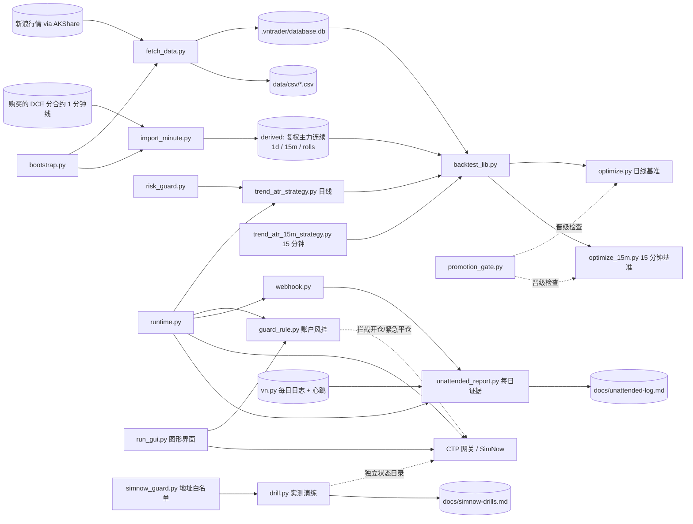
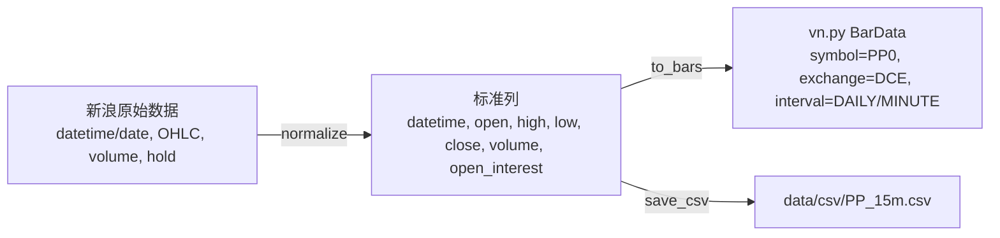
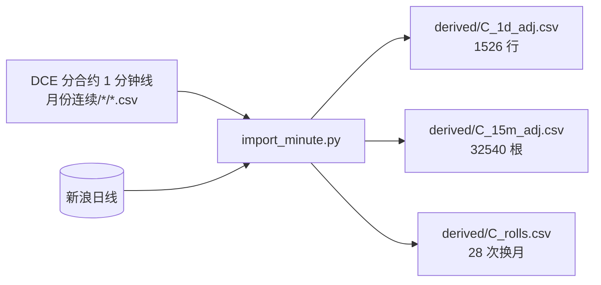
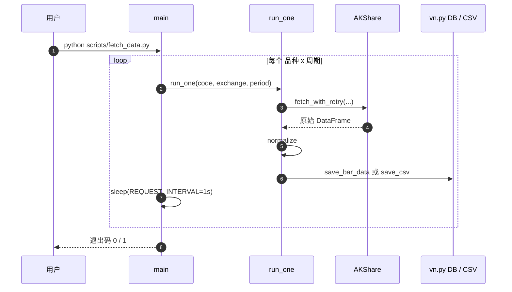

# PROJECTWIKI.md

> 项目知识库(单一可信源),与 `README.md`(怎么用)、`docs/`(ADR / 手册 / 路线图)互链。
> **拆分说明**(2026-11-11):目标架构与路线图 → `docs/roadmap.md`;研究方法论映射 → `docs/methodology-mapping.md`;模块详细文档 → `docs/modules.md`。
> **当前状态**(测试数与覆盖率以 `CHANGELOG.md` 与测试输出为准,不在此处写死):
> - 工程基线(原 Phase 0–5)代码完成并通过离线端到端测试;SimNow 上主机端与 Docker 容器内均已跑通真实 CTP 启动管道。
>   **2026-11-12 夜盘:`scripts/drill.py` 六个演练场景全部通过**(夜盘归属、成交回报延迟、行情停更、**真实切断网络**的断线与自动重连、当日熔断、累计死线硬锁定),见 `docs/simnow-drills.md`。
> - 路线图当前处于**阶段一(SimNow 验收闭环)**,**尚未退出**:演练六场景已通过;行情录制已在交易时段验收并加了「已连接却不订阅」的卡住检测;通知器有落盘待补发队列,Telegram 送达已验证。未完成:连续 ≥5 个交易日无人值守、行情录制的 DSH 重启实测、国信测试环境、废单文本补采。**两个未解决的问题**:退出登出(`logout_ctp`)在重连后出现过一次原生段错误(待复现);`latency` 演练在行情清淡时 30 秒未成交(不稳定)。
> - **策略结论为负面**:日线与 15 分钟两条基准都没有发现可延续的优势(见 ADR),当前策略只用于**管道测试**;15 分钟基准的测试段(2024-01 ~ 2026-06)已被使用一次,
>   不能再用于新候选的最终确认,新候选需要 2026-06 之后的分钟线或模拟盘/小额实盘记录。
> - 连接**生产 API** 需要实盘准入批准(晋级门槛全部通过才会写出,见 `docs/adr/20261111-discipline-enforcement.md`);穿透式认证与实盘准入是人工步骤,见 `docs/live-readiness.md`。
> - **研究沙盒与毕昇外层(已提前部署,偏离原定时序,见 ADR `20261112-research-sandbox-groundwork`)**:沙盒 CLI + HTTP 网关 + 容器隔离(内部网络无外网、只读根文件系统、控制目录只读)、候选声明 `param_grid` 的服务端选参 + 晋级门槛评估(选参窗口与验证窗口不重叠)、滚动 24 小时最多提交 5 个候选的服务端迭代上限、确定性中文报告、先看代码再批准均已实现;毕昇本机部署(仅 127.0.0.1),工作流 v3 已建,**需要 LLM 的节点因模型额度用完待联调**;无人值守的连续迭代(4c)未放开。
> 跟踪 Issue:[#1](https://github.com/laiyinyizao007/invest/issues/1)、Batch B [#12](https://github.com/laiyinyizao007/invest/issues/12)、行情录制与增量副线 [#13](https://github.com/laiyinyizao007/invest/issues/13)
> 阶段一期间已锁定行情基础设施副线：官方 `vnpy_datarecorder` 写入独立 `.vntrader_record/database.db`，DSH 只调度短任务 `ensure`/`watchdog`；dsh-cron 长任务 timeout 与 Windows 进程语义的事实、限制和待实测项见 [`docs/adr/20261111-market-recording-and-dsh-orchestration.md`](docs/adr/20261111-market-recording-and-dsh-orchestration.md)。

## 1. 项目概述
- **目标**:用代码自动交易国内商品期货,把"盈亏比纪律"固化为策略层风控,杜绝盘中手动干预。
- **账户约束**:本金 1 万元,单笔最大亏损 300 元(3%),固定 1 手;主测品种玉米(C),甲醇(MA)作对照。已下载 PP/L/EB 的数据,但 1 万元预算下它们的止损只有日波动的 15% 左右,不适合。
- **背景**:放弃自研底层,采用开源框架 vn.py(CTA 策略 + CTP 网关),先在 SimNow 模拟盘验证,再走期货公司穿透式认证上实盘。
- **范围**:数据下载与存储、CTA 策略与回测、策略层风控、SimNow 模拟盘、Webhook 监控、Docker 部署。
- **非目标**:高频交易;手机 app 自动化(adb)下单(无可靠成交回报、合规风险);美股(Alpaca)暂列后续备选。
- **运行环境**:开发 Windows 11 + Python 3.13;实盘与穿透测试运行在**另一台 Windows 机器**上直接用 Python 运行(不用 Docker,见 `docs/live-readiness.md` C2);Docker + x86_64 Linux 保留为备选。
  树莓派 5(ARM64)不可行:CTP 官方库只有 x86_64,`vnpy_ctp` 在 PyPI 上也只有 win_amd64 wheel 与源码包。
- **实盘切换需用户另行明确授权**;当前不连接任何实盘。
- **上手入口**:`README.md`(面向"这个项目在干嘛、怎么用");本文件是模块级的单一可信源,两者互链。

## 2. 架构设计

> 分层依赖图、磁盘状态归属表、隔离机制与**已知局限台账**见 [`docs/architecture.md`](docs/architecture.md)。

### 2.1 现状数据流(代码已实现;**各节点的真实验证程度见下表**,不要把"代码完成"读成"已验证")

| 节点 | 代码路径 | 状态 |
|---|---|---|
| FD | `scripts/fetch_data.py` | 完成 |
| BS | `scripts/bootstrap.py` | 完成 |
| IM / DER | `scripts/import_minute.py` → `C:\Dev\data\invest\derived\` | 完成(玉米实测交叉验证通过) |
| DB / CSV | 运行时生成,均已 `.gitignore` | 完成 |
| BL | `scripts/backtest_lib.py` | 完成 |
| OPT / O15 | `scripts/optimize.py`、`scripts/optimize_15m.py` | 完成(两者结论均为负面) |
| ST / ST15 | `strategies/trend_atr_strategy.py`、`trend_atr_15m_strategy.py`、`random_entry_strategy.py`、`instruments.py` | 完成 |
| RG / PG | `risk/risk_guard.py`、`risk/promotion_gate.py` | 完成 |
| RT / GR | `trading/runtime.py`、`trading/guard_rule.py`、`trading/safe_risk.py` | 完成(仅假网关离线测试;**未在真实 CTP 上验证**) |
| WH | `notify/webhook.py` | 完成 |
| CTP | `scripts/run_headless.py`(无头入口)、`Dockerfile`、`docker-compose.yml` | **部分**:主机端与容器内均跑通完整启动管道(2026-11-10);废单文本、撤单失败、断线重连、夜盘跨日**未在真实 CTP 验证** |
| GUI | `scripts/run_gui.py` | 完成(人工观察用,非无人值守) |
| SG / DR | `scripts/simnow_guard.py`、`scripts/drill.py` | 代码完成,**演练从未实跑**(`docs/simnow-drills.md` 尚不存在,首次实跑时由脚本生成);阶段一,见 §2.4 |
| UR | `scripts/unattended_report.py` | 完成(离线自检通过,真实 webhook 待配,probe 未通过;连续 5 天证据未攒齐);纯逻辑在 `evidence/logstats.py` |
| 状态页 | `dashboard/`(含 `dashboard/evolution.py`)、`scripts/status_server.py`、`requirements-dashboard.txt`、`tools/build_static_manifest.py` | **后端阶段①已实现并有测试**(2026-11-12/13):只读、仅回环、令牌鉴权(令牌在专属目录 `data/dashboard/`,不在交易侧目录树)、全 GET/HEAD、缺失/过期/损坏永不显示为正常。**前端未构建**(占位页)。**G8 审查:两轮都已确认过线**——codex 那轮经十六轮复核到 **46.0/50**;Gemini 那轮 **45/50**(其发现的『提示语说详见服务端日志却没记日志』已修)。**连续段口径**(用户 2026-11-13 拍板):只有严重事件才打断,警告不打断但必须数出来(`streak_warning_count`);无法判断的日子与缺日志的工作日仍打断。**复核过程中的关键教训**:校验规则必须与产出规则同源(曾因另写一份键集,导致所有真实回测被判成损坏);测试必须走到被守的那条分支(容差与缓存都可能让断言恒真);样例必须是『服务器真能产出的』,否则前端会照着学一条不存在的规则

### 2.2 目标架构与演进路线(已迁出)
- 详见 [`docs/roadmap.md`](docs/roadmap.md)(原 §2.2 目标分层架构、§2.4 差距与路线、§2.5 规划位登记表,编号沿用)。
- **一句话**:两层架构——**内层 = vn.py 流程引擎**(确定性内核:`trading/`、`risk/`、`strategies/`、研究脚本、`notify/`、Docker,即上图全部已实现部分);**外层 = Bisheng 流程编排**(AI 策略研究员,**规划位,零代码**)。边界铁律:外层只经研究沙盒 API 白名单端点交互;`promotion_gate` 是候选策略唯一闸门;LLM 产出只落 `pending_strategies/`,装载永远人工。
- 路线图四个阶段:**一** SimNow 验收闭环(当前)→ **二** 调度/换月/日历/真实费率 → **三** 月度滚动优化引擎化 + 研究沙盒 API(触发条件驱动,不排日期)→ **四** Bisheng 接入与 Alpha Factory(远期)。
- 每个阶段的验收都只是通道/能力验收,**不是策略准入**;实盘切换需用户另行明确授权。

### 2.3 研究方法论 → 系统映射(已迁出)
- 详见 [`docs/methodology-mapping.md`](docs/methodology-mapping.md):研究资料条目 → 状态 → 实现文件的映射表(34 行),以及研究文档自身的矛盾与证据强度——本项目的采纳口径。

## 3. 架构决策记录(ADR)
- 目录:`docs/adr/`,MADR 格式;各 ADR 的「已知局限」汇总与状态见 [`docs/architecture.md`](docs/architecture.md) §4
  - [`20261109-use-vnpy.md`](docs/adr/20261109-use-vnpy.md):采用 vn.py,不自研
  - [`20261109-china-timezone.md`](docs/adr/20261109-china-timezone.md):进程统一为中国时区
  - [`20261109-account-risk-budget.md`](docs/adr/20261109-account-risk-budget.md):1 万元 / 300 元预算,超预算则不交易,主测玉米
  - [`20261109-negative-backtest-result.md`](docs/adr/20261109-negative-backtest-result.md):如实记录"未发现优势"与方法学纪律
  - [`20261109-promotion-gate.md`](docs/adr/20261109-promotion-gate.md):策略晋级门槛(9 条;第 9 条 DSR 见 [`20261113-evolution-engine.md`](docs/adr/20261113-evolution-engine.md))
  - [`20261109-account-risk-lock.md`](docs/adr/20261109-account-risk-lock.md):账户级双层熔断、平仓永远放行、紧急平仓防重复下单
  - [`20261109-deployment-and-live-mode.md`](docs/adr/20261109-deployment-and-live-mode.md):实盘模式策略、运行时对账、通知、容器化
  - [`20261110-baseline-15m.md`](docs/adr/20261110-baseline-15m.md):15 分钟基准的事前方案、成绩单与"测试段已被使用"的约束
  - [`20261110-ctp-error-code-and-watchdog-policy.md`](docs/adr/20261110-ctp-error-code-and-watchdog-policy.md):错误码优先的废单三级分类、假死强撤开仓单、断线连接状态机与无积压补发证据
  - [`20261110-walk-forward-optimizer.md`](docs/adr/20261110-walk-forward-optimizer.md):Walk-Forward 滚动窗口方法学、测试段三层隔离护栏、预算弃单率口径与负面结果记录
  - [`20261110-bisheng-ai-researcher.md`](docs/adr/20261110-bisheng-ai-researcher.md):两层架构——外层 Bisheng AI 策略研究员经研究沙盒 API 与内层 vn.py 确定性内核隔离;LLM 产出只落 pending 目录、装载永远人工、外层可整体替换

  - [`20261111-discipline-enforcement.md`](docs/adr/20261111-discipline-enforcement.md):纪律机制补缺——解锁冷却与历史、非策略委托检测(只告警计数)、实盘准入检查(生产 API 必须有晋级门槛批准)
  - [`20261111-risk-floor-immutability.md`](docs/adr/20261111-risk-floor-immutability.md):风控底线不可优化(预算是约束不是变量)、明确不做清单、本地止损依赖进程存活的已接受风险

  - [`20261111-broker-test-compliance.md`](docs/adr/20261111-broker-test-compliance.md):国信程序化测试合规——阈值触达预警(走 Webhook、按指标节流)、手动暂停开仓(标志文件)、证据与报告
  - [`20261111-market-recording-and-dsh-orchestration.md`](docs/adr/20261111-market-recording-and-dsh-orchestration.md):行情录制采用官方 DataRecorder 与独立数据库；DSH 采用短任务 `ensure`/`watchdog` + wrapper，不直接承载长期前台录制

## 4. 设计决策 & 技术债务
> 只保留**未解决**的条目。已处理或重复的行已归档到 `docs/roadmap.md` §2.7;各条目的阶段归属见 `docs/roadmap.md` §2.4 末尾的去向表。
| 项 | 说明 | 优先级 |
|---|---|---|
| 分钟线历史很浅 | 新浪每个周期只返回最近约 1023 根(1 分钟≈5 个交易日,15 分钟≈2.5 个月),须每天/每周增量运行脚本积累 | 高 |
| **未在真实 CTP/SimNow 上验证** | 启动管道已在真实 SimNow(第一套)跑通一次(2026-11-10);但废单文本、持仓回报时序、撤单失败、断线重连、SHFE/INE 平今平昨、夜盘跨日、kill -9 重启、熔断演练都只在离线假网关上验证;须按 `docs/runbook-simnow.md` 第 5 节实测并回填 | **最高** |
| **演练脚本已就绪但未实跑** | `scripts/drill.py` 把第 5 节的第 3/4/6/7/8/9 项做成了可重复执行的场景,但**还没有在 SimNow 上真跑过**,结论仍为空 | **最高** |
| **飞书的"失败也返回 HTTP 200"** | 通知器只看 HTTP 状态码会把 `{"code":19001}` 当成发送成功 → 告警静默丢失。现已解析响应体,业务码非 0 一律算失败并重试;但**真实飞书 webhook 仍未验证过**(`.env` 的 `WEBHOOK_URL` 是空的) | **高** |
| 无人值守只跑了 1 天 | 第 6 节要求连续 ≥ 5 个交易日,目前证据表(`docs/unattended-log.md`)只有 2026-11-10 一天,且心跳已停 | 高 |
| 废单关键词表只覆盖 2 条实测文本 | 已在 SimNow 实测到"该交易席位未连接到交易所"(硬拒绝);越界价格、无持仓平仓、超大手数、资金不足四类因 SimNow 反复登录触发 4097 冷却尚未采到,见 `docs/reject-texts-simnow.md` | 高 |
| 图形界面不是运行方式 | `run_gui.py` 无对账、无看门狗、无 Webhook,只能人工观察;不得用于无人值守 | 中 |
| 主力合约换月需人工更新 | `LIVE_VT_SYMBOL` 指向具体合约,换月与持仓移仓未实现 | 高 |
| 本地止损依赖进程存活 | vn.py 停止单是引擎本地触发的、不是交易所委托,断线或进程退出时不执行;进程退出时若有持仓会发 FATAL,但无法替代交易所端条件单。实盘须跑在稳定机器上并有行情停更检测。**已接受的风险**,见 `docs/adr/20261111-risk-floor-immutability.md` | 高 |
| 交易日不处理法定节假日 | 长假前后的当日熔断边界需人工留意 | 中 |
| 复权数据历史较短 | 新浪分合约日线只到 2018-05;更早需交易所逐日合约数据(大连 2005 起、郑州 2010-08 起,约几千次请求) | 高 |
| 分钟线历史不足 | 已购买并导入(DCE 玉米分合约 1 分钟线,约 5.9 年);**只到 2026-06-15**,新候选需要更新数据 | 高 |
| **15 分钟基准的测试段已被使用一次** | 2024-01 ~ 2026-06 已被 `optimize_15m.py --test` 使用,再用于新候选会产生多重检验偏差;新候选只能用训练/验证段筛选,最终确认需要 2026-06 之后的分钟线或模拟盘记录 | **高** |
| 15 分钟夏普口径与日线不同 | vn.py 按**日历日**分组逐日盈亏、夜盘与次日日盘被拆成两条记录,年化因子固定 240(日线口径);15 分钟夏普**不可与日线夏普直接比大小**,只有收益率/净盈亏/回撤金额可靠(详见 ADR 的"事后补充") | 高 |
| 回测结论统计效力不足 | 日线选定参数在验证段 10 笔往返(复权数据重做);15 分钟基准测试段 91 笔往返,均低于 150 的门槛;结论只能是"无法证明优势" | 高 |
| 预算约束不了跳空 | 默认参数回测有 4 笔单笔亏损超 300 元,最大 700 元(未计成本) | 中 |
| 日线内高低点先后未知 | 移动止损按当根极值收紧、下一根生效,属日线固有近似 | 中 |
| 测试段"只看一次"登记仅覆盖 optimize*.py | 已由 `config/test_segment_usage.json` 持久化;但登记文件可被手工改写,约束依赖 git 历史可审计 | 低 |
| `DailyLossGuard` 对日线策略无意义 | 同一天几乎不会连亏两笔,仅对未来日内策略有效 | 低 |
| 回测成本是假设值 | 每边 1 tick + 3 元/手,实盘前须换成期货公司真实费率 | 高 |
| 5/15 分钟线只存 CSV | vn.py 无对应 `Interval`;回测时需自行加载,或由 1 分钟线合成 | 中 |
| 数据源 OHLC 偶有矛盾 | 已修复(取 OHLC 极值),实测 PP 2020-08-06、L 2007-07-31 各 1 行 | 低 |
| `turnover` 恒为 0 | 新浪不提供成交额 | 低 |
| 缺少自动化调度 | 增量下载目前需手动运行 | 中 |
| **`parameter_on_plateau` 无计算来源** | 晋级门槛第 8 条由调用方传入布尔值,仓库内没有代码计算它;计算落地前该项靠人工判断(见 `docs/roadmap.md` §2.6) | 高 |
| **非策略委托检测的前提未实测** | 假设"外部终端下的单会以 reference 为空的回报出现";codex 审阅源码认为外部会话的委托可能收不到事件。须按 runbook 第 5 节第 11 项在 SimNow 实测,两种结果都要记录(`docs/adr/20261111-discipline-enforcement.md`) | **高** |
| 实盘准入批准文件可被手写 | 它是防误操作的闸门,不防有写权限的人 | 低 |

## 5. 模块索引
> 每个模块一行;详细职责、约束与修复经过见 [`docs/modules.md`](docs/modules.md)(按下列路径查找小节)。纪律机制与穿透式监管工具的决策见 `docs/adr/20261111-*.md`。

**数据**
- `scripts/bootstrap.py`:所有脚本的统一启动入口(固定工作目录与中国时区,须先于 `vnpy.trader.database` 导入)。
- `scripts/fetch_data.py`:新浪行情下载→清洗→存 vn.py 数据库/CSV(分钟线只返回最近约 1023 根,须定期增量运行)。
- `scripts/record_market_data.py`、`scripts/record_market_data_wrapper.py`:官方 DataRecorder 行情录制与独立子进程生命周期管理；连行情前置，并受限地连交易前置（仅认证+查合约，发单/撤单/查资金/查持仓在代码层硬性禁止）。**验证程度**：SimNow 第二套 7x24 前置已验证认证/登录/合约/订阅/tick/优雅停止，但该环境行情时间不可信，正式库 0 行；SimNow 第一套前置交易时段录制已验收（2026-11-12 夜盘：Tick/1 分钟 K 线入正式库、数据自洽、自动重连正常），**DSH 重启实测与国信测试环境未验证；「连接成功但长时间不订阅」已加 `stalled` 检测与 watchdog 重启**，详见 runbook「验收记录」与 ADR 修订。
- `scripts/record_market_incremental.py`:DSH 调用的有界、可重入增量任务；通过锁、超时和结果状态文件保护定时补数。
- `docs/runbook-market-recording.md`:行情录制、增量任务、离线检查与生命周期验收手册。
- `scripts/import_minute.py`:购买的 DCE 分合约 1 分钟线 → 复权主力连续(日线/15 分钟/换月表,派生文件不入库)。
- `scripts/build_continuous.py`:新浪日线构造主力连续并存库,供运行时预热。

**策略与研究**
- `strategies/trend_atr_strategy.py`:日线趋势 + ATR 止损策略,含实盘模式(Tick→日线合成、信号次日发单、状态持久化)。
- `strategies/trend_atr_15m_strategy.py`、`intraday_demo_strategy.py`、`random_entry_strategy.py`、`instruments.py`:15 分钟基准、日内演示(仅研究/回测)、随机入场对照、品种参数。
- 研究沙盒(阶段四 4a/4b 的内层部分):`scripts/research_api.py`(CLI:`data`/`approve`/`review`/`backtest`/`gate`/`evaluate`/`results`)、`scripts/research_sandbox.py`(路径限制、静态筛查、环境白名单、批准账本)、`scripts/research_gate.py`(门槛评估与选参编排)、`scripts/research_grid.py`(候选参数网格寻优)、`scripts/research_config.py` + `config/research_sandbox.json`(全部可调参数,严格校验)、`scripts/research_gateway.py`(HTTP 网关,标准库实现;容器见 `docker-compose.research.yml`、`docker/research/`);纯逻辑:`risk/diagnosis.py`、`risk/plateau.py`、`risk/candidate_eval.py`、`risk/report.py`。威胁模型与限制见文件头及 ADR `20261112-research-sandbox-*`。毕昇工作流脚本在 `tools/bisheng/`。
- `notify/webhook.py`:非阻塞、带重试、去重、脱敏的 Webhook 通知(generic/feishu/telegram);**落盘待补发队列**(`WEBHOOK_OUTBOX`,默认 `data/state/webhook_outbox.jsonl`):发送最终失败的告警写入 JSONL,网络恢复后补发(【补发】前缀、保留原始时间、积压 INFO 合并成摘要),进程重启后继续。
- `scripts/segment_ledger.py`、`config/test_segment_usage.json`:测试段使用登记，`optimize.py`/`optimize_15m.py` 的 `--test` 先查后登记，重复使用即拒绝（无强制开关）。
- `scripts/backtest_lib.py`:回测公共库(统一成本、内存 K 线回放、异常哨兵)。
- `scripts/optimize.py`、`optimize_15m.py`、`walk_forward_optimizer.py`:日线/15 分钟网格与三段验证;Walk-Forward 滚动优化(测试段物理隔离)。

**风控(纯逻辑在 `risk/`,vn.py 集成在 `trading/`)**
- `risk/risk_guard.py`:单笔预算闸、只收紧的移动止损、策略层连亏熔断。
- `risk/promotion_gate.py`:策略晋级门槛(9 条,含 DSR ≥ 0.95),纯函数;`risk/dsr.py`、`risk/trial_ledger.py`:DSR 与试验次数账本(Issue #15)。
- **进化引擎阶段 3**(Issue #21,ADR「阶段 3 实现」):`risk/ladder.py`(梯子,η = 1.10、预算 60)、`risk/dsr.py` + `risk/trial_ledger.py` 的逐试验夏普与经验方差 V、`risk/lineage.py`(谱系台账)、`risk/map_elites.py`(16 格,不读 DSR)、`risk/heatmap.py`、`risk/behavior.py`、`risk/structured_diagnosis.py`、`risk/describe.py`、`risk/outward.py`(**对外揭示层**:网关 `/evaluate`、`/gate`、`/results`、`/feedback` 只给净化视图,验证窗口夏普只经梯子、每个 run 至多一次查询;`/backtest` 验证段 403)。**没有任何真实战役跑过**(毕昇配额仍卡着),格子边界与真实数据下的表现未验证;阶段 4 未做。**第 19 轮**(修复第 18 轮 codex 复核 37.5/50 的 8 项发现):梯子加**跨进程文件锁**(`submit`/`renew`/`reset` 互斥,此前 reset 与 submit 并发能把日志写成断链,梯子永久报废)且写入前重读磁盘核对;"完整但缺换行"不再被当成撕裂丢弃(那是上一轮引入的回归,同样导致永久报废);`reset` 改为**审计先落盘**(`reset-intent`/`reset-archived`/`reset-done`/`reset-failed`,含被丢弃的 best/queries 与被孤立的 run_id)、**状态正常时默认拒绝**须显式 `--force`、并连同揭示存档目录一起归档;`/feedback` 的"跳过"分成**篡改**与**结果不合法**两类并给出 `skipped` 计数(被 reset 孤立的 run 单列 `orphaned_by_reset`,人工重置不算篡改),且一次请求只读一次梯子(快照)。`reset` 的审计再收紧一层(codex 第 2 轮复核):**意图行写不进去就不许动手**(fail-closed),被拒绝的 reset 也留痕(`reset-refused`)。**第 20 轮第一批**(修复第 19 轮 codex 第 2 轮复核 36/50 的发现):揭示存档**读不到/写不进**不再算成"篡改"或"结果不合法",改用新增的 `OutwardUnavailable`(可用性故障),`/feedback` 的 `skipped` 单列 `unavailable`;读日志与锚点统一为"只有换行符是行分隔符"(此前文本模式把回车也当行分隔,与按字节的撕裂判定口径不一致,会截掉**完整**的锚点见证);梯子锁文件写入失败 fail-closed 成 `LadderError`;`/feedback` 的死代码已删;`LadderSnapshot` 与 `research_ladder.py` 的 docstring/用法块改成与代码一致(`reset --force` 的存在与代价已写明)。**第 20 轮第二批**(修复第 19 轮 codex 第 2 轮复核 36/50 的剩余发现):**人工梯子重置不再被记成篡改**——揭示层新增 `OutwardOrphaned`,被孤立的 run 归类为 `orphaned_by_reset`(单条接口回 **410**),但**一样读不出任何数据**(孤立名单只用于分类、不用于放行;名单本身是无链的普通追加文本,伪造它最多改掉"跳过原因",不会泄漏信息——这一点如实登记);**快照过期即重读**(变更令牌取自头指针的 `seq`/`hash`,`reset` 之后令牌变 `None`、快照必然作废),此前重置后仍会回放重置前的 best 与查询数;**被孤立的 run 名单不再截断**(此前只记前 200 个而返回值报总数)。**第 20 轮自查更正**:`reset` 的**返回值**此前与**审计意图行**用同一个键名 `orphaned_run_ids` 却有两种类型(一个是个数、一个是名单),"返回值与落盘内容一致"这句话当时并不成立;现改为 `orphaned_count`(个数)与 `orphaned_run_ids`(名单),两边**逐键一致**,并配了一条逐键比对的回归用例(已做变异验证)。**第 21 轮**(修复第 20 轮 codex 第 2 轮复核 38/50 的发现):**坏 UTF-8 的揭示存档不再让整个 `/feedback` 500「内部错误」**(读字节 + 显式解码:读失败=不可用、解码失败=篡改);**梯子已经坏了时的 `reset` 也会记下被孤立的 run**(此前名单只在对账成功时才回填,而那正是 `reset` 的用武之地——"合法人工重置不算篡改"此前只在被劝阻的路径上兑现);**伪造的孤立名单压不掉篡改计数器**(异常判定优先);**名单读不出来按"不可用"归类,不再被说成篡改**;并更正了三处**不成立的文档断言**。**已登记阈值全部未动**(DSR 0.95 / 可疑上限 3.0 / η=1.10 / 预算 60 / 16 格)。
- `scripts/calc_ladder_eta.py`:梯子式量化的**汇报步长 η** 的标定脚本(阶段 3 前置,纯数据 + 纯统计,不碰交易接口)。η = 1.5 × SE(配对日盈亏差),下限 0.25;在**池化验证段**(2022-07-01 ~ 2023-12-31,n=367 交易日)上用分块自助(块长 5 日,2000 次)标定,SE 中位数 0.7297 → **η = 1.10 夏普**(已登记进 ADR,早于任何候选生成);同一方法在 W1 训练段上得 η = 1.010,相差 8%,说明不是单一窗口的偶然。η 是**汇报阈值**(阶梯何时更新汇报值),**不是晋级门槛**,与 DSR 0.95 互相独立。标定**没有**碰测试段——测试段(2024-01-01 起)全程未触碰。
- `risk/constitution.py` + `config/immutable_constitution.json`:不可变宪法(Issue #16)——候选能改什么、不能改什么的机器可校验清单。三层防线:提交时的静态 AST 筛查、执行前的运行时类校验、请求时的参数校验;清单文件只能追加(相对历史提交只增不减,由 `.github/workflows/constitution-guard.yml` 保证:`fetch-depth: 0` 拉全历史后逐个历史版本比对;仓库是浅克隆时该检查直接失败而不是跳过),文件缺失/非法即 fail-closed。三个子进程入口统一走 `research_api.import_candidate()`,一处不漏。G8:第 1 轮外部复核无 Critical/High;codex 已审 5 轮,第 4 轮(31/50)的 6 项发现逐条复现后修复并各配了会在修复前失败的测试;**第 5 轮已跑完**(`gpt-5.6-sol` 40.5/50 与另一轮独立复核 `MiniMax-M3` 33/50,两轮都未通过),阻塞项已逐条复现后修复并配了回归测试:①**框架的"按名 setter"绕过**(`self.update_setting(dict(risk_budget=1e12))` 能在三层防线全绿时把单笔风险预算从 300 改成 1e12——模板 `parameters` 里就有四个受保护参数),现整体禁用按名 setter 并拦受保护参数作关键字参数;②**内置保护的历史守卫形同虚设**(`BUILTIN_PROTECTED_NAMES` 是 BinOp,提取器只认字面量,删掉受保护成员后 CI 照样全绿),现改为常量表达式求值 + fail-closed,并把沙盒的三个 deny set 一并纳入;③隐藏子入口只复查了设置字典,`--random-runs`/`--prior-trials`/`--key`/`--segment`/`--file` 现在各自复查(其中 `--prior-trials` 为负会放松 DSR 门槛)。修复后补跑第 6 轮(独立复核 32/50,仍不通过),它又报出一条前两轮都没报出的活绕过 `__builtins__['setattr']`(静态层与沙盒层当时都返回空列表,底线照样从 300 被改成 1e12)——现已修(受禁属性名的裸名与字符串形式一律拒);同一轮还查出**宪法守卫在 CI 上收集即失败**(根 conftest 依赖 vnpy),守卫已抽成独立脚本 `tools/check_constitution_history.py`(只用标准库 + git),CI 直接跑它;三轮复核的发现均已逐条复现后修复并配了回归测试。第 7 轮(codex `gpt-5.6-sol` 与独立复核各一轮)结论不一致:gpt 指出前面封的是**已知写法**而不是**能力**——实测经异常回溯拿到 `frame.f_builtins.setattr`、以及 `unittest.mock.patch.object` 两条都放行(gpt 是对的);现已改为**执行时能力隔离**:候选执行时拿到的内建集合里没有 `setattr`/`getattr`/`eval`/`open` 这些,`__import__` 换成受限导入器,无论怎么绕都改不了实例属性。容器隔离与"运行前由人读过代码"仍是真正的边界。第 8 轮(codex CLI 深度分析,36/50,未通过)又报出两条**实测可复现**的 Critical:①候选可以**调用**模板的风控执行点(`self._send_entry(...)` 绕开了同在 `_try_enter()` 体内的预算与熔断判定),②静态层只看赋值的**末段属性名**,不看整条属性路径(`self.guard.max_losses=999` 让熔断失效、`self.cta_engine.size=0.001` 把回撤缩成 -0 元从而让两道回撤门槛同时失效),两条当时三层校验全绿——现静态层新增**受保护执行点**与**受保护状态对象**清单(引用即拦,连别名与读都不许)、按**整条属性路径**判定,并新增**运行时第三层** `check_instance_state()`:回测跑完之后核对实例上的 `risk_budget`/`atr_window`/`max_daily_losses`/`guard.max_losses`/`cta_engine.size`,不一致即 fail-closed(比对基准是回测开始前的快照)。同轮还修了历史守卫"只守常量不守执行点"、网格与参数层的口径裂缝、`check_params` 不查嵌套、受禁 dunder 名单不全、`__slots__` 漏扫。**第 9 轮(codex CLI 深度分析,34/50,需改进)**又报出一条 Critical:候选可以**改写模块对象上的风控函数**(`import risk.risk_guard as rg; rg.risk_per_trade = lambda *a, **k: 0.0`),四层防线全部放行——静态层按整条属性路径判定在这里失效(路径的根是候选自起的别名),而**枚举写法枚举不完**。现新增**运行期第四层:受保护对象的身份指纹**——候选执行前后各拍一张(`risk`/`strategies`/`vnpy_ctastrategy` 三个受保护包下所有已加载模块的公开属性与每个类的成员;容器取副本、函数与类比身份),被替换/被删除/被往已存在的类上新增成员即 fail-closed;接点在 `import_candidate` 的导入期前后与 `backtest_lib` 两条回测入口的回测前后,且**快照必须预加载模板模块**(否则模板是候选自己 import 的,改写它不被记录)。同轮还修了:`__new__` 早于快照(构造期改写结构性不可见)直接禁掉、ADR 保留字表补全并把 `listed()` 扩展到全部宪法名单、`risk` 包加入禁用模块清单(不含 `strategies`——候选要 import 模板)、历史守卫不再对每个历史版本重复解析当前源码。**第 10 轮(codex CLI 深度分析,37/50,未通过)**又报出一条 Critical 并由本地自查抓到另一条独立 Critical,两条都不是"写法"问题:①第 9 轮的"身份指纹"只比**身份**,而函数对象可以**就地改写**(`within_budget.__defaults__ = (0.0,)` → 单笔风险金额恒为 0,300 元预算形同虚设);②候选可以在**实例**上遮蔽模板方法(`self.get_size = lambda: 0.001` → 合约乘数 10 变成 0.001,预算判定恒真)——两者当时四层防线全部放行。现改为:静态层禁 `__defaults__` 等函数状态 dunder + 新增"不得读风控对象"名单 + `get_size` 进受保护成员;第四层对函数比**状态**(函数对象/`__code__`/默认参数/闭包内容)而不是只比身份;第三层加"实例上不许遮蔽模板方法"、家族判定改按 **MRO**(不再用可被改写的 `isinstance`);指纹的 dunder 覆盖从"跳过全部"改为显式忽略清单;第四层的"回测前"基准前移到构造实例之前;历史守卫新增 `CALL_SITE_REGISTRY` 守第四层的两个接点。**第 11 轮(codex CLI 深度分析,43/50,需改进,不建议发布)**逐条复核了第 9/10 轮的 10 条修复(9 条确认真堵住,1 条只半堵),新报出 2 条 High / 3 条 Medium / 2 条 Low,逐条修复:①**High**:受保护容器只挡"写/取别名"、不挡"变更型方法调用"(`self.am.update_bar(fake_bar)` 四层全绿而回测结果被完全改写),新增容器变更型方法名单(路径经过 `am`/`bg` 且调用变更型方法一律拒,只读调用照常放行,裸局部名 `am`/`bg` 降级为路径保护);②**High**:第四层执行点守卫只数名字不看语义(同名影子/自己比自己/死分支/新执行入口四种改法都能让守卫 exit 0),现升级为**调用形态**核对 + **完备性检查**(谁执行候选谁就必须走第四层);③**Medium**:`self.trading_day` 的第 10 轮新误报、运行期新加载的受保护模块看不见、vnpy 核心对象只靠"按名 import"的巧合被覆盖(改为按点号路径显式纳入)、numpy 原地改写看不见;④**Low**:裸局部 `am`/`bg` 误报、运行期给类打补丁看不见(新增类字典比对;仓库自己的演示策略与测试替身不受候选规矩约束)。指纹范围扩到约 4600 键(第 12 轮重测约 8 毫秒/张,实测 7.3–10.1、中位 8.2),真实回测与候选导入前后零虚假 diff;新增 `tests/test_constitution_round11.py`(22 条回归)。**第 12 轮(codex CLI 深度分析,38.5/50,需改进,不建议发布)**端到端实测报出 2 条 High / 2 条 Medium / 2 条 Low,逐条修复:①**High**:容器规则只挡"写/取别名"、不挡"numpy 视图 / dunder 写入口 / bg 别名"(`self.am.close[:]`、`self.am.close.__setitem__(...)`、`x = self.bg` 再 `x.update_bar(fake)` 四层防线全绿,ATR 被从 40 压到 2.86,¥300 单笔风险预算被架空)——静态层新增容器**视图型方法**名单、变更型方法补 dunder 写入口、新增"**交出引用**"检查(存进名字/传参/返回/装容器一律拒,容器只许就地使用);并新增**运行期第五层** `check_market_data_integrity`(回测后把行情容器与引擎真正喂过的 K 线逐值比对:根数不得多于喂入根数、四个价格数组必须逐值相等)——**不依赖静态分析**,未枚举出的写路径一并兜住;②**High**:第四层执行点守卫仍能被"形态"绕过(比对挪进死函数 / 第二个实参语义相同 / 注释冒充 / `eval(compile(...))` 入口 / 只 import 已覆盖模块,五种改法都能让守卫 exit 0),守卫升级为**数据流 + 作用域 + 可达性 + AST 覆盖**(第二个实参必须就是一次 `snapshot_protected_state()` 调用、快照与比对同作用域、所在函数必须被调用过、执行入口按 AST 识别),另加 `check_constitution_module_is_clean`(宪法模块自身不得出现裸 `exec`/`eval`/`compile`);修复过程中自己踩到两个坑也已修正并记入 CHANGELOG:第五层的基准拍在 **`on_init` 之前**、预热的合法根数只认引擎 `load_bar` 实际交出的那些(日线族 `on_init` 会先加载历史日线做预热,不剥出来会把预热误判成"凭空多出来的 K 线",实测让 14 条既有回测测试同时变红;而把基准拍在预热之后会让候选在 `on_init` 里塞的假 K 线变成"基线",第 13 轮自查已改正),"仓库自己的类"的豁免判据改为**类体里自己的代码落在哪个文件**(就地定义的测试替身豁免,伪造 `__module__` 的候选不豁免);③**Medium**:裸局部名 `am.append(...)` 仍被误拒(受保护容器判定改为**路径级**,作用域段须在接收者路径第 2 段及以后)、伪造 `__module__` 能买"仓库自己的类"豁免(豁免改为判定"该类确实由那个模块定义",`vars(sys.modules[module]).get(name) is klass`);④**Low**:保留字表补齐(容器视图型方法与 dunder 写入口)、文档三处不实断言按实现更正。新增 `tests/test_constitution_round12.py`(34 条回归)。**第 13 轮(codex CLI 深度分析,38.0/50,需改进,不建议发布)**:确认单笔 ¥300 底线没有被突破(被判定的 `dist` 与 `pending_dist` 同源),但统计口径可被伪造——①**Critical**:第五层只比末态,"改→用→改回"的瞬时改写看不见(ATR 40.00→5.07、成交 30 笔往返,五层全绿),静态层也漏了 `[:, None]`/`[...]`/`[None]`/`.swapaxes()` 等视图写法;现静态层认出 numpy 全部基本索引视图,运行期改为 `MarketDataWatch` **逐根核对**(终态比对保留),并扩到成交量/成交额/持仓量;②**High**:历史守卫验形态不验效果(结论被扔掉 / 比对挪进 lambda / 执行点挂在别的函数上),现要求结论被用掉、lambda 算作用域、执行点同函数体内自己成对取快照并比对;③**Medium**:仓库类豁免可被候选买断(现只认类体里自己函数的 `co_filename`,且至少有一个)、`pending_dir` 与沙盒口径不一致(现做同一套校验);④G8 第一轮的外部专家验证因 Gemini 配额耗尽没跑成,修复发生在 codex 第 13 轮审查的提交之后,**需第 14 轮复核**。回归用例增至 56 条。**第 14 轮(codex CLI 深度分析,38.5/50,需改进,不建议发布)**:第 13 轮 Critical 真堵住,无 Critical,新报 2 High / 3 Medium / 4 Low:①**High**:`am.count` 被当成模式开关,候选让计数落后即可永久关闭第五层强核对(ATR 31.54→14.51、成交 0→12 笔,运行期各层全绿)——改为把"每根 K 线容器恰好更新一次"当成被核对的契约(由模板受保护的 `on_bar`/`_process_daily_bar` 决定),并更正了 ADR "第五层不依赖静态分析"的过头表述;②**High**:守卫仍只验形态(基准挪到执行之后、结论只被 print、嵌套死函数、条件表达式吞结论五种一行改法 exit 0)——新增时序检查与结论流向决策检查;③**Medium**:嵌套类买断豁免、`pending_dir` 大小写与盘符(宪法与沙盒两边)、终态核对读活的 size,均已修;④删除了掩盖真缺陷的全局 conftest fixture。三轮分数 38.5/38.0/38.5 基本持平:每轮修的都是写法、下一轮总有新的,**继续逐条堵没有理由认为能收敛到 ≥45**,真正可能改变趋势的是收能力(候选拿到只读视图),需经用户确认后再改模板与 ADR。回归用例增至 69 条。结果见 `CHANGELOG.md`。
- `risk/account_guard.py`:账户级双层熔断(当日 600 / 累计 2000)、原子落盘、解锁冷却与历史、非策略委托计数。
- `risk/order_policy.py`:CTP 错误码优先的废单三级分类与有限重试策略。
- `risk/live_admission.py`:生产 API 的实盘准入检查(需晋级门槛批准文件)。
- `trading/guard_rule.py`、`trading/safe_risk.py`:挂在 vnpy_riskmanager 发单链上的账户风控规则(拦开仓放平仓、废单分类、紧急平仓状态机、非策略委托检测)。

**运行时与运维**
- `trading/runtime.py`、`scripts/run_headless.py`:无头运行入口——启动对账、看门狗、连接状态机、退出码语义、准入检查。
- `scripts/unlock_account.py`、`scripts/record_promotion.py`、`scripts/pause_trading.py`:人工解锁(冷却/强制/历史)、实盘准入批准记录、手动暂停/恢复新开仓(标志文件,平仓放行)。
- `trading/graceful_exit.py`:退出前向交易/行情前置发 `ReqUserLogout`(vnpy_ctp 的 `close()` 只断开连接),供运行时与脚本共用。
- `notify/webhook.py`:非阻塞 Webhook 通知(通用/飞书/Telegram),发送前脱敏。
- `scripts/run_gui.py`:图形界面(人工观察用,含算法单/价差应用,不得用于无人值守)。

**验证与接入工具**
- `scripts/simnow_guard.py`:SimNow 前置机地址白名单(演练/采集脚本共用)。
- `scripts/drill.py`:SimNow 实测演练(第 5 节做成可重复执行的场景,状态与实盘隔离)。
- `scripts/collect_reject_texts.py`:采集 SimNow 真实废单文本,校准关键词表。
- `scripts/unattended_report.py`:无人值守每日证据表与验收清单、Webhook 连通性自检。
- `scripts/collect_terminal_info.py`、`scripts/penetration_check.py`:穿透式监管的终端信息采集与看穿式测试环境演练(脱敏报告)。
- `scripts/broker_test.py`、`scripts/broker_evidence.py`、`scripts/broker_report.py`:国信测试报告的取证运行器(18 项,证据渲染成图;每次运行向 `connection.json` 留痕实际连接的环境)、证据模型与渲染、docx 报告生成器(lxml 填国信原模板,不默认勾通过,不碰国信填写区)。
  取证运行器的硬约束:**发单前统一过空仓闸门**(有持仓一笔不发)、演示委托用唯一价格(不污染重复报单计数)、测试前置地址靠人工确认(脚本无法判别)、异常也清场(解除暂停标志、还原阈值)。
- 标记区重写约定(演练/采集/无人值守报告共用):见 `docs/modules.md`「标记区重写的共同约定」。

## 6. API 手册(脚本内部接口)
| 函数 | 签名 | 说明 |
|---|---|---|
| `fetch_with_retry` | `(func, **kwargs) -> DataFrame` | 指数退避重试,间隔 2s/4s/8s;`TypeError/KeyError/AttributeError` 立即抛出不重试 |
| `normalize` | `(raw, period) -> DataFrame` | 统一列名;分钟线时间前推一个周期;丢弃 NaN/非正价格;修复 OHLC 矛盾;去重排序 |
| `to_bars` | `(df, code, exchange, interval) -> list[BarData]` | 时间带 `DB_TZ`;`symbol=f"{code}0"`;`turnover=0` |
| `save_csv` | `(df, code, period) -> DataFrame` | 与旧 CSV 合并;先写 `.csv.tmp` 再 `os.replace` 原子替换 |
| `run_one` | `(code, exchange, period) -> None` | 单任务:下载→清洗→存储 |
| `main` | `() -> int` | 命令行入口,全部成功返回 0,否则 1 |

命令行参数:`--symbols`(PP/L/EB/C/MA,默认全部)、`--periods`(d/1/5/15,默认全部)。

`python scripts/optimize.py --symbol {C|MA} [--test]`:日线网格优化;加 `--test` 才查看测试段,且只应运行一次。

`python scripts/optimize_15m.py [--test]`:15 分钟基准(数据在 `C:\Dev\data\invest\derived\C_15m_adj.csv`);加 `--test` 才查看测试段,只应运行一次。

| 函数 | 签名 | 说明 |
|---|---|---|
| `load_bars_csv` | `(path, symbol, exchange, interval=MINUTE) -> list[BarData]` | 读 `import_minute.py` 输出的 K 线 CSV(时间戳为开始时间) |
| `run_engine_bars` | `(strategy_class, setting, key, bars, capital=10000, interval=MINUTE, cost_multiplier=1.0) -> BacktestingEngine` | 直接回放内存 K 线;滑点 × `cost_multiplier`;策略异常转 `RuntimeError` |
| `run_backtest_bars` | `(同上) -> (stats, df, trades)` | 上者 + 绩效统计 |

`python scripts/walk_forward_optimizer.py [--workers N] [--data 路径] [--output 路径]`:Walk-Forward 滚动优化;
无 `--test` 开关,任何越界窗口在 `_assert_pre_test` 直接 `ValueError`。

| 函数 | 签名 | 说明 |
|---|---|---|
| `build_windows` | `() -> list[Window]` | 3 个滚动窗口(训练 24 月/验证 6 月/步长 6 月),构造即过隔离断言 |
| `grid` | `() -> list[dict]` | fast/slow 二维 31 组,固定 `atr_mult=1.5`,无 `risk_budget` 键 |
| `rank` | `(rows) -> list[dict]` | fills≥100 门槛;夏普↓→回撤↓→fills↓→fast↑→slow↑ 确定性排序 |
| `_backtest_one` | `(data_file, params, start_iso, end_iso, cost_multiplier=1.0) -> dict` | 模块级可 pickle worker;含 `skipped_by_budget` 与 `budget_skip_rate` |
| `map_backtests` | `(data_file, jobs, workers, executor=None) -> list[dict]` | workers=1 串行;否则进程池;executor 仅供测试注入 |
| `run_window` | `(data_file, window, workers, executor=None) -> dict` | 训练网格→Top5→验证外推;不足 5 组标 `insufficient` |
| `summarize` | `(results) -> dict` | 第一名验证夏普均值/中位数、正夏普窗口占比、最差回撤、预算弃单率 |

## 7. 数据模型

- **时间语义**:新浪分钟线时间戳是 K 线**结束**时间,入库统一为**开始**时间(vn.py 约定);日线为交易日 00:00。
- 合约:`PP0` / `L0` / `EB0`(新浪主力连续),交易所 `DCE`。
- CSV 日期格式固定为 `%Y-%m-%d %H:%M:%S`。

**购买数据与派生产物(仓库之外,`C:\Dev\data\invest\`)**

- 派生文件**不入库**(购买数据有授权限制,派生产物体积大),换机器需重新导入。
- 复权方式:差额法(换月价差取换月前最后共同交易日收盘价之差),主力按**前一交易日**持仓量选,只向更远月换月。
- 分钟线时间戳是**开始**时间;交易日归属:夜盘(≥20 时)归下一交易日,日历之外返回 NaT 并丢弃。

## 8. 核心流程

## 9. 依赖图谱
直接依赖见 `requirements.txt`(未锁定版本,安装时实测版本如下):
| 包 | 实测版本 | 用途 |
|---|---|---|
| vnpy | 4.5.0 | 框架核心(会拉入 PySide6 等 GUI 依赖,体积大) |
| vnpy_ctp | 6.7.11.4 | CTP 网关(仅 win_amd64 wheel) |
| vnpy_ctastrategy / vnpy_ctabacktester / vnpy_riskmanager / vnpy_sqlite | — | CTA、回测、风控、SQLite |
| akshare | 1.20.36 | 行情下载 |
| pandas | 3.1.1 | 数据清洗 |
| pillow | 已安装 | 界面里点"微信"二维码对话框需要,缺它会让整个界面崩溃 |
| pytest / pytest-cov | — | 测试 |
- 许可证:vn.py、akshare 等为宽松开源协议,**尚未逐包核验**;CTP 底层库为上期技术专有二进制,实盘前需确认条款。
- 潜在冲突:Python 3.13 与部分依赖的兼容性已通过导入验证,尚未跑完整回测。

## 10. 维护建议
- **每天/每周运行一次 `fetch_data.py`**,否则分钟线历史会因 1023 根上限而断档且无法回补。
- **购买数据在 `C:\Dev\data\invest\`,派生文件在 `derived\`;两者都不入库**。换机器或数据更新后重新运行 `scripts/import_minute.py` 重建派生文件。
- 所有新脚本第一行业务导入前先 `import bootstrap`。
- 部署到 Docker/VPS 时设置 `TZ=Asia/Shanghai`;`.env` 通过挂载注入,不入库。
- 临时文件:pip 异常中断会在 `%TEMP%` 残留 `pip-unpack-*`,可手动清理。
- **本机网络**:走本地代理(127.0.0.1:7897)下载 PyPI/Docker 镜像这类大文件只有约 20 KB/s,直连约 4.7 MB/s。pip 安装与镜像拉取应绕过代理(`NO_PROXY=*`;WSL 里还要 `unset http_proxy https_proxy` 并忽略 pip 的旧代理配置)。
- 运行与部署:见 `docs/runbook-simnow.md`、`docs/live-readiness.md`、`docker-compose.yml`;宿主机挂载目录需让 uid 1000 可写。
- Windows 控制台输出中文时设置 `PYTHONUTF8=1`。
- **测试不得比较 vn.py 枚举的 `.value` 字符串**(`Direction.LONG.value` 等会随 `LANG` 环境变量在 `'Long'`/`'多'` 间变化),一律用枚举成员比较。
  验证方法:`env -u LANG -u LC_ALL -u LANGUAGE ... pytest tests`。
- 升级 vn.py 后须确认 `backtest_lib.py` 依赖的异常哨兵(`Traceback` / `回测终止`)仍有效(`tests/test_strategy_backtest.py` 覆盖)。
- `vnpy_ctp` 在 PyPI 上近几个版本只有 Windows 预编译包与源码包,Linux/Docker 须从源码编译(需 g++ 与 Python 头文件),容器内编译与导入已于 2026-11-10 实测通过(`docs/runbook-simnow.md` §10)。

## 11. 术语表和缩写
- **CTP**:综合交易平台(上期技术),国内期货事实标准接口。
- **SimNow**:上期技术提供的官方模拟环境。
- **穿透式监管认证**:实盘接入前由期货公司登记程序、发放 AppID/AuthCode 的流程。
- **主力连续**:把各月份主力合约拼接成的连续序列,换月处有价差跳空。
- **CTA**:vn.py 中的单品种策略引擎。
- **MADR**:Markdown 架构决策记录模板。

## 12. 变更日志
- 参见 [`CHANGELOG.md`](CHANGELOG.md)。提交与本文件同步更新,提交信息引用对应 Issue。
- 2026-11-12:**夜盘实测日**:演练六场景全部通过(含真实切网);行情录制第一套前置验收与卡住检测;`drill.py --trace` 诊断埋点定位 `td_api.close()` 段错误并重写 `disconnect` 场景;通知器落盘待补发队列(起因:断网期间的告警恢复后也没送到);研究沙盒 CLI/网关/容器/选参评估/迭代上限/报告/审阅;毕昇本机部署与工作流 v3(LLM 联调待额度)。详见 `CHANGELOG.md`。
- 2026-11-11:国信测试报告取证与自动生成(Issue #9):`broker_test.py`/`broker_evidence.py`/`broker_report.py`,模板不入库;`docs/live-readiness.md` 补 C2b。
- 2026-11-11:**拆分与瘦身**(Issue #7):原 §2.2/§2.4/§2.5 → `docs/roadmap.md`;原 §2.3 → `docs/methodology-mapping.md`(扩充至 34 行并新增矛盾与证据强度一节);原 §5 → `docs/modules.md`(原文未删改),§5 改为模块索引;§4 只留未解决条目(已处理/重复的 4 行归档到 `docs/roadmap.md` §2.7,新增 3 条技术债);修正过期事实(运行环境、测试数、阶段命名);新增 ADR 索引 2 条。
- 2026-11-11:纪律机制补缺(Issue #6):解锁冷却与历史、非策略委托检测、实盘准入检查;新增 ADR `20261111-discipline-enforcement.md`、`20261111-risk-floor-immutability.md`。
- 2026-11-10:穿透式监管接入工具(Issue #5):新增 `collect_terminal_info.py`/`penetration_check.py` 与 `docs/broker-filing.md`;`docs/live-readiness.md` 补 C2/C3。
- 2026-11-10:报备能力面补齐(Issue #4):日内演示策略、算法单/价差应用页与多账户能力说明。
- 2026-11-10:目标分层架构(两层)、研究方法论映射、四阶段路线与规划位登记表、ADR `20261110-bisheng-ai-researcher.md`(现位于 `docs/roadmap.md`/`docs/methodology-mapping.md`)。
