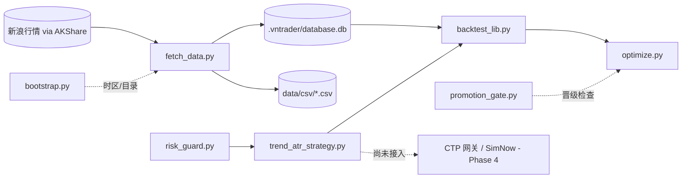
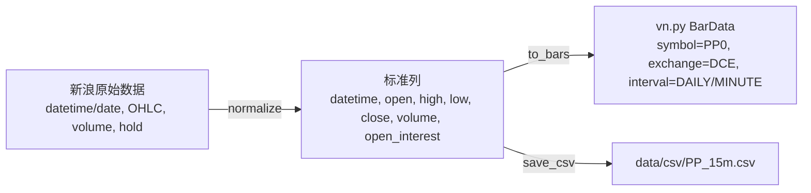
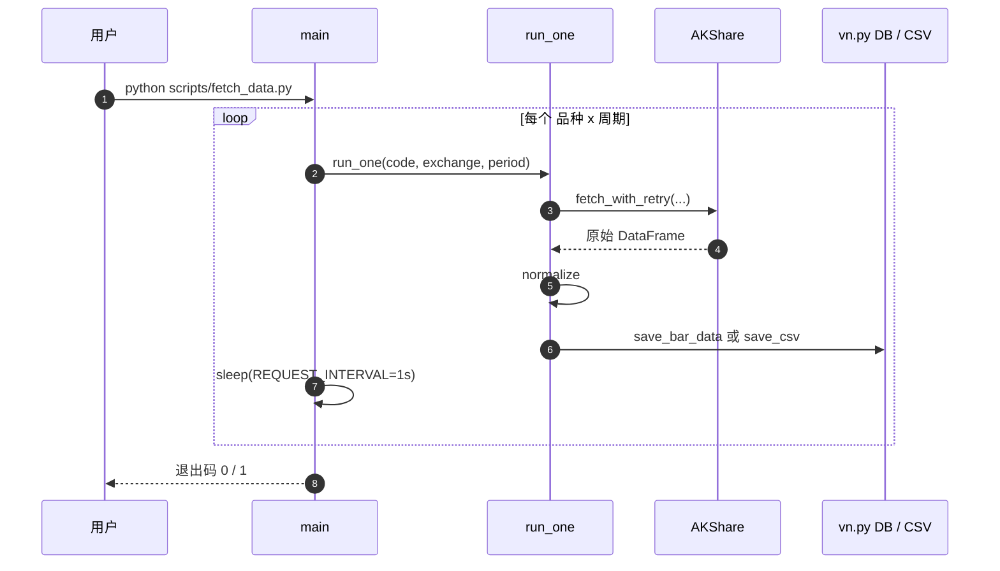

# PROJECTWIKI.md

> 项目知识库(单一可信源)。状态:**Phase 0–2 完成**(骨架、数据层、策略/回测/优化/风控模块);
> **回测结论为负面:未发现可延续的优势**(见 ADR)。当前转向基础设施(Phase 3–5:SimNow 无头运行、Webhook、Docker)。
> 跟踪 Issue:[#1](https://github.com/laiyinyizao007/invest/issues/1)

## 1. 项目概述
- **目标**:用代码自动交易国内商品期货,把"盈亏比纪律"固化为策略层风控,杜绝盘中手动干预。
- **账户约束**:本金 1 万元,单笔最大亏损 300 元(3%),固定 1 手;主测品种玉米(C),甲醇(MA)作对照。已下载 PP/L/EB 的数据,但 1 万元预算下它们的止损只有日波动的 15% 左右,不适合。
- **背景**:放弃自研底层,采用开源框架 vn.py(CTA 策略 + CTP 网关),先在 SimNow 模拟盘验证,再走期货公司穿透式认证上实盘。
- **范围**:数据下载与存储、CTA 策略与回测、策略层风控、SimNow 模拟盘、Webhook 监控、Docker 部署。
- **非目标**:高频交易;手机 app 自动化(adb)下单(无可靠成交回报、合规风险);美股(Alpaca)暂列后续备选。
- **运行环境**:开发 Windows 11 + Python 3.13;部署目标 x86_64 Linux(已有 RackNerd VPS)。
  树莓派 5(ARM64)不能直接跑 CTP:PyPI 上 `vnpy_ctp` 最新版只有 win_amd64 wheel 与源码包。
- **实盘切换需用户另行明确授权**;当前不连接任何实盘。

## 2. 架构设计

| 节点 | 代码路径 | 状态 |
|---|---|---|
| FD | `scripts/fetch_data.py` | 完成 |
| BS | `scripts/bootstrap.py` | 完成 |
| DB / CSV | 运行时生成,均已 `.gitignore` | 完成 |
| BL | `scripts/backtest_lib.py` | 完成 |
| OPT | `scripts/optimize.py` | 完成 |
| ST | `strategies/trend_atr_strategy.py`、`random_entry_strategy.py`、`instruments.py` | 完成 |
| RG / PG | `risk/risk_guard.py`、`risk/promotion_gate.py` | 完成 |
| CTP | `notify/`(目前仅空包)、无头运行脚本 | 未开始 |

## 3. 架构决策记录(ADR)
- 目录:`docs/adr/`,MADR 格式
  - [`20261109-use-vnpy.md`](docs/adr/20261109-use-vnpy.md):采用 vn.py,不自研
  - [`20261109-china-timezone.md`](docs/adr/20261109-china-timezone.md):进程统一为中国时区
  - [`20261109-account-risk-budget.md`](docs/adr/20261109-account-risk-budget.md):1 万元 / 300 元预算,超预算则不交易,主测玉米
  - [`20261109-negative-backtest-result.md`](docs/adr/20261109-negative-backtest-result.md):如实记录"未发现优势"与方法学纪律
  - [`20261109-promotion-gate.md`](docs/adr/20261109-promotion-gate.md):策略晋级门槛(8 条)

## 4. 设计决策 & 技术债务
| 项 | 说明 | 优先级 |
|---|---|---|
| 分钟线历史很浅 | 新浪每个周期只返回最近约 1023 根(1 分钟≈5 个交易日,15 分钟≈2.5 个月),须每天/每周增量运行脚本积累 | 高 |
| **旧回测基于未复权数据** | 已用 `build_continuous.py` 量化:换月价差玉米中位 44 点、甲醇 75 点,大于整个 300 元止损;**基于 `C0`/`MA0` 的回测结论作废,须在复权数据(2018-05 起)上重做**,切分已在 ADR 中先行确定 | **最高** |
| 复权数据历史较短 | 新浪分合约日线只到 2018-05;更早需交易所逐日合约数据(大连 2005 起、郑州 2010-08 起,约几千次请求) | 高 |
| 分钟线历史不足 | 已购买外部数据,待到货后做交叉验证与导入;须先核对时间戳语义、复权情况与授权 | 高 |
| 回测结论统计效力不足 | 选定参数在验证段仅 1 笔往返;结论只能是"无法证明优势" | 高 |
| 预算约束不了跳空 | 默认参数回测有 4 笔单笔亏损超 300 元,最大 700 元(未计成本) | 中 |
| 日线内高低点先后未知 | 移动止损按当根极值收紧、下一根生效,属日线固有近似 | 中 |
| 测试段"只看一次"靠人工纪律 | `--test` 未持久化记录使用次数 | 低 |
| `DailyLossGuard` 对日线策略无意义 | 同一天几乎不会连亏两笔,仅对未来日内策略有效 | 低 |
| 回测成本是假设值 | 每边 1 tick + 3 元/手,实盘前须换成期货公司真实费率 | 高 |
| 停止单是引擎本地触发 | vn.py CTA 停止单不是交易所委托,断线时不执行;实盘须跑在稳定服务器并加行情停更检测 | 高 |
| 5/15 分钟线只存 CSV | vn.py 无对应 `Interval`;回测时需自行加载,或由 1 分钟线合成 | 中 |
| 数据源 OHLC 偶有矛盾 | 已修复(取 OHLC 极值),实测 PP 2020-08-06、L 2007-07-31 各 1 行 | 低 |
| `turnover` 恒为 0 | 新浪不提供成交额 | 低 |
| 缺少自动化调度 | 增量下载目前需手动运行 | 中 |

## 5. 模块文档
### `scripts/bootstrap.py`
- **职责**:所有脚本的统一启动入口,须在导入 `vnpy.trader.database` 之前 `import bootstrap`(否则抛 `RuntimeError`)。
- **做的事**:`chdir` 到项目根并确保 `.vntrader/` 存在(vn.py 据此把数据库放在项目内);设置 `TZ=CST-8` 与 `database.timezone=Asia/Shanghai`;`NO_PROXY` 默认 `*`(新浪为国内源,绕开系统代理)。
- **风险**:导入顺序是隐式约定,由运行时检查兜底。

### `scripts/fetch_data.py`
- **职责**:AKShare(新浪源)→ 清洗 → vn.py 数据库(日线/1 分钟)或 CSV(5/15 分钟)。
- **入口**:`python scripts/fetch_data.py [--symbols PP L EB] [--periods d 1 5 15]`,在项目根目录运行。
- **关键函数**:`fetch_with_retry`、`normalize`、`to_bars`、`save_csv`、`run_one`、`main`。
- **幂等**:数据库 upsert;CSV 按时间戳去重,新数据覆盖旧数据;重复运行安全。
- **失败隔离**:单个品种/周期失败不影响其余,最终退出码为 1。
- **测试**:`tests/test_fetch_data.py`,32 个用例。全仓库 124 个测试,覆盖率 98%(目标 85%)。

### `risk/risk_guard.py`(纯 Python,覆盖率 100%)
- `stop_distance` / `risk_per_trade` / `within_budget`:单笔风险预算,超预算则放弃交易(不缩小止损)。
- `TrailingStop`:只收紧不放松的移动止损(多头 max、空头 min),ATR 变大也不放松。
- `DailyLossGuard`:当日连亏熔断,换日重置。

### `risk/promotion_gate.py`(纯 Python,覆盖率 100%)
- `sharpe_standard_error` / `sharpe_ci`:夏普的统计误差(Lo 2002 近似)。
- `check_gate(CandidateMetrics, GateThresholds)`:8 条晋级门槛,返回未通过项。接入真实回测流程尚未实现。

### `strategies/trend_atr_strategy.py`
- 日线双均线(金叉做多/死叉做空,仅空仓入场)+ ATR 移动止损,1 手;可选固定止盈(保守:收盘后触及目标则下一根开盘附近离场)。
- 可优化参数 3 个:`fast_window` / `slow_window` / `atr_mult`;`atr_window=14`、`risk_budget=300` 固定。
- 所有委托价按 `pricetick` 取整(止损取"更紧"一侧);信号收盘后产生、下一根成交,无前视偏差。
- `random_entry_strategy.py`:出场与预算相同、入场随机的对照策略。`instruments.py`:品种参数与成本假设。

### `scripts/build_continuous.py`
- 用分合约日线构建差价法向前复权的主力连续合约(`python scripts/build_continuous.py --symbol C|MA`),输出 `data/results/{品种}_continuous_adj.csv` 与 `_rolls.csv`。
- 主力 = 前一交易日持仓量最大且只向更远月换月(无前视、不回头);主力停牌不换月,到期强制换月;换月价差取换月前最后共同交易日收盘价之差,无共同日时近似并告警。
- 取数缓存:已到期合约永久缓存(含确认不存在),未到期合约缓存 24 小时,网络错误不缓存,原子写入;单合约失败不输出残缺序列。
- 局限:仅 1/5/9 月合约;新浪分合约日线只覆盖 2018-05 之后;差价法可能产生非正价格(会告警)。

### `scripts/backtest_lib.py` 与 `scripts/optimize.py`
- `run_engine` / `run_backtest`:统一成本口径(rate=0,固定手续费折成点数并入滑点);把 vn.py 静默吞掉的策略异常转成 `RuntimeError`。
- `optimize.py`:三段切分(训练 2005–2018 / 验证 2019–2022 / 测试 2023–),测试段仅 `--test` 才看;
  邻域平滑选参(仅完整 3×3×3 邻域的格子可选,无效邻居按悲观下限计);验证/测试往返笔数 <10 时输出醒目警告。

## 6. API 手册(脚本内部接口)
| 函数 | 签名 | 说明 |
|---|---|---|
| `fetch_with_retry` | `(func, **kwargs) -> DataFrame` | 指数退避重试,间隔 2s/4s/8s;`TypeError/KeyError/AttributeError` 立即抛出不重试 |
| `normalize` | `(raw, period) -> DataFrame` | 统一列名;分钟线时间前推一个周期;丢弃 NaN/非正价格;修复 OHLC 矛盾;去重排序 |
| `to_bars` | `(df, code, exchange, interval) -> list[BarData]` | 时间带 `DB_TZ`;`symbol=f"{code}0"`;`turnover=0` |
| `save_csv` | `(df, code, period) -> DataFrame` | 与旧 CSV 合并;先写 `.csv.tmp` 再 `os.replace` 原子替换 |
| `run_one` | `(code, exchange, period) -> None` | 单任务:下载→清洗→存储 |
| `main` | `() -> int` | 命令行入口,全部成功返回 0,否则 1 |

命令行参数:`--symbols`(PP/L/EB/C/MA,默认全部)、`--periods`(d/1/5/15,默认全部)。

`python scripts/optimize.py --symbol {C|MA} [--test]`:网格优化;加 `--test` 才查看测试段,且只应运行一次。

## 7. 数据模型

- **时间语义**:新浪分钟线时间戳是 K 线**结束**时间,入库统一为**开始**时间(vn.py 约定);日线为交易日 00:00。
- 合约:`PP0` / `L0` / `EB0`(新浪主力连续),交易所 `DCE`。
- CSV 日期格式固定为 `%Y-%m-%d %H:%M:%S`。

## 8. 核心流程

## 9. 依赖图谱
直接依赖见 `requirements.txt`(未锁定版本,安装时实测版本如下):
| 包 | 实测版本 | 用途 |
|---|---|---|
| vnpy | 4.5.0 | 框架核心(会拉入 PySide6 等 GUI 依赖,体积大) |
| vnpy_ctp | 6.7.11.4 | CTP 网关(仅 win_amd64 wheel) |
| vnpy_ctastrategy / vnpy_ctabacktester / vnpy_riskmanager / vnpy_sqlite | — | CTA、回测、风控、SQLite |
| akshare | 1.20.36 | 行情下载 |
| pandas | 3.1.1 | 数据清洗 |
| pytest / pytest-cov | — | 测试 |
- 许可证:vn.py、akshare 等为宽松开源协议,**尚未逐包核验**;CTP 底层库为上期技术专有二进制,实盘前需确认条款。
- 潜在冲突:Python 3.13 与部分依赖的兼容性已通过导入验证,尚未跑完整回测。

## 10. 维护建议
- **每天/每周运行一次 `fetch_data.py`**,否则分钟线历史会因 1023 根上限而断档且无法回补。
- 所有新脚本第一行业务导入前先 `import bootstrap`。
- 部署到 Docker/VPS 时设置 `TZ=Asia/Shanghai`;`.env` 通过挂载注入,不入库。
- 临时文件:pip 异常中断会在 `%TEMP%` 残留 `pip-unpack-*`,可手动清理。
- Windows 控制台输出中文时设置 `PYTHONUTF8=1`。
- **测试不得比较 vn.py 枚举的 `.value` 字符串**(`Direction.LONG.value` 等会随 `LANG` 环境变量在 `'Long'`/`'多'` 间变化),一律用枚举成员比较。
  验证方法:`env -u LANG -u LC_ALL -u LANGUAGE ... pytest tests`。
- 升级 vn.py 后须确认 `backtest_lib.py` 依赖的异常哨兵(`Traceback` / `回测终止`)仍有效(`tests/test_strategy_backtest.py` 覆盖)。
- `vnpy_ctp` 在 PyPI 上近几个版本只有 Windows 预编译包与源码包,Linux/Docker 须从源码编译(需 g++ 与 Python 头文件),Phase 5 须实测。

## 11. 术语表和缩写
- **CTP**:综合交易平台(上期技术),国内期货事实标准接口。
- **SimNow**:上期技术提供的官方模拟环境。
- **穿透式监管认证**:实盘接入前由期货公司登记程序、发放 AppID/AuthCode 的流程。
- **主力连续**:把各月份主力合约拼接成的连续序列,换月处有价差跳空。
- **CTA**:vn.py 中的单品种策略引擎。
- **MADR**:Markdown 架构决策记录模板。

## 12. 变更日志
- 参见 [`CHANGELOG.md`](CHANGELOG.md)。提交与本文件同步更新,提交信息引用 Issue #1。
