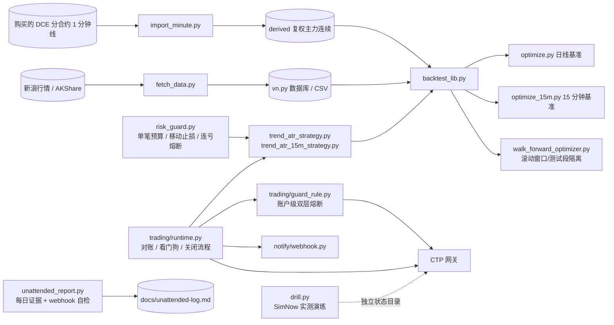

# invest — 国内商品期货自动交易（vn.py）

用代码自动交易国内商品期货，把「盈亏比纪律」固化为**策略层风控**，杜绝盘中手动干预。

- **框架**：[vn.py](https://www.vnpy.com) 4.5（CTA 策略 + CTP 网关），数据层用 AKShare / 新浪行情。
- **账户约束**：本金 1 万元，**单笔最大亏损 300 元（3%）**，固定 1 手；主测品种玉米（C），甲醇（MA）作对照。
- **部署形态**：开发用 Windows 11 + Python 3.13；部署用 Docker（x86_64 Linux）。

> ## ⚠️ 当前状态：只可用于「管道测试」
>
> 1. **策略结论为负面**——日线（双均线 + ATR 移动止损）与 15 分钟两条基准**都没有发现可延续的优势**
>    （[ADR](docs/adr/20261109-negative-backtest-result.md)、[15 分钟基准](docs/adr/20261110-baseline-15m.md)）。
>    当前策略只用于验证交易管道是否稳定，**不应连接真实资金**。
> 2. **当前不连接任何实盘**；切换到实盘需要用户另行明确授权（见 [docs/live-readiness.md](docs/live-readiness.md)）。
> 3. 撤单 / 废单 / 断线 / 重启等**实测项尚未完成**，配套演练脚本已就绪但还没在 SimNow 上真跑过。

---

## 目录

1. [这个项目在干嘛](#这个项目在干嘛)
2. [架构速览](#架构速览)
3. [目录结构](#目录结构)
4. [环境准备](#环境准备)
5. [怎么跑](#怎么跑)
6. [配置项](#配置项)
7. [测试](#测试)
8. [已知限制](#已知限制)
9. [相关文档](#相关文档)

---

## 这个项目在干嘛

**目标**：把「单笔亏损上限 / 止损只收紧不放松 / 连亏熔断」三条纪律写进代码，让策略在盘中**不需要也不允许**人工干预。

**做什么**：

- 下载并清洗国内商品期货行情（AKShare / 新浪），存进 vn.py 数据库与 CSV；
- 用双均线 + ATR 移动止损做基准策略，跑参数优化（训练段 → 验证段 → 测试段三段切分）；
- 在策略层加风控：单笔风险预算（超预算就不开仓，而不是缩小止损）、只收紧不放松的移动止损、当日连亏熔断；
- 接入 CTP 网关，在 SimNow 模拟盘上跑无头运行时：启动对账、看门狗（行情停更 / 策略异常）、账户级双层熔断、紧急平仓、Webhook 告警；
- 用 Docker 固化部署形态。

**不做什么**：高频交易；手机 app 自动化下单（无可靠成交回报、合规风险）；在策略无优势的前提下连接真实资金。

---

## 架构速览



---

## 目录结构

| 路径 | 内容 |
|---|---|
| `risk/` | 纯 Python 风控：`risk_guard.py`（单笔预算 / 移动止损 / 连亏熔断）、`account_guard.py`（账户级双层熔断状态机）、`order_policy.py`（废单分类、重试节奏）、`promotion_gate.py`（策略晋级门槛 8 条） |
| `strategies/` | `trend_atr_strategy.py`（日线）、`trend_atr_15m_strategy.py`（15 分钟）、`random_entry_strategy.py`（随机入场对照组）、`instruments.py`（品种参数与成本假设） |
| `trading/` | 运行时：`runtime.py`（引擎编排、对账、看门狗、退出语义）、`guard_rule.py`（vnpy_riskmanager 发单链上的账户风控规则）、`safe_risk.py`（让平仓单跳过计数类内置规则）、`events.py` |
| `notify/` | `webhook.py`：非阻塞告警队列、重试退避、发送前脱敏、generic / 飞书 / Telegram 三种格式 |
| `scripts/` | 全部命令行入口（见下节） |
| `config/` | `.env.example`（配置模板）、`risk_manager_setting.json`（账户级风控阈值） |
| `docs/` | 运行手册、验收清单、ADR、实测记录 |
| `tests/` | pytest 用例（含假网关 `tests/fakes.py`） |
| `data/`、`runtime/`、`.vntrader/` | 运行时产物，**均已 gitignore**；购买的分钟线与派生数据在**仓库之外**（`C:\Dev\data\invest`），不入库 |

---

## 环境准备

```bash
# 1) Python 3.13 + 依赖
python -m venv .venv
.venv/Scripts/activate
pip install -r requirements.txt

# 2) 配置
cp config/.env.example .env      # Windows: copy config\.env.example .env
# 然后编辑 .env，填 CTP 账号、前置机地址、交易合约、Webhook 等
```

> `.env` 已被 `.gitignore` 忽略，**切勿提交**；也**不要**把账号密码写进任何文档、日志或命令行参数。

先做一次不连网的自检：

```bash
python scripts/run_headless.py --check
```

---

## 怎么跑

所有命令都**在项目根目录**执行。

### 1. 下载数据

```bash
python scripts/fetch_data.py --symbols C MA --periods d 1 15
```

- `--symbols`：`PP L EB C MA` 等；`--periods`：`d`（日线）`1` `5` `15`（分钟线）。
- 数据库走 upsert、CSV 按时间戳去重，**重复运行安全**；单个品种失败不影响其余（退出码 1）。
- 分钟线历史很浅：新浪每个周期只返回最近约 1023 根，需要**定期增量运行**积累。

### 2. 构建主力连续（复权）

```bash
python scripts/build_continuous.py --symbol C --save
```

`--save` 会把复权序列写入 vn.py 数据库（代码 `CADJ`），供回测与实盘预热使用。主力换月规则、价差复权的细节见 [PROJECTWIKI](PROJECTWIKI.md)。

### 3. 回测与参数优化

```bash
python scripts/optimize.py --symbol CADJ        # 日线基准
python scripts/optimize_15m.py                  # 15 分钟基准
python scripts/walk_forward_optimizer.py        # Walk-Forward 滚动窗口(只在 2023 年底前的区间,测试段物理隔离)
```

> **纪律**：不加 `--test`。测试段只在最终确认时看**一次**，看过之后不得再据此调参。
> 日线基准的测试段：复权数据（`CADJ`/`MAADJ`）为 2024-01 起，未复权数据为 2023-01 起；
> 15 分钟基准的测试段为 2024-01 ~ 2026-06，**已经用掉了**，新候选需要 2026-06 之后的分钟线或模拟盘记录。
> `walk_forward_optimizer.py` 不提供任何访问测试段的开关：窗口硬断言 + 源码扫描测试双重保证，
> 方法学与结果见 `docs/adr/20261110-walk-forward-optimizer.md`。

### 4. 无头运行（连接 SimNow）

```bash
python scripts/run_headless.py --symbol c2701.DCE
# 常用参数
python scripts/run_headless.py --symbol c2701.DCE --history CADJ.DCE \
       --setting '{"fast_window":10,"slow_window":40}' --heartbeat 60
python scripts/run_headless.py --check          # 只校验配置与依赖，不连接、不交易
# 连接生产 API(实盘且非 SimNow)前必须有晋级门槛批准文件:未全部通过时下面的命令不会写文件
python scripts/record_promotion.py --metrics candidate.json --strategy <名称> --approver <批准人>
```

容器方式（推荐用于长期运行）：

```bash
docker compose up -d --build
docker compose logs -f trader
docker compose down
```

退出码语义（`restart: on-failure:3`）：

| 退出码 | 含义 | 是否自动重启 |
|---|---|---|
| `0` | 正常停止，或硬锁定后确认空仓 | 否 |
| `3` | 启动失败，可重试 | 是（最多 3 次） |
| `4` | 对账失败，需人工处理 | 是（最多 3 次后停止） |

### 5. 图形界面（仅人工观察）

```bash
python scripts/run_gui.py
```

> `run_gui.py` **没有**对账、没有看门狗、没有 Webhook，只能人工盯着看。**不得用于无人值守**。

> 界面另含 vn.py 官方的**算法单**（AlgoTrading：TWAP/冰山等拆单算法）与**价差/组合套利**（SpreadTrading）应用页，
> 以及 CTA 本地停止单（条件单）。多账户可按不同账号分别连接 CTP（平台原生支持；本项目默认单账户配置）。
> 这些是平台能力面的演示与手动试验入口，无人值守路径不使用它们。

### 6. SimNow 实测演练

```bash
python scripts/drill.py --list                       # 列出场景
python scripts/drill.py all --confirm-simnow         # 跑全部场景
```

| 场景 | 验证什么 |
|---|---|
| `latency` | 成交后持仓回报多久刷新（会真的开 1 手再平掉） |
| `tick-stale` | 行情断流 → 看门狗是否告警 |
| `disconnect` | 交易连接断开 → 是否告警、是否自动重连 |
| `daily-loss` | 当日熔断 → 撤单 → 平仓（会真的发单） |
| `hard-lock` | 累计死线 → 平仓 → 退出 → 重启拒绝交易（会真的发单） |
| `overnight` | 夜盘首根 Tick 与交易日归属 |

结果默认写到 `docs/simnow-drills.md`（容器内没有 `docs/` 目录，会退到挂载出来的 `runtime/data/simnow-drills.md`，退出后拷回仓库即可）。

采集 SimNow 的**真实废单文本**（用于校准拒单关键词表）：

```bash
python scripts/collect_reject_texts.py --confirm-simnow --out docs/reject-texts-simnow.md

# 期货公司穿透式监管测试(在运行实盘的那台 Windows 上直接运行,不用 Docker;详见 docs/live-readiness.md C2)
python scripts/collect_terminal_info.py --public-ip --out terminal-info.txt   # 终端信息采集
python scripts/penetration_check.py --confirm-broker-test [--with-order]      # 测试环境演练,报告写到 data/penetration/
```

> 两个脚本都只连 **SimNow 白名单地址**；`--confirm-simnow` 只是布尔开关，挡不住「配置写错连上真券商」，
> 地址不在白名单会直接拒绝连接（确有别的模拟环境才用 `--allow-any-address` 强制放行）。
> 会真发单的场景在非白名单地址上还要再加 `--confirm-any-address-trades`。

### 7. 无人值守日报

```bash
python scripts/unattended_report.py --report          # 生成每日证据表
python scripts/unattended_report.py --probe-webhook   # webhook 连通性自检
```

输出到 `docs/unattended-log.md`。**这是验收「连续 ≥5 个交易日无人值守」的证据来源**，需要先在 `.env` 里配好 `WEBHOOK_URL`。

### 8. 其它

```bash
# 导入购买的分钟线 → 复权主力连续（数据在仓库之外）
python scripts/import_minute.py --root C:/Dev/data/invest \
       --exchange DCE_大连商品交易所 --folder C_玉米 --product C

# 解除账户硬锁定（风控锁定后需要人工确认才放行）
python scripts/unlock_account.py --yes
# 注意:硬锁定当个交易日内会被冷却期拒绝(退出码 3);核对后确需越过用 --force(须交互输入 FORCE,不能与 --yes 同用)
```

---

## 配置项

全部配置在项目根目录的 `.env`（模板见 `config/.env.example`）。

### CTP 连接

| 变量 | 说明 |
|---|---|
| `CTP_USERNAME` / `CTP_PASSWORD` | SimNow / 期货公司的账号密码（**不要提交**） |
| `CTP_BROKER_ID` | BrokerID，SimNow 第一套为 `9999` |
| `CTP_TD_ADDRESS` | 交易前置，如 `182.254.243.31:30001` |
| `CTP_MD_ADDRESS` | 行情前置，如 `182.254.243.31:30011` |
| `CTP_APP_ID` / `CTP_AUTH_CODE` | AppID 与认证码（SimNow 第一套：`simnow_client_test` / 16 个 0） |
| `CTP_ENVIRONMENT` | `实盘`（SimNow 与实盘都用这个）或 `测试`（期货公司看穿式监管测试环境） |

### 交易标的

| 变量 | 说明 |
|---|---|
| `LIVE_VT_SYMBOL` | 实际交易的具体合约，如 `c2701.DCE`（**主力会换月，需定期人工更新**） |
| `HISTORY_VT_SYMBOL` | 预热用的历史日线代码，通常是 `CADJ.DCE` |

### 通知

| 变量 | 说明 |
|---|---|
| `WEBHOOK_URL` | 机器人地址；**留空则完全不发送通知** |
| `WEBHOOK_KIND` | `generic` / `feishu` / `telegram` |
| `WEBHOOK_TELEGRAM_CHAT_ID` | Telegram 需要的 chat id |
| `WEBHOOK_MIN_LEVEL` | 低于该级别不发送：`INFO` / `WARN` / `ERROR` / `FATAL` |
| `HEARTBEAT_SECONDS` | 心跳间隔（秒），`0` = 不发 |

### 账户级风控阈值

不在 `.env`，在 `config/risk_manager_setting.json` 的「账户风控」一节：

| 键 | 默认值 | 含义 |
|---|---|---|
| `daily_loss_limit` | `600` | 当日亏损熔断线（元） |
| `max_drawdown` | `2000` | 距最高权益的累计死线（元） |
| `flatten_on_daily_lock` | `true` | 熔断后自动平仓 |
| `state_file` | `data/state/account_guard.json` | 熔断状态持久化位置 |

---

## 测试

```bash
pytest tests -q --cov=risk --cov=strategies --cov=trading --cov=notify --cov=scripts --cov=ctp_tools
```

- 覆盖率目标 **85%**，最低 70%；当前全仓库 **1813 个用例通过 / 1 个跳过**，覆盖率 **86%**。
- `ctp_tools/`（CTP 取证与穿透测试的共用实现：可信前置地址表、档案解析、行情采集、穿透检查）已纳入统计口径——它现在是一等公民代码，不统计就等于把风险最大的那部分排除在门禁之外。
- 用例里有假网关（`tests/fakes.py`），**不需要**连网或连 CTP。
- 改完代码请先跑测试再提交。

---

## 已知限制

| 项 | 说明 | 优先级 |
|---|---|---|
| 策略未发现优势 | 日线与 15 分钟两条基准结论均为负面，只能当管道测试用 | 最高 |
| 撤单 / 废单 / 断线 / 重启未实测 | 演练脚本已就绪但还没在 SimNow 上真跑过，结论为空 | 最高 |
| 飞书 webhook 未验证 | `.env` 的 `WEBHOOK_URL` 是空的；飞书「失败也返回 HTTP 200」需要看响应体业务码，已按 fail-closed 处理 | 高 |
| 无人值守只跑了 1 天 | 验收要求连续 ≥5 个交易日，证据表目前只有一天 | 高 |
| 日线止损的跳空风险 | 默认参数回测有 4 笔单笔亏损超 300 元，最大 700 元（未计成本）；预算约束不了跳空 | 中 |
| 300 元预算与波动率不相容 | 2021 年起 1.75×ATR 止损对应每手亏损 >300 元，预算规则会让策略长期空仓 | 中 |
| 分钟线历史很浅 | 新浪每周期只返回最近约 1023 根（1 分钟约 5 个交易日），须每天/每周增量运行 | 高 |
| 15 分钟测试段已被使用一次 | 再用于新候选会产生多重检验偏差 | 高 |
| 主力合约换月需人工更新 | `LIVE_VT_SYMBOL` 指向具体合约，换月与持仓移仓未实现 | 高 |
| 本地止损依赖进程存活 | vn.py 停止单是引擎本地触发的，断线不执行；无法替代交易所端条件单 | 高 |
| 回测成本是假设值 | 每边 1 tick + 3 元/手手续费，实盘前须换成期货公司真实费率 | 高 |
| SimNow 使用约束 | 第一套约 09:00–16:00 交易时段（16:00 后连不上）；两次登录至少隔 2 分钟（否则 4097 断开）；第二套 `:40001` 对新注册账号返回「不合法的登录」，要到第三个交易日才能用 | 高 |
| SimNow 第二套的行情前置 | 第二套的行情前置 `:40011` 官网没有单独公布，白名单收下它的依据是**我们自己 2026-11-12 跑通过**（认证、登录、合约查询、`c2701.DCE` / `MA701.CZCE` 订阅与 tick 均正常）；`:40002`/`:40003` 没有这层背书，不收 | 中 |
| ARM64 不能跑 CTP | PyPI 上 `vnpy_ctp` 只有 win_amd64 wheel 与源码包，树莓派 5 需自编译 | 中 |
| 交易日不处理法定节假日 | 长假前后的当日熔断边界需人工留意 | 中 |
| 回测统计效力不足 | 日线验证段 10 笔往返、15 分钟测试段 91 笔往返，均低于晋级门槛要求的 150 笔 | 中 |

---

## 相关文档

| 文档 | 内容 |
|---|---|
| [PROJECTWIKI.md](PROJECTWIKI.md) | 项目知识库（单一可信源）：现状架构、ADR 索引、未解决技术债、模块索引 |
| [docs/roadmap.md](docs/roadmap.md) | 目标分层架构、四阶段演进路线、规划位登记表 |
| [docs/methodology-mapping.md](docs/methodology-mapping.md) | 研究方法论 → 系统映射，及研究资料的矛盾与证据强度 |
| [docs/modules.md](docs/modules.md) | 各模块的详细文档（职责、约束、修复经过） |
| [docs/broker-filing.md](docs/broker-filing.md) | 程序化交易报备说明草稿 |
| [CHANGELOG.md](CHANGELOG.md) | 变更记录 |
| [docs/runbook-simnow.md](docs/runbook-simnow.md) | SimNow 实测运行手册（含容器内跑通记录） |
| [docs/live-readiness.md](docs/live-readiness.md) | 实盘准入检查清单（人工步骤） |
| [docs/unattended-log.md](docs/unattended-log.md) | 无人值守每日证据表 |
| [docs/reject-texts-simnow.md](docs/reject-texts-simnow.md) | SimNow 实测废单文本与拒单关键词表 |
| [docs/adr/](docs/adr/) | 架构决策记录（vn.py 选型、时区、账户风险预算、负回测结论、晋级门槛、账户级熔断、部署与实盘模式、15 分钟基准） |

跟踪 Issue：[#1](https://github.com/laiyinyizao007/invest/issues/1)
