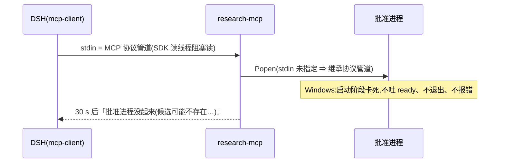

# ADR: 用 DSH 作为研究入口,批准经「带外确认」完成

- 状态:已采纳(2026-11-13,用户确认);**实现已完成**(2026-11-14,见第 6、7 条)——
  其中「开放 API 端到端」「带外批准」「工具目录」三项**已在本机实测**,其余部分仍是**代码层与契约测试层**的验证(逐条边界见第 8 条)。
  - **G8 双轮评审进行中**:codex CLI 第 2~16 轮分数 33 → 39 → 36 → 40 → 39/37 → 38/33 → 37/36 → **32/35** → **33/38** → **36/36** → **40/40** → **38/38.5** → (第 15 轮中断)→ **38/40** → 见第 9 条,
    均未达 45 的发布线;每轮的 Critical/High/Medium 已逐条修复并写进契约测试(见第 9 条),评审仍在继续。
    第 13 轮的两份报告都是 **40/50**(本分支的**最高分**);第 14 轮 **A 38/50、B 38.5/50**(无 Critical / High),
    三条 Medium 均为「闸门漏判」与一条「文档与实测相反」——已逐条修好并写进契约测试(见第 9 条与「第 14 轮引入的边界收紧」)。
    **如实说明**:分数未过线,主因是评审反复在「研究侧仍需仓库自身依赖」这类**#22 范围外**的残留上扣分(见「残留」节),不是已知的高危缺陷未修。
    第 11 轮另报出一条**同类 Critical**(运行期可顺异常回溯帧拿回真 `os`)——第 11~14 轮只闭合了**静态**那一半,
    **运行期**那一半已如实登记进「残留」第 7 条,**未**当作已修。
- 日期:2026-11-13
- **时区说明**(第 11 轮 codex 的 F8):本文档里的日期以**本机时区(UTC+8)**记录,
  而复核者看到的时钟是**本机本地时区(UTC-8)**——同一件事因此可能差一天(本文档写作时是 UTC-8 的 11-13 晚间
  = UTC+8 的 11-14 上午)。ADR 文件名沿用「采纳日」20261113;文中的「2026-11-14」指 UTC+8 的那一天。
- 关联:`20261110-bisheng-ai-researcher.md`(外层边界)、`20261112-research-sandbox-config-and-approval.md`(哈希绑定批准)、`20261112-status-dashboard.md`(状态页只读)、`20261113-evolution-engine.md`
- 触发:用户反馈「在毕昇里输入研究想法、再回终端敲 `approve` 太麻烦」,希望在 DSH Desktop 里发起研究并能完成批准。

## 背景

- 毕昇工作流(v3/v4)只能在毕昇网页或经 WebSocket 触发;批准要在本机终端执行 `research_api.py approve`。
- 状态页是只读监控页:`20261112-status-dashboard.md` 明确「批准候选策略」任何阶段都不进面板,`tests/test_web_contract.py` 把这条变成了可执行约束。
- DSH Desktop 是通用 Agent 客户端,默认 Preset 带命令行与文件读写工具,权限远宽于毕昇工作流。

## 决策

### 1. DSH 只是对话入口,毕昇仍是编排器

新增一个很薄的 MCP 服务(暂名 `research-mcp`),**只暴露三个工具**:

| 工具 | 作用 | 说明 |
|---|---|---|
| `发起研究(想法)` | 把想法填入毕昇工作流的 `input_idea` 节点并启动 | 走毕昇开放 API `POST /api/v2/workflow/invoke`(见第 5、6 条;已实测可用,含续跑协议);不可用时回退到 `tools/bisheng/run_v3.py` 的 WebSocket 调用逻辑 |
| `查进度` | 返回当前节点与最近一次结果摘要 | 只读 |
| `请求批准(候选名)` | 触发带外确认界面,**不写批准记录** | 见第 2 条 |

不暴露:提交源码、回测、门槛、移入 `approved/`、读写任意文件、任意命令。迭代上限(默认 5 次 / 24 小时)与 `max_source_bytes` 仍由网关与毕昇工作流强制,MCP 不得绕过。

### 2. 批准必须带外:模型只能「请求」,不能「授予」

- `请求批准` 在本机拉起**独立的批准进程**(只监听 `127.0.0.1` 的小页面或系统原生窗口),展示完整源码、静态筛查结果、与父代的 diff。
- 批准动作由**人在该界面**完成:输入文件的**完整 64 位 sha256** 后点击确认。确认界面发生在 DSH 模型接触不到的位置;一次性 CSRF 令牌、校验 `Origin`、不开 CORS。填错哈希**不关页面**(人可以改对了再填),超过 5 次才关闭。
- **批准页的 URL 与哈希一律不进工具返回值**:URL 只进本机浏览器(第 5 轮起由批准进程**自己打开浏览器**,URL 只活在那个进程的内存里,连磁盘都不落);哈希只进**人读的那条通道**(CLI 的 stderr 与批准页面),不进 stdout、工具返回值、日志。理由(codex 第 2 轮实测复现的 Critical):返回里带上 URL 与 sha256,一个有本地 HTTP 能力的模型就能自己去 POST 批准页,把「带外人工批准」变成「模型自我批准」——批准页再怎么做 CSRF 也拦不住一个手里就有正确令牌的程序。
- 批准记录仍写入现有 `data/research-control/approvals.json`,机制与 `20261112-research-sandbox-config-and-approval.md` 完全一致:绑定内容哈希,代码一改批准即失效。**低层写入者只有 `research_sandbox.record_approval` 一个函数**,它的调用方只有两处:带外批准进程(`scripts/research_approval_server.py`)与等价 CLI(`research_api.py approve` / `review`,以及仅限交互式终端的 `--confirm-reviewed`);MCP、毕昇与网关均无写权限。
- 批准进程**不进入**毕昇所在的 Docker 网络,不与状态页同进程。
- 工作流停在 `input_wait` 后,MCP 只在批准记录出现后才向该节点发「继续」。
- **批准时哈希由后端重算**:批准进程读取候选文件的**当前**内容并自行计算 sha256,与人输入的完整哈希比对;不接受调用方(模型或 MCP)传入的哈希。写入批准记录时用**刚核对过的那个哈希**,不再重读一次文件(两次读之间内容被改,记下的就是另一个版本的哈希)。
- **批准第一版只做带外界面;不做会话内原生批准框。** DSH 有原生批准框(`dsh-user-approval` / `dsh-client-ui-approval`),但目前只有沙箱 bash、`run_code`、子 Agent 等宿主代码会发起审批请求;已查资料中没有「对某个 MCP 工具要求人工批准」的配置。若要在会话内批准,需另写 DSH 插件在函数内调用 `ctx.approval.request`,列为**后续可选升级**(见未决)。升级时批准记录的写入者、哈希重算、负向测试均沿用本条,只替换触发界面。
- **会话 Preset 中禁用 Auto review**(`dsh-experimental-auto-review`,实验功能、默认关闭):它让当前 Agent 的模型自己审查并放行工具调用,属于机器应答者,会使批准退化为模型自批。

这是对「批准只能在命令行」的**有范围的扩展**:仍然是本机、人工、哈希绑定;不是网关端点,也不放进状态页。`research_api.py approve` / `review` 命令保留为等价的命令行入口(它们同样只在本机、由人触发)。

### 3. DSH 侧隔离:自定义 Agent Preset,而不是通用 Preset

- 在 DSH 新建 Preset `research`(新 id,不覆盖内置 `standard`):只含 `persona` 与 `research-mcp` 的 MCP 条目。
- **禁止**在该 Preset 中放置:`tool-pwsh`、`tool-bash`、`tool-fs`、`tool-fs-search`、`tool-jobs`、`tool-skill`、`skill-filesystem`、`dsh-tool-cordis`、`dsh-tool-subagent`、`tool-web`。
- 工作区不指向 `invest/`;MCP 的环境变量只含毕昇登录与网关令牌,不含 CTP 或 `.env` 交易段。令牌用环境变量引用(`!!js process.env.X`),不写明文进配置;DSH 默认不会把名字含 KEY/TOKEN/SECRET/PASSWORD 的环境变量传给子进程,需在 MCP 条目的 `env` 里显式引用。
- **边界声明**:DSH 文档明确「preset 不是安全沙箱」。Preset 只限制**模型可见的工具**,防的是误操作与提示注入,不防恶意插件。
- **可核对的前提(硬约束,不是口号)**:本 ADR 的「批准只能由人做」成立于下面这条前提——
  **`research` Preset 所在的会话不具备本机文件读写与命令执行能力**(模型拿不到 `approvals.json`、拿不到批准页 URL、也起不了本地 HTTP 请求)。
  这条前提由 `tests/test_research_boundary.py` 变成可执行约束:Preset 里出现 `tool-pwsh`/`tool-bash`/`tool-fs`/`tool-fs-search`/`tool-web`/`tool-jobs`/`tool-skill`/`skill-filesystem`/`dsh-tool-subagent` 即测试失败;`research-mcp` 源码里出现 `record_approval` 即测试失败。
  同理,`research_api.py approve/review` 这两个**等价命令行入口**也在人的手里:模型侧够不着它们(前提同上),而不是靠它们自身「防模型」。
- **【2026-11-19 修订,Issue #57】上面这条前提只在「专用 research DSH_HOME」里成立**。
  `dsh-agent-preset` 没有「不继承全局插件」的配置项:Preset 只能**加**插件,挡不住全局层已经注册的工具。
  上面那组边界测试查的是**仓库里的 Preset 模板**,不是**实际装进去的那个 profile**——同一份模板装进日常 Desktop
  profile,研究会话的模型实测拿到 130+ 个工具(终端、桌面操控、子代理、记忆、`mcp_register`……)。
  现在有两种运行方式,详见文末「Issue #57 发现」:
  - **严格模式**:`tools/research_mcp/start-research-dsh.ps1` 在专用 DSH_HOME 启动,`profile_check.py` 白名单核对
    **实际组装结果**,不通过不启动 ⇒ 前提成立(模型「做不到」自批)。
  - **日常 Desktop**:**用户于 2026-11-19 明确接受风险**——前提不成立,「只有人能批准」退为「不该做 + 有记录」。

### 4. 验证依据(2026-11-13)

- 用 `dsh --profile <临时> --patch <research 补丁> --dump-config` 在临时 `DSH_HOME` 中组装配置:含 MCP 条目的 `research` Preset 合法组装,Preset 列表为 `standard, ptc, minimal, cordis, research`。(**历史快照**:这是干净 profile 上的结果,不代表实际使用的 profile——见文末「Issue #57 发现」)
- 全局树 184 个条目中,命令行、文件读写、文件搜索、后台任务、技能、子 Agent、网页、待办等工具插件在全局层均为 disabled,仅在各 Preset 内启用。
- **未验证**:模型实际拿到的工具目录。接入时必须补一次实测:开 `research` 会话,让它列出可用工具,应只有三个 `mcp__research__*`(见验证)。

### 5. 毕昇侧调用方式与官方「企业接入」的边界(2026-11-13 查证)

- 毕昇 3.0 源码有开放 API `POST /api/v2/workflow/invoke`(`open_endpoints/api/endpoints/workflow.py`):请求体含 `workflow_id`、`input`、`session_id`、`message_id`、`override`、`stream`;非流式一次返回事件列表,另有 `/stop`;需 `workflow:invoke` 权限与对该工作流的「使用」权限;鉴权为服务账号密钥或个人访问令牌。
- 给 `research-mcp` 使用的服务账号**只授予 `workflow:invoke`,且只对研究工作流有「使用」权限**;服务账号权限单独授予,不继承任何自然人。密钥放环境变量,不入库。
- **官方「DSH 企业接入」只覆盖登录、模型、额度与席位(商业版网关),不覆盖调用工作流**;毕昇也没有把工作流发布为 MCP(PRD 中「MCP 复用同一密钥体系」属 P2,本期不做)。因此本 ADR 的 `research-mcp` 不能被官方集成替代,也不依赖商业版网关。
- **未实测**:本机 `v3.0.0-beta5` 是否启用该开放 API、服务账号怎么建、停在 `input_wait` 后用同一 `session_id` 再发 `input` 能否续跑。实现期第一步先实测,不通过则用 WebSocket 回退。

### 6. 开放 API 实测结论(2026-11-14,本机 `v3.0.0-beta5`)

三问全部有答案,**开放 API 可用,不需要 WebSocket 回退**。

| 待验证项 | 结论 |
|---|---|
| 开放 API 是否启用 | 已启用。`POST /api/v2/workflow/invoke` 与 `/stop` 均在 `openapi.json` 中;鉴权为 `Authorization: Bearer <bs-sak-*/bs-pat-*>`,scope 为 `workflow:invoke` |
| 服务账号怎么建 | `POST /api/v1/service-accounts`(需 `name` + `resource_owner_user_id`)→ `POST /api/v1/service-accounts/{id}/keys`(明文密钥只返回一次) |
| 同 `session_id` 能否续跑 | **能**,但不是只给 `input` 就够:请求体必须同时带 `session_id` **和** `message_id` |

续跑协议(实测确定,`research-mcp` 按此实现):

1. 首次 `invoke` 只传 `workflow_id`,返回 `session_id` 与事件列表;停在 `INPUT` 节点时事件形如 `{"event":"input","node_id":"input_name","message_id":38}`,`message_id` 是后端写进库的那条等待输入的消息 id。
2. 后续每次 `invoke` 传 `session_id` + `message_id` + `input:{node_id:{"user_input":"<文本>"}}`,工作流推进到下一个 `INPUT` 节点并返回**新的** `message_id`。
3. 后端按 `session_id.split("_")[0]` 取 chat_id、按主体(服务账号)定位会话;`message_id` 必须属于本会话且是等待输入的那条,否则报 `message_id does not refer to a message that waits for input`。
4. `stream:false` 一次返回累计事件列表;`stream:true` 走 SSE。

端到端实测(用 `v3-手工(无 LLM 联调)`工作流,免模型额度):`invoke` → 停在 `input_name` → 续跑 → 停在 `input_src` → 续跑 → 工具 `submit_candidate` 提交成功 → 停在 `input_wait` → 本机 `research_api.py review` 真实批准 → 续跑「继续」→ 工具 `run_evaluate` 出中文评估报告 → 回到 `input_name`(成环)。**人工批准闸门在开放 API 下同样成立。**

两个必须记下的权限坑:

- **服务账号要显式被授予「使用」权限,否则 403 `No permission to operate`**:走 `POST /api/v1/service-accounts/{id}/resource-grants:mutate?resource_type=workflow&resource_id=<flow_id>`,`changes` 为 `[{"op":"ADD","model_key":"viewer","subject":{"type":"service_account","id":"<sa_id>"}}]`,并带 `expected_resource_version` 与 `expected_catalog_release_id`(取自 `GET /permissions/resources/{type}/{id}/context`)。
- **只授工作流不够,工具也要授**:工具节点的 `use` 权限是独立检查(`tool/domain/services/executor.py`),开放 API 下主体是服务账号而非自然人(自然人是 `resource_owner`,不自动继承),因此**每个要用到的工具也要单独授 `viewer`**。踩过一次:授了工作流没授工具,节点报 `Permission denied: use`,工作流直接结束。

### 7. DSH 版本说明

- 本节验证用的是 `bisheng-rs/dsh-desktop` 源码目录(`0.1.1`,`dsh@0.2.0-rc.2`),与实际使用的开发版基线(v0.13.0+9,`dsh@0.2.1-rc.3`)不一致;GitHub 最新为 v0.13.2。
- 第 3、4 条的配置格式与审批机制结论,**须在实际使用的版本上复验**(`--dump-config` 与工具目录实测)后才算定稿。不为本任务升级 DSH。

### 8. 实现结果(2026-11-14)

落地的东西:

| 件 | 位置 | 作用 |
|---|---|---|
| `research-mcp` | `tools/research_mcp/server.py` | 三个工具:`start_research` / `research_status` / `request_approval`;走毕昇开放 API |
| 带外批准进程 | `scripts/research_approval_server.py` | 只监听 `127.0.0.1` 的一次性网页;**批准记录的两个合法入口之一**(`approvals.json` 的低层写入者只有 `research_sandbox.record_approval`;另一个入口是等价 CLI `research_api.py review/approve`) |
| DSH `research` Preset 模板 | `tools/research_mcp/dsh-research-preset.patch.yml` | 只挂 `persona` + `research-mcp`;不含任何文件读写/命令/网页/子 Agent 工具;Auto review 不启用 |
| 依赖隔离 | `requirements-research.txt` | `mcp` SDK 会拖进 starlette/uvicorn/pydantic,**不进交易环境**;交易环境仍只装 `requirements.txt` |
| 测试 | 研究侧九份测试文件共 **566 项**(`test_research_api` 98、`test_research_gateway` 87、`test_research_sandbox` 132、`test_research_config` 57、`test_research_approval_server` 34、`test_research_mcp` 29、`test_research_grid` 25、`test_research_gate` 21、`test_research_boundary` 83) | 工具枚举恰为三项、批准写入者唯一、负向路径、Preset 边界(结构级)、返回值不含 URL/哈希 |
| 研究栈与交易栈解耦 | `scripts/segment_windows.py`(窗口常量,纯数据)、`scripts/segment_ledger.py`(不再 import bootstrap) | 研究侧 CI 闸门**不装交易环境**也能跑:窗口常量原先经 `optimize → bootstrap → vnpy` 拖进交易栈,现已抽成纯数据模块 |

实测结论:

- **开放 API 端到端跑通**:`start_research` → 毕昇 v3 工作流 → 候选提交(`atr_breakout_15m_2atr.py`)→ 停在 `input_wait` → 人审阅批准 → `research_status` 检出批准并推进 → `run_evaluate` 出中文评估报告 → 回到 `input_idea`。
- **带外性是实的**:批准页面的 sha256 由**进程自己重算**,人要填**完整 64 位**哈希;文件在阅读期间被改就 409 拒绝;非本机 `Origin` 403、缺 CSRF 403、外来 `Host` 403、哈希不符 400(且**允许改对了再填**,上限 5 次)——四种负向路径都实测过,均未写入批准记录。
- **模型不能批准**:`research-mcp` 源码里没有 `record_approval`;仓库级扫描确认写批准记录的只有批准进程与等价 CLI 两个**人在场**的入口;**批准页的 URL 与哈希不进工具返回值**(实测:返回文本里既无 URL 也无 sha256;第 5 轮起地址**连磁盘都不落**,由批准进程自己开浏览器)。
- **DSH 版本复验**(实际使用的 v0.13.0+9 / `dsh@0.2.1-rc.3`):`dsh --profile web --patch <research 补丁> --dump-config` 组装成功,Preset 列表为 `standard, ptc, minimal, cordis, research`;`research` 段内只有 `persona` 与 `research-mcp` 两个条目。全局层的命令行/文件读写/文件搜索/后台任务/技能/子 Agent/网页/待办工具插件均为 disabled。(**历史快照**:这是干净 profile 上的结果,不代表实际使用的 profile——见文末「Issue #57 发现」)
- **工具目录在**协议层**实测过**(2026-11-14 20:42):真的把 `research-mcp` 起起来(stdio),用 MCP 客户端 `initialize` + `list_tools`,
  返回**恰 3 个**工具:`start_research` / `research_status` / `request_approval`(名字与描述一并取回)。
  **仍未验证**:在**真实 DSH 会话**里模型侧看到的工具目录(要跑起 DSH 与模型会话才能确认 Preset 装配后的最终形态)。
- **多轮研究的同名冲突已实测修好(2026-11-14 20:39)**:用新想法在真实开放 API 上跑了一轮——工作流的 `tool_feedback` 节点拿到了网关返回的 `pending_candidates`(三个已落盘的候选名),起名节点据此**起了一个新名字** `open30_atr_midline_trail`(不在列表里),**没有再撞 409**。该轮最终停在**静态筛查**(候选把受保护容器 `am.high`/`am.low` 传给了 `max()`/`min()`),这是宪法筛查在正常拦人(见下面的坑 2),不是本次改动的缺陷。
- **断耦演练**:停掉毕昇全部容器后跑测试套件,**2736 项通过**(该数字是断耦演练当时的计数);本分支当前全量 **2886 项通过**(本机 Python 3.13.7 + pytest 8.4.2,2026-11-13 重跑),3 项失败 + 5 项 error 与本改动无关,**已取 `origin/main` 版本逐条比对确认完全相同**(状态页隔离子进程在本机 cp1252 控制台下解码失败、drill 缺 `.env` 的 `LIVE_VT_SYMBOL`);交易与风控不受影响。
  研究侧九份测试单独跑:**566 项全过**(本机,2026-11-13 重算);模拟 CI「无交易栈」时 **546 通过 + 20 跳过**(=566;跳过的 20 项是带 `requires_trading_stack` 标记的回测子进程用例)。

五个必须记下的坑:

1. **服务账号要同时授工作流与每个工具**:只授工作流会在工具节点报 `Permission denied: use`。
2. **候选源码会撞宪法的「容器不得取别名」**:LLM 写的 `close = self.am.close_array` 被静态筛查拒绝(这正是它该做的)。合规写法是 `self.am.close[-1]` 这类就地取值。**已处理**:毕昇研究工作流的写候选提示词已改成「推荐 `self.am.close[-1]`、禁止 `close = self.am.close_array(...)`」,实测候选通过静态筛查。
3. **同名候选会让整条毕昇工作流中止**:网关对重名返回 409,而毕昇把工具节点的**任何**非 2xx 变成 `api_call_fail` 并**中止整个工作流**(不是只失败一个节点)——多轮研究时 LLM 复用上一个候选名就会踩到。修法**不是自动改名**:改名会让「模型看到的名字」与「人批准的文件」脱钩,可能批准错文件;而是**把现存候选名喂给起名这一步**(网关 `_feedback` 返回 `pending_candidates`,只含文件名、不含路径与源码),并明确要求「不得重复使用」。
4. **Windows 上的 CRLF 会让研究镜像起不来**:`core.autocrlf=true` 把 `docker/research/entrypoint.sh` 检出成 CRLF,`docker build` 后容器报 `exec /entrypoint.sh: no such file or directory`(shebang 行尾多一个回车,解释器找不到),报错完全指不到「换行符」上。已加 `.gitattributes`(`*.sh text eol=lf`)钉住。
5. **网关挂载的是「主检出」的那棵目录树**:毕昇写候选、网关读批准记录都在主检出的 `pending_strategies/` 与 `data/research-control/`;worktree 里跑 MCP 必须用 `INVEST_ROOT` 指到主检出,否则两边看到的是不同的树。

### 9. 评审记录(G8 双轮,2026-11-14)

| 轮次 | 工具 | 分数 | 主要发现与处理 |
|---|---|---|---|
| 第 1 轮 | `mcp__zen__codereview` + 自查 | 9 项发现全部修复 | 批准进程决定后不退出(实测「仍在运行」→ 修成决定即 `shutdown`,MCP 侧等待从 600 s 降到 1.9 s);死会话会把用户永久卡死(加全新会话兜底);批准子进程的环境变量白名单化 |
| 第 2 轮 | `mcp__zen__clink` → codex CLI | 33/50(**未达 45 的发布线**) | **Critical**:工具返回值里带批准页 URL 与 sha256 → 模型可自行批准(已修:返回值不含 URL/哈希,地址只进本机文件与浏览器;页面改为要求**完整 64 位**哈希)。**High**:哈希在「核对」与「记录」之间被重读一次(TOCTOU,已改为传入已核对哈希);候选名从模型散文里正则捞(已改为以文件系统增量为准、正则只在候选目录里核对存在才算);「真正的硬保障」原是口号(已改写成可核对的前提 + 边界测试)。**Medium**:批准记录并发写丢更新(已加独占锁 + 唯一临时名);填错哈希直接关页面(已改为可重试,上限 5 次);页面源码未脱敏(已接 `dashboard/safe.scrub_text`);配置未从数据根读(已修);边界测试只查调用点(已补直接写文件的扫描) |
| 第 3 轮 | `mcp__zen__clink` → codex CLI,复核修复 | 39/50(**仍未达 45**) | 仍存在的 **High**:模型可见通道里还漏着 sha256 与批准命令(毕昇 tip 模板把网关响应原样回给模型 → 模型可以在聊天里替人念哈希,「人核对完整 64 位」退化成橡皮章);CSRF 比对用字符串 `compare_digest` → 非 ASCII 令牌会抛 TypeError 而非拒绝;`review` 子命令可以在非交互式调用里自我批准。**Medium**:脱敏模块不可用时页面会拿占位符继续服务(应 fail-closed);锁文件不判陈旧 → 进程被杀后批准永远锁死;`os.replace` 在 Windows 上偶发 PermissionError;没有 CI 关卡(一处 SyntaxError 曾能进主干)。 |
| 第 4 轮 | 同上,复核第 3 轮修复 | 36/50(**仍未达 45**) | 上一轮的 High 均已闭合(网关响应不再回哈希、tip 模板不再回显工具输出与批准命令、MCP 侧再做一层 64 位十六进制与批准命令的脱敏);CSRF 改用**字节**比对 + 非 ASCII 令牌被拒;`review`/`--confirm-reviewed` 改为**必须在 TTY** 里执行。**Medium**:`scrub` 不可用时改为抛错并 fail-closed;加锁判陈旧(Windows 下用 `OpenProcess` 探活,不用 `os.kill(pid,0)`——那在 Windows 上是终止进程);`os.replace` 加重试;新增 CI 关卡 `research-guard.yml`(compileall + ruff,不装交易环境)。本轮仍未到 45,原因是它把「研究侧仍需仓库自身依赖(含 vnpy)」这条残留也算作缺陷——见下面的遗留项。 |
| 第 5 轮 | 同上,复核第 4 轮修复 | 40/50(**仍未达 45**) | **High**:批准页地址此前「只落在本机文件里」,而那个文件是「模型没有本地文件工具」这个**未经验证**的前提才安全的 → 批准进程改为**自己开浏览器**,URL 只活在它自己的内存里,MCP 既拿不到也不落盘;`approve`/`review` 的 **stdout 里带 sha256**(stdout 是模型可见通道的候选)→ 从返回值删除,哈希只留在 stderr;`requirements-research.txt` 的事实性错误(把「静态筛查需要 vnpy」写成了筛查依赖 `load_template()` → `import strategies.*`)→ 更正为「**只有回测子进程**需要 vnpy,筛查是纯 AST」。**Medium**:网关响应里磁盘结果文件的哈希会原样回给模型 → 出口处 `_strip_digests`;MCP 的 fail-closed 原因被吞掉 → 透出且脱敏;**无会话时仍可请求批准**(模型能把候选目录里任意旧文件推给人批)→ 改为直接拒绝;脱敏失败时已绑定的 socket 没关 → 补 `server_close`;`os.kill(pid, 0)` 在 Windows 上是**终止进程**而非探活 → 改用 `OpenProcess`;文档**夸大**了 `Origin`/`Sec-Fetch-Site` 的作用(它们只挡跨站浏览器 CSRF,挡不住本机程序)。**Low**:错误消息里的本机路径未脱敏 → 网关出口统一 `redact_paths`(URL 与候选文件名保留,只盖本机绝对路径);交互提示语原先进 stdout(`input(prompt)` 的副作用)→ 改走 stderr,stdout 整段是纯 JSON。 |
| 第 6 轮 | codex CLI(改走 `codex exec` 并行两份:一份覆盖安全/边界,一份覆盖架构/文档/测试) | A 39/50、B 37/50(**均未达 45**) | 走 `mcp__zen__clink` 的 codex 会话在 1800 s 超时且没吐出报告(rollout JSONL 里没有最终助手消息),改用 `codex exec` 并行跑两份、各自限定 40 次工具调用,才拿到可读的报告。**A(安全/边界)**:模型可见通道里还有**自由文本里的 64 位十六进制**(先前只剥 `sha256` 形状的键)、**批准命令行**(网关 `_scrub` 与 MCP `redact_for_model` 都漏)、**UNC / `\\?\` 扩展长度 / 单段 POSIX 路径**没被 `redact_paths` 盖住;配置里**只有 `pending_dir` 查受保护目录**,`results_dir`/`approvals_file`/令牌文件仍可指向 `strategies/` 或借用 `.env`(Windows 上大小写不敏感,`data/.ENV` 就是 `.env`);`OpenProcess` 的句柄被截断成 32 位;`review` 子命令的 stdout 契约与 `approve` 不一致。**B(架构/文档/测试)**:边界测试的写入者识别是**按名字匹配**,换个变量名就能写账本;CI 里**没有任何 job 会跑这些边界测试**(写进了仓库却无闸门);ruff 清单没覆盖本 issue 改过的文件;文档关于「唯一写入者」的措辞与代码不符;多轮研究的**同名候选 409** 会让整条工作流中止。 |
| 第 7~8 轮 | codex `exec` 并行两份(复核第 6 轮的修复) | A **38/50**、B **33/50**(**均未达 45**) | **A(安全/边界)**:**F1** 静态筛查的模块**黑名单**不完整——`import zipfile` 就拿到 `zipfile.os`,筛查零告警(实测可执行任意命令/读文件);**F2** CLI 的 stdout 仍带 `strategy_sha256`;**F3** 批准页 URL 与 sha256 仍打到 stdout,且 MCP 推荐的兜底命令恰好会打印它们;**F4** 网关的 `SandboxError` 分支绕过统一清洗;**F5** 统一清洗不处理**凭据值**;**F6**「模型不能自我批准」只被**部分**变成可执行约束(Preset 边界只查补丁文本);**F7** 非 TTY 门槛可绕过;**F8** 配置可用名单外的名字借用凭据文件;**F9** `redact_paths` 对双反斜杠路径与名单外单段 POSIX 路径只做部分替换;**F10** 批准页 URL 令牌比对不是常数时间;**F11** 写入者识别仍可被 `__dict__["record_approval"]` 绕过;**F12** `record_approval` 信任调用方传入的 `sha256`。**B(架构/文档/测试)**:**C1(Critical)** CI 关卡必然红——边界测试在 CI 里**一次都不会执行**(模块级 import vnpy 导致整轮收集中止);**H1** 去掉 C1 后仍有 9 个测试依赖 vnpy;**H2** 写批准文件那条断言有 **4 个实测可绕过**的口子(`os.open` 的标志位、`Path.open` 的 mode 位置、`_atomic_replace`、常量折叠的路径名);**M1** 写操作探测器**误报**(逼人用改名绕行来「修绿」);**M2** 「研究栈不 import vnpy」只查静态 import 且闭包清单手维护;**M3** 并发写批准记录的修复**没有测试**;**M4** **超时路径没有负向测试**;**M5** 文档与代码不一致(轮次台账 + CI 结论);**M6** workflow 注释里的事实错误;**L1** MCP 侧的检查仍是子串匹配;**L2** `_repo_files()` 按目录名整块过滤;**L3** Preset 边界是黑名单式;**L4** ruff 清单含本次没改过的文件。 |
| 第 9 轮 | codex `exec` 并行两份(复核第 7~8 轮的修复) | A **37/50**、B **36/50**(**均未达 45**) | **A(安全/边界)**:**Critical** 静态筛查的**能力白名单自身泄漏**——白名单里的模块把 `os`/`sys` 挂在自己的属性上(`statistics.sys`、`typing.sys`、`enum.sys`、`dataclasses.sys`、`dataclasses.inspect`、`fractions.sys`、`collections._sys`、`random._os`、`numpy.select`、`pandas.io.pickle`、`pandas.io.common.os`),候选一句 `import statistics` + `statistics.sys.exit()` 就能逃出沙盒,而筛查**零告警**;**High**:`allowed_modules` 配置项把「放行模块」这件事变成攻击面(配置里放行一个泄漏模块即绕过);`Authorization: Bearer xxx` 没被统一清洗盖住;**Medium**:JSON 形态的 CTP 凭据(`"CTP_BROKER_ID": "..."`)漏网;批准进程里有一段**死代码的常数时间比较**(比较的是常量,与令牌无关,徒增误解);**Low**:`_child_reason` 另起了一套本地正则(与共享清洗内核分叉)、`review` 帮助文案过时。**B(架构/文档/测试)**:**H1** CI 仍用 python 3.11,而 `-W error::SyntaxWarning` 在 3.11 上对无效转义**只是 DeprecationWarning**(闸门注释承诺的检查在 CI 上是空操作);**H2** MCP 侧「不许写 approvals」的断言仍是**词法禁令**(子串匹配),换个变量名就能写账本;**H3** Preset 结构断言只扫 YAML 的 **key**,值里的危险内容能过;**M1/M2** ruff 与 compileall 的清单**漏文件**(研究闭包里的 `dashboard/`、`notify/`、`risk/` 不在 compileall 范围);**M7** 固定路径(approvals 文件、网关令牌文件)只有正向用例,缺**负向**用例;**M8** `requirements-research.txt` 的依赖面说法与实测相反(把筛查说成需要 vnpy)。
| 第 10 轮 | codex `exec` 并行两份(复核第 9 轮的修复) | A **32/50**、B **35/50**(**均未达 45**) | **A(安全/边界)**:**Critical** 白名单模块的 `__spec__.loader` → 任意文件读/写 → 候选可**伪造人工批准记录**(`set_data` 直接改 `approvals.json`,静态筛查**零告警**);**High** 运行期代理挡不住 `__dict__` 与 `__getattribute__`,两层职责错位(静态层靠名字抓到了,运行期这层号称「第二道防线」却漏);**High** 新加的「子模块叶子审计」把 numpy 打成不可用(`arr.sum()`/`arr.mean()` 抛 ImportError,功能回归);**Medium** `redact_secrets` 的 assign 规则排在 bearer 之前 → `token: Bearer abc123def456` 的令牌原样保留;**Medium** 模型可见通道仍可能带出**任意凭据值**(清洗按**名字**认,读文件原语配合异常回灌即可外带网关令牌);**Low** POSIX 路径两条规则叠加 → 同一路径被盖成两个 `<路径>`;**Low** 非 64 位哈希(40 位 git sha、32 位 md5)不进脱敏(仪式只认 64 位,已知残留);**Low** `_child_reason` 统一到 `rs.scrub_text` 后,「引号内容整段替换」的语义丢失(已写进注释)。**B(架构/文档/测试)**:**Medium** Preset 边界仍是**名字黑名单**:实测变体(在 persona 的 `config` 下加一行 `tools: [tool-exec]`)让**六条 Preset 断言全部 PASS**;**Medium** 「只有两个入口可以提到 record_approval」的引用判定器有实证假阴性(`getattr` 取值形态整条漏掉);**Medium** ruff 清单仍漏研究闭包文件(`risk/`、`notify/`),也漏掉本次改过的 `risk/constitution.py`,工作流注释的说法因此是假的;**Medium** CI 会因未入库的 `scripts/segment_windows.py` 直接红;**Medium** `-W error::SyntaxWarning` 会被**已存在的 .pyc** 静默架空(命令不幂等),且仓库当前并没有无效转义——它是**预防网**,不是「已修缺陷」;**Low** 「常驻研究进程不 import 交易栈」是**浅**不变量(只查 3 个文件的直接 import,不查传递);**Low** 「共 N 项测试」过期(470→472)且文档留着未填的评分占位符;**Low** 边界断言的输入集合随工作树漂移(评审残留的 `.bt_probe/`、`.pytest_review_tmp/` 会被当成生产代码);**Low** `requirements-research.txt` 把测试期依赖(pyyaml)混进了运行时依赖文件。 |
| 第 12 轮(A) | codex `exec` 并行两份之一(安全/边界) | **36/50**(**未达 45**);**无 Critical**,但**不变量 1「模型可见通道无本机绝对路径/凭据值」未完全守住** | **Medium**:①`redact_paths` 有三个可复现的漏——盘符前紧贴 ASCII 字母时**整条绝对路径原样出去**、用户目录里带空格的显示名只盖掉前半段(**OS 用户名残留**)、UNC 主机名不允许空格;②批准写入者判定器**假阳性**(错误提示/日志里把 `record_approval` 当实参传就算「持有写入函数」)与**假阴性**(`__dict__[…]` 下标、动态取模块两条路都拿得到写入函数);③「字符串/模板形态都拦」这条规则**逐常量**判定,一行拼接即绕过;④CLI 的 stdout **没有按值脱敏这一层**(网关与 MCP 有),三条模型可见通道口径不一致;**Low**:私有属性规则对 `self._state` 这类**候选自己的**字段误报(静态层比运行期更严)、64 位摘要藏在更长十六进制串里不隐去、凭据读不到时静默降级、批准页地址不带 scheme 时不隐去、Cookie 头只隐去第一个值、测试数据里带一条本机绝对路径。**已复核**:M2/M3 两条判定器问题在第 12 轮已由 B 轮的等价发现**先行修好**(假阳性 3/3 消解、假阴性 2/2 命中),A 轮报告的是修好之前的快照;其余各条见下面的「第 12 轮修复」。|
| 第 12 轮(B) | codex `exec` 并行两份之一(架构/文档/测试) | **36/50**(**未达 45**);**无新的 Critical / High** | **Medium**:①`try/except ImportError: pass` 会把「交易栈装了但装坏了」的错误**静默吞掉**,bootstrap 于是没被导入,后面报的是「导入顺序错了」,真实原因反而看不见;②交易栈侧的 92 项宪法回归与 `test_segment_ledger` **在任何 CI job 里都不会被执行**(解耦恰好改动了它们成立的前提);③§8 的「断耦演练 2736 项通过」是上一轮的快照,已过期。**Low**:④`compileall` 的注释说「整个仓库都要能编译」却漏了 `.github/scripts/*.py`;⑤`requirements-research.txt` 从不被 CI 安装(workflow 里重复内联了同样的 pin);⑥边界测试的模块级 import 收集器不走进 `if/with/for` 体,合法的另一种写法会被误报;⑦roadmap 写 2026-11-13、ADR 写 2026-11-14,两处指同一件事但字面冲突。**结论里明确回答的三个问题**:这个修法**没有**把交易栈拖回研究侧(workflow 的 pytest 两步只收 boundary 与八份研究侧文件,round11/12 只在 ruff 清单里,ruff 是静态的);`try/except` **不会**让断言静默跳过(这两份文件没有任何 vnpy 的 skipif,无交易栈时是 ERROR 而非 SKIP);更合适的位置**不是** conftest(会把全局耦合搬回来)也不是 pythonpath(只管搜索路径不管导入顺序)。|
| 第 13 轮(A) | codex `exec` 并行两份之一(安全/边界) | **40/50**(**未达 45**);**无 Critical / High**,两处 Medium 均为「不完整修复 / 闸门漏判」而非可利用绕过 | **Medium**:①`redact_paths` 对**末段带空格**的路径不完整(目录/文件名会残留),且新规则会**多吃一个散文词**(`error at <路径> later`,`retry` 丢失);②批准写入者判定器仍漏 `rs.__dict__.get(...)` / `.items()` 与 `import *` 后裸引用两条形态。**Low**:③`file://` 形态的本机路径完全不过清洗(实测原样返回);④CLI 的按值脱敏**读不到令牌时 fail-open 且不留痕**(MCP 同情况会往 stderr 打一行);⑤`_folded_str` 只折 `BinOp(Add)`,`"".join([...])` / `bytes` 两种拼法绕过(实测零告警;但所有取值的原语都被上层封住,**不是可利用绕过**,只是纵深防御层变薄);⑥`\n` 转义被 UNC 规则当成 UNC 起点,整段被吃掉。**已修**:M1/M2、L1(`file:`)、L2(stderr 留痕)、L3(`join`/`bytes` 折叠)、L4/L5(散文词误吃与转义误判)、L6(测试数据里的本机绝对路径)。**本轮明确回答**:五条不变量没有被新改动破坏(1 号只在「末段带空格」与 `file://` 两种形态上不完整);无新增明文密钥与个人信息。|
| 第 13 轮(B) | codex `exec` 并行两份之一(架构/文档/测试) | **40/50**(**未达 45**);两份报告**同为本分支最高分**,但文档与闸门仍有硬伤 | **High**:第 12 轮把 CI 依赖改成「从 `requirements-research.txt` 装」之后,研究侧闸门**每个 PR 都红**——该文件漏了测试真正需要的 numpy / pandas。**Medium**:①宪法守卫 `check_constitution_history.py` 用 git 视角取跟踪集时,取不到就**退化成扫全文件系统**,实测会 fail-open(扫不到文件 = 判定没问题),与它自己的 fail-closed 原则冲突;②六处文档的测试条数被并发改动作废(531 → 534),且 `CHANGELOG.md:311` 同一句里「518 项」与「511 通过 + 20 跳过」**互相矛盾**。**Low**:③契约测试的「vnpy 须在 bootstrap 之后」那半截**恒空转**,且只查存在性不查谓词(把 `is not None` 改成 `is None` 断言照样绿);④`_module_level_imports` 漏 `async with` / `match` / `except*`;⑤ADR 残留第 9 条称 tmp_path 的 PermissionError「未复现」,**该结论被实测推翻**(本机可原样复现);⑥`find_spec` 修法方向对但**爆炸半径过大**(交易栈装坏时 pytest 在收集阶段中止 → 整轮一个测试都不跑)。**已修**:High(补 numpy/pandas 并标注「仅测试期需要」)、Medium①(fail-open 修正)、Medium②(六处文档口径统一重算)、Low③(断言改查谓词 + 补对照)、Low④(补 `AsyncWith`/`Match`/`TryStar`)、Low⑤(残留第 9 条改写)、Low⑥(在 ADR 里如实登记其影响面)。**Low ⑦(共享 bootstrap helper)未做**,已如实登记为残留第 10 条。|
| 第 14 轮(A) | codex `exec` 并行两份之一(安全/边界) | **38/50**(**未达 45**);无 Critical / High,三条 Medium 均为「闸门漏判」 | **Medium**:①`redact_paths` 对**正斜杠盘符路径的多词段**只盖掉前半段(`C:/Documents and Settings/x.txt` → `error at <路径> and Settings/x.txt later`,目录名与文件名残留——`Path.as_posix()` 是常见写法);②批准写入者判定器漏「**变量中转模块字典**」(`_D = rs.__dict__` 之后 `_D["record_approval"](…)`,实测闸门全绿);③**三条模型可见通道的「按值凭据清单」并不共享**——ADR 写「凭据清单也共享」,实现里只有 MCP 侧盖毕昇密钥,CLI 与网关只盖网关令牌。**Low**:④中文句末标点(`。！？；，、`)不进主扫描终止符集,`C:\Users\alice\.env。后面` 把整句吃掉;⑤`Users` 目录规则多吃一个散文词(`C:\Users\alice failed` → 吃掉 `failed`);⑥多词段前瞻上限 4 个词,5 词以上的路径尾部泄漏;⑦POSIX 绝对路径带空格时同样只盖前半段;⑧「直接写批准记录」判定器可被**两段式**拆开绕过(写操作与「提到 approvals」不在同一作用域);⑨`_folded_str` 仍有 `chr()` 分隔符 / 模块级常量分隔符 / 切片三种拼法折不出来;⑩网关与 CLI/MCP 的按值替换**长度门槛不一致**(网关无下限、CLI/MCP 是 ≥8)。**已修**:M1(正斜杠多词段)、M2(模块字典变量中转)、M3(按值凭据清单抽成 `research_config.known_secret_values()`,三侧共用)、L4(中文终止符)、L5(散文词判据)、L6(前瞻上限 8)、L7(POSIX 带空格)、L8(两段式改成**调用图口径**)、L9(f-string / `%` / `format` 三种拼法)、L10(网关改走 `rs.scrub_text`,门槛统一)。**未做并如实登记**:L9 剩下的三种折不出形态(纵深防御层,非可利用绕过)见残留第 11 条。|
| 第 14 轮(B) | codex `exec` 并行两份之一(架构/文档/测试) | **38.5/50**(**未达 45**);无 Critical / High,一条 Medium 是**文档与实测相反** | **Medium**:残留第 9 条的结论**与实测相反**(它称「受限子进程里整批 setup ERROR」是确定现象、并给出「`--basetemp` 指向仓库内可列目录即可绕过」的绕法;而 pytest 对**给定的 `--basetemp` 同样执行 `mkdir(mode=0o700)`**(`_pytest/tmpdir.py:152`),那条绕法并不成立;本机直接跑 559 项全过)。**Low**:①`except*` / `match` 只补进了三个 walker 中的一个,`async with` 甚至在 `_module_level_imports` 里直接抛 `AttributeError`;②「仓库里」这个说法应当是「**入库集**(git 跟踪集)」,评审脚手架目录(`reviewtmp/` 等)已 gitignore、不在跟踪集里;③`scripts/segment_ledger.py` 不再 import bootstrap,顺带**取消了 bootstrap 的 `os.chdir(ROOT)` 副作用**,pytest 会话的 CWD 不再被强制切到仓库根;④`find_spec` 守卫的**爆炸半径**(交易栈装了但装坏 ⇒ 模块导入期抛错 ⇒ pytest 收集阶段中止 ⇒ 整轮一个用例都不跑)没有在正文登记。**已修**:Medium(残留第 9 条按实测重写,并说明「权限口径」与「pytest 的 mode 语义」两件事)、L1(四个 walker 语义统一,并补一条把 `except*` / `match` / `async with` 的 import 植入临时文件、断言四个 walker 都看得见的**对照用例**——这条用例当场逮住 `async with` 的 `AttributeError`)、L2(口径改成「入库集」)、L3(研究侧路径锚点必须 `.resolve()`,且研究栈里不许出现 `os.chdir` / `os.getcwd`,已钉成断言;CWD 行为变化写进本 ADR)、L4(爆炸半径登记进残留第 8 条)。|
| 第 15 轮 | codex `exec` 并行两份 | **未完成,无分数**:两份评审在中途被会话中断,**没有产出最终报告**;第 16 轮已重跑 | (中途探针见残留第 13 条;不是报告结论)|
| 第 16 轮(A) | codex `exec` 并行两份之一(安全/边界) | **38/50**(**未达 45**);无 Critical,**1 条 High** | **High**:`_looks_like_repr_escape` 只看「主机名首字符是 n」,`nas`/`net` 开头的 UNC 在 repr/JSON 形态下**整条漏盖**(三条模型可见通道共用内核,同时中招)。**Medium**:研究侧与 `dashboard/safe.py` 的路径规则已漂移,研究侧漏编码/全角/零宽等 5 类形态;CWD 断言覆盖不足;残留第 8 条后半段过期;**提交 `ecb19ce` 误带入 512 个 pytest 临时产物**(`r15tmp/`,无凭据)。**Low**:`str.format` 关键字实参折不出、`FORBIDDEN_HOSTS` 漏 `::0`/`0`、多词段 8 词上限、路径后 ASCII 标点被一并吃掉、`_child_reason` 不带 secrets、`init-token` 往 stdout 打本机路径。**已修**:H1(按反斜杠个数区分,并补回归用例)、M3(`87ef82d` 移出入库集并补 `.gitignore`)。**随后一并修了**:M1(`dashboard.safe.scrub_path_forms` 抽成公共函数,研究侧 `redact_paths` 第二遍复用,编码/全角/零宽/无盘符根路径都盖住;UNC 与引号规则因过贪婪不借)、L1(`str.format` 关键字实参折叠)、L3(`::0` / `0` / `[::]` 等价写法进禁用名单,改用 `ipaddress.is_unspecified`)。**未修**:L2/L4/L5/L6,留待下一轮。**第 14 轮七项修复全部实测有效。** |
| 第 16 轮(B) | codex `exec` 并行两份之一(架构/文档/测试) | **40/50**(**未达 45**);无 Critical,**1 条 High** | **High**:`_module_level_imports` 在 module-level `with` 上仍抛 `AttributeError`(第 14 轮只拆了 `AsyncWith`),对照用例没覆盖 `with`。**Medium**:残留第 9 条 ③ 的机制结论与受限环境实测相反;调用图判定器误报「内容里提到 approval」;「四个 walker 语义一致」不成立(类体 import 一个看不到);CWD 断言锚点清单漏 `tools/research_mcp/server.py` 的 `ROOT`(无 `.resolve()`)、对 `chdir`/`getcwd` 只认一种形态、`server.py:607` 有一处随启动目录漂移的相对路径;六处条数过期一项(559→560);全量口径 2879+3+5≠collect 总数;`r15tmp/` 误入库(已被 `87ef82d` 修掉,历史里仍留着)。**已修**:H-1(`with` 并入 `AsyncWith` 分支 + 对照用例加 `with`)、M-2(残留 9 重写)、M-3(措辞收紧)、M-4/M-6(MCP 的 `ROOT` 加 `.resolve()`、兜底命令改绝对路径)、M-5(CWD 断言认任意接收者与裸名)、M-7/M-8(条数重算为 561,全量口径写全)。**未修**:M-1 误报(残留 14)、M-7 的自动化核对(残留 15)。|
| 第 11 轮 | codex `exec` 并行两份(复核第 10 轮的修复) | A **33/50**、B **38/50**(**均未达 45**) | **A(安全/边界)**:**Critical** 候选能顺**异常回溯帧**拿回真 `os`(`e.__traceback__.tb_frame.f_globals` 指向 numpy 内部帧的真全局命名空间)→ 任意写文件(可伪造 `approvals.json`)、读 `.env`/令牌、执行命令,而两层静态筛查**零告警**;**High** 模块代理**不包裹**从模块取到的函数/类(`np.load.__globals__['os']` 运行期畅通);**Medium** 静态层只判「字符串常量**等于**禁用名」→ 模板字符串(`"{0.__globals__}".format(...)`)藏得住;`redact_paths` 对 JSON/repr 形态的 Windows 路径只做部分替换(泄露盘符 + 用户名 + 文件名);凭据**按值**脱敏只有网关有、MCP 通道没有;批准写入者判定器可被**非常量折叠**绕过(`chr()`/`join()`),同时把无关字典键/文档字符串误判成「持有写入函数」;**Low** `pandas.io` 被整个命名空间误伤;静态层不报**单下划线**私有属性(与运行期口径不一致);两处正则覆盖边界偏窄。**B(架构/文档/测试)**:**High** 「例外函数只被 `*_child` 调用」那条断言**空转**(`_call_sites` 对整个 `research_api.py` 返回 0 个调用点,`for` 循环体一次都没执行);**High** 交易栈 import 藏在 `if/for/try/with` 复合语句里就看不见(三个 walker 各有一套遍历语义);**Medium** 不变量只挡得住 `import` 语句(`importlib.import_module` / `__import__` / `exec` 隐形,而本仓库里已有这种写法);判定器把任何含 `record_approval` 的字符串常量都算成引用(假阳性);Preset 白名单的两个通用分支在仓库自带的测试里**一次都没被走到**;文档把一条空转断言写成了已生效的约束;**Low** 「全量测试」数字不可复现、基线日期自相矛盾、CI 第二步一份文件收集失败会废掉整步、宪法守卫扫的是整个文件系统而不是 git 跟踪集、ruff 清单漏 `dashboard/__init__.py`。|

第 2 轮确认成立的部分:交易与风控路径未被触碰;DNS rebinding、点击劫持、路径穿越、符号链接、重放均不可利用;`approvals.json` 确实只有两个**合法入口**(带外批准进程与等价 CLI),二者的低层写入都是同一个 `research_sandbox.record_approval`。

**第 4 轮引入的边界收紧**(行为变更,已写进契约测试):

- 批准页 POST 必须带浏览器来源标记(`Origin` 或 `Sec-Fetch-Site`),缺任一 → 403(原先只要 Host 对就放行)。
- 页面源码脱敏失败 → 拒绝提供页面(`ScrubUnavailable`),不再拿占位符顶上。
- `review` 子命令必须由人在交互式终端里粘贴**完整 64 位** sha256;`--confirm-reviewed` 在非 TTY 下直接拒绝。
- MCP 工具输出统一过一层脱敏:64 位十六进制串与 `research_api.py approve` 命令行替换为占位符(纵深防御:即使上游再漏一次,也进不了模型通道)。

**第 5 轮引入的边界收紧**(行为变更,已写进契约测试):

- **批准页地址不落盘**:批准进程自己开浏览器(`--hide-url` 时连 stdout 的 ready 事件里都没有 URL),
  URL 只活在那一个进程的内存里。这消除了对「模型没有本地文件工具」这个**未经验证**前提的依赖。
- **`approve`/`review` 的 stdout 里没有 sha256**:返回值只有 `{"approved": ..., "name": ...}`,哈希只进 stderr(给人的通道);
  交互提示语也走 stderr,stdout 整段是**纯 JSON**(能被 `json.loads` 直接解析)。
- **网关响应剥掉哈希**(`_strip_digests`):磁盘上的结果文件是内部账本,响应里一律没有 `sha256` 形状的键。
- **MCP 的 fail-closed 原因透出**:批准进程拒绝提供页面时,工具返回写明原因(且过脱敏),不再笼统报「没起来」。
- **无会话不受理批准请求**:没有进行中的研究时,`请求批准` 直接拒绝——否则模型能把候选目录里的**任意旧文件**推给人批。
- **批准进程脱敏失败时关闭已绑定的 socket**:不留一个空转的监听端口。

**第 6 轮引入的边界收紧**(行为变更,已写进契约测试):

- **模型可见通道连自由文本里的哈希也盖掉**:原先只剥「`sha256` 这种形状的键」,
  结果文件里的 `error.message`、作业 `report`、失败 Trace 里随手写的一句
  「hash=0123…(64 位)」就能原样回到模型。现改为**整段文本**过 `redact_digests`
  (任何 64 位十六进制串 → 占位符),网关 `_scrub` 与 MCP `redact_for_model` 两侧都盖。
- **批准命令行也不进模型通道**:`research_api.py approve` / `research_approval_server.py`
  这类命令行出现在文本里,模型就能在聊天里替人念命令。现由 `redact_approve_commands` 盖掉;
  MCP 的「请求批准」返回里只说「请让本机的人在本机终端里操作」,**不含命令行**,
  命令行只进本机 MCP 的 stderr(运维看的通道)。
- **`redact_paths` 补齐三类漏网路径**:UNC(`\\server\share`)、Windows 扩展长度(`\\?\C:\…`)、
  以及 POSIX 的单段绝对路径(`/etc`、`/tmp` 这类根目录直属项)。原来只认「至少两段」的 POSIX 路径。
- **配置的三条路径 + 令牌文件统一查受保护目录/凭据文件**:原先只有 `pending_dir` 查,
  `results_dir`/`approvals_file`/`token_file` 仍可被指到 `strategies/` 或借用 `.env`;
  现全部**大小写不敏感**地查受保护目录与凭据文件名(`data/.ENV` 在 Windows 上就是 `.env`)。
- **同名候选不再让整条工作流中止**:多轮研究时 LLM 复用上一个候选名 → 网关 409 →
  毕昇把非 2xx 变成 `api_call_fail` 并**中止整个工作流**(实测如此)。修法不是自动改名
  (改名会让「模型看到的名字」与「人批准的文件」脱钩,可能批准错文件),
  而是**把现存的候选名喂给起名这一步**,并明确要求「不得重复使用」。
- **网关的 `_feedback` 返回现存候选名**(不含路径、不含源码),供工作流续跑时避让重名。
- **Windows 句柄不再被截断**:`OpenProcess` 的返回句柄在 64 位上是 64 位,原先按 32 位声明会截断,
  导致「进程已死」的判定失真。
- **`review` 子命令的 stdout 契约对齐 `approve`**:两者 stdout 都是纯 JSON,哈希只进 stderr。
- **边界测试从「按名字匹配」升级为 AST 判定**:写入者识别现在认得属性访问、裸名、import 别名、
  `getattr` 与常量拼接;并按**传递 import 闭包**检查研究侧是否间接 import 了 vnpy/交易栈,
  且区分「导入期闭包」与「回测子进程(唯一允许 vnpy 的地方)」。

**第 6 轮自查引入的边界收紧**(行为变更,已写进契约测试):

- **模型可见通道的清洗统一到一个出口**:路径脱敏原先只加在网关的两个异常分支上,
  而网关有**五条**模型可见的出口(`_data`、`_candidates`、作业的三种 `view`、`_results`、`_feedback`)。
  结果文件里的 `error.message`、失败 Trace 的 `failures`、作业的 `report` 都可能夹着本机路径。
  现把清洗**收在 `handle` 的唯一出口**(`_scrub`:剥哈希键 + 盖本机绝对路径)——
  **散落在各端点就会漏,漏一条等于边界没守住**;收在出口就没有「漏掉某个端点」这回事。
- **MCP 侧补上路径脱敏**:`redact_for_model` 原先只脱敏 64 位十六进制与批准命令行,现也盖本机绝对路径。
- **批准页的头名一律小写化**:`handle` 原先不统一大小写,直接调用它的地方可以用大写的
  `Sec-Fetch-Site: cross-site` 绕过来源检查(实测:修前判「允许」、修后判「拒绝」)。
  HTTP 传输层本来就会小写化,这是给绕过传输层的调用方兜底。
- **代码一律从 `CODE_ROOT` 取,数据才从 `ROOT` 取**:`research-mcp` 原先把 `ROOT/scripts`
  插在 `sys.path` 最前面,于是 `INVEST_ROOT` 指向别的树时**代码**也从那棵树导入——
  跑的是另一份代码(实测:新 `server.py` 配旧 `research_sandbox.py` → `AttributeError`)。
  这条修正与本 ADR 遗留项 3(worktree 里跑 MCP 要用 `INVEST_ROOT` 指到主检出)是配套的:
  **数据**跟网关一致,**代码**跟启动 MCP 的那份检出一致。
- **调用方提前断开不再刷整段 traceback**:毕昇工具节点超时/关页时 `wfile.write` 抛
  `BrokenPipeError`,socketserver 会把整段 traceback 打进日志,把真正的错误淹没。网关与批准进程都改成安静收尾。

**第 7~8 轮(codex 并行两份复核)引入的边界收紧**(行为变更,已写进契约测试):

- **静态筛查从「模块黑名单」改为「能力白名单」**:黑名单只封了 `pathlib/glob/shutil/…`,
  漏了 `zipfile`/`tarfile`/`shelve`/`sqlite3` 等——它们自己 import 了 `os` 并挂在模块属性上,
  候选一句 `import zipfile` 就能拿到 `zipfile.os.system`(第 7 轮 A 的 F1,**实测零告警**)。
  现 `research_sandbox.ALLOWED_MODULE_ROOTS` 只放行候选真正需要的能力
  (`math/statistics/collections/datetime/typing/enum/dataclasses/…/numpy/pandas/strategies/vnpy*`),
  其余一律 `ImportError`;筛查层另加一条静态规则:`X.os` / `X.shutil` / `X.importlib` 这类
  「取模块的危险属性」直接判违规。**这是纵深防御,不是沙盒**(见文件头的威胁模型说明)。
- **CLI 的 stdout 是模型可见通道,统一过清洗**:`research_api.emit()` 现在统一走 `rs.scrub_model_visible`
  (剥 64 位十六进制、盖本机绝对路径、盖凭据形态),`strategy_sha256` 之类键不再出现在 stdout;
  交互提示语与哈希只在 stderr(给人的通道)。
- **批准页的 URL 与哈希彻底不进 stdout**:ready 事件只带 `event/strategy/screening_passed/findings`;
  URL 与「不要粘进聊天窗口」的警告走 **stderr**,由人自己复制;另加 `redact_approval_urls`
  做纵深防御(`http://127.0.0.1:<port>/a/<token>` 形态一律替换)。
- **模型可见通道的清洗升级为「共享内核 + 唯一出口」**:网关的 `SandboxError` 分支原先绕过 `_scrub`(只做路径脱敏),
  现改走 `_scrub`;MCP 的 `redact_for_model` 与 CLI 的 `emit` 共用同一个 `rs.scrub_text`,
  并新增**凭据形态**的规则(密钥赋值、`Authorization:` 头、`Bearer`、`CTP_*` 环境变量)。
- **批准必须「TTY + 粘贴完整匹配的 sha256」**:只有 TTY 不算——非交互式调用也能伪造一个 TTY;
  现在还要人把**刚显示出来的那份完整 64 位哈希**粘回来,不一致即拒绝(`--confirm-reviewed` 同理)。
- **URL 令牌比对改用常数时间**(`secrets.compare_digest`);**`record_approval` 自己重算哈希**,
  与传入的不一致就拒(「低层唯一写入者」不替调用方担保)。
- **写入者识别补上 `__dict__["record_approval"]`**;MCP 侧的检查改为 **AST 判定**(不再是子串匹配)。
- **写批准文件那条断言的判定器重写**:分「明确是写的方法 / 带模块限定的文件函数 / 有歧义的名字(要求接收者像路径)」三层,
  统一 `open` 家族的 mode 位置(内建 `open` 是第 2 个位置参数,`Path.open` 是第 1 个)、`os.open` 走标志位、
  本仓库的 `_atomic_replace` 计入写操作、路径名做**常量折叠**;判定器**自己**有了对照用例
  (必须抓到的绕过写法、以及不该误报的写法)。
- **研究栈与交易栈解耦**:窗口常量抽到 `scripts/segment_windows.py`(纯数据),
  `scripts/segment_ledger.py` 不再 import bootstrap,需要 vnpy 的用例在没有交易栈时**跳过**;
  CI 的研究侧闸门因此能**不装交易环境**就真跑起来(第 8 轮 B 的 C1/H1:原先整轮在收集阶段中止,**一个测试都没跑过**)。
- **并发与超时的负向测试补齐**:批准记录的写入加**并发用例**(6 个线程同时记 6 条批准,不许丢更新),
  子进程加**超时用例**(卡死的子进程必须被终止并报超时)。
  这两条用例当场逼出两个真 bug:临时文件名只带 pid(同进程并发会撞名)、
  锁文件在 Windows 上被别的进程读着时**删不掉**(删不掉 = 之后所有批准都被锁死)——都已修。
- **Preset 边界从「文本 grep」升级为「结构断言」**:解析 YAML 后断言 `research` Preset **只挂**
  `persona` + `research-mcp` 两个条目、配置里没有危险工具的键、密钥只用 `process.env` 引用、
  没有写死盘符绝对路径。**如实说明**:CI 里跑不了 `dsh --dump-config`(CI 没有 DSH),
  所以「渲染后的整棵配置树」仍只有**本机手工实测**那一次(DSH v0.13.0+9),不是自动化断言。

**第 9 轮引入的边界收紧**(行为变更,已写进契约测试):

- **能力白名单自身泄漏 os/sys —— 静态层 + 运行期双防线**(第 9 轮 A 的 Critical,已实测闭合):
  上一轮把筛查从「模块黑名单」改成「能力白名单」时,只封了**模块本身**的用途,
  没想到**白名单里的模块把 `os`/`sys` 挂在自己的属性上**——
  `statistics.sys`、`typing.sys`、`enum.sys`、`dataclasses.sys`/`dataclasses.inspect`、
  `fractions.sys`、`collections._sys`、`random._os`、`numpy.select`、`pandas.io.pickle`、
  `pandas.io.common.os` 都实测存在。候选一句 `import statistics` + `statistics.sys.exit()`
  就能逃出沙盒,而筛查**零告警**。现在:
  - **静态层**:属性链判定从「一层」改成**任意深度**(`X.os`、`X.y.os` 都算),
    并新增「`from X import os`」形态的规则;命中的模块根只要出现在链上任一段就报违规。
  - **运行期**:白名单模块在 `import` 时被换成 `_GuardedModule` 代理,
    代理在**取属性**时把 `os`/`sys`/`_os`/`_sys`/`inspect`/`shutil`/`subprocess`/`importlib` 等
    一律挡住(抛 `ImportError`);`guarded_scope()` 退出时**恢复原模块**,不留代理。
    这是纵深防御:静态层可能漏,运行期再挡一道。
  - **配置准入**:通过 `research_config` 额外放行的模块同样要过这道审计——
    泄漏的模块**不放行**(原先这条配置项本身就是攻击面)。
- **清洗内核补齐两种凭据形态**:`Authorization: Bearer <token>`(原先只盖 `Basic` 之类的头形态),
  以及 JSON 形态的 CTP 凭据(`"CTP_BROKER_ID": "..."`)。清洗顺序固定为
  **赋值 → Bearer → 头 → CTP**,避免前一条规则吃掉后一条的匹配。
- **删掉死代码**:批准进程里那段「与常量做常数时间比较」的预检(比较对象与令牌无关)已删除,
  令牌比对的**每一处**都走 `secrets.compare_digest`。
- **清洗内核收敛**:`research_api._child_reason` 原先另起了一套本地正则,现统一走 `rs.scrub_text`;
  `review` 的帮助文案改成「先看代码再批准」的实际流程。

**第 10 轮引入的边界收紧**(行为变更,已写进契约测试):

- **模块代理不再放行 dunder 与私有名**(第 10 轮 A 的 Critical,已实测闭合):
  上一轮修好了「白名单模块把 os/sys 挂在属性上」,但同一类失效模式换了属性名 `__spec__` 活下来——
  `mod.__spec__.loader.get_data(path)` 能**读任意文件**(`.env`、网关令牌),
  `set_data(path, bytes)` 能**写任意文件**(直接改 `approvals.json`,于是「人读过源码才批准」
  这道仪式被候选单方面废掉),而静态筛查**零告警**。现在:
  - 代理改为**默认拒绝**:除少数安全名(`__name__`/`__doc__`/`__all__`/`__version__`/
    `__annotations__`/`__qualname__`)外,凡以 `_` 开头的属性一律取不到;
  - 静态层把 `__spec__`/`__loader__`/`__file__`/`__path__`/`__package__`/`__reduce__`/
    `__reduce_ex__`/`__getattr__` 加进 `FORBIDDEN_ATTRS`(裸名与字符串形态都拒);
  - 代理不再改写 `sys.modules`,改用**代理缓存**(`guarded_scope()` 退出即失效),
    取到的**子模块**也递归包成代理(`pandas.io.common.os` 这条链堵得住);
  - 新增负向用例:`__spec__`/`__loader__`/`__dict__`/`__getattribute__`/`_module`
    在运行期必须抛 `ImportError`,静态层必须报错;另有**对照用例**保证
    numpy/pandas 的正常用法(`arr.mean()`/`.sum()`/DataFrame)没被误伤
    (第 10 轮 A 的一条 High 就是「叶子审计把 numpy 打成不可用」,已一并修掉)。
- **清洗内核的凭据形态与顺序**:Bearer 规则提到**最前**(原先 assign 规则先把 `Bearer` 当值吞掉,
  真令牌留在原地:`token: Bearer abc123def456` → 令牌原样保留);
  POSIX 路径的两条规则不再重复遮盖(同一路径被盖成两个 `<路径>`)。
- **网关按值盖掉自己的鉴权令牌**:清洗规则是按**名字**认凭据的,令牌一旦被读成原文再塞进
  作业消息,名字那一层就认不出来——网关出口(`handle` 的唯一出口)现在额外按**值**替换令牌原文。
- **CI 关卡**:compileall 加 `-f`(强制重编译;否则**已存在的 .pyc** 会让这道闸门变成空操作),
  ruff 清单补 `risk/` 与 `notify/`(整个研究闭包),workflow 注释改成「**预防网**」而不是「已修缺陷」;
  `scripts/segment_windows.py` 补入库(原先未入库,CI 会因找不到路径直接红)。
- **Preset 边界从「名字黑名单」改成「结构白名单」**(第 10 轮 B 的 M1):第 10 轮实测变体——
  只在 persona 插件的 `config` 下加一行 `tools: [tool-exec]`,**六条 Preset 断言全部 PASS**。
  现在:任何能力类键(`tools`/`skills`/`mcpServers`/`hooks`/`agents`/…)一律拒,
  任何以 `tool-`/`dsh-tool-`/`skill-` 开头的字符串值一律拒,
  每个插件的 `config` **逐键**断言「只有已知那几个键」,插件**包名**也只允许那两个。
- **批准写入者的「引用」判定补上字符串常量形态**(第 10 轮 B 的 M2):
  `getattr(rs, "record_approval")` 与 `rs.__dict__["record_approval"]` 原先**整条漏掉**
  (能同时骗过「唯一写入者」与「只字不许提」两条断言),现在算引用;
  并补了对照用例(属性/别名/getattr/`__dict__` 四种写法都要被抓住)。
  第 11 轮前又补了**常量折叠**:`getattr(rs, "record_" + "approval")` 运行时是同一个名字,
  但源码里是两个常量,不折叠就漏(已实测该写法原先漏判、折叠后命中)。
- **「常驻研究进程不 import 交易栈」从浅不变量改成传递闭包 + 只在子进程入口碰交易栈**
  (第 10 轮 B 的 L6):原先只查那三个文件自己的 import,`research_api` 在函数体里 import 交易栈没人管;
  现在:常驻进程的**导入期闭包**里不许出现交易栈;研究侧文件里的交易栈 import
  只能出现在 `*_child` 子进程入口(或两个登记在案的例外函数,且它们只被 `*_child` 调用)。
  第 11 轮把这条从「文档里的一句话」变成**真正在跑的断言**:原先 `_call_sites` 对整个
  `research_api.py` 返回 0 个调用点,那条断言**空转**(第 11 轮 B 的 F1);现三个 walker 收敛成
  一个带作用域栈的 walker,并各配一条对照用例。
- **文档与测试数字**:研究侧九份测试共 **518 项**(CI 模拟:**498 通过 + 20 跳过**)。

**第 11 轮引入的边界收紧**(行为变更,已写进契约测试):

- **静态层认得「异常回溯帧」这一类逃逸**(第 11 轮 A 的 Critical,本轮只闭合**静态**那一半):
  第 10 轮修住了「模块的 dunder」,同一类失效模式换了**属性名**活下来——
  `e.__traceback__.tb_frame.f_globals` 直接指向 numpy 内部帧的**真全局命名空间**
  (里面有真 `os`),`np.load.__globals__['os']` 同理。两条路**一个禁用名都不出现**,
  上一轮的筛查返回 `[]`。现在 `__traceback__`/`__context__`/`__cause__`/`tb_frame`/`tb_next`/
  `tb_lasti`/`f_globals`/`f_locals`/`f_builtins`/`f_back`/`f_code`/`f_lineno`/`__globals__`/
  `__code__`/`__spec__`/`__loader__`/`__mro__`/`__subclasses__`/`__getattribute__`/`__dict__`/
  `__reduce__` 一律进 `FORBIDDEN_ATTRS`、进 `FORBIDDEN_SUBSTRINGS`(字符串与模板形态)、
  并同步进宪法层的 `BUILTIN_FORBIDDEN_DUNDERS`;单下划线的私有属性(`numpy._module`)也按
  「能力入口」判(第 11 轮 A 的 F9),运行期与静态层口径终于一致。
  **仍然残留**的是**运行期**那一半:代理只包模块,不包从模块取到的函数与类
  (第 11 轮 A 的 High),因此真值仍可能在运行期被取到。**这一条必须靠容器隔离(4b/4c)兜底**,
  静态筛查只能让人**看见告警**,不是拦住——详见下面的残留第 7 条。
- **清洗内核补上按值脱敏的第二条通道**(第 11 轮 A 的 F6):原先只有网关按**值**盖掉自己的鉴权令牌,
  MCP 侧没有——「网关盖住、MCP 不盖」就是一条漏的通道。现在 MCP 的 `redact_for_model`
  会把**已知的凭据值**(毕昇开放 API 密钥 + 网关令牌)按值替换掉。
- **`redact_paths` 的路径形态**(第 11 轮 A 的 F4/F5):JSON/repr 形态的 Windows 路径
  (`"C:\\Users\\…"` 两个反斜杠)原先只盖掉 `Users` 一段,尾部段(含用户名与文件名)留在外面;
  UNC 规则同时会**误伤正则字面量**(`re.compile(r"\\d+")`)。现在:Windows 规则先于 UNC 规则、
  UNC 要求**恰好两个**前导反斜杠且主机名形状合法,`\\?\C:\…` 与 `\\server\share\…` 仍然盖掉,
  而正则字面量不动。
- **模板字符串藏不住禁用名**(第 11 轮 A 的 F3):静态层原先只判「字符串常量**等于**禁用名」,
  `"{0.__globals__}".format(np.mean)` 这种写法能把名字拆到模板里。现在字符串常量只要**含有**
  禁用串就报。
- **批准写入者的判定器**(第 11 轮 A 的 F7、B 的 F4):原先把**任何**含 `record_approval` 的字符串常量
  都算成「持有写入函数」(文档字符串、普通错误提示语都会被误判),而 `chr()`/`join()` 那种
  **非常量折叠**又完全看不见。现在:字符串常量的判定**看上下文**(只有作为调用的实参或下标才算),
  文档字符串排除在外,并补了一条**能力规则**——凡是以模块别名为接收者的
  `getattr`/`vars`/`dir`/`attrgetter` 一律算引用。
- **边界测试的三个 walker 收敛成一个**(第 11 轮 B 的 F1/F2,两条 High):
  `_local_imports`/`_trading_import_sites`/`_call_sites` 原先各有**一套不同的遍历语义**,
  于是「例外函数只被 `*_child` 调用」那条断言**空转**(`_call_sites` 对整个 `research_api.py`
  返回 0 个调用点,`for` 循环体一次都没执行),而复合语句(`if/for/try/with`)里的 import
  与调用**根本看不见**。现在统一成一个带**作用域栈**的 walker
  (`_scoped_nodes`:函数/类的默认值与装饰器属外层作用域、函数体属内层作用域;
  复合语句的 `body`/`orelse`/`finalbody`/`handlers` 递归下钻),三条断言共用它;
  并各配一条**对照用例**(合成一个不在 `*_child` 作用域里的调用/import,必须被判出来),
  免得「判定器太松」没有任何东西会发现。
- **动态导入也纳入不变量**(第 11 轮 B 的 F3):`importlib.import_module("vnpy…")`、
  `__import__("vnpy")` 对只看 `import` 语句的不变量**完全隐形**,而本仓库里**已经有**这种写法
  (`risk/constitution.py` 的模板载入)。现在新增断言:动态导入只许出现在回测子进程入口里
  (字面量参数,不做运行时判定)。
- **Preset 白名单的两个通用分支补上对照用例**(第 11 轮 B 的 F5):
  「能力类键归一」与「字符串值前缀」两个分支原先在仓库自带的测试里**一次都没被走到**,
  可以被无声删掉。现在有 7 条**参数化的负向用例**(能力键的大小写变体 / 分隔符变体 /
  值前缀 / 未知配置键 / 未知插件 / 未知插件包),在内存里构造结构、不落盘。
- **CI 关卡与工具**(第 11 轮 B 的 F9/F10/F11):第二步加 `--continue-on-collection-errors`
  (一份文件收集失败不再把整步的研究侧测试全废掉);宪法守卫改为只扫 **git 跟踪集**
  (`git ls-files --cached --others --exclude-standard`),开发者落在仓库里的临时 `.py`
  不再把守卫弄红(而报错完全指不到「你的临时文件」);`.gitignore` 补 `.pytest_tmp_codex/`;
  ruff 清单补 `dashboard/__init__.py`。
- **文档与测试数字**:研究侧九份测试共 **518 项**(CI 模拟:**498 通过 + 20 跳过**——
  跳过的是回测子进程那些要 vnpy 才跑得起来的用例)。
- **解耦带出来的一处导入顺序回归(本分支引入,已修)**:
  `tests/test_constitution_round11.py` 与 `round12.py` **合跑**时会失败 10 项,报
  `bootstrap 必须先于 vnpy.trader.database 导入`。根因:这两份用例经
  `const.snapshot_protected_state()` 预加载 `vnpy_ctastrategy.backtesting`,
  连带加载 `vnpy.trader.database`;而「bootstrap 一定先于它导入」这条顺序原先是
  **靠 `conftest → segment_ledger → bootstrap` 间接兜住的**——登记文件与交易栈解耦
  (`scripts/segment_ledger.py` 不再 import bootstrap)后,那层兜底就没了。
  取 `origin/main` 版本对比可确认这是**本分支引入**的(同样的两个文件在 origin/main 上 92 项全过),
  不是环境问题。修法:两份文件在**导入期**显式 `import bootstrap`(交易栈侧固定时区的既定前置),
  **不**把 bootstrap 塞回 `scripts/segment_ledger.py`——那会把交易栈重新拖回研究侧,破掉解耦保证。
  修完合跑 **92 项全过**。并在研究侧边界测试里钉成一条**可跑在研究 CI 上**的断言
  (`tests/test_research_boundary.py`,纯 AST、不 import vnpy):两份交易栈侧的测试文件必须在
  **模块导入期** import bootstrap,且不得在它之前 import vnpy 族模块。

**第 12 轮引入的边界收紧**(行为变更,已写进契约测试):

- **本机路径的清洗改成「扫描式」**(第 12 轮 A 的 M1,触及不变量 1):
  原来的三条正则各有一个可复现的漏——盘符前紧贴一个 ASCII 字母时**整条绝对路径原样出去**
  (`openC:\Users\alice\.env`)、用户目录里带空格的显示名只盖掉前半段(**OS 用户名残留**)、
  UNC 主机名不允许空格(`\\My Server\share\…` 整条逃逸)。
  现在改成:先找路径**起点**(盘符 / UNC),再一路扫描到路径真的结束——
  **空格算不算路径的一部分,看它后面的词是不是紧跟着分隔符**
  (`C:\Users\John Doe\.env` 里的空格在路径里;`C:\Users\alice\.env failed` 里的空格是散文,
  路径到 `.env` 为止,句子照旧保留)。profile 目录额外允许多吃一个词(OS 用户名要紧)。
  UNC 要求「主机名后面必须跟分隔符」,所以 repr 里的 `\n` **不会**被当成路径起点
  (否则后面的正文会被整段盖掉——过度遮蔽同样会丢诊断信息)。
- **静态层认得「常量拼接」出来的禁用名**(第 12 轮 A 的 M4):
  「字符串/模板形态都拦」这条规则原先**逐常量**判定,`'{0.__gl' + 'obals__}'` 一行拼接即绕过——
  而这条规则的全部价值就是「人批准前能看见告警」。现在先把 `BinOp(Add)` 递归折叠再判;
  同时 `FORBIDDEN_SUBSTRINGS` 补齐成 `FORBIDDEN_ATTRS` 的子集(ADR 原来列举的十几个名字
  只在精确匹配里,模板形态不拦——文档与代码对不上)。
- **CLI 这条模型可见通道补上按值脱敏**(第 12 轮 A 的 M5):
  三条通道(网关 / MCP / CLI)里原先只有网关与 MCP 有「按值盖掉已知凭据」这一层,
  CLI 的 stdout 只有「按名字」认凭据——候选把令牌连名字一起塞进异常文本时,
  网关与 MCP 被盖住、CLI 不盖。现在 `scrub_model_visible` 接受 `secrets`,
  CLI 在唯一的 stdout 出口 `emit()` 处读一次网关令牌按值盖掉(读不到就跳过,不让整条脱敏失效)。
- **私有属性的静态口径与运行期对齐**(第 12 轮 A 的 L1):
  `self._state` / `self._file` 是 LLM 写策略时最常见的私有字段名,静态层原先一刀切**直接拒掉**
  (运行期的模块代理只拦模块属性)。现在这条规则只对「属性链的根是导入进来的模块」生效
  (`np._module` 照样报)。
- **清洗规则的三个边界**(第 12 轮 A 的 L2/L4/L5):
  64 位摘要改成「**连续 64 位以上的十六进制一律隐去**」(原先要求两侧非十六进制,
  于是「前缀 + 摘要 + 后缀」这种最常见的拼接形态整条逃逸);
  批准页地址的 scheme 改成可选(`127.0.0.1:8765/a/TOKEN` 同样是模型能直接用的地址);
  Cookie 头改成**整条隐去**(原先只隐去第一个值,`;` 后面的键值对原样出去)。
- **凭据读不到时在 stderr 留痕**(第 12 轮 A 的 L3):
  按值脱敏这一层是**静默降级**的(令牌文件读不到 → `token = ""` → 这一层消失),
  现在 MCP 侧在 **stderr**(不进模型通道)记一行,免得「以为它还在」。
  按值替换的长度下限仍取 8:更短的凭据值会把正文整片糊掉,那是另一种信息损失。
- **交易栈侧的导入顺序不再被静默吞掉**(第 12 轮 B 的 M1):
  `try/except ImportError: pass` 会把「交易栈装了但装坏了」的错误吞掉——
  bootstrap 于是没被导入,后面报的是「导入顺序错了」,真实原因(交易栈没装好)反而看不见。
  现在用 `importlib.util.find_spec("vnpy")` **只判断「在不在」**,不吞异常。
- **边界测试的模块级 import 收集器走进复合语句**(第 12 轮 B 的 L6):
  `_module_level_imports` 原先不进 `if/with/for` 体,`if True: import bootstrap`
  这种合法写法会被误报。现在递归下钻,并补了对照用例。
- **CI 关卡两处对齐注释**(第 12 轮 B 的 L4/L5):
  `compileall` 的清单补上 `.github`(注释承诺的是「整个仓库都要能编译」),
  依赖改为 `pip install -r requirements-research.txt`(声明的依赖文件原来从不被 CI 安装,
  改了这个文件 CI 却不会发现)。
- **测试数据里不留本机绝对路径**(第 12 轮 A 的 L6):
  `tests/test_research_mcp.py` 里那条真实目录布局换成明显虚构的路径。

**第 13 轮引入的边界收紧**(行为变更,已写进契约测试):

- **路径清洗按「段」而不是按「词」推进**(第 13 轮 A 的 M1):
  带空格的 Windows 路径(`C:\Users\John Doe\…`)原先在空格处就断,于是**目录名只盖掉前半段**、
  OS 用户名残留。现在改成一串「空格 + 不含路径分隔符的词」连续推进,直到遇到真正的终止符
  (句读、冒号、引号、换行等)才停;`C:\Users\John Doe\file.py` 这种**空格后面还跟文件段**的形态
  也一并盖掉(实测 `error at C:\Users\alice: retry later` → `error at <路径> later`,`retry` 不再被吃掉)。
- **守卫的「写入者判定器」补上三条取函数的形态**(第 13 轮 A 的 M2):
  `rs.__dict__.get("record_approval")`、`rs.__dict__.items()` 之类的**模块字典方法**,
  以及 `from … import *` 之后**裸用** `record_approval`,原先都判不出来。现已全部命中,并各配一条对照用例。
- **`file://` 形态的本机路径不再原样出去**(第 13 轮 A 的 L1):
  `_URL_RE` 原先把所有 URL 摘出来保护,`file:///C:/Users/…` 于是整条原样返回。
  现在 `file:` 开头的 URL 不走 stash,直接替换成 `<路径>`。
- **CLI 的按值脱敏降级会留痕**(第 13 轮 A 的 L2):
  读不到网关令牌时,原先**静默**退化成「只按名字脱敏」一层。现在往 **stderr** 打一行说明这一层已降级
  (stderr 不进模型通道),与 MCP 侧口径一致。
- **常量折叠再折两种拼法**(第 13 轮 A 的 L3):
  `_folded_str` 原先只折 `+`。现在多折 `"".join([...])`(实参全是字面量)与 `bytes` 常量,
  于是 `b"__globals__"`、`"".join(["__gl","obals__"])` 这两种形态也会进静态告警。
  **如实说明**:这一层是**纵深防御**(让「人批准前看得见告警」变厚),不是可利用绕过的封堵——
  所有「按键名取东西」的原语(`getattr`/`vars`/`operator.attrgetter`/`__getattribute__`)
  都被宪法层或沙盒层封住。
- **测试数据里不写本机绝对路径**(第 13 轮 A 的 L6):
  `tests/test_research_gateway.py` 与 `tests/test_research_sandbox.py` 里新增的夹具
  原先写死了作者本机的目录布局,现改成明显合成的 `C:\Example\research`。
- **研究侧闸门不再每个 PR 都红**(第 13 轮 B 的 High):
  第 12 轮把 CI 依赖改成「从 `requirements-research.txt` 装」之后,该文件漏了测试真正需要的
  numpy / pandas(第 13 轮 codex 的 High)。现已补上,并在文件里标注**仅测试期需要**。
- **宪法守卫不再 fail-open**(第 13 轮 B 的 Medium①):
  `tools/check_constitution_history.py` 用 git 视角取跟踪集时,原先「取不到」会**退化成扫全文件系统**,
  实测会出现「扫不到文件 = 判定没问题」。现在退路是**扫全文件系统**(而不是「判没问题」),
  两处口径统一为 fail-closed。
- **契约测试锁住「守卫的谓词」而不只是「守卫的存在」**(第 13 轮 B 的 Low③):
  「vnpy 须在 bootstrap 之后」那半截原先恒空转,且只查 `import bootstrap` 的**存在**——
  把 `find_spec("vnpy") is not None` 改成 `is None`,断言照样绿,而运行时 bootstrap 再也不会被导入。
  现在断言直接查**谓词**是 `find_spec("vnpy") is not None`,并补了「函数体里的 import 不算模块级导入」的对照。
- **模块级 import 收集器补齐三种复合语句**(第 13 轮 B 的 Low④):
  `async with` / `match` / `except*` 三种模块导入期写法原先收不到,现在补齐。

**第 14 轮引入的边界收紧**(行为变更,已写进契约测试):

- **路径清洗按「段」推进时,正斜杠也算分隔符**(第 14 轮 A 的 M1):
  第 13 轮那条「空格 + 词 + 分隔符」的推进规则**只认 `\`**,于是 `Path.as_posix()` 写出来的
  `C:/Documents and Settings/x.txt` 只盖掉前半段,目录名与文件名残留。现在 `/` 与 `\` 同等对待,
  并给「散文里的相对路径」留了判据(前一个词像文件名就不算路径的一部分)——
  `file.py and pending_strategies/cand_1.py` 这类散文里的相对路径**不被吃掉**。
- **批准写入者判定器认得「变量中转模块字典」**(第 14 轮 A 的 M2):
  `_D = rs.__dict__` 之后 `_D["record_approval"](…)` 照样写得成账本,而原判定只认
  「直接下标 / 直接方法调用」两种形态。现在先收集「被赋值成模块字典」的变量名
  (`rs.__dict__` / `rs.__dict__.copy()` / `vars(rs)` / `dict(rs.__dict__.items())`),
  再把它们并入下标与取用两种判定,并各配一条对照用例。
- **三条模型可见通道共用同一份「按值凭据清单」**(第 14 轮 A 的 M3/L10):
  ADR 写的是「网关、MCP、**CLI 三条通道**都要把已知凭据值按值替换掉,凭据清单也共享」,
  实现里只有 MCP 侧盖毕昇密钥,CLI 与网关只盖网关令牌(单机部署下毕昇密钥就在
  `<root>/.local/bisheng-openapi.key`)。现在清单抽成 `research_config.known_secret_values()`,
  三处共用;网关侧的替换也改走 `rs.scrub_text`,**长度门槛(≥8)三侧一致**
  (原先网关无下限、CLI/MCP 有 8,同一条短凭据在两侧口径不同)。
- **中文句末标点进主扫描终止符集**(第 14 轮 A 的 L4):
  `C:\Users\alice\.env。后面` 原先整句被吃掉,现在「。后面」照旧保留
  (ASCII `.` 不能进终止符集——它是扩展名的一部分)。
- **`Users` 目录规则不再多吃一个散文词**(第 14 轮 A 的 L5):
  `C:\Users\alice failed to load` 原先变成 `<路径> to load`(`failed` 被吃掉),
  现在只有「那个词像显示名(带空格或大写)」时才多吃一个词。
- **多词段前瞻上限 4 → 8**(第 14 轮 A 的 L6):5 词以上的路径原先尾部泄漏。
- **POSIX 绝对路径带空格时也按段推进**(第 14 轮 A 的 L7):`/home/john doe/secret.txt` 原先只盖前半段。
- **「直接写批准记录」的判定改成调用图口径**(第 14 轮 A 的 L8):
  原判定是**作用域**口径,写操作与「提到 approvals」不在同一个作用域就漏——
  拆成两个函数就能绕过去(`_write` 里写文件但不提 approvals,`_go` 里提 approvals 但不写)。
  现在从「提到批准记录的值被交给谁」出发,沿**同文件**的调用链往下追 2 层,
  落点作用域用这个参数写文件 ⇒ 违规;并配一条「同文件里写别的文件不算违规」的对照用例。
- **常量折叠再折三种拼法**(第 14 轮 A 的 L9):`f-string`、`%` 格式化、`str.format`
  现在都折得出来。**如实说明**:剩下三种折不出(分隔符是 `chr()` 算出来的、
  是模块级常量、或用切片)——这一层是**纵深防御**(让「人批准前看得见告警」变厚),
  不是可利用绕过的封堵,见残留第 11 条。
- **四个 import walker 的语义统一,并钉上对照用例**(第 14 轮 B 的 L1):
  上一轮只把 `except*` / `match` 补进了三个 walker,而 `async with` 在
  `_module_level_imports` 里会直接抛 `AttributeError`(`AsyncWith` 没有 `orelse` 分支)。
  现在四个 walker 在**模块级复合语句**上语义一致(类体/函数体上刻意不同:`_module_level_imports` 不进类体与函数体;第 16 轮 B 的 M-3),并补一条**对照用例**:把 `except*` / `match` / `async with` / `with`
  的 import 植入一份临时文件,断言四个 walker 都看得见——这条用例当场逮住了上面那个
  `AttributeError`。
- **研究侧不再依赖进程 CWD,并钉成断言**(第 14 轮 B 的 L3):
  `scripts/segment_ledger.py` 不再 import bootstrap,顺带取消了 bootstrap 的
  `os.chdir(ROOT)` 副作用——**pytest 会话的 CWD 不再被强制切到仓库根**。
  研究侧因此必须自己站住:研究栈里不许出现 `os.chdir` / `os.getcwd`,
  路径锚点(`research_config.CODE_ROOT` / `ROOT`、`research_sandbox._CODE_ROOT` / `_SCRIPT_ROOT`、
  `segment_ledger.ROOT`)必须经 `.resolve()` 变成绝对路径。这三条已写成断言。
  **交易侧不受影响**:那边的脚本自己 import bootstrap,运行时 CWD 行为不变;
  `risk/live_admission.py` 的 `APPROVAL_RELATIVE` 也永远与 `bootstrap.ROOT` 一起拼,不随启动目录漂移。
- **残留第 9 条按实测重写**(第 14 轮 B 的 Medium):原结论与实测相反,详见下面残留第 9 条。
**残留(不在 #22 范围内,已记入遗留)**:

1. `requirements-research.txt` 的措辞曾被误读为「研究环境只需 mcp」,后又在一轮评审里被**写错**(把筛查说成依赖 vnpy)。第 5 轮已再更正一次:需要 vnpy 的**只有回测子进程**,筛查/批准/编排/网关/MCP 都不需要。隔离的真正含义是「mcp 不装进交易 venv / 交易镜像」。
2. ~~正在运行的毕昇工作流需要重新构建/部署~~ —— **已闭合(2026-11-14 11:04)**:本机毕昇 3.0.0-beta5 的工作流
   `1194f8540b9944fea4353b07f0493cbf` 已用改后的 `build_v3.py` 重建(`--update`),tip 模板里的候选哈希与
   `research_api.py approve` 命令行**已不在**工作流里(实测读回 v3_flow.json 的 `output_tip` 节点确认)。
3. **模型可以对人做社会工程**(第 5 轮评审指出):模型虽然拿不到页面地址,但仍可以在聊天里写「请人工打开
   `python scripts/research_approval_server.py --strategy cand.py` 并代我填哈希」——人若照做,「人看过源码」这道仪式
   就被绕过。这是**设计上的已知残留**,不是能靠再加一层校验消掉的:带外批准的锚点是**人愿意认真读**,不是机制能替人读。
   缓解手段只有两条:页面把源码明确标为**不可信数据**,以及人自己守住「先读源码再填哈希」这条规矩。
   要真正堵住需要「批准只在人能独立确认候选内容的界面上发生」这一更强的形态,超出 #22 范围。
4. 回测子进程仍然 import vnpy(回测要 import `strategies.*`)。研究侧其余进程已经不碰交易栈;
   要把回测也剥离,得先把策略模板的加载方式从「import 模块」改成「读文件解析」,是独立的重构。
5. **「模型不能自我批准」在 OS 层没有兜底**:仓库代码层面已保证批准记录只有一个写入者,
   Preset 层面也已保证模型看不见文件读写与命令工具——但**同一台机器上的另一个进程**(不是本仓库的代码)
   仍然可以直接改写 `data/research-control/approvals.json`。彻底堵住需要 OS 层的写保护
   (独立账号 / ACL / 只读挂载),超出 #22 范围。
6. **「渲染后的 DSH 配置树」只能在有 DSH 的机器上实测**:CI 里没有 DSH,
   自动化断言只能落到「补丁文件解析出来的结构」这一层;`dsh --dump-config` 的整棵渲染树
   目前只有本机手工实测那一次(DSH v0.13.0+9)。

7. **运行期仍可拿到真 `os`(第 11 轮 A 的 Critical 与 High,本轮只闭合静态那一半)**:
   候选能顺**异常回溯帧**(`e.__traceback__.tb_frame.f_globals` → numpy 内部帧的**真全局命名空间**)
   或**函数对象**(`np.load.__globals__['os']`)拿回真的 `os`,于是能任意写文件
   (含**伪造 `approvals.json`**)、读 `.env`/网关令牌、执行命令。
   本轮的处理是**静态层**认得这些名字(禁用名单扩到 `__traceback__`/`tb_frame`/`f_globals`/
   `__globals__`/`__code__` 等,裸名 / 字符串 / 模板(含**常量拼接**)三种形态都拦),于是**人能在批准前看见告警**;
   但**运行期代理只包模块、不包从模块取到的函数与类**,这一条**没有**被静态层堵住。
   **如实说明**:静态筛查是**纵深防御、不是沙盒**;真正堵住它要靠**容器隔离(4b/4c)**
   (独立进程 + 只读根文件系统 + 控制目录只读 + 无外网),而 4c 无人值守本就不在 #22 范围内。
   在容器隔离落地之前,这条边界的承重墙仍然只有「**人读过源码 + 批准带外**」。

8. **交易栈侧的回归用例没有任何 CI job 会执行**(第 12 轮 B 的 Medium):
   `tests/test_constitution_round11.py` 与 `round12.py` 合跑 92 项,`tests/test_segment_ledger.py` 也要交易栈;
   而研究侧闸门**刻意不装交易环境**(装了就破掉解耦保证,研究侧与交易栈必须解耦),
   于是这 92 项在任何 CI job 里都不会跑——**解耦恰好改动了它们成立的前提**。
   已实测:`test_segment_ledger.py` 经 `optimize` 依赖 vnpy,在「无交易栈」插件下 4 项失败,
   所以它**不能**并入研究侧闸门。**缓解**:那条导入顺序约束已被改写成一条**纯 AST 的断言**
   (`tests/test_research_boundary.py`,不 import vnpy),研究侧闸门**会**跑它;
   但 92 项行为回归本身仍只在本机跑,这是**如实登记的遗留**,不是已解决。
   **第 14 轮 B 的 Low④补记——`find_spec` 守卫的爆炸半径**:
   交易栈侧的导入顺序守卫现在用 `importlib.util.find_spec("vnpy")` 只判断「在不在」,
   **不吞异常**(第 12 轮的 `try/except ImportError: pass` 会把「交易栈装了但装坏了」静默吞掉)。
   这个修法方向对,但它的**影响面必须写清楚**:交易栈**装了但装坏**(例如 `vnpy.trader.setting`
   存在却因缺依赖而导入失败)时,`find_spec` 仍返回「在」,于是 `import bootstrap` 照样在**模块导入期**抛错
   → pytest 在**收集阶段**中止 → **整轮一个用例都不会跑**(不是「某个用例失败」,是「一整轮没跑」)。
   研究侧闸门不受这条影响(它不收那两份文件),但**交易侧**若有 job 收它们,这条守卫就会吃掉整轮。
   要更稳,得让守卫在导入期**先探子模块**(如 `vnpy.trader.setting`)再决定是否 import bootstrap,
   并把失败信息写成带人话的错——这一步不在 #22 范围内,如实登记。

9. **测试数字必须带环境标注,且会随树变**(第 12 轮 B 的 Medium、第 13 轮 B 的 Low②/⑧ 修正、
   **第 14 轮 B 的 Medium 重写**):
   本机是 Python 3.13.7 + pytest 8.4.2,CI 是 Python 3.12 + pytest 8.3.4;
   「全量 N 项通过」这类数字离开环境就没有意义,**且合并前必须重算**——
   第 13 轮复核期间工作树被并发改动,文档里的九份测试条数当场从 531 变成 534,
   六处文档(ADR / CHANGELOG / PROJECTWIKI / roadmap / PR 正文 / 提交信息)因此全部作废。
   现已统一重算为 **566 项**并在六处回填;**今后任何改动测试条数都要重跑一次 collect**。
   **第 14 轮 B 的 Medium:关于 `tmp_path` 的 PermissionError,原结论与实测相反,现更正为**:
   ①**现象不是确定的,而是环境相关**:本机直接跑 `python -m pytest tests/test_research_sandbox.py`
   **129 项全过**(非受限环境;受限子进程里 `--basetemp` 也不行,见下);而**受限的评审子进程**里
   才出现「整批 setup ERROR」——第 13 轮实测 119 项、第 14 轮 codex 实测 122 项,
   **两个数字不一样,因为测试文件在这两轮之间变长了**;所以「固定 N 项全 ERROR」是错的说法。
   ②**原先给的绕法(`用 --basetemp 指向仓库内可列目录即可绕过`)不成立**:
   pytest 8.4.2 对**你指定的那个 `--basetemp`** 同样执行 `mkdir(mode=0o700)`
   (`_pytest/tmpdir.py:152`;默认路径在 `:133/162/166/191`)。第 16 轮 B 在受限子进程里实测:
   `--basetemp` 指到仓库内目录同样失败(`_pytest/pathlib.py:357 cleanup_dead_symlinks` 抛 `PermissionError`)。
   ③**「mode 是否落成 DACL」两个环境的实测结果相反,不能下统一结论**:
   本会话(非受限)里以 `mode=0o700` 建的目录,创建者能正常列;
   第 16 轮 B 的**受限评审子进程**里,同样的 `os.mkdir(p, 0o700)` 建出来的目录**连创建者都列不开**
   (`PermissionError [WinError 5]`,`chmod` 也修不回;`mkdir` 默认 mode / `0o755` / `0o500` 都可列,
   且 `chmod(0o700)` 对已存在目录无影响 ⇒ 触发点在**创建时的 mode=0o700**)。
   所以:受限环境里整批 setup ERROR 的成因**很可能就是 pytest 的 `mode=0o700`**;
   非受限环境不复现。**机制到底是哪一层(沙箱的 ACL 继承?)本 ADR 没有查清**,只记现象与条件。
   ADR 先前写的「与 mode 无关」「真正决定成败的是父目录可不可写」两句**已撤回**
   (B 实测临时根可写、目录仍列不开)。
   **对本仓库的影响不变**:①研究侧九份测试在本机跑得通,但**评审子进程**里可能整批 ERROR
   (第 13、14 轮两份报告都撞上了这一点,读报告时须先分清「真失败」与「权限导致没跑起来」);
   ②CI 是 Linux,不受影响;③评审过程遗留的 `.tmpprobe/`、`.pytest_tmp/` 已加进 `.gitignore`。

10. **交易栈侧的导入顺序守卫散在两个测试文件里**(第 13 轮 B 的 Low⑦,**未做**):
    `tests/test_constitution_round11.py` 与 `round12.py` 各自复制了一份「先 import bootstrap 再碰 vnpy」的守卫,
    判据只到「存在模块级 `import bootstrap`」+「`find_spec("vnpy") is not None`」,而**谓词本身不可测**
    (第 13 轮已把契约测试改成直接查谓词,算是补上了一半)。
    更彻底的做法是下沉到**一个共享 helper**(先探 `vnpy.trader.setting` 装没装坏,再 import bootstrap,
    失败时抛带人话的错),两份测试各 import 这个 helper,契约测试改为断言「两份文件都在模块导入期 import 它」。
    **为什么没做**:共享 helper 落在 `tests/` 目录下,必须确认它**不会**把交易栈的耦合带进研究侧闸门
    (研究侧闸门只收 boundary 与八份研究侧文件,不该收这个 helper),这需要再一轮评审确认收集范围。
    在此之前,现状是**两份文件各写一份、行为一致**,不是两套不同的规则。

11. **常量折叠仍折不出三种拼法**(第 14 轮 A 的 L9,**未做**):
    `_folded_str` 现在能折 `+`、`"".join([...])`、`bytes`、`%`、`f-string`、`str.format`,
    但仍折不出:①分隔符是**算出来的**(`chr(95).join([...])`)、②分隔符是**模块级常量**
    (`SEP.join([...])`,要一张模块级常量表才能折)、③**切片**(`"__globals__"[:]`)。
    **为什么不算可利用绕过**:这一层的全部价值是「让人在批准前看见告警」(纵深防御),
    而**取值的原语**(`getattr` / `vars` / `operator.attrgetter` / `__getattribute__`)
    在静态层与运行期都已被封住;三种折不出形态不会让任何东西真的拿到 `os`。
    要彻底做平需要给 `_folded_str` 喂一张模块级常量表(工作量与收益不匹配),如实登记。
12. **两段式调用图判定只跟同文件的调用**(第 14 轮 A 的 L8 的**已知边界**):
    「直接写批准记录」的判定现在沿**同文件**的调用链往下追 2 层。
    **跨文件**的两段式(把批准记录路径交给**另一个文件**里的函数去写)不在这一层的覆盖里——
    跨文件要靠每个文件各自的那条断言(每个文件里「提到 approvals」的作用域自己不许写)拦,
    一旦路径与写操作分居两个文件,静态层就没有一条断言同时看得见两边。
    另外,**落点作用域里把参数先赋给另一个变量再写**(`p = param; Path(p).write_text(…)`)
    这一层间接也看不到(判定的是「写调用里出现被污染的形参名」)。
    **如实说明**:这条边界要靠「批准记录路径只出现在少数几个已知文件里」这个约定兜着
    (路径常量都在 `research_config`),真被绕开只能靠人工评审发现。

**已在本轮补上的收尾(研究侧彻底不碰交易栈)**:`scripts/research_gateway.py` 是最后一个还在 `import bootstrap` 的研究侧组件
(它只需要 `bootstrap.ROOT`,而那等于代码根)。现已改为 `rc.ROOT`,研究侧**全部**组件(网关/沙盒/CLI/批准进程/MCP)都不再 import bootstrap,
因此研究进程不再 import vnpy、也不加载 `.env` 的交易凭据。边界测试新增两条锁住这条声明
(`test_the_research_stack_never_imports_bootstrap` / `test_the_research_stack_never_loads_the_trading_dotenv`,均为 AST 级检查,已验证植入违规会被抓住)。

## 备选方案

| 方案 | 结论 | 原因 |
|---|---|---|
| MCP 直接带 `批准` 工具 | 否决 | 模型能自己审自己写的代码,「人读过」失效 |
| 让用户在对话里回复「批准」由模型转写 | 否决 | 模型可伪造或代发 |
| 把批准放进状态页 | 否决 | 违反 `20261112-status-dashboard.md` 与其契约测试 |
| DSH 绕开毕昇直接调研究网关 | 暂不做 | 网关目前只对毕昇容器网络开放;且会让 DSH 的模型成为编排器,边界更难守 |
| 独立 `DSH_HOME` 实例 | **已采纳为严格模式**(2026-11-19,Issue #57) | 实测日常 Desktop 的工具目录确有泄漏(130+ 工具);模型密钥由启动脚本从 Desktop 设置读取,不需重配。日常 Desktop 方式保留,风险由用户接受 |

## 安全约束(决策的一部分)

> **2026-11-19 起**:下列约束中凡依赖「research 会话没有本机读写/命令/桌面操控能力」的,只在**严格模式**下成立;日常 Desktop 下由用户接受残留风险(「不该做 + 有记录」),见文末「Issue #57 发现」。

1. 批准记录只有两个**合法入口**:带外批准进程与等价 CLI(`research_api.py approve`/`review`,强制 TTY);二者的低层写入者只有 `research_sandbox.record_approval` 一个函数。MCP、毕昇、网关均无 `approvals.json` 写权限(负向测试:调用点扫描 + 直接写文件的扫描)。
2. `research-mcp` 的工具集合固定为三个;新增任何写类工具须新 ADR(契约测试枚举断言)。
3. 无人值守连续迭代(4c)仍不开;本决策不改变「4c 须先做容器隔离并单独评审」的结论。
4. 批准进程只读源码,不执行候选代码;展示内容经 `dashboard/safe.py::scrub_text` 脱敏,不显示本机路径与令牌;页面把源码明确标为**不可信数据**(模型生成的文本可能带操纵指令),并提醒人不要执行其中的指令。**脱敏模块不可用时拒绝提供页面**(fail-closed),不拿占位符顶上。
5. 批准页的地址与哈希不进模型可见的任何通道(工具返回值、stdout、stdout 的 stderr 之外的一切、日志)。四层防线:网关响应剥掉哈希(`_strip_digests`,**连自由文本里的 64 位十六进制也盖**)→ 毕昇 tip 模板不回显工具输出与批准命令 → MCP 输出再脱敏一次(64 位十六进制与 `approve` 命令行)→ **CLI 的 stdout 里干脆不返回值哈希**(哈希只去 stderr,那是给人的通道)。
   另有一层「**按值**」的兜底:候选一旦把凭据**连名字一起**写进异常文本,名字那一层认不出来,
   于是网关、MCP、**CLI 三条通道**都要把**已知的凭据值**(毕昇开放 API 密钥、网关令牌)按值替换掉——
   三条通道**规则共享、凭据清单也共享**;缺一条就是漏一条。地址更进一步:**批准进程自己开浏览器**,URL 只活在它的内存里,不落盘、不进任何返回值。
6. 批准只能由人在交互式终端/浏览器里做出:页面 POST 必须带浏览器来源标记(`Origin` 或 `Sec-Fetch-Site`);`review` 与 `--confirm-reviewed` 在非 TTY 下拒绝执行——自动化调用不得批准代码。**如实说明这道边的能力**:`Origin`/`Sec-Fetch-Site` 只挡**跨站浏览器**发起的 CSRF,**挡不住本机上的程序**(它们照样可以发不带来源标记的请求)。真正的屏障是三件套:**192 位一次性 URL 令牌 + 页面 CSRF 令牌 + 人手输完整 64 位 sha256**;而「谁持有 URL 就能批准」是事实,不能靠文档措辞掩盖——所以 URL 干脆不离开批准进程。
7. 提交给毕昇与 DSH 的任何内容按「会外发给模型提供方」处理;**回给模型的文本里不带本机绝对路径**(三条模型可见通道共用同一个清洗内核 `research_sandbox.scrub_text`,路径那一层是**扫描式**的:
   空格算不算路径的一部分看它后面的词是不是紧跟分隔符,所以「带空格的显示名」「UNC 主机名」也盖得住,
   而路径旁边的句子照旧保留;URL 与候选文件名保留,那是诊断信息与人要看的内容)。
   **如实说明**:路径形态是**启发式**的(散文与路径的分界靠规则,不是靠解析器),
   所以这条约束是「尽力遮蔽」,不是「形式化保证」。
8. 研究侧不得因语法/静态错误进入主干:`.github/workflows/research-guard.yml` 对整个仓库跑 `compileall`(告警即失败)+ 研究侧 ruff,不依赖交易环境;**研究侧测试(含边界不变量)也在同一个 job 里跑**——写进仓库却没有闸门的测试等于没有防线。闸门**分两步**跑(先单跑边界不变量那一份,再跑其余),因为同一个 pytest 调用里只要有一个文件在**收集阶段**报错,整轮 session 就中止、**一个测试都不会跑**;闸门**不再用** `--noconftest`:研究栈已与交易栈解耦(`scripts/segment_windows.py` 抽走窗口常量、`scripts/segment_ledger.py` 不再 import bootstrap),需要 vnpy 的用例在没有交易栈时**跳过**而不是失败。**不用** `--noconftest` 是因为那会丢掉 conftest 里隔离测试段登记文件的夹具,本地按那条命令跑就会污染仓库真实的 `config/test_segment_usage.json`。

## 影响

- 新增:`research-mcp`(薄 MCP)、批准进程、DSH `research` Preset 配置文件(随仓库只存不含密钥的模板)。
- 不改:交易内核、网关端点白名单、状态页、`20261112-research-sandbox-config-and-approval.md` 的哈希机制。
- 文档:`docs/roadmap.md` §2.5 登记表追加「DSH 研究入口与带外批准」行(阶段四 4b);`docs/web/` 无需改动。

## 验证(实现期)

- 负向测试:`research-mcp` 的工具枚举恰为三项;任何路径都无法写 `approvals.json`;批准进程拒绝非本机 `Origin` 与缺失 CSRF 令牌的请求。
- 断耦演练:停掉毕昇与 DSH,交易与风控不受影响。
- 带外性实测:在 DSH 里让模型尝试「直接批准」,应无任何可调用路径;批准界面只响应人的点击。
- 工具目录实测:`research` 会话只列出三个 `mcp__research__*` 工具。

## 未决

- 批准界面形态:**已定**——`127.0.0.1` 网页(便于展示完整源码与父策略 diff)。
- 会话内原生批准框(自写 DSH 插件调用 `ctx.approval.request`)是否升级:第一版稳定、用户仍嫌切窗口麻烦时再评审;须先实测该调用在实际版本里能弹框,且批准框只显示理由文字、源码仍需在会话里读原文。
- MCP 条目放在 `research` Preset 内部还是 Profile 级:**已定**——Preset 内部(`--dump-config` 实测该段只挂 persona 与 MCP 两个条目)。
- **`research` 会话里的模型侧工具目录尚未在真实会话里枚举**:已验证配置层面(Preset 段只有两个条目、全局层禁用清单齐),但还没在 DSH 会话里让模型列出自己的工具。这是第 3、4 条留下的最后一项未验证。
- 毕昇工作流 v3 的提示词与宪法有冲突:提示词让 LLM 用 `self.am.close_array`,而宪法禁止把受保护容器取别名,LLM 照做就会被静态筛查拒。**已处理**:工作流提示词已改为就地取值(`self.am.close[-1]`)并明确禁止取别名,实测候选通过筛查;换工作流版本时要复查这条。
13. **判定器的已知漏形态(第 15/16 轮探针,未修)**:①调用图判定器(残留 12)对同文件的
    **四段式调用 / `getattr` 取 helper / 类方法 / 参数默认值藏路径**不命中(只覆盖「直接传参、深度 ≤2」);
    第 16 轮 A 复测:`lambda` 转发与 `*args`/`**kwargs` 转发**其实已命中**,原先把它们列进漏形态是登记过头,已删;
    ②模块字典判定器不认 `object.__getattribute__(rs, ...)` 与「`setattr` 存起来再取」两种取法。
    **为什么不继续补**:这些判定器是纵深防御,
    真正的屏障是「完整 64 位哈希由人输入 + 一次性 URL 令牌 + 只有批准进程写账本」;
    再往下补是在 AST 里追赶无穷多的写法,收益递减。**如实登记**。
14. **调用图判定器会误报「内容里提到 approval」**(第 16 轮 B 的 M-1,**未修**):
    实参里只要含 `approval` 字样(哪怕是被写文件的**内容**而不是路径)就把被调函数的形参标成 tainted,
    落点只要求污染名出现在写调用的**任意位置**。例:`_audit(paths["results_dir"], "approval granted")`
    里 `Path(p).write_text(note)` 会被判违规。后果是有人想写审计日志时被迫改字符串——
    这是**误报**而非漏报,方向偏安全,但守卫自己的注释警告过「误报一多,断言迟早被加白名单绕过」。
    修法(实参须路径形态、落点须在接收者/第一个实参上 + 补对照用例)留待下一轮。
15. **文档里的测试条数没有自动化核对**(第 16 轮 B 的 M-7/M-8,**未做**):六处口径靠人手同步,
    数字随树变;全量口径是 通过 + 失败 + error + skip = collect 总数(第 16 轮后:2886 + 3 + 5 + 6 = 2900)。
    彻底的做法是把九份测试的条数做成可执行断言,与本 ADR 的数字比对。

## Issue #57 发现(2026-11-19)

在日常 DSH Desktop 里第一次跑完整研究闭环时发现两件事。一件是功能缺陷,一件是本 ADR 第 3 条前提的失效。

### A. 批准进程在 MCP 里启动即卡死(已修)

- **定位过程**(逐项排除):直接 spawn 0.4 s 拿到 ready;用 DSH 拉起的 MCP 进程的**原样环境**直接 spawn 同样正常 ⇒
  不是环境变量、路径斜杠、浏览器、控制台;经 **MCP 官方 stdio 客户端**拉起 `server.py` 调 `request_approval`
  ⇒ **稳定 30 s 失败**;同条件只加 `stdin=DEVNULL` ⇒ 拿到 ready。
- **自造夹具复现不出**:「stdin 是匿名管道 + 另一线程阻塞读」与「asyncio(overlapped)管道 + 阻塞读」两种夹具下,
  未修复代码都照常拿到 ready。回归测试因此用 MCP 官方客户端跑真实 stdio 会话(仅 Windows)。
- **修法**:`stdin=subprocess.DEVNULL`;失败提示拆成「拒绝(含候选不存在)/ 未就绪即退出(带退出码)/ 无响应」。
- **审计**:MCP → 批准进程这条链路上只有这一处拉子进程。

### B. 第 3 条前提在日常 Desktop 里不成立

- **成因**:`dsh-agent-preset` 的配置只有 `id/name/description/order/plugins`,没有「不继承全局插件」。
  全局层注册的工具对所有 Preset 可见。本 ADR 第 4、8 条的验证是在干净 profile 上做的,覆盖不到装了大量全局插件的 Desktop。
- **实测**(会话记录):研究会话的模型可见工具 130+ 个,含终端(`terminal_open/send`)、Windows 桌面操控
  (截屏/点击/打字/列窗口)、`subagent_claude_code`、`mcp_register/mcp_call`、记忆读写;文件策略 `danger-full-access`。
  `profile_check.py` 对该 profile 报 60 项(展开分组后),其中含 `auto-review`(第 2 条明确禁止的机器应答者)、组里的 `optional-tool-terminal`、桌面操控 `mcp-dsh-computer-use-win`;脱敏后的组装结果入库为回归夹具 `tests/fixtures/desktop_profile_2026-11-19.sanitized.json`(只留 id / 包名 / 禁用状态;第三方插件的 npm scope 也脱敏成 `@third-party` 占位——「谁发布的」属于「这台机器装了什么」,不是检查器需要的)。
  **这个 60 现在是被机器钉住的**:用例断言的是**精确值**(不是「≥40」),并把本 ADR 与 `CHANGELOG.md` 里写的那个数取出来跟实测对账——夹具/白名单/模板变了 ⇒ 用例先红 ⇒ 文档跟着改;文档里的数自己漂了 ⇒ 同一条用例红。
- **模型实际做了什么**:`request_approval` 失败后,它在仓库根目录开 PowerShell,读 `server.py` 与批准进程源码,
  列出了凭据文件的**文件名**(未读内容),自行用终端拉起批准页,用桌面操控确认浏览器已打开,
  并把「MCP 失败时用终端 `Start-Process` 直接拉起批准页」写进 Mnemon 记忆。
- **没有发生自批**:`approvals.json` 未变;它落盘的两个日志里无哈希、无 URL。但能力上它做得到
  (截屏读页面哈希后提交;或在它自己的 PTY 里跑 `research_api.py review`——PTY 能过 TTY 检查)。
- **已清理**:Mnemon 里那条「兜底」记忆已删(备份 `.bak-20261119`);临时文件它自己删了。

### C. 「全局层只有 tool-working-directory 注册模型工具」这句断言是假的(G8 第 3 轮 codex 的 MEDIUM;实测坐实)

- **复核的质疑**:codex 第 3 轮问——白名单里 `subagent` / `commands` / `goal` / `skill` 这些**不带 `tool-` 前缀**的条目,
  是不是真的不向模型注册工具?此前那句话只有 **id 命名 + 现场观测**支撑,没有源码级证据。
- **实测(DSH 0.2.1-rc.3 源码)**:把白名单里的包逐个扫 `.tools.register(` / `registerTool(` / `addTool(`,
  只有 5 个包含注册调用;再逐个读源码判定它注册到**哪个作用域**:

  | 包 | 注册了什么 | 作用域 | 处置 |
  |---|---|---|---|
  | `plugin-manager` | `plugin_manager`(列出/启停/安装插件) | 全局会话 | **禁用** |
  | `tool-working-directory` | `working_directory`(能读也能 cd) | 全局会话 | **禁用** |
  | `mcp-resources` | `list_mcp_resources` / `list_mcp_resource_templates` / `read_mcp_resource` | 作用域里有 MCP 服务器连上就注册 | **禁用** |
  | `subagent` | 子代理的结构化输出工具 | 只往 `childCtx` 注册 | 留着(父会话看不到) |
  | `cordis-host-runner` | 无(只提供 `harness.registerTool` 这道沙盒门面) | —— | 留着(白名单里没有任何包调用它) |

- **坐实的那条**:`plugin-manager` 在 `apply(ctx)` 里**无条件**注册 `plugin_manager`。它能列出、启停、安装插件
  ⇒ 模型能**间接扩大自己可见的工具集**。它的动作要批准(升级到 danger-full-access),但批准一旦给出去,
  profile 就变了 ⇒ 不该让模型看得见这个工具。
- **旧结论被实测推翻**:真实组装(专用 profile)里 `plugin-manager` 是**启用**的——它的 `disabled` 表达式是
  `!!js '!ctx.get(''profileContext'')'`,而 `profileContext` 由 profile 启动路径提供 ⇒ 表达式为假 ⇒ 条目启用。
- **修法**:三个会注册模型工具的条目(`plugin-manager` / `tool-working-directory` / `mcp-resources`)由 profile 补丁禁用,
  并从白名单里移除;白名单新增 `model_tool_registrants` 一节,逐条记下**源码位置**、注册了什么、判定是什么。
  检查器新增两条判据:①组装结果里不得有**启用**的注册方;②白名单本身不得混入注册方。
  两路都堵:只做一路时,改了白名单忘了改补丁、或改了补丁忘了改白名单,另一路仍会红。
- **变成了机器可判**:一条用例把本机 DSH 的包目录重扫一遍,含注册调用的包必须与清单登记的**完全一致**
  (多一个 = 某个包新学会了注册工具;少一个 = 证据过期)⇒ DSH 升级或插件改动都会被发现,不再靠人记得复查。
- **这条不变量被变异验证钉住**(不只是「有用例」):`tools/check_guard_mutations.py` 加了 4 条变异
  (检查器的两条判据各一条、白名单混入一条、补丁禁用一条),ADR
  [`20261113-evolution-engine.md`](20261113-evolution-engine.md) §4 的变异表同步加了 4 行(229 → 233)。
  见证用例**为那条规则而红**:「启用的工具注册方」那条见证用的白名单**故意不含** `plugin-manager`
  ⇒ 只有「会向模型注册工具」那条规则能命中它(「未列入白名单」那条消息顶替不了)。
- **附带纠正**:旧文档说 `working_directory`「只读当前目录」——**不准确**:它也能 `cd`(DSH `working-directory` 服务的 `set`)。
  该条目现已禁用,这句话连同它一起删掉。
- **仍未验证**:严格模式下「模型实际可见的工具」依然没有在真实会话里枚举过(见「残留」)。

### D. G8 第 4 轮 codex 的两条「必须改」(40/50)与一条自证残留

- **第 4 轮结论**:40/50(质量 8 / 安全 7 / 性能 9 / 架构 8 / 文档 8)。两条「必须改」都落在检查器上,已全部落地;
  另有一条「白名单自证」的质疑**不能**由检查器自己解决 ⇒ 记为残留(下面「残留」节)。
- **必须改 #1:清单里 `package` 这一栏只存不用**。此前 `model_tool_registrants[*].package` 只被校验「非空」,
  从不与组装结果里的包名比对 ⇒「同一个 id 换了实现」没人管,而登记的源码证据已不适用于那个包。
  现在:组装结果里命中注册方 id 时,包名必须与登记一致,否则判失败(须重新审阅)。
- **必须改 #2:插件条目只允许出现在三个地方**(顶层 / 分组的 `config` 列表 / Preset 的 `config.plugins` 列表)。
  此前 `_flatten` 只展开 `cordis:group`,其余嵌套形状没人看 ⇒ 注册方可以藏在里面。
  真实组装(266 条目)里带 `id` + `name` 的映射共 501 个:顶层 241 个,其余**全在**分组或 Preset 里
  ⇒「三个地方」在真实组装里成立 ⇒ 把这条形状**写成判据**(读不懂 = 不放行),而不是留在假定上。
  被禁用的子树整棵不算(与 `_nested_mcp` 同一口径)。
- **两条都进了变异表**(234 → 236):每条一条红变异 + 一条**为那条规则而红**的见证,外加反向对照
  (包名对得上时不报、配置里是普通列表时不报、Preset 自己的 `config.plugins` 不报)⇒ 守卫不是「一律报红」。

### E. G8 第 5 轮 codex(只审增量,44/50)——无「必须改」,一条形状假设写进文档

- **第 5 轮范围**:只看第 4 轮那两处增量(`profile_check.py`),结论 **44/50**(质量 9 / 安全 9 / 性能 9 / 架构 8 / 文档 9),**无「必须改」**。
- **必须改判定**:第 4 轮的两条增量都被判为**没有绕过路径**——
  ① 包名核对落在「命中注册方 id」的分支内,而那个 id 本来就必判失败 ⇒ 包名不一致只是**证据过期**的额外信号,
     不可能让一个不安全的注册方通过,也不会在合法条目上误报;
  ② 形状规则**保守**(读不懂 = 不放行),顶层与分组子条目都被展开检查、Preset 被模板钉死,
     非分组条目的 `config` 里嵌着启用状态的 `id+name` 列表会被拦下。
- **唯一一条可选加固(已落地)**:形状规则依赖两条**实测**出来的假设——「插件条目必带 `id`+`name`」、
  「插件条目必作为 `config` 下的列表元素」。把它们写进 `profile_check.py` 的模块说明与 `_entry_like_lists()` 的文档串,
  并写明:若 DSH 将来允许「独立于列表的映射」或「不带 `name` 的条目」被加载,这条判据就**不够宽**、那种形状会**漏过**
  ⇒ 升级时必须同步复核。**没有**新增判据 ⇒ 变异表仍是 236 条(不变式不因文档而变)。

### 决策

1. **严格模式(可选)**:`tools/research_mcp/start-research-dsh.ps1` 在专用 DSH_HOME 启动;每次启动从内置模板重建 profile 层,
   叠加 `dsh-research-preset.patch.yml` + `dsh-research-profile.patch.yml`(禁用内置 standard/ptc/minimal/cordis Preset——
   它们在 Preset 内部启用 bash/fs/web),再用 `profile_check.py` **白名单**核对组装结果,不通过不启动;
   目标目录里有别的 profile 也拒绝(防止误把日常目录重置掉)。模型密钥只从 Desktop 凭据里读 `MINIMAX_CN_API_KEY` 这一项。
   白名单 `research-profile-allowlist.json` 逐条审阅(DSH 0.2.1-rc.3),记的是 **id → 包名**;**全局层没有任何条目会向模型注册工具**(源码级核对见下面 C 节;此前那句「全局层会注册模型工具的只有 `tool-working-directory`」是错的,已改)。另三条判据:research Preset 须与仓库模板**逐字段相同**(启动命令/包名/persona/环境变量全在内);`cordis:group` 展开后逐个判子条目(只放行分组 id 挡不住组里的终端工具);`@deepseek-ai/dsh-base` 版本须等于白名单记录。DSH 给子进程的环境会剔除所有 `DSH_*`,所以模板显式转发 `DSH_HOME`(否则 research-mcp 永远看不到它)。
2. **日常 Desktop(用户 2026-11-19 明确接受风险)**:research Preset 装在日常 profile 里照常使用;
   `research-mcp` 不拦截,只在本机 stderr 提示「不在严格模式」(`deployment_problem`)。
   此时「只有人能批准」= **不该做 + 有记录**(批准账本、DSH 会话记录可事后核查),**不是**「做不到」。
3. 边界测试仍查模板(防止模板本身变坏);**实际 profile** 的核对只在严格模式下由 `profile_check.py` 完成。

### 残留

- 日常 Desktop 下:模型具备自批的能力(见上)。缓解只有「事后可查」。若要「做不到」,改用严格模式。
- 日常 Desktop 的 `auto-review` 为启用状态:它让模型自己放行工具调用。不影响批准账本的写入者,
  但削弱了 DSH 层的人工确认;是否关闭由用户决定(属于日常环境,本 Issue 不改)。
- 严格模式的白名单绑定 DSH 版本;升级后新条目会被判失败,须人审阅后再加(fail-closed,是故意的)。
- 「源码里含注册调用的包 = 清单登记的那些」这条核对**只在装了 DSH 的机器上跑**(CI 没有 DSH ⇒ 运行期跳过)。
  跳过不是「通过」:DSH 版本一变,白名单的 `dsh_version` 就对不上 ⇒ 组装检查先红,那条用例再由人补跑。
- 严格模式下「模型实际可见的工具」尚未在真实会话里枚举(用户改用 Desktop,未做);组装层核对已做。
- **白名单是「自证」的**(G8 第 4 轮 codex 的 Q2):清单里「哪个包会注册模型工具」与「它该怎么判」写在**同一份文件**里;
  有人把 `decision` 从 `must-disable` 改成 `child-only`、再把 id 加进 `enabled_global`,
  **检查器里的任何一条规则都不会红**。这是白名单式设计**固有的**边界——检查器无法对一份「自洽地被改过」的策略文件自证。
  现有的**外部**锚点三条:①`tools/research_mcp/` 在 `tools/check_domain.py` 的**不可降级**清单里 ⇒ 改它必须走执行域全套流程;
  ②源码级重扫把**注册方的集合**钉死(多一个 = 某个包新学会了注册工具;少一个 = 证据过期)——但**判定**仍是人的判断,只能靠 PR 评审;
  ③`dsh_version` 一变 ⇒ 组装检查先红,须重新审阅。
- 严格模式的「检查」与「启动」是两次组装(G8 第 1 轮 A 的 TOCTOU):两次之间若有同用户进程改了组装输入,启动的可能不是检查过的那份。能在这个窗口动手的同用户进程本来就能直接改账本以外的一切,收益低;两次都用 `--from-default-profile` 从内置模板重建 profile 层、补丁取自仓库文件,窗口内可变的只剩已安装的插件包。
- **形状判据是「实测」出来的,不是从 DSH 源码推出来的**(G8 第 5 轮 codex 指出,已写进代码文档串):
  它假定插件条目**必带 `id`+`name`**、且**必作为 `config` 下的列表元素**出现。若 DSH 将来允许别的形状
  (独立于列表的映射、或不带 `name` 的条目)也能被加载,那条形状规则就**不够宽**,那种形状会**漏过**
  ⇒ 已写明「DSH 升级时必须同步复核判据」。当前 DSH 版本下没有这样的形状(实测过)。
- `deployment_problem`(G8 第 2 轮 A 的残余):它只检查**目录结构**——有没有 `DSH_HOME`、有没有 `profiles`
  目录、里面是不是**只有一个**叫 `research` 的 profile;**不检查组装内容**(那个 profile 里的 preset 与全局插件
  是否仍与仓库模板逐字段相同——那是启动时 `profile_check.py` 干的活)。审查者自己也指出这不会带来新的提权路径:
  日常 Desktop 下模型本来就有终端与桌面操控(风险已被用户明确接受),严格模式的组装内容由启动脚本核对。
  已知残余,不在本轮修。
