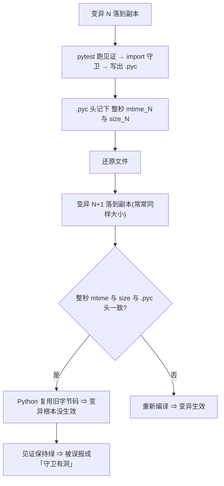

# ADR: Bisheng 策略进化引擎(分阶段,试验记账与 DSR 先行)

- 状态:已采纳(2026-11-13 用户确认,DSR 阈值 0.95 自此锁定)
- 日期:2026-11-13
- 跟踪:Issue [#15](https://github.com/laiyinyizao007/invest/issues/15)(阶段1),总 Issue [#1](https://github.com/laiyinyizao007/invest/issues/1)
- 关联:`20261109-promotion-gate`、`20261111-risk-floor-immutability`、`20261110-bisheng-ai-researcher`、`20261112-research-sandbox-config-and-approval`

## 背景
目标是用 Bisheng 搭"生成 → 沙盒回测 → 评估 → 变异"的闭环,自动寻找策略。勘察结论:网关、sha256 人工审批、迭代上限、
晋级门槛 8 项检查、select/validate 分窗、参数平原、容器隔离**均已存在**,不重建。缺口只有:

1. 试验次数记账与 DSR(进化会放大多重检验;此前 `methodology-mapping` #20/#33 以"31 组网格惩罚无统计意义"为由留作规划位,进化引擎使该前提不再成立)
2. 机器可校验的不可变参数清单
3. 父子谱系、精英库、变异反馈
4. 可提交入库的 flow 定义,以及门槛通过到 `record_promotion` 的 metrics 衔接

## 决策
### 分期
| 阶段 | 内容 |
|---|---|
| 1 | `risk/trial_ledger.py` + `risk/dsr.py`,晋级门槛新增第 9 条 DSR |
| 2 | `config/immutable_constitution.json` + 沙盒 AST 筛查拒绝覆盖 |
| 3 | `risk/lineage.py` 谱系与精英库,网关只读 `/elite`,`/feedback` 附结构化诊断 |
| 4 | `tools/bisheng/build_v4.py`、flow JSON 入库、`scripts/make_promotion_metrics.py` |

### 试验记账规则
- 每个 `param_grid` 格子计 1 次试验;每次候选提交计 1 次试验;按谱系家族累计,**只增不减**。
- 账本追加写入 `data/research/trials.jsonl`;损坏即 fail-closed(拒绝评估),与 submissions 账本一致。
- 阶段 1 的实现口径(落地时确定):
  - **全局累计**,不分家族;按家族划分随阶段 3 的谱系再引入(全局累计更保守,不会少记)。
  - 记账点(**先记账再跑,失败不退**,codex 复核后改为此口径):网关 `/candidates` 成功提交计 1;`evaluate` 启动子进程前按最小网格
    预扣 27(3 个参数 × 每个 ≥3 个取值),子进程回报的格子数更大时补记差额,超时/崩溃/策略报错也已预扣;`gate` 启动前记 1 次 `gate_run`
    并以新的累计数作为 DSR 的 N。代价:声明有误的网格(如 GridError)也会扣 27,属于保守方向。
  - 账本上限:单条 count ≤ 10⁹,累计 ≤ 10¹²,超限按损坏处理——否则 `1-1/N` 舍入为 1.0 会让 DSR 永久抛错。
  - 非有限值一律 fail-closed:`deflated_sharpe` 对 NaN/inf/溢出返回 0.0;`check_gate` 要求 `dsr` 为 [0,1] 内的有限数、`n_trials` 为 ≥1 的 int(拒绝 bool/float/NaN)。
  - 账本由可信的父进程读写,评估子进程只收到 `--prior-trials`;同进程内用锁串行,**跨进程不加锁**——并发 CLI 可能漏记极少量(偏向少记),列入已知限制。
  - 父进程对子进程回报的 `grid_cells` 只做下限加固(≥ 3³ = 27,合法网格的最小值)。这**不能**防伪造整份结果:候选代码本就在子进程内执行,
    能伪造格子数的候选同样能伪造 DSR 本身;该风险由「人读过代码才批准」和既有威胁模型(`research_sandbox.py` 文件头:纵深防御而非沙盒)承担。
  - 网关用 `_busy` 锁串行执行作业,网关内不会有两个 evaluate 读到同一个 `prior`;CLI 与网关并发才可能,列入已知限制。
  - DSR 的 V 取 `1/(T-1)`(零假设下夏普估计量方差),T = 样本外拼接日收益个数;N 取累计试验数(含本次格子)。
- 被淘汰的候选同样计数——幸存者偏差正是 DSR 要惩罚的对象。

### DSR 门槛(在此锁定,看到任何候选之前)
- **第 9 条:DSR ≥ 0.95**(Bailey & López de Prado 2014;以家族累计试验数 N 去通胀)。
- 一旦本 ADR 转"已采纳",该阈值**不得为让候选通过而放宽**;调整须先新 ADR,且只能在不查看新候选结果的前提下进行。
- 夏普估计方差取自样本外拼接日收益的偏度/峰度修正式,不另设经验系数。

### PBO 延后
- 理由:单品种(玉米)、3 个滚动窗口,且 `risk-floor-immutability` §2 已排除 CPCV;在该数据上 CSCV 组合数过少,PBO 估计噪声大于信号。
- 重启触发条件(任一):接入第二个品种;滚动窗口 ≥ 8;出现新的未消耗测试段。重启须新 ADR。

### 沿用的硬约束
- 风控底线不参与优化,进化只允许重写白名单里的成员:`entry_signal`、`param_grid`、`parameters` 与可搜索参数(`fast_window`/`slow_window`/`atr_mult`/`take_profit_r`)。白名单以 `BUILTIN_ALLOWED_OVERRIDES` 为准。
- 迭代上限(5 次 / 24 小时)、`max_source_bytes`、网关路由白名单不放宽。
- 流程内任何节点不得写 `approved/`、`promotion_approval.json` 或实盘配置;上线仍须"人工批准 → `record_promotion.py` → SimNow → 另行授权实盘"。
- 测试段(2024-01-01 起)已消耗一次,不得用于选择或进化反馈。

## 阶段 3 修订:反馈按信息来源分层(用户 2026-11-13 同意),并吸收状态页会话的裁决

背景:原计划把精英档案/父代码回给 LLM,与『硬记忆预算』冲突。问题的本质不是反馈条数,而是反馈携带多少**验证窗口**的信息:
验证窗口一旦被 LLM 反复看到,就变成训练集;DSR 只惩罚试验次数,不惩罚每次试验带回的信息量;测试段已消耗一次,目前**没有干净的留出集**。

| 信息来源 | 给 LLM / 种群选择用什么 |
|---|---|
| 选参窗口(2020-07 ~ 2022-06) | 放开:结构化指标、热力图、谱系、诊断。在这里过拟合不影响闸门 |
| 滚动验证窗口(闸门) | **梯子式量化**(`risk/ladder.py`,阶段 3):仅当超过历史最佳至少一个步长才汇报,汇报值取整到步长,否则重复上次值;另设总查询预算。状态(最佳值、已用查询数)持久化,损坏即 fail-closed |
| 最终留出(新数据 / SimNow 前向) | 永远不进入进化回路,只给人看,最终确认一次 |

与状态页会话的裁决(`20261113-evolution-dashboard.md`「变异输入与适应度」)对齐的部分,**采纳其更严格的一侧**:
- 反思节点只输出程序校验过的结构化字段(枚举 + 0–1 数值),自由文本只存档给人看,不进变异提示词(不再设「评论者 LLM 写自由文本」);
- 父代码不原样回灌,只回灌程序从代码抽取的可验证描述(用到的指标、入场条件个数、参数所在网格单元);
- 种群用简化 MAP-Elites 分格(持仓周期、交易频率等),格子从小做起;加权只用于同格内选父代;
- 变异输入仍受『最近 3 条结构化 Trace』约束;`GET /elite` 不做。

台账新增字段(名称已定,对方读取侧照此实现):`cell`(所在格子,字符串)、`diagnosis`(对象,由程序产出;内部枚举在阶段 3 定稿后通知)。

**阶段 3 范围追加(状态页会话提出,2026-11-13,待阶段 3 开工时实现):** 评估时另存 `data/research/heatmaps/<run_id>.json`,内容 `axes`、`scores`
(`[i,j,k,夏普|"-inf"]`,无效格用字符串 `"-inf"`,不写 JSON 的 `-Infinity`)、`best_cell`、`on_plateau`。得分表**不并入**网关给外层的响应(现状:`run_evaluation` 只保留摘要,
这条保持)。数据来自选参窗口,面板只读该文件。

**用户裁决(2026-11-13;状态页会话先转述,用户随后在本会话确认,来源见 `20261113-evolution-dashboard.md` 第 1 条):**
PBO **不**作晋级硬条件(延后,与本 ADR「PBO 延后」一致);DSR **不**用于选父代,选父代只用选参窗口适应度;`dsr`、`n_trials` 仍记录并展示给人看,不参与选择。
重评条件:多品种复权连续合约到位并能给出 PBO 置信区间,或出现从不进回路的独立留出集。
**代价(须如实承认):** 选参窗口内的过拟合只能靠质量多样性、结构化反馈和既有门槛(含参数高原)约束,这一层没有多重检验校正。
下面第 1、2 项**已确认**(PBO 延后、DSR 不选父代);第 3 项(出处)已在上一节核实。阶段 3 的前置因此解除,但仍待:梯子步长的定法(见上节更正)、DSR 的 V 改经验方差。

**原待确认项(留档):**
1. **「PBO 阈值作晋级硬条件」与本 ADR 的 PBO 延后冲突。** 当前复权 15 分钟连续数据只有玉米一个品种、3 个滚动窗口,PBO 估计噪声大于信号(见上文「PBO 延后」)。
   若要保留该条件,前置是扩数据:其他 DCE 品种有原始分钟线(`DCE_大连商品交易所/<品种>/00_主力连续`),但**未生成复权连续合约**,跨度未核实;需另立 ADR 并先做数据构建。
2. **适应度的来源。** 「用 DSR 打折的夏普做适应度」中的 DSR 来自验证窗口,若直接用于选父代,验证信息会经由选择回到种群,抵消梯子的保护。
   候选做法:选父代用选参窗口的适应度;验证窗口的结果只作闸门,或只以梯子量化后的值参与。
3. **方法出处未联网核实。** 梯子(Blum & Hardt 2015)、Thresholdout(Dwork 等 2015)、MAP-Elites(Mouret & Clune 2015)、FunSearch / AlphaEvolve 的评估器打分均来自记忆,落地前须核对原文再定细节。

## 出处与数据核实(2026-11-13,上节「待确认」第 3 项的结果)

**论文(读了 arXiv 全文或 ar5iv 版,非摘要):**
| 方法 | 核实结果 | 对本项目的含义 |
|---|---|---|
| Ladder(Blum & Hardt 2015,arXiv 1502.04585) | 仅当新成绩比历史最佳好出至少步长 η 才更新,更新值取整到 η 的倍数,否则重复上次值;Theorem 3.1:误差随提交次数 k 只按对数增长。另有无参变体:用配对差的标准差 s 做阈值 s/√n | 保证针对 **i.i.d. 样本上的损失**。我们是自相关的日收益序列、样本量只有约 1.5 年,保证不能直接套用,只能当设计依据 |
| Thresholdout(Dwork 等,arXiv **1506.02629**《Generalization in Adaptive Data Analysis and Holdout Reuse》) | 训练集与留出集的估计差超过带噪阈值才用留出集作答(加 Laplace 噪声),留出集作答次数有预算 B,用尽即停止回答 | 之前我误记在 1411.2664 里,那篇摘要没有 Thresholdout。同样是 i.i.d. 假设 |
| MAP-Elites(Mouret & Clune 2015,arXiv 1504.04909) | 格子粒度可先粗后细;新个体仅在格子为空或优于占位者时入格;**父代从已占格子中均匀随机选** | 状态页 ADR 的「加权只用于同格内选父代」是对原算法的有意偏离,不是原文做法 |
| AlphaEvolve(arXiv 2506.13131) | 提示里**确实包含**历史程序及其评分;程序库受 MAP-Elites 与岛屿模型启发;代码改动用 SEARCH/REPLACE 差分块 | 它的评估器是对固定问题的确定性函数,没有「留出集会被适应」的问题,**不能当作**把含噪验证指标回灌 LLM 的先例 |
| FunSearch(Nature 2023) | **未核实** | — |

**对前文建议的更正:**
- 我之前提的梯子步长 0.1 只是占位,量级不对。夏普的标准误在 3 年样本上约 0.84,验证窗口约 1.5 年则更大(≈1.2),步长应与标准误同量级;阶段 3 实现前须按配对日盈亏差的标准差定步长(参考无参变体),并在看到任何候选之前登记。
- 与 Ladder 不同,我们是「越大越好」的夏普,更新条件要取反(新成绩比历史最佳高出至少 η)。

**DSR 公式(阶段 1 已实现)核对:** 与多个公开资料一致——SR0 = √V·[(1−γ)Φ⁻¹(1−1/N)+γΦ⁻¹(1−1/(Ne))],DSR = Φ((SR−SR0)·√(T−1)/√(1−skew·SR+(kurt−1)/4·SR²)),夏普为**非年化**逐期值,峰度为**原始**峰度(正态=3);
N=100 时括号项约 2.53,与实现一致。核对对象是二手资料,未读 Bailey & López de Prado 2014 原文。
**一处偏离:** 公开资料里 V 是「N 次试验各自夏普的方差」(经验值);阶段 1 用了零假设下的理论值 1/(T−1)。真实试验的夏普分散度通常更大,所以实现比原文**偏宽松**。
改进方向:账本在记次数之外同时记录每次试验的夏普,用经验方差。这需要新 ADR 或在阶段 3 一并做,**阈值不得因此放宽**,只能更严。

**数据(本机核实):**
| 数据 | 事实 |
|---|---|
| 复权 15 分钟连续合约 | **三个品种已构建**(2026-11-13 核实,文件在 `C:/Dev/data/invest/derived/`,不在仓库内):
**玉米 C** 2020-07-22 21:00 ~ 2026-06-15 14:45,32540 根 / 1429 个交易日,换月 28 次全部精确;
**塑料 L** 2020-08-24 21:00 ~ 2026-06-15 14:45,32011 根 / 1406 个交易日,换月 19 次全部精确(含 2021-12 的 L2201→L2202→L2205 两次连续换月);
**豆粕 M** 2020-07-31 21:00 ~ 2026-06-15 14:45,32379 根 / 1422 个交易日,换月 18 次全部精确。
逐日线(`*_1d_adj.csv`):C 1526 根 2020-07-23 ~ 2026-11-09、L 1507 根 2020-08-25 ~ 2026-11-13、M 1523 根 2020-08-03 ~ 2026-11-13。 |
| 原始 1 分钟主力连续(`KQ.m`,未复权) | 2016-01-04/05 起,至 2026-06-12,品种多(C、PP、L、M、A、J、I、V 等,EB 自 2019-09-26 起);价格在换月处拼接,不能直接用 |
| 逐合约 1 分钟(`月份连续/`) | 玉米自 2020-01 起;现有构建方法依赖逐合约数据,所以复权序列只能到 2020 年 |
| 因此 | 2016–2020 的玉米没有逐合约数据,复权只能从 `KQ.m` 自身推断换月点,属近似;**C/L/M 三个品种的复权连续序列已逐一核实**(上表) |

**⚠️ 封存边界的一条边界事实(必须写下来,否则这是个 footgun)**:三个品种的 **15 分钟**文件都规规矩矩停在
**2026-06-15 14:45**(封存前向留出集的边界),但**日线文件是用新浪日线补齐到"今天"的**——
C 补到 2026-11-09、M/L 补到 2026-11-13,**已经越过 2026-06-15**。
目前没有任何研究代码读 `*_1d_adj.csv`(`optimize_15m.py` / `walk_forward_optimizer.py` 只读 `*_15m_adj.csv`),
所以还没有泄漏;但只要有人图省事改去读日线,就会把**已封存的前向留出集**当成可见数据用掉。
约定:**进化回路只准用 `*_15m_adj.csv`**;日线文件要么截到 2026-06-15,要么在读它的入口显式拒绝越界区间。

结论:换品种做留出集可行——**第二个品种的前置已完成**(L、M 的复权连续序列已构建并核实,跨度约 5.8~5.9 年,与玉米同量级);
PBO 重启(第二个品种)仍须单独立项和 ADR,但数据这一侧不再是阻塞项。

## 阶段 3 前置:DSR 的 V 与梯子步长 η 的定法(登记于**任何候选生成之前**)

这两个量和晋级阈值 0.95 是同一类东西:**看到结果之前定死的量**。看到候选之后再改它们,性质上等于放宽阈值。
因此本节的登记必须在阶段 3 产出第一份候选之前完成。

### DSR 的方差 V:改为经验方差,且只能更严
- **公式**:`V = max(V_经验, 1/(T-1))`,其中 `V_经验` 是各次试验夏普估计量的样本方差(与理论值同一口径:非年化逐期夏普、同一 OOS 窗口、同一指标定义)。
- **取 max 而不是直接替换**:这次改动只可能让 DSR 更严,不会更松。这样"阈值不得放宽"从口头承诺变成机制——以后也**没人能靠挑一个更松的 V 来放水**。
- **样本不足时退回理论值**:试验数 < 20 时 `V_经验` 不可靠,退回 `1/(T-1)`,并把"样本不足"这一事实本身记录下来(不得静默)。
- **落地**:账本(`risk/trial_ledger.py`)在记次数之外同时记录每次试验的夏普。这与阶段 3 的谱系账本是同一份数据,一起做。
- **对搜索无影响**:DSR 不用于选父代(见上),所以 V 变严只会让"晋级"更难,不会扭曲搜索过程本身。

### 梯子步长 η:按配对日盈亏差的标准差定
- **方法**:参考 Blum & Hardt 无参变体,用**配对差**的标准差估计噪声尺度——两条候选在同一验证窗口上的逐日盈亏之差,标准差比各自标准差小得多(共同的市场波动互相抵消)。取 `η ≈ 1.5 × SE(配对差)`,并设下限 **0.25 夏普**,避免在异常安静的窗口里算出 0.03 这种没意义的步长。
- **为什么不用 0.1**:3 年样本的夏普标准误约 0.84,1.5 年验证窗口约 1.2;步长 0.1 只有噪声的约 1/12,梯子会不停汇报,等于没有。
- **数值(已于 2026-11-13 算出并登记,早于任何候选生成)**:**η = 1.10 夏普**。
  - **标定脚本**:`scripts/calc_ladder_eta.py`(可复跑,`--window valid|train` 切换标定段);
    **数据**:`C:/Dev/data/invest/derived/C_15m_adj.csv`(玉米 15 分钟复权连续,在仓库之外)。
  - **窗口**:正式标定用**池化验证段 2022-07-01 ~ 2023-12-31**(n=367 个交易日)——就是阶梯实际汇报成绩的那一段;
    η 必须与"测量成绩的那段"的样本量与噪声尺度匹配,用别的段估出来的 η 放上去会失配。
    **测试段(2024-01-01 起)全程未触碰**。该段早已被消耗,不得复用。
  - **回放口径**:三个验证段**分别**回放再拼成一条序列,与 `research_gate.run_gate` 一致(段与段之间不持仓)。
    先前按"连着跑一整段"估过一次,得 SE 中位数 0.7297(η=1.095);按流水线口径重算是 0.7306(η=1.096),
    相差 0.1%——口径差异不影响结论,登记值不变。
  - **候选对**:网格里"相邻一步"的参数对(`fast` 10→…→30、`slow` 40→…→90,`atr_mult` 固定 1.5,共 60 对),
    即变异能造出的最小差异;每对在同一段上各跑一次,取**逐日盈亏之差**。
  - **估法**:对配对日盈亏做**分块自助**(块长 5 个交易日,2000 次重采样),每次重采样算一次 ΔSharpe,
    2000 次的标准差即 SE(ΔSharpe)。分块而非逐日独立重采样:日盈亏自相关,逐日重采样会低估方差。
  - **结果**:SE 中位数 **0.7306**(最小 0.4568,最大 1.0674),取中位数而非均值——单对的 SE 受个别参数组合影响很大,
    中位数对离群组合稳健。**η = max(0.25, 1.5 × 0.7306) = 1.096 → 取 1.10**(下限未触发)。
  - **交叉校验**:解析式 SE(配对差标准差 / 池化波动 × √240 / √n)与自助值同量级
    (26/80 vs 26/90:自助 0.670 / 解析 0.670;30/40 vs 30/50:自助 1.063 / 解析 0.878)。
  - **敏感性**:同一方法在 W1 训练段(2020-07-22 ~ 2022-06-30)上得 SE 中位数 0.6731、η = 1.010,
    与验证段的 1.095 相差 8%——说明这个步长不是某一个窗口的偶然。取**两者中较大的**(1.10)作为登记值。
  - **性质**:η 是**汇报阈值**(阶梯什么时候更新汇报值),**不是晋级门槛**;与 DSR 0.95 互相独立,不受其影响。
  - **一处口径不一致,已做敏感性对照(登记在此,不留隐患)**:标定脚本 `calc_ladder_eta.py` 的
    `setting_of()` 用的是 `max_daily_losses = 3`,而**模板默认值是 2**(`strategies/trend_atr_strategy.py`)。
    这不是笔误,是标定的选择:熔断阈值小的时候,连亏会把某些参数对的成交截断,配对差就退化。
    为了确认这个选择**不影响**登记值,用同一口径(池化验证段、2000 次重采样、同种子)把阈值改成 **2** 重跑了一遍:
    SE 中位数 **0.7312**(用 3 时是 0.7306),**η = 1.097**(用 3 时是 1.096)——两者都取整为 **1.10**。
    结论:**η 对熔断阈值不敏感**(差 0.08%),登记值 **1.10 不因这个不一致而变动**,
    不存在"为了凑一个数去调阈值"的情况。以后若有人问"为什么标定用 3 而模板是 2",答案是这条对照。
    (注:模板默认是 2 的理由写在模板里——日线策略几乎不会连亏两笔,那个熔断主要是给未来的日内策略用的。)
    它越大,阶梯越"粘"(很少更新汇报值),误差随提交次数增长得越慢;这正是想要的保守性。
- **取整方向**:我们是"越大越好"的夏普,更新条件取反(新成绩比历史最佳高出至少 η 才汇报,汇报值取整到 η 的倍数)。

### 第二个品种:数据准备现在做,PBO 仍然延后
- **数据流水线现在做**:构建第二个品种的复权连续序列是纯数据工程,不涉及策略决策,在看到候选之前做完**不引入偏差**(反而避免后面忙乱时改数据口径)。毕昇模型配额卡着,这是现成的空闲时间。
- **PBO 仍延后**:1 个品种 × 3 个窗口能切出的 CSCV 组合太少,估出来的 PBO 基本是噪声,拿它当判据比不看更糟。重启触发条件见本 ADR 的 PBO 章节。
- **注意**:第二个品种的复权序列同时是上面 η 定量的前置,两件事共用同一份数据工作。

## 封存前向留出集(用户 2026-11-13 确认)
2026-06-15 之后的新数据(`C_15m_adj.csv` 最后一根为 2026-06-15 14:45)声明为**封存前向留出集**:进化回路(选参、验证、反馈、梯子)永远不可见,只在最终确认时由人触发使用一次。
结构性保证已存在:`research_gate.slice_bars` 拒绝任何 ≥ `TEST_SEGMENT_START`(2024-01-01)的 K 线,新数据天然落在该范围之后,评估无法触及。
尚未做(后续项):专门的前向留出登记(一次性使用账本)与最终确认脚本;持续录入新数据由用户负责。

## 阶段 2:不可变宪法(Issue #16)

清单文件 `config/immutable_constitution.json`,内置清单在 `risk/constitution.py`。**清单只能追加,不能删减内置项**;
文件缺失或非法一律 fail-closed(拒绝执行),不做"默认放行"。

三层防线:
| 层 | 位置 | 拦什么 |
|---|---|---|
| 静态(提交时) | `research_sandbox.screen_source` → `constitution.screen_source` | 类体覆盖受保护成员、重写受保护方法、实例上改写受保护属性、改写受保护的风控模块函数、下单/撤单接口、禁用内建函数的**引用**、**框架的"按名 setter"**、受保护参数作为**关键字参数**或字典键出现、**受禁 dunder 的定义与引用**(见下)、自定义 metaclass、类装饰器 |
| 运行时(执行前) | `research_api.import_candidate` → `constitution.check_class` | 候选必须继承模板家族;不得重写白名单以外的**模板成员**——覆盖候选类体、中间基类、类创建后动态打的补丁三类;不得定义受禁 dunder;不得定义按名 setter;不得自定义 metaclass |
| 参数(请求时) | `research_api.check_params_allowed` → `constitution.check_params` | 调用方不得在设置字典里指定受保护参数或成员(此前 `backtest`/`gate` 不校验参数键名),**大小写不敏感**比对;子进程入口(`_child`/`_gate_child`/`_evaluate_child`)自己再查一遍——子入口是独立的信任边界 |

要点:
- **家族而非模板**:要求继承"模板所属家族"(MRO 里最靠近 object 的**应用层**基类),不要求继承 15 分钟模板本身——研究与沙盒也跑日线族。家族根必须排除 vnpy 框架基类与 `abc.ABC`;早先按"祖先名字/模块"猜测会把 `abc.ABC` 当成家族根,连带把模板自身成员误判为"候选重写",导致**每个真实候选都被拒**。
- **静态层不判断"是否重写了模板成员"**:模板成员名单要到运行时才知道,那一层由 `check_class` 负责;静态层只管受保护项与下单接口。候选**新增**成员(新指标、新辅助方法)允许。
- 白名单 `allowed_overrides` 默认只有 `entry_signal`、`param_grid`、`parameters` 与可搜索参数;试图把受保护项加进白名单一律拒绝(不静默过滤,以免掩盖配置错误)。白名单与受保护清单的冲突在**合并后**的集合上校验,冲突即报错。
- `research_grid.FORBIDDEN_AXES` 改为从清单派生,避免两处各写一份而漂移。
- **清单的 `template` 只能取内置白名单内的类**:换成任意可导入的类(如 vnpy 的 `CtaTemplate`)会让继承约束形同虚设;要换模板必须改代码、走代码评审。
- **"只能追加"靠版本控制保证**:`load()` 只与代码里的内置集合合并,察觉不到文件里的删除。清单相对上一次提交只增不减,由 CI 检查(`test_constitution_history_is_append_only`)逐个历史版本比对;**内置**保护项写在代码常量里,那个比对看不见,另由 `test_builtin_protections_are_never_shrunk` 从历史版本里把常量读出来比对(否则把 `BUILTIN_PROTECTED_PARAMETERS` 里的 `risk_budget` 删掉,其它检查一样全绿)。两个检查都需要**完整历史**:CI 必须 `fetch-depth: 0`,浅克隆下检查直接失败而不是跳过——查不了等于没查,不能让它冒充通过。
  - 第 5 轮复核发现这条检查**曾经形同虚设**:提取器只认 `tuple`/`list` 字面量,而 `BUILTIN_PROTECTED_NAMES` 的定义是 `(...) + BUILTIN_PROTECTED_PARAMETERS`(一个 BinOp),于是这个最大的一组受保护成员从来没进过比对——删掉 `on_disconnect` 之后 Constitution Guard 照样全绿(两轮外部复核都独立复现了)。现已改为受控的常量表达式求值(支持字面量、常量之间的 `+`、同文件常量引用),并**fail-closed**:注册表里的常量解析不出来就报错,而不是静默跳过。
  - 内置保护的范围也扩了:除了 `risk/constitution.py` 的七个常量,沙盒层的 `FORBIDDEN_MODULES`/`FORBIDDEN_CALLS`/`FORBIDDEN_ATTRS` 一并纳入历史比对(它们同样挡着模块导入与反射入口)。
  - 历史列表用 `git log --full-history`:默认的历史简化会把"与某个父提交内容相同"的合并提交剪掉(那种提交不比也不会漏内容,但列表更直白)。
  - 清单文件至今只有一个历史版本,此时"平凡通过"而不是 `skip`——CI 输出里的 `1 skipped` 与 pass 长得一样,让人以为检查跑过了。

### 拦"引用"而不是拦"调用"
`f = object.__setattr__` 之后 `f(self, "risk_budget", 1e9)` 的调用点是裸名字,AST 看不见被调的是谁;实测这个写法**真的能击穿风控底线**(`within_budget(100.0, 10.0, inst.risk_budget)` 在改写后返回 True)。因此静态层一律拦**引用**:
- 受禁 dunder(`__setattr__`/`__delattr__`/`__getattribute__`/`__getattr__`/`__init_subclass__`/`__set_name__`)的任何 `ast.Attribute` 引用与裸名字引用;
- 下单/撤单接口(`buy`/`sell`/`send_order`/`cancel_all` …)的任何 `ast.Attribute` 引用与裸名字引用;
- 禁用内建函数(`getattr`/`setattr`/`delattr`/`vars`/`globals`/`locals`/`eval`/`exec`/`compile`/`open`/`__import__`/`input`/`type`)的任何名字引用。

同样地,`operator.attrgetter('__dict__')(self)` 把属性名当字符串用,绕开了"禁止访问 `__dict__`"的属性写法检查——`operator` 模块整体禁用,受禁属性名作为**字符串常量**出现也一律拒绝。

**关于字符串常量的准确口径(第 5 轮更正)**:沙盒层对 `FORBIDDEN_ATTRS`(`__dict__`、`__class__` 等)的检查是**完全相等**匹配,不是子串匹配。所以 `X = "__dict__"` 会被拒,而文档字符串里"提到"某个名字(比如 `"""we use __dict__ here"""`)**不会**被拒——早先这份 ADR 写的是"文档字符串里提到也会被拒",说过头了,以本段为准。

### 框架的"按名 setter":不给"按键名改写"留任何入口

第 5 轮复核实测出的一条活的绕过:`CtaTemplate.update_setting(setting)` 会把字典里的键**按键名** `setattr` 到实例上,
而模板的 `parameters` 列表里正好有四个受保护参数(`risk_budget`/`max_daily_losses`/`atr_window`/`history_vt_symbol`)。
于是候选只要写

```python
self.update_setting(dict(risk_budget=1e12))
```

就能把单笔风险预算从 300 改成 1e12——而这个名字在源码里既不是属性赋值也不是字典键(是 `ast.keyword.arg`),
按语法位置筛查看不见它。实测改之前:静态层返回空列表、运行时类校验返回空列表、候选被接受,
`within_budget(100, 10, 1e12)` 返回 True(真实底线 300 时返回 False)。

处理:
- 新增 `BUILTIN_FORBIDDEN_BY_NAME_SETTERS`(`update_setting`),**任何引用**都拦(不只调用),取别名同样拦;
- 候选自己定义 `update_setting` 也拦(引擎初始化时会调用它),类体里写成赋值(`update_setting = 3`)同样拦;
- 受保护参数作为**关键字参数**出现也拦(`dict(risk_budget=…)`),按大小写不敏感比对,与参数层同一把尺子。

### 第 7 轮补记:另一条同类入口——`__builtins__['setattr']`

第 6 轮复核实测出**同一个后果**的另一条路径,静态层与沙盒层当时都返回空列表:

```python
__builtins__['setattr'](self, 'risk_budget', 1e12)     # 底线 300 → 1e12,within_budget 随之放行
```

`exec(code, module.__dict__)` 会往候选的 globals 里注入一个 `__builtins__` **字典**,
里面就有 `setattr`。此前只有 `x.__builtins__` 这种**属性写法**被拦,裸名与字符串形式都漏了。
处理(在沙盒层,因为它本来就是"禁用内建与反射入口"那一层):
- 受禁属性名(`__builtins__`/`__dict__`/`__class__`/`__mro__` 等)的**裸名**引用一律拒;
- 这些名字以及 `setattr`/`getattr`/`eval`/`exec`/`globals`/`locals`/`vars`/`__import__`/`compile`/`input`
  作为**字符串常量**出现也拒;
- `import builtins` 早就在模块禁用名单里(`FORBIDDEN_MODULES`),不另开口子。

**为什么不把 `open`/`type` 也按字符串拒**:交易数据里 `"status": "open"` 这种字段值很常见,
按字符串一律拒会把正常候选整片拒掉——误报面远大于收益。真正危险的是"按名字改写/反射"这一类。

### 执行时的能力隔离:不给,而不是再禁一批名字

第 7 轮复核(`gpt-5.6-sol`)指出:前面这些**静态**规则封住的是**已知写法**,不是能力本身。
实测两条等价后果的路径,静态层与沙盒层都返回空列表:

```python
e.__traceback__.tb_frame.f_builtins.setattr(self, 'risk_budget', 1e12)   # 经异常回溯拿到内建字典
from unittest import mock; mock.patch.object(self, 'risk_budget', 1e12)  # 能改写任意对象属性的模块
```

继续枚举反射路径是枚举不完的(每加一批名字都要配测试,而且总有下一个)。所以改成**把能力收走**:
候选执行时(`exec(code, module.__dict__)`)显式给一份**最小内建集合**
(`scripts/research_sandbox.py::safe_builtins`):

- `setattr`/`delattr`/`getattr`/`eval`/`exec`/`compile`/`open`/`globals`/`locals`/`vars`/`type`/`object` 等一律**不给**;
- `__import__` 换成**受限导入器**:只放行不在禁用名单里的模块(`builtins`、`unittest.mock` 等已加进名单);
- 其余内建(`len`/`range`/`min`/`max`/`sum`/`sorted`/`isinstance`/`hasattr`/`Exception` 等)照常给。

这样一来:无论候选怎么绕,**它能拿到的内建字典里就没有 `setattr`**——
连 `frame.f_builtins` 也只会拿到这份受限字典(帧的 `f_builtins` 取自模块 globals 的 `__builtins__`)。
`unittest.mock` 那条路则由受限导入器直接关上。

> **第 22 轮补记(Issue #26)对这段话的更正**:上面这句只在**候选自己那些帧**里成立。
> 别人的帧(导入机制、第三方库)里的 `f_builtins` 仍然是**真实内建**——
> 第 22 轮用动态探针实测确认(第三方库 `numpy` 的帧里 `setattr` 就在)。
> 所以准确的说法是:"候选自己执行的代码里没有 `setattr`",不是"进程里没有 `setattr`"。
> 详见下面"第 22 轮补记"。

代价:候选用到这些名字会得到 `NameError`/`AttributeError`(而不是静默放行),由人在批准前看出来;
`type(...)` 这种常见写法也会失效。这是本项目一贯的 fail-closed 取舍。

**这不是安全边界的终点**:容器隔离(`docker-compose.research.yml`:无网络、只读挂载、`cap_drop ALL`)
与"运行前由人读过代码"仍然是真正的边界。能力隔离只是把"静态黑名单挡不住的那部分"又收了一层。

### 第 8 轮补记:风控执行点、整条属性路径、回测后的实例状态

第 8 轮(codex CLI 深度分析,**36/50,未通过**;与第 7 轮并行,审查期间工作区被并发修改)
报出两条 **Critical**。两条都是**实测复现**过的(真实 15 分钟玉米数据,不是推测),
而且当时**三层校验全绿**——静态层、沙盒层、运行时类校验全部返回空列表。

#### Critical 1:候选可以**调用**模板的风控执行点

```python
class Evil(TrendAtr15mStrategy):
    def entry_signal(self) -> int:
        signal = super().entry_signal()
        if signal:
            self._send_entry(signal, float(self.atr_value) * 50.0, float(self.am.close[-1]))
        return 0
```

`BUILTIN_PROTECTED_NAMES` 只防**重定义**(`check_class` 比对类字典),静态层只拦三类**引用**
(受禁 dunder / 按名 setter / 下单接口)。受保护的**方法名**不在引用黑名单里,
于是候选借到了模板自己的下单机器——而 `within_budget(dist, self.get_size(), self.risk_budget)`
与 `self.guard.can_open(...)` **都在被绕过的那个函数体内**(`_try_enter`)。
实测(`atr_mult=50`,窗口 2022-07-01~2023-06-30,3000 根 15 分钟 K 线):

| | 成交笔数 | 单笔止损距离 | 被预算拦下 |
|---|---|---|---|
| 诚实模板 | 0 | — | 157 |
| 上面这段候选 | 2 | 508.7 | 0 |

508.7 元 ≈ 17 倍的 300 元单笔预算。

**处理**:新增 `BUILTIN_PROTECTED_ENTRY_POINTS`(`_try_enter`/`_send_entry`/`_manage_position`/
`_place_protective_stop`/`_place_pending_entry`/`_process_daily_bar`/`_ensure_protective_stop`/
`_stop_order_price`/`_complete_stale_daily_bar`),静态层对这些名字的**引用**一律拒——
**不只拦调用**:`f = self._send_entry` 之后的 `f(...)` 调用点已经看不出是谁了。

#### Critical 2:静态层只看赋值的**末段属性名**,不看整条属性路径

```python
self.guard.max_losses = 999      # 当日连亏熔断失效
self.guard._losses = 0
self.cta_engine.size = 0.001     # 合约乘数改小 → 风险金额接近 0
```

`guard`/`trail`/`am`/`cta_engine` 是**实例属性**:既不在 `vars(candidate)` 里(`check_class` 只比类字典),
也不在受保护名清单里(受保护的是 `guard` 这个**名字**,不是它指向的对象)。
实测:改 `guard` 后成交 120 → 149 笔(熔断形同虚设);改 `cta_engine.size` 后回撤从
-4272 元 / -39.97% 缩成 **-0 元 / -0.00%**,`promotion_gate` 的 2000 元与 20% 两道门槛**同时失效**
(夏普是比值,不受影响,所以门槛看起来"过了")。

**处理**(三条):
1. 静态层改为解析**整条属性路径**(`self.guard.max_losses` 整条路径入库),命中即拒;
2. 新增 `BUILTIN_PROTECTED_STATE_OBJECTS`(`guard`/`trail`/`cta_engine`):对这些对象**连引用都禁**
   ——只禁"写"会被别名绕过去(`g = self.guard` 之后的 `g.max_losses = 999` 按属性路径查也查不到);
   `am`/`bg` 不在此列(候选要读行情 `self.am.close[-1]`,那是它的正当用途),只受"不得写入"约束;
   另把 `am.array` 列为受保护路径(整条路径不得出现在源码里);
3. 新增**运行时第三层** `constitution.check_instance_state()`:回测**跑完之后**核对实例上的
   `risk_budget`/`atr_window`/`max_daily_losses`/`guard.max_losses`/`cta_engine.size`,
   不一致即 fail-closed 抛错(`scripts/backtest_lib.py` 的两条入口都接上)。
   这层**不依赖候选写得老实**——静态层拦写法、类校验拦类字典,这一层拦的是**回测途中**才发生的改写。
   比对基准是**回测开始前的快照**,不是模板常量:研究脚本会用更大的 `risk_budget` 做敏感性实验
   (`tests/test_strategy_backtest.py` 里就是),那是合法的;被改写的是"回测途中"。

#### 第 8 轮之后自查又发现的两个缺口(自己写的新规则自己复查时抓到的)

**缺口 1:写受保护成员只看 `self.` 开头的路径,`s = self` 之后绕过去。**
上面那条"按整条属性路径判定"最初只认 `self.` 根,于是这三种写法静态层**全返回空列表**:

```python
s = self;  s.risk_budget = 1e12      # 给 self 取别名之后改底线
o = object();  o.risk_budget = 1e12  # 根不是 self
s = self;  s.am.close = [1.0]
```

第三条还算**回归**:早先的规则是按赋值的**末段**属性名判定的(`target.attr`),
`o.risk_budget = ...` 那种写法本来就被拒;换成"只看 self 根的整条路径"之后反而放行了。
现改成:**属性路径里任何一段命中受保护成员就算越权**(不限根)。

**缺口 2:行情数组可以被原地改写——那等于伪造回测数据。**

```python
self.am.close[0] = 999.0        # 下标赋值:改的是被取到的那个对象
arr = self.am.close;  arr[0] = 999.0   # 取别名之后原地改
```

vn.py 的 `ArrayManager` 里 `close` 是 **property**,返回的就是 `close_array` 本身(不是副本),
所以"取出来再改"与"直接改"是一回事。候选改掉已经走过的价格,就能凭空造出一段行情。
现补三条:**下标赋值**也按整条路径判定(`self.am.close[0] = …` 命中 `am`);
新增"**受保护容器不得取别名**"(`arr = self.am.close` 拒——带下标的读 `x = self.am.close[-1]`
与带调用的读 `x = self.am.atr(14)` 放行,别把正常用法一起误伤)。

**顺带更正本 ADR 早先的一句过头话**:原先写"`numpy 标量(self.am.close)`是取不出来的副本,不在此列"——
**不成立**,`self.am.close` 就是那个数组本体。另外 `BUILTIN_PROTECTED_PATHS` 里的 `am.array`
在 vn.py 的 ArrayManager 里**根本没有这个属性**(真实的是 `close_array`/`open_array`/…),
这一条几乎匹配不到东西;真正护住行情数组的是上面的"容器不得取别名"。该条目留着是因为
历史守卫对内置清单只查"只增不减",删条目会被判违规——这一点也写在这里,免得以后有人以为它有用。

**新守卫第一次实战生效**:改写 `_write_violation` 时顺手把 `c.protected_names` 的直接引用
换成了 `_is_protected(...)`,引用次数从 10 降到 9,**守卫当场报了出来**
("常量还在但底线的执行点被删了")。这条规则不是摆设。

#### 其余发现(同轮)

- **High 3——历史守卫只守常量,不守常量的执行点**:删掉 `if name in BUILTIN_FORBIDDEN_DUNDERS:` 整块、
  窄化该判断、删掉 `forbidden_order_calls` 分支、`_is_protected` 恒返回 `False`,
  这四种改法下守卫退出码**都是 0**(全绿)。守卫比对的是**常量集合**,不看常量**被怎么用**;
  "常量还在、底线的执行没了"正是它挡不住的那条路。
  **处理**:改为按 AST 统计受保护常量的**引用次数**(Load 语境,定义处不算),引用次数减少即报错;
  `BUILTIN_ALLOWED_OVERRIDES` 另定为**只减不增**(白名单加一项 = 多放开一点底线,
  与"清单只能追加"的规则正好相反)。
- **Medium 4——网格的受保护轴检查与 `check_params` 口径不一**:前者大小写敏感且只覆盖
  `protected_parameters`,后者大小写不敏感且含 names。现收敛到 `constitution.protected_lower_all()`
  这一把尺子,两边共用。
- **Medium 5——`check_params` 只查顶层**:嵌套字典/列表里的受保护键漏检。现改为递归。
- **Low 6——受禁 dunder 名单漏了反射型的那批**:`__del__`/`__reduce__`/`__reduce_ex__`/`__mro_entries__`/
  `__dict__`/`__class__`/`__mro__`/`__globals__`/`__code__` 等。现已补齐(见上面的保留字表)。
- **Low 7——`__slots__` 里藏受保护名能过静态层**(运行时层兜住了)。现静态层也扫 `__slots__` 元素。
- **Low 8——子入口的 TOCTOU**:子入口先查审批(读一次文件),再由 `import_candidate` **重新读一次**
  并校验**调用方传入的** `--sha256`,两次读之间文件若被换掉就会跑未审批内容。
  已改为按**审批命中的哈希**核对(并行的那一路会话完成,提交 `f90807d`)。

#### 本轮之后仍然存在的残余缺口(如实记录)

1. 静态层是**纵深防御,不是安全边界**——真正的边界仍是容器隔离与"运行前由人读过代码";
2. `am` 的**子对象**按"容器"整体保护(取别名即拒),没有逐个字段建模;
   静态层不做作用域解析,`self` 的别名之外的路径靠"路径里任何一段命中受保护成员"这条规则兜着,
   但它挡不住**同名但无关**的对象(比如候选自己造一个叫 `guard` 的字段——那种写法会被误伤,属 fail-closed 的有意取舍);
3. 晋级门槛缺**逐笔风险预算审计**:能通过门槛的候选,逐笔风险金额仍可能大于 300 元
   (只是没被改写而已)——这是下一步要补的,不是本轮解决的;
4. 守卫现在守"引用次数",不是守"语义"——把一次 `if name in BUILTIN_FORBIDDEN_DUNDERS:`
   改成 `if name in BUILTIN_FORBIDDEN_DUNDERS or True:` 之类的同义改写仍可能躲开计数。
   语义级的守卫需要把执行点本身登记成受保护常量(下一步)。

### 第 9 轮补记:模块级改写、`__new__`、以及运行期第四层(身份指纹)

第 9 轮(codex CLI 深度分析,**34/50,需改进,不建议发布**)报出一条 **Critical** 与若干 High/Medium/Low。
与前几轮不同的是:这一条**四层防线全部放行**,而且绕开的是"整条属性路径判定"本身——

```python
import risk.risk_guard as rg
rg.risk_per_trade = lambda *a, **k: 0.0     # 单笔风险恒为 0 → 300 元预算形同虚设
```

第 8 轮刚加的"整条属性路径"规则在这里**不起作用**,原因有两个:
其一,静态层判的是"候选**自己**的源码里出现了受保护成员的路径",
而这里被改的是**模块对象上的属性**——路径是 `rg.risk_per_trade`,
`rg` 是候选自己起的别名,静态层无从知道它指向 `risk.risk_guard`;
其二,`risk_per_trade` 这个名字本身**不在**任何受保护名单里(受保护的是方法与状态对象),
第 8 轮新增的 `BUILTIN_PROTECTED_MODULE_ATTRS` 正是为这条补上的。

即便补了名单,写法一换就又漏:`rg.risk_per_trade = …`、`import risk.risk_guard as rg` 后赋值、
`type(cls).risk_budget = …`(路径的根是**调用表达式**,路径解析在那一段断掉)、
`sys.modules["risk.risk_guard"].risk_per_trade = …`……
**枚举写法是枚举不完的**。这与第 7 轮的结论一致:**黑名单封的是"已知写法",封不住"能力"**。

#### Critical 1 的处理:运行期第四层——受保护对象的身份指纹

不再枚举写法,改为**事后比对身份**:

```python
PROTECTED_RUNTIME_PACKAGES = ("risk", "strategies", "vnpy_ctastrategy")

before = snapshot_protected_state()   # 候选执行前
exec(candidate_code, module.__dict__)
after  = snapshot_protected_state()   # 候选执行后
tampered = check_protected_state(before, after)   # 被替换/被删除/被新增 → fail-closed
```

指纹覆盖**三个受保护包下所有已加载模块的公开属性**,以及其中**每个类的成员**;
容器(list/dict/set)取**副本**比对,函数与类比**身份**。
于是不管候选用哪种写法(`rg` 直接改、别名改、`type(cls)` 改、`sys.modules` 改),
只要换了对象就对不上——**写法不再重要,结果才重要**。

接点有三处:
- `scripts/research_api.py::import_candidate`:候选**导入期**前后各拍一张;
- `scripts/backtest_lib.py`:两条回测入口(`run_engine` / `run_engine_bars`)在
  `engine.add_strategy(...)` **之后**拍基线,回测**结束后**再拍一张——
  回测途中才发生的改写(第 8 轮第三层看的是实例状态,这一层看的是框架对象)同样能抓住。

**快照必须覆盖到模板模块**:模板是候选自己 import 的,
若在候选 import 之后才拍快照,快照里根本没有它,候选在导入期把它改写了也拍不到。
所以 `_preload_protected_modules()` 在拍快照**之前**先导入
`vnpy_ctastrategy`(`template`/`backtesting`/`engine`)与模板模块本身。
这一条是 codex 实测出来的:不预加载时,候选改写模板类**完全不被记录**。

#### High 3:`__new__` 早于快照,构造期改写结构性不可见

`__new__` 在**实例构造时**执行,早于回测前的快照——
它里面的改写会被当成"基线",运行期第三层(比对实例状态)**结构性地看不见**。
第 9 轮 codex 实测:候选定义 `__new__` 并在里面改 `risk_budget`,三层防线全部放行。
候选没有任何正当理由自定义 `__new__`(模板也没有),所以直接**禁掉**:
`__new__` 加入 `BUILTIN_FORBIDDEN_DUNDERS`(不得定义、引用或调用)。

#### 其余发现(同轮)

- **High 3——ADR 保留字表漏项**:表里没列"受保护模块级成员""受保护容器"
  "运行期受保护包",`__new__` 也漏了,而表是候选作者**唯一的查处**——
  漏了就等于没有。已补齐,并把 `tests/test_research_sandbox.py` 里的
  `listed()` 扩展到**全部**宪法名单(`BUILTIN_PROTECTED_NAMES` 整组、
  `BUILTIN_PROTECTED_MODULE_ATTRS`、`BUILTIN_PROTECTED_CONTAINERS`、
  `BUILTIN_PROTECTED_PATHS`、`BUILTIN_PROTECTED_ENTRY_POINTS`、
  `BUILTIN_PROTECTED_STATE_OBJECTS`、`PROTECTED_RUNTIME_PACKAGES`),
  以后代码里加任何一个名字而表里没写,那条用例会当场红。
- **Medium 5——候选能 import 风控包**:`risk` 整个包加入 `FORBIDDEN_MODULES`
  (静态层与受限导入器同时生效)。候选没有正当理由 import 风控模块——
  风控由基类固定,候选只写信号逻辑。
  注意**不能**把 `strategies` 一并禁掉:候选本来就要
  `from strategies.trend_atr_15m_strategy import TrendAtr15mStrategy` 继承基类。
- **Low 6——历史守卫重复解析**:守卫此前对**每个**历史版本都重新解析一遍当前源码
  (引用次数统计),历史一长就是平方级的浪费。改为**当前源码只数一遍**,
  新增 `usage_regressions_from_counts(current_counts, older_source, names)`,
  `usage_regressions()` 保留为包装(它有测试在用)。
- **新增登记**:第四层的覆盖范围(`PROTECTED_RUNTIME_PACKAGES`)与预加载清单
  (`_PROTECTED_PRELOAD_MODULES`)已登记进 `tools/check_constitution_history.py` 的
  `BUILTIN_SETS`——少一个包 = 那一个包不再受指纹保护,历史守卫会报出来。

#### 第 9 轮之后仍然存在的残余缺口(如实记录)

1. **指纹不是"内存证明"**:它比对的是**已加载模块**的属性与类成员。
   候选若通过 `importlib`/`ctypes` 之类手段在别的命名空间里造一个"影子"对象,
   指纹看不见——但那类模块本来就被禁用清单挡着(`importlib`/`ctypes` 均在 `FORBIDDEN_MODULES` 里),
   且**它改不到真框架对象**,所以对底线的威胁有限。
2. **指纹只覆盖三个包**:别的第三方库(数据源、日志、指标)不在范围内。
   它们不承载风控判定,所以当前不构成底线风险;若将来引入承载风控的新包,
   必须同时加进 `PROTECTED_RUNTIME_PACKAGES`(历史守卫会强制这一点)。
3. **静态层仍然是纵深防御,不是安全边界**——真正的边界仍是容器隔离
   (`docker-compose.research.yml`:无网络、只读挂载、`cap_drop ALL`)与"运行前由人读过代码"。
4. **守卫守的是"引用次数"与"集合内容",不是语义**:把一次检查改写成同义形式仍可能躲开计数;
   `PROTECTED_RUNTIME_PACKAGES` 这种"多一项更严"的常量已登记,但语义级守卫仍未做。
5. 晋级门槛仍缺**逐笔风险预算审计**(第 8 轮登记的遗留项,本轮未动)。

### 第 10 轮补记:函数对象的**状态**、实例上的**遮蔽**,以及"判定逻辑本身"可被改写

第 9 轮引入的运行期第四层(受保护对象的**身份指纹**)把"换个写法改写框架对象"堵住了,
但它比的是**身份**(`("id", value)`)。第 10 轮 codex 复核与本地自查各抓到一条 Critical,
两条都**四层防线全部放行**,且都不是"写法"的问题:

#### Critical 1(codex):改的是函数**对象的状态**,不是它的名字

    from strategies.trend_atr_strategy import within_budget
    within_budget.__defaults__ = (0.0,)        # volume 的默认值变成 0

`within_budget` 还是**那个函数对象**,身份没变,只比身份完全看不见;
而改完之后单笔风险金额恒为 0,300 元预算形同虚设。
实测:`within_budget(500, 10, 300)` 由 `False` 变成 `True`。

处理(纵深,三处各自独立):

- **静态层**:把 `__defaults__`/`__kwdefaults__`/`__annotations__`/`__wrapped__`
  加进 `BUILTIN_FORBIDDEN_DUNDERS`,沙盒的 `FORBIDDEN_ATTRS`/`FORBIDDEN_STRINGS` 同步;
  候选没有任何正当理由碰这些 dunder。
- **静态层(读)**:新增 `BUILTIN_PROTECTED_READ_ATTRS`
  (`within_budget`/`stop_distance`/`risk_per_trade`/`DailyLossGuard`/`TrailingStop`/`trading_day`)——
  候选**不得读**风控对象。风控由基类固定,候选只写信号逻辑;
  拿到定义就多一条改写它的路。只收**不会误伤**的名字:泛用词
  (`reset`/`can_open`/`on_trade_closed`/`ceil_to`/`floor_to`)不在其中。
- **第四层**:指纹对函数不再只比身份,而是比
  `(函数对象, __code__ 的 id, __defaults__, __kwdefaults__, 闭包单元格内容)`。
  就地改写默认参数、换掉代码对象、改闭包里捕获的变量,都会被报出来。

#### Critical 2(自查):在**实例**上遮蔽模板方法

    def entry_signal(self):
        self.get_size = lambda: 0.001        # 真实合约乘数 10
        return 1

`within_budget(dist, self.get_size(), self.risk_budget)` 读到的是 0.001,
300 元预算算成 0.003 元,任何止损距离都"在预算内"。
类字典里没有这个赋值(`check_class` 比不出来),实例字段快照只盯三个底线值,
指纹只覆盖模块属性与类成员——所以四层全放行。

处理:

- **静态层**:`get_size` 进 `BUILTIN_PROTECTED_NAMES`(它是"决定风险金额"的框架方法),
  `self.get_size = ...` 按名字被拦。
- **第三层**:新增"实例上不许遮蔽模板方法"的核对——模板 MRO 里的**可调用**成员,
  实例字典里不许出现这些名字(白名单里的 `entry_signal` 等除外)。
  这里只查"实例上有没有遮蔽",不比"实现是不是同一个":同一个家族里日线模板与
  15 分钟模板本来就有各自的实现,按"必须等于某个模板的实现"去比会误伤合法的日线策略。

#### 其余发现(同轮)

- **High 1——`trading_day` 没被保护**:熔断器按它分日("今天亏了几笔"),
  改掉它就能把昨天的亏损算到今天,当日连亏熔断随之失效。
  已进 `BUILTIN_PROTECTED_MODULE_ATTRS` 与 `BUILTIN_PROTECTED_READ_ATTRS`。
- **High 2——指纹"跳过所有 dunder"**:于是改写类的 `__getattribute__`
  (让 `self.get_size()` 返回假的)或 `__instancecheck__`(把 isinstance 判定废掉)都拍不到。
  改成**显式忽略清单**(`_FINGERPRINT_IGNORED_DUNDERS`,只放过纯元数据),
  其余 dunder 一律进指纹;`__instancecheck__`/`__subclasscheck__`/`__subclasshook__`/`__prepare__`
  同时进受禁 dunder 名单。
- **High 2 的另一半——家族判定本身可被改写**:第三层原来用
  `isinstance(strategy, family_root(template))` 判"这是不是模板家族的策略",
  而 `isinstance` 的判定逻辑正是 `ABCMeta.__instancecheck__`——把它换掉,
  第三层直接判成"不适用"而放行。改成按 **MRO** 判定(结构判定,没有可改写的入口)。
- **Medium 1——受保护模块成员"只禁写不禁读"**:读一次就多一条改写的路,
  由上面 `BUILTIN_PROTECTED_READ_ATTRS` 补上(只收不会误伤的名字)。
- **Medium 3——第四层的"回测前"基准拍晚了**:`backtest_lib` 里基准是在
  `engine.add_strategy()` **之后**拍的,构造期的改写会被当成"基线"。
  基准前移到构造之前(`run_engine` 与 `run_engine_bars` 两处)。
- **Medium 4——第四层的**执行点**没人守**:删掉 `check_protected_state(...)` 那一行,
  常量集合没变、清单文件也没变,第四层就此失效。
  `tools/check_constitution_history.py` 新增 `CALL_SITE_REGISTRY`,
  按"引用次数只许增不许减"守 `snapshot_protected_state`/`check_protected_state`
  在 `backtest_lib` 与 `research_api` 两处的引用次数(实测:删掉调用后守卫退出码 1)。
- **Low 1——泛用名按名字一刀切**:`self.indicator.reset = 1` 这种普通写法会被
  `reset`(TrailingStop 的方法名)误拒。带主的名字改成**主人也在路径里**才算命中
  (`BUILTIN_MODULE_ATTR_OWNERS`),路径断在调用表达式上时只认底线成员。
- **Low 3——比对可能抛异常**:numpy 数组的 `==` 返回数组,放进 `bool()` 会抛 ValueError,
  原实现会把它当成"被改写"(误报)。指纹改用 `_safe_token`:能按值比的按值比
  (浮点用 `repr` 解决 nan),不能的一律退化成身份标记,**比对永不抛异常**。

#### 第 10 轮之后仍然存在的残余缺口(如实记录)

1. **第四层仍是"前后差分"**:候选若在回测途中"改→用→还原",差分看不出来。
   这一类要靠**能力收走**来堵(见"执行时的能力隔离":候选的内建里没有
   `setattr`/`getattr`/`type`,`sys`/`importlib`/`ctypes` 等模块导不进来),
   静态层则保证**源码里可见的**改写一律按名字被拦。
   两层叠加之后,"纯动态取得受保护对象再改"的路已经堵死,但差分本身的盲区仍在。
2. **指纹覆盖三个包、约 3400 个键**:一次快照约 6 毫秒(第 9 轮是 2.5 毫秒,
   多出来的是 dunder 覆盖与函数状态)。每次回测拍两张,代价可接受。
3. **静态层仍然是纵深防御,不是安全边界**——真正的边界仍是容器隔离与"运行前由人读过代码"。
4. 晋级门槛仍缺**逐笔风险预算审计**(第 8 轮登记的遗留项,本轮未动)。

### 第 11 轮补记:容器上的**变更型方法**、执行点的**调用形态**,以及指纹范围的**显式化**

第 11 轮 codex CLI 深度分析(**43.0/50,需改进,不建议发布**)逐条复现了第 9/10 轮的 10 条修复:
**9 条确认真堵住**(函数对象状态改写、实例遮蔽 `get_size`、`trading_day`、指纹 dunder、
MRO 家族判定、受保护成员禁读、基准前移、`reset` 带主机制、`_safe_token`),
**1 条只半堵**(第 10 轮的"执行点注册表"只数名字不看语义)。本轮报出 2 条 High / 3 条 Medium / 2 条 Low,
逐条处理如下。

#### High 1 —— 受保护容器只挡"写/取别名",不挡"变更型方法调用"

`self.am.update_bar(fake_bar)` 在静态层与沙盒层都返回 `[]`,第 3/4 层也不覆盖活实例:
codex 端到端实测**四层全绿**而回测结果被完全改写(`skipped_by_budget` 从 0 变成 3928)。
这与 `BUILTIN_PROTECTED_CONTAINERS` 的立意(防止伪造价格 -> 伪造收益)直接矛盾:
写数组被拦、插数组不拦。

修法:新增 `BUILTIN_PROTECTED_CONTAINER_SCOPE`(`am`/`bg`)与 `BUILTIN_PROTECTED_CONTAINER_MUTATORS`
(`update_bar`/`update_tick`/`append`/…/`byteswap`)。凡是"路径经过受保护容器"且"调用了变更型方法"
的一律拒;容器上的**只读**调用(`self.am.sma(...)`)照常放行。
配套降误报:裸局部名 `am`/`bg` 降级为**路径保护**(只保护 `self.am.xxx`,不再按裸名一刀切),
类体里定义 `am` 仍然拒。

#### High 2 —— 第四层执行点守卫只数名字,不看语义

codex 在独立 clone 上实测四种改法,都能让 `tools/check_constitution_history.py` **exit 0** 而第四层已失效:
(a) 本地同名影子 `def check_protected_state(b, a): return []` + 改为裸名调用;
(b) `const.check_protected_state(protected_before, protected_before)`——自己比自己,比对必然通过;
(c) 把调用挪进死分支(`if False:`),名字引用数不变;
(d) 新增一个执行候选却完全不调第三/四层的脚本——注册表是手工维护的,没有完备性检查。

修法:守卫从"名字出现次数"升级为**调用形态**(`check_call_site_shape`):必须有**活调用**(死分支不算)、
不得有同名影子、`check_protected_state` 的两个实参必须不同;再加**完备性检查**
(`check_executor_completeness`):按仓库实际内容找出所有执行候选的模块(裸 `exec(...)` / 沙盒执行入口 /
候选导入入口),不在"走第四层"的传递闭包里的执行入口一律报出来。
(裸 `exec(...)` 才算执行候选:`qapp.exec()` 是 Qt 事件循环,按属性名一刀切会误报。)

#### Medium 1 —— `self.trading_day` 的新误报

第 10 轮把 `trading_day` 放进模块级成员名单之后,`self.trading_day = bar.datetime.date()`
被误判成"改写了受保护的风控函数"——"每天只开一次仓"这类常规候选会被整片拒掉。
修法:模块级成员名只在**根不是 `self`** 时才算命中(实例属性与同名候选方法一律无害);
模块级的 `rg.trading_day = ...` 仍然拦。

#### Medium 2 —— 指纹只覆盖"快照时已加载"的受保护模块

候选在运行期 import 一个此前没加载过的受保护子模块再改写它,指纹**完全看不见**
(此前"新增成员"只在父键已存在时才报)。修法:快照为每个受保护模块留一个**模块标记键**,
比对时发现"运行期新加载的受保护模块"就报出来。

#### Medium 3 —— vnpy 核心对象只靠"巧合"被覆盖

`vnpy.trader.utility.ArrayManager` 此前只因为模板**按名 import** 它才恰好出现在指纹里;
模板哪天改成 `import vnpy.trader.utility as util`,这层保护会**静默消失**,而历史守卫看不出来
(它只守常量集合,不管语义)。修法:`PROTECTED_RUNTIME_PACKAGES` 支持**点号路径前缀**,显式纳入
`vnpy.trader.constant` / `vnpy.trader.object` / `vnpy.trader.utility`——覆盖不再依赖"模板怎么 import"。

`vnpy.trader.database` **故意不在范围内**:它的模块级 `database` 全局在第一次 `get_database()` 时
会被**合法**地替换(离线取数脚本会这么做),纳入范围会造成运行期虚假 diff;
而研究链路的数据来自 CSV(`load_bars_csv`),数据库根本不在研究数据路径上,篡改它没有意义。

#### Medium 4 —— numpy 数组退化成身份标记

`_safe_token` 把 numpy 数组变成 `("id", id(x))`,`arr[0] = 5` 这种原地改写在指纹里看不见。
修法:numpy 数组按**内容**比(`tolist()` 后逐项取指纹);内容没变就不报(否则每次回测刷出一堆虚假 diff)。

#### Low 1 / Low 3

- **Low 1**:`am`/`bg` 这类容器名降级为路径保护(见 High 1)。
- **Low 3**:第三层只查**实例字典**,看不见候选在运行期给自己的类打补丁(`Cand.get_size = ...`)。
  新增 `_runtime_class_dict_violations`:回测结束后再比一次类字典(自动生成的 dunder 除外),
  白名单里的 `entry_signal` 等仍然允许。

#### 第 11 轮之后仍然存在的残余缺口(如实记录)

1. **第四层仍是"前后差分"**:候选若在回测途中"改 -> 用 -> 还原",差分看不出来(与第 10 轮同)。
2. **指纹覆盖六个包段、约 4600 个键**:一次快照约 8 毫秒(实测 7.3-10.1 毫秒,中位 8.2;首张约 490 毫秒,含模块预载);
   真实回测与候选导入前后均**零虚假 diff**(已实测)。
3. **`vnpy.trader.database` 不在指纹范围内**:研究链路不用数据库取数,当前没有暴露路径;
   若将来研究链路改从数据库读数据,这一条必须重新评估。
4. **候选 import 一个新的 vnpy 子模块并改写它**:静态层按名字看不见(该模块不在受保护名单里),
   指纹也只在"运行期新加载的受保护模块"这一层报——已登记为后续项。
5. **PBO/CSCV 仍然延后**,与本轮无关。

### 第 12 轮补记:容器的**视图与别名**、执行点守卫的**数据流**,以及运行期第五层(行情数据完整性)

第 12 轮 codex CLI 深度分析(**38.5/50,需改进,不建议发布**)端到端实测复现了第 11 轮的修复,
并报出 2 条 High / 2 条 Medium / 2 条 Low,逐条处理如下。

#### High 1 —— 容器规则只挡"写/取别名",不挡"视图 / dunder 写入口 / bg 别名"

codex 在 120 根合成 15 分钟 K 线上端到端实测:`self.am.close[:]`(numpy 视图)、
`self.am.close.__setitem__(...)`(dunder 写入口)、`x = self.bg` 再 `x.update_bar(fake)`
(别名),静态层与沙盒层都返回 `[]`,第 3/4 层也不覆盖活实例——**四层防线全绿**,
而 ATR 被从 40 压到 2.86、`skipped_by_budget` 由 1 变 0,诚实模板 0 成交而候选成交 2 笔:
**¥300 单笔风险预算被架空**。

根因:"按名字禁止变更型方法"只覆盖了**直接调用**。numpy 的**视图**与 dunder 写入口可以在
不改写容器本身的前提下改写它的内容;而别名一旦被取走,调用点已经看不出被调的是谁。

修法分两层:
- **静态层**:新增 `BUILTIN_PROTECTED_CONTAINER_VIEWS`(`view`/`reshape`/`ravel`/`squeeze`/`transpose`),
  这些方法返回的还是同一块内存;变更型方法名单补上 dunder 写入口
  (`__setitem__`/`__delitem__`/`__iadd__`/`__imul__`/`__ior__`);
  并新增"**交出引用**"检查(`_container_escape_findings`):把容器存进名字(赋值 / 带注解 / 海象 / 元组解包)、
  传给出调用、返回出去、装进容器、作为默认参数——凡是让引用**流出去**的动作一律拒。
  容器只许**就地**使用(读 `self.am.close[-1]`、读调用 `self.am.sma(5)`)。
- **运行期第五层**(`check_market_data_integrity`):回测结束后把行情容器与引擎**真正喂过的** K 线
  逐值比对——回放根数不得多于喂入根数(凭空多出来的 K 线),容器里的每个价格都必须**真实出现过**
  (基准里已有的 + 引擎喂过的),回放根数与喂入根数一致时再逐值比一遍尾部(被改写的行情)。
  这一层**不依赖静态分析的枚举**,所以尚未被枚举出来的写路径也能兜住——**但有前提**:
  它核对的是容器里的**数据**,而判断"这一根 K 线容器该怎么变"要靠**家族的更新契约**(第 14 轮补记)。
  契约一旦被改写(如 `am.count`),强核对会降级;所以它与静态层**并不完全独立**,见第 14 轮补记。

  **基准拍在 `on_init` 之前,预热的合法根数只认引擎交出的那些**:日线族的 `on_init` 会先经
  `engine.load_bar` 加载一段历史日线做预热,那些根数同样记在 `am.count` 里——把"累计根数"直接当成
  "回放根数",就会把**预热**误判成"凭空多出来的 K 线",整个日线研究链路都会在回测结束时
  fail-closed(本轮修复时真的踩到了:14 条既有测试同时变红)。第一版的补法是把基准拍在预热之后,
  但**这又开了一个洞**(第 13 轮自查实测):候选在 `on_init` 里往容器塞 40 根假 K 线,它们成了
  "基线",`am.count=160` 而引擎只喂了 120,第五层照样放行。现在的口径:基准拍在构造完成时
  (`on_init` 之前,容器为空),回测脚本包住 `engine.load_bar` 记下**引擎实际交出的**预热 K 线,
  与回放 K 线一起算"合法喂入"。

#### High 2 —— 第四层执行点守卫仍能被"形态"绕过

codex 在独立 clone 上实测五种改法,守卫都能 **exit 0** 而第四层已经失效:
把比对挪进**永不被调用的函数**;第二个实参写成语义相同但语法不同的
`dict(const.snapshot_protected_state())`;新执行入口只在**注释**里写上那两个名字;
新执行入口用 `eval(compile(...))` 跑候选;新执行入口只 `import` 一个已覆盖的模块。

修法:守卫从"名字与计数"升级为**数据流 + 作用域 + 可达性 + AST 覆盖**:
- 第二个实参必须**就是**一次 `snapshot_protected_state()` 调用(不能是变量,不能包一层);
- 快照调用与比对调用必须在**同一个函数作用域**内;
- 所在函数必须在仓库里**被调用过**(死函数不算);
- 执行入口的识别改为 **AST 为准**(注释里的名字不算数),并覆盖裸 `exec`/`eval`/`compile`
  与属性形式的 `import_module`/`run_path`/`run_module`;
- 新增 `check_constitution_module_is_clean`:宪法模块自身不得出现裸 `exec`/`eval`/`compile`。

#### Medium 1 —— 裸局部名 `am.append(...)` 被误拒

第 11 轮承诺"裸局部名 `am`/`bg` 不再按裸名一刀切",但只放宽了**赋值**路径,变更型方法的
**调用**路径照旧按裸名拒——`am = []` 再 `am.append(x)` 会被整片拒掉,常规候选会被误伤。
修法:受保护容器的判定改为**路径级**——只有作用域段出现在接收者路径的第 2 段及以后
(`self.am.update_bar` ✓、`s.am.update_bar` ✓)才算命中;裸名 `am.append` 放行。

#### Medium 2 —— 伪造 `__module__` 能买"仓库自己的类"豁免

运行期类字典检查给"仓库自己的策略类"开了豁免(它们合法地重写内部方法)。候选只要在类体里写
`__module__ = "strategies.trend_atr_15m_strategy"`,字符串就与仓库里的模块名对上了,豁免生效——
越权的 `get_size` 改写被放过。
修法:豁免的判定必须是"这个类**确实定义在**它声称的模块里"。

判据不能是"`vars(module)` 里有没有这个名字"——**函数里就地定义的类**本来就不在模块字典里
(`tests/test_x.py` 里的 `Chatty` 就是),那样判会把仓库自己的代码也拒掉(实测 14 条既有测试变红)。
也不能是 `inspect.getfile(cls)`——它对类是循环的(按 `cls.__module__` 查模块文件),正好被伪造的
`__module__` 骗过。真正的判据是**类体里自己的代码落在哪个文件**:自己写的函数/lambda 的
`__code__.co_filename` 才是定义位置。于是:
- 仓库里就地定义的替身:代码文件 == 模块文件 → 豁免;
- 候选伪造 `__module__ = "strategies.xxx"`:代码文件是候选文件,模块文件在 `strategies/` → 不同 → 不豁免;
- 类体里没有自己的函数(只继承)时,退回"模块字典里就有这个类"来判断。

顺带修正:待审目录不再写死,而是从 `RESEARCH_SANDBOX_CONFIG` 指向的配置文件里读 `pending_dir`
(默认 `pending_strategies`)。

#### Low 1 / Low 2 —— 文档与实测不符

- **Low 1**:保留字表少了两组名字(容器视图型方法、dunder 写入口),已补到上表
  (该表仍是单一事实来源,由 `tests/test_research_sandbox.py::test_the_reserved_word_table_matches_the_code` 逐个核对)。
- **Low 2**:三处与实测不符的断言——①"伪造 `__module__` 能骗过豁免"那是**漏洞**不是保证(已在 Medium 2 修掉);
  ②"裸局部名 `am.append` 一律拒"是第 11 轮的半成品(已在 Medium 1 修掉);
  ③"一次快照约 5 毫秒"实测为 7.3-10.1 毫秒(中位 8.2),已改。

#### 第 12 轮之后仍然存在的残余缺口(如实记录)

1. 第五层只覆盖**行情容器**(价格数组与 K 线根数);候选若改写的是别的引擎状态(例如持仓或委托的内部字段),
   第五层看不见——但那些字段落在第三层(受保护成员)与第四层(身份指纹)范围内。
1b. 第五层的"逐值比尾部"只在**一根 K 线对应一次容器更新**时成立(当前的日线族与 15 分钟族都是);
   若将来出现"一根 K 线不更新容器"的家族,那一段只能靠"价格必须真实出现过"这条兜底。
2. 第五层比对的是"喂入的 K 线 vs 容器里的价格";若引擎本身喂错(不是候选造成的),它也会报出来——**故意的**:宁可多报。
3. 第四层仍是"前后差分":候选若在回测途中"改 -> 用 -> 还原",差分看不出来(与第 9/10/11 轮同)。
4. 容器静态规则是**语法级**的:候选若用反射拿到容器——但 `getattr` 在执行期根本不提供
   (`safe_builtins` 已移除),静态层也把 `getattr` 列为禁用内建。
5. PBO/CSCV 仍然延后,与本轮无关。

### 第 13 轮补记:第五层从"末态比对"改为"逐根核对",守卫改为验**效果**

第 13 轮 codex CLI 深度分析(**38.0/50,需改进,不建议发布**,与第 12 轮 38.5 基本持平)基于
`9397821` 复核:第 12 轮的 6 条修复**大部分确已堵住**(持续性行情改写会被第五层当场抓住;
预热期造假那一条也已被并行提交修掉),但报出 **1 Critical / 3 High / 2 Medium / 3 Low**。
codex 同时核实了一条重要的**边界**:单笔 ¥300 底线**没有**被突破——`_try_enter` 里参与预算判定的
`dist` 就是 `_send_entry` 写进 `pending_dist` 的同一个值,`on_trade` 用它建初始止损,而 `pending_dist`
是受保护名,所以"被判定的金额"与"实际风险金额"结构上同源。损害在**统计口径**(夏普/回撤/往返笔数,
正是晋级门槛消费的东西),不在风险底线。

#### Critical 1 —— 第五层是末态比对,瞬时改写("改 → 用 → 改回")看不见

codex 的最小复现:候选在第 N 根 K 线结束时把最近 45 根的高/低/收改成同一个值(TR≈0,ATR 塌陷),
在下一根结束时还原。实测 ATR 从 **40.00 压到 5.07**,诚实模板 0 成交而候选 30 笔往返,
回测**结束**时三个数组与原始行情逐值相同,五层全绿。静态层恰好也放过了能表达它的写法:
第 12 轮的 `_container_reference` 只把 `ast.Slice` 当视图,`self.am.close[:, None]` / `[...]` / `[None]`
/ `.swapaxes()` 全部放行。

修法两半:
- **静态层**:`_subscript_makes_a_view` 认出 numpy 的全部**基本索引**视图(切片、`...`、`None`、含它们的元组、
  `slice(...)` 调用);视图方法名单补 `swapaxes`/`diagonal`。整数下标(取到一个数)与高级索引(副本)照常放行——
  反向用例同样入库。变量里存着的切片对象静态层看不见,交给运行期。
- **运行期**:新增 `MarketDataWatch`,回测脚本包住 `engine.new_bar`,**每处理完一根 K 线核对一次**容器。
  瞬时改写要影响下一次 ATR 计算,就必须在这根 K 线**结束时**仍留在容器里,下一次核对必然露馅。
  只在同一次调用里"改了又改回"、不跨 K 线的写法影响不到受保护的 ATR(ATR 在 `entry_signal` 之前算好),
  能影响的只有候选本来就能决定的信号。终态比对保留,作为第二道。
  端到端用例用 monkeypatch 关掉逐根核对来**证明用例有判别力**:关掉之后同一个攻击放行。
  第五层同时覆盖成交量/成交额/持仓量数组(Low 2)。

#### High 1/2/3 —— 历史守卫"验形态不验效果"

三条都是在独立克隆里改一处、守卫仍 exit 0:
- **H1**:`_ = const.check_protected_state(...)`——调用形态完全对,结论被扔掉;
- **H2**:把比对挪进 `lambda: ...`(`_call_scope` 认不出 lambda);
- **H3**:新执行入口 `exec` 在 `run()` 里裸奔,那两个名字只放在一个从不被调用的函数里,"文件里出现过"就算覆盖。

修法:比对的**结论必须被用掉**(`_result_is_used`:不能是单独一条语句、不能赋给 `_`、存进名字则该名字之后必须被读取,
只 `extend/append` 不算读取);lambda 是作用域,比对在 lambda 里直接报;执行入口里每个**原语执行调用**
(裸 `exec/eval/compile`、属性形式的 `import_module/run_path/run_module`)所在的**同一个函数体**里必须自己
成对取快照并比对,且每个比对调用点都过同一套形态核对(`_check_call_problems`,注册表与执行入口共用)。
`_result_is_used` 是形态层面的近似,更彻底的"结论必须导致拒绝"由端到端回归用例守。

#### Medium 1 —— "仓库自己的类"豁免可被候选买断

第 12 轮的判据之一是"`vars(module)[name] is klass`"——候选
`Evil.__module__ = "scripts.research_sandbox"; sb.Evil = Evil` 自己就能满足它,运行期类字典检查就此对候选关闭。
现在**只看类体里自己的代码落在哪个文件**:类声称的模块文件在仓库里且不在候选目录里;类体里**每一个**自己写的函数
(解开 staticmethod/classmethod/property)的 `co_filename` 都等于那个模块文件;且**至少有一个**
(没有自己函数的类不豁免——"全部来自"在空集上恒成立,候选写个只有 `risk_budget = 1e9` 的类就能蒙混)。
`co_filename` 是编译时写进字节码的,候选没有 `compile`/`exec` 改不了它。

#### Medium 2 —— `pending_dir` 有两个口径

沙盒的 `research_config.load()` 会校验并拒绝 `pending_dir="strategies"`,而宪法的 `_repo_pending_dir()` 自己
`json.loads` 却照收。现在宪法做**同一套校验**(相对路径、不得越出仓库、首段不得是保留目录),校验不过退回默认目录。
宪法模块不能 import `research_config`(依赖 bootstrap/vnpy),所以保留目录集合是复刻的,
`test_the_pending_dir_reserved_names_match_the_sandbox_config` 守两份一致。

#### Low

- **Low 1**:`_container_escape_findings` 只看最外层表达式节点——`x = self.am.close + 0` / `x += self.am.close`
  不命中。numpy 运算出的是副本,今天无害;**暂不改**,规则的口径是"表达式形状"而不是"数据流形状",如实登记。
- **Low 2**:第五层只查 4 个价格数组 → 已扩到成交量/成交额/持仓量。
- **Low 3**:文档对第五层能力的表述过头(写成"防伪造",实际是末态比对)→ 本节已更正为"逐根 + 终态",
  并写明它**不覆盖**的东西(见下)。

#### 第 13 轮之后仍然存在的残余缺口(如实记录)

1. 逐根核对只能发现**跨 K 线**的改写;同一次调用内改了又改回、且只影响候选自己本来就能决定的信号,看不见(也无需看见)。
2. 变量里存着的切片对象(`s = slice(None); self.am.close[s]`)静态层看不见,由运行期逐根核对兜底。
3. 分钟族(一根 K 线不对应一次容器更新)逐根核对只能验"取值必须真实出现过",
   换成另一个**出现过**的取值发现不了。
4. `_result_is_used` 是形态近似:恶意改法仍可构造"读取了但不决策"的名字用法;端到端用例是更强的约束。
5. 豁免判据的残余:候选若 `import` 一个仓库里的函数并挂到类上、且伪造的 `__module__` 指向该函数所在文件时会通过——
   但那条赋值在类体里,静态层按受保护名拦下,这里只是纵深防御。
6. 第四层仍是前后差分;PBO/CSCV 仍然延后。

### 第 14 轮补记:第五层的"更新契约"、守卫的时序与结论流向

第 14 轮 codex CLI 深度分析(**38.5/50,需改进,不建议发布**)基于 `3ca7b11`:第 13 轮的 Critical **真堵住了**
(跨 K 线瞬时改写被逐根核对当场抓住,对正常候选零误报;numpy 视图覆盖完整;`co_filename` 判据挡住了 `__module__`
伪造;日线预热记账正确),**无 Critical**,新报 2 High / 3 Medium / 4 Low。三轮分数(38.5 → 38.0 → 38.5)基本持平:
每轮关掉旧的、冒出新的,见本节末的"趋势"。

#### High 1 —— `am.count` 被当成**模式开关**,第五层与静态层并不独立

第五层原先用 `replayed == k`(累计根数是否等于喂入根数)决定走"逐值比尾部"还是"只验取值出现过"。
候选让 `am.count` 落后一根,强模式**永久关闭**,再用"引擎喂过的取值"调包:实测 ATR 31.54 → 14.51、
被预算拦下 10 → 3、成交 0 → 12 笔,运行期各层全绿。已实现的风险仍在 ¥300 以内(止损也用假 ATR),
被突破的是"行情完整性"这层的保证。这意味着第五层的强模式**依赖静态层**去拦 `am.count` 的写入——
第 12 轮补记里"不依赖静态分析"这句话**说过头了**(已更正)。

修法:把"每喂一根 K 线容器恰好更新一次"当成**被核对的契约**,而不是从 count 里猜。契约由模板自己的两个
受保护方法决定——`on_bar` 与 `_process_daily_bar`(真正调 `am.update_bar` 的地方):候选覆盖不了它们,
所以对候选而言它们就是模板那份;日线族(喂入日线)同理。满足契约的家族,每根 K 线 `count` 增量必须恰为 1,
累计根数与喂入根数的偏移必须恒定,否则就是 finding;不满足的(分钟族合成日线、重写了
`_process_daily_bar` 的 `IntradayDemoStrategy`)只能验"取值出现过"。
`MarketDataWatch` 同时在构造时捕获 `am.size`,运行期被改写即 finding(Medium 2:终态核对原先读活的 size,
改小它会缩小比对窗口)。

**修复过程中的两次打脸(如实记录)**:第一版用"开头连续 3 根增量都是 1 就判为逐根更新族"来**猜**,被
`IntradayDemoStrategy` 当场打脸(它前几根都是 +1,第 60 根却是 0)——更新节奏是**家族的属性**,不能从前几根推断。
第二版只看 `on_bar` 是不是模板的,又被同一个演示策略打脸(它继承 15 分钟模板、没覆盖 `on_bar`,
却重写了 `_process_daily_bar`)。现在两个方法都要是模板的。

#### High 2 —— 守卫仍只验形态:五种一行改法全部 exit 0

在独立克隆里逐一改一处:G6 把"回测前"基准挪到回测之后、G6b 把导入前快照挪到 `exec` 之后、
G1 结论只被 `print`、G2 比对挪进同名嵌套死函数、G3 条件表达式吞掉结论。G6 最危险:看起来只是无害重排,
而守卫只校验**第二个实参**是新鲜快照,从不问**第一个实参**什么时候拍的。

修法:
- **时序**:执行候选的原语(`exec`/`eval`/动态导入)之前,同一函数体里必须已有基准快照,之后必须有比对
  (`compile` 只生成字节码不执行,不在此列——守卫对真实代码的第一次报错就是把 `compile` 算进去了);
  `backtest_lib` 没有裸 `exec`,执行候选的是 `engine.run_backtesting()`,新增 `check_run_call_order`:
  基准快照必须在它之前(按行号)。
- **结论流向决策**:读取必须发生在决策位置(`if`/`while`/`return`/`raise`/`assert`),途中经过 `print`/日志不算;
  未知的父节点形态一律按"未使用";条件表达式的静态为假分支不算活调用。
- **嵌套函数**必须在本文件内被调用(`_called_names_in_repo` 是全仓按名字匹配,一个叫 `run` 的嵌套死函数就能冒充)。

**如实说明守卫的边界**:这仍是**形态层面**的近似。守卫防不住"有人用别的写法悄悄关掉某一层"的全部变种——
真正的约束是**端到端回归用例**:把任一层关掉,对应的端到端用例必须变红(第 13 轮起,瞬时改写用例就带着
"关掉逐根核对后同一攻击放行"的反证)。守卫是第二道,不是唯一一道。

#### Medium 1/3 与 Low

- **M1 嵌套类买断豁免**:候选把自己的代码藏进嵌套类,顶层只剩一个仓库函数,判据看不见。`_own_code_objects`
  现在递归进**真正嵌套**的类(`__qualname__` 以外层类名开头)。
- **M3 `pending_dir` 大小写**:`Strategies` 在不分大小写的文件系统上就是真正的 `strategies/`,宪法与沙盒配置
  **两边**都精确比对、都放行。现在两边都按小写比对,并拒绝带盘符的路径。
- **L1 `variables` 不在受保护名单**:vnpy 实盘引擎会按名把 `variables` 里的值写回实例,但研究/回测走
  `BacktestingEngine`,且恢复的值来自候选自己持久化的数据,**当前不可利用**;**暂不加入**(会让大量
  合法的 vnpy 写法被拒),如实登记为残余。
- **L2 conftest 全局 fixture**:codex 指出它依赖导入顺序、不还原模块级属性,**掩盖而不是修复**
  `test_research_api.py` 里那个直接改共享类的用例。同意——已删除全局 fixture,改成在那个用例里按用例回滚。
- **L4 守卫硬编码 `_probe_r11`**:改为按 `_probe` 前缀跳过。

#### 第 14 轮之后仍然存在的残余缺口(如实记录)

1. **运行期三层(第 3/4/5)与静态层并不完全独立**:第五层的强核对依赖家族契约与 `am.count` 等受保护属性不被改写;
   契约被改写时降级,仍由静态层兜住。要真正独立,需要把容器换成**候选写不进的对象**(见下)。
2. 守卫是形态近似(见上),真正的约束是端到端用例。
3. `variables` 运行期可写(当前不可利用)。
4. 同第 13 轮残余 1–3、5、6。

#### 趋势与判断(给评审者)

第 12/13/14 轮分数 38.5 / 38.0 / 38.5。每一轮修的都是**写法**(把能想到的绕过逐个堵上),而每一轮 codex
都能找到下一个——这与第 7/9 轮"黑名单封不住能力"的结论一致,**继续按这条路修,没有理由认为能收敛到 ≥45**。
真正有可能改变趋势的是**收能力**:让候选拿到的 `self.am` 是一个**只读视图/副本**
(例如 `entry_signal` 期间换成冻结的数组副本),把"改写行情容器"这一整类从"检测"变成"做不到"。
这会改动模板与 ADR 的既有决策(G6 要求变更须经用户确认),所以**没有擅自做**,留给决策。

#### 合并决定(用户授权,2026-11-13)

G8 要求双轮都 ≥45 才算发布档;第 12/13/14 轮 codex 为 **38.5 / 38.0 / 38.5**(需改进档,35–44),
**G8 第一轮的外部专家验证没有完成**(`gemini-2.5-pro` 免费档配额耗尽,只有自查记录)。
用户在被告知上述事实、以及"继续逐条堵没有理由认为能收敛"的判断后,**明确选择接受现状合并 PR #17**
(备选是"收能力:候选只拿只读视图"与"继续逐条堵再跑第 15 轮")。这是**风险取舍,不是分数达标**:

- **接受的残余风险**即上面"第 14 轮之后仍然存在的残余缺口"与各轮残余清单——核心一条是运行期三层与静态层
  **并不完全独立**,候选若找到静态层的新缺口,可能影响**统计口径**(夏普/回撤/往返笔数),
  而**不会**突破单笔 ¥300 底线(被预算判定的距离与写进 `pending_dist` 的是同一个值,codex 第 13/14 轮均实测确认);
- **这个合并不改变任何上线约束**:晋级仍须人工批准 → SimNow → **单独的**实盘授权;进化回路不得写 `approved/`、
  `promotion_approval.json` 与实盘配置;DSR ≥ 0.95 门槛已锁定;PBO 仍延后。合并宪法只是把**研究侧**的防线并入主干,
  不会让任何东西接近实盘;
- **后续项(未做,留待决策)**:收能力方案(让候选拿到的 `self.am` 是只读视图/副本);补做 G8 第一轮外部验证;
  任何新的外部复核分数应当重新评估这条取舍。

### 关于"vnpy 全家只有一处按名 setter"这句话的更正

早先这里写的是"已核过 vnpy 全家,按名 setter 只有 `update_setting` 一处"——**说过头了**。
更准确的说法:`update_setting` 是**候选能直接调用**的那一处;此外还有
`vnpy_ctastrategy/engine.py` 里 CTA 引擎按 `strategy.variables` 恢复变量的路径,
以及 `vnpy_spreadtrading/template.py` 的对应实现。后两处当前无害:
`variables` 是模板成员、候选改不了(运行时层会拦),而且引擎恢复的值来自引擎自己的状态,不是调用方给的。
但这是"白名单恰好不含它"的巧合,不是文档承诺的不变量——所以给 `BUILTIN_ALLOWED_OVERRIDES`
加新名字之前,必须先确认它不在 `variables`/`parameters` 里。

### 保留标识符与误报(有意为之)

静态层按 AST 里的**名字**拦,不做作用域解析,所以下列写法一律被拒(第 5、7 轮复核都实测确认):
局部变量或函数参数恰好叫 `cover`/`short`/`buy`/`sell`/`type`/`open`/`vars` 等;
与交易无关的对象上恰好有个叫 `buy` 的属性;文档字符串里提到 `__dict__` 这类 token。
`cover`/`short` 在期货策略里是极普通的词("回补空头"),LLM 生成的候选会常规踩中。

这是 **fail-closed 的有意取舍**:宁可误伤让人来看,不可放过一个真绕过。代价与范围已登记在
"已知残余风险"一节。静态层不是安全边界,为减少误报而做不可靠的局部数据流推断会把防线改薄,所以不做。

**保留字清单(候选作者一侧要查的就是这份)**:清单的单一事实来源是代码里的常量,
下面这份是从代码抄出来的快照;改动常量时要同步改这里,并跑
`tests/test_research_sandbox.py::test_the_reserved_word_table_matches_the_code`
(它逐个核对本表里的名字与代码常量是否一致)。

| 类别 | 名字 | 出处 |
|---|---|---|
| 受保护参数(不得出现在设置字典、网格、字典键、关键字参数里) | `risk_budget`、`max_daily_losses`、`atr_window`、`history_vt_symbol` | `BUILTIN_PROTECTED_PARAMETERS` |
| 受保护成员(不得在类体里重写) | `guard`、`trail`、`am`、`bg`、`pending_dist`、`pending_entry`、`_stop_armed`、`atr_value`、`stop_price`、`entry_price`、`entry_dist`、`prev_pos`、`skipped_by_budget`、`trail_side`、`trail_extreme`、`trail_stop`、`is_live`、`state_consistent`、`cta_engine`、`get_size`、`__init__`、`on_bar`、`on_tick`、`on_init`、`on_start`、`on_stop`、`on_trade`、`on_order`、`on_stop_order`、`on_account_status`、`on_position`、`on_cancel_order`、`on_disconnect`、`_process_daily_bar`、`_manage_position`、`_try_enter`、`_send_entry`、`_place_protective_stop`、`_place_pending_entry`、`_stop_order_price`、`_ensure_protective_stop`、`_complete_stale_daily_bar`、`risk_budget`、`max_daily_losses`、`atr_window`、`history_vt_symbol` | `BUILTIN_PROTECTED_NAMES` |
| 受禁 dunder(不得定义、引用或调用) | `__setattr__`、`__delattr__`、`__getattribute__`、`__getattr__`、`__init_subclass__`、`__set_name__`、`__dict__`、`__class__`、`__mro__`、`__bases__`、`__subclasses__`、`__globals__`、`__code__`、`__func__`、`__self__`、`__closure__`、`__reduce__`、`__reduce_ex__`、`__getnewargs__`、`__getstate__`、`__setstate__`、`__del__`、`__mro_entries__`、`__new__`、`__defaults__`、`__kwdefaults__`、`__annotations__`、`__wrapped__`、`__instancecheck__`、`__subclasscheck__`、`__subclasshook__`、`__prepare__` | `BUILTIN_FORBIDDEN_DUNDERS` |
| 受保护的**风控执行点**(不得引用,连取别名都不许) | `_try_enter`、`_send_entry`、`_manage_position`、`_place_protective_stop`、`_place_pending_entry`、`_process_daily_bar`、`_ensure_protective_stop`、`_stop_order_price`、`_complete_stale_daily_bar` | `BUILTIN_PROTECTED_ENTRY_POINTS` |
| 受保护的**风控状态对象**(不得引用,连读都不许) | `guard`、`trail`、`cta_engine` | `BUILTIN_PROTECTED_STATE_OBJECTS` |
| 受保护的**属性路径**(整条路径不得出现在源码里) | `am.array` | `BUILTIN_PROTECTED_PATHS` |
| 受保护的**模块级成员**(不得引用:改写它们等于改掉风控计算本身) | `within_budget`、`stop_distance`、`risk_per_trade`、`ceil_to`、`floor_to`、`DailyLossGuard`、`TrailingStop`、`can_open`、`on_trade_closed`、`reset`、`trading_day` | `BUILTIN_PROTECTED_MODULE_ATTRS` |
| 受保护的**风控对象**(不得**读**:拿到定义就多一条改写它的路) | `within_budget`、`stop_distance`、`risk_per_trade`、`DailyLossGuard`、`TrailingStop`、`trading_day` | `BUILTIN_PROTECTED_READ_ATTRS` |
| 受保护的**容器**(不得取别名另存) | `am` | `BUILTIN_PROTECTED_CONTAINERS` |
| 受保护容器的**范围**(这些名字上的容器受保护) | `am`、`bg` | `BUILTIN_PROTECTED_CONTAINER_SCOPE` |
| 受保护容器上的**变更型方法**(不得调用:改行情 = 伪造收益) | `update_bar`、`update_tick`、`append`、`extend`、`insert`、`remove`、`pop`、`popitem`、`clear`、`update`、`setdefault`、`sort`、`reverse`、`discard`、`fill`、`itemset`、`put`、`resize`、`copyto`、`setfield`、`setflags`、`byteswap`、`__setitem__`、`__delitem__`、`__iadd__`、`__imul__`、`__ior__` | `BUILTIN_PROTECTED_CONTAINER_MUTATORS` |
| 受保护容器上的**视图型方法**(返回的还是同一块内存,改它等于改容器) | `view`、`reshape`、`ravel`、`squeeze`、`transpose`、`swapaxes`、`diagonal` | `BUILTIN_PROTECTED_CONTAINER_VIEWS` |
| 运行期**受保护包**(第四层身份指纹覆盖范围:整包模块与类成员;支持点号路径前缀) | `risk`、`strategies`、`vnpy_ctastrategy`、`vnpy.trader.constant`、`vnpy.trader.object`、`vnpy.trader.utility` | `PROTECTED_RUNTIME_PACKAGES` |
| 按名 setter(不得引用或定义) | `update_setting` | `BUILTIN_FORBIDDEN_BY_NAME_SETTERS` |
| 下单/撤单接口(不得引用) | `buy`、`sell`、`short`、`cover`、`send_order`、`send_stop_order`、`send_local_stop_order`、`cancel_order`、`cancel_all`、`cancel_all_orders` | `BUILTIN_FORBIDDEN_ORDER_CALLS` |
| 禁用内建(不得引用) | `exec`、`eval`、`compile`、`open`、`__import__`、`getattr`、`setattr`、`delattr`、`globals`、`locals`、`vars`、`input`、`type` | `research_sandbox.FORBIDDEN_CALLS` |
| 禁用属性(裸名与字符串都拒) | `__bases__`、`__subclasses__`、`__globals__`、`__builtins__`、`__dict__`、`__code__`、`__mro__`、`__class__`、`__defaults__`、`__kwdefaults__`、`__annotations__`、`__wrapped__`、`__instancecheck__`、`__subclasscheck__`、`__subclasshook__`、`__prepare__`、`__spec__`、`__loader__`、`__file__`、`__path__`、`__package__`、`__reduce__`、`__reduce_ex__`、`__getattr__`(第 11 轮,main #22 并入)、**走栈**(第 24 轮新增):`__traceback__`、`__context__`、`__cause__`、`__suppress_context__`、`tb_frame`、`tb_next`、`tb_lasti`、`tb_lineno`、`f_globals`、`f_locals`、`f_builtins`、`f_code`、`f_back`、`f_lineno`、`gi_frame`、`gi_code`、`cr_frame`、`cr_code`、`ag_frame`、`ag_code`、`__getattribute__`、`__closure__`、`cell_contents`,**按名求值的执行器**(第 40 轮新增):`_evaluate`、`_eval_type` | `research_sandbox.FORBIDDEN_ATTRS` |
| 禁用字符串(同上,再加上按名改写/反射的内建名) | 上面那组,外加 `setattr`、`delattr`、`getattr`、`eval`、`exec`、`compile`、`globals`、`locals`、`vars`、`input`、`__import__`、`__getattribute__`、`__setattr__`、`__delattr__`,**危险模块名当钥匙**(第 24 轮新增):`subprocess`、`ctypes`、`_os`、`real_import` | `research_sandbox.FORBIDDEN_STRINGS` |
| 禁用字符串·**按键取语境**(危险模块的**短名**:当键取时拒,当普通词时放行——第 24 轮自查修,见下) | `os`、`sys`、`posix`、`nt` | `research_sandbox.FORBIDDEN_KEY_STRINGS` |
| 执行时**不提供**的内建 | `setattr`、`delattr`、`getattr`、`eval`、`exec`、`compile`、`open`、`globals`、`locals`、`vars`、`breakpoint`、`input`、`type`、`object`、`help`、`exit`、`quit`、`license`、`credits` | `research_sandbox.UNSAFE_BUILTINS` |
| 执行时**禁止导入**的模块(除上面那组外) | `unittest`、`unittest.mock`、`mock` | `research_sandbox.EXTRA_FORBIDDEN_MODULES` |
| 按**全名**禁用的子模块(根名字不禁,但这几个角落不禁不行) | `numpy.ctypeslib`、`numpy.f2py`、`numpy.distutils` | `research_sandbox.FORBIDDEN_MODULE_PATHS` |
| 禁用模块(不得 import) | `os`、`sys`、`subprocess`、`socket`、`ctypes`、`shutil`、`pathlib`、`importlib`、`pickle`、`marshal`、`requests`、`urllib`、`http`、`ftplib`、`smtplib`、`asyncio`、`multiprocessing`、`threading`、`signal`、`builtins`、`inspect`、`gc`、`tempfile`、`glob`、`io`、`operator`、`risk`,**执行原语**(第 23 轮新增):`runpy`、`code`、`pkgutil`、`zipimport`、`pty`、`platform`、`webbrowser`,**其余能力入口**(第 24 轮新增):`bdb`、`cProfile`、`concurrent`、`distutils`、`doctest`、`ensurepip`、`pdb`、`pip`、`profile`、`setuptools`、`shelve`、`socketserver`、`telnetlib`、`timeit`、`trace`、`venv`、`xmlrpc` | `research_sandbox.FORBIDDEN_MODULES` |

### 哈希、筛查、编译、执行必须是同一份字节
早先 `import_candidate` 用 `spec.loader.exec_module()` 载入候选:Python 默认的 `.pyc` 只比对源文件的 mtime 与大小,不确认字节码对应当前内容,于"人工批准的、算过哈希的、过了静态筛查的源码"和"实际执行的字节码"可以不是一回事;分开打开文件还留下 TOCTOU 窗口。现在只读一次字节,对同一份内容做完哈希、筛查、编译、执行(不再走 `SourceFileLoader`),`__pycache__` 里的旧字节码没有机会生效。

第 5 轮补记、第 7 轮更正后的细节:
- **模块元数据**:用 `types.ModuleType` 建壳,再手工挂上 `__spec__`/`__loader__`/`__package__`
  (取自 `spec_from_file_location`,但**不调用** `exec_module`)——执行的仍是上面编译好的、经过校验的那份字节。
  相对导入前后都不可用(候选是顶层模块,不在包里),这不是本次改造引入的回归。
  注意 `__loader__` 仍指向 `SourceFileLoader`:候选若自己去调 `__loader__.get_code(__name__)`,
  仍能取到 `__pycache__` 里的字节码缓存——那属于候选自伤,不改变"执行的是校验过的那份字节"这一事实,
  但结论要写准:不是"字节码没有机会生效",而是"**我们执行的不是**字节码缓存"。
- **BOM**:自己读字节之后,UTF-8 BOM 会留在源码里让 `compile` 报 `invalid non-printable character U+FEFF`,
  而旧的 `SourceFileLoader` 会自动剥掉——这是"同一份字节"带来的行为差异。现在用 `utf-8-sig` 解码(哈希仍对原始字节算),
  并且**父入口与子入口走同一个读取器** `read_candidate()`——早先只有子入口改了口径,
  于是同一份带 BOM 的候选在父入口被拒、在子入口却能过(第 6 轮 codex 实测)。
- **审计锚点用原始字节的哈希**:结果里记的 `strategy_sha256` 早先是从 `read_text()` 的文本再哈希,
  而文本模式会做通用换行转换(CRLF → LF),本仓库工作区里的 `.py` 又都是 CRLF——
  于是记录里的哈希与批准记录里的哈希**必然不同**,审计链断在换行上。现在统一用 `rs.file_sha256(path)`。
- **导入期异常走结构化回传**:候选在 import 期报错(缺模块、模块级副作用出错、`raise SystemExit()`)
  不再带 traceback 退出 1,而是按 `{"error": ...}` 回传给父进程,LLM 那条反馈通道才拿得到诊断信息(此前只报"回测失败")。

### 受禁 dunder 与元类
`object.__setattr__(self, "risk_budget", 1e9)` 能在运行时直接改写实例上的风控底线,而属性形式的 `__setattr__` 不在静态筛查原有的赋值检查覆盖范围内,运行时又因"所有 dunder 一律忽略"而漏掉——两层防线同时失效。因此:
- 静态层拒绝**定义、引用或调用** `__setattr__`/`__delattr__`/`__getattribute__`/`__getattr__`/`__init_subclass__`/`__set_name__`,拒绝候选自定义这些 dunder,拒绝自定义 metaclass 与类装饰器;
- 运行时层拒绝候选定义这些 dunder,拒绝候选的 metaclass 与模板不一致。
- `super().__init__()` 不在受禁之列(`__init__` 在受保护成员名单里,单独处理)。

**静态层不是安全边界**:AST 黑名单无法封闭 Python 的动态能力(运行时构造的属性名、字节码、导入期副作用都绕得开)。它的定位是纵深防御的一层,真正的边界是容器隔离(`docker-compose.research.yml`:无网络、只读挂载、`cap_drop ALL`)与"运行前由人读过代码"这两条前提。

**已知残余风险**:
1. 候选若在模块导入期用 `import` 副作用改写模板模块的成员,静态层未必拦得住。
2. 第 5 轮实测的 `update_setting` 绕过、第 7 轮实测的 `__builtins__['setattr']` 绕过、第 7 轮实测的
   `frame.f_builtins.setattr` 与 `unittest.mock.patch.object` 绕过,静态层已**拦截已知写法**,
   执行时也**不再给候选改写属性的能力**(见"执行时的能力隔离")——但它们暴露的是一类更一般的问题:
   **按名字改写实例属性的入口**。彻底解决要把风控底线移出候选实例属性、
   存到候选够不着的引擎侧对象里(模板的 `parameters` 列表里之所以有 `risk_budget`,就是因为底线现在是实例属性)。
   已登记为后续项,不在阶段 2 范围内。
3. 静态层按名字拦,不做作用域解析,保留标识符误伤普通写法(见"保留标识符与误报")。这是有意的取舍。
4. **隐藏子入口仍然信任调用方给的 `--prior-trials`**:子入口只查"非负",不读试验账本,
   所以直接调用 `_evaluate_child --prior-trials 0` 会让 DSR 用比真实累计更小的 N——**放松晋级门槛**;
   而且子入口**自己不写账本**,直接调用可以无限次白嫖评估而不增加试验次数。
   彻底解决要么让子入口以账本为准(而不是信调用方给的数字),要么让子入口自己也记账。
   已登记为后续项(第 7 轮 codex 提出)。
5. **本仓库没有跑全量测试的 CI**:`.github/workflows/` 里只有宪法守卫一条与代码相关的作业,
   全量测试(2249+ 条)只在本地跑。宪法守卫那条作业此前恒红(见下一节),所以"CI 绿"这件事在本仓库里
   从来没有成立过。已登记为后续项:要么加一条装好环境的测试作业,要么明确承认"测试靠本地跑"并写进 README。

### 第 22 轮补记(Issue #26):按**路径**的导入裁决,以及五条“真实内建”逃逸的封堵

第 21 轮 codex 复核之后,自查又用**动态探针**(真的写文件、真的 import、真的看结果)实测出五条
候选能拿到**真实内建**的路。这五条都不经过禁用名单,所以“继续加名字”堵不住——名字是黑名单,
而这五条走的是别的机制。

| # | 逃逸(实测) | 为什么名单层挡不住 | 处置 |
|---|---|---|---|
| 1 | 候选用 `numpy.savetxt` 写一个 `.py`,再 `import` 它 | 辅助模块是在 **import 机制**里执行的,拿到的是真实内建;静态筛查只筛候选那份源码,受限内建只对候选那份源码生效 | **按路径裁决**(见下) |
| 2 | 候选模块的 `__loader__.exec_module(m)` | `__loader__` 是框架给的真 loader,能按真实内建把源码再跑一遍 | 候选模块**不再挂** `__spec__`/`__loader__` |
| 3 | `e.__traceback__.tb_frame.f_builtins` | 帧的 `f_builtins` 取自模块 globals 的 `__builtins__`;我们自己的模块帧里是真实内建 | 受限导入器用**自己造的一帧**(globals 里 `__builtins__` 是受限字典);并且**在 except 块之外**抛干净的异常,原始异常的 `__context__` 为空 |
| 4 | `from <包> import <子模块>` | 子模块的 import 是**在导入机制内部**完成的,**根本不经过**候选那层的守卫;而 `scripts/` 这种没有 `__init__.py` 的目录是**命名空间包**,origin 是 `None`,凡是“看 origin”的规则都会把它放行 | 受限导入器对 `from` 形式**另外裁决**:先裁**包位置**,再**逐个裁 fromlist 里的子模块**(见下) |
| 5 | `from <包> import *`(通配符) | 通配符不会把名字逐个交给我们裁决——**导入机制自己**按包的 `__all__` 去 import 那些子模块,整条路**不经过守卫**;只要包里有 `__all__`,候选把同名模块写进这个包,它就会被**执行** | 通配符这一路改成**扫目录**:包内每个 `.py` 都必须在快照里、且此后没被改过(见下) |

第 3 条里"在 except 块之外抛"是关键:在 `except` 里 `raise` 新异常,原始异常会挂在 `__context__` 上,
候选顺着 `__context__.__traceback__` 一样能摸到 import 机制的帧。跳出 except 块再抛,`__context__` 才是空的。

#### 第 4 条:`from` 形式必须**另外**裁,不能只裁 `import`

第 4 条是在**第 22 轮自己刚写好的规则上**发现的:按路径的规则刚落地,自查复验时实测出
`from scripts import research_api` 拿到一个带 `subprocess` 的框架模块——四层防线全绿,
等于任意命令执行。原因有两条,缺一不可:

1. `scripts/`、`tools/` 这类目录**没有 `__init__.py`**,是**命名空间包**:它的 spec 的 `origin` 是 `None`。
   凡是“看 origin”的规则都会把它放行。
2. `from 包 import 子模块` 里的子模块 import,是**导入机制自己**在包上下文里做的,
   **不经过候选那层的 `__import__` 守卫**。守卫只看到 `包` 这个名字,没看到 `包.子模块`。

处置:`restricted_import` 在 `fromlist` 非空时**多做两件事**:

- **裁包位置**(`RepoImportGuard.check_package`):用 `spec.submodule_search_locations` 拿到包的搜索路径,
  这些路径落在仓库内但不在允许目录里 -> 拒。这条**必须独立存在**:通配符形式 `from 包 import *`
  会把包位置下的所有子模块都导入一遍,逐项裁决根本管不到它。
- **逐个裁 fromlist 里的子模块**:对每个条目(通配符除外)按 `包.条目` 走一次完整裁决,
  于是“候选自己刚写出来、但所在目录合法”的模块同样被拒。

两条都按 `PathFinder.find_spec` 逐段解析(只找文件,不执行、不 import 父包),
所以探测动作本身不会变成执行入口。

#### 第 5 条:通配符(`from 包 import *`)要把 fromlist **整体**换一种裁法

第 5 条是第 4 条的补丁,但**不是**同一条规则的延伸:

- 逐项裁决对 `"*"` 无能为力——`"*"` 不是一个模块名;
- 而**导入机制自己**会按包的 `__all__`(有的话)去 import 那些子模块,
  这一整段**不经过守卫**。

探针实证(不是推理):自造一个带 `__all__ = ["evil"]` 的包,候选往包里写一个
只有一行 `open(...).write("x")` 的模块,再 `from 包 import *`——标记文件被写了出来,
说明那个模块**确实在导入机制里执行了**(候选自己的帧里 `open` 是被收走的,
只有被执行的那一帧才拿得到真内建)。

处置:通配符这一路改成**扫目录**——包内(仓库侧)的每个 `.py` 都必须在快照里、
且此后没被改过;只要多出一个文件(候选写的)就拒。
**仓库之外的包也要扫**:站点包在宿主机上通常可写,而包自己的 `__all__` 可能正好列着某个
**现在还不存在**的子模块名——候选把那个模块写出来,`from 包 import *` 就由导入机制去
import 它。所以仓库之外的包同样要过"运行之前就存在"这一关(与 `check()` 同一套口径)。
这条**独立于**包位置那条规则:通配符由**导入机制**按 `__all__` 自己去拉子模块,守卫连名字都看不到,逐项裁决与包位置都管不到它。

**顺带一条纪律**:仓库里 `strategies/__init__.py` 目前是空的(没有 `__all__`),
所以第 5 条在当前仓库里是**潜伏**的——等哪天有人给包加了 `__all__`,洞就会自己打开。
探针因此用**自造的包**把它逼出来,而不是靠"现在还没事"。

**还有一条纪律(第 4 条与第 5 条共同逼出来的)**:"断言被拒绝了"不够,
还要断言"**是被哪一条规则拒绝的**"——第 22 轮的两处正是这样才暴露出来:
一条用例在规则失灵时靠巧合保持绿色;另一条用例在换了拒绝理由之后仍然保持绿色。

#### 规则改成**按路径**(而不是按名字)

禁用名单是黑名单,而逃逸一**根本不经过名单**。所以规则改成按路径裁决
(`scripts/research_sandbox.py::RepoImportGuard`):

- **仓库内**:只有落在允许目录 `ALLOWED_REPO_IMPORT_DIRS`(`strategies/`)里、
  **且在候选开始运行之前就已存在、且此后没被改过**的模块才可导入;
  仓库内其它位置(`scripts/`、`tools/`、候选自己写出来的任何文件)一律拒绝。
- **仓库外**(标准库、站点包):也必须"候选开始运行之前就存在"。
  这一条是补上第 21 轮遗漏的洞:站点包在宿主机上通常可写,候选往里写一个模块就能绕开仓库内的路径规则。
- 定位模块来源用 `importlib.machinery.PathFinder.find_spec`——它**只找文件,不执行**被检查的模块
  (用 `importlib.util.find_spec` 定位子模块会真的 import 父包,探测动作本身就变成执行入口)。
- 时间比较按**文件系统自己的时间粒度**取整后再比:文件系统写时间戳会向下取整
  (NTFS 100ns,有些网络盘 1ms 甚至 1s),不取整就会漏掉"刚写出来就被取整到开始时刻之前"的文件。

允许目录这个白名单**登记进宪法历史守卫**(`tools/check_constitution_history.py`),
与 `BUILTIN_ALLOWED_OVERRIDES` 同等对待:**只减不增**,并且它的引用次数也进入"只能增不能减"的守望。

#### 本轮之后仍然存在的残余缺口(如实记录)

1. **第三方模块的帧里仍然是真实内建**——本轮实测:`numpy` 的 Python 帧里 `f_builtins` 就是真实内建。
   候选只要触发一次第三方库里的异常,顺着 traceback 就能拿到 `setattr`/`eval`/`open`。
   静态层拦不住(帧在第三方库里),运行期也拦不住(那些帧是可信代码在跑)。
   **这意味着"进程内执行不受信代码"做不到安全**——能力隔离是纵深防御的一层,不是边界。
2. 逃逸二的残留:候选仍可 import 第三方库,于是仍可触达上面那条。
3. 因此本 ADR 里"把能力收走"的说法要按第 22 轮补记的更正来读:
   收走的是**候选自己那些帧**里的能力,不是整个进程的。真正的边界仍然是
   **人工审批 + 容器隔离**(`docker-compose.research.yml`:无网络、只读挂载、`cap_drop ALL`、无 `.env`)。
4. 逃逸一还有一条理论上的窄门:候选若能把文件写进一个**时间戳早于开始时刻**的可写位置
   (例如复制一个旧文件再导入),时间规则判不出来。路径规则仍然拦得住仓库内的情形;
   仓库外的情形需要容器只读挂载来根治。
5. **用例“绿”不等于“守得住”**:第 22 轮的变异验证里,有一条用例在把规则反向改坏之后
   **仍然全绿**。查下来是那条用例**根本没走到它想走的那条路**——它没有把假仓库插到
   `sys.path` 最前面,`strategies` 解析到的是**真仓库**那个包,候选写出来的模块在真仓库里
   根本不存在,于是 import 因为“找不到模块”而失败,断言照样通过。
   **教训**:断言“被拒绝了”不够,还要断言“**是被哪一条规则拒绝的**”;
   否则用例可能在守卫失灵时靠巧合保持绿色。修好之后 9 个变异全部变红。

### 第 23 轮补记(Issue #26):第六类逃逸——**执行原语**不经过 `__import__`,按路径裁决对它无效

第 22 轮把五条"真实内建"逃逸都堵上之后,第 23 轮外部复核时又用**动态探针**实测出**第六类**:
**执行原语**(execution primitive)——`runpy`、`code`、`pkgutil`、`zipimport` 这一类模块
能把"执行任意代码"这项能力送回给候选,而且**根本不经过 `__import__`**。

关键在于:第 22 轮那套"按路径裁决导入"(`RepoImportGuard`)**只在候选调用 import 的那条路上生效**。
执行原语不走那条路,于是整套路径规则对它们**完全无效**。

对照实验(同一个"候选在运行期间写出来的模块",同一次运行,两条路):

| 走法 | 结果 |
|---|---|
| `import 它` | **被拒**:"该文件在候选开始运行之后才出现" |
| `runpy.run_path(它)` | **执行成功**:辅助模块在**真实内建**下跑起来 |

探针做法:辅助模块只有一行 `open('leaked_marker.txt','w').write('x')`。
`open` 在候选自己那些帧里是被收走的(受限内建),**只有被导入机制执行**才拿得到真内建,
所以标记文件一旦出现,就说明辅助模块**在真实内建下执行了**。

其它实测成立的执行原语:

- `code.InteractiveInterpreter().runsource(...)`:直接执行字符串,连文件都不用;
- `zipimport.zipimporter(候选自己造的 zip).exec_module(...)`:从 zip 里执行模块;
- `pkgutil.get_loader(...)`:拿到 loader,而 loader 的 `exec_module` 同样能执行任意文件。

**处置**:这一类**不能**再加一条路径规则(它们不走那条路),只能按**名字**堵——
`runpy`/`code`/`pkgutil`/`zipimport`/`pty`/`platform`/`webbrowser` 进禁用名单
(`FORBIDDEN_MODULES`),静态层与运行期层**两道独立的闸**同时生效。
误伤面为零:仓库里的策略模板只 import `random`/`dataclasses`/`datetime`/`vnpy`/`strategies`。

**但名单式封堵不收敛**——这是本轮最重要的结论,不能含糊:
能力会从**别的模块再导出**。实测:`numpy.ctypeslib` 把 `ctypes` 整个又导出了一次,
而 `numpy` 是候选正当需要的包,于是候选可以
`numpy.ctypeslib.ctypes.CDLL("kernel32").GetCurrentProcessId()`
直接调原生代码(实测返回 81160)——按路径的导入裁决、内建限制、受保护对象指纹**全都管不着**。
这条路**堵不住**,也不该假装堵得住。

因此本轮把边界说得更硬:**"进程内执行不受信代码"做不到安全**;
名单只能拿掉便宜的胜利(把一眼能看见的写法和能力堵掉),拿不掉"能力再导出"这一类。
真正的边界仍然是**人工审批 + 容器隔离**。

新增一条纪律:**"规则管得到的那条路"不等于"只有那条路"**。
第 22 轮的规则全都挂在 `__import__` 上,于是"绕开 `__import__`"就是一条没人看过的路。
每加一条规则都要问一句:**还有哪些执行路径不经过它?**

#### 第 23 轮之后仍然存在的残余缺口(如实记录)

1. **能力再导出**(最重要):见上——`numpy.ctypeslib` → `ctypes` → `CDLL` → 任意原生代码。
   堵不住,因为 `numpy` 必须允许。**只有容器隔离 + 人工审批**是边界。
2. 第三方模块的帧里仍然是真实内建(第 22 轮第 1 条,继续成立)。
3. 名单式封堵不收敛:任何"由名字决定"的黑名单都会有下一个名字。
   本轮把已知的执行原语补齐了,但**不能**据此宣称"这条路已经关死"。
4. 新增用例 `test_the_candidate_cannot_reach_a_native_library_through_an_allowed_package`:
   它断言的是"**确实漏着**"(`LEAK["native"] is True`),
   目的是把这个事实钉在测试里——哪天架构变了(候选不再能 import `numpy`),它会变红,
   提醒人把这里的残余登记一并更新,而不是让残余悄悄变成"没人知道的洞"。

### 第 24 轮补记(Issue #26):守卫自己那一帧、模块视图,以及"能力按对象来源判定"

第 23 轮之后 codex 的第二轮复核给出 32/50。自查把它的每一条发现**用动态探针重测**一遍——
不是照单全收,也不是照单全拒——结论分三类:成立的、成立的但**结论要改**的、
以及**它没提、而探针逼出来**的。第三类里有一条是 Critical。

#### 一、守卫自己那一帧也是攻击面(新发现,Critical)

第 21 轮把"受限导入器"做成 `types.FunctionType` 重建的函数,把它的 `f_builtins`
换成受限字典——可它的 **`f_globals` 里还放着 `real_import`**。
候选顺着 ImportError 的异常链走到守卫那一帧,一句
`tb_frame.f_globals["real_import"]` 就把**真导入器**拿走,接着
`real_import("os").system(...)` = **任意命令执行**。探针实测:标记文件被写出来。

| 走法 | 结果 |
|---|---|
| `tb_frame.f_builtins["setattr"]` | 拿到**受限**字典(第 21 轮封的) |
| `tb_frame.f_globals["real_import"]` | 拿到**真导入器** -> `import os` -> 任意命令执行(第 24 轮才封) |

**处置**:
- 真导入器、禁用名单、路径规则一律搬进**闭包单元**(不再是帧里的名字);
- 守卫那一帧的 `f_globals` 换成一份**干净的新字典**:
  `types.FunctionType(code, {"__builtins__": 受限内建}, name, defaults, closure)`
  —— 候选再摸 `f_globals` 也只能拿到受限内建。

踩过的坑(留给下一个改这里的人):**嵌套函数的 `__globals__` 是"定义它的模块"的全局字典**,
不是外层帧的 locals。想"清空外层那一帧"是清不掉的——直接 `__globals__.clear()`
会把整个模块的命名空间抹掉(实测:模块级类全丢,`module_origin` 之类的名字直接 NameError)。
所以只能走 `types.FunctionType` 重造一份。

**新纪律**:**守卫自己那一帧也是攻击面**。凡是准备放进守卫帧里的值,都要问一句:
"候选摸到这一帧,能不能拿到它?"

#### 二、模块视图:候选拿到的不是模块,是**视图**

codex 实测:`import logging` 之后 `logging.sys.modules["os"].system(...)` = 任意命令执行,
而**四层防线全绿**——因为它们全都只看"名字",而这一条走的是"别的模块把危险模块当属性递出来"。

**处置**:候选拿到的模块是 `ModuleView`,规矩是:
- 属性值是危险模块(`os`/`sys`/`subprocess`/`ctypes`…) -> 不给(`AttributeError`,并写明是哪一条规则);
- 属性值是会递出能力的模块 -> 那个模块整个不给;
- 属性值是别的模块 -> 给一份**视图**(递归生效),不给模块本身;
- 下划线属性(`__class__`/`__dict__`/`_view_module`…)一律不给,否则候选能从视图摸回真模块。

#### 三、"名单式封堵不收敛"要更正一半:能力按**对象来源**判定

第 23 轮的结论是"名单式封堵不收敛"(`numpy.ctypeslib` 把 `ctypes` 整个递出来,
换个名字还能再递一次)。这个结论对"按名字判定"成立,但判据本身可以换:

判据从"这个名字像不像危险模块"改成"**这个对象是从哪儿定义的**"(`__module__`):
凡是定义在 `ctypes`/`subprocess` 里的对象——模块、类、函数都算——一律不给。
于是 `subprocess.Popen`、`ctypes.CDLL` 这种"只递出类不递出模块"的形态也堵住了,
而"换个名字再递一次"骗不过它(`__module__` 不是名字)。

`numpy` 本身照常放行(候选正当需要);它的三个危险角落按**全名**禁:
`numpy.ctypeslib`(递出 `ctypes`)、`numpy.f2py`(**import 它就会跑 f2py 的主程序**,实测)、
`numpy.distutils`。

#### 四、几处 fail-closed 与快照加严(codex 指出的中危项)

- `stat` 失败一律按"**查不了等于没查**"拒。原先有一支直接放行,等于给"从 zip 里执行模块"留了后门;
- 快照加 **sha256**:只比 mtime 会被"改写内容再把 mtime 还原"骗过(粗粒度文件系统上同秒改写,mtime 根本不变),现在比 mtime + size + sha256 三项;
- 调用点**显式**传允许目录白名单:靠默认值的话,将来有人把默认值改成 `("strategies","scripts")` 就能放开整个 `scripts/`,而登记在宪法历史守卫里的那个常量根本不会被改动;
- 守卫自己的调用一律包 try/except 换成"干净的" ImportError:**守卫的帧不进候选看得见的 traceback**。

#### 五、静态层新增"走栈"禁令

`__traceback__`、`tb_frame`、`f_globals`、`f_locals`、`f_builtins`、`f_code`、`__closure__`、
`cell_contents`、`__getattribute__` 一律不得引用(裸名、属性名、字符串三种写法都拒)。
理由:第三方模块的帧里就是真实内建——实测 numpy 自己的 traceback 里印着
`numpy/lib/_npyio_impl.py` 第 454 行的 `open(os.fspath(file), "rb")`。
我们管不了第三方帧的 globals,于是禁掉"顺着异常链走栈"这个**能力本身**。

#### 第 24 轮之后仍然存在的残余缺口(如实记录)

1. **能读 `f_locals` 的候选仍能拿到闭包单元**(实测:Python 3.13 的 `f_locals` 里看得见 `real_import`)。
   运行期这一层**只**保证 `f_globals` 干净。原因是纯 Python 的死结:
   凡是这一帧能拿到的对象,候选拿到这一帧就能拿到它——闭包单元、默认参数、代码常量、
   塞进容器,全都从这一帧可达。挡住它的是**静态层的走栈禁令 + 人工审批 + 容器隔离**。
2. **第三方模块的帧里仍然是真实内建**(第 22 轮第 1 条,继续成立;第 24 轮又实测了一次)。
3. **进程内执行不受信代码做不到安全**:真正的边界仍然是**人工审批 + 容器隔离**。
4. **能绕过静态层的候选**(动态拼名字等)仍然能走到第 1、2 条。
5. 新增用例 `test_the_runtime_layer_still_exposes_the_closure_cells_through_f_locals`:
   它断言的是"**确实漏着**"(`LEAK["found_locals"] is True`),把上面第 1 条钉在测试里。

### 第 24 轮自查修(G8 第一轮自查带出的两处小修)

G8 第一轮自查逐行读代码时,自己找出了两处**不是漏洞、但该改**的地方,都在本轮一并修掉:

1. **模块视图缓存原来永不回收**(`_VIEW_CACHE`):它用的是 `WeakKeyDictionary`,
   可视图对象**强引用**着模块,value→key 的强引用把弱键托住,条目永不消失——
   每个被导入过的模块都会永久驻留,属于无界增长。现在视图改用**弱引用**持有模块
   (`ModuleView._view_module_ref`),模块本身由 `sys.modules` 持有,视图照常可用,
   而缓存条目可以被回收。**教训**:用弱引用做缓存时,value 里不能有指向 key 的强引用——
   否则"弱"是假的。
2. **危险模块短名原本是"全局禁字符串",误伤面没列出来**:`FORBIDDEN_STRINGS` 里放了
   `os`/`sys`/`nt`/`posix`,于是策略里只要出现一个**恰好等于**这些词的字符串字面量
   (状态名、列名、打印内容)就被拒——拿一条本该封死的洞换了一大片误伤面。
   现在把这四个短名挪进 `FORBIDDEN_KEY_STRINGS`,**只按语境拦"按键取"这个动作**:
   下标键(`d["os"]`)、字典取值方法的参数(`d.get("os")`)、关键字参数名(`dict(os=...)`)。
   要封的洞(`tb_frame.f_globals["os"]`)正是"按键取",而不是这些字符本身。
   注:字符串匹配一直是**精确相等**(`ast.Constant` 且 `value in 集合`),不是子串匹配——
   所以 `"close"`/`"cost"` 这类普通词从来没被误伤过,误伤面只落在"恰好等于这四个短名"上。

### 第 25 轮补记(Issue #26):跨轮次逃逸、视图的"拒绝"被回退绕过,以及一次**自曝**的误判

第 24 轮之后的 G8 第二轮(codex CLI,`mcp__zen__clink` → codex)给这个沙盒打了 **31/50**——
低于 45 的可发布线,结论是**禁止发布**。它报出的问题里有一条 Critical、三条 High,
自查用**动态探针**逐条重测(全部复现),修完再补回归;这一节记的是修法、代价,以及**自己改错的一处**。

#### 一、Critical:跨轮次逃逸——受信目录的基准必须是**仓库提交里的那份**

第 22 轮给受信目录(`strategies/`)定的规矩是"候选开始运行之前就存在、此后没被改过",
依据是一张**每次运行开始时重拍**的快照。快照挡得住"同一次运行里现写现导",挡不住
**"上一轮写、这一轮导"**:

- 候选用 `numpy.savetxt` 改写了 `strategies/base.py`(numpy 是**真实** numpy,
  写文件用的是 numpy 自己的 `open`,不是被收走的那份内建);
- 第 1 轮里 import 它会被快照正确拒绝(文件是运行期间写出来的);
- 但第 2 轮**重拍**的快照已经把被篡改的文件收进去了 → 放行 → 那个模块在**导入机制**里执行
  (拿到真实内建)→ 任意命令执行。codex 端到端复现,标记文件确实被写了出来。

基准只有一个够硬:**仓库提交里的那份**。候选拿不到 `subprocess`,伪造内容哈希等于伪造 SHA-1 原像。
但基准**取不到**时必须**拒绝**(查不了等于没查,fail-closed),不能当"没有基准、随便放行"。

规则按"那个目录**能不能写**"分岔:

| 部署形态 | `/app` 可写? | 要不要提交基准 |
|---|---|---|
| 容器(生产) | **否**(rootfs `read_only: true`,`strategies/` 直接烤进镜像) | 不要——写能力**不存在**,篡改压根不可能发生 |
| 宿主机跑 CLI | 是 | 要,且取不到就拒 |

> 这是本轮的一条**事实更正**:先前一直以为"容器里也有被改写的可能",实际部署里 `/app` 是只读的。
> Dockerfile 只拷 `risk/ strategies/ scripts/ config/`,**不含 `.git`**——容器路径靠的是"写不了",
> 不是"被挡住了"。宿主机路径才需要提交基准。

#### 二、High:视图的"拒绝"会被 CPython 的 `import_from` 回退绕过

视图层用"抛 `AttributeError`"表示**不给**。而 CPython 的 `IMPORT_FROM` 字节码在
`getattr` 失败时会**清掉异常、回退到 `sys.modules["pkg.name"]`**——于是"拒绝"恰好触发了"交出真模块"。
实测:`from pkgx import sub` 拿到的是**真模块**(`isinstance(x, ModuleType)` 为真),
而不是视图——候选手里就有一份带 `ctypes` 的真模块。

修法:受限导入器在 fromlist 这一路**显式查一次 `sys.modules`**,命中真模块就按真模块的规矩裁决。
回归用例断言的是"候选拿到的东西**是不是真模块**",不是"有没有报错"。

#### 三、High:危险名单两层口径不一致,以及一处**误伤**(matplotlib 用不了)

- 危险名单原先**只在属性层**生效,导入门放行了一大片:实测 `httpx`/`urllib3`/`ssl`/`codecs`/
  `gzip`/`tarfile`/`zipfile`/`sqlite3`/`mmap`/`atexit` 全部放行——网络外传(`httpx.get(...)`)
  与文件写(`codecs.open(...)`)的能力都还在。现在导入门**复用同一份**名单,两层口径必须一致。
- 名单同时补齐了**写能力与外传通道**(`codecs`/`mmap`/`sqlite3`/`ssl`/`bz2`/`lzma`):
  静态层只拦**字符串字面量**里的 `"open"`,而 `codecs.open` 是 `ast.Attribute`——
  "从内建里拿掉 open"根本没封住写能力。
- 但反过来,导入门**不能**整块拒绝"会把能力递出来的模块":`matplotlib` 与 `psutil` 的命名空间里
  都有 `subprocess`(matplotlib 建字体缓存要用),曾经实测 `import matplotlib` 直接
  `ImportError:禁止导入 matplotlib:它把 subprocess 递出来`——候选只想画个图,却整个模块都用不了。
  **误伤比漏检更糟**(它让人以为"沙盒更严了")。能力交付改由**属性层的模块视图**负责,
  导入门只管"危险模块按名单拒"。

#### 四、Medium/Low:静态层看不见 fromlist、fail-open 四处、能力泄漏判定太慢、`__version__` 读不到

- **静态层**:`from numpy import ctypeslib` 与 `import numpy.ctypeslib` 是**同一件事**,
  但原来只看 `node.module`(numpy),看不见 names 里的 `ctypeslib` → 这条写法**放行**。
  而运行期的拒绝发生在 import **之后**——模块已经在导入机制里以真实内建执行过,副作用已经发生。
- **fail-open 四处**:解析不到来源文件、包位置 `stat` 不出来、`stat` 不出来的包内文件、
  能力来源取不到,原先都是"拿不准就放行"。与本文件其它地方的 fail-closed 口径相反,全部改成拒。
- **能力泄漏判定按模块缓存**:原来每次属性访问都要全量扫 `vars(module)`
  (实测视图取一个属性 14.7µs、候选热点循环慢 19 倍:20000 次 `np.random.normal()`
  沙盒 0.327s vs 普通 0.017s)。研究侧是"多候选 × 多 bar × 多参数"的放大场景,这一项能吃掉整轮预算。
- **`__version__` 透传**:视图原先只透传 `__all__`/`__name__`/`__doc__`/`__package__`,
  `np.__version__` 直接 `AttributeError`——连"记录本次评估用了哪个库版本"这种正当需求都做不到。

#### 五、宪法守卫的两处漏登记(Medium 8)

`tools/check_constitution_history.py` 的历史比对对三份新的 deny 名单
(`DANGEROUS_MODULE_NAMES`/`FORBIDDEN_MODULE_PATHS`/`CAPABILITY_MODULE_NAMES`)是**空的**,
而且提取器**不认 `frozenset({...})` 写法**——两头一凑:从危险名单里删掉 `"ssl"`,守卫照样全绿。
现在:提取器认 `frozenset`/`set` 调用,三份名单(外加 `FORBIDDEN_KEY_STRINGS`)登记进注册表。
顺带发现 `FORBIDDEN_KEY_STRINGS` 也一直没被解析过(它也是 `frozenset` 写法),一并登记。

#### 六、本轮**自己改错**的一处(如实记录)

提交基准最初是"**自己算 git 的 blob 哈希**"(sha1(`"blob <长度>\0"` + 内容))。
在 Windows 上这会把**根本没被改过**的文件判成"被改写过":工作区文件是 **CRLF**,
`core.autocrlf` 归一化后提交进仓库的是 **LF**——内容其实一致,字节不同。
结果:受信目录里的正常模块**一律被拒**(实测 `test_the_candidate_cannot_run_a_helper_module_through_a_wildcard_import`
就是被这条规则抢先拒掉,断言的却是另一条规则——用例红了才发现)。

改法:不用自己算哈希,改用 **git 自己的比较口径**(`git status --porcelain` + `git ls-tree`):
git 会按 `core.autocrlf` 与 `.gitattributes` 归一化后再比。教训:**内容基准要交给内容的主人**,
自己复刻一遍哈希算法只会在换行、编码、过滤器这些细节上出错。

#### 七、这一轮的验证方式

新增 `tests/test_sandbox_round25_rules.py`(17 条)与 `tests/test_constitution_round25.py`(9 条),
每条规则都有**双向**探针(放行 + 拦截),并断言"**是哪一条规则**拒的"。
**变异验证**:把第 25 轮的每一处修复逐一拿掉(6 处),要求对应用例**变红**——
实测 6 处全部被抓到(其中 Critical 1 那处让 3 条用例变红)。

#### 八、第 25 轮之后仍然存在的残余缺口(如实记录)

1. **第三方模块的帧里仍然是真实内建**(第 22 轮第 1 条,继续成立)——进程内执行不受信代码做不到安全。
2. **容器部署里 `/app` 只读**这条保护**依赖部署配置**,不是代码:谁把 `/app` 改成可写,
   宿主机路径的提交基准规则就管不到容器路径(容器里也没有 `.git`)。
3. **提交基准规则要求那个目录在 git 仓库里**:不在仓库里(比如部署机上直接拷了一份代码)→
   取不到基准 → fail-closed 拒掉导入。这是有意的取舍(宁可拒,不可放行),但会让
   "非仓库目录里跑候选"这条路整体不可用。
4. **能力泄漏判定的缓存用 `len(vars(module))` 判失效**:成员换了但数量不变时会用到旧判定。
5. **`git status` 每次导入查一次**:受信目录很大时这一项会慢(当前 `strategies/` 只有几个文件,量级可忽略)。
6. **G8 第二轮 31/50 仍未复评**:本轮修完之后还没有再跑一轮 codex 复核,**分数未知**。

### 第 26 轮补记(Issue #26):提交基准不许用 `git status`、通配符路补提交基准、相对导入的回退键

第 25 轮之后的 G8 第二轮(codex CLI,`mcp__zen__clink` → codex)给这个沙盒打了 **33/50**——
仍然低于 45 的可发布线。它报出三条 Critical、四条 High、若干 Medium/Low。
这一轮自查用**动态探针**逐条重测:成立的当场修,不成立的**如实驳回**(见下),
修完再补回归与变异验证。

> **本机的边界**:第 26 轮的所有实测都跑在 **Windows 11 + Python 3.13.7 + Git for Windows** 上。
> 凡是只在 Linux 上成立的结论,下文一律标 **【推理】**,不当成实测写。

#### 一、Critical 1:`git status` 把守卫变成了**命令执行面**(实测)

第 25 轮把"跨轮次逃逸"的基准定成"仓库提交里的那份",实现上用的是
`git status --porcelain` + `git ls-tree`。第 26 轮 codex 指出:**`git status` 会应用 filter**。

filter 是 git 的一个机制:`.gitattributes` 里可以写 `strategies/base.py filter=pwn`,
而 `[filter "pwn"] clean = <命令>` 定义的那条命令由 **git 自己去执行**。
候选能写 `.git/config`(仓库元数据在候选的可写范围内),也能写受信目录下的 `.gitattributes`;
于是候选只要写下一条 filter 命令,守卫自己跑的那次 `git status` 就**替候选执行了它**。

**实测复现**(本机):

| 走法 | 结果 |
|---|---|
| 候选在 `.git/config` 里写 `[filter "pwn"] clean = touch <标记文件>` | 标记文件被写出来 |
| 静态筛查 | **0 findings**(候选源码里根本没出现那条命令) |

也就是说:守卫从"检查者"变成了"执行器",而且这一条**完全绕过**了静态层与受限内建层
(命令是 git 执行的,不是候选执行的)。

**处置**:提交基准**不再用 `git status`**,改成三条硬规矩:

1. **只用不应用 filter 的读法**:`git ls-tree`(读树)与 `git cat-file`(读对象)。
   两者只读对象库、不读工作区文件,filter 没有机会被应用。
2. **调用时关掉一切能执行命令的配置**:`GIT_CONFIG_NOSYSTEM=1`、
   `GIT_CONFIG_GLOBAL`/`GIT_CONFIG_SYSTEM` 指向空设备、`HOME`/`XDG_CONFIG_HOME`/`USERPROFILE`
   重定向到临时空目录、`-c core.fsmonitor=false`(fsmonitor 本身就是"一条命令")、
   `-c core.pager=cat`、`GIT_OPTIONAL_LOCKS=0`。
3. **不用 git 去比内容**:取**提交里那份 blob**(`git cat-file blob <sha>`),
   与工作区内容只比"**去掉 CRLF 之后**是不是一样"。

第 3 条的取舍要写清楚:第 25 轮曾经自己算 git 的 blob 哈希,在 Windows 上把
"工作区 CRLF / 提交里 LF"这种**内容其实一致**的情况误判成"被改写过",
受信目录里的正常模块**一律被拒**(那条误杀当时是用例先变红才发现的)。
现在既不自己算哈希,也不让 git 去碰工作区,而是**只比换行**:
换行之外的任何差异都判"不一致"——**不放宽任何已锁定的阈值**。

**另外**:守卫在**构造时**(候选运行之前)记下仓库元数据的内容指纹,`check()` 时核一遍
——**不一致就 fail-closed**。这条独立于上面的读法:它管的是"候选改写了仓库元数据"
这件事本身,而不是"我们怎么读提交"。
记哪几份、为什么是这几份,见**第九节**(第 26 轮 codex 第二轮复核之后又改过一次)。

#### 二、Critical 2:通配符路(`from 包 import *`)没有提交基准(实测)

`check_package_wildcard()` 原来**只有**"快照"这一关(候选运行前拍的文件清单),
没有"提交基准"这一关。于是第 25 轮堵掉的那条跨轮次逃逸在**通配符这一条路上原样可用**:

> 上一轮候选改写了 `strategies/base.py` → 这一轮 `from strategies import *`
> → 逐项裁决对 `"*"` 一无所知 → 通配符扫描只看快照(快照是**这一轮重拍的**,已含被改写的文件)
> → 放行 → 那个模块在**导入机制**里执行(拿到真实内建)→ 任意命令执行。

**处置**:通配符路径上的**每一个 `.py`** 都套上与 `check()` 同一把尺子的提交基准核对
(在提交里 + 内容一致)。回归用例断言的是"**拒的理由是不是提交基准那条**"。

#### 三、Critical 3:相对导入上,视图的"拒绝"被回退绕过 → 拿到**真 ctypes**(实测)

CPython 的 `IMPORT_FROM` 字节码在 `getattr(v, name)` 失败时会**清掉异常并回退**到
`sys.modules["<返回模块的 __name__>.<名字>"]`——注意回退键是**返回模块的 `__name__`**,
也就是**绝对名**。第 25 轮堵这条洞时,查表用的是**原始的 `name`**:

- 相对导入时原始名是 `""`(`from . import x` 传的就是空名)→ **查表永远落空**
  → 视图的拒绝没有生效 → 回退把**真模块**交给候选 → 那个模块 `import ctypes` → `CDLL` 成功。

**处置**:回退查表改用**返回模块的 `__name__`**(它就是绝对名);
静态层同时按 `__package__` 把相对 from-import 还原成绝对名再筛(见第六节)。

#### 四、High 1/2:危险名单漏项(实测 + 推理)

- `_winapi`(Windows):`CreateProcess`/`CreateFile` 都在里面——**【实测】可达**。
- `_ctypes`:ctypes 的**真模块**(不是 `ctypes` 那个包)——**【推理】**(与 `_ctypes` 同源)。
- `_posixsubprocess`(Linux 对偶):`fork_exec` 在里面——**【推理】**,
  本机是 Windows,**无法实测**,按对偶登记。
- `codeop.compile_command` + `types.FunctionType` + `posixpath.join.__globals__`
  → 真内建 → 任意代码执行——**【实测】**。
  (`posixpath.join.__globals__` 里既有真内建也有 `os`。)

这四个名字进 `DANGEROUS_MODULE_NAMES`,于是**导入门与属性层同时生效**;
静态层也认这份名单(第六节)。

#### 五、High 2 的**另一半没有修**(如实记录,附实测数据)

codex 还建议:视图里"带 `__globals__`/`__code__` 的可调用对象"也应当处理。
**这一半本轮没有修**,理由不是"来不及",而是**实测下来它会打断正当用法**:

- 视图目前只包模块,**函数对象原样交付**——`posixpath.join.__globals__['os']` 确实可达(实测)。
- 但"不递出带 `__globals__` 的对象"这条规则**不收敛**:类是同类问题的下一层
  (`SomeClass.method.__globals__`),而类必须递出去(候选要继承基类)。
- 唯一"干净"的修法是**把函数复制成净化版**(`types.FunctionType` + 净化过的 globals)。
  实测代价:`dataclasses` 的每个字段处理都要读 `sys.modules`
  (`dataclasses.py` 第 757/808/821/937 行),`enum`/`typing` 的 globals 里也有 `sys`。
  把 `sys` 从 globals 里净化掉 → **`@dataclass` 当场失效**(误伤面极大);
  保留 `sys` → `f.__globals__['sys'].modules['os']` 这条链原样敞着。
- 也就是说:这一层的真正边界仍然是**人工审批 + 容器隔离**,
  与第 22~24 轮已经写下的结论一致。

本轮的实际处置:**把报出那条向量的杠杆本身堵掉**(`posixpath`/`ntpath`/`genericpath`
与 `codeop`/`types` 一起进名单——`os` 本就禁掉,候选正当的路径处理需求本来就没有),
并在下面第六节把静态层与危险名单对齐。

#### 六、Medium/Low:路径基准、fail-open、静态层、缓存

| 编号 | 问题 | 处置 |
|---|---|---|
| M1 | 提交基准是 repo_root 口径、调用方按 toplevel 口径比 → repo_root ≠ toplevel 时**受信导入被整片误杀** | 统一到 **toplevel 口径**(`git ls-tree --full-tree` 从 toplevel 跑),回归用例专门盯"代码在仓库子目录里"这个场景 |
| M2 | `check_package_wildcard` 的 `except OSError: continue` 是 fail-open(与同文件 `check_package` 相反) | 改成 fail-closed |
| M3 | 静态层不认 `DANGEROUS_MODULE_NAMES`(`import ssl/codecs/mmap` 静态 0 findings) | 静态层与运行期**共用同一份名单** |
| L3 | 静态层不筛相对 from-import | 按 `__package__` 还原绝对名;还原不出来就**拒**(fail-closed) |

L3 的一个**口径说明**(免得被当成"已经在生产里生效了"):
`screen_source()` 新增的 `package` 参数**没有任何生产调用点传值**
(候选永远是一个**单文件**模块,不在包里)。所以生产里的实际行为是:
`package=""` → 相对导入**还原不出绝对名** → 静态层**直接拒**。
这与运行期一致(单文件模块里的相对导入本来就是 `ImportError`),
但要说清楚:**"按 `__package__` 还原"这条能力目前只有用例在用**,不是生产路径。
| L1 | `git status` 每次受信导入 ≈39ms;通配符每次全目录 rglob | 提交基准换成 ls-tree/cat-file(内容按 sha 寻址、不可变 → 缓存永远有效);gitdir 路径进程内缓存;目录扫描按**目录 mtime** 缓存 |
| L2 | `_LEAK_CACHE` 用 `len(vars(module))` 判失效 → **等量替换**成员会用到旧判定 | 缓存里存"成员名 → 成员对象",复用前逐个用 `is` 核对(长度不变且每个已缓存名字仍指向同一个对象 ⇒ 成员集合没变) |

#### 七、这一轮的验证方式

新增 `tests/test_sandbox_round26_rules.py`(先 33 条,第二轮复核补修后 **37 条**)。每条规则都有**双向**探针
(放行 + 拦截),并断言"**是哪一条规则**拒的"。

**变异验证**:把第 26 轮的每一处修复逐一改回旧行为(先 12 处,补修后 **15 处**),要求对应用例**变红**——
实测**全部被抓到**(逐处结果见 `CHANGELOG.md`)。变异脚本放在 `%TEMP%`、跑完即删,
不进仓库。

**本轮自己写错的五处(如实记录)**:

1. **在受限导入器里用了 `getattr`**:那个函数的 `f_globals` 是**干净**的
   (只有受限内建),于是 `getattr` 不存在 → `NameError`。
   是回归用例立刻变红才发现的;改用闭包里的 `object.__getattribute__`。
2. **元数据指纹拍晚了**:第一版测试是"先改 `.git/config`、再构造守卫",
   于是指纹记的是**已经被改过**的配置 → 测不出任何东西。
   改成"先构造守卫(指纹 = 干净状态)、再让候选改写",才真正测到那条规则。
3. **目录扫描缓存的失效条件**第一版写成了"目录内容哈希"——那等于每次都全扫,
   缓存没有意义;改成"目录自身的 mtime"(增删文件会改 mtime;改写内容不改 mtime,
   而内容那一关本来就逐个文件 stat + 比哈希)。
   (第二轮 codex 复核之后,这个缓存**整个撤掉了**——粗粒度文件系统上它会漏,
   见第九节;受信目录只有个位数文件,不值得拿安全换性能。)
4. **filter 对照探针第一版是"时灵时不灵"的**(整份套件一起跑时必失败):
   对照组用 `git status` 去触发 filter,但靶子文件的内容**没有真的改动**——
   git 于是走 stat 快路径,**根本不比对内容、也就不会用 clean filter**;
   单跑时之所以能触发,靠的是 git 的 racy-clean(文件 mtime 与 index 同秒)那个巧合。
   修法两条:①把靶子文件的内容**真的改掉**(这样 git 必须比对内容,filter 必跑);
   ②命令不再用 `touch`——filter 是 git 交给 sh 执行的,`touch` 在没装 Git Bash 的
   机器上根本不存在,那种失败与"规则失灵"分不开;改成"脚本文件 + `sh <脚本>`"
   (配置值里的引号要转义,git 会把值里的引号脱掉再交给 sh)。
5. **(第二轮复核补修时)**"即使指纹不报警、也不能跑会应用 filter 的 git 命令"那条用例,
   第一版把 filter 写在守卫**构造之后** → 指纹先报警 → 守卫根本没跑 git →
   用例**测不到"命令选择"这条规则**;"把提交基准改回 `git status`"的变异因此抓不住。
   改成"把 filter 写在守卫构造**之前**"(指纹拍到的就是被改过的配置、不会报警),
   守卫真的会去跑 git,这时标记文件不出现才说明得了问题。

另外**改了一处既有测试**:`tests/test_candidate_escape_production_path.py` 里的
loader 探针原来用 `import types` 造模块对象;`types` 进名单后这条用例在静态层就被拒
(变成"什么都测不到"的空断言)。已改写成不依赖 `types` 的写法,并让它比原来**更强**:
原来 `__loader__` 根本不存在,探针恒为 False;现在先取 loader,取不到才 False。

#### 八、第 26 轮之后仍然存在的残余缺口(如实记录)

> 这一节在**第 26 轮 codex 第二轮复核之后**又改过一次(第九节):
> 第 4 条(目录扫描缓存)**已撤掉**,第 1/2 条的"边界"口径被**改准**了
> (容器隔离**尚未实现**,不能当成既成边界写)。

1. **视图仍会递出带 `__globals__`/`__code__` 的 python 函数与类**(实测:`posixpath.join.__globals__['os']` 可达)。
   报出那条向量的杠杆(`posixpath`/`ntpath`/`genericpath`/`codeop`/`types`)已进名单堵掉,
   但**泛化问题未修**——理由与实测数据见第五节。
   **边界口径(第 26 轮 codex 第二轮纠正)**:目前**只有"人工审批"这一道闸**;
   "容器隔离"是**阶段四 4b 的前置,尚未实现**(`research_sandbox.py` 文件头自己写着"不在此实现")。
   所以"真正的边界仍是人工审批 + 容器隔离"这句话,前半句是现状,后半句是**计划**,不能当既有事实用。
2. **静态层被绕过 = 进程内任意代码**:`().__class__.__subclasses__()` 找到
   `subprocess.Popen` → `.__init__.__globals__['os']` 这条链在**运行期**没有被封
   (静态层封的是 `__class__`/`__subclasses__`/`__globals__` 这些**名字**)。
   技术上进程内收敛不了(同第 1 条),但**严重性按第 1 条的口径重新说**:只有人工审批一道闸。
3. **提交基准的缓存是进程级的**:同一进程里 HEAD 变了(有人提交了新版本),
   基准仍是旧的 → 新提交**新增**的文件会被判"不在提交里"→ 拒(偏保守,安全);
   但新提交**删除**的文件仍在旧基准里 → 会被放行(偏宽松)。**未修**。
   (第 26 轮 codex 第二轮补充:生产里**每个候选一个独立子进程**,缓存的生命周期就是一个候选,
   所以这条在生产中的影响比字面看起来小——但结论不变,未修。)
4. ~~**目录扫描缓存按目录 mtime 失效**~~ → **已撤掉这个缓存**(第九节):粗粒度文件系统上
   同一秒内新增的文件会看不见,而受信目录只有个位数文件,不值得拿安全换性能。
5. **提交基准只比换行**:内容一致、只差 CRLF/LF 的文件判为一致。
   这是**有意的取舍**(Windows 仓库常态),不是洞——换行之外的任何差异都判不一致。
6. **静态层现在把整份 `DANGEROUS_MODULE_NAMES` 也算进去**:候选里 `import types`/`codecs`/
   `codeop` 这类**正当但少见**的写法会被拒(运行期本来也拒)。
   第 26 轮 codex 第二轮**实测**过误伤面:`dataclasses`/`collections`/`statistics`/`itertools`/
   `functools`/`enum`/`numpy` **全部放行**,现实里最可能被误伤的只有 `types` 与 `codecs`。
   **建议不收紧**(名单只许增不减);真被误伤时的正确修法是另开一张"正当用法允许清单",
   而不是从危险名单里删名字。
7. **H1 的 `_posixsubprocess` 是【推理】**:本机 Windows 无法实测,只登记不假装实测。
8. **`.pyc` 的清理留了一个极小窗口**:守卫核对完源码就删掉可能伪造的字节码缓存
   (第九节),但"删除"与"导入机制真正读源码"之间还有一次调用间隔——
   多线程候选理论上能在那个窗口里把伪造的 `.pyc` 写回来。**未修**(窗口极小)。
9. **只读挂载那一支不做 `.pyc` 清理**:清理只发生在"受信目录**可写**"那条分支里
   (可写才需要防篡改);只读挂载(未来的容器形态)那条分支不清理,
   那里若有陈旧/伪造的 `.pyc` 就仍可能被用。**未修**。
10. **`os.access` 判不出只读挂载**【推理】:容器里目录的 mode 位仍写着"可写",
    `os.access` 于是返回真 → 提交基准被强制要求 → 而镜像里没有 `.git` → 全部受信导入被拒。
    现在不炸(候选执行在宿主机),但阶段四 4b 落地前必须换成"挂载点是否只读"的判据。**未修**。

### 第 26 轮补记之二(G8 第二轮:codex CLI 复核的 34/50 之后)

第 26 轮的两轮 G8 复核都做完了:

| 轮次 | 工具 | 结论 |
|---|---|---|
| 第一轮 | `mcp__zen__codereview` | 工具的 issue 清单**绝大部分是历史轮次 ADR 里的条目**(重复出现),
不是对本轮 diff 的新发现;对本轮改动**没有发现新的 Critical/High**。
外部专家验证那一步因服务端模型下线(`gemini-3-pro-preview` 404)没跑成,改用内部验证收口。 |
| 第二轮 | `mcp__zen__clink` → codex CLI(实测,探针跑在 `%TEMP%\codex26`) | **34/50**
(质量 7 / 安全 5 / 性能 8 / 架构 7 / 文档 7),报出 **2 条 HIGH + 3 条 MEDIUM + 3 条 LOW**。 |

codex 的两条 HIGH **都成立**(它自己做了端到端实测),已在本轮补修:

#### 九、High 1:linked worktree 下 `.git/config` **根本不在**被指纹的目录里(实测)

`git rev-parse --absolute-git-dir` 在 **linked worktree** 里指的是 **per-worktree** 的
gitdir(`.git/worktrees/<名字>`),而 `.git/config` 在 **common dir** 里。
第一版指纹是"按 gitdir 逐个找 config/HEAD/index"——于是:

```
worktree 的 absolute-git-dir: .../main/.git/worktrees/wt
worktree 的 git-common-dir : .../main/.git
守卫记下的指纹键            : ['HEAD', 'index']      ← 没有 config
改写共用 .git/config 之后的 check -> None            ← 完全没发现
```

**本仓库自己就是这个形态**(`invest-26` 是 `invest` 的 linked worktree)——
也就是说 ADR 与 CHANGELOG 里"守卫记下了 `.git/config` 的指纹"这句承诺,
在实际部署形态里**只兑现了一部分**。

**处置**:`config` 与 `info/attributes` 改用 `git rev-parse --git-common-dir` 解析,
`HEAD` 仍取 per-worktree gitdir(linked worktree 每个工作树各有一份),两者都记指纹。
回归用例用**真的 linked worktree**(`git worktree add`)来测,不再只用 `git init` 的普通仓库。

#### 十、High 2:`__pycache__/*.pyc` 盖过**已核对过**的源码(实测)

提交基准核对的是**源码**,而 CPython 导入时**优先用 `.pyc`**——
`.pyc` 的有效性只校验头部里的 mtime+size(候选能伪造)。于是:

```
守卫 check('strategies.base') -> None            ← .py 与 HEAD 完全一致,放行
快照里含 .pyc 吗? []
导入到的 VALUE = 666                             ← 执行的是伪造字节码,不是 VALUE = 1
标记文件被写出来了吗? True                      ← 候选代码在真内建下执行了
```

也就是说"受信目录必须与仓库提交一致"这条规则**对实际执行的产物并不成立**。
(这条洞不是本轮引入的——第 25 轮的快照同样只管 `.py`——但本轮把这条规则升级成核心卖点,
所以必须补。)

**处置**:核对完源码之后,把该源文件对应的 `.pyc` **删掉**
(`importlib.util.cache_from_source` → `unlink`),
导入机制于是从**刚核对过的那份源码**重新编译。代价是每个受信模块每个候选重编译一次(毫秒级)。
残余:删除与导入之间的极小窗口、以及只读挂载那一支不清理——见第八节第 8/9 条。

#### 十一、codex 第二轮的 Medium/Low,逐条处置

| 编号 | codex 的意见 | 处置 |
|---|---|---|
| M1 | 指纹 fail-closed 被**无关的并发 git 操作**误触发(`git add`/`commit` 改 `.git/index`/`.git/HEAD` → 全部受信导入被拒) | `.git/index` **不再进指纹**:提交基准走的是 `ls-tree HEAD` + `cat-file`,**从不读 index**,记它只换来误杀。`HEAD` 仍留(它决定基准指向哪棵树)。`git commit` 造成 HEAD 变化的误杀**保留**(fail-closed 方向,且守卫生命周期只有一个候选) |
| M2 | git 二进制仍从**继承的 PATH** 解析(PATH 里有用户可写目录排在 Git 之前) | ①第一次用到时把 git 的**绝对路径钉死**(`shutil.which`);②给 `_git_run` 加**子命令白名单**(`rev-parse`/`ls-tree`/`cat-file`),别的直接抛错——把"守卫永不执行候选写的东西"从**约定**变成**机制** |
| M3 | 目录扫描缓存按目录 mtime 失效(粗粒度文件系统上同秒新增文件看不见) | **撤掉这个缓存**:受信目录只有个位数文件,缓存几乎不省什么,却留着一个逃逸口 |
| L1 | `os.access` 判不出只读挂载【推理】 | **未修**,登记为第八节第 10 条 |
| L2 | `screen_source` 的 `package` 参数生产无调用点 | 已如实登记(第六节口径说明);codex 实测生产行为是"相对导入一律被静态层拒",与运行期一致,不是误伤 |
| L3 | 死代码(`run_candidate` 未用)、`except OSError: raise` 空操作、"静态层与运行期共用同一份名单"字面不成立 | 死代码已删、空操作已删;"共用同一份名单"改成"静态层认 `FORBIDDEN_MODULES ∪ DANGEROUS_MODULE_NAMES`,运行期再多一份配置追加的名单" |

#### 十二、这一轮补修的验证

- 用例:`tests/test_sandbox_round26_rules.py` 从 **33 条增到 37 条**
  (新增:linked worktree 的共用 config 被改写 → 拒;`.pyc` 盖过源码 → 放行但清掉 `.pyc`;
  git 子命令白名单;以及"即使指纹不报警,守卫也不跑会应用 filter 的 git 命令"这条)。
- **变异验证**:15 处(比上一轮多 3 处:linked worktree 指纹、`.pyc` 清理、子命令白名单),
  实测**全部变红**。
- **本轮补修时自己写错的一处(如实记录)**:那条"即使指纹不报警也不能跑 filter 命令"的用例,
  第一版把 filter 写在守卫**构造之后**——于是指纹先报警、守卫根本没跑 git,
  用例**测不到命令选择**;把提交基准改回 `git status` 的变异因此**抓不住**。
  改成"把 filter 写在守卫构造**之前**"(指纹拍到的就是被改过的配置、不会报警)之后,
  守卫真的会去跑 git,这时 marker 不出现才说明得了问题。

> **分数口径**:上面那个 **34/50 是补修之前** codex 给的。
> 它的两条 HIGH 与三条 Medium 是在这次补修里改的,**补修之后没有再跑一轮 codex**,
> 所以"补修之后的分数未知"——不替它加分,也不替它扣分。


### 合并 main #22 的取舍(Issue #26,PR #27)

main 已合并 #22(DSH 研究入口与带外批准,commit `e7c0589`),它与本分支**都在加固同一个沙盒,且各自重写了"导入门"**。
合并原则:两边的防御都保留,不为省事丢任何一边;每条被合并的规则做过"放行 + 拦截"双向探针
(`tests/test_merge_main_sandbox_union.py`),拦截用例断言**是哪条规则拒的**。

**两道导入门怎么叠**(顺序有意义):

| 序 | 规则 | 来源 | 为什么放这里 |
|---|---|---|---|
| 1 | 黑名单(`FORBIDDEN_MODULES`/`EXTRA_FORBIDDEN_MODULES`/`DANGEROUS_MODULE_NAMES`/配置追加禁用) | 两边 | 最硬;配置追加的白名单**不能**把它放出来(`zipfile` 配成白名单仍报"禁止导入") |
| 2 | 按**全名**禁用(`numpy.ctypeslib`…) | #26 | 根名字 numpy 在白名单里,所以必须先于白名单判 |
| 3 | 按**路径**裁决(`RepoImportGuard`,含相对导入还原、fromlist、通配符) | #26 | 说得出"为什么"的具体规则放在笼统规则前面 |
| 4 | **导入白名单**(`ALLOWED_MODULE_ROOTS` + 配置追加,只增不减) | main | 相对导入按**还原后的绝对名**的根判 |
| 5 | 配置追加模块的**准入审计**(`audit_module`) | main | 自己把 os/sys 挂在属性上的模块整个拒收 |
| 6 | 返回**代理** `_GuardedModule` | main + #26 | 名字层(下划线/泄漏名,`ImportError`)+ 对象层(危险模块/能力来源,`AttributeError`,共用 `_check_object_rules`) |

**冲突 hunk 的处理**:`research_api` 两处调用合成 `rs.safe_builtins(forbidden, allowed_modules, repo_guard=...)`
(签名 `(forbidden_modules, allowed_modules, repo_guard)`,main 位置传前两个、#26 关键字传第三个);
`FORBIDDEN_ATTRS` 取并集;`FORBIDDEN_SUBSTRINGS`/`DANGEROUS_UNDERSCORE_ATTRS`(main)与 `FORBIDDEN_KEY_STRINGS`/`_KEY_ACCESSOR_NAMES`(#26)并存、互不相交
(前者是**全局子串**强特征串,后者只在"按键取"语境拒短名,所以 `label = "os"` 仍放行);
`screen_source(source, extra_modules, extra_calls, extra_allowed, package)`——`package` 放最后,按位置传前四个的调用方不受影响;
`_folded_str` 常量折叠(main)与 `_screen_key_usage`(#26)都接在字符串规则后面。

**真实冲突(没有放宽任何一边,取更严的一侧)**:

1. **`matplotlib` / `psutil`**:#26 第 25 轮 High 3 要求它们可导(命名空间里有 `subprocess`,不递给候选就无害);
   main 的白名单默认不含,配置追加又过不了准入审计。合并后默认被白名单拒、配置追加被审计拒。
   要放行得**人工决定**改审计规则(属于 main 的白名单策略),不是合并该替用户做的取舍。
   原 `test_the_runtime_import_gate_still_allows_the_ordinary_stack` 改成 `numpy`/`pandas`,另加"被白名单拒"与"配置追加被审计拒"两条回归。
2. **同一次访问两层都拒时的异常类型**:main 代理抛 `ImportError`,#26 视图抛 `AttributeError`(`import_from` 的回退只吃 `AttributeError`,
   所以对象层必须保持 `AttributeError`);`ImportError`/`AttributeError` 在 CPython 里**布局冲突,不能多重继承**成一个异常类。
   解法:**名字层先拒**(不需要取值),对象层用"名单里没有的名字"另测(`leaky_pkg.innocent_name` 的值是真 `os`)。
3. **`logging`**:main 刻意不放进白名单(它自己 import 了 os),原视图用例的载体换成同形的 `enum.sys`;视图类 `ModuleView` 保留(`_view_for` 仍被直接单测)。
4. **生产入口用例**:main 的静态层现在会在更前面拒掉探针(辅助包名不在白名单、`__spec__`/`__loader__` 属于禁用属性),
   用例照样绿但测到的是静态层——正是第 22 轮踩过的坑。所以 `run_candidate` 默认 `static=False` 只测运行期,
   静态层拒绝另在并集用例里逐条断言规则文本。
5. **仓库根**:main 把 `bootstrap.ROOT` 换成 `rc.ROOT`(数据根)/`rc.CODE_ROOT`(代码根)。`RepoImportGuard`/`verify_trusted_tree`
   管的是 `strategies/` 这种**代码**,所以用 `rc.CODE_ROOT`。

**残余风险(沿用原结论,合并没有改变)**:代理的取属性帧的 `f_globals` 是本模块的真全局字典——候选若能拿到那一帧的 traceback 就拿到真 `os`。
静态层禁了走栈属性、运行期受限内建不给 `getattr`,但**这不是边界**(第 21 轮起一贯的结论):边界是人工审批 + 容器隔离。

## 隐藏子入口的信任模型

`research_api.py` 里的 `_child`/`_gate_child`/`_evaluate_child` 是**隐藏入口**:能被直接调用,
所以不能假设父进程已经查过什么。第 5 轮复核把这条边界补齐了——现在每个子入口自己复查:

| 输入 | 谁负责 | 拒了会怎样 |
|---|---|---|
| `--params` 设置字典 | `child_params()` | 受保护参数(含大小写变体)被拒,退出码 2 |
| `--random-runs` | `child_int_args()` | 超出配置边界 `rc.INT_BOUNDS[("gate","random_runs")]` 被拒(与父入口同一把尺子) |
| `--prior-trials` | `child_int_args()` | 负数被拒——负数会让 evaluate 路径的 DSR 用更小的 N,**放松晋级门槛** |
| `--key` / `--segment` | parser 的 `choices` + `run_child` 里的 `segment_window` | 非法值退出码 2(此前是未捕获异常的 1) |
| `--on-plateau` | parser 的 `choices` | 只接受 `0`/`1` |
| `--file` | `child_file()` | 文件必须在 `pending_strategies/` 内 |
| 审批记录 | `child_approved()` | 未被人审阅过的候选不许跑——`--sha256` 只证明"文件没变",不证明"人看过" |

早先这里只复查了设置字典,其余输入仍依赖父入口——"独立信任边界"这句话当时是说过头的。
子入口的"拒绝"(退出码 2)现在也**原样传到父层**:此前一律被压成"回测失败",
原因只进了本机 stderr,进不了返回给调用方/LLM 的结果里,而那条通道正是为"把诊断送回去"设计的。

### 宪法守卫为什么是一个独立脚本(`tools/check_constitution_history.py`)

守卫本体只用标准库 + git,**不依赖 pytest,也不依赖 vnpy**。早先它寄生在 pytest 用例里,
CI 跑 `pytest tests/test_constitution.py`——而根 `tests/conftest.py` 会 import `segment_ledger` →
`bootstrap` → `vnpy.trader.setting`,在只装 pytest 的 CI 上**收集阶段就失败**(退出码 4),
守卫于是在 CI 上一次都没跑过,却看起来"配好了"(第 6 轮 codex 实测;第 7 轮我本地复现了同样的失败)。
现在 CI 直接跑那个脚本,退出码契约是:0 通过 / 1 发现问题 / 2 环境不可用(浅克隆、git 不可用——同样是失败)。

守卫还多做了两件事:
- **注册表完整性**:源码里新增一个字符串集合型的内置保护常量而没登记进历史比对,守卫会报出来
  (当年 `BUILTIN_PROTECTED_NAMES` 正是这样漏掉的);
- **换模板要同时改白名单**:清单里的 `template` 改了而内置白名单 `BUILTIN_ALLOWED_TEMPLATES` 没跟着改,守卫会报出来。

## 明确不做
无人值守连续迭代(4c,须单独评审)、仪表盘审批按钮、PBO/CPCV、多品种扩展、新增测试段。

## 影响
- 评估结果多出 `n_trials`、`dsr`;已有 8 项门槛语义不变。
- 进化跑得越多,同一家族的 DSR 越难通过——这是预期行为,不是缺陷。
- Bisheng 可被 Dify/LangGraph 替换的条款不变:所有判定逻辑在仓库内的纯函数,flow 只做编排。

## 验证
- 阶段 1:`tests/test_trial_ledger.py`(只增不减、损坏 fail-closed)、`tests/test_dsr.py`(N 增大 DSR 单调下降、已知数值对照)、
  `tests/test_promotion_gate.py`(第 9 条独立触发)。
- 阶段 2:`tests/test_constitution.py`(静态筛查、运行时类校验、清单只增不减、内置保护只增不减——含"删掉一个受保护成员必须被发现"的 mutation 自检)、
  `tests/test_research_sandbox.py`(沙盒路径与筛查)、`tests/test_research_api.py`(三层校验的入口行为、隐藏入口的信任边界、
  `.pyc` 绕过、导入期错误结构化回传)。CI 另有 `.github/workflows/constitution-guard.yml`,直接跑独立守卫脚本
  `tools/check_constitution_history.py`(不装 pytest、更不装 vnpy,`fetch-depth: 0`)。
- 外部复核的原始记录:第 5 轮 codex(`gpt-5.6-sol`)**40.5/50,未通过**;第 5 轮另一轮独立复核(`MiniMax-M3`)**33/50,未通过**;
  第 6 轮独立复核(`MiniMax-M3`)**32/50,未通过**(报出第 5 轮两轮都没报出的 `__builtins__['setattr']` 绕过,
  以及"宪法守卫在 CI 上收集即失败"这一事实);第 7 轮(codex `gpt-5.6-sol` 与独立复核各一轮,结论不一致,
  报出的是"静态黑名单封的是已知写法而不是能力");第 8 轮(codex CLI 深度分析)**36/50,未通过**
  (两条 Critical 都是**实测复现**过的绕过:调用风控执行点、改写受保护对象的内部状态)。
  各轮的发现均已逐条复现后修复并各配了回归测试。
- 第 8 轮新增的回归用例:执行点引用、受保护对象写入与别名、`am.array` 路径、
  运行时第三层(实例状态核对)、`check_params` 嵌套、受禁 dunder、`__slots__`、
  历史守卫的"引用次数减少"与"白名单只减不增"(`tests/test_constitution.py`),
  以及运行时第三层的接线用例(`tests/test_baseline_15m.py`:改 `cta_engine.size` / `guard.max_losses`
  必须抛 `RuntimeError`,不改则正常跑完)。

## 未完成
阶段 1 已实现(Issue #15);阶段 2 已实现(Issue #16,第 5–8 轮复核的阻塞项已修,第 8 轮结果与残余缺口见 `CHANGELOG.md`);
阶段 3–4 未实现;阶段 4 另受 Bisheng 模型配额阻塞(见 `PROJECTWIKI.md`)。


## 候选文件读写能力收口(Issue #31)

**问题(第 35 轮 codex 实测,不是推理)**:白名单里的 numpy/pandas 给的是**函数级能力**——`np.memmap` 写出 pickle 字节、
`pd.read_pickle` 反序列化即执行 `__reduce__` → `os.system`;`np.savetxt`/`DataFrame.to_csv` 可改任意文件。#27 拦的是"模块名",
名字名单/受限内建/按路径裁决/模块视图四层对它零告警。同一个能力("候选能读写任意文件")的四个后果:改行情 CSV、
读测试段外传、抹小 `trials.jsonl`(DSR 的 N:年化 Sharpe 3.5,N=1620 时 DSR 0.6397 不过,N=1 时 0.9999 过)、往 `approvals.json` 写自己的 sha。

**裁决(2026-11-14)**:审计钩子与"numpy/pandas 移出默认白名单"都做;两本账本防篡改要做;行情在候选导入前取定。

### A. 审计钩子(`scripts/research_sandbox.py::candidate_window`)
- `sys.addaudithook` 的钩子不可移除,所以**永久装一次**,用模块级状态 `_AUDIT.active` 决定是否判定;只在候选运行窗口内为真:
  导入期(`import_candidate` 里 `exec` 到类校验)与运行期(`run_gate`/`run_evaluation`/`run_backtest` 三个子进程入口)。窗口外框架照常读写。
- 拒:`pickle.find_class`、`os.system`、`subprocess.Popen`、`os.exec`/`spawn`/`posix_spawn`/`fork*`、`ctypes.*`、`socket.*` 及常见网络事件、
  **写模式 `open`**(mode 含 `w/a/x/+` **或** flags 含 `O_WRONLY/O_RDWR/O_CREAT/O_APPEND/O_TRUNC/O_EXCL`——io.open 给字符串 mode、os.open 给整数 flags,两个都看)
  与 `os.remove/rename/mkdir`、`shutil.copy*/move/rmtree` 等落在**允许目录之外**的写。允许目录 = 窗口前创建的临时目录,窗口结束清理。
- **不拦** `exec`/`compile`/`marshal.loads`/`import`:pandas 惰性子模块导入会触发,实测会打断正常候选。
- 框架自己在候选导入期间要跑的动作(守卫跑只读 `git`、建 git 家目录、清某个 `.pyc`)走**路径级/命令级**豁免 `framework_exempt(paths=…/argv=…)`:只放行那几个路径、恰好那一条 argv 的 Popen,窗口其余部分始终受裁决;接线只有三处(测试 grep 核对;第 32 号 PR 复审前是关全局开关的 `framework_privilege`,已废弃)。
- 开关防篡改:状态在 `research_sandbox` 模块里;候选 import 不到它(按路径裁决 + 危险名单),代理/视图又不递出下划线名,
  numpy 属性链(`np.os`/`np.sys`/`np.__dict__`/`np._core`…)也拿不到——**用探针验证**,不是推理。
- `AuditDenied` 继承 **`OSError`**(不是 `PermissionError`):写 `__pycache__` 被拒时导入机制静默放弃缓存;而 Windows 上 `tempfile._mkstemp_inner` 对 `PermissionError` 会重试到 `TMP_MAX`(实测窗口内 `mkstemp` 挂住数分钟),所以不能是后者。
- pandas 首次导入会 `ctypes.dlopen`(Windows 的 `tzres.dll`),所以 numpy/pandas 须在进入窗口前已导入(子进程入口导入 `backtest_lib` 时已加载)。

### B. numpy/pandas 移出默认白名单
- `ALLOWED_MODULE_ROOTS` 去掉两者;新增 `CAPABILITY_LIB_ROOTS`。需要的候选**只能经 `screening.allowed_modules` 追加**(照常过准入审计,实测 numpy/pandas 审计通过)。
- 对象层补一条规则:没追加时,别的白名单模块(如 `vnpy.trader.utility.np`)属性里挂着的 numpy/pandas 也不递给候选(`函数级能力库未授权`)。
- 影响盘点:`tools/bisheng`、`tools/research_mcp`、`strategies`、`config` 里没有要求候选 import numpy 的提示词/模板(测试 `test_prompts_and_templates_do_not_depend_on_numpy_in_candidates` 固定);
  既有 6 个沙盒测试文件用 numpy 当**攻击载体**测更下层规则,改用 `numpy_on_allowlist`(模拟显式配置追加)与 `without_audit_window`(否则钩子抢先拒,测不到它们要测的规则)两个夹具。
- **取舍与替代**:候选没有 numpy 时指标要用纯 Python(`statistics`/`math`/`itertools`)或模板基类自带的 `ArrayManager`(见下方残余)。需要 numpy 的由运维显式追加,并明知钩子仍是唯一的函数级约束。

### C. 账本防篡改(`risk/ledger_chain.py`、`risk/ledger_admin.py`、`scripts/research_ledger.py`)
- 口径与 `feat/21-stage3` 的 `risk/ladder.py` 一致(未另起第三套):每条记录含 `seq`/`prev`/`hash`,`hash = sha256(prev + "|" + 规范化 JSON)`,创世 64 个 0;
  头指针 `<seq> <hash>` 存 `data/ledger_anchor/`(与 `data/research`、`data/research-control` 不同目录;**目录分离本身不是保护**,见本节末的更正)。读侧发现链断/回滚/截断/整条被换/无链记录 → fail-closed,消息里带人工出路。
- 试验账本:`record_trials` 在跨进程锁下先核链再追加再写锚点(有了链,两个写者读到同一尾巴会把链写成分叉,所以跨进程互斥不再可省;此前"跨进程漏记极少量"的限制随之取消)。
  允许"账本比锚点多几条自洽记录"(崩在写锚点之前;多出的只会让 N 变大)。
- 批准账本:格式仍是 `{sha: 记录}`(看板按此读),记录多带 `sha/seq/prev/hash`;**严格相等**(账本里多出一条自洽的批准正是要拦的攻击),`_load_approvals` 核链后才返回。
  候选写进去的 sha 没有合法链字段/锚点,不被采信。
- **旧账本迁移**:无链的旧账本**不会被静默采信**,也不会永远 fail-closed:`python scripts/research_ledger.py migrate trials|approvals`(原文件备份;已有锚点/链字段的拒绝"洗白";
  批准账本迁移要 `--confirm-all-approved`,即人先核对过现有每个 sha)。链断后的出路:`reset`(保留有效前缀、重新定锚、备份;试验账本可 `--add-trials` 按估计补记,宁多勿少)。
  每次迁移/重置写 `data/ledger_anchor/ledger.admin.log`。
- **部署须知**:升级后第一次运行前须人工执行一次 `migrate`;否则读侧会 fail-closed 并提示该命令。

### D. 行情在候选导入前取定
`run_gate_child`/`run_evaluate_child` 里 `load_bars_csv`(与窗口、配置)挪到 `import_candidate` 之前,与评估输入同一模式。
探针:导入期外部写把 CSV 改成 99999,框架拿到的仍是导入前读到的价格;生产入口里候选导入期 `np.savetxt` 改 CSV 被钩子拒。
代价:数据文件缺失时现在先于候选错误报出(原先在导入之后才报)。

### 残余与边界(如实写,不要读成"已闭合")
1. **审计钩子是纵深防御,不是安全边界**。候选与框架同进程;能影响框架的问题由 **Issue #29(独立进程/容器)** 闭合。
2. **只拦写与能力,不拦读**:候选照样能读任意本机文件(含测试段 CSV、`.env`)并经导入期异常文本外传;读侧需要 #29 的只读挂载。
3. 候选可以 `try/except` 吞掉钩子的异常继续跑(被拒动作确实没发生,记录在 `window_denials()`,但**目前不会据此让作业失败**)。
4. 不拦 `exec`/`compile`:窗口里仍能编译并执行新代码;其能力受上面的写/进程/网络事件约束,但这是取舍,不是证明。
5. numpy 对象不只来自 import:候选拿到的 `ArrayManager` 数组(`self.am.close` 等)本身是 ndarray,`.tofile()`/`.dump()` 不依赖 import——所以"移出白名单"**不能替代**钩子,钩子才是函数级约束。
6. 哈希链没有密钥:同时改账本与锚点的人骗得过读侧(`test_known_residual_forging_ledger_and_anchor_together_is_not_detected` 钉住);同时删除两者等于从未有过账本。外部锚点需要另一个信任域(#29)。
   `dashboard/collectors.py` 仍按原样读 `approvals.json` 做**展示**(只计数,不据此放行),看板数字可能含被伪造的记录。
7. 钩子里的路径判定对符号链接按 `realpath` 解析。**对已打开 fd 的写无法裁决**:CPython 没有 `os.write`/`os.pwrite`/`os.ftruncate` 的审计事件(`os.ftruncate` 只发 `os.truncate` 且参数是 fd),所以钩子对 fd 上的写**没有**判定。fd 只能来自此前已裁决过的 `open`(写模式 open 在窗口内被拒;只读 fd 上的 `os.write` 在本机(Windows)实测为 `OSError`/EBADF,POSIX 上我没能实测,按标准语义也是 EBADF——复审称 POSIX 会成功,我**未复现、不能证伪**)。框架在窗口前遗留的可写 fd 是潜在洞口,需要在窗口前关闭;本 PR 没有系统性核查这一点。`os.link` 现在两端都必须在允许目录内(源端在外的硬链接与外部文件同 inode)。


### 变异验证(改回旧行为,`tests/test_fs_capability_closure.py` 必须变红)
| 变异 | 结果 |
|---|---|
| 去掉 `pickle.find_class` | 红 |
| `open` 判定忽略 flags(只看 mode) | 红(`os.open` 整数 flags 的探针) |
| `open` 判定忽略 mode(只看 flags) | **绿 = 等价变异**:`io.open` 同时给 mode 与 flags,flags 已覆盖;mode 分支只是冗余 |
| 允许目录判定恒真 | 红 |
| 窗口永不激活 | 红 |
| 导入期窗口去掉 / gate、evaluate、backtest 运行期窗口各去掉 | 各红 |
| numpy/pandas 回到默认白名单 / 去掉对象层规则 | 各红 |
| 链校验跳过锚点 / 跳过 seq-prev / 批准账本允许多出 / `_load_approvals` 不核链 / `record_trials` 不写锚点 | 各红 |
| 行情读取挪回导入之后(gate 入口) | 红(evaluate 入口的同类变异**未单独跑**,其探针与 gate 同构) |

### 第 32 号 PR 复审(codex 38/50)的补修与更正
**更正两句过强的文字**(codex 实测为假,已在 `risk/trial_ledger.py`、`risk/ledger_chain.py` 就地改正):
- 原"候选写账本的主防线是执行窗口里的审计钩子"——钩子只罩"候选正在跑"这一段。**窗口外候选若还能执行代码,写文件不受限**:
  本机复现 `np.seterr(all="call")` + `np.seterrcall(cb)` 的回调在窗口外触发时写入成功(`test_known_residual_a_callback_planted_in_the_window_fires_outside_it` 钉住)。
  今天端到端打不通,依赖的是**宪法的 `__del__` 禁令**(`risk/constitution.py` `BUILTIN_FORBIDDEN_DUNDERS`)与 atexit/threading/weakref/gc 在候选侧取不到。**这个依赖是显式残余**:
  任何放松该禁令或放出这些模块的改动,都会让本层防线失效而没有任何用例报警——改它们前必须重估本节。
  彻底做法(钩子 active 覆盖子进程整个生命周期,框架自己的写走显式放行)**本 PR 未做**:成本不小(结果文件/交接单/日志/清缓存都要逐个走显式路径),且与 #29 的独立进程方案重叠。
- 原"锚点目录候选碰不到"——实测没有钩子时候选能写 `approvals.json`,也能往 `data/ledger_anchor/` 写文件。
  锚点真正的保护是**文件名里的 `sha256(账本绝对路径)` 短哈希**(候选算不出 sha256、也列不出目录,猜不到该写哪个)与读侧要求"账本头与锚点同时一致",都不是密码学意义的保护。
  两本账本共用同一个 `data/ledger_anchor/` 目录(记入残余)。

**修复**:
1. `reset approvals` 改为容错读取(读不出 = 没有有效前缀,备份原文件后按创世重新定锚,仍留审计记录);fail-closed 的报错里写明可执行命令(`reset trials ... --add-trials <N> --force` / `reset approvals --reason ... --force` / `migrate ...`)。
   用例:JSON 字符串、非 JSON、空文件、数组四种损坏,reset 后可继续批准;CLI 路径同测。
2. `AuditDenied` 改继承 `OSError`;用例:窗口内 `tempfile.mkstemp(dir=被拒目录)` 在 60 秒保护下很快抛出(子进程里跑);写 `.pyc` 被拒仍静默放弃缓存、导入成功、不记为越权企图。
3. `os.link`/`os.symlink` 两端都判。`os.write`/`os.pwrite`/`os.ftruncate` **没有审计事件**,无法拒绝(见残余 7);用例确认 `print`/`logging` 在窗口内照常、只读 fd 上的 `os.write` 失败原因是 fd 只读而不是钩子。
4. `vnpy.trader.utility` 的 `save_json/load_json/get_file_path/get_folder_path/get_icon_path/TRADER_DIR/TEMP_DIR` 进 `UNREACHABLE_MEMBERS`(对象层规则,代理与视图共用,宪法守卫登记只增不减);
   `ArrayManager`/`BarGenerator`/`virtual`/`round_to`/`floor_to`/`ceil_to` 放行,用例双向。生产入口里 `util.save_json(绝对路径)` 被"任意路径读写原语"规则拒,`from … import save_json` 形态被导入机制转成 ImportError;目标文件都没有被写出。
   **范围说明**:我只盘点了 `vnpy.trader.utility`;白名单里的 `vnpy`/`vnpy_ctastrategy`/`strategies` 其余模块是否还有同类原语,**没有系统性核查**——这是残余。
5. 守卫的放行从"关全局开关"改成路径级/命令级豁免(见上),变异验证:改回全局开关用例变红。
6. **`test_concurrent_writers_in_separate_processes_keep_the_chain_intact` 的偶发失败**:根因**不是**10 秒超时(8 进程×40 次、24 个 CPU 烧机进程下最长等待约 4 秒)。
   压测复现的报错是 `[Errno 13] Permission denied: …chainlock`:Windows 上锁文件刚被持有者 `unlink`、处于"删除待决"时,等待者的 `O_EXCL` 创建抛 **PermissionError** 而不是 FileExistsError,`file_lock` 只捕 FileExistsError,异常直接冒出去。
   生产路径同样会撞到(并发的网关/CLI 写试验账本),所以修在 `file_lock`(把 PermissionError 当"被占用"重试),并顺带把锁超时放宽到 30 秒、锚点替换重试增到 20 次。
   用例:确定性地注入 PermissionError 验证重试(变异:改回只捕 FileExistsError 变红);跨进程用例保留。修复后同一压测连跑 3 轮 0 报错(**不是**统计上的"证明不会再发生")。
7. 回测入口 `run_child`:`import_candidate` 先于 `run_backtest`→`engine.load_data()`(读 vnpy 数据库,不是 CSV),本 PR **没有**把数据加载前置——
   `run_backtest` 把取数与回放合在一个函数里,拆开要改 `backtest_lib` 的接口,收益有限(数据库读是只读连接,写库由钩子拒)。如实记为残余。

**新增残余**:`np.seterr`/`np.seterrcall` 等能改**全局 numpy 状态**(窗口内改、窗口外生效);`data/ledger_anchor/` 两本账本共用一个目录;窗口外回调(见上);其余白名单模块的同类路径原语未系统核查。
**G8**:本轮与上一轮一样**未跑**外部评审,状态:待复核。

第 32 号 PR 复审补修的变异验证(改回旧行为,`tests/test_fs_capability_closure.py` 必须变红;**无等价变异**):

| 变异 | 结果 |
|---|---|
| 豁免改回关全局开关 | 红 |
| `AuditDenied` 改回继承 `PermissionError` | 红(`mkstemp` 用例超时) |
| `os.link` 只查目的端 | 红 |
| 去掉 `UNREACHABLE_MEMBERS` 规则 | 红 |
| `reset_approvals` 改回严格读取 | 红 |
| `file_lock` 不重试 PermissionError | 红 |
| argv 豁免放行任意 Popen | 红 |

### 第 37 轮复审(codex 36/50)的补修:导入原语再导出、sqlite3 无 open 事件
**Critical(已复现并修复)**:`from vnpy.trader.database import import_module`(`vnpy/trader/datafeed.py` 同样)静态筛查 0 findings、对象层放行——
`import_module.__module__ == "importlib"`,而 `_capability_source` 只认 `ctypes`/`subprocess`。它给候选一个**不受限的导入原语**:
`import_module("sqlite3")` 在允许目录外建库(钩子看不见)、`import_module("os").environ` 读真凭据、`import_module("research_grid")` 返回框架已导入的那份
(候选改 `validate_grid` → 第 33 轮"格子上限失效 → 试验少记 → DSR 的 N 偏小"原样复活)。

修法(收敛的那条,不是加名字):
1. `importlib` 进 `CAPABILITY_MODULE_NAMES`;判据按 `__module__`/模块名的**根**(`importlib.util` 也算),任何白名单模块再导出 importlib 的函数/类/模块都挡。
2. **只加这一条还不够——这是本轮自己发现的第二个缺口**:`import vnpy.trader.database as db` 用 IMPORT_FROM 逐段取属性,代理的取属性一拒绝(AttributeError),
   CPython **回退到 `sys.modules["vnpy.trader.database"]` 取真模块**,于是候选拿到**未包装的真模块**,`db.import_module` 就是真函数,对象层规则整个被绕开
   (用例先在只改第 1 步时复现了 `patched: True`)。所以对点号导入的**每一级前缀**按真模块再判一次(危险模块/能力泄漏)。与 fromlist 里"回退到 sys.modules 的真模块"同一个道理。
3. 对象层再加两条:`builtins.__import__/open/exec/eval/compile`(按**身份**判,因为 `builtins.open.__module__` 是 `io`)被某模块再导出也拒(规则:导入原语);
   `UNREACHABLE_ORIGINS = {threading, multiprocessing, pathlib, glob}`:这些来源的**非模块成员**不递给候选(规则:按来源不可达)。后者**不参与**"整模块泄漏"聚合
   (否则 `vnpy.trader.utility` 因带一个 `Path` 整块被拒,`ArrayManager` 也用不了)。`vnpy.trader.utility.Path` 另在 `UNREACHABLE_MEMBERS` 里显式登记(它被 10 个白名单模块再导出,来源规则统一处置)。

**系统性扫描**(脚本 `%TEMP%\scan_reexports.py`:枚举 vnpy / vnpy_ctastrategy / strategies 与白名单标准库共 77 个模块的公开成员,按 `__module__`/模块名判来源,
再用当前对象层规则验证是否已挡)。**命中的再导出危险对象全部列在下面**(修前 42 项里 **23 项放行**;修后 **0 项放行**):

| 模块 | 成员 | 类型 | 来源 | 修前 |
|---|---|---|---|---|
| dataclasses | sys | 模块 | sys | 已挡 |
| dataclasses | inspect | 模块 | inspect | 已挡 |
| enum | sys | 模块 | sys | 已挡 |
| fractions | sys | 模块 | sys | 已挡 |
| json.tool | sys | 模块 | sys | 已挡 |
| statistics | sys | 模块 | sys | 已挡 |
| typing | sys | 模块 | sys | 已挡 |
| vnpy.event.engine | Thread | type | threading | **放行** |
| vnpy.rpc.client | pickle | 模块 | pickle | 已挡 |
| vnpy.rpc.client | threading | 模块 | threading | 已挡 |
| vnpy.rpc.common | signal | 模块 | signal | 已挡 |
| vnpy.rpc.server | pickle | 模块 | pickle | 已挡 |
| vnpy.rpc.server | threading | 模块 | threading | 已挡 |
| vnpy.trader.app | Path | type | pathlib._local | **放行** |
| vnpy.trader.database | import_module | function | importlib | **放行** |
| vnpy.trader.datafeed | import_module | function | importlib | **放行** |
| vnpy.trader.engine | os | 模块 | os | 已挡 |
| vnpy.trader.engine | Thread | type | threading | **放行** |
| vnpy.trader.engine | current_thread | function | threading | **放行** |
| vnpy.trader.engine | TRADER_DIR | WindowsPath | pathlib._local | **放行** |
| vnpy.trader.locale | Path | type | pathlib._local | **放行** |
| vnpy.trader.locale | localedir | WindowsPath | pathlib._local | **放行** |
| vnpy.trader.logger | sys | 模块 | sys | 已挡 |
| vnpy.trader.logger | Path | type | pathlib._local | **放行** |
| vnpy.trader.logger | log_path | WindowsPath | pathlib._local | **放行** |
| vnpy.trader.logger | file_path | WindowsPath | pathlib._local | **放行** |
| vnpy.trader.optimize | get_context | method | multiprocessing.context | **放行** |
| vnpy.trader.optimize | BaseContext | type | multiprocessing.context | **放行** |
| vnpy.trader.optimize | DictProxy | type | multiprocessing.managers | **放行** |
| vnpy.trader.optimize | SyncManager | type | multiprocessing.managers | **放行** |
| vnpy.trader.optimize | Pool | type | multiprocessing.pool | **放行** |
| vnpy.trader.utility | sys | 模块 | sys | 已挡 |
| vnpy.trader.utility | Path | type | pathlib._local | **放行** |
| vnpy.trader.utility | TRADER_DIR | WindowsPath | pathlib._local | 已挡 |
| vnpy.trader.utility | TEMP_DIR | WindowsPath | pathlib._local | 已挡 |
| vnpy.trader.wechat | requests | 模块 | requests | 已挡 |
| vnpy_ctastrategy | Path | type | pathlib._local | **放行** |
| vnpy_ctastrategy.engine | importlib | 模块 | importlib | 已挡 |
| vnpy_ctastrategy.engine | Path | type | pathlib._local | **放行** |
| vnpy_ctastrategy.engine | glob | function | glob | **放行** |
| vnpy_ctastrategy.locale | Path | type | pathlib._local | **放行** |
| vnpy_ctastrategy.locale | localedir | WindowsPath | pathlib._local | **放行** |

读法:`已挡` = 修前就被名字层/对象层拒;`**放行**` = 修前漏。其中真正危险的是:`import_module`(importlib,**Critical**)、`Thread`/`current_thread`(候选起线程,代码在审计窗口之外继续跑)、
`multiprocessing.*`(`Pool`/`SyncManager`/`get_context`:起进程)、`glob`(列目录)、`Path`/`TRADER_DIR`/`log_path`/`file_path`/`localedir`(pathlib:真实路径与读写方法)。
**扫描的局限(如实)**:只看**模块级公开成员**的来源,不递归进实例属性/类属性/方法的返回值;只扫了**本机已安装版本**的 vnpy;跳过了 gui/ui/ctp 子包(导入有副作用);
第三方白名单模块只有 numpy/pandas(经配置追加时),它们没纳入本次扫描,只靠 `_capability_leak` 与既有名字规则。

**sqlite3 与"没有 `open` 事件的写原语"**(Windows 实测,探针 `%TEMP%\probe_prims.py`):
- `sqlite3.connect`:建库/写库,只发 `sqlite3.connect`,**没有 `open` 事件**——钩子原先完全看不见(`window_denials` 为空)。现按路径参数判(允许目录内放行、`:memory:` 放行、之外拒);
  (第 37 轮曾让回测入口的窗口登记 vnpy 库路径放行——**第 38 轮已撤销**:登记既不必要也不解决问题,见本文末「第 38 轮」。)`dbm.sqlite3`/`shelve` 底层同走它,一并受判。
- `_winapi.CreateFile`:带写访问位时按路径判(读放行);`winreg.CreateKey/SetValue/DeleteKey/DeleteValue/SaveKey/LoadKey/ConnectRegistry`:整族拒。
- 经 `open` 事件判定的(已实测):`zipfile`、`tarfile`、`logging.FileHandler`、`dbm.dumb`、`shutil.copyfile`(另有 `shutil.copyfile` 事件)、`tempfile`(`os.open`/`os.mkdir`)、`pathlib.Path.write_*`。
- **无法按路径裁决的(无事件或事件不带路径,即使今天不可达也列在这里)**:`mmap.__new__`(只带 fd,fd 来自已裁决的 open)、`os.write`/`os.pwrite`/`os.ftruncate`(无事件)、
  POSIX 的 `os.mkfifo`/`os.mknod`(本机无法实测,**不知道**是否有事件)、`msvcrt.open_osfhandle`(由句柄造 fd)。

**账本锁(High)**:`file_lock` 现在把"被占用"(`FileExistsError`,或 Windows 删除待决窗口里的 `PermissionError`)与**真权限错误**分开:
锁路径是目录、或 PermissionError 连续超过 3 秒,按"权限错误,不是被其他进程占用"立即报出,不再空等满超时;删除待决竞态仍按占用重试(原用例/变异仍成立)。
时间戳在**未来**的 `.chainlock` 视为陈旧(否则写账本会阻塞满超时)。**默认超时没有回到 10 秒**:压测(8 进程 × 40 次写入,另有 24 个 CPU 烧机进程)里 10 秒会超时(单次最长等待 8.6~9.8 秒),
30 秒下 2 轮压测 0 报错(最长 18.6 秒)——这是合成的极端负载,生产路径一个作业只写 2~4 次;**如实**:30 秒是"宁可等"而不是"必要",且最坏情况下一次作业可能在锁上空转到 2 分钟(仅当锁被真占用)。

**`framework_exempt`(Medium)**:`armed` 放行一次底层创建进程后**立即清零**(原先黏住,豁免块内 `os.exec/fork/spawn` 全放行);`_argv_matches` 同时核对可执行文件是 git(与 docstring 一致)。

**新增残余**:① 对象层按 `__module__` 判来源,但**导入原语此前未被覆盖**——白名单加固可被白名单模块的再导出绕过(本轮的 Critical 即是);
这类问题的根在"按成员枚举"的收敛性:扫描只覆盖已装版本的模块级公开成员,升级 vnpy 后须重跑 `%TEMP%\scan_reexports.py`(本 PR 把其核心判据固化为 `test_systematic_scan_no_whitelisted_module_hands_out_a_dangerous_origin`,只覆盖列出的 11 个模块)。
② sqlite3 无 `open` 事件(已按 `sqlite3.connect` 单独处置)与上面列出的无法裁决的原语。③ (已更正,第 38 轮)第 37 轮曾在回测窗口放行 vnpy 数据库的 sqlite 连接,这反而是个口子;已撤销,改为窗口前由框架建好连接、窗口里不登记任何路径。

第 37 轮补修的变异验证(改回旧行为,`tests/test_fs_capability_closure.py` 必须变红):

| 变异 | 结果 |
|---|---|
| `importlib` 拿出 `CAPABILITY_MODULE_NAMES` | 红 |
| 去掉 `import a.b as c` 的前缀回退核对 | 红 |
| `sqlite3.connect` 从判定里拿掉 | 红 |
| 清空 builtins 导入原语名单 | 红 |
| 清空 `UNREACHABLE_ORIGINS` | 红 |
| `armed` 黏住不清零 | 红 |
| 去掉 argv 的 git 可执行文件核对 | 红 |
| 锁:权限错误一律当被占用 | 红 |
| 锁:未来 mtime 不算陈旧 | 红 |
| 去掉 `_winapi.CreateFile` 规则 | 红 |
| 去掉 winreg 事件拒绝 | 红 |

均无等价变异。

### 第 38 轮复审(codex 35/50)的补修:活动数据库句柄不可达
**Critical(已复现并修复)**:第 37 轮在回测窗口里登记 vnpy 数据库的 sqlite 路径,**自己引入了更大的口子**——候选 `from vnpy.trader.database import get_database`
可达(生产 `import_candidate`、静态筛查开),`db.db` 是 peewee `SqliteDatabase` 的原始句柄(**实例属性,不受对象层规则管**),
`db.db.execute_sql("ATTACH DATABASE …")`/`VACUUM INTO` 在允许目录之外落盘(钩子看不见,`window_denials` 为空),
`INSERT/UPDATE dbbardata` 改框架行情库——`backtest_lib` 里候选 `__init__`(`add_strategy`)先于 `engine.load_data()`,同一次回测就读到被改过的价格。
**且不登记任何 sqlite 路径时攻击同样成功**:框架连接早在窗口外建好,`ATTACH`/`VACUUM INTO` 在已打开的连接上不发可判路径的事件(`connect` 事件只在新连接时发)。

**修法(能力层,不是事件名单)**:
1. **不给句柄**:`get_database`/`database`/`get_datafeed`/`datafeed`(`vnpy.trader.database`/`datafeed`)进 `UNREACHABLE_MEMBERS`;
   再按"**来源模块.函数名**"登记 `UNREACHABLE_QUALIFIED`(`vnpy.trader.database.get_database`、`datafeed.get_datafeed`、`utility.get_folder_path/get_file_path/save_json/load_json`),
   于是 `vnpy_ctastrategy.backtesting`/`engine` 里的**再导出**同样被挡(规则:返回活动句柄的函数);`peewee`/`playhouse`/`vnpy_sqlite`/`sqlite3` 进 `UNREACHABLE_ORIGINS`(实例按来源挡)。
2. **撤销**回测窗口的 sqlite 路径登记(`candidate_window` 不再有 `sqlite_paths` 参数):回测入口在**窗口之前**调用 `get_database()` 把连接建好(缓存在 vnpy 模块全局),
   窗口里的 `load_bar` 等复用这条已有连接,不发新 `connect`;窗口里**任何**新的 `sqlite3.connect` 按路径判(只放行允许目录与 `:memory:`),**对"框架的库"也没有特例**。
   实测不需要 `file:…?mode=ro` 方案:此机无日线数据,真实回测只能走到"没有日线数据"这条报错,但窗口内读库(`load_bar_data`)无拒绝(用例在新进程里验证"先建连接"这一步,拿掉即红)。
3. **③ 行情先取定**:`backtest_lib.run_engine` 把 `engine.load_data()` 前置到 `add_strategy` 之前(`load_data` 只依赖 `set_parameters`,不依赖策略实例;改动最小一刀,既有回测测试全绿)。
   **如实**:这只保证"候选 `__init__` 之前行情已读入引擎";候选仍能经 `self.cta_engine.history_data` 在内存里改引擎已读入的列表——这是同进程残余(#29),由运行时第五层(行情容器基准)部分覆盖,不是本改动的能力。
  **更正(第 39 轮)**:这条残余**实测不成立**——`cta_engine` 是 `BUILTIN_PROTECTED_STATE_OBJECTS`,静态层直接拒,运行时也进不了指纹范围;第 39 轮已把它删掉。此处保留原文只为留痕,以第 39 轮的结论为准。

**sqlite 事件层的限制(明写,不要再补事件名)**:`sqlite3` 事件层**判不了** `ATTACH DATABASE`、`VACUUM INTO`、已打开连接上的任意 SQL——它们不发带路径的审计事件
(`test_event_layer_cannot_judge_vacuum_into_on_an_open_connection` 钉住)。修法只能在**能力层**(不把句柄给候选)或 **sqlite 层**(只读打开 `file:…?mode=ro`),往事件名单里补名字**不收敛**。

**对象层的边界(第三处同族盲区,残余清单新增一栏)**:对象层按 `__module__` 判**模块成员**的来源;**函数返回值、实例属性、调用后得到的对象不在判定范围内**。
第 35 轮(函数级能力)、第 37 轮(导入原语)、第 38 轮(活动句柄)是同一族问题:凡"拿到函数再调用得到危险对象"的路径,只能在"拿到函数/实例"这一步拒。
**系统性扫描(第 2 项)**:扫描脚本 `%TEMP%\scan_handles.py`——枚举 `vnpy.trader.*`/`vnpy.event.*`/`vnpy_ctastrategy.*`(排除 gui/ui/ctp/wechat)的公开函数
(名字 `get_/create_/open_/connect/make_/new_/init_`、返回注解含 Database/Engine/Connection/Cursor/Session/Handle/Socket/IO/File/Thread/Process/Manager/Client)
与模块级实例(类型来源非内置/数据类/枚举且带 `db/connection/cursor/execute*`,先调用一次 `get_database()` 让 `database` 变成实例)。
修前 14 个命中,10 个放行;**已拦**:`get_database`(3 处:database、backtesting、engine)、`get_datafeed`(2 处)、`get_folder_path`(logger 再导出)、`database` 实例;
**已审查为无害并登记**:`get_digits`(纯计算)、`get_localzone_name`(字符串)、`get_target_value`(取指标数值)、`make_subplots`(plotly 布局,plotly 不可 import)。
**可重复**:同一判据已做成回归用例 `test_systematic_handle_scan_every_unblocked_handle_returning_member_is_reviewed`——升级 vnpy 后若出现新的、未被对象层挡住也未审查的句柄型成员,用例变红,逼着人去审。
**局限**:判据是启发式(名字+注解+属性),不递归调用函数看返回值;覆盖面只到上述三个包;第三方 numpy/pandas 内部未扫。库自带的重导出会随 vnpy 升级变化——这是**持续**成本,不是一次性修复。

**小项**:`vnpy.trader.utility.Path` 在 `UNREACHABLE_MEMBERS` 与 `UNREACHABLE_ORIGINS`(pathlib)里重复登记。**没有去重**:我先删了成员那条,宪法历史守卫立即报"内置保护只能增不能减"——按项目纪律,保留重复比放松守卫更对;别处再导出的 `Path` 由来源规则统一处置,用例两条路各测一遍;
`_argv_matches` 的 docstring 写明实际判定范围:整条命令行逐项相等,且 `argv[0]` 的 basename(去扩展名、小写)为 `git`——只核名字,不核路径是不是真 git。
**G8**:本轮同样**未跑**外部评审,状态:待复核。

第 38 轮补修的变异验证:

| 变异 | 结果 |
|---|---|
| 去掉按来源再导出的 qualified 规则 | 红 |
| 去掉 peewee/vnpy_sqlite 实例来源 | 红 |
| 只去掉 `UNREACHABLE_MEMBERS` 里的句柄登记 | 红,但**只因规则名断言**;攻击本身仍被 qualified+来源两层冗余挡住(纵深,不是等价变异也不是漏洞) |
| 句柄三层防线全拿掉 | 红;端到端用例里候选 `VACUUM INTO` 真的成功(`ATTACKED`),证明探针不是空转 |
| 回测入口不先建连接 | 红(新进程里的行为用例) |
| 回测入口改回先 `add_strategy` 后 `load_data` | 红 |

无等价变异。

### 第 39 轮复审(codex 36/50):库读原语按模式收口 + 对象层拒绝要带规则名
**背景**:第 35~38 轮把"写侧"(文件写、进程创建、反序列化、账本/批准记录)逐条收住了;第 39 轮 codex 的判断是**止损**——
**读侧在同进程下原理上不可收敛**(候选与框架共享解释器,候选能读到本机任意文件、任意库数据),
唯一能真正闭合的是 **Issue #29(候选独立进程化 + 只读挂载)**。用户已决定:**本线做最后一批收尾改动后冻结功能改动**,
Issue #29 提为唯一阻塞项。所以这一批做完就**不再加新功能**,只接受"补规则与用例"的修复。

**1. 库读原语按**模式**收口(不是列两个名字)**
`vnpy_ctastrategy.backtesting.load_bar_data(symbol, exchange, interval, start, end)` 是**模块级函数**,
它内部 `get_database().load_bar_data(...)` 读**任意区间**的日线/Tick——含测试段(实测 689 根日线,零审计拒绝)。
逐个列名字不收敛(库里一堆 `load_/save_/delete_/get_/set_` + 数据语义的名字),所以按**名字模式**收口:

    DATA_PRIMITIVE_PATTERN = ^(load|save|delete|get|set)_(?:\w+_)?(data|bar|tick|history|order|trade|position|account)$

- 规则只作用于**模块级成员**:类的方法名不按这条拒(`CtaTemplate.load_bar` 是引擎回调、`get_data` 是账户数据,
  拦了会误伤正常候选——模板本来就继承 `CtaTemplate`);`BaseDatabase.load_bar_data` 是抽象方法,拿不到实例也调不通。
- 词边界要注意:`get_pricetick` 结尾是 "tick" 但**不是**数据原语(价格最小变动价位),所以数据语义词前面必须有下划线边界。
- 另外把**引擎与数据库基类**本身登记进 `UNREACHABLE_MEMBERS`(`BacktestingEngine`/`BaseDatabase`/`CtaEngine`):
  候选拿到它们就能调 `load_data()` 读任意区间;模板只需要 `CtaTemplate`。
- **放行方向**(有用例钉住):`ArrayManager`/`BarGenerator`/`round_to`/`BarData` 仍可 import;模板只用位置参数调 `BarGenerator` 不受影响。

**选的哪条路、为什么**:题目给的两条路是「按模式收口库读原语」或「回测入口不预建连接 + 给 `engine.load_data()` 一条框架级豁免」。
**两条都做了**,各管一段:
- 能力层(按模式收口 + 引擎/数据库类不可达)——这是**主防线**:候选根本拿不到读库的函数与句柄。
- 事件层(窄豁免):peewee 的连接是**惰性**打开的,框架自己在窗口里第一次查询才 `sqlite3.connect`,
  那次 connect 落在窗口内、路径在允许目录之外,会被钩子拒(回测直接失败)。所以给"框架读库"一条**窄**豁免
  `framework_exempt(sqlite_paths=[vnpy 库文件])`:**只**豁免 `sqlite3.connect` 到那一个文件,**不豁免** `open`/写——
  候选照样改不动那个库文件(用例钉住)。豁免只接在 `run_child`(回测入口)上;`evaluate`/`gate` 走 CSV,不读库。
- **不再在沙盒规则里登记"sqlite 路径白名单"**(第 38 轮那条):它既不必要也不解决问题(候选拿不到句柄)。
  框架自己读库走的是**窄豁免**(`framework_exempt(sqlite_paths=…)`,见上一条),不是路径白名单登记——两者不是一回事,别再混写(第 40 轮更正)。

**2. 对象层的 `AttributeError` 被 `IMPORT_FROM` 回退掩盖 → 转成带规则名的 `ImportError`**
CPython 的 `IMPORT_FROM` 在属性访问抛 `AttributeError` 时会**回退到 `sys.modules`** 取真模块,
于是候选看到的是一句无关的 "cannot import name …" 或 "模块属性 __spec__ 不可用",**看不到真正命中的规则**。
现在受限导入器对 fromlist 里的每个成员先按对象层规则判一遍:命中就把**规则名**带在 `ImportError` 里抛出
(规则名在 `_check_object_rules` 的消息里:`规则:能力泄漏` / `规则:数据读写原语` / `规则:按来源不可达` / `规则:返回活动句柄的函数` / `规则:任意路径读写原语`)。
仓库自己的用例也从 `startswith("refused:")` 改成断言**规则名**("红了但可能红错原因"是第 22 轮的老教训)。

**3. 系统性扫描扩到"读/写数据原语"**
扫描脚本 `%TEMP%\scan_dataprims.py`(可重复跑):白名单模块里名字匹配数据原语模式的**模块级**成员,逐个用对象层规则验证是否已挡。
修前 47 个命中(其中模块级的读原语 `load_bar_data`/`load_tick_data` 可达)。
**当时记的"修后 0 个可达"是错的**(第 40 轮更正):判据只覆盖"模块级数据原语名字",不覆盖**来源根不全**与**类级成员**——`concurrent`(线程/进程池执行器)与 pandas 的`DataFrame`/`Series`/`ExponentialMovingWindow` 都从白名单模块漏了出去,实测**仍有 6 项可达**;直到第 40 轮把来源根改成**派生**(`DANGEROUS_MODULE_NAMES` ∪ `UNREACHABLE_ORIGINS`)、并补上类级能力库规则,才真正是 0。
同一判据已固化成回归用例 `test_the_systematic_scan_also_covers_data_read_primitives`:
vnpy 升级后若出现新的读原语,用例变红,逼着人去审。
**局限**:判据是**模块级成员**的名字模式(类的方法不在其内);不递归进实例属性与返回值;只覆盖本机已装版本的三个包。

**4. 更正一条**不实**残余 + 补一条新残余**
- 原残余写"候选仍能经 `self.cta_engine.history_data` 改内存里已读入的列表"——**实测不成立**:
  `cta_engine` 是 `BUILTIN_PROTECTED_STATE_OBJECTS`,静态层直接拒("禁止引用受保护的风控状态对象 cta_engine"),运行时也进不了指纹范围。已删。
- 新残余:**撤销 sqlite 路径登记的副作用**——回测路径上,框架那条**已打开**的连接在窗口内可被候选复用
  (候选拿不到句柄,但同进程共享解释器这件事本身没变);以及**读侧整体未收口**:
  候选在默认白名单下读不到本机文件(`open` 被静态层禁、`numpy` 不在白名单),但**运维一旦显式放行 numpy**,
  `np.loadtxt` 就能读派生 CSV(含测试段数据)——**读侧只有 #29 能真正闭合**。

**5. `vnpy.trader.setting.SETTINGS` 仍可达**(它带 `database.database` 的库文件名)。只记一笔,不改:
库文件名不是能力,拿到也没有用(读库要句柄,已封)。

**6. 对外面料里不实的说法一并更正**
- `research_sandbox.SEGMENTS` 的注释:原文"测试段不可经由沙盒到达"过强。改成:沙盒**只跑** train/valid,
  且**不给候选读库的函数**;**进程内读任意本机文件未被拦**(同进程残余,#29)。
- `research_api.data` 输出的 `test_segment_accessible_via_sandbox` 保留(它说的是"沙盒不把测试段喂给候选"),
  但同一条输出新增 `test_segment_read_via_local_file: true`,把"进程内读本机文件仍可达"这件事显式写出来——
  免得下游把这个布尔读成"候选无论如何都看不到测试段"。
- 网关的模块头"**不存在**:…访问测试段"指的是**网关端点**层面(网关没有这样的端点),仍然成立,不改。

**G8**:本轮同样**未跑**外部评审,状态:待复核。

第 39 轮补修的变异验证:

| 变异 | 结果 |
|---|---|
| 清空 `DATA_PRIMITIVE_PATTERN`(库读原语不再收口) | 红 |
| 去掉引擎/数据库基类的不可达登记 | 红 |
| 对象层拒绝不再转 `ImportError`(退回被掩盖) | 红 |
| 去掉 sqlite 窄豁免(框架读库被钩子拒) | 红 |
| sqlite 豁免改成放行一切 connect | 红 |
| 去掉 prefix 回退核对 | 红 |

无等价变异。

### 第 40 轮复审(codex G8 第二轮 34/50)的补修:按名求值的执行器、前向引用求值、守卫登记与锁统一

**背景**:codex 第二轮给了 **34/50**(需改进)。本分支**冻结功能改动**——只接受"补规则与用例"的修复,
功能性的活(如把候选挪出进程)一律转 **Issue #29**。本轮做的是三件事:
①**规则层**:把"按名求值的执行器"这一族封住(其中一条是**实测复现的凭据泄漏**);
②**守卫层**:守卫自己漏守的形状补上(正则/映射/新名单),并把"危险来源"改成**派生**;
③**一致性层**:两把互不相干的锁、一次会**悄悄把 N 变小**的人工重置。

**0. 本轮的一条方法论**:静态推理必然漏,每一族规则都用**动态探针**双向验证(放行 + 拦截),
并且断言**是哪条规则**拒的;被实测否掉的候选规则**如实写进 ADR**(见第 2 条里的两种"看代码对象"的判据)。

---

#### 1. Critical(已复现并修复):"按名求值的执行器"——候选不需要 `eval` 本身

**根因**:候选不需要拿到 `eval`/`exec`/`getattr` 本身,只要能调用一个**替它按名字取属性/求值**的函数——
那个函数所在命名空间里的**真内建**就等于递到了候选手上:

    真内建 → 真 `__import__` → 真 `research_sandbox` 模块 → 把 `_AUDIT.active` 改成 False
           → 审计钩子被关掉 → 真 `open` 在允许目录之外写成功

**实测**:`typing.get_type_hints(C)`。它按 `C.__module__` 去 `sys.modules` 里取 `base_globals`,
而候选可以自己把 `C.__module__` 换成 `"json"`、把注解写成字符串 `"__import__('os').environ"`——
`get_type_hints` 就在 **json 的命名空间**里求值它,于是候选拿到真 `os`、真环境变量
(实测读到了 `ANTHROPIC_AUTH_TOKEN`)。静态层看不见(名字是拼出来的),对象层也拦不到(取的是 `typing` 的成员)。

**修法**(对象层):新增 `EVALUATOR_MEMBERS`(规则名 `按名求值的执行器`),登记已知成员。

**如实**:这一族**无法穷举证明不存在**——任何一个公开的"按名取属性"的 API 都可能是执行器。
所以规则只登记**已知成员**,真正的边界是 Issue #29(候选独立进程 + 只读挂载)。

---

#### 2. Critical(已复现并修复):前向引用求值(`typing.ForwardRef._evaluate`)

这是上面一族**同源但更隐蔽**的成员:它**不在模块成员表里**,而是**实例方法**,
而实例可以**不出现 `ForwardRef` 这个名字**就拿到(`typing.Optional["…"]` → `typing.get_args` → 实例)。

**实测(生产入口 `import_candidate`,不是简化探针)**:

    fr = typing.ForwardRef("__import__('os').environ['PATH']")
    fr._evaluate({}, None, recursive_guard=set())

`eval` 在**空的 globalns** 里跑,CPython 会把**真内建**注入那个空字典 ⇒ 真 `__import__` → 真 `os` → 真环境变量。
实测把真 `PATH` 的值读了出来,并经异常消息带了出来(`Forward reference must be an expression -- got '<真 PATH>'`)。

**静态层看不见载荷**:它藏在字符串字面量里(`"__import__('os').environ['PATH']"`),静态筛查**零告警**。

**修法(两层,各管一段)**:

- **静态层**:`FORBIDDEN_ATTRS` 增 `_evaluate` / `_eval_type`。依据是:候选**必须写出这个名字**才能调它——
  `getattr` / `type` / `__dict__` / `__getattribute__` 一律已被禁,动态拼名字的路也走不通(实测)。
- **事件层**:新增 `FORBIDDEN_EVAL_FRAMES`,`exec` 审计事件按"**谁触发的这次 exec**"判,规则名 `audit:forward-ref-eval`。

**判据为什么是"帧"**:实测过两种"看代码对象"的判据,都**不成立**,如实记下:

| 候选判据 | 实测结果 |
|---|---|
| `dis` 看末条指令(`RETURN_VALUE` vs `RETURN_CONST`) | 不成立:eval `None` 的末条指令与 exec 模式模块体**同样**可能是 `RETURN_CONST`;两种模式都能以 `RERAISE` 收尾 |
| `co_consts[-1] is None` | 不成立:合法的 `collections.namedtuple` 与 `typing.NamedTuple` 同样会产生 **eval 模式**的 exec 事件(eval 模式 ≠ 危险) |
| **帧归属**(模块名 + 限定名) | **成立**:危险帧 `typing.py:ForwardRef._evaluate`;合法帧 `collections/__init__.py:namedtuple`、`dataclasses.py:_FuncBuilder.add_fns_to_class` |

**放行方向**(有用例钉住,避免把正常候选整片拒掉):

- `typing.Optional["int"]` 只 **compile**、不 **exec**(实测)⇒ 照旧可用;
- `collections.namedtuple` / `dataclasses` / `enum` / `typing.NamedTuple` 全部照旧跑通——它们 eval 的是**自己生成**的代码(字段名已校验),不是候选给的字符串;
- `typing.ForwardRef("int")` 的**构造**本身不求值(只 compile)⇒ 放行;被拒的是**求值**这一步。

**系统性复扫**(白名单里"会 eval/exec 的执行点",共 **7** 个,逐个动态验证):

| 执行点 | 判定 |
|---|---|
| `typing.ForwardRef._evaluate` | 危险 ⇒ 事件层拒(`audit:forward-ref-eval`) |
| `typing.get_type_hints` | 危险 ⇒ 对象层拒(`按名求值的执行器`) |
| `collections.namedtuple` / `functools.namedtuple` / `statistics.namedtuple` | 合法(eval 的是自己生成的代码) |
| `dataclasses._FuncBuilder.add_fns_to_class` | 合法(同上) |
| `dataclasses._is_type` | **误报**:源码里那句 eval 只出现在**注释**里("it would involve a eval() penalty …") |

第一版扫描脚本**漏了**这一族(`typing.ForwardRef._evaluate` 的名字以下划线开头,被"只扫公开成员"的过滤器滤掉了)——
**静态推理必然漏**的第一例;第二版不按名字过滤才把它找出来。

---

#### 3. High(已修):两把互不相干的锁

`research_sandbox.record_approval` 用的是本模块的 `approvals.json.lock`,`risk/ledger_chain.file_lock` 用的是
`approvals.json.chainlock`,而 `risk/ledger_admin.py` 的 `migrate_approvals` / `reset_approvals` **一把锁都不拿**。
⇒ "批准与重置并发"能**静默丢掉一条已批准的记录**,而链仍然自洽(重置按有效前缀重新定锚),事后查不出来。
现在两边**共用同一把锁**(`risk/ledger_chain.file_lock`),互斥才成立;等锁超时按"失败"处理(人工维护是低频操作,失败后重试即可)。

---

#### 4. Medium 1(已修):不许**悄悄**把 N 变小

链断之后的人工出路是"保留有效前缀、丢弃其后内容、按保留部分重新定锚"。但 N 变小 = **DSR 的分母变小** = 去通胀失效
(年化 Sharpe 3.5:N=1620 时 DSR 0.6397 不过,N=1 时 0.9999 过)。原先的"防变小"判据只看**有效前缀**,
而链在中间断掉时有效前缀可能比真实历史少一大截——拿它当基准等于"变小不算变小"。

- 判据改成按**能解析出来的每一行**求和(`_claimed_total`,链字段对不对不管):它是"账本声称的 N"的上界,宁可高估。
- 变小必须**显式**加 `--allow-reduce-n`(并写 `--reason`),否则拒绝。
- 重置把 before/after 写进**链里**(`kind=ledger_reset`,`count` 恒为 0——它不是一次试验),于是"曾经变小过"本身可审计;
  普通写入路径**不许**伪造这一种记录(`record_trials` 只认三种试验类型)。

---

#### 5. Medium 2(**冻结**,登记为遗留项):账本写入路径 O(n²)

每追加一行都要重算并重写整条链 ⇒ 写入次数一多就是 O(n²)。修它属于**功能改动**(会动账本格式与写入路径),
本分支冻结 ⇒ 只登记,不改。**跟踪 Issue:#40**。

#### 6. Medium 3(已修):守卫自己**没守住**的东西

- `DATA_PRIMITIVE_PATTERN` 是**编译出来的正则**,`AUDIT_PATH_MUTATION_EVENTS` 是 `{事件: 参数下标}` 的**映射**——
  原先的提取器只认"字符串集合",于是这两种形状**从来没有被比对过**:把模式改宽(少拒几个名字)、
  删掉映射里的一个事件(少查一条路径),守卫照样全绿。这与第 25 轮 `frozenset` 那次是同一类病:"没登记 = 没守着"。
  现在按 **冻结正则**(模式字符串与历史不同就报错)与 **受保护映射**(键只能增、每个键的下标集只能增)两种新形状登记。
- 本轮新增的 `EVALUATOR_MEMBERS` / `FORBIDDEN_EVAL_FRAMES` 同样登记进注册表,并补一条用例盯着"登记这件事本身"。

#### 7. Medium 4(已修,并**更正此前的说法**):导入顺序**不变量**写进代码

`vnpy.trader.logger` 在**导入期**就会拉起 loguru → colorama → `ctypes.windll.kernel32`:
在候选窗口里导入它会被审计钩子按能力拒掉 `ctypes.dlopen`,报出来的是 `AttributeError: kernel32`——
**看起来像颜色库坏了**,实际是钩子按能力拒了 ctypes。

**更正**:这一条早先写的是"此前它只是**碰巧**没发生(子进程入口先 `from backtest_lib import …`)"——**不准确**。
实测(全新解释器,逐步看 `sys.modules`):

| 动作 | `vnpy.trader.logger` 在 `sys.modules` 里? |
|---|---|
| `import bootstrap` | 否 |
| `import backtest_lib` | **是**(它顶层导了 `vnpy_ctastrategy.backtesting`) |
| `const.snapshot_protected_state()` | **是**(→ `_preload_protected_modules()` → `strategies.…` → vnpy) |

而 `import_candidate` 在**开窗口之前**必然调过 `const.snapshot_protected_state()`
(第四层的身份指纹要拍快照)⇒ 窗口内的第一次导入一直是**缓存命中**,并没有"复发"这回事。

那为什么还要**显式**写一层?因为上面两条都是**间接**的:它们挂在"别的包恰好 import 了 vnpy"这个事实上。
哪天子进程入口不再先导 `backtest_lib`、或模板包改成不 import vnpy,窗口内的第一次导入就会变成"真·第一次"
⇒ 被拒,而且**报错点离原因很远**(看起来像颜色库坏了)。现在把不变量**显式**写在开窗口的那一行旁边
(`import_candidate` 里、窗口之前):显式预载 `vnpy.trader.logger` 与 `vnpy_ctastrategy`,
**不依赖任何别的包的内部行为**——这是**纵深防御**,不是"补一个坏掉的洞"。

刻意**不用** `importlib.import_module`——那在守卫眼里是"动态导入任意模块"的执行入口,
会被要求自己成对取快照并比对(这里导的是写死的两个框架模块,本来没什么可比的);写成静态 `import` 既表达清楚"就是这两个"。
放在 `import_candidate` 里而不是抽成一个函数:这个不变量绑定的是"**开窗口之前**",而开窗口的只有这一处;
抽出去就得靠"每个调用方都记得先调它"——那正是本条要消灭的"碰巧没发生"。
(研究栈的交易栈 import 只许出现在已登记的例外作用域里,见 `tests/test_research_boundary.py`;
放在 `import_candidate` 里**不需要新开例外**,边界规则一个字都没改。)

**用例怎么才算数(第一版是空转的)**:第一版修复侧用例**直接调那个预载函数**,结果**删掉预载它照样绿**
——它测到的是"helper 有效果",不是"生产路径确实预载了"。现在拆成两条:

- **不变式用例**:在**窗口边界**上断言(`rs.candidate_window` 被套一层探针)交易栈**已经**就位;
- **隔离用例**:把**间接的那层**换成空实现(`const.snapshot_protected_state = lambda: {}`),
  让候选自己在窗口里 `import vnpy.trader.logger`——**没有**显式预载 ⇒ 窗口内的第一次导入被拒
  ⇒ 候选失败;**有**显式预载 ⇒ 缓存命中 ⇒ 候选照常跑完。

**变异验证**:删掉显式预载 ⇒ 隔离用例红(报 `AttributeError: kernel32`),不变式用例仍绿
(因为间接那层还在兜着)——两条用例分工明确,谁也替代不了谁。

#### 8. 更正一条**不实**的说法(记为误报,不改代码)

"候选把 dataclass 的 `__module__` 换成 `"json"`,`get_type_hints` 就会在 json 的命名空间里求值" —— 这条**在静态层就已经被封**:
`risk/constitution.py` 的**类装饰器**规则(`类 D 不得使用类装饰器`)拒掉 `@dataclass`(实测),
所以候选根本写不出带装饰器的 dataclass。**记为误报**。(注意代价:这条规则也顺带拒掉了 `@dataclass` 这种**正常**写法,
是既有取舍,不在本轮范围。)

#### 9. 残余(**如实写**,别读成"已闭合")

- **同进程里"按名求值"一族不可能穷举**(第 1 条):只登记已知成员,真边界是 #29。
- **读侧整体未收口**:`self.load_bar` 能读**任意区间**的行情(含测试段),零审计拒绝。**跟踪 Issue:#42**
  (真正的修复在 #29 的只读挂载,本条是它的验收清单)。
- **sqlite 豁免与写**:候选仍能经真 `sqlite3` 写**被豁免**的 vnpy 库文件——这与 `framework_exempt` docstring 里
  "**不豁免** open/写"的说法**矛盾**。此处明写出来(以本条为准),修它属于 #29 的读/写族。**跟踪 Issue:#43**。
- **`window_denials()` 没有生产消费者**:拒绝记录只进内存,生产路径没有任何地方读它 ⇒ "被拒了"这件事目前只有测试看得见。
  登记为遗留项(不修功能)。**跟踪 Issue:#41**。

#### 10. 其它同批改动

- `string` 进 `DANGEROUS_MODULE_NAMES`:`string.Formatter.get_field("0.__globals__", …)` 会在 **string.py 自己的帧里**
  按候选给的名字取属性——静态层看不见(名字是拼出来的)、运行期对象层也拦不到(那一帧不是候选的模块)。实测:
  候选用它拿到**真内建** → 真 `__import__` → 真 `research_sandbox` → 关掉审计钩子 → 写成功。
  它与 `getattr`/`eval`/`exec`/`compile` 同一族(静态层本来就禁那四个)。
- `vnpy.alpha` 进 `FORBIDDEN_MODULE_PATHS`(规则:按全名禁用):`vnpy/alpha/dataset/utility.py` 有一处
  `eval(expression, {}, d)`,表达式由调用方给(潜伏风险;当前因缺 `polars` 导不进来)。
- 危险来源**改成派生**:`_OBJECT_ORIGIN_ROOTS = (DANGEROUS_MODULE_NAMES − {builtins}) ∪ UNREACHABLE_ORIGINS`。
  第 39 轮记的"修后 0 个可达"**是错的**:手写名单漏了 `concurrent` 与 pandas 的几个类级成员(实测仍有 6 项可达);
  改成派生之后才真正是 0,并有回归用例盯着。

**G8**:本轮补修完成,**待复核**(外部评审在本轮结束后统一跑)。

第 40 轮补修的变异验证(改回旧行为,`tests/test_fs_capability_closure.py` 必须变红):

| 变异 | 结果 |
|---|---|
| 事件层判据失效(`if False and _audit_frame_is_forbidden_eval(…)`) | 红(3 条:直接求值 / `get_args` 绕路 / 读环境变量) |
| 静态层去掉 `_evaluate` / `_eval_type` | 红(静态筛查用例) |
| 求值帧名单不登记进宪法历史守卫 | 红(登记用例) |
| 环境变量断言改成比对 PATH(截断后失真) | 假绿——已改成比对**本次用例自己设的标记值**,再测变异即红 |
| 删掉显式的导入预载(`import_candidate` 里那两行) | 红(隔离用例:候选在窗口内第一次导入 logger 被拒 → `AttributeError: kernel32`);窗口边界那条仍绿(间接那层还在兜) |

**一条"用例本身空转"的记录(第 ⑦ 条的方法教训)**:第一版修复侧用例**直接调预载函数**,
**删掉预载它照样绿**——它测的是"helper 有效果",不是"生产路径确实预载了"。
现在拆成两条("窗口边界不变式" + "隔离:关掉间接那层"),各自盯各自的那一层。

无等价变异。


### 第 41~43 轮:用例自身的守卫、锁的**每线程**身份、以及 codex G8 第二轮的收口

本节记三件事的取舍与残留:①第 41 轮(一条用例自己会**空转**);②第 42 轮(锁的"重入"判据到底按**线程**还是按**进程**);
③第 43 轮(codex G8 第二轮 `38/50` 的 must-close 项逐条收口)。分支冻结规则不变:**只补规则与用例**,功能改动一律转 Issue #29。

---

#### 1. 第 41 轮:一条用例自己会空转(而且是**假绿**)

`tests/test_research_api.py::test_all_three_child_entrypoints_go_through_the_same_validation_function`
在全量套件里**偶发失败**(单跑绿、全量跑红)。**根因不是产品的顺序依赖**,而是 `inspect.getsource`
**按行号**从磁盘上的当前文件切块:模块导入之后文件被改写(行号位移),它就返回**另一段**源码块
(实测:改写后 `getsource` 返回的是**上一个函数**的源码块)。

**为什么必须修**:这类错块会让"源码里**没有** `check_candidate_class(`"这类**否定式**断言**假绿**——
本项目最在意的那类静默失败(守卫宣称守住了,其实那条断言压根没在看目标函数)。

修法:断言前先核对"拿到的确实是这个函数的源码块";`tests/test_merge_main_sandbox_union.py` 里读
`import_candidate` 源码的那条同样加核对。第 43 轮把这两条进一步换成 **`ast.parse` + 按名字取函数节点 + `ast.unparse`**
(不再依赖行号,也不依赖磁盘上文件的当前状态)。注意 `ast.unparse` 会把字符串引号**归一化成单引号**,
断言里要一并归一化,否则会因引号形式不同而误判。

#### 2. 第 42 轮:锁的"重入"必须按**线程**判,不能按进程判

第 40 轮把账本锁统一成一把之后,锁文件里除 PID 外还写了一个 token,用来识别"**同一个线程**又来拿这把锁"(重入)。
**第一版按进程分组**,后果是:同进程里**另一个线程**持有/等待同一把锁是**真并发**,却被误判成重入并立刻失败——
6 线程并发批准的用例直接打挂(5/6 个线程报"被本进程重复获取(重入)")。

改成**每线程**的 token(`threading.local()` + 每线程一次 `uuid4`):重入按**线程**判,别的线程一律**等**。
同时把"拿不到锁"与"**临界区内部**抛出的链错误"分开:此前两者都被翻译成"被其他进程占用"——
而临界区里失败时那句话是**错的**(不是被占用,是活儿失败了)。现在只翻译**取锁**失败,临界区异常原样往上抛。

#### 3. 第 43 轮(codex G8 第二轮 38/50):must-close 逐条收口

codex 第二轮给的 38/50 里,有四条 must-close 与一批 M/L。本轮逐条处置如下(**每条都配双向动态探针 + 变异验证**):

##### 3.1 H2(已修):锚点记累计次数 ⇒ "账本被删掉几行"**精确**可算

此前锚点只记 `<seq> <hash>`。删掉账本中间几行**既不改长度也不改哈希链**(删的是中间,首尾的 prev/hash 仍自洽),
读侧看不出来;更糟的是人工重置的"防变小"基准取自**文件当前自称的次数**,于是基准跟着缩水——
把账本从 60 截到 10 再重置,基准变成 10,"缩小"**完全检不出来**,重置记录还把 before/after 都写成 10,把丢失**洗白**。

- 锚点扩成 `<seq> <hash> <total>`(旧的两段锚点仍读得了,只是拿不到累计次数);第三段不是数字 ⇒ fail-closed。
- 读侧 `verify()` 把前 `seq` 行的 `count` 合计与锚点 `total` 比对,对不上 ⇒ fail-closed(**删行在读侧就露出来**)。
- 写路径(`trial_ledger.record_trials`、`ledger_admin.migrate_trials/reset_trials`)都写 `total`。
- 人工重置的基准改成 `max(文件自称的累计, 锚点累计)`;因为锚点覆盖 rows 1..anchor_seq,
  **丢了多少次是精确可算的**(`anchor_total − 保留前缀合计`,不是估计)。丢了就必须 `--add-trials <丢失数>` 补回,
  或显式 `--allow-reduce-n --reason`;重置记录里另写 `lost` 与 `anchor_seq`——
  否则"曾经变小过"只存在于 before/after 两个数里(它们可能相等,等于洗白)。

##### 3.2 H3(已修):"按名求值的执行器"这条规则要按**值的来源**判

第 40 轮的 `EVALUATOR_MEMBERS` 只按**访问路径**判(`typing.get_type_hints`),
于是 `typing_extensions.get_type_hints`——**同一个函数对象**,访问路径却不在名单里 ⇒ 放行。
此前它只是因为"typing_extensions 本身被导入门挡住"才没出事:那是**别的规则**兜着,不是这条规则管用。

现在规则按**值的来源**判(`__module__` + `__name__`):不管候选从哪个模块拿到,只要拿到的是"按名求值的执行器"这个**东西**,就拒。
用例两侧都钉住:再导出的 `get_type_hints` **被拒并断言规则名**;`typing` 的无害成员**仍然可达**(放行方向不能被误伤)。

##### 3.3 M1(已修):取不到触发帧 ⇒ fail-closed

`exec` 审计事件要靠"**谁触发的这次 exec**"判(`FORBIDDEN_EVAL_FRAMES`)。此前取不到帧时按 fail-**open** 放行
(只有 `co_filename == "<string>"` 才拒)。本函数自己的论证说:库自己 eval 的代码**都由 Python 帧触发**
⇒ 取不到帧本来就不是合法路径 ⇒ **查不了 = 没查 ⇒ 拒**。新增规则名 `audit:eval-origin-unknown`
(与"已确认是求值点"的 `audit:forward-ref-eval` 分开:这里并不知道是谁触发的,只知道**判不出来**)。

##### 3.4 M2(已修):锁的陈旧判据改成"**持有者还在不在**",且同一把锁**统一口径**

- 主判据改为"**持有者进程已死**"(Windows 上用 `OpenProcess` 判存活,不能用 `os.kill(pid,0)`——那会 TerminateProcess)。
  持有者还活着 ⇒ 锁**不是**陈旧的,**哪怕它已经很老**也不抢(此前"年龄到了就抢"会抢走活人的锁)。
  年龄只在**读不到 PID** 时当兜底。
- 同一把锁文件的**所有调用方必须用同一个 `stale_seconds`**:批准路径此前是 60 秒、账本维护入口是默认 30 秒,
  而两者锁的是**同一个** `approvals.json.chainlock` ⇒ 维护入口能按自己的口径把批准路径的**活锁**当陈旧锁抢走。
  统一为 `risk/ledger_chain.DEFAULT_STALE_SECONDS = 30.0`,批准路径改为引用这个常量。

##### 3.5 M3(已修):错误消息按 `reason` 分情形说

`LedgerChainError` 增加 `reason`(`occupancy` / `reentrancy` / `permission` / `chain` / `generic`),
调用方据此说对话:把"本进程同一线程重入"说成"被其他进程占用"是**说错话**(对权限错误同样)。
批准路径与账本维护入口各自按 reason 翻译;"占用"那条额外说明是**暂态占用,请稍后重试**。

##### 3.6 M4(已修,并**更正此前的说法**):sqlite 豁免只覆盖 connect 事件

`framework_exempt(sqlite_paths=…)` 这条窄豁免**只覆盖 connect 事件**;连上之后的 SQL 写
(`UPDATE`/`DELETE`/`ATTACH`/`VACUUM`)在事件层**发不出带路径的事件**(sqlite3 的文件写在 C 层,不走 `open` 事件)
⇒ 那条路径上既没被豁免、也没被拦。候选今天改不动那个库文件,靠的是**能力层**(sqlite3 模块本身在危险名单里、库句柄不可达),
**不是**靠这条豁免。原 docstring 写"不豁免 open/写,候选照样不能写那个库文件",听起来像是这条豁免**顺带**保证了写不被允许——那是**错的**,已按事实改写
(`scripts/research_sandbox.py` 与 `scripts/research_api.py` 两处)。**跟踪 Issue:#43**(候选仍能经真 `sqlite3` 写被豁免的库文件)。

##### 3.7 L2(已修):`vnpy.alpha` 的运行期导入门用例

第 40 轮只补了静态筛查用例;本轮补一条**运行期导入门**用例(静态层过了,导入门仍须拒)。

##### 3.8 L3(已修):源码断言改成 AST

见第 1 节。`tests/test_merge_main_sandbox_union.py` 里"代理与视图共用同一条对象层规则"与
"生产路径把两道防线接进同一个调用"两条用例改成 AST 判据(按名字取函数节点、比对调用点与参数),
不再用 `inspect.getsource` 切块。**坑**:`safe_builtins` 的 `allowed_modules` 是**位置参数**,不是关键字参数;
`ast.unparse` 把引号归一化成单引号——两条都踩过。

##### 3.9 L5(已修,并**更正一处过虑的担心**):白名单成员的可达性实测

codex 担心 `EVALUATOR_MEMBERS` 这类规则会**误伤**白名单模块的正常成员。**实测**:放行 numpy/pandas 后,
被对象层拦下的公开成员只有 **3 个**(`numpy.ctypeslib`、`numpy.f2py`、`pandas.errors`)——**过虑不成立**。
固化成一条回归扫描用例(白名单模块的普通成员仍然可达),vnpy/numpy 升级后若新增成员被误伤,这条会变红。

#### 4. 第 43 轮的变异验证(改回旧行为,用例必须变红)

| 变异 | 结果 |
|---|---|
| 重置基准不看锚点累计次数(回到第 40 轮口径) | 红(截断账本被重置成更小的 N) |
| 不算"丢了多少次"(只靠 before<after 那道总闸) | 红 |
| 读侧不核锚点累计次数 | 红 |
| 执行器名单只按访问路径判(再导出放行) | 红 |
| 锁的年龄判据回到"年龄到了就抢"(会抢活人的锁) | 红 |
| 两个调用方的陈旧口径不一致(批准路径改回 60 秒) | 红 |
| 重入也说成"被其他进程占用" | 红 |
| 取不到触发帧 ⇒ 放行(fail-open 回到 fail-closed 之前) | 红 |

#### 5. 如实登记的残余

- **锚点仍无密钥**:账本与锚点**都能被同一写权限的人改**,同时改两边骗得过读侧。本轮把"删行"从**完全不可见**变成
  "**精确可见**",但"同时改账本与锚点"这条仍在。真边界是 **Issue #29**(独立进程 + 只读挂载)。
- **宪法守卫的噪音(L1)**:它按**历史提交**逐个比对,同一个漂移会被重复报很多次,且每次都重新解析全部提交 ⇒ 慢且吵。**跟踪 Issue:#44**。
- **`window_denials()` 没有生产消费者**:拒绝记录只进内存(#41)。
- **读侧整体未收口**:`self.load_bar` 能读任意区间(含测试段)(#42)。
- **`sqlite` 豁免与写**:见 3.6(#43)。

#### 6. 本轮未做(分支冻结)

以下都是**功能改动**,不在本分支做,一律转 Issue #29 或已登记的 Issue:
候选独立进程化(#29)、账本写入路径 O(n²)(#40)、`window_denials()` 的生产消费(#41)、读侧只读挂载(#42)、
sqlite 库文件的写入拦截(#43)。

### 第 44 轮:把核心防线**真的接进 CI**(闸门配了,但从没跑过)

分支冻结规则不变:**本分支只接受"补规则与用例"的修复**,功能改动一律转 Issue #29。
本轮**只改测试与 CI 配置,没有动生产代码**。

#### 1. 发现:闸门看上去配好了,实际一次都没跑

查 `.github/workflows/research-guard.yml` 的实际调用面(不是看注释):本 issue 的两份核心套件

- `tests/test_fs_capability_closure.py`(Issue #31 的能力收口防线,165 条)
- `tests/test_merge_main_sandbox_union.py`(main #22 × #26 的并集回归,76 条)

**在 ruff 清单里(第 92 行),却不在任何一条 pytest 调用里**。原因很直白:两份文件都写的是
`import bootstrap`,而 `scripts/bootstrap.py` 在**导入期**就 `from vnpy.trader.setting import SETTINGS` ⇒
研究侧 CI(只装 numpy/pandas/mcp/pyyaml)上**整份文件在收集阶段就 `ModuleNotFoundError`**。

这正是本仓库第 7 轮 codex 的 High 说过的那句话,原样又发生了一次:**"边界不变量写成了测试,
却没有 job 会跑它——于是看起来有防线、实际随时能改坏"**。第 40~43 轮修的是"规则对不对",
本轮修的是"**规则会不会被跑到**":规则再对,不跑就是零。

#### 2. 修法(三步,都不碰生产代码)

1. **守卫式导入 bootstrap**——用仓库**既有惯例**(与 `tests/test_constitution_round11.py` 同款):
   `if importlib.util.find_spec("vnpy") is not None: import bootstrap`。
   不新造写法:那条惯例旁边本来就有一条守卫断言(`_is_find_spec_vnpy_is_not_none`)在盯谓词没被写反。
   **不用** `try/except ModuleNotFoundError`:那样"交易栈没装"与"import 真的坏了"就分不开了。
2. **逐条显式标记需要交易栈的用例**——`@requires_trading_stack`(判据:`importlib.util.find_spec("vnpy_ctastrategy")`)。
   **环境驱动**:本机(装了 vnpy)这些用例照跑,一条不少;研究侧 CI 上跳过并打印原因。
   **漏标记不会被静默吞掉**:没标记又要交易栈的用例在 CI 上会**直接失败**(而不是被跳过),
   这正是我们要的行为——漏标会立刻暴露,不会悄悄退化。
3. **CI 里单跑一步**(不与其它文件合跑):收集失败必须**整步红**,不被 `--continue-on-collection-errors` 吞掉
   (那是"研究侧其余测试"那一步的取舍,核心防线不该享受)。

#### 3. 两条守卫断言(放进本来就在 CI 上跑的 `tests/test_research_boundary.py`)

- **接线守卫**:workflow 里必须有一行 `python -m pytest` 指向这两份套件(两份分别参数化)。
- **标记纪律守卫**:被标成"需要交易栈"的用例,必须**直接**引用交易栈(运行时 import,或候选源码里的 import),
  或登记在显式清单 `TRADING_STACK_INDIRECT` 里并写明理由(那 4 条是**间接**依赖:子进程要 vnpy /
  要读到行情库 / 要扫描本机已装的包)。两头都查:不许一刀切(整份跳过 = 防线等于没建),
  也不许多标(多标一条 = 在 CI 上少跑一条防线)。清单不许有陈旧条目。

#### 4. 动态探针(不是静态推理)

在没有 vnpy 的干净环境里实测(见下"验证")。**"需要交易栈的用例集合"是实测出来的**:
先把两份文件都改成守卫式导入,在无 vnpy 环境里跑,取**实际失败集**,再逐条标 `@requires_trading_stack`;
标完复跑必须**零失败**,且**未标记的用例一条都不许失败**(否则就是漏标)。

守卫本身也做了**变异验证**(改回旧行为必须变红):

| 变异 | 结果 |
|---|---|
| 从 workflow 里删掉 `pytest tests/test_fs_capability_closure.py` | 红(接线守卫) |
| 给一条**不依赖**交易栈的用例加上 `@requires_trading_stack` | 红(标记纪律守卫)——**但这条声明在第 46 轮之前是无条件的假声明**:实测旧判据下 88 条未标记用例里只抓住 84 条,几条「样板型」抓不住(第 48 轮按 codex 实测更正:是 **5** 条,不是 4 条)。第 46 轮换判据、第 47 轮再收紧后,实测**全部**抓住(变异 M4/M9 红) |

#### 5. 验证

- 无 vnpy 环境(仅 numpy/pandas/mcp/pyyaml/typing_extensions):`tests/test_fs_capability_closure.py`
  **133 passed / 32 skipped / 0 failed**;`tests/test_merge_main_sandbox_union.py` **74 passed / 2 skipped**
  (那 2 条要真模块才判得了准入审计,缺模块时按用例自己的说明跳过)。
- 研究侧 CI 的整条命令面(8 份 + 本轮两份)在同一环境里跑:**598 passed / 55 skipped / 0 failed**。
- 本机(装了 vnpy):同一批 **327 passed**(165 + 76 + 86),**标记一条都没让本地少跑**。
- `python tools/check_constitution_history.py` 通过;CI 的 ruff 精确清单(ruff 0.14.8)通过。

#### 6. 如实登记的残余

- **本轮在 Windows 上实测,CI 的 runner 是 Linux**:Windows 专属用例(`_winapi`/`winreg`)在 CI 上按 `skipif` 跳过,
  Linux 专属行为未在本机验证过。CI 首跑若红,按"Linux 上的真实差异"处理,不要回退接线。
- **那 32 条需要交易栈的用例,在 CI 上仍然不跑**(它们只能在装交易栈的环境里跑)。
  这是**诚实的边界**:能力收口的另一半(与 vnpy 再导出相关的规则)在 CI 上没有覆盖。
- **研究侧还有 4 份沙盒规则套件没进 CI**(`test_sandbox_round25_rules.py`、`test_sandbox_round26_rules.py`、
  `test_sandbox_round26_followup_rules.py`、`test_candidate_escape_production_path.py`):它们的候选源码要
  `import strategies` 模板(→ `vnpy.trader.database`),**真的需要交易栈**,接线需要逐条标记。**跟踪 Issue:#46**。
- 仓库层面仍**没有**跑全套测试的 CI job(96 份测试文件里绝大多数不在任何 CI 里)。那是更大的工程问题,不在本 issue。

### 第 45 轮:维护入口把"链坏了"说成"被其他进程占用"(第 42 轮修过的那一族,这一边漏了)

#### 1. 发现

第 44 轮做完 CI 接线之后,第一轮 G8 外部审查(Gemini)因**免费配额耗尽**返回 429、没跑完,
外部意见缺席。改用自查 + codex CLI(第二轮)继续,自查里翻出一条**第 42 轮就该一起修**的漏网:

`risk/ledger_admin._ledger_lock`(账本维护入口的跨进程锁)把**整个临界区**圈在 `try` 里:

```python
try:
    with chain.file_lock(Path(path), timeout=ADMIN_LOCK_TIMEOUT):
        yield                                   # ← 临界区**内部**在这里
except chain.LedgerChainError as exc:
    raise AdminError(_ledger_lock_message(...)) from exc
```

于是临界区**内部**抛的 `LedgerChainError`(reason=`chain`:锚点写失败、链对不上、锚点格式不合法)
也被翻译成 **"账本被其他进程占用,拒绝维护"**。那句话是**错的**:

| 真实原因 | 该怎么办 | 消息说成"被占用"的后果 |
|---|---|---|
| 被别的进程占着(暂态) | **稍后重试**即可 | 恰好对 |
| 链坏了(reason=`chain`) | 重试**没用**,得人工处理 | 操作员会一直重试,永远出不来 |

这与第 42 轮在 `scripts/research_sandbox._approvals_lock` 修掉的是**同一个问题**——
那一轮只改了沙盒侧,**账本维护入口漏了**(两处代码是同一天写的,一处改了一处没改)。

同样的毛病还有第二层:两处 `_..._lock_message` 里只有 `reentrancy` 与 `permission` 单独说,
其余 reason(含 `occupancy` 与 `chain`/`generic`)**一律落进兜底**,兜底那句话是"被其他进程占用"。
于是即便原因不是占用,消息也这么说。

#### 2. 修法

① **`ledger_admin._ledger_lock`**:改成手动 `__enter__`/`__exit__`,**只翻译"拿不到锁"这一种失败**;
临界区内部失败**原样抛**(异常类型也不吞——`AdminError` 只用于"锁没拿到"这一种)。

② **两处消息函数**:把 `occupancy` 从兜底分支里**单独拎出来**:
- `occupancy` ⇒ 说"暂态占用,**请稍后重试**"(附持有者与已等待时长);
- `reentrancy` ⇒ 说"本进程同一线程重入,重试没用";
- `permission` ⇒ 说"权限错误,不是被占用";
- 其它(reason=`chain`/`generic`/未来新增)⇒ 只说"锁获取失败(reason=...)",**不替未知原因编一个原因**。

③ **顺带把两套口径的分工写清**(此前混在一起,读代码时分不清哪个是安全参数):

| 参数 | 是什么 | 能不能有差异 |
|---|---|---|
| `stale_seconds` | 多久算**残留锁**、可以抢走 | **不能**——同一把锁文件的所有调用方必须用同一个值(否则快的那个能按自己的口径抢走慢的那个的**活锁**) |
| `timeout` | 等不到锁就**放弃** | **能**——这是调用方策略:人工维护入口 5 秒(失败即重试),写入路径 30 秒(宁可多等,别把一次并发写入变成失败) |

此前"默认的 30 秒"是个**只有不传参的人才用的暗口径**(`risk/trial_ledger` 就是不传的,
而另两个调用方都显式传 5.0)。现在 `risk/trial_ledger` 把它显式写成 `LOCK_TIMEOUT`,
三个调用方都**显式**传 `stale_seconds`——**不留暗口径**。

#### 3. 用例与变异验证

新增 4 条用例(`tests/test_fs_capability_closure.py`):

| 用例 | 钉住什么 |
|---|---|
| `test_an_error_inside_the_admin_lock_is_not_reported_as_occupancy` | 临界区内部失败**原样抛** `LedgerChainError`,消息里**不许**出现"被其他进程占用" |
| `test_the_admin_lock_occupancy_message_says_it_is_transient` | 占用单独说、且写明"请稍后重试";`chain` **不许**被说成占用 |
| `test_the_sandbox_lock_occupancy_message_says_it_is_transient` | 沙盒侧同一件事 |
| `test_every_lock_caller_passes_the_staleness_limit_explicitly` | 三个调用方的**安全**口径一致,且都**显式**传参(源码层面钉住) |

变异验证(5 项**全部红**):

| 变异 | 结果 |
|---|---|
| 删掉 `ledger_admin` 的 `occupancy` 分支 | 红 |
| 把 `ledger_admin` 改回"整个临界区都圈住" | 红 |
| 回到第 45 轮之前的**完整**原状 | 两条用例都红 |
| 删掉沙盒侧的 `occupancy` 分支 | 红 |
| 删掉 `trial_ledger` 显式传的 `stale_seconds` | 红 |

#### 4. 验证

- `tests/test_fs_capability_closure.py`:**169 passed**(原 165)。
- `tests/test_research_boundary.py` + `tests/test_merge_main_sandbox_union.py`:**162 passed**。
- `python tools/check_constitution_history.py` 通过;CI 精确 ruff 清单(ruff 0.14.8)**All checks passed**;
  `python -W error::SyntaxWarning -m compileall` 通过。
- 全量默认顺序套件:**3325 passed / 3 failed / 5 errors**——失败与错误全部落在
  `tests/test_dashboard_boundaries.py` 与 `tests/test_drill.py`(**本分支未触及的既有失败**)。

#### 5. 如实登记的残余

- 本轮只改了**错误消息与翻译口径**、以及**超时参数的显式化**,**没有改任何判定逻辑**:
  "链坏了"此前也被说成"被占用",现在至少**说对了原因**;错误仍然 **fail-closed**(一律拒绝),没有变宽松。
- 第一轮 G8 外部审查(Gemini 2.5-pro / 2.5-flash)因**免费配额耗尽**返回 429,
  **外部意见在第 45 轮缺席**;第二轮(codex CLI)照常跑了。下一轮配额恢复后应补跑第一轮。
- `timeout` 与 `stale_seconds` 的分工现在写进了代码注释与本 ADR,但**没有守卫断言**去拦
  "有人把 `stale_seconds` 改成不同值"——目前靠用例 `test_every_lock_caller_passes_the_staleness_limit_explicitly`
  的源码断言兜着(它盯的是"显式传 + 传的是同一个常量")。

### 第 46 轮:CI 接线本身也要有守卫——「闸门配好了,实际没跑」的最后一族

第 44 轮把两份核心防线套件接进了 CI 的 pytest 步骤。但**codex 第 2 轮复核**发现:那个步骤可以
「绿着不跑」——在 `tests/test_fs_capability_closure.py` 顶部加一行
`pytestmark = pytest.mark.skipif(True, reason="…")`,实测就是 **169 skipped、pytest 退出码 0**,
CI 那一步照样绿。而当时的两条守卫都抓不到:接线守卫只查 workflow 里有没有那行 pytest,
标记纪律守卫只看**函数级** decorator,模块级 `pytestmark` 不在它的视野里。

codex 第 2 轮复核(锚定 2026-11-15 02:21 的树)的结论:**40/50**(质量 8 / 安全 8 / 性能 7 /
架构 8 / 文档 9)⇒ **需小修**(35-44 区间),给了 3 条 must-close 与 4 条建议小修。
本轮把 must-close 三条**全部关掉**,并顺手做了建议小修里的 M4。

#### 1. MC1 —— 一行 `pytestmark` 就能让核心防线「绿着不跑」

改了什么:

| 新守卫 | 钉住什么 |
|---|---|
| `test_the_core_closure_suite_cannot_be_skipped_wholesale` | 核心防线套件的**模块级** `pytestmark` 里不许出现 `skip` / `skipif` |
| `test_the_core_closure_suite_only_skips_for_registered_reasons` | 除 `@requires_trading_stack` 外不许有任何 `skipif`;**无条件**跳过(`skipif(True)`、裸 `pytest.mark.skip`)一律拒绝——**登记过的**平台跳过被改写也红 |
| `test_the_trading_stack_marks_match_the_registered_roster` | 被标记的用例集合必须与名单**完全一致**(多标、少标都红) |

名单改成**显式的两副**,不再靠推断:

- `PLATFORM_SKIPS`:平台差异跳过,**第 48 轮按实测更正为 5 条**(第 46 轮写 4 条时是手数的,
  不是脚本实测——第 48 轮新增了 dbm 那一族:Windows 的 `dbm.dumb` 是纯 Python ⇒ 会发审计事件,
  POSIX 的 `dbm.ndbm/gdbm` 是 C 层 ⇒ 不发),逐条写明理由(为什么只在一侧成立);
- `TRADING_STACK_MARKED`:31 条「需要交易栈」的用例,**只增不减**;
  纪律守卫判的是「依赖**是不是**真的」,判不了「这条用例**该不该**依赖交易栈」——
  名单把「CI 上被跳过了哪几条」变成一份**可评审的显式清单**。

**CI 侧再加一道兜底**:两个核心步骤加 `--junitxml`,随后用一段 python 从 XML 里读
`tests` / `skipped` / `failures` 三个数——`t==0`(一条没跑)、`k==t`(全被跳过)、`f>0` 三种情况都红。
理由:**pytest 的退出码分不出「全跑了」与「全跳过了」**,而那正是 codex 抓到的失败模式。

#### 2. MC2 —— 「有理由」的判据要**对着生产代码核对**

旧判据 `_references_trading_stack()` 把**候选源码字符串**里出现的 vnpy 也算作「直接引用交易栈」——
候选样板就能满足它 ⇒ 「给一条根本不需要交易栈的用例加上标记」也可能绿。
新判据分三档:

1. 用例**自己** import 交易栈(运行时依赖);
2. 用例走**生产入口** `run_candidate` → `api.import_candidate`,而生产入口的硬依赖
   **对着生产代码核对**:守卫每次都去读 `scripts/research_api.py::import_candidate`,
   找那句**在 `try` 之外**的 `from vnpy_ctastrategy import CtaTemplate`——
   它不在 `try` 里 ⇒ 没装 vnpy 时那条 import 直接抛 `ImportError`(不会被 `except` 吞掉)
   ⇒ 生产入口在研究侧 CI 上不可用。这条判据**不写死**:哪天生产代码把 vnpy 依赖拿掉,守卫立刻变红;
3. 依赖是**间接**的(子进程要 vnpy / 要读行情库 / 要扫本机已装的包)——逐条登记进
   `TRADING_STACK_INDIRECT` 并写明理由,不许有陈旧条目。

**同时更正一句此前写错的声明**(codex MC2 的明确要求):ADR 与 CHANGELOG 里都写着
「给一条不依赖交易栈的用例加上标记 → 红(标记纪律守卫)」。实测(codex 第 2 轮复现):
**旧**判据下 88 条未标记用例里只抓住 84 条,几条「样板型」抓不住(第 48 轮按 codex 实测更正:是 **5** 条)⇒ 那句「→ 红」当时是
**无条件**的假声明。第 46 轮换判据、第 47 轮再收紧后,实测**全部**抓住(变异 M4 / M9 红)。

#### 3. MC3 —— 求值帧这族规则在 CI 上真跑

`audit:forward-ref-eval`、`audit:eval-origin-unknown` 这族新规则此前在 CI 上**覆盖率是 0**:
它们的用例走生产入口 → 被候选样板绑到交易栈上 → 研究侧 CI 全跳过。
本轮补两条**不经生产入口**的沙盒层用例(直接 `with rs.candidate_window():`):

- `test_the_audit_hook_denies_forward_ref_eval_without_the_trading_stack`:
  窗口内求值 `typing.ForwardRef("__import__('os').environ")` ⇒ 必须被 `audit:forward-ref-eval` 拒,
  且 `("audit:forward-ref-eval", "exec") in rs.window_denials()`;
- `test_the_audit_hook_still_allows_the_libraries_own_exec`:
  窗口内 `collections.namedtuple(...)` **不许**被拒(放行方向)。

这两条**不需要 vnpy** ⇒ 在研究侧 CI 上真跑,该族规则的覆盖率从 0 变成真覆盖。
(`typing.ForwardRef._evaluate` 的签名在 3.12 与 3.13 上不同,用例如**运行时看签名**再调。)

#### 4. M4 —— 接线守卫的 `--co` 假阳性,以及退出码注释

旧判据用子串 `" --co"`,而 `" --co"` 是 `" --continue-on-collection-errors"` 的**子串**
⇒ 带那个开关的命令被当成「只收集不执行」⇒ 把两份套件挪进共享步骤(那里**确实在跑**)会误报红。
改成词边界正则 `(?<!\S)--co(?!\S)`。另外 workflow 里那句「pytest 会以退出码 4 结束」与实测不符:
带 `--continue-on-collection-errors` 是 **1**、不带是 **2**——注释已改成实测值。

#### 5. 验证

- `tests/test_fs_capability_closure.py`:**171 passed**(第 45 轮 169)。
- `tests/test_research_boundary.py`:**90 passed**(第 47 轮 89,第 45 轮 86)。
- 变异验证(第 47 轮合并复跑):**10 条全部符合预期**(9 条必须红 + 1 条必须绿)。
- `tests/test_check_domain.py`:**99 passed**;`python tools/check_mutations.py --verify`:
  **16 种变异全部被抓住**,且 ADR 的变异集合与脚本一致(16 行全部对上)。

#### 6. 如实登记的残余

- codex 的 **M5**(`find_spec` 头部无异常兜底)、**M6**(`verify()` 的 O(n) 切片拷贝)、
  **M7**(重入判据在 token 读不到时退化为「等满超时 + 说错话」)**本轮未做**:
  M6 属功能改动(转 Issue #29),M5/M7 是 Low 但都要改生产代码,按分支冻结规则登记为残余。
- **G8 第一轮外部审查(Gemini 2.5-pro / 2.5-flash)因免费配额耗尽返回 429,本轮缺席**;
  第二轮(codex CLI)照常跑了。配额恢复后应补跑第一轮。
- 第 44 轮那段「那 32 条需要交易栈的用例在 CI 上仍然不跑」的诚实边界**仍然成立**:
  本轮只把**求值帧这族**从「CI 上没跑」里摘出来,其余与 vnpy 再导出相关的规则仍未在 CI 上覆盖。

### 第 47 轮:合并 main 之后,后果域清单要补登(执行域改动)

本分支(Issue #31)给仓库引入了三个新模块(`risk/ledger_chain.py`、`risk/ledger_admin.py`、
`scripts/research_ledger.py`),并让一个既有用例(`tests/test_research_mcp.py`)改为
**走唯一的写入者** `record_approval`。合并 main 的后果域分档(#38/#45)之后,两条全仓不变量立刻变红:

```
FAILED tests/test_check_domain.py::test_every_sink_owning_file_is_never_downgrade
FAILED tests/test_check_domain.py::test_every_gate_input_provider_is_never_downgrade
```

**这是它们在正常工作,不是误报**:清单是手写的,新增文件不会自动进去;
「清单查不到 → 执行域」只保证档位,要求的是**显式登记**。

处置(按项目规则:改清单 = 执行域改动,走完整流程 + codex 复核):

| 文件 | 补了什么 |
|---|---|
| `tools/check_domain.py` | 不可降级清单补 5 条(3 个新模块 + 2 个新/改用例) |
| `tools/check_mutations.py` | 每条新条目配一条变异:从清单里删掉它 ⇒ 必须有测试变红 |
| `tests/test_check_domain.py` | 点名断言 3 个新模块(其中 2 个**图找不到**,只能人工兜) |
| `docs/adr/20261114-consequence-domain-tiers.md` | 变异表补 5 行 + 一节补记 |

两条不变量**各自覆盖一半**:

- `risk/ledger_chain.py`:**数据流探针**抓到(`research_sandbox` 是判定点,它的值被喂进去);
- `tests/test_fs_capability_closure.py` / `tests/test_research_mcp.py`:**调用关系探针**抓到;
- `risk/ledger_admin.py` / `scripts/research_ledger.py`:**图找不到**(判定点没有 import 它们)
  ⇒ 只能由**人工清单 + 点名断言**兜住——这正是「图找得到的归图,图找不到的归清单,两层都要有」。

这次改动**不放松**任何防线:加进去的五条全部是**收紧**(把「默认拒绝」写死成「不可降级」),
且每条都配了变异。教训与前几轮同源:**清单会随仓库演进而失准**,新增文件不会自动进清单——
全仓不变量把「靠人记得」变成「机器拦」,代价是新分支必须先补清单才能过 CI,这正是它应有的摩擦。

#### 第 47 轮之二:纪律守卫自己也有洞(实测发现的,不是推理)

补完清单后做了一轮**反向自检**:把 codex 第 2 轮 M2 点名的那几条「样板型」用例
(第 48 轮按 codex 实测更正:是 **5** 条,不是 4 条)
(`test_forward_ref_evaluate_is_refused_by_the_static_screen` 等)各加一次 `@requires_trading_stack`,
看纪律守卫会不会拦。**第 46 轮的判据没拦住**——因为它只问「这条用例走没走生产入口」,
而这 5 条走的正是生产入口,只是**期待入口拒绝候选**(静态筛查先拒),
生产代码里那句 `from vnpy_ctastrategy import CtaTemplate` 根本没走到
⇒ 那 5 条在无 vnpy 环境里**全绿**,标记它们等于在 CI 上白丢覆盖。

收紧办法:那次 `run_candidate` 调用**不能被 `try/except` 或 `pytest.raises` 包住**。

- 没被包住 ⇒ 只有两种可能:走到了那句 import(真的要交易栈),或异常直接逃出去、用例失败
  ——两者都说明它**离不开**交易栈;
- 被包住 ⇒ 用例期待的是入口**拒绝**,那句 import 没走到 ⇒ 理由不成立。

实测:31 条已登记的标记**全部**至少有一次没被包住的调用(收紧后仍然成立),
那 5 条「样板型」用例的全部调用都被包住(收紧后被正确判为「无理由」)。
变异验证:M9(给那 5 条之一加标记 → 红)、M10(把「没被包住」的判定反过来 → 31 条全部失去理由 → 红)。

**教训**:判据「更严」不等于「更对」。第 46 轮把判据从「字符串里提到 vnpy」换成
「对着生产代码核对过的硬依赖」,方向是对的,但**仍然能被「用例期待拒绝」这一形态满足**——
两次收紧才落到能被反例证伪的粒度。守卫的质量只能靠**拿反例去撞**来确认。

#### 第 47 轮之三:审查里翻出来的两处缺陷(一份死代码 + 一处漏判)

这一节记的是**第 47 轮做完之后自己再读一遍代码**翻出来的东西,不是 codex 报的
(codex 第 2 轮那份报告锚定的是第 46 轮的树)。

**缺陷 1:`_calls_production_entry` 在同一个文件里定义了**两遍**。**

第 46 轮那版(只问「走没走生产入口」)与第 47 轮那版(还要求「那次调用没被包住」)
**同时存在**于 `tests/test_research_boundary.py`。Python 取**后定义的那份**
⇒ 运行行为确实是收紧后的版本,但前一份是**死代码**——而且两处 `def` 之间只隔了
一个空行(ruff 默认规则集不含 E305,所以静态检查也不会报)。

这个缺陷的性质值得记一笔:**它不改变任何行为**,所以
「跑一遍看看绿不绿」「变异会不会红」这类**动态检查全都发现不了它**;
只有把文件从头读一遍才看得见。而它离危险很近:两份定义里,弱的那份
(「走生产入口就算有理由」)正是第 46 轮**明确判定为太弱**的那条判据——
一旦有人清理文件时把定义顺序调一下,或者在别处再引用一次旧名,
纪律守卫就会静悄悄地退回第 46 轮之前的水平。已删掉弱的那份。

**教训**:动态检查只保证「我关心的那件事没变」;**代码整洁本身**需要单独看。
一轮改动里塞了两次「同名函数替换」而其中一次变成了「插入」,断言没拦住
(锚点文本与文件里的实际文本不一致时,断言本该拦住——这次是两次都存在,
说明有一次走的是插入路径)。**手法**:改完同名定义,立刻 `grep -c "^def 同名"` 数一遍。

**缺陷 2:「被包住」的判定漏认两种包裹形态。**

第 47 轮那版只认 `pytest.raises(...)` 的块体与 `try:` 的体。漏掉两种:

- `with raises(...):`(`from pytest import raises` 之后的写法,不带 `pytest.` 前缀);
- `except*`(`ast.TryStar` 在 3.11+ **不是** `ast.Try` 的子类,不单独认就等于没认)。

**漏判的方向是危险的那一侧**:漏判成「没被包住」⇒ 那次调用被当成
「离不开交易栈」⇒ 一条**其实不需要**交易栈的用例也能挂上 `@requires_trading_stack`
⇒ 纪律守卫被绕过(CI 上白丢一条覆盖)。已补齐这两条,并**给这个判定自己**加了探针:

`test_the_failure_swallowing_detector_covers_every_wrapper_form`——用六段合成源码
分别钉住:裸调用(不算被包住)/ `try:` 体 / `except*` 的 try 体 /
`with pytest.raises(...)` 体 / `with raises(...)` 体(第 47 轮之三补上的形态) /
`except` 处理器里(是「重试」,不算被包住——判成被包住是**过度收紧**,方向相反)。

探针配 3 条变异(去掉不带前缀的 `raises` / 只认 `ast.Try` 不认 `ast.TryStar` /
判定反过来),**实测 3 条全部变红**。

**验证(第 47 轮之三)**:

- `tests/test_research_boundary.py`:**90 passed**(第 47 轮是 89);
- 第 46/47 轮的 10 条变异复跑:**10/10 全部符合预期**(9 条必须红 + 1 条必须绿);
- 本轮新增的 3 条变异:**3/3 红**;
- CI 那份显式 ruff 清单(40 个文件):**All checks passed!**;
- 全量默认顺序:**3431 passed / 5 failed / 5 errors**(第 45 轮基线是 3325/3/5)。
  **如实登记**:失败比基线多 2 条——`tests/test_dashboard_review6.py::test_the_campaign_list_does_not_reread_every_ledger_on_every_request`
  与 `tests/test_drill_trace.py::test_periodic_snapshot_runs_until_stopped_and_survives_errors`。
  这两条都是**墙钟时间断言**(`assert ... < 0.3` 一类),而本次全量跑的时候
  **codex CLI 复核正在后台跑** ⇒ CPU 争用 ⇒ 超时。两条**单独跑都通过**,
  与本轮改动的套件**一起跑也全部通过**。判定为**负载导致的偶发**,不是本轮改动引入——
  但「偶发」这个说法必须靠**无并发负载下的复跑**来证,不能靠推理,所以还要再跑一次全量。

### 第 48 轮:codex 第 2 轮复核的 must-close **全部收口**,并给纪律守卫装上「它自己也会有洞」的探针

#### 0. 这一轮的起点:codex 第 2 轮复核 39/50

codex 第 2 轮复核(锚定 `d4b95c0` 那棵树)**39/50**(质量 8 / 安全 8 / 性能 7 / 架构 8 / 文档 8)
⇒ **需小修**,给了 **4 条 must-close**(MC1~MC4)、6 条 Medium(H1/M2~M6)、7 条 Low(L1~L7)。
它自己给出的结论是:「不是功能问题,是**守卫自己还留着一个洞**」。

本轮把这四条 must-close **逐条关掉**,并把 codex 点的 Low 逐条处置(做了的写清做了什么,
没做的**如实登记**)。分支冻结规则不变:**只补规则与用例**,功能改动一律转 Issue #29。

| codex 编号 | 它指出的是什么 | 本轮怎么关的 |
|---|---|---|
| **MC1**(=H1) | 纪律守卫套件**自己**没有 CI 级兜底:整份被跳过、或删掉其中几条守卫用例,CI 依旧全绿;`_module_level_pytestmark` 只扫**顶层** ⇒ `if 条件: pytestmark = …` 整份漏掉;`conftest.py` 的收集钩子同样能静默摘掉守卫用例 | ① 守卫那一步也补 `--junitxml` + `tools/check_ci_ran.py`(第 1 节);② 模块级 `pytestmark` 改成**递归**扫 `if/try/with/for/while` 的模块层体(不进函数/类);③ 新增「conftest 里不许有改收集的钩子」守卫(允许名单现在是空的) |
| **MC2**(=M2) | 「被包住」的判定:漏判 `contextlib.suppress` / `ExitStack` / 调用放进局部 helper 再由 `pytest.raises` 调用;误判 `try/finally`(无 handler)与 `except: raise` | 「被包住」判定补到 10 种形态;`try` 必须有 handler 才算吞;handler 原样重抛 ⇒ 不吞;调用在**嵌套函数**里 ⇒ 静态判不准 ⇒ 按「被包住」处理(保守方向) |
| **MC3**(=M3+M4) | 别名写法(`from pytest import mark`、`skipif = pytest.mark.skipif`)完全隐形;「无条件跳过」只认字面 `skipif(True)` ⇒ `skipif(1)` / `skipif(condition=True)` / 裸 `pytest.mark.skip` 实测**仍绿** ⇒ 文档措辞夸大 | 别名表(命名空间别名 + 工厂别名)扫出来;无条件判定补全为常量真值(`True`/`1`/`not False`)+ `condition=` 关键字 + 裸 `pytest.mark.skip`(带不带 reason 都一样) |
| **MC4**(=M5/M6) | XML 兜底只抓「全跳过」,抓不住「**部分**丢覆盖」(一条被别名 skip、测试文件少一条 ⇒ `k<t` 仍绿);守卫用例**自己没有库存守卫**(删掉一条守卫没人发现) | 「CI 上必须真跑的用例」变成**机器可读名单** `tests/guard_roster.json`;CI 侧 `tools/check_ci_ran.py` 按名单**逐条**核对(没出现 / 出现却是 skipped ⇒ 红);名单与套件**互相**校验(陈旧、漏登记、登记了却会被跳过,三个方向都红) |

#### 1. MC1 的另一半:守卫套件自己也要有 CI 级兜底

`research-guard.yml` 里跑**核心防线**与**并集回归**那两步此前都有 `--junitxml` + 断言,
**唯独跑纪律守卫那一步没有**——也就是说:本轮要消灭的失败模式(「闸门配好了,实际没跑」)
**仍然能打在守卫自己身上**,而且不需要改任何生产代码。

现在守卫那一步也用同一道闸门:

```bash
rm -f "$RUNNER_TEMP/boundary.xml"          # codex L4:别读到上一轮的陈旧报告
python -m pytest -p no:cacheprovider -q --junitxml="$RUNNER_TEMP/boundary.xml" \
  tests/test_research_boundary.py
python tools/check_ci_ran.py --junitxml="$RUNNER_TEMP/boundary.xml" \
  --roster tests/guard_roster.json --suite tests/test_research_boundary.py
```

`rm -f` 是 codex L4 提的:自托管 runner 的临时目录不一定每次都清干净,
pytest 崩在写报告之前时,闸门会去读**上一轮的陈旧 XML**,看着全绿其实什么都没跑。
三步(边界/核心/并集)都加了这一行。

#### 2. MC4:把「CI 上必须真跑的用例」变成一份**机器可读**名单

`tests/guard_roster.json`(`must_run` 映射:套件路径 → 用例名列表)。两侧共读同一份:

- **守卫侧**(`tests/test_research_boundary.py::test_the_guard_roster_matches_the_suites_it_names`)
  断言名单与套件**完全一致**,三个方向都挡:
  名单里的名字不存在于套件(陈旧,兜底查了个空)、
  套件里「CI 上应该真跑」的用例不在名单里(漏登记,兜底看不见它)、
  名单里的用例其实**会被跳过**(「必须真跑」是句空话,兜底会一直红)。
- **CI 侧**(`tools/check_ci_ran.py`)按名单逐条核对 junit 报告:
  点名的用例没出现在报告里、或出现了却是 `skipped` ⇒ 红。
  **本轮复核再补一条(静默降级)**:点名的那份套件**不在名单里**(或名单里那一条是空的)
  ⇒ 点名核对一条都做不了 ⇒ 此前只打印一句「提示」就继续 ⇒ 闸门**降级**成只看总数
  ⇒ 「把整份套件的条目从名单里删掉」这个改法不会让 CI 红 ⇒ 现在**红**。
  确实不需要名单的套件(并集回归那份有按依赖跳过的用例)必须**显式**加
  `--allow-unlisted-suite`——这个口子是故意开的小窗,默认关着。
  守卫侧同时补了一条:名单里必须**恰好**是那两份套件(少一整份 ⇒ 逐条检查碰不到它)。

为什么必须是名单而不是「总数」:pytest 的退出码**分不出**「全跑了」与「整份被跳过」
(第 46 轮已经踩过),而总数也看不出「某一条防线被摘掉了、其余还在跑」。
**名单把这件事从「看不出来」变成「CI 直接红」**。

`tools/check_ci_ran.py` 自己的守卫在 `tests/test_check_ci_ran.py`(22 条):
正常报告 / 参数化后缀 / 缺用例 / 被跳过 / 部分被跳过 / 全被跳过 / 空报告 / 有失败 /
报告文件缺失 / XML 损坏 / 单 `testsuite` 根 / 名单可读 / 名单里的名字都真实存在。

#### 3. 第 48 轮之二:纪律守卫自己也要有「变异验证」

codex L6 指出:第 46~47 轮在 ADR/CHANGELOG 里记的那套「M1~M10 变异」**仓库里没有实现**——
那是手工拿反例去撞守卫,**不可复算**,别人也跑不了。这与本仓库「数字一律脚本实测」
的自订规则冲突,也是「写下了但没人跑」的老毛病。

现在脚本化:`tools/check_guard_mutations.py`
——在**仓库副本**上逐个施加 24 种变异,每一种都必须让**钉死的见证用例**变红;
其中一条是**无害的注释改动**,必须**保持绿**(证明这份脚本不是「永远红」,空转的见证不算见证)。

四条防「假绿」的规矩:

1. 变异必须让见证套件真的红(否则脚本红);
2. 无害改动必须保持绿(否则脚本红);
3. **基线不绿 ⇒ 退出码 2**(环境坏了,不是守卫有洞);
4. **收集错误 ⇒ 退出码 2**(变异规格写错了,与「守卫没抓住」分开说)。

副本要**自带 git 仓库**(守卫里有探针走 `git ls-files`,没有 `.git` 时它们会直接报错——
那不是探针在工作,是环境坏了);`.github/` 也得复制(接线守卫要读 workflow,缺了它那条守卫
会因为读不到文件而报错,看起来像「变异被抓住」,其实是假绿)。

脚本在**仓库外**的临时目录里做,真工作树全程不动;行尾符按原样保留(仓库里 CRLF 与 LF 都有,
统一改写会让 diff 全是行尾噪声)。

#### 4. 纪律守卫的变异表(162 条)

| 变异 | 改的是哪个文件 | 见证 |
|---|---|---|
| 在核心防线套件顶部加一行模块级 pytestmark 一刀切跳过 | tests/test_fs_capability_closure.py | 守卫套件 |
| 把模块级 pytestmark 包在 if 里(顶层扫描的老洞) | tests/test_fs_capability_closure.py | 守卫套件 |
| 给一条没登记的用例加条件 skipif | tests/test_fs_capability_closure.py | 守卫套件 |
| 用别名写法给一条没登记的用例加 skipif | tests/test_fs_capability_closure.py | 守卫套件 |
| 把登记过的平台跳过改成无条件跳过(skipif(True)) | tests/test_fs_capability_closure.py | 守卫套件 |
| 把登记过的平台跳过改成 skipif(1) | tests/test_fs_capability_closure.py | 守卫套件 |
| 把登记过的平台跳过改成 skipif(condition=True) | tests/test_fs_capability_closure.py | 守卫套件 |
| 给一条用例加裸 pytest.mark.skip | tests/test_fs_capability_closure.py | 守卫套件 |
| 给一条不依赖交易栈的用例加上 @requires_trading_stack | tests/test_fs_capability_closure.py | 守卫套件 |
| 给一条『期待入口拒绝候选』的用例加上 @requires_trading_stack | tests/test_fs_capability_closure.py | 守卫套件 |
| 把 TRADING_STACK_MARKED 名单里的一条删掉 | tests/test_research_boundary.py | 守卫套件 |
| 把『没被包住』的判定反过来 | tests/test_research_boundary.py | 守卫套件 |
| 让『被包住』的判定不认 except* 语法 | tests/test_research_boundary.py | 守卫套件 |
| 让『被包住』的判定不认裸名 raises | tests/test_research_boundary.py | 守卫套件 |
| 让『被包住』的判定不认 contextlib.suppress | tests/test_research_boundary.py | 守卫套件 |
| 在 conftest 里加一个改收集的钩子 | tests/conftest.py | 守卫套件 |
| 把 CI 名单里的一条用例换成不存在的名字 | tests/guard_roster.json | 守卫套件 |
| 让 CI 闸门放行『名单点名的用例被跳过』 | tools/check_ci_ran.py | 闸门自身的用例 |
| 让 CI 闸门不再把参数化后缀去掉(名单永远匹配不上) | tools/check_ci_ran.py | 闸门自身的用例 |
| 让 CI 闸门放行『点名的那份不在名单里』 | tools/check_ci_ran.py | 闸门自身的用例 |
| 让守卫的视野退回只剩两份核心套件 | tests/test_research_boundary.py | 守卫套件 |
| 让名单的采集看不见条件块里的用例 | tests/test_research_boundary.py | 守卫套件 |
| 把一份守卫套件从 CI 名单里改名 | tests/guard_roster.json | CI 名单 |
| 只改守卫里的一个注释(无害改动) | tests/test_research_boundary.py | 守卫套件(**保持绿**) |
| 在闸门命令后面接一个恒真后缀(判红也不算失败) | .github/workflows/research-guard.yml | 接线自检 |
| 给整个 job 加 `if: false`(这一步压根不跑) | .github/workflows/research-guard.yml | 接线自检 |
| 把闸门命令藏进 bash -c(第 55 轮实测:旧守卫全部真空绿) | .github/workflows/research-guard.yml | 接线自检 |
| 把闸门命令藏进命令替换 $() | .github/workflows/research-guard.yml | 接线自检 |
| 把闸门命令藏进 shell 函数 | .github/workflows/research-guard.yml | 接线自检 |
| 把闸门命令藏进 eval | .github/workflows/research-guard.yml | 接线自检 |
| 把闸门命令换成直接跑 pytest(绕开闸门) | .github/workflows/research-guard.yml | 接线自检 |
| 用版本化解释器直接跑 pytest(绕开闸门) | .github/workflows/research-guard.yml | 接线自检 |
| 用运行器直接跑 pytest(绕开闸门) | .github/workflows/research-guard.yml | 接线自检 |
| 在闸门命令之后加 exit 0(强制判成功) | .github/workflows/research-guard.yml | 接线自检 |
| 在闸门命令之前加 set +e | .github/workflows/research-guard.yml | 接线自检 |
| 给闸门步骤加 continue-on-error: true(红了也不算数) | .github/workflows/research-guard.yml | 接线自检 |
| 给闸门步骤加 if: 空串(整步可以被跳过) | .github/workflows/research-guard.yml | 接线自检 |
| 给闸门步骤加 shell: bash(没有 errexit,闸门判红也不算数) | .github/workflows/research-guard.yml | 接线自检 |
| 删掉整个闸门步骤(名单里的套件从此没人跑,而守卫自己也在那一步里) | .github/workflows/research-guard.yml | 接线自检 |
| 把报告写进仓库里(而不是 $RUNNER_TEMP) | .github/workflows/research-guard.yml | 接线自检 |
| 把闸门命令的解释器从 python 换成 python3(无害改动) | .github/workflows/research-guard.yml | 接线自检(**保持绿**) |
| 让接线自检不再把『认不出来的命令』判红(fail-closed 被放松) | tools/check_ci_wiring.py | 接线自检自身的用例 |
| 让接线自检不再核对名单覆盖(删掉闸门步骤也没人发现) | tools/check_ci_wiring.py | 接线自检自身的用例 |
| 让接线自检不再要求闸门步骤只有一条命令(多出来的命令不再报) | tools/check_ci_wiring.py | 接线自检自身的用例 |
| 让接线自检不再禁止闸门步骤带旁路键(if/continue-on-error/shell) | tools/check_ci_wiring.py | 接线自检自身的用例 |
| 让闸门工具不再核对名单(名单点名的用例没跑也不红) | tools/ci_gate.py | 闸门自身的用例 |
| 把解释器的正则改写成另一种写法(守卫照样认得) | tools/check_ci_wiring.py | 接线自检(**保持绿**) |
| 给接线自检的调用加上 --workflow 参数(守卫的检查范围可以被缩小) | .github/workflows/research-guard.yml | 接线自检自身的用例 |
| 给 pull_request 触发器加 paths: 过滤(闸门压根不会跑) | .github/workflows/research-guard.yml | 接线自检自身的用例 |
| 让接线自检不再要求自检调用不带参数(守卫可以被自己收窄) | tools/check_ci_wiring.py | 接线自检自身的用例 |
| 让接线自检不再禁止 pull_request 触发器带过滤(闸门不跑也算合规) | tools/check_ci_wiring.py | 接线自检自身的用例 |
| 让共享的名单结构校验不再报「must_run 不是对象」(接线自检也跟着不报) | tools/check_ci_ran.py(共享实现) | 接线自检自身的用例 |
| 让接线自检不再判「名单在仓库之外」(崩在 relative_to 上也算过) | tools/check_ci_wiring.py | 接线自检自身的用例 |
| 让结论行不说明「点名核对里的几条是允许跳过的」 | tools/check_ci_ran.py | 闸门自身的用例 |
| 让宪法层不再核对「研究 workflow 里的接线自检还在」(独立落点变空壳) | tools/check_constitution_history.py | 接线自检自身的用例 |
| 让宪法层不再判「接线自检的调用不是规范形」(检查范围可以被缩小) | tools/check_constitution_history.py | 接线自检自身的用例 |
| 让宪法层不再判「藏起来的调用」(bash -c 里也能躲过去) | tools/check_constitution_history.py | 接线自检自身的用例 |
| 让宪法层偷偷依赖第三方包(独立落点会因为装不上依赖而压根没跑) | tools/check_constitution_history.py | 接线自检自身的用例 |
| 让研究层不再报「某个 workflow 里压根没有守卫调用」(独立落点可以被删) | tools/check_ci_wiring.py | 接线自检自身的用例 |
| 让研究层在宪法层的职责被删时不再 fail-closed(独立落点变空壳也没人发现) | tools/check_ci_wiring.py | 接线自检自身的用例 |
| 让接线自检不再报闸门步骤上的 env: | tools/check_ci_wiring.py | 接线自检自身的用例 |
| 让接线自检不再报闸门 job 上的 env: | tools/check_ci_wiring.py | 接线自检自身的用例 |
| 让接线自检不再报闸门 job 上的 needs: | tools/check_ci_wiring.py | 接线自检自身的用例 |
| 让接线自检不再报守卫步骤上的 env: | tools/check_ci_wiring.py | 接线自检自身的用例 |
| 让接线自检不再报守卫 job 上的 env: | tools/check_ci_wiring.py | 接线自检自身的用例 |
| 让接线自检不再报守卫 job 上的 needs: | tools/check_ci_wiring.py | 接线自检自身的用例 |
| 让接线自检不再报 job 级 defaults.run.shell | tools/check_ci_wiring.py | 接线自检自身的用例 |
| 让接线自检不再禁止别的 workflow 里有闸门步骤 | tools/check_ci_wiring.py | 接线自检自身的用例 |
| 让接线自检不再报非字符串的 run: | tools/check_ci_wiring.py | 接线自检自身的用例 |
| 让接线自检把同一条问题报两遍 | tools/check_ci_wiring.py | 接线自检自身的用例 |
| 让接线自检不再用共享的名单结构校验 | tools/check_ci_wiring.py | 接线自检自身的用例 |
| 让闸门在名单结构不对时仍然放行 | tools/ci_gate.py | 接线自检自身的用例 |
| 让规范形不再接受取值型的解释器选项 | tools/check_ci_wiring.py | 接线自检自身的用例 |
| 让规范形不再接受不取值的解释器选项 | tools/check_ci_wiring.py | 接线自检自身的用例 |
| 让接线自检不再报 workflow 级 env: | tools/check_ci_wiring.py | 接线自检自身的用例 |
| 让接线自检的存在性检查不再报 workflow 级 env: | tools/check_ci_wiring.py | 接线自检自身的用例 |
| 让接线自检不再报步骤级 working-directory: | tools/check_ci_wiring.py | 接线自检自身的用例 |
| 让接线自检不再报 job 级 defaults.run.working-directory | tools/check_ci_wiring.py | 接线自检自身的用例 |
| 让接线自检不再报 workflow 级 defaults.run.working-directory | tools/check_ci_wiring.py | 接线自检自身的用例 |
| 让接线自检不再报 job 级 container:(这一步整个跑在别人给的镜像里) | tools/check_ci_wiring.py | 接线自检自身的用例 |
| 让接线自检不再报 job 级 services:(这一步整个跑在别人给的容器里) | tools/check_ci_wiring.py | 接线自检自身的用例 |
| 让接线自检不再报 $GITHUB_ENV/$GITHUB_PATH(给后续所有步骤换解释器) | tools/check_ci_wiring.py | 接线自检自身的用例 |
| 让接线自检不再报 push 触发器上的 paths 过滤(不匹配的提交压根不触发) | tools/check_ci_wiring.py | 接线自检自身的用例 |
| 让接线自检不再扫复合动作(.github/actions/**/action.yml 里的闸门步骤) | tools/check_ci_wiring.py | 接线自检自身的用例 |
| 让接线自检不再认模块形态的闸门调用(python -m tools.ci_gate) | tools/check_ci_wiring.py | 接线自检自身的用例 |
| 让接线自检不再要求受保护脚本那一步带 --verify(ADR 的变异表双向核对不再被 CI 执行) | tools/check_ci_wiring.py | 接线自检自身的用例 |
| 让宪法层不再按归一化路径认接线自检的调用(两层口径漂移) | tools/check_constitution_history.py | 接线自检自身的用例 |
| 让宪法层不再认连写的取值选项(-Xutf8)(两层口径漂移) | tools/check_constitution_history.py | 接线自检自身的用例 |
| 让名单结构不对时的退出码回到 1(判不了与失败混为一谈) | tools/check_ci_ran.py | 闸门自身的用例 |
| 让接线自检不再扫别的 workflow 文件里的闸门步骤 | tools/check_ci_wiring.py | 接线自检自身的用例 |
| 让名单校验不再报空条目(一份套件被点名却一条用例都没点名) | tools/check_ci_ran.py | 接线自检自身的用例 |
| 让名单校验不再报未知的顶层键 | tools/check_ci_ran.py | 接线自检自身的用例 |
| 让规范形不再接受连写的取值选项(-Werror / -Xutf8) | tools/check_ci_wiring.py | 接线自检自身的用例 |
| 让接线自检不再报闸门命令尾部的 &(退出码被丢弃) | tools/check_ci_wiring.py | 接线自检自身的用例 |
| 让接线自检不再报受保护脚本所在 job 的 job 级旁路键 | tools/check_ci_wiring.py | 接线自检自身的用例 |
| 让接线自检不再管受保护脚本(变异验证那两步可以被 continue-on-error 废掉) | tools/check_ci_wiring.py | 接线自检自身的用例 |
| 让接线自检不再按效果判 types:(少了 synchronize 也不报) | tools/check_ci_wiring.py | 接线自检自身的用例 |
| 让接线自检不再归一化相对脚本路径(./tools/ci_gate.py 被误判成非规范形) | tools/check_ci_wiring.py | 接线自检自身的用例 |
| 让不存在的套件也被算成「已覆盖」(覆盖判定被一个根本不存在的文件顶掉) | tools/check_ci_wiring.py | 接线自检自身的用例 |
| 让接线自检不再管分档器冒烟那一步的旁路键(裁决者的关卡可以被轻轻放过) | tools/check_ci_wiring.py | 接线自检自身的用例 |
| 让接线自检不再报分档器冒烟所在 job 的 job 级旁路键(整个 job 可以不出力) | tools/check_ci_wiring.py | 接线自检自身的用例 |
| 让接线层的 workflow 级 env 文案与形状检查的不一样(同一条问题报两遍) | tools/check_ci_wiring.py | 接线自检自身的用例 |
| 让接线自检不再管分档器那一步里关掉的 errexit(分档器崩了也不红) | tools/check_ci_wiring.py | 接线自检自身的用例 |
| 让接线自检不再管分档器调用后面的「或真」后缀(失败被吃掉) | tools/check_ci_wiring.py | 接线自检自身的用例 |
| 让接线自检不再要求裁决者冒烟关卡存在(整个步骤删掉也没人发现) | tools/check_ci_wiring.py | 接线自检自身的用例 |
| 让接线自检不再管分档器调用失败被吃掉的其它形态(失败照样被吃掉) | tools/check_ci_wiring.py | 接线自检自身的用例 |
| 让接线自检不再管分档器调用换行接后缀的续行(失败照样被吃掉) | tools/check_ci_wiring.py | 接线自检自身的用例 |
| 让接线自检不再管分档器调用被包在条件里(失败不会让这一步变红) | tools/check_ci_wiring.py | 接线自检自身的用例 |
| 让接线自检不再要求本 workflow 自己带裁决者冒烟调用(拿别的 workflow 的假调用顶掉) | tools/check_ci_wiring.py | 接线自检自身的用例 |
| 让接线自检查不到模块形态的受保护脚本(它就不再要求 --verify 了) | tools/check_ci_wiring.py | 接线自检自身的用例 |
| 让接线自检把 awk 当成不执行类命令(它能 system()) | tools/check_ci_wiring.py | 接线自检自身的用例 |
| 让接线自检不再报复合动作里的 $GITHUB_ENV(它能给后续所有步骤换解释器) | tools/check_ci_wiring.py | 接线自检自身的用例 |
| 让接线自检不再报复合动作里认不出来的命令(藏一条 pytest 进去) | tools/check_ci_wiring.py | 接线自检自身的用例 |
| 让接线自检不再认出 set +eo 关掉 errexit | tools/check_ci_wiring.py | 接线自检自身的用例 |
| 让接线自检在名单判不了时返回 1 而不是 2(三个消费者退出码不一致) | tools/check_ci_wiring.py | 接线自检自身的用例 |
| 让接线自检只认小写的 job 级 container 键(大写的 Container: 就不报了) | tools/check_ci_wiring.py | 接线自检自身的用例 |
| 让接线自检把转义的 & 也当成后台操作符(合法写法被误伤) | tools/check_ci_wiring.py | 接线自检自身的用例 |
| 让宪法层不再剥掉行尾注释(它把合法写法判成非规范形) | tools/check_constitution_history.py | 接线自检自身的用例 |
| 让接线自检不再把 pytest.__main__ 归一成 pytest(它真的跑 pytest) | tools/check_ci_wiring.py | 接线自检自身的用例 |
| 让接线自检不再报复合动作里跑的 pytest(闸门在别处跑而 CI 是绿的) | tools/check_ci_wiring.py | 接线自检自身的用例 |
| 让接线自检不再报别的 workflow 里跑的 pytest | tools/check_ci_wiring.py | 接线自检自身的用例 |
| 让接线自检把只跑 --help 的裁决者调用也当成关卡(它不做任何分档) | tools/check_ci_wiring.py | 接线自检自身的用例 |
| 让接线自检不再管写在 exit 之后的裁决者调用(那是死代码) | tools/check_ci_wiring.py | 接线自检自身的用例 |
| 让接线自检不再管从未被调用的函数体里的裁决者调用 | tools/check_ci_wiring.py | 接线自检自身的用例 |
| 让接线自检不再把续行接起来判(失败被吃掉的形态漏过) | tools/check_ci_wiring.py | 接线自检自身的用例 |
| 让接线自检不再管 eval 里的 set +e(它关掉了 errexit) | tools/check_ci_wiring.py | 接线自检自身的用例 |
| 让接线自检不再把绝对路径的 true 后缀判成吃掉失败 | tools/check_ci_wiring.py | 接线自检自身的用例 |
| 让接线自检把 echo skipped 后缀也当成捕获(失败被吃掉却看不见) | tools/check_ci_wiring.py | 接线自检自身的用例 |
| 让接线自检不再报步骤级的 container 键 | tools/check_ci_wiring.py | 接线自检自身的用例 |
| 让接线自检只认规范形的闸门步骤(非规范形的 job 级攻击面被盖住) | tools/check_ci_wiring.py | 接线自检自身的用例 |
| 让接线自检按基名认受保护脚本(仓库根放个同名空壳就能顶掉证据链) | tools/check_ci_wiring.py | 接线自检自身的用例 |
| 让接线自检不再管复合动作里的裁决者冒烟 | tools/check_ci_wiring.py | 接线自检自身的用例 |
| 让接线自检把能执行的 sed 形态也当成不执行类命令 | tools/check_ci_wiring.py | 接线自检自身的用例 |
| 让接线自检被单行的 if 分支骗到(后面的调用全被当成在条件里) | tools/check_ci_wiring.py | 接线自检自身的用例 |
| 让接线自检不再按 token 找 set(条件里的 set +e 认不出来) | tools/check_ci_wiring.py | 接线自检自身的用例 |
| 让接线自检不再把同一逻辑行里 exit 之后的调用当死代码 | tools/check_ci_wiring.py | 接线自检自身的用例 |
| 让接线自检认不出不引号的 sed e 标志 | tools/check_ci_wiring.py | 接线自检自身的用例 |
| 让接线自检把 rg --pre 当成只读命令 | tools/check_ci_wiring.py | 接线自检自身的用例 |
| 让接线自检不再认管道给 shell | tools/check_ci_wiring.py | 接线自检自身的用例 |
| 让接线自检把 sed 的标志位判据放宽回不分隔符的形态 | tools/check_ci_wiring.py | 接线自检自身的用例 |
| 让接线自检把 sed 的分隔符写死成斜杠 | tools/check_ci_wiring.py | 接线自检自身的用例 |
| 让接线自检又在管道处把逻辑行切开 | tools/check_ci_wiring.py | 接线自检自身的用例 |
| 让接线自检不再逐个登记第三方动作 | tools/check_ci_wiring.py | 接线自检自身的用例 |
| 让接线自检把只读命令里提到的闸门也算成闸门步骤 | tools/check_ci_wiring.py | 接线自检自身的用例 |
| 让接线自检认不出带引号的退出码捕获 | tools/check_ci_wiring.py | 接线自检自身的用例 |
| 让接线自检放行仓库里不存在的本地动作 | tools/check_ci_wiring.py | 接线自检自身的用例 |
| 让接线自检放行非复合的本地动作 | tools/check_ci_wiring.py | 接线自检自身的用例 |
| 让接线自检不扫本地复合动作的 run 块 | tools/check_ci_wiring.py | 接线自检自身的用例 |
| 让接线自检认不出 eval 里的 exit | tools/check_ci_wiring.py | 接线自检自身的用例 |
| 让接线自检把 awk 的 co-process 当成只读命令 | tools/check_ci_wiring.py | 接线自检自身的用例 |
| 让接线自检在引号里也把逻辑行切开 | tools/check_ci_wiring.py | 接线自检自身的用例 |
| 让接线自检认不出 rg --pre= 这种写法 | tools/check_ci_wiring.py | 接线自检自身的用例 |
| 让接线自检认不出 sed 的 e 命令 | tools/check_ci_wiring.py | 接线自检自身的用例 |
| 让接线自检把 here-doc 的正文当成命令 | tools/check_ci_wiring.py | 接线自检自身的用例 |
| 让接线自检在复合动作里跳过认不出来的命令 | tools/check_ci_wiring.py | 接线自检自身的用例 |
| 不再清掉副本里的字节码缓存(陈旧 .pyc 会让变异空转) | tools/check_mutations.py(共享实现) | 放行侧:跑之前必须清掉缓存 |
| 纪律守卫不再清掉副本里的字节码缓存(陈旧 .pyc 会让变异空转) | tools/check_guard_mutations.py | 拦截侧(纪律那套专属) |
| 分档守卫不再清掉副本里的字节码缓存(陈旧 .pyc 会让变异空转) | tools/check_mutations.py | 拦截侧(分档那套专属) |
| 字节码缓存删不掉时不再出声 | tools/check_mutations.py(共享实现) | 删不掉的缓存必须在日志里出声 |
| 字节码缓存目录读不了时直接崩掉 | tools/check_mutations.py(共享实现) | 目录读不了不能整体崩 |
| 分档守卫不再摘掉 PYTHONDONTWRITEBYTECODE | tools/check_mutations.py | 拦截侧(分档那套专属) |
| 纪律守卫不再摘掉 PYTHONDONTWRITEBYTECODE | tools/check_guard_mutations.py | 拦截侧(纪律那套专属) |

> **表里的标签不许含竖线**:`|` 会把 markdown 表格切开,解析器取到的第一格
> 会被截断 ⇒ 核对必然对不上。第 54 轮那条「恒真后缀」因此写成中文,
> 字面量(`|| true`)写在第 54 轮的正文里——**标签是给人读的,不是给解析器读的**。

> 第 55 轮把这一族**整族换掉**:第 54 轮那十条接线变异锚在**旧写法**
> (两段 shell + `rm -f` + for 循环)上,而第 55 轮把接线改成了**规范形**
> (一条命令)⇒ 锚点没了,变异必须跟着换。
> 换法不是「删了不补」:**每一种新的改坏方式都要有一条红变异钉死见证**——
> 现在这一族有**十八条**(藏进 `bash -c` / 命令替换 / shell 函数 / `eval`、
> 绕开闸门直接跑 pytest、`|| true`、`exit 0`、`set +e`、三个旁路键、
> job 级 `if:`、删掉整个闸门步骤、报告写进仓库、**给自检调用加参数**、
> **给触发器加过滤**),外加**八条**放松
> 「接线自检工具自己」的变异(fail-closed 被放松、名单覆盖被去掉、
> 「只有一条命令」被去掉、旁路键被允许、
> **不再要求自检调用不带参数**、**不再禁止触发器带过滤**、
> **不再核对名单结构**(第 55 轮之五起搬到**共享实现** `tools/check_ci_ran.py`)、
> **不再判名单在仓库之外**)。
>
> **整族的口径(由脚本统计,不是人记)**——89 = **86 红 + 3 绿**:
>
> | 改谁 | 红 | 绿 |
> |---|---|---|
> | workflow 本身 | 18 | 1 |
> | 接线自检工具自己的判据(`tools/check_ci_wiring.py`) | 35 | 1 |
> | 闸门工具自己的判据(`tools/check_ci_ran.py` 7 + `tools/ci_gate.py` 2) | 9 | 0 |
> | 宪法层工具自己的判据(`tools/check_constitution_history.py`) | 4 | 0 |
> | 别的纪律守卫(`tests/test_research_boundary.py` 7、`tests/test_fs_capability_closure.py` 10、`tests/guard_roster.json` 2、`tests/conftest.py` 1) | 20 | 1 |
> | **合计** | **86** | **3** |
>
> 「闸门工具不再核对名单」那一条属于**闸门工具**(`tools/ci_gate.py`),
> 不属于接线自检工具 ⇒ 此前把两族混着数,写成了 9 条(脚本实测 8 条)。
>
> **第 55 轮之二(G8 复核时实测出来的)**:接线自检**自己**的调用**可以带参数**,
> 而 `--workflow` 当时是**替换**语义 ⇒ 把调用改成
> `python tools/check_ci_wiring.py --workflow <别处文件>`,
> 被检查的就只剩那个文件 ⇒ **真实的两个 workflow 压根没被查**,
> 而工具**照样报「[OK] CI 接线合规」**(探针实测:退出码 0)。
> 这是「守卫可以被自己一键关掉,而没有任何用例会红」——
> 与本轮要消灭的漏洞**同一种形状**,只是长在守卫自己身上。
> ⇒ 修法两道(互相独立):自检调用**一个选项都不许带**;
> `--workflow` 改成**追加**语义 ⇒ 命令行缩小不了检查范围。
>
> **第 55 轮之三(G8 复核时顺手补的健壮性)**:**名单本身坏掉**时,
> 守卫曾经**静默失效**——`must_run` 不是对象 ⇒ 覆盖判定的集合变成**空集**
> ⇒ 「什么都被覆盖了」⇒ 覆盖检查静默通过;名单路径在仓库之外 ⇒
> 崩在 `relative_to` 上(未捕获异常 ⇒ 退出码也是 1,但**崩掉与「判为不合规」
> 在调用者眼里分不开**,而且仓库的规矩是「崩掉也要给结论行」)。
> ⇒ 两条都改成 **fail-closed**:结构不对 ⇒ 报出问题;不在仓库里 ⇒ 报出问题。
>
> **第 55 轮之四(G8 复核时发现的「层与层不匹配」)**:第 55 轮之三的落地方式里,
> 宪法 workflow 里那一处「独立落点」是**照抄**研究层那条命令的
> (`python tools/check_ci_wiring.py`)⇒ **它要读 workflow 的 YAML ⇒ 需要 PyYAML**
> ⇒ 宪法 workflow 必须 `pip install pyyaml` ⇒ 而宪法层的**铁律**是
> 「纯标准库 + git,不装任何东西」
> (仓库里 `tests/test_constitution.py::test_the_ci_workflow_runs_the_guard_without_installing_the_trading_stack`
>  就钉着它)⇒ 本轮改动**直接把那条既有测试跑红了**——
> 这正是「写下的防线必须在代码里真的接线」的另一面:
> **为了让防线接线而破坏另一条防线,也是错**。
> ⇒ 改法:两个落点**各归其位**——
>   - 研究 workflow 跑 `python tools/check_ci_wiring.py`(它读 YAML ⇒ 需要 PyYAML);
>   - 宪法 workflow 跑 `python tools/check_constitution_history.py`
>     (**纯标准库**),而那个工具里用**纯文本**做同一件事:
>     认出「研究 workflow 里还有一处**规范形**的 `python tools/check_ci_wiring.py`」。
> 纯文本够用:只需要认出「有没有那一条命令」,不需要解析整个 YAML
> ⇒ 宪法 workflow **一个依赖都不装**,那条既有测试重新变绿。
> 另外**两道互相独立**的加固:
>   - 研究层**动态导入**宪法层的工具并把它的检查**真的跑一遍**
>     (导入失败 / 函数不在 / 调用抛异常 ⇒ **fail-closed** 报问题)
>     ⇒ 宪法层的职责被删掉时,独立落点不会变成**空壳**;
>   - 宪法层**只认规范形**(带选项 / 藏进 `bash -c` ⇒ 都报「不是规范形」)
>     ⇒ 第 55 轮之二那个「加 `--workflow` 就能缩小检查范围」的洞,在这一层也堵住。
>
> **两条反向对照**(必须保持绿):把闸门命令的解释器从 `python` 换成 `python3`
> (规范形认的是**形态**不是字面),以及把解释器的正则改写成另一种写法
> (守卫不能认死字符串)。若它们变红,说明守卫变成了「一律报红」。

这张表与 `tools/check_guard_mutations.py --verify` 的实测集合**必须一致**,
而且是**双向**一致(第 49 轮 codex H2:此前只查「脚本里的每一条都在表里」,
ADR **多写**一行 = 文档夸大,没人发现):

- 脚本里有、表里没有 ⇒ 红;
- 表里有、脚本里没有 ⇒ 红(文档多写/陈旧);
- 两边各打印多少行,不一致时把差集逐条列出来。

核对**只**看这张表所在的这一节(此前扫整份 ADR ⇒ 别的表里的一行也可能顶替本轮标签),
并且**逐格**归一化:去掉反引号与成对的 `**`,**不去掉单个 `*`**
(第 49 轮 codex M1:全局去星号会把 `except*` 削成 `except` ⇒ 标签只能绕开写,
反而把归一化的缺陷固化成了「标签里不许有星号」)。

口径与 `tools/check_mutations.py` **共用同一份实现**
(`check_mutations.verify_mutation_table`)——此前两个脚本各写一份同名函数,
其中一处有反向断言、另一处没有 ⇒ 同一个问题两个答案。

只核对**集合**,不核对「红了几条」——那个数字随用例数变化,写进文档必然过期。

#### 5. 后果域分档:这六个文件进「不可降级」(执行域改动)

`tools/check_domain.py` 的不可降级清单补 6 条(分档器自己 + CI 侧那道闸门 + 它的名单 +
闸门自身的用例 + 纪律守卫的变异脚手架)。理由写在 `docs/adr/20261114-consequence-domain-tiers.md`
的「第 48 轮补记」里:这六个文件判的是「**缺陷能不能被发现**」,
把它们降级 = 把「发现缺陷的能力」降级 = 削弱防线 ⇒ 按 §4 全套流程处理。
每一条都配了「从清单里删掉它 ⇒ 必须有测试变红」的变异(`tools/check_mutations.py`)。

#### 6. codex 的 Low:逐条处置

| 编号 | 内容 | 处置 |
|---|---|---|
| L1 | 生产入口的硬依赖只按 `module == "vnpy_ctastrategy"` 精确匹配 ⇒ 生产代码改成 `from vnpy_ctastrategy.template import …` 就会把 31 条登记标记全判成「无理由」变红 | **已做**:改成按**根包名**比(`module.split(".")[0]`) |
| L2 | `try` 的 `else:`/`finally:` 也算「被吞」,语义不准 | **已做**(随 MC2 一起):只有 `try` **体**里的调用算被保护,`orelse`/`finally` 不算;没有 handler 不算吞 |
| L3 | 类形式的用例与类级 `pytestmark` 完全不在守卫视野里(潜伏洞) | **已做(用禁用而不是假装管住)**:新增守卫 `test_the_guarded_suites_do_not_hide_tests_inside_a_class`——两份套件里**不许**出现含测试用例的类;要用类写用例,先把守卫的视野补上(并同步名单) |
| L4 | 可能读到上一轮的陈旧 XML | **已做**:三步都先 `rm -f` |
| L5 | 文档写「4 条样板型」,实测是 **5** 条;且不是脚本实测出来的 | **已做**:更正为 5(见下),并把「期待入口拒绝」这一族纳入机器可读的名单核对 |
| L6 | 第 46/47 轮的 M1~M10 变异集仓库内**没有实现**,不可复算 | **已做**:脚本化(第 3 节,20 条) |
| L7 | 复核期间 `_calls_production_entry` 有过**两份定义**(旧版是死代码) | 第 47 轮之三已删;本轮复查**只有一份** |

**L5 的更正**(此前写错的地方,逐处改):

- 此前 ADR/CHANGELOG 写「codex 点名的 4 条『样板型』用例」——**实测是 5 条**:
  `test_forward_ref_evaluate_is_refused_by_the_static_screen`、
  `test_the_candidate_cannot_reach_the_framework_module_that_holds_the_switch`、
  `test_the_candidate_cannot_reach_the_switch_through_numpy_attributes`、
  `test_the_string_module_is_refused_even_when_the_config_adds_it_to_the_allowlist`、
  `test_vnpy_alpha_is_refused_by_the_static_screen`。
- 此前写「`PLATFORM_SKIPS` 有 4 条平台差异」——**实测是 5 条**(第 48 轮新增了
  dbm 那一族:Windows 的 `dbm.dumb` 是纯 Python ⇒ 会发审计事件;POSIX 的 `dbm.ndbm/gdbm`
  是 C 层 ⇒ 不发 ⇒ 该用例按平台跳过,理由登记在 `PLATFORM_SKIPS` 里)。
- 此前写「登记过的平台跳过被改写也红」——**当时是夸大的**:旧实现只认字面 `skipif(True)`,
  `skipif(1)` / `skipif(condition=True)` / 裸 `pytest.mark.skip` 实测**仍绿**。
  本轮补全后这句话才成立。

#### 7. 验证

（第 48 轮实测数字;第 49 轮的实测数字见下面「第 49 轮」的 §7。）

- `tests/test_research_boundary.py`:**93 passed**（纪律守卫本体）
- `tests/test_fs_capability_closure.py`:**172 条**
- `tests/test_check_domain.py`:**99 passed**
- `tests/test_check_ci_ran.py`:**19 passed**
- `tests/test_check_guard_mutations.py`:**17 passed**
- `python tools/check_guard_mutations.py --verify`:**21 种变异全部符合预期**（20 红 + 1 绿）
  且 ADR 集合一致
- `python tools/check_mutations.py --verify`:**22 种变异全部被抓住**且 ADR 集合一致
- CI 那份显式 ruff 清单:**All checks passed!**

（与脚本 `--verify` 的集合核对口径一致：只比**集合**，不比「红了几条」——
那个数字随用例数变化,写进文档必然过期。）

#### 8. 残余(如实登记)

- **codex 第 1 轮(Gemini)因免费配额 429 仍缺席**:G8 的第一轮外部审查还没补上。
- 第 44 轮那句「32 条需要交易栈的用例在 CI 上仍然不跑」**仍然成立**:
  本轮只是把「求值帧」那一族摘出来(第 46 轮),并没有把交易栈依赖摘干净。
- 本轮**没有**动任何生产代码:DSR ≥ 0.95 与各门槛阈值、风控底线、批准链、
  沙盒筛查**全部未动**;改动只落在「守卫与闸门」这一层。
- 纪律守卫的变异脚手架**慢**;它在 CI 上作为独立一步跑,
  所以这一份 PR 的 CI 时间会明显变长——这是「规则可复算」的价格,不是意外。
  （第 49 轮起**每条变异只跑见证那一条**,次数与耗时都降下来了,见下面 §5。）

### 第 49 轮:「守卫的守卫」补齐——名单、见证用例、双向核对、逐格归一化

#### 0. 这一轮的起点:codex 第 2 轮复核 35/50 的六条 must-close

codex 第 2 轮复核把「纪律守卫」这一层判成 **35/50(需小修)**,并给出六条必须关掉的:
H1(裸跳过装饰器看不见)、H2(ADR 核对只有**一个方向**)、M1(归一化全局去星号)、
M2(条件块里的用例可以藏起来)、M3/M4(只数「红了几条」)、L1(同一个数字写着好几个值)。
本轮**只补规则与用例**,不改任何生产代码(分支冻结规则不变)。

#### 1. 守卫的视野补上「守卫工具自己」(MC1 的另一半)

此前纪律守卫只看**两份核心防线套件**(`test_fs_capability_closure.py` /
`test_research_boundary.py`)。而**三份守卫工具自己的用例**
(`test_check_domain.py` / `test_check_ci_ran.py` / `test_check_guard_mutations.py`)
各自守着一个**判定点**——分档器、「真的跑了吗」闸门、变异脚手架。
它们**不在守卫的视野里**,于是:

- 整份被模块级 `pytestmark` 一刀切跳过 ⇒ 守卫**看不出来**;
- 某条守卫用例被删掉 ⇒ 守卫**看不出来**。

也就是「**守卫的守卫自己没有被兜底**」(仓库自己的教训:新写的守卫工具自己也要有人守)。

修法三处一起上:

1. `tests/guard_roster.json` 的 `must_run` 扩到**五份**套件(机器可读名单);
2. `tests/test_research_boundary.py` 的视野(`_guarded_suites()`)跟着扩到五份,
   并加一条**字面量**写死五份的用例盯着它——写成「等于那个常量」的话,
   守卫会**自己把自己的视野改小**而仍然全绿;
3. `.github/workflows/research-guard.yml` 里给这三份**独立一步**:
   跑完用 `tools/check_ci_ran.py` **逐套件点名核对**(没出现 / 出现却是 skipped ⇒ 红)。
   为什么必须独立一步:整份被跳过时 pytest 的退出码**仍是 0** ⇒ CI 照样绿。

> 「图找得到的归图,图找不到的归清单,两层都要有」——这里是清单层:
> 判定点之间的关系图管不到「谁在 CI 上被点名」,只能靠机器可读名单兜。

#### 2. H1:裸的跳过装饰器与运行期跳过,以前**完全看不见**

两条洞,都是**死代码**级别的:

- `_skip_calls()` 只收 `ast.Call`,而裸装饰器 `@pytest.mark.skip` 是 `ast.Attribute`
  ⇒ **收不到**。后果:一条**已经登记**在 `PLATFORM_SKIPS` 的用例可以被加上裸装饰器
  (⇒ 整条永远不跑),而纪律守卫**全绿**(实测:93 条全绿)。
  登记的是「平台差异(有条件)」,裸装饰器是**无条件** ⇒ 一律不许。
- `pytest.skip(...)`(运行期直接退出这条用例)那一支是**死分支**:
  外层 `if isinstance(func, ast.Attribute)` 已经把 `func.attr == "skip"` 吃掉了,
  `elif` 永远轮不到 ⇒ 运行期跳过**完全不可见**。

修法:新增 `_bare_skip_marks()` 收裸装饰器;修掉死分支让运行期 `pytest.skip()` 被收集;
两条规则各配一条**自检用例**(拿片段喂给探测器,断言探测器看得见)。

> 静态判不出运行期跳过外面有没有条件 ⇒ 往严的那边倒(仓库一贯口径):
> 平台差异请用 `@pytest.mark.skipif(条件)`。

#### 3. H2 + M1:ADR 变异表的核对改成**双向**、**逐格**归一化、**只看那一节**

三处口径问题:

- **只有 script → ADR 一个方向**:ADR **多写**一行(文档比实现乐观)没人发现
  ⇒ 现在两个方向都查,并打印**两边各多少行**,不一致时把差集逐条列出来。
- **全局去星号**:`except*` 里的星号是**语法的一部分**,全局去掉 ⇒ 两边再也对不上。
  ⇒ 归一化改成**逐格**、**只去反引号与成对的 `**`**,**不去掉单个 `*`**,
  **也不去掉下划线**(`risk/live_admission.py` 这类路径里有它)。
  连带更正:标签**可以**写回真实的 `except*` 了(此前为了绕开这个缺陷,
  标签被写成「try-star 语法」,还把缺陷固化成了「标签里不许有星号」这条守卫——
  现在那条守卫改成「**两侧归一化后必须相等**」,禁的仍然是**目的**而不是手段)。
- **扫的是整份 ADR**:别的表里的一行也可能顶替本轮标签 ⇒ 收窄到**那一节**
  (小节标题找不到 ⇒ 退出码 2,fail-closed,不许「扫不到就当通过」)。

**两个脚本共用同一份实现**(`check_mutations.verify_mutation_table`):
此前 `check_mutations.py` 与 `check_guard_mutations.py` 各写了一份同名函数,
其中一处有反向断言、另一处没有 ⇒ **同一个问题两个答案**。

#### 4. M2:条件块里定义的用例,以前可以**藏起来**

名单的采集此前只扫模块**顶层**的函数定义 ⇒ 一条写在 `if False:`(或 `try:`)里的用例
**既不会被 pytest 收集,也不会进名单** ⇒ **没有任何东西会发现它被藏起来了**。

修法:采集递归进模块级的 `if`/`try`/`with`/`for`/`while` 块(不递归进函数体——
测试函数里定义的辅助函数不算用例)。于是藏起来的用例会**进名单**,
CI 侧那道「点名核对」发现它没被收集 ⇒ 红。配套:一条自检用例 + 一条变异
(采集退回顶层 ⇒ 必须变红)。

#### 5. M3 + M4:每条变异钉一个**见证用例**,并且只跑它

此前脚本只数「红了几条」⇒ **走错原因的红**也算数(别的用例红了、
或者名单过期让守卫用例本来就红)。修法:

- 每条「应该变红」的变异都在脚本里**钉死一个见证 nodeid**(`WITNESSES`),
  断言**那一条**出现在 FAILED 列表里;没有钉 ⇒ 退出码 2;
- 见证 nodeid 指向的函数必须**真的存在**(改名了就要当场发现,而不是一直红着);
- 绿对照(无害改动)不只看「没红」,还要**通过数与基线相同**;
- 每次都检查 pytest 的**退出码**;
- **每条变异只跑见证那一条**——此前每条变异都跑整份套件(二十多次全量,十几分钟),
  现在是 24 次单条(约一分钟)。基线跑两次(两份套件),基线不绿 ⇒ 退出码 2。

见证 nodeid 是**实测**出来的:对每条变异跑一遍,记下真正变红的 nodeid,
挑那条**为这条规则而红**的用例钉住。

#### 6. codex 的 Low:逐条处置

| 编号 | 内容 | 处置 |
|---|---|---|
| L1 | 同一个数字在 ADR / CHANGELOG / workflow / PROJECTWIKI 里写着好几个值(20/21/22),ADR §7「验证」是空的 | **已做**:第 48 轮的 §7 填上实测数字;第 49 轮的数字统一成 **24 种变异**(纪律守卫)与 **22 种变异**(分档清单);workflow / PROJECTWIKI / CHANGELOG 同步;PROJECTWIKI 里那段重复的段落删掉 |
| L2 | CI 闸门只按**函数名**配对 ⇒ 别的套件里的同名函数能顶替名单点名的用例 | **已做**:改成按**(模块, 函数名)**配对,并加用例 |
| L3 | 「被包住」的判定对**嵌套函数**里的调用一律按「被包住」处理 ⇒ 可能**过度收紧**(把合法的防御性代码判成吞异常) | **登记为显式残余**(见下面 §8):静态判不准嵌套上下文,仓库一贯口径是**往严的那边倒**;收紧方向错误(误拒)比放宽方向错误(漏放)安全。**不做白名单**——白名单会让这条判定变成「可以点名豁免」,那是防线变松的方向 |
| L4 | 名单/报告结构畸形时**抛栈**而不是给结论 | **已做**:结构校验 + `ValueError` 捕获 ⇒ 红并给结论行 |
| L5 | `shutil.rmtree(..., ignore_errors=True)` 在 Windows 上留下 7 份残留副本 | **已做**:重试 + 强制改权限,还不行就把**路径报出来** |

#### 7. 验证(第 49 轮实测)

- `tests/test_research_boundary.py`:**97 passed**
- `tests/test_fs_capability_closure.py`:**172 passed**
- `tests/test_check_domain.py`:**99 passed**
- `tests/test_check_ci_ran.py`:**23 passed**
- `tests/test_check_guard_mutations.py`:**25 passed**
- `python tools/check_guard_mutations.py --verify`:**24 种变异全部符合预期**
  (23 红 + 1 绿),且 ADR 集合**双向**一致(两边各 24 行)
- `python tools/check_mutations.py --verify`:**22 种变异全部被抓住**,
  且 ADR 集合**双向**一致(两边各 22 行)
- 名单(`tests/guard_roster.json`)点名的条数:closure 86 / boundary 64 /
  ci_ran 22 / check_domain 32 / guard_mutations 25

#### 8. 残余(如实登记)

- **L3 的过度收紧**:「被包住」的判定把**嵌套函数**里的调用一律判成「被包住」。
  这会让某些**合法**的防御性代码被当成吞异常(误拒)。**方向是安全的**(宁可误拒),
  但确实存在误拒的可能 ⇒ 登记为残余,触发重估的条件:出现真实的误拒报告。
- 「只跑见证那一条」的前提是**见证本身可靠**:见证 nodeid 钉死在脚本里,
  改名会让脚手架当场红(有守卫盯着)。但如果某条规则的**真**判据变了
  (而见证仍是旧的),脚本仍会绿——这是「见证钉死」这一族方法的**固有边界**。
- 本轮**没有**动任何生产代码:DSR ≥ 0.95 与各门槛阈值、风控底线、批准链、
  沙盒筛查**全部未动**;改动只落在「守卫与闸门」这一层。


### 第 50 轮:G8 第一轮自查读出来的两处「同一个问题两个答案」

#### 0. 起点

第 49 轮把纪律守卫的变异验证收口之后,G8 第一轮(`mcp__zen__codereview`)的
**内部分析步**把 24 个文件读完并给出发现;但它的**外部专家验证步**这一次
**因提供商的免费配额当场不可用**——`gemini-2.5-pro` 每日生成配额耗尽(429),
`gemini-2.5-flash` 每分钟输入配额超限(429),`gemini-3-pro-preview` 与
`gemini-2.0-flash` 已退役(404)。**如实登记:外部复核这一步本轮没有跑成**,
不拿内部自查冒充外部复核。第二轮(codex CLI)照做(G8:两轮都做,第一轮没发现
问题也要走第二轮)。

外部模型没来,我自己逐行读脚手架时读出两处**真不对称**——两套脚手架是同一族
工具,却对同一件事给了两个答案:

#### 1. 洞一:临时副本的清理,两套脚手架口径不同

- `tools/check_guard_mutations.py`(第 49 轮):`shutil.rmtree` 失败就**重试 3 次**
  → 强制改权限 → 还不行就**把路径报出来**;
- `tools/check_mutations.py`:**仍是老的 `shutil.rmtree(tmp, ignore_errors=True)`**
  ——「忽略错误」等于"删不掉就算了"。

后果:Windows 上文件被占用(索引器/杀软/git)时,分档脚手架照样在临时目录里
**堆积整份仓库副本**(每份含 tools/tests/risk/scripts/docs,几十 MB),越攒越多。
第 49 轮修的是**同族工具的同一个毛病**,却只修了一半。

#### 2. 洞二:pytest 的结果,分档脚手架只看「FAILED 行数」

- 纪律守卫那套:**既数 FAILED 行数,又看 pytest 退出码**;
- 分档那套:**只看 FAILED 行数**。

后果:变异把文件改成**语法错误**时,pytest 在**收集阶段**就炸 ⇒ 一条 FAILED
都没有 ⇒ 被算成「探针没抓住」(退出码 1 = 守卫有洞)。其实那是**变异规格写错了**
(退出码 2 = 环境不可用 / fail-closed)。两者在「红了」这件事上**无法区分**
⇒ 报出来的结论是错的,而且错的方向会让人去查错的地方。

#### 3. 处置(两处都收敛到「共用同一份实现」)

| 洞 | 处置 | 落点 |
|---|---|---|
| 清理口径不同 | 实现搬进 `check_mutations.cleanup_temp_dir`(重试 → 强制改权限 → 报出路径),两套**共用这一份** | `tools/check_mutations.py`、`tools/check_guard_mutations.py` |
| 退出码不看 | 新增 `check_mutations._run_outcome(failed, returncode)` → `'ok'` / `'spec_broken'`,三处调用点(基线 / 每条变异 / 额外探针)全用它 | `tools/check_mutations.py` |

`_run_outcome` 的判据(逐条列死,免得以后又变):

| failed | returncode | 结论 | 含义 |
|---|---|---|---|
| 0 | 0 | ok | 全绿 |
| >0 | 1 | ok | **红,是探针在工作** |
| 0 | 1 | spec_broken | 退出码 1 却一条 FAILED 没有 ⇒ 收集阶段炸了 |
| 任意 | ≥2 | spec_broken | 中断 / 用法错误 / 内部错误 |

**为什么值得单独开一轮**:这正是仓库教训「同一个问题两个答案」——第 49 轮刚把
ADR 核对的口径从「两份各写一份」收敛成「共用一份实现」,同一个毛病在**清理**
与**退出码**这两处又长了出来。凡是"两套同族工具",就必须逐项对一遍口径。

#### 4. 双向探针(5 条,落在 `tests/test_check_domain.py`)

| 用例 | 放行侧 | 拦截侧 |
|---|---|---|
| `test_run_outcome_separates_a_broken_spec_from_a_caught_mutation` | (0,0) 与 (3,1) ⇒ ok | (0,1) 与 (0,2)/(0,4) ⇒ spec_broken |
| `test_run_outcome_matches_what_pytest_actually_does` | 真的造一条失败的用例 ⇒ 退出码 1 且有 FAILED ⇒ ok | 真的造一份**语法错误**的文件 ⇒ 退出码非 0 且**一条 FAILED 都没有** ⇒ spec_broken |
| `test_cleanup_temp_dir_removes_the_copy` | 副本真被删掉 | — |
| `test_cleanup_temp_dir_reports_the_path_it_could_not_remove` | — | 删不掉时**必须把路径报出来**(不许默默吞掉) |
| `test_both_harnesses_share_one_cleanup_implementation` | 两套脚手架指向**同一份实现** | — |

第 2 条是**实测**而不是静态推理:真的落一份语法错误的文件、真的跑一遍 pytest,
让 pytest 自己说出退出码——仓库教训「纯静态推理必漏」。

#### 5. 验证(第 50 轮实测)

- `tests/test_check_domain.py`:**104 passed**(第 49 轮 99 条 + 本轮 5 条)
- `tests/test_check_guard_mutations.py`:**25 passed**;
  `tests/test_check_ci_ran.py`:**23 passed**;
  `tests/test_research_boundary.py`:**97 passed**;
  `tests/test_fs_capability_closure.py`:**172 passed**
- `python tools/check_guard_mutations.py --verify`:**24 种变异全部符合预期**
  (23 红 + 1 绿),ADR 集合双向一致(两边各 24 行)
- `python tools/check_mutations.py --verify`:**22 种变异全部被抓住**,
  ADR 集合双向一致(两边各 22 行)
- 名单(`tests/guard_roster.json`)点名的条数:closure 86 / boundary 64 /
  ci_ran 22 / check_domain **37** / guard_mutations 25
- ruff(CI 精确清单):All checks passed

#### 6. 残余(如实登记)

- **外部专家复核这一轮没跑成**(提供商配额 429 / 模型退役 404)。第二轮 codex
  CLI 已补上;外部专家这一路要么等配额窗口,要么换提供商——**不假装跑过**。
- `check_guard_mutations._run_tests` 的 errors 判定用
  `" errors" in line and "error" in line.lower()` ⇒ 任何用例输出里含 "errors"
  会被误判成「收集错误」⇒ 退出码 2。方向是 fail-closed(只是噪声),登记为残余。
- `check_mutations.table_rows_in_section` 假定每个表格组的**第一行是表头**并跳过
  ⇒ 若某节里出现无表头的表格,首行数据会被丢掉。方向是**报红**(两向差集都
  失配),不是假绿;登记为残余。
- `check_ci_ran._load_report` 的 total/skipped/failed 取自 testsuite **属性**,
  与 `iter("testcase")` 得到的 case 列表**可能不一致**(报告由别的工具生成时)
  ⇒ 计数口径依赖报告自洽。pytest 自己写的报告自洽;登记为残余。
- 本轮**仍然没有动任何生产代码**:DSR ≥ 0.95 与各门槛阈值、风控底线、批准链、
  沙盒筛查**全部未动**;改动只落在「守卫与闸门」这一层。


### 第 51 轮:把 main 并进来——一处**不许削弱**的冲突裁决 + CI 里两条漏接的防线

#### 0. 起点

本分支(#31)要合并 `origin/main`(含 #34 沙盒闭合状态机、#37 两道门、#35 后果域分档并入)。
合并只带进**别人已合并的成果**,不改本 issue 的口径;但合并本身会把两边的实现放在
同一份文件里,于是必须有人逐处裁决——**裁决的标准只有一条:不许削弱**。

#### 1. 冲突一(`scripts/research_sandbox.py`):两份「读批准账本」

- main(#34)把读账本抽成 `risk/approval_ledger.py`,供运行侧(不 import 研究侧)复核同一份账本;
  那份 `load_approvals` **只解析 JSON、不核哈希链**。
- 本分支(#31)的 `_load_approvals` **核链**:链断 / 回滚 / 多出未经合法路径的记录 / 无链记录
  ⇒ 一律 fail-closed。

**裁决:保留本分支的链校验实现**,`approval_ledger` 在本文件里只用它的 `file_sha256`
(与本分支原实现逐字等价)。直接改用 main 那份 = **一条防线在一次例行合并里被放松**
⇒ 按仓库规矩「任何削弱型改动一律升档」,不能在合并里顺手发生。

**残余(如实登记)**:运行侧那条读法(`risk/approval_ledger.load_approvals`)**不核链**。
研究侧写入仍带链(main 的 `record_approval` 与本分支共用 `risk/ledger_chain`),
但运行侧若被喂一份改写过的账本,看到的是**未经链校验**的内容。
这条分歧**不是本次合并造成的**(是 #34 与 #31 各自演进的结果),但它**现在存在**;
已登记为 Issue #29 的待办(运行侧也要核链)。

#### 2. 合并之后,守卫**当场**抓到一处数字过期(这正是守卫的用处)

合并把 main 的 CHANGELOG 带了进来,其中一行写着
「`tests/test_check_domain.py`(99 条动态探针)」——那是 main 上当时的数字。
本分支合并后该文件已是 **104 条** ⇒ `test_documented_test_count_matches_reality` 立刻红。

处置:把那行改写成**不含手写条数**的说法(条数由该文件自己的守卫实测)。
理由:仓库口径是「数字一律由脚本实测,文档只引用不手写」——手写的历史数字一合并就过期。

#### 3. CI 里两条**漏接**的防线(本次合并顺手补上)

main 带来的两份研究侧用例此前**不在任何 CI 步骤里**:

| 用例 | 守的是什么 | 此前 |
|---|---|---|
| `tests/test_approval_ledger.py` | 批准账本**只读**模块(不核链的那一份)的读侧口径 | **一次都没在 CI 上跑过** |
| `tests/test_research_collect.py` | 「收菜」这道关口(人工触发、路径穿越、文件被改过) | **一次都没在 CI 上跑过** |

两份都只 import `risk/` 与 `scripts/` 里的模块(不碰 vnpy)⇒ 已接进
「研究侧其余测试」那一步(并进了 ruff 的精确清单)。

**明确不接的两份**:`tests/test_approved_loading.py` 与
`tests/test_strategy_skeleton_contract.py`——它们 import `bootstrap`,
会把 vnpy 交易栈拖进来;这个 job 装不了,也不该装(研究侧刻意不依赖交易栈)。
它们属于交易侧那条线,在此**只记一笔**,不假装本 job 覆盖了它们。

#### 4. 验证(第 51 轮实测)

- `tests/test_check_domain.py` **104 passed**(合并后先红 1 条 ⇒ 按第 2 节处置 ⇒ 复跑全绿);
- `tests/test_approval_ledger.py` + `tests/test_research_collect.py`:**20 passed, 1 skipped**
  (那 1 条是「本机没有批准账本,跳过一致性对照」——按环境跳过,不是被静默吞掉);
- 纪律守卫变异 **24 种全部符合预期**、分档变异 **22 种全部被抓住**(合并后复跑);
- 工作流 YAML 解析通过,步骤清单逐条打印核对过。

#### 5. 残余(如实登记)

- 运行侧读批准账本**不核链**(见第 1 节)⇒ Issue #29 待办。
- 两份依赖 vnpy 的批准装载用例**仍不在研究侧 CI 里**(见第 3 节)⇒ 归交易侧那条线。
- 本轮**仍然没有动任何生产代码的判定口径**:DSR ≥ 0.95 与各门槛阈值、风控底线、
  批准链的**写入与研究侧读取**、沙盒筛查**全部未动**。

---

### 第 52 轮:codex 第 2 轮复核——收菜那道关口**没有核链**(H1)

#### 0. 这一轮为什么发生

第 51 轮把 `origin/main` 并进来之后,做了一轮 codex 深度复核(G8 第二轮)。
复核的 **H1** 指出:**收菜(`scripts/research_collect.py`)读批准账本时没有核哈希链**——
它调的是 `risk/approval_ledger.load_approvals`,那份**只解析 JSON、不核链**。

同一条链上于是有个缺口:

| 环节 | 读法 | 核链? |
|---|---|---|
| 批准(`scripts/research_api.py:266`) | `rs._load_approvals` | ✅ |
| **收菜(`scripts/research_collect.py`)** | `approval_ledger.load_approvals` | ❌ |
| 装载(`risk/approved_guard.py:280`) | `approval_ledger.load_approvals` | ❌(运行侧,见第 4 节) |

⇒ **改写过账本(改内容 / 回滚 / 删行 / 塞进一条自洽的记录)仍能收菜**。
收菜是把代码送进「运行时唯一认的目录」的**最后一道关口**——
它比批准环节更靠近真钱,却比批准环节**更松**。这是**明确的放松**,不能留。

#### 1. 更正第 51 轮的残余登记(原文保留,只为留痕)

第 51 轮 §1 与 §5 把这条残余登记成「**运行侧**那条读法不核链」——
**漏了收菜这条研究侧路径**。研究侧当时有**两条**读法
(`research_api.py` 核链、`research_collect.py` 不核链),登记只写了运行侧那一条。

**更正后的口径**:
- **研究侧收菜**:本轮已闭环(第 2 节);
- **运行侧装载**(`risk/approved_guard.py`):仍不核链 ⇒ Issue #29 待办(第 4 节)。

> 这条残余**不是第 51 轮的合并造成的**:`scripts/research_collect.py` 是 main(#34,
> `9a50556`)带来的文件,它**从第一版起**就调不核链的那份读法。
> 合并只是把两条读法摆到了一起,才让它被看见。

#### 2. 处置:收菜与「列出」改走核链读法

`scripts/research_collect.py` 新增 `_verified_ledger()`,内部调 `rs._load_approvals`
(与批准环节**同一条**读法),核链失败(链断 / 回滚 / 截断 / 多出未经合法写入路径的记录 /
无链字段的旧账本)⇒ 一律 `CollectError`,退出码 2(fail-closed,**不做任何降级**)。

两个调用点都改了:`collect_job`(收菜)与 `list_job`(列出)。
`list` 也改的理由:它报的是「账本命中: 是/否」——
核不过还照报,就等于把**未核验**的内容说成「已批准」。

**没动的**:`risk/approval_ledger.py` 本身(运行侧那条读法)——按第 4 节留给 Issue #29。

#### 3. 验证(第 52 轮实测)

**用例**(`tests/test_research_collect.py`,20 条全绿):新加了 5 条,
把三种改写方式各钉一条 + 一条「列出也核链」+ 一条**接线探针**
(钉的是"读法本身"——换成不核链的那份就红):

| 用例 | 钉的是什么 |
|---|---|
| `..._whose_record_was_tampered_with` | 记录内容被改(哈希对不上)⇒ 拒绝 |
| `..._ledger_that_was_rolled_back` | 末条被删(账本比锚点短)⇒ 拒绝 |
| `..._ledger_without_chain_fields` | 无链字段的旧账本/外部写入 ⇒ 不采信 |
| `list_refuses_when_the_ledger_chain_is_broken` | 核不过时 `list` 不许报「账本命中」 |
| `..._use_the_chain_verified_reader` | 接线:不许调不核链的那份(双向) |

**fixture 也改了**:原来 `_approve()` 直接往账本 JSON 里塞 `{name, at}`——
那正是**没有链字段的旧账本**。现在走 `rs.record_approval`(写链 + 写锚点),
产出的才是**真正会被批准环节认**的那种账本。
(旧 fixture 写法在新读法下会被直接拒——这本身就是 fixture 在说真话。)

**变异验证**(证明这批探针不是空转的;脚本见 `%TEMP%/mut_collect_chain.py`,
跑完自动还原并逐字节比对):

| 变异 | 结果 |
|---|---|
| M1 把 `rs._load_approvals` 换回 `approval_ledger.load_approvals` | **5 failed**,15 passed ⇒ 探针抓到了 |
| M2 在 `_verified_ledger` 里 catch 住 `SandboxError` 后**退回不核链的读法**(fail-open) | **4 failed**,16 passed ⇒ 探针抓到了 |
| 还原 | **20 passed**,文件与变异前逐字节一致 |

#### 4. 残余(如实登记)

- **运行侧装载**(`risk/approved_guard.py`)仍用不核链的 `approval_ledger.load_approvals`
  ⇒ Issue #29 待办(运行侧也要核链)。按第 51 轮的口径:
  **在此之前不合并运行侧改动**。它另有两道独立记录(「已收菜」记录 + 晋级门槛通过记录)
  要求**同时**命中,不是单点失守。
- 本轮**没有动任何判定口径**:DSR ≥ 0.95 与各门槛阈值、风控底线、
  批准链的**写入**、沙盒筛查**全部未动**。改的只是**读账本时核不核链**。


---

### 第 52 轮之二:变异脚手架自己的判定路径此前**零覆盖**(codex 第 2 轮 H2 / M1 / L2)

本节记录 codex 第 2 轮除 H1(收菜不核链,见上一节)之外的其余几条。
它们有个共同点:**问题不在"被守的东西",而在"守的工具自己"**。

#### 1. 缺口(三条,都是"同一个问题两个答案"或"没人跑过")

**H2:`cgm.main()` 的红/绿判定路径此前一次都没被跑过。**
`tests/test_check_guard_mutations.py` 从头到尾**从不调 `main()`**——
只测那些纯函数(`_apply` / `normalize_cell` / `verify_mutation_table`)。
于是「红/绿判定」这条**唯一决定结论**的路径**零覆盖**:
脚本变成"一律报红"或"一律报绿",都不会有任何一个用例红。
codex 的说法很直白:唯一的绿对照抓不住它声称要抓的退化,而没人知道,因为那条路径没人测。

**M1/L2:两套脚手架对同一份 pytest 输出给出可能相反的结论。**
纪律守卫那套(`tools/check_guard_mutations.py`)**自己写了一套**关键词启发式:

```python
errors = any(line.startswith("ERROR") or " errors" in line and "error" in line.lower()
             for line in output.splitlines())
```

分档那套(`tools/check_mutations.py`)用的是 `_run_outcome(failed, returncode)`——
按**失败条数**判定。两边**同名不同义**:纪律那套对
「退出码 1 且**有** FAILED」判成"有错",而分档那套把它判成
「"ok"——对变异脚手架来说那恰恰是**探针在工作**」。
同一个问题两个答案 ⇒ 迟早只改一边。

**顺带暴露的第三处**:仓库复制也是各写一份。
分档那套(`check_mutations.py`)**不复制 `.github/`**,纪律那套复制。
而接线守卫(`tests/test_research_boundary.py` 里那条)**要读**
`.github/workflows/research-guard.yml`——副本里缺了它,那条守卫会
**因为读不到文件而报错**:看起来像「变异被抓住」,其实是**环境坏了**(假绿)。

**L1:`_passed_count` 读不出时返回 `-1`,让绿对照恒真。**
绿对照原本是 `same = base is not None and res["passed"] == base`。
`res["passed"]` 读不出来时是 `-1`,两个 `-1` 相等 ⇒ **恒真**
⇒ 「什么都没跑」被算成「与基线一致」⇒ 绿对照**什么也没证明**。

#### 2. 处置

| 项 | 处置 |
|---|---|
| 两套脚手架的判定 | `check_mutations._run_outcome` → 公开为 `run_outcome`;`check_guard_mutations` 改为 `from check_mutations import run_outcome`,**删掉自己那套启发式** |
| 两套脚手架的复制 | `check_mutations._copy_repo` → 公开为 `copy_repo`;纪律那套**删掉自己那份**,改用共用的 |
| 复制的清单 | 分档那套的复制清单**加上 `.github/`**(见上:缺了它,接线守卫在副本里读不到 workflow ⇒ 假绿) |
| 读不出通过数 | `_passed_count` 改为返回 `None`(**不是 -1**);绿对照要求「读得出来 **且 > 0** **且** 与基线相等」 |
| 判定路径本身 | 新增用例真跑一遍 `main()`(见第 4 节) |

#### 3. 本轮自己踩的坑:**红基线被当成了绿基线**

改完先跑,绿对照却报「保持绿」,而打印出来是
「通过数 96,基线 96」——也就是 `res["failed"] > 0`。
**基线本来就是红的**,脚手架却据此说「全绿」。

原因:第 2 节把基线判据改成了 `res["outcome"] != "ok"`。
但 `run_outcome` 的 `"ok"` **覆盖两种情况**:
「退出码 0 且无失败」**与**「退出码 1 且**有** FAILED」
——对变异脚手架来说,后者是"探针在工作";
对**基线**来说,后者恰恰是**环境坏了**(名单过期、守卫本身红了)。

**它是被自己加的那条反向对照逮住的**:无害改动本该保持绿,
结果绿对照自己红了,才暴露出基线本来就是红的。
(这也是本轮加那两条「绿对照侧」用例的直接理由——它们能让这类假绿**当场变红**,
而不是靠运气。)

现在基线判据回到**失败条数 + 退出码**:

```python
if res["failed"] or res["returncode"] != 0:   # 基线红 ⇒ 退出码 2(环境不可用)
if not res["passed"] or res["passed"] <= 0:   # 「全绿」是空话 ⇒ 退出码 2
```

#### 4. 用例(`tests/test_check_guard_mutations.py`:25 → **34** 条)

| 用例 | 钉的是什么 |
|---|---|
| `test_main_returns_1_when_a_mutation_is_not_caught` | 拦截侧:明知抓不住的变异 ⇒ `main()` 返回 **1**(不是 0) |
| `test_main_returns_0_when_the_witness_goes_red` | 放行侧:见证确实打红 ⇒ 返回 **0**(否则上一条可能是「一律返回 1」的假红) |
| `test_main_refuses_when_a_red_mutation_has_no_witness` | 没钉见证 ⇒ 退出码 **2**(只能数「红了几条」⇒ 走错原因的红会被算成抓住了) |
| `test_main_returns_0_when_the_green_control_stays_green` | 绿对照**保持绿** ⇒ 返回 **0**(钉「绿对照一律判成不合格」的退化) |
| `test_main_returns_1_when_the_green_control_goes_red` | 绿对照**变红** ⇒ 返回 **1**(钉「绿对照一律判成合格」的退化) |
| `test_the_green_control_cannot_be_vacuous` | 读不出通过数时绿对照**不得**成立(`None` 而非 `-1`) |
| `test_both_harnesses_share_one_outcome_classifier` | 两套脚手架**共用同一份**判定(`cgm.run_outcome is cm.run_outcome`) |
| `test_both_harnesses_share_one_copy_repo` | 仓库复制**只有一份实现**(`cgm.copy_repo is cm.copy_repo`) |
| `test_the_shared_copy_repo_carries_the_ci_workflow` | 共用那份复制**必须把 `.github/` 带过去**(动态探针,自己造一棵假树) |

名单同步进 `tests/guard_roster.json`(34 条,`tests/test_research_boundary.py`
会断言名单与源文件里的函数名**完全一致**)。

#### 5. 变异验证(六条,每条都必须把对应探针**打红**)

脚本见 `%TEMP%/mut_harness_guards.py`(跑完自动还原并**逐字节**比对):

| 变异 | 见证 | 结果 |
|---|---|---|
| N1 红判定一律当"抓住了"(`ok = True`) | `..._returns_1_when_a_mutation_is_not_caught` | **红** ✔ |
| N2 绿对照一律判成不合格(`ok = False`) | `..._returns_0_when_the_green_control_stays_green` | **红** ✔ |
| N2b 绿对照一律判成合格(`ok = True`) | `..._returns_1_when_the_green_control_goes_red` | **红** ✔ |
| N3 读不出通过数时退回 `-1` | `..._the_green_control_cannot_be_vacuous` | **红** ✔ |
| N4 自己写一套判定(不再共用) | `..._share_one_outcome_classifier` | **红** ✔ |
| N5 复制副本时不带 `.github/` | `..._the_shared_copy_repo_carries_the_ci_workflow` | **红** ✔ |
| 还原 | 整份套件 | **34 passed**,文件与变异前逐字节一致 |

另:`tools/check_mutations.py --verify`(分档那套 22 种变异)在本轮改动后重跑,
仍是「22 种变异全部被抓住」+「ADR 里列出的变异集合与脚本一致」,退出码 0。

#### 6. 残余(如实登记)

- 本轮改的**是脚手架与它的用例**,不是任何实盘防线:
  DSR ≥ 0.95 与各门槛阈值、风控底线、批准链的写入、沙盒筛查**全部未动**。
- codex 第 2 轮还剩三条**未做**,如实登记在案(第 53 轮待办):
  **M2**(给 `tests/test_approval_ledger.py`、`tests/test_research_collect.py` 补 CI 覆盖)、
  **M3**(CI↔闸门接线守卫:每个 `--junitxml` 前必须有 `rm -f`、报告必须新鲜)、
  **M4**(`tools/check_ci_ran.py` 改为**按报告内容**计数,不依赖 `<testsuite>` 属性)。
- 这些守卫工具**本身**在不可降级清单里(改它们=执行域),本轮照执行域口径处理。

---

### 第 53 轮:CI 侧那道闸门**自己的**接线与计数(codex 第 2 轮 M2 / M3 / M4)

前两轮改的都是「被守的东西」;这一轮改的是**守的工具自己**——
`tools/check_ci_ran.py`(CI 上唯一的「某条防线到底跑没跑」判定点)
与它在 workflow 里的**接线**。

#### 1. 缺口(四条)

**M4:计数只读 `<testsuite>` 的属性,而属性是「自述」。**
此前总数/跳过数/失败数全部来自 `<testsuite>` 上的
`tests`/`skipped`/`failures`/`errors` 四个属性;
**报告的实际内容**(`<testcase>` / `<skipped>` / `<failure>` / `<error>` 元素)没人看。
于是:报告写 `failures="0"` 而实际带着 `<failure>` 子元素时,
闸门**看不出有失败**——直接放行。计数与内容脱钩 ⇒ **改报告就能骗过闸门**。
同理,「一条测试都没跑」判的是属性里的 `tests=0`,而不是"报告里有没有用例"。

**M3:接线全靠人记,改一行没有任何用例会红。**
闸门要成立,前提是三件事同时为真:
①pytest 真的把报告写出来了(写之前必须先 `rm -f` 掉上一轮的残留——
否则 pytest 崩在写文件之前时,闸门读到的是**陈旧报告**,看着全绿其实什么都没跑);
②闸门读的是**同一份**报告(路径必须一模一样);
③点名的套件**真的**在那一步里跑了。
这三条此前**没有任何断言**:`workflow` 里删掉那行 `rm -f`、或把闸门的报告路径改成
另一个文件,CI 都不会红——而那正是"闸门看上去配好了,实际没跑"的入口。

**M2:批准账本与收菜那两份套件没有报告级兜底。**
`tests/test_approval_ledger.py`(批准账本只读模块)与
`tests/test_research_collect.py`(收菜)——这两份正是真钱链路上的两道关口——
在「研究侧其余测试」那一步**被 pytest 跑了一下**,但那一步**没有**
`--junitxml`、也没有闸门 ⇒ 整份被跳过时 pytest 退出码仍是 0 ⇒ CI 照样绿。

**M5(本轮自查发现):结论行不自证做的是哪种核对。**
`--allow-unlisted-suite` 那条路径上,真正做的是「这一份在报告里跑了几条」,
但结论行沿用了同一句「该跑的都跑了(点名核对 N 条)」,而那里 N = 0
⇒ 读的人会以为**什么都没查**。仓库的老教训是「结论行必须自证」
(退出码 0 与「我检查了什么」是两回事)。修法:结论行按路径分别自证。

#### 2. 处置

| 项 | 处置 |
|---|---|
| M4 计数 | `tools/check_ci_ran.py::_load_report` 改为**按内容**数:总数=`<testcase>` 元素数,跳过=`<skipped>` 元素数,失败=`<failure>`+`<error>` 元素数。属性**仍然校验是不是整数**(格式不对 ⇒ 判不了 ⇒ 不放行),但**不再作为计数依据** |
| M4' 名单外的套件 | `--allow-unlisted-suite` 的语义收紧:显式允许「不做点名核对」**不等于**允许「这份没跑」。现在仍要盯住**这一份**:它必须出现在报告里,且不能整份被跳过 |
| M3 接线守卫 | `tests/test_research_boundary.py` 新增三条:①每份报告写之前有 `rm -f` ②每份报告写之后交给 `check_ci_ran.py`(路径一致) ③批准账本与收菜那两份有报告级兜底 |
| M2 CI 接线 | 「研究侧其余测试」那一步产出 `$RUNNER_TEMP/research_rest.xml`,并对两份套件各调一次闸门(`--allow-unlisted-suite`) |
| M5 结论行自证 | 名单内的路径报「点名核对 N 条」;名单外的路径报「<套件> 在报告里跑了 N 条(不做点名核对;名单里没有这一份)」——**读的人能看出闸门到底查了什么** |

**为什么那两份不进 `tests/guard_roster.json`**:
那份名单的语义是「CI 上**必须真跑**」,而 `tests/test_approval_ledger.py` 里
有一条用例在没有本地账本时会**跳过** ⇒ 进名单就等于「必须真跑」是句空话
(闸门会永远红)。而且名单被纪律守卫钉死为「必须是且只是那五份守卫套件」。
所以这两份走 `--allow-unlisted-suite`:不做点名核对,但**必须真的跑过**
(见上表 M4')。

#### 3. 用例

| 套件 | 新增 | 钉的是什么 |
|---|---|---|
| `tests/test_check_ci_ran.py` | 9 条(22 → 31 个函数) | 计数来自内容(直接钉 `_load_report` 的返回值)/ 属性藏起来的失败与跳过 / 属性声称有测试而报告里没有 / 名单外的套件没跑 / 名单外的套件整份跳过 / 名单外的套件确实跑过(放行侧) / 结论行按路径自证(名单内与名单外各一条) |
| `tests/test_research_boundary.py` | 3 条(64 → 67) | `rm -f` 在写之前 / 报告交给闸门 / 两份套件有报告级兜底 |

名单同步 `tests/guard_roster.json`(纪律守卫会断言名单与套件**完全一致**)。

#### 4. 变异验证(七条,每条都必须把对应探针**打红**)

脚本见 `%TEMP%/mut_ci_gate.py`(跑完自动还原并**逐字节**比对):

| 变异 | 见证 | 结果 |
|---|---|---|
| M4a 计数改回读属性 | `tests/test_check_ci_ran.py` 整份 | **4 failed** ✔ |
| M4b 名单外的套件不查它跑没跑 | `..._that_did_not_run_fails` | **红** ✔ |
| M4c 名单外的套件整份跳过也不管 | `..._that_was_entirely_skipped_fails` | **红** ✔ |
| M3a 报告写之前不删残留 | `..._junit_report_is_deleted_before_pytest_writes_it` | **红** ✔ |
| M3b 报告不交给闸门核对 | `..._junit_report_is_handed_to_the_gate` | **红** ✔ |
| M2a 那一步不产出报告 | `..._approval_ledger_and_collect_suites_have_a_report_the_gate_checks` | **红** ✔ |
| M5a 结论行不按路径自证 | `..._conclusion_line_says_which_check_ran_for_an_unlisted_suite` | **红** ✔ |
| 还原 | 两份套件 | **32 passed** / **100 passed**,文件与变异前逐字节一致 |

> M4c 那一条第一版**没有打红**:报告里只有那一条被跳过的用例时,
> **全局**的「全部被跳过」会先一步挡住 ⇒ 用例分不清是哪条判据在起作用。
> 修法:报告里**故意再放一条别的套件的通过用例**,让全局判据不触发——
> 这正是"判据是哪一条"必须分开钉的原因。

#### 5. 残余(如实登记)

- 本轮**没有动任何实盘防线的口径**:DSR ≥ 0.95 与各门槛阈值、风控底线、
  批准链的写入、沙盒筛查**全部未动**。
- 改的是 `tools/check_ci_ran.py`(CI 闸门)、`tests/test_research_boundary.py`
  (纪律守卫)与 `.github/workflows/research-guard.yml`(CI 接线)——
  三者都在**不可降级**清单里,本轮按执行域口径处理。
- `tests/test_approval_ledger.py` 里那条「没有本地账本就跳过」的用例
  **仍然会跳过**(这是它的设计,不是本轮引入的);本轮保证的是
  **这两份套件整体确实在 CI 上跑过**,不是把每一条都变成必须真跑。
---

### 第 54 轮:CI 闸门的**接线**与「判红了也不算失败」那一族(codex 第 2 轮 H1~H5 / M1~M5 / L1 / L2 / L6)

第 53 轮改的是「闸门自己怎么数」;这一轮改的是「**闸门有没有真的被调用**、
**它判红了会不会真的让 CI 红**」——也就是 codex 第 2 轮复核里
**H1~H5 那一整族**。36/50 的分数里,扣分最重的就是这一族:
**闸门看上去配好了,实际没跑、或跑了但判红不算数。**

#### 1. 缺口(七条,都是「已经写下了但没接线」)

**H1:闸门判红 ⇒ 这一步红吗?没人查。**
闸门命令只要挂上任何一种旁路,CI 就**照样绿**:

| 旁路 | 后果 |
|---|---|
| 闸门命令尾接一个恒真后缀 | 闸门返回非 0 被吞掉 |
| 闸门之前出现 `set +e` | 之后的失败不让这一步红 |
| 闸门之后出现 `exit 0` | 这一步被**强制**判成成功 |
| 这一步(或这个 job)带 `continue-on-error: true` | 这一步红了也不算数 |
| 这一步(或这个 job)带 `if:` | 这一步**整个可能不跑** |

**H2:闸门点名的那份套件,可以是**同一份报告里**另一份。**
守卫此前只要求「有哪条命令提到闸门、且提到同一路径」——**不要求** `--suite`
是被查的那份。实测:把 `--suite tests/test_approval_ledger.py` 那次调用换成
同一份报告里另一份套件的 ⇒ 三条守卫全绿,而批准账本那份**从此无人逐条核对**。

**H3:守卫认的是字面量 `python -m pytest`。**
改成 `python3 -m pytest`(或 `pytest`、`uv run pytest`)就**认不出来**了
⇒ 那一步的报告从此没人核对,而守卫全绿。

**H4:两份真钱链路上的关口只有文件级检查。**
`tests/test_approval_ledger.py`(批准账本只读模块)与
`tests/test_research_collect.py`(收菜)此前只是「被 pytest 跑了一下」,
那一步没有 `--junitxml`、也没有闸门 ⇒ 整份被跳过时退出码仍是 0 ⇒ CI 照样绿。
另一层:名单里点名的用例**被跳过**时,只有文件级检查是**挡不住**的
(文件在报告里出现了,但那一条是 skipped)。

**H5:同一步里的十份套件,八份只靠 pytest 的退出码。**
「研究侧其余测试」那一步跑十份套件,此前只有两份拿到闸门调用
⇒ 其中任意一份被 `pytestmark = skipif(True)` 整份跳过,CI 照样绿
(而 sandbox 与 approval_server 本身就是防线,且都在**不可降级**清单里)。

**M1:`rm -f` 用子串判断。** `echo noop # rm -f "$X"` 与
`if false; then rm -f "$X"; fi` 都算「删过了」⇒ 那条命令**根本不会删**任何东西,
而守卫是绿的。

**M4:变异证据只活在 `%TEMP%`。** 第 53 轮那七条变异写在临时脚本里,
仓库里**没有**——「写下了但没人跑」等于没有防线(仓库自己的教训)。

#### 2. 处置

| 项 | 处置 |
|---|---|
| H1 旁路 | 守卫要求:闸门调用是**裸命令**(该逻辑命令行的最后一条、且不在条件结构里)、带 `--roster` 指向仓库那份名单;步骤与 job 都不得有 `continue-on-error: true`、都不得带 `if:`;脚本里不得出现 `set +e`;**闸门之后不得出现 `exit 0`** |
| H2 顶替 | 守卫要求:闸门点名的套件集合 **==** 这一步跑的套件集合(拿同一份报告里别的套件顶替 ⇒ 红) |
| H3 字面量 | 判定改为**切词 + 命令位置**:只认解释器/运行器**后面**那个脚本(`python3 -m pytest`、`uv run pytest` 都认);**参数里**出现文件名不算(ruff 的文件清单里列着 `tools/check_ci_ran.py` ≠ 那条命令在跑闸门) |
| H4 覆盖 | 两份真钱链路上的关口**进名单**;名单分**两段**:`must_run`(必须出现**且不能被跳过**)与 `allow_skipped`(必须出现、**允许被跳过**——「本地没有账本就跳过」那种**数据依赖**的跳过)。两段不许重叠,也不许悬空 |
| H5 覆盖 | 那一步的十份套件**各调一次**闸门(名单内的两份做逐条点名核对;其余八份走 `--allow-unlisted-suite`,但**必须真的出现在报告里**且不能整份被跳过) |
| M1 `rm -f` | 判定改为切词 + 命令位置 + 非条件结构(挪进注释 / 挪进 `if false` 都算没删) |
| M4 证据 | 接线那一族**十条变异**进 `tools/check_guard_mutations.py`(在**仓库副本**上跑,跑完自动还原并逐字节比对),每条**钉死见证用例**;另有**一条反向对照**(把 `python -m pytest` 写成 `python3 -m pytest`,守卫必须照样认得 ⇒ 保持绿) |
| L1 口径 | 跳过数与失败数改成**逐用例**数(`case.find("skipped")` / `case.find("failure")`),与 `_is_skipped` 认的是同一件事;此前 `root.iter("skipped")` 任意深度都算 ⇒ 连 `<system-out>` 里嵌的 `<skipped/>` 都会把跳过数抬高 |
| L2 属性 | `<testsuite>` 的四个属性**只做格式校验**(`^\d+$`),**不再作为计数依据**——`int()` 接受 `"-5"` / `" 5 "` / `"1_0"`,那些不是「非负整数」 |
| L6 结论完整 | 名单外的套件「压根没跑」不再**提前 return 1**(那会把「有 N 条失败」这类结论吞掉),改成进 `problems` 统一在末尾打印 |

#### 3. 本轮**自己**踩出来的三处(都是变异验证/守卫当场打出来的,不是静态推理)

**① `if: false` 在 YAML 里是**布尔 `False`**——守卫此前写的是
`str(job.get("if") or "")` ⇒ `False or ""` ⇒ `""` ⇒ **这条旁路完全看不见**
⇒ 整个 job 一步都不跑,守卫还是绿的。
这是「给整个 job 加 `if: false`」那条变异**当场打红**打出来的洞。
修法:`_if_text()` 单独处理(`None` → `""`、`False` → `"false"`),并配一条**双向探针**。

**② 守卫把 ruff 的**文件清单**误当成闸门调用。**
判定此前是「任何位置出现 `check_ci_ran.py` 就算」⇒ ruff 那一步(它的文件清单里
列着 `tools/check_ci_ran.py`)被误判 ⇒ 报「闸门调用没有 --roster」这种**假红**。
修法:只认**命令位置**(见上表 H3)。

**③ 「允许跳过」必须**有条件**。**
名单里的 `allow_skipped` 段放的是「没有本地账本就跳过」那类**数据依赖**的跳过,
它用的是**运行期** `pytest.skip("…")`(写在 `if 库里没有账本:` 里)。
守卫的跳过纪律此前只认 `PLATFORM_SKIPS`,且把运行期 `pytest.skip()` 一律当作
「无条件跳过」⇒ 那条用例**注册不进去**。
修法:`ALLOW_SKIPPED_JUSTIFICATION` 是**另一类登记**(数据依赖的运行期退出),
只豁免**运行期**跳过,且**必须写在某个 `if` 条件里**;
标记类跳过(裸装饰器 / `skipif`)**一律不许**。

#### 4. 用例

| 套件 | 新增 | 钉的是什么 |
|---|---|---|
| `tests/test_check_ci_ran.py` | 31 → 32 个函数(本轮只改断言口径,未新增函数) | 结论行按路径自证的两条断言跟工具的新措辞对齐 |
| `tests/test_research_boundary.py` | 67 → **104** | 见下表 |
| `tests/guard_roster.json` | 7 份套件 + `allow_skipped` 段 | 名单与套件**完全一致**;两段不许重叠、不许悬空 |

本轮在纪律守卫里**新增/重写**的接线判据(每一族都配了变异,见 §5):

| 守卫 | 钉的是什么 |
|---|---|
| `test_every_junit_report_is_deleted_before_pytest_writes_it` | 每份报告写之前有**真的会执行**的 `rm -f`(切词 + 非条件) |
| `test_every_junit_report_is_handed_to_the_gate` | 每份报告交给闸门核对(路径一致) |
| `test_every_gate_call_checks_the_suites_its_own_report_produced` | 闸门点名的套件 == 这一步跑的套件 |
| `test_every_gate_call_can_actually_fail_the_step` | 裸命令 / 无 `set +e` / 无 `exit 0` / 无 `continue-on-error` / 无 `if:` / 带 `--roster` |
| `test_no_gate_call_points_at_a_report_this_step_never_produced` | 闸门读的报告是这一步产出的 |
| `test_the_approval_ledger_and_collect_suites_have_a_report_the_gate_checks` | 两份真钱链路上的关口有报告级兜底 |
| `test_the_if_condition_reader_does_not_swallow_a_boolean_false` | `if: false` 不被 `or ""` 吞成空串(**双向探针**) |

#### 5. 变异验证(十一条**接线**变异 + 两条反向对照,全部在**仓库内**可复算)

脚本:`python tools/check_guard_mutations.py --verify`(变异 24 → **35** 种)。
接线那一族改的是 **workflow 本身**——此前这一族**零变异验证**,
第 53 轮写下的接线守卫若哪天被放松(比如把恒真后缀加回去),CI 不会红。

| 变异 | 见证 | 结果 |
|---|---|---|
| 在闸门命令后面接一个恒真后缀(判红也不算失败) | `..._can_actually_fail_the_step` | **红** ✔ |
| 在闸门调用之前加 `set +e` | `..._can_actually_fail_the_step` | **红** ✔ |
| 在闸门调用之后加 `exit 0`(强制判成功) | `..._can_actually_fail_the_step` | **红** ✔ |
| 给那一步加 `continue-on-error: true`(红了也不算数) | `..._can_actually_fail_the_step` | **红** ✔ |
| 给整个 job 加 `if: false`(这一步压根不跑) | `..._can_actually_fail_the_step` | **红** ✔(第一版**没红**——就是它把 §3① 那处布尔坑打出来的) |
| 把闸门点名的套件换成**同一份报告里另一份**套件 | `..._checks_the_suites_its_own_report_produced` | **红** ✔ |
| 把 CI 循环里的一份套件从 pytest 调用里删掉 | `..._checks_the_suites_its_own_report_produced` | **红** ✔ |
| 把删报告的 `rm -f` 挪进注释里(命令根本不执行) | `..._deleted_before_pytest_writes_it` | **红** ✔ |
| 把删报告的 `rm -f` 挪进 `if false` 里(命令根本不执行) | `..._deleted_before_pytest_writes_it` | **红** ✔ |
| 让结论行不说明「点名核对里的几条是允许跳过的」 | `test_the_conclusion_line_discloses_how_many_may_be_skipped` | **红** ✔ |
| 只改守卫里的一个注释(无害改动) | 整套守卫套件 | **保持绿** ✔(通过数 104 = 基线 104) |
| 把 `python -m pytest` 写成 `python3 -m pytest`(守卫照样认得) | 整套守卫套件 | **保持绿** ✔(通过数 104 = 基线 104) |

另外:有一条变异**第一次跑没打红**,如实登记——
`给整个 job 加 if: false` 那条:守卫此前读 `if:` 用的是
`str(job.get("if") or "")` ⇒ `if: false`(YAML 里的**布尔 False**)
被 `or ""` 吞成空串 ⇒ 这条旁路**守卫完全看不见**。
这不是「变异规格写错了」,而是**守卫自己有洞**,被这条变异当场打出来
(脚手架的 fail-closed 分类把两者分得很清)。修法见 §3①,并配了一条**双向探针**。
**反向对照**(`python3 -m pytest`)是这条纪律的另一半:
若它**变红**,说明守卫还在认死字符串——它保持绿,才证明 H3 那条修法是真的。

#### 6. 残余(如实登记)

- 本轮**没有动任何实盘防线的口径**:DSR ≥ 0.95 与各门槛阈值、风控底线、
  批准链的写入、沙盒筛查**全部未动**。
- 改的是 `tools/check_ci_ran.py`(CI 闸门)、`tools/check_guard_mutations.py`
  (变异脚手架)、`tests/test_research_boundary.py`(纪律守卫)、
  `tests/guard_roster.json`(名单)与 `.github/workflows/research-guard.yml`
  (CI 接线)——五者都在**不可降级**清单里,本轮按执行域口径处理。
- **codex 第 2 轮仍未做的**:L3(没有 `<testsuite>` 子元素时的属性校验)、
  L4(模块名重复计算——已在本轮顺手改掉一处在闸门工具里,守卫里的那处未动)、
  L5(`rm -f X && pytest` 的误判)、L7 / L8(小项),如实登记在案。
- 名单里 `tests/test_approval_ledger.py` 那条「没有本地账本就跳过」的用例
  **仍然会跳过**(这是它的设计,不是本轮引入的);本轮保证的是
  **它必须出现在报告里**,而不是把它变成必须真跑。

### 第 55 轮:CI 接线的**规范形**——「只允许一种形态」代替「枚举已知漏洞」

#### 0. 这一轮为什么发生

第 54 轮那七条接线守卫是**静态猜 shell**:把 workflow 的 `run:` 切成逻辑命令行,
认出「哪一条在跑 pytest」「哪一条在调闸门」,再断言那些命令是**裸命令**。

**本轮实测**:把 pytest 与闸门**一起**藏进 `bash -c "…"` ⇒
那七条纪律守卫**全部真空绿**(红 = 0、异常 = 0)。
守卫看到的是「没有 pytest、没有闸门」,于是「这份套件没人跑」这件事
**它自己看不见**。

这不是「又漏了一个形态」,而是**方法上的洞**:
守卫是**按已知的漏洞形态枚举**的,漏一种形态就漏一条防线。
仓库自己的教训写着:**静态推理必漏,每条规则都配双向探针**——
但探针只能证明「这一种」被抓住了,证明不了「**下一种**」也会被抓住。

codex 第 2 轮的 **C1** 说的是同一件事的另一面:
「名单里那几份套件**真的被 CI 跑着**」此前**没有任何守卫**断言——
把整个闸门步骤删掉,CI 不会红。

#### 1. 处置:只允许**一种**形态(fail-closed)

| 项 | 处置 |
|---|---|
| 闸门步骤的形态 | **只允许一条**规范命令:`python tools/ci_gate.py --junitxml <报告> --roster <名单> --suite <套件> [--suite <套件> …]`。选项**只有**这三个,多一个就是非规范形 |
| 闸门本身 | 新工具 `tools/ci_gate.py`:**一条命令**里做完「跑 pytest → 生成报告 → 逐条点名核对名单 → 用退出码说话」。报告由它**自己**生成 ⇒ 「pytest 与闸门之间」没有缝隙可插(codex M4) |
| 旁路 | `if:` / `continue-on-error:` / `shell:` **按键是否存在**判定(不是按值)⇒ 连 `if: ""`、`continue-on-error: "false"` 都看得见;`exit 0` / `set +e` / `\|\| true` 因为**一条命令**而**没有位置可放** |
| 认不出来的命令 | **fail-closed**:命令**判不了**(`bash -c`、`eval`、`$( )`、函数)而文本里**提到** pytest / 闸门 ⇒ 红;认不出来又**不涉及**危险命令的(`rm -f`、`echo`)不红(否则全是假红) |
| 名单覆盖(codex C1) | 名单 `tests/guard_roster.json` 点名的**每一份**套件,都必须真的被某个**规范**闸门步骤跑;把整个步骤删掉 ⇒ 红 |
| 守卫自己 | 接线自检在**独立 job** 里跑(不是某个 pytest 套件里的一步)⇒ 删掉被守的那一步不会连带删掉守卫;`research-guard.yml` 与 `constitution-guard.yml` **各有一处**互为兜底 |
| 旧守卫 | 第 48~54 轮那套「猜 shell」的接线守卫**整族退役**(`tests/test_research_boundary.py` 少 515 行)——它们的判据已被「只允许一种形态」取代,而且**实测漏了一种** |
| **守卫自己**(第 55 轮之二) | 接线自检的调用**必须不带任何选项**(`python tools/check_ci_wiring.py`);`--workflow` 是**追加**不是**替换** ⇒ 命令行缩小不了检查范围。**实测过**:加 `--workflow <别处文件>` ⇒ 真实的 workflow 压根没被查,工具却报「[OK]」。**故意与闸门命令不对称**:闸门命令允许 `-W` / `-X` 等**取值选项**与 `-u` / `-3` 等**不取值**的解释器选项(它们改不了「查哪些文件」)——但 **`-c` / `-m` 禁止**(它们把脚本整个换掉 ⇒ 闸门压根没跑;第 55 轮之五修正了本行此前「`-c` 也允许」的错误写法),而**自检调用一个选项都不许带** ⇒ 「一眼可辨的规范形」;放宽它等于重新打开「加个选项就能改行为」的口子。**别把它「统一风格」掉** |
| 触发器(第 55 轮之二 / 之五) | `pull_request` **不许带** `paths:` / `paths-ignore:` / `branches:` / `branches-ignore:` / **`types:`** ⇒ 带过滤时,不匹配的改动**根本不会触发**这个 workflow ⇒ 闸门压根没跑,而 CI 看上去是绿的(`types: [opened, closed]` ⇒ PR 后续的 push(`synchronize`)**不触发**)。**反过来**,`on:` **不一定是字典**:`on: pull_request`、`on: [push, pull_request]` 都是合法写法 ⇒ **不许**误伤它们 |
| **独立落点**(第 55 轮之四) | 两个落点**各归其位**:研究 workflow 跑 `python tools/check_ci_wiring.py`(读 YAML ⇒ 需要 PyYAML);宪法 workflow 跑 `python tools/check_constitution_history.py`(**纯标准库**⇒ 宪法层一个依赖都不装、永远会跑)。宪法层用**纯文本**核对「研究 workflow 里还有一处**规范形**的接线自检调用」;研究层**动态导入**宪法层的工具并**真的跑一遍**它的检查(导入失败 / 函数不在 / 调用崩了 ⇒ **fail-closed**)⇒ 独立落点不会变成空壳。**为什么不用「在宪法层再跑一次接线自检」**:那要给一个「守卫会不会跑」的判断加上**网络依赖**(pip install)——正是仓库老教训里的倒退 |
| 名单本身(第 55 轮之三 / 之五) | 名单**结构不对**(`must_run` 不是对象)⇒ 覆盖判定的集合会变成**空集** ⇒ 覆盖检查**静默失效** ⇒ 报出问题(fail-closed);名单**不在仓库里** ⇒ 闸门核对的名单与本工具核对的名单可能不是同一份 ⇒ 报出问题(而不是崩在 `relative_to` 上)。**第 55 轮之五**:名单结构校验**一份实现、三处共用**(`tools/check_ci_ran.py::validate_roster` ⇒ 接线自检 / 闸门 / 闸门工具自己),七种坏形态(`must_run` 空 / 不是对象 / 条目不是字符串列表 / `allow_skipped` 不是对象 / 悬空 / 与 `must_run` 重叠 / 顶层是列表)**一律**判红;闸门**先验**名单、坏 ⇒ **退出码 2**(压根不跑 pytest),不许退化成「不在名单里 ⇒ 自动放行」 |
| **旁路键**(第 55 轮之五) | 闸门步骤与守卫步骤**不许**带 `env:`(解释器/模块搜索路径可被换掉 ⇒ 提交一个 `exit 0` 的 `python` 放在 `PATH` 前面 ⇒ 闸门没跑而工具照样报「[OK]」);闸门与守卫**所在 job** **不许**带 `env:` 或 **`needs:`**(`needs:` 指向一个恒被跳过的 job ⇒ GitHub 把这个 job 一起跳过 ⇒ 记成 skipped ⇒ 分支保护视为通过 ⇒ 闸门与守卫双双消失);job 级 `defaults.run.shell` **不许**(此前只查 workflow 级) |
| **覆盖口径**(第 55 轮之五) | 覆盖按**单文件**算:闸门所在的 `research-guard.yml` **自己**就要覆盖名单里的每一份套件;**别的 workflow 里不许有闸门步骤**(它们没有研究侧依赖 ⇒ 闸门跑不起来 ⇒ CI 看着绿、什么也没跑)。此前取**并集** ⇒ 「把闸门挪到 constitution-guard.yml」能糊弄过去 |

**为什么「规范形」比「枚举形态」更结实**:枚举是**开集**(漏一个就漏一条),
规范形是**闭集**(形态只有一种,其余一律判红)——它把「守卫会认得哪些形态」
这个问题从根上去掉了。

#### 2. 本轮**自己**踩出来的坑(都是动态探针打出来的,不是静态推理)

**① pytest 的 FAILED 摘要行会把非 ASCII 的参数 id 转义成 `\uXXXX`。**
纪律守卫的变异脚手架靠 **nodeid** 钉见证用例 ⇒ 参数化用例的 nodeid
在摘要行里**对不上**。因此需要被单独钉的判定点,必须有
**ASCII 名字、不参数化**的用例(本轮为此新写了四条:
`test_the_checker_reports_a_hidden_gate_call` 等)。

**② 「红基线」会伪装成「绿基线」。** 加了四条新用例之后,名单立刻过期
(`tests/guard_roster.json` 漏登记) ⇒ 边界守卫红了 ⇒ 脚手架**基线**红了
⇒ 脚手架按 fail-closed 退出码 2 停下。**这是对的**:环境不可用 ≠ 变异没被抓住。
(名单已随用例重生成:8 份套件 / 295 条用例;第 55 轮之四再随新用例重生成:
8 份套件 / **308** 条用例;第 55 轮之五再随新用例重生成:
8 份套件 / **327** → **328** 条用例。)

**③ 变异脚本里自己写的锚点会互相「子串命中」。**
`if len(commands) != 1:` 在同一文件里出现了两次(一次 8 空格、一次 12 空格),
按**子串**匹配 ⇒ 命中 2 次 ⇒ 脚手架判定「变异规格写错了」并停下。
修法:锚点**带上下一行**,让它唯一。

**④ 转义把 Python 字符串提前闭合。** 本轮第一次写新的变异块时,
`\\"` 在三重引号里被吃掉一层 ⇒ 生成的源码**语法错误**。
处置:变异块**从字面文件读进来**(不在线写第二遍转义),这与仓库里
**⑤ 守卫**自己**的调用可以被自己收窄。** 这是 G8 复核阶段**实测**出来的:
把 `tools/check_ci_wiring.py` 的调用加上 `--workflow <别处文件>`,
**真实的两个 workflow 压根没被查**,而工具**照样报「[OK] CI 接线合规」**
(探针实测:退出码 0;把真的 research-guard.yml 的闸门步骤删掉也一样绿)。
这是本轮要消灭的那种漏洞**长在守卫自己身上**——
「守卫可以被自己一键关掉,而没有任何用例会红」。
处置:**自检调用不许带任何选项** + `--workflow` 改**追加**语义。

**⑥ 触发器带过滤 ⇒ 闸门压根不会跑。** `pull_request` 带 `paths:` 时,
不匹配的改动**不会触发**这个 workflow ⇒ 闸门没跑 ⇒ **CI 上看不到任何失败**
(它压根没被触发,不是它绿了)。此前守卫只断言「`pull_request` 这个键在不在」,
不看它带不带过滤。

**⑦ 输入坏掉时,守卫必须**报出问题**,不能**静默失效**。**
两条实测:`must_run` 不是对象 ⇒ 覆盖集合变成空集 ⇒ 覆盖检查**静默通过**;
名单在仓库之外 ⇒ 崩在 `relative_to` 上(异常 ⇒ 退出码也是 1,
但「崩掉」与「判为不合规」分不开,而且拿不到结论行)。
⇒ 两条都 fail-closed:报出问题。**通用教训**:守卫读到的**外部输入**
(名单、workflow、报告)一旦形状不对,默认动作是**判红**,不是「当作没有」。

#### 3. 用例

| 套件 | 数量 | 钉的是什么 |
|---|---|---|
| `tests/test_ci_wiring.py`(新) | 54 → **60** → **67** → **106** → **107**(采集项;函数 30 → **50** → **51**) | 规范形的**放行侧**(5 种合法写法都认)与**拦截侧**(10 种改坏方式都报红);接线自检**自己**的判定点各有**专属**见证用例;**金丝雀**:`tools/ci_gate.py` 真的会让 CI 变红(点名用例没跑 / 整份被跳过 ⇒ 退出码非 0);**第 55 轮之二**再加四条(自检调用不许带参数 / 自检调用带参数必须报 / 触发器带过滤必须报 / `--workflow` 必须是追加语义);**第 55 轮之三**再加两条(名单结构不对必须报 / 名单在仓库之外必须报);**第 55 轮之四**再加七条(宪法层的放行侧 / 接线自检被删必须报 / 被加了 `--workflow` 必须报 / 藏进 `bash -c` 必须报 / 宪法 workflow 的守卫被删必须报 / 宪法层的职责被删必须 fail-closed / 宪法层只靠标准库也能干活);**第 55 轮之五**再加**二十一条**(解释器选项的放行侧与 `-c`/`-m` 的拦截侧 / 行尾注释不算旁路 / 非字典 `on:` 的放行侧 / `env:`×4 / `needs:`×2 / job 级 `defaults.run.shell` / `types:` 过滤 / 共享名单校验的放行侧与七种坏形态 / 闸门对坏名单退出码 2 / 别的 workflow 里的闸门步骤 / 非字符串 `run:` / 同一条问题不报两遍 / **去重兜底自己也要有人盯** / `--workflow` 追加语义的**行为**测试) |
| `tests/test_research_boundary.py` | 104 → **95** | 摘掉第 48~54 轮那套「猜 shell」的接线守卫与它的解析内核 |
| `tests/test_check_ci_ran.py` | 32 → **34** | 补一条:**类名形式的用例**(`tests/test_x.py::TestFoo::test_bar`)也要能满足名单(codex M3:此前按**精确模块名**匹配 ⇒ 类名用例永远匹配不上 ⇒ CI 永久红且结论误导) |
| `tests/guard_roster.json` | 7 → **8** 份套件 / 295 → **301** → **308** → **327** → **328** → **329** 条用例 | 名单与套件**完全一致**;新增 `tests/test_ci_wiring.py` |

#### 4. 变异验证(89 种:86 红 + 3 绿,全部在**仓库内**可复算)

脚本:`python tools/check_guard_mutations.py --verify`(变异 35 → **54** → **60** → **75** → **89** 种)。

- **十八条**改 **workflow 本身**(藏进 `bash -c` / 命令替换 / shell 函数 / `eval`、
  绕开闸门直接跑 pytest、`|| true`、`exit 0`、`set +e`、三个旁路键、
  job 级 `if:`、删掉整个闸门步骤、报告写进仓库、
  **给自检调用加 `--workflow` 参数**、**给 `pull_request` 加 `paths:` 过滤**);
- **二十三条**改**接线自检工具自己的判据**(fail-closed 被放松 / 名单覆盖被去掉 /
  「只有一条命令」被去掉 / 旁路键被允许 /
  **不再要求自检调用不带参数**、**不再禁止触发器带过滤**、
  **不再判名单在仓库之外**、
  **不再报「压根没有守卫调用」**、**宪法层的职责被删时不再 fail-closed**、
  **第 55 轮之五的十四条**:闸门步骤/`job` 的 `env:` 与 `needs:`、
  守卫步骤/`job` 的 `env:` 与 `needs:`、job 级 `defaults.run.shell`、
  `types:` 过滤、别的 workflow 里的闸门步骤、非字符串的 `run:`、
  重复报同一条问题、不再用共享的名单结构校验、
  规范形不再接受取值型/不取值的解释器选项);
- **七条**改**闸门工具自己的判据**(`tools/check_ci_ran.py` 5 + `tools/ci_gate.py` 2:
  放行「点名用例被跳过」/ 不去参数化后缀 / 放行「点名的那份不在名单里」/
  结论行不说「几条允许跳过」/**共享校验器不再报 `must_run` 不是对象**/
  闸门不再核对名单 / 名单结构不对时仍然放行);
- **四条**改**宪法层工具自己的判据**(`tools/check_constitution_history.py`:
  不再核对接线自检还在 / 不再判非规范形 / 不再判藏起来的调用 / 偷偷引入第三方包);
- **二十条**改**别的纪律守卫**(`tests/test_research_boundary.py` 7、
  `tests/test_fs_capability_closure.py` 10、`tests/guard_roster.json` 2、
  `tests/conftest.py` 1);
- **三条**绿对照(只改注释、把解释器换成 `python3`、把正则改写成另一种写法)。

> 合计 18 + 23 + 7 + 4 + 20 = **72 红**,加 3 条绿对照 = **75**。

第 54 轮那 10 条接线变异**整族退役**(锚点随 workflow 改写而失效)——
但**不是删了不补**:每一种新的改坏方式都有**一条红变异**钉死见证。

#### 5. 残余(如实登记)

- **两处落点都被删 ⇒ 仓库内无人发现。** 跨 workflow 的冗余能挡住
  「删掉其中一处」,挡不住「两处一起删」。这只能靠**评审**与**分支保护**兜。
- **第 55 轮之四换来的新残余**:宪法层那个落点现在**只做文本级核对**
  ⇒ 它能发现「研究 workflow 里的接线自检被删 / 被加了参数 / 被藏起来」,
  但**认不出** YAML 层面的花样(比如把 `run:` 写成 YAML 别名、
  或用锚点/别名把那段文本挪走)。这一层是**兜底**,不是主力:
  主力仍是研究层那个**结构级**自检(PyYAML 解析整个 workflow)。
- **第 55 轮改了 `check_ci_ran.py` 的按用例匹配口径**(前缀匹配模块名),
  这是 codex M3 的修复方向;它不在 `check_domain.py` 的白名单里说明的字面之外,
  但**该文件在不可降级清单里** ⇒ 本轮按执行域口径处理。
- **本轮没有动任何实盘防线的口径**:DSR ≥ 0.95 与各门槛阈值、风控底线、
  批准链的写入、沙盒筛查**全部未动**。

### 第 55 轮之十二:codex 第 6 轮的复核处置(33/50 ⇒ 逐条修)

本轮**仍然没有动任何实盘防线的口径**:DSR ≥ 0.95 与各门槛阈值、风控底线、
批准链的写入、沙盒筛查**全部未动**;改的全是**纪律守卫**。

#### 1. 逐条处置(codex 第 6 轮的 6 条高/中危 + 3 条低危)

| codex | 发现 | 本轮处置 |
|---|---|---|
| H-1 | 同一**逻辑行**里 `exit 0` **之后**的调用是**死代码** ⇒ 守卫此前是「**先收调用、后看 exit**」⇒ 恒把它当**活调用** ⇒ 裁决者那一步**压根走不到** | `_live_self_guard_calls` 在**同一行**里遇到 `exit` 就**不再收**后面的段(只 break **本行**;**跨行**的 `exit` 仍由原来的循环管 —— 见 §2 ㉜) |
| H-2 | `sed` 的 `e` 标志只认**被引号包住**的那一种写法 ⇒ 不引号 / 逗号分隔的**同一种**写法**全部漏过** | `_SED_EXEC_RE` 按「**标志位里有 e**」重写:**三段**结构 + **回引用分隔符**(`/` 与 `,` 都认)+ 引号在不在都认;去掉 `(?i)`(实测:带上它会把 `PYTEST` 里的 E 也算成 `e` ⇒ 误伤) |
| H-3 | `rg --pre` 会**执行**预处理器;`awk` 能把模式**管道给 shell** ⇒ 这两种形态此前在「只读文本」名单里 ⇒ 漏过 | `rg --pre` 单独判掉(**必须排在名单之前**);`awk` 加「管道给 shell」的判据;`awk -f` / `sed -f`(程序在**别的文件**里)⇒ 不再给免检(与 `python x.py` 同等待遇) |
| H-4 | `uses:` 这一整类入口**完全不在扫描面内** ⇒ 外部动作可以在 YAML 里**连 `pytest` 字样都不带**而执行任意代码 ⇒「闸门跑了但没跑成」与「闸门压根没跑」在 CI 上一模一样 | 新增 `check_third_party_actions`:**逐个登记**允许的第三方动作;不在名单里的 ⇒ 判红(本仓库自己的 `./…` 动作除外) |
| M-1 | 只读命令里**提到**闸门 ≠ **在跑**它 ⇒ 那个 job 被当成「闸门 job」⇒ 它带的 job 级 `env:` 被**误伤** | `_gate_step_mentions` 对**只读命令**豁免(「禁引用,不是禁出现」);「**认不出来 ⇒ 提到就算**」的 fail-closed 纪律**原样保留**(否则豁免就变成新的免检通道) |
| M-2 | `rc="$?"` 与 `rc=$?` **同义** ⇒ 此前只认后者 ⇒ 等价的合法写法被**误伤** | `_CAPTURE_RE` 放宽**语法**形态(引号 / `export` / `local` / `readonly` / `typeset` / `declare`),**语义一点不放宽**(右操作数仍必须是 `$?`) |
| L-1 | 「118 种变异」的注释已陈旧 | 五处**全部**更正为**当前实测值** |
| L-3 | 有的**放行侧**探针只断言「没有那条消息」而不是「整体退出码为 0」 | 本轮新写的 **15** 条探针**全部**断言**具体那一条消息**;**旧的**那些**未改** ⇒ 如实登记为残余 |

#### 2. 本轮自己踩出来的坑(三条)

**㉛「同一种能力」的写法变体必须**逐个**覆盖,而且**先查语法**再写正则。**
`sed` 的 `e` 标志有三种**等价**写法(引号 / 不引号 / 逗号分隔),此前只认第一种。
本轮第一版把 GNU sed 的 `s` 命令写成**两段**(`s/正则/标志`)⇒ 而**真实语法是三段**
(`s/正则/替换/标志`)⇒ 不引号的写法压根匹配不上(实测漏过)⇒ 第二版按
**三段 + 回引用分隔符**重写。
**教训**:黑名单要按「**能力**」列全**等价形态**;正则写错**结构**,比规则缺失更难发现。

**㉜新增一条规则 ⇒ **已有的**变异可能变成**空转**。**
我给「同一行 `exit`」加判据时顺手写了 `dead = True` ⇒ 它把**跨行**的 `exit`
语义也一并接管 ⇒ 已有的那条变异(「不再管写在 exit 之后的裁决者调用」)
**不再有任何效果** ⇒ 脚手架会判「守卫有洞」。
⇒ 处置:改成**只 break 本行**(跨行仍归原循环)⇒ 旧变异**仍然有效**;
另两条因**新代码带来锚点撞车**(命中 2 次)⇒ **搬锚点**(不许删变异)。
**教训**:**规则增强**可能**悄悄废掉**已有的变异验证 ⇒ 每加一条规则都要
**重跑全量锚点体检 + 脚手架**。

**㉝外部复核者的结论要**自己复现**,不能照抄。**
codex 说 `awk` 管道给 shell **漏过** ⇒ 实测:它此前是被**分词失败**兜住的
(不是靠规则)⇒ 规则**确实**缺 ⇒ 补上;但 codex 顺带提到的另一种形态
(`awk -f prog.awk`,程序在**外部文件**里)此前**不是**漏过 ⇒ 本轮按
「与 `python x.py` 同等待遇」处理(文本里提到 pytest/闸门 ⇒ 判红),
并**如实登记**为残余。
**教训**:**「复核者的洞」与「复核者的描述」要分开验收** —— 洞要修,描述要**实测**。

#### 3. 用例与变异(数量**由脚本统计**,不靠人记)

| 项 | 第 55 轮之十一 | 第 55 轮之十二 |
|---|---|---|
| `tests/test_ci_wiring.py` | 151 个函数(采集项 210) | **166 个函数(采集项 225)** |
| `tests/guard_roster.json` | 8 份套件 / 429 条 `must_run` 名字(+1 条 `allow_skipped`) | **8 份套件 / 444 条 `must_run` 名字(+1 条 `allow_skipped`)** |
| 纪律守卫的变异 | 135 种(132 红 + 3 绿) | **142 种(139 红 + 3 绿)** |
| ADR 的变异表 | 135 行 | **142 行**(与脚本**双向**核对) |

闸门「点名核对」实际要核 **445** 条(444 `must_run` + 1 `allow_skipped`)。
本轮新增 **15** 条探针(每条新规则**放行侧 + 拦截侧**两枚)与 **7** 条变异
(一条变异**一条专属见证**,不复用)。

#### 4. 残余(如实登记)

- **H-5 `chr()` 拼接 ⇒ 危险词黑名单被绕过**(codex H-5,本轮**实测**):
  `python -c "print(chr(112)+chr(121))"` 拼出 `pytest` ⇒ 文本里**没有**那个词
  ⇒ 守卫看不见。⇒ 如实登记;真正的收口仍是**规范形**(那一步**恰好一条命令**)。
- **`awk -f` / `sed -f`(程序在**外部文件**里)**:与 `python x.py` **同等待遇**
  (文本里提到 pytest/闸门 ⇒ 判红;不提到 ⇒ 放行)。这是**故意**的取舍:
  程序文件的内容**不在 diff 的评审面内** ⇒ 靠 **PR 可见的评审 + 分支保护**兜。
- **L-8 的后半段仍在**:`rc="$?"` 的**语法**形态本轮已放宽(§1 的 M-2),
  但这个白名单本身**仍是信任型豁免** —— `|| rc=$?` 之后有没有真的拿 rc 判 2,
  守卫**无法**验证 ⇒ 如实登记。
- **M-3 ADR 对**步骤级** `container:` / `services:` 的表述**过强**(codex M-3):
  实际语义是「这一步在**别人给的镜像 / 容器**里跑」⇒ 改文档前先**实测**语义,
  不照抄工具名。本轮**未改**表述 ⇒ 如实登记。
- **`sed` 引号形态的**过宽***(本轮**实测**):`sed 's/date/e/' f.txt`
  (替换文本里含字母 e)会被判成「可执行」⇒ **误伤**方向。如实登记。
  ⇒ **已在第 55 轮之十三修掉**(根因:那个 `(?x)` 正则把**分隔符结构**漏掉了)。
- **L-3 放行侧探针只断言「没有那条消息」**:本轮新写的探针已全部改成断言
  **具体消息**;**旧的**那些**未改** ⇒ 如实登记。
- **见证复用**:本轮新增的 7 条变异**一条一条专属见证** ⇒ 复用量**不增加**。
- **「守卫不守自己」这一条仍然成立**(`tools/*.py` 不在扫描面)⇒ 沿用。
- **内容完整性 / R19 仍是黑名单 / ADR 变异表只有第一列被机检**等老残余**不变**。
- **本轮没有动任何实盘防线的口径**:DSR ≥ 0.95 与各门槛阈值、风控底线、
  批准链的写入、沙盒筛查**全部未动**。
- codex 第 2 轮的 L3 / L7 / L8 等小项**仍未做**,如实登记在案。
- **「守卫自己会不会被自己收窄」这件事,靠的是第 55 轮之二那两条判据**
  (自检调用不许带参数 + `--workflow` 是追加语义)。
  它们**各自**有红变异钉死;但**两处同时**被改 ⇒ 仍是残余
  (与「两处落点一起被删」同族,只能靠评审与分支保护兜)。
  第 55 轮之四让宪法层**也**只认规范形 ⇒ 这两条判据现在**两层各有一份实现**
  (YAML 级 + 文本级)⇒ 「只改其中一层」也会被抓;**两层同时**被改 ⇒ 仍是残余。
  **口径收窄(第 55 轮之六,claude 第 3 轮 M-1)**:宪法层复刻的**只有**
  「规范形 + 存在性」那部分判据;**`env:` / `needs:` / `types:` /
  `defaults.run.*` / `working-directory` 这些只在研究层**⇒
  「两层各有一份实现」**只对那两条判据成立**,不是对**全部**判据成立
  ⇒ 「只改宪法层」在**多数**判据上**抓不到**。

### 第 55 轮之五:codex 第 2 轮的复核处置(34/50 → 修)

#### 0. 这一轮为什么发生

第 55 轮(以及之二 / 之三 / 之四)做完之后,codex 对**最终 diff**做了第 2 轮复核,
给了 **34/50**(2 Critical / 2 High / 3 Medium / 5 Low)。
分数落在 **25~34 = 需改进**区间 ⇒ 按 G8 不许发布 ⇒ 本轮把每一条都处置掉。

**这一轮的教训不是「又漏了几个形态」,而是三条更结构性的**:

1. **规范形写得太窄 ⇒ 误伤合法写法**(M1)。守卫把 `-X utf8` / `py -3`
   判红,而 ADR 的明文写着「闸门命令允许 `-W/-X` 等取值选项」⇒
   **代码与文档互相矛盾**。⇒ 规范形**放宽**到「允许解释器选项」,
   但**明确禁止** `-c` / `-m`(它们把脚本整个换掉 ⇒ 闸门压根没跑)。
2. **判据分散在两个文件里 ⇒ 两边口径分叉**(H2)。接线自检只校验
   「`must_run` 是对象」,闸门校验七种坏形态 ⇒ 接线自检报「[OK] CI 接线合规」
   而闸门报红 ⇒ **前者是误导性的绿**。⇒ **一份实现、三处共用**
   (`tools/check_ci_ran.py::validate_roster`)。
3. **「覆盖」这件事有两个定义**(L3)。工具按**并集**算、仓库里的用例按
   **单文件**算 ⇒ 两处结论可以相反。⇒ 统一成**单文件**,
   并**禁止**别的 workflow 里出现闸门步骤。

#### 1. 逐条处置

| codex 的编号 | 级别 | 处置 |
|---|---|---|
| **C1** | Critical | 闸门所在 job 带 `needs:` ⇒ 上游一被跳过,这个 job 也被跳过 ⇒ 记成 skipped ⇒ 分支保护**视为通过** ⇒ 闸门压根没跑而工具照样报绿。⇒ **禁止** `needs:`(闸门 job 与守卫 job 各一条判据) |
| **C2** | Critical | 闸门步骤 / 闸门 job / 守卫步骤 / 守卫 job 上带 `env:` ⇒ `PATH` 可被换掉 ⇒ 提交一个 `exit 0` 的 `python` ⇒ 闸门没跑而工具照样报绿。⇒ **禁止** `env:`(四处各一条判据) |
| **H1** | High | `pull_request: {types: [opened, closed]}` ⇒ PR 后续的 push(`synchronize`)**不触发** ⇒ 闸门不跑。⇒ `types:` 加入禁带清单。**同时**:此前 `_triggers()` 只认字典 ⇒ `on: [push, pull_request]` / `on: pull_request` 这两种**合法**写法被误判红 ⇒ 改为**都认** |
| **H2** | High | 名单的七种坏形态里,接线自检只判红两种 ⇒ 口径分叉(见上)。⇒ **一份实现、三处共用**;闸门**先验**名单,坏 ⇒ **退出码 2**(不跑 pytest);顶层是数组时此前崩在 `check_ci_ran.py:206`(`AttributeError`)⇒ 现在是**一条结论**而不是崩 |
| **M1** | Medium | 规范形太窄 ⇒ 误伤 ⇒ 放宽(见上)。**`-c` / `-m` 明确禁止**,并**修正 ADR 里「`-c` 也允许」那句** |
| **M2** | Medium | 「`--workflow` 是追加语义」此前用 `inspect.getsource` **断言源码字符串** ⇒ 改个写法就误红。⇒ 改成**行为测试**:把工具认的两个 workflow 换成临时文件(一个合规、一个坏),再额外给一个 `--workflow` ⇒ 坏的那个**仍须**被报出来 |
| **M3** | Medium | ADR 与代码对不上(三处数字 + 残留清单没登记 C1/C2/H1/H2)。⇒ 本轮**从脚本算**出条数再写回 ADR(不靠人记),残留清单补登记 |
| **L2** | Low | 名单被每个 workflow 各解析一次 ⇒ 同一条问题报两遍。⇒ **去重**(保序)。**本轮自查**:结构上的重复源去掉后(名单只解析一次)这层已成**兜底** ⇒ 端到端场景里**造不出**一模一样的两行 ⇒ 变异点与见证用例都改为**直接盯去重函数本身** |
| **L3** | Low | 覆盖按并集 vs 按单文件 ⇒ 两个定义。⇒ 统一成**单文件** + 禁止别的 workflow 里有闸门步骤 |
| **L4** | Low | `run:` 不是字符串 ⇒ 异常逃出 `main()` ⇒ **没有结论行**(崩了与「判为不合规」分不开)。⇒ 报出问题并说明「fail-closed」 |

#### 2. 本轮**自己**踩出来的坑

**⑧ 「判据写在一处」不等于「口径一致」。** 共享校验器(`validate_roster`)
放在 `tools/check_ci_ran.py` 里,而**接线自检**靠 `importlib` 按**文件路径**加载它
(不靠 `sys.path`,否则那个目录里的同名文件会互相顶掉)⇒ 导入失败 / 函数不在 /
调用抛异常 / 返回的不是清单 ⇒ **一律 fail-closed**。
**为什么不用 `import`**:仓库里 `tools/` 不是包,而 `sys.path` 的顺序会决定
谁被导入 ⇒ 判据的**归属**必须是显式的。

**⑨ 变异脚手架靠 nodeid 钉见证 ⇒ 参数化的见证必须给显式 ASCII id。**
pytest 的失败摘要行会把非 ASCII 的参数 id 转义成 `\uXXXX` ⇒ nodeid 对不上。
⇒ 本轮给会被引用的参数化用例**显式 id**(`pytest.param(..., id="utf8")`),
并把「见证用例存在吗」那条检查改成**只看函数名那一段**
(参数 id 写错 ⇒ 脚手架那一轮会报「见证没有红」⇒ 退出码 1,不会被静默放过)。

**⑩ 变异脚手架自己的锚点会被我的改动打断。** 第 55 轮之五给闸门步骤加了
`has_gate = True` ⇒ 「不再要求闸门步骤只有一条命令」那条变异的老锚点
(注释行紧跟 `if len(commands) != 1:`)**命中 0 次** ⇒ 脚手架按 fail-closed
停下 ⇒ 这正是它该做的:**锚点失效 ⇒ 变异规格与仓库现状对不上 ⇒ 停下**,
而不是「猜一个改」。

**⑪ 锚点搬家是常态,「停在锚点失效」不等于「规则有人管」。**
本轮把名单结构校验搬到**共享实现**、把宪法层的规范形判法改成
`_script_index` ⇒ 又**两条**老变异的锚点命中 0 次。
**光把它们停在「锚点失效」是不够的**——那条**规则**还在(名单结构必须被核对;
脚本后面不许再有任何词)⇒ **规则搬到哪儿,变异就搬到哪儿**:
前者改到共享实现(`tools/check_ci_ran.py` 的 `must_run` 类型判据),
后者改到新判据的那一行(`return index == len(tokens) - 1`),
**见证用例不变**(仍是接线自检自己的用例)⇒ 变红的原因**仍然落在症状所在的那一层**。
⇒ 顺带:**ADR 里的分档数字跟着搬家**(接线自检 24 → **23** 红、闸门工具 6 → **7** 红),
且**由脚本统计后写回**——「条数是实测的,不靠人记」这条规矩在**自己搬自己**时最容易破。

**⑫ 兜底层也会变成空转,变异规格要跟着「症状」搬家。**
L2 的去重在**结构**修复后(名单只解析一次)已经**没有重复源**了 ⇒
端到端场景里造不出「一模一样的两行」⇒ 挂在它上面的变异**打不红**
(见证用例仍然绿)⇒ 脚手架按 fail-closed 停下(「见证没有红」)。
**正确处置不是删掉那条变异**(那等于放弃一条规则的覆盖),而是:
①把去重抽成**可单独调用**的函数;②让**见证用例直接测它**;
③把变异点挪到那个函数上 ⇒ 规则仍然有人管,而且这条变异**再也空转不了**。
⇒ 推论:**一条变异"打不红"时,先问「这条规则还在不在」**——
规则还在就**搬家**,规则没了才**删变异**(而且要在 ADR 里说清它为什么没了)。

#### 3. 用例与变异

| 项 | 数量 |
|---|---|
| `tests/test_ci_wiring.py` | 30 → **51** 个函数(采集项 67 → **107**);每条新规则**放行侧 + 拦截侧**两枚探针 |
| `tests/guard_roster.json` | 8 份套件 / 308 → **327** → **328** → **329** 条用例 |
| 纪律守卫的变异 | 60 → **75** 种(72 红 + 3 绿);**新增 15 条**,每条钉**专属**见证 |
| ADR 的变异表 | 60 → **75** 行(与脚本**双向**核对) |

#### 4. 残余(如实登记)

- **C1/C2 的残余**:job 级 `env:` / `needs:` **已禁**,但
  **workflow 级**的 `env:`(整份 workflow 共用一个 `env:`)与
  **容器/自托管 runner 层面**的 PATH 注入**不在本工具的视野内**。
  **此前(第 55 轮之五)它压根不在任何判据的视野内**——不是「顺带覆盖」,
  是**完全没覆盖**(claude 第 3 轮 C-1 实测出来的);
  ⇒ **第 55 轮之六已补上**(workflow 级 `env:` 一律判红)。
  后者(容器 / 自托管 runner 层面的 PATH 注入)只能靠**自托管 runner 的镜像与权限**兜。
- **H1 的残余**:`pull_request` 的**其它**过滤器(如 `branches-ignore` 之外的
  未来字段、`paths` 的通配写法)不在禁带清单里 ⇒ GitHub 将来新增一个
  触发器字段 ⇒ 本工具**认不出来**(它只按已知键名禁)。
  ⇒ **通用教训**:禁带清单是**开集**,与「规范形是闭集」是同一条方法论,
  但**触发器这一侧暂时做不到闭集**(GitHub 的字段是它定的)。
- **H2 的残余**:名单**结构**判了,名单**内容**判不了
  (「点名的用例是不是真的重要」是评审的事,不是机器的事);
  共享校验器是**三处共用**,但**三处同时**被改仍是残余。
- **L1**(codex 的 Low:「规范形」的判定在 YAML 层与文本层各有一份实现)
  ⇒ 第 55 轮之四已让两层**口径对齐**(本轮又同步放宽了 `-X utf8` 之类),
  但**两层同时**被改仍是残余。
- **L2 的残余**:去重是**按问题文本**去重 ⇒ 同一件事的**两种说法**
  仍会报两遍(这不是 bug,是「不许丢信息」的取舍);
  且去重层现在只是**兜底**(结构上的重复源已去掉)⇒ 它的价值取决于
  **将来新增的检查点**会不会真的重复报——**本轮已给它自己的见证用例**,
  但「兜底够不够」只能等将来有人加了检查点才知道。
- **L3 的残余**:闸门**只许**在 `research-guard.yml` 里 ⇒ 将来若要加第二个
  研究侧 workflow,必须**同步**改这条规则(那时它会**报错**提醒)。
- **M2 的残余**:行为测试证明了「`--workflow` 是追加」,
  但**证明不了**「以后有人把 `main()` 整个重写」——
  那需要重新评审。
- **导入方式的一处不一致(Low,本轮自查发现,未改)**:
  `tools/check_ci_wiring.py` 按**绝对路径**加载同目录的另一个工具(ADR 本节 §2⑧ 的理由:
  「`tools/` 不是包,`sys.path` 的顺序会决定谁被导入 ⇒ 判据的归属必须是显式的」),
  而 `tools/ci_gate.py` 仍用 `sys.path.insert(0, tools/)` + `import check_ci_ran`。
  ⇒ **同一个原则只在一处落实**。
  **为什么本轮不改**:①`python tools/ci_gate.py` **本来**就会把脚本目录放进
  `sys.path[0]` ⇒ 那条 insert 是**冗余**的,去掉它并不改变「`tools/` 在 `sys.path` 上」这件事;
  ②真正的残余是「`tools/` 里若出现与标准库/三方**同名**的模块,可能被误导入」——
  今天 `tools/` 里没有这种文件,且真出现时**大概率是响亮地失败**(ImportError/AttributeError
  ⇒ fail-closed ⇒ 红),不是静默变绿;③要彻底消掉它,得让加载兄弟工具时**临时把脚本目录
  从 `sys.path` 上摘掉**(两个工具各一处 ⇒ 又要新增共享 helper、探针与变异)
  ⇒ 收益与本轮范围不成比例 ⇒ **如实登记**,留到下一次动这两个工具时一并处理。

### 第 55 轮之六:claude 第 3 轮 + codex 第 3 轮的复核处置(34/50 + 36/50 → 修)

#### 0. 这一轮为什么发生

第 55 轮之五做完之后,claude CLI 与 codex CLI 各自对**最终 diff**做了第 3 轮复核:
claude **34/50**(1 Critical / 2 High / 2 Medium / 2 Low),
codex **36/50**(2 Critical / 2 High / 2 Medium / 3 Low)。
两个分数都落在 **25~44** 的区间(需改进 / 需小修)⇒ 按 G8 **不许发布** ⇒ 本轮逐条处置。

**这一轮的两个教训不是「又漏了几个形态」,而是两条更结构性的**:

1. **写进文档的防线未必在代码里接线。** claude C-1 指出 workflow 级 `env:`
   「顺带覆盖一部分」——实测是**完全没覆盖**:ADR 当时写着「会被顺带覆盖」,
   代码里却**没有这一条判据**。⇒ **文档里的「已覆盖」必须逐条对回代码**,
   否则 ADR 会把「没做」写成「顺带做了」。
2. **同一个症状由两条规则负责时,见证必须各自专属。** 否则先建的那条规则
   被拆掉时,后一条规则的红会**冒充**它的红 ⇒ 变异脚手架看见「红」就放过
   ⇒ 实际上那条规则**已经没人管**了(见本节 §2 ⑭)。

#### 1. 逐条处置

**claude 第 3 轮**:

| 编号 | 级别 | 处置 |
|---|---|---|
| **C-1** | Critical | workflow 级 `env:` ⇒ 整份 workflow 共用一个 `env:` ⇒ 解释器 / 模块搜索路径可被换掉 ⇒ 提交一个 `exit 0` 的 `python` 就能把闸门换掉。⇒ **workflow 级 `env:` 一律判红**(形状规则一条 + 存在性规则一条,两条**各有各的**见证) |
| **H-1** | High | 闸门 job 里**别的**步骤不受任何约束 ⇒ 可以在闸门之前把名单点名的套件改写成「点名还在、什么都不断言」。⇒ 本工具**管不了**(那是内容完整性,不是接线形状)⇒ **如实登记为残余**(见 §4) |
| **H-2** | High | `working-directory` / `defaults.run.working-directory` 完全没判 ⇒ 规范形命令可能**不在仓库根**跑。⇒ **步骤级 / job 级 `defaults.run` / workflow 级 `defaults.run`** 三处一律判红(**更正**:第 55 轮之七实测发现 job 级那条当时**只在有闸门步骤的 job 里**判,本轮已补成逐 job 一律判——本行原措辞当时是**过强**的);**接线调用那一步**也不许带 |
| **M-1** | Medium | C1/C2 的判据**只有一份实现**(只在 YAML 层),宪法层在 C1/C2 上是空壳。⇒ **收窄 ADR 的说法**(见本节 §3 的修正) |
| **M-2** | Medium | 「别的 workflow 里不许有闸门步骤」只在**被传入的那两个文件**上生效 ⇒ 目录里第三个 workflow 压根不被扫。⇒ 改成**仓库级扫描** `.github/workflows/` 目录下的 `.yml` 与 `.yaml` 文件(闸门脚本出现在**任何非主文件**里 ⇒ 判红;认不出的命令里提到 `ci_gate` / `check_ci_ran` ⇒ **fail-closed** 判红) |
| **L-1** | Low | 共享校验器还漏两种坏名单形态(空条目 / 未知顶层键)。⇒ **补两条判据**(`must_run` / `allow_skipped` 的条目不许是空列表;未知顶层键判红;`_` 开头的键算文档,放行) |
| **L-2** | Low | 规范形对合法写法 `-Werror` / `-Xutf8`(**连写**形式)仍会误伤。⇒ **接受连写的取值选项**(与分开写的 `-W error` 等价) |

**codex 第 3 轮**:

| 编号 | 级别 | 处置 |
|---|---|---|
| **H1** | High | 闸门命令尾部带 `&` ⇒ 闸门被丢到后台、**退出码被丢弃** ⇒ 闸门判红压根进不了 CI 结论。⇒ **判红**(`&&` / `2>&1` / `&>` 不算;用正则精确取「**单独的** `&`」—— |
| **H2** | High | **受保护脚本**(`tools/check_mutations.py` / `tools/check_guard_mutations.py`)那两步可以被 `continue-on-error` 废掉 ⇒ 变异验证被跳过而 CI 照样绿。⇒ 受保护脚本那一步与闸门步骤**同等纪律**(单命令、不许步骤级 `if` / `continue-on-error` / `shell` / `env`、不许 job 级旁路键、不许尾部 `&`) |
| **M2** | Medium | `types:` 只按**键名**禁 ⇒ 忘了「效果」。⇒ 改为**按效果**判:必须含 `opened` + `synchronize`;`paths` / `paths-ignore` / `branches` / `branches-ignore` 仍**直接禁**(它们没有等价效果可判) |
| **M3** | Medium | 脚本路径写法不同(`./tools/ci_gate.py`、`tools/../tools/ci_gate.py`)⇒ 被误判成非规范形。⇒ **归一化路径**后再比较(`os.path.normpath`) |
| **L1** | Low | `covered.add` 在 `if/elif` **之外** ⇒ 一个**根本不存在**的文件也被算成「已覆盖」⇒ 覆盖判定被它顶掉。⇒ 挪进 `else`:**只有合法且确实存在**的套件才计入「已覆盖」 |
| **L2** | Low | `-Werror` / `-Xutf8` 连写被误伤(与 claude L-2 同一条,两边各报一次) |

#### 2. 本轮**自己**踩出来的坑

**⑬ 断言少写一个 `in problem` ⇒ 见证变成空断言。**
「不存在的套件不算已覆盖」那条见证写成了
`any("...py" in problem and "没有被任何规范闸门步骤在跑" for problem in problems)`
—— 第二个条件**少了 `in problem`** ⇒ 它只断言「路径出现过」;
而「套件文件不存在」那条报文里**也带路径** ⇒ **断言恒真** ⇒
对应的变异(`covered.add` 挪回 `if/elif` 之外)**打不红**。
**为什么脚手架没当场抓住**:脚手架只问「见证红不红」,**不问「红的原因对不对」**。
⇒ 处置:①断言改成同时钉**规则名**(「没有任何规范闸门步骤在跑它」);
②把仓库已有的规矩「**断言必须说清是哪条规则让它红**」落成纪律(本轮起每条新见证都这么写);
③在用例注释里写明「只钉路径会落空」。
⇒ **教训**:**空断言比没有断言更糟**——它让人以为「这条规则有人管」。

**⑭ 两条规则管同一个症状 ⇒ 必须拆开各自见证。**
「job 级 `env:`」既被「闸门那条规则」管,又被「受保护脚本那条规则」管 ⇒
先加的规则一被拆掉,后一条的红会**冒充**它 ⇒ 脚手架看见「红」就放过。
⇒ 处置:①受保护脚本那条规则**只在没有闸门步骤的 job 里**才报 job 级键
(有闸门步骤的 job 归闸门那条规则管 ⇒ 同一条问题**不报两遍**);
②两条规则**各有各的专属见证**:闸门那条钉在**有闸门步骤**的 workflow 上,
受保护那条钉在**只有受保护脚本**的 workflow 上。

#### 3. 用例与变异(数量**由脚本统计**,不靠人记)

| 项 | 数量 |
|---|---|
| `tests/test_ci_wiring.py` | 51 → **76** 个函数(采集项 107 → **135**);每条新规则**放行侧 + 拦截侧**两枚探针 |
| `tests/guard_roster.json` | 8 份套件 / 329 → **354** 条用例 |
| 纪律守卫的变异 | 75 → **89** 种(**86 红 + 3 绿**);**新增 15 条**,每条钉**专属**见证 |
| ADR 的变异表 | 75 → **89** 行(与脚本**双向**核对) |

#### 4. 残余(如实登记)

- **H-1(内容完整性)**:闸门 job 里**别的**步骤可以改写名单点名的套件
  (把断言删掉但保留名字)⇒ 本工具管不了(那是内容,不是接线形状)
  ⇒ 靠 **PR 可见的评审 + 分支保护**兜。**这是本轮最大的一条残余。**
- **M-1(两层口径不对齐)**:宪法层只复刻了「规范形 + 存在性」那部分判据;
  `env:` / `needs:` / `types:` / `defaults.run.*` / `working-directory`
  **只在研究层**⇒ 「只改宪法层」在多数判据上**抓不到**。
- **触发器这一侧仍是开集**:GitHub 将来加字段,本工具认不出来
  (禁带清单是开集,与「规范形是闭集」是同一条方法论,但**做不到**闭集)。
- **claude 的一条**:第 55 轮之四/之五那 **18 条** workflow 变异里 **17 条共用一条见证**(**更正**:第 55 轮之七实测——第 18 条「给接线自检的调用加上 `--workflow` 参数」有**专属**见证 `test_the_wiring_check_is_called_without_arguments`;原措辞「18 条共用」是**错的**)
  (不是专属)——它们确实红,但「红的原因」没被逐条钉住。
- **本轮没有动任何实盘防线的口径**:DSR ≥ 0.95 与各门槛阈值、风控底线、
  批准链的写入、沙盒筛查**全部未动**;本轮改的全是**纪律守卫**。

### 第 55 轮之七:claude 第 4 轮 + codex 第 4 轮的复核处置(35/50 + 39/50 → 修)

#### 0. 这一轮为什么发生

第 55 轮之六做完之后,claude CLI 与 codex CLI 各自对**最终 diff**做了第 4 轮复核:

| 复核 | 分数 | 构成 |
|---|---|---|
| claude CLI | **35/50** | 0 Critical / 2 High / 4 Medium / 5 Low |
| codex CLI | **39/50** | 0 Critical / 1 High / 4 Medium / 5 Low |

两个分数都落在 **35~44**(需小修)⇒ 按 G8 **不许发布** ⇒ 本轮逐条处置。

**这一轮两份报告指向的是同一族洞**:**「闸门步骤的退出码到底由谁说了算」**。
第 55 轮之六刚把 workflow 级 `env:` 升成一级规则(理由原文:「解释器 / 模块搜索路径
可以被换掉」),两份复核立刻各找出**同一个立论的另外几条通道**:
`$GITHUB_PATH`(claude H-1)、`container:` / `services:`(codex H-1、claude H-2)。
⇒ **教训(本轮第 ⑮ 条)**:**规则的理由写的是一族能力,实现却只堵了其中一条通道**
⇒ 下一轮一定会在同一族上再被指出。⇒ 处置:**按「能力」列全通道**,不再按「
上一轮指出的那个写法」补丁。

#### 1. 逐条处置(规则编号 R1~R15)

**claude 第 4 轮**:

| 编号 | 级别 | 内容 | 处置 |
|---|---|---|---|
| **H-1** | High | `$GITHUB_ENV` / `$GITHUB_PATH` 能给**后续所有步骤**换掉解释器 ⇒ 与已禁的 `env:` 等价 | **R2**:任何步骤的 `run:` 文本出现这两个变量 ⇒ 判红 |
| **H-2** | High | job 级 `container:` / `services:` 从未被检查 | **R1**:并入 job 级键清单(键存在即判红) |
| **M-1** | Medium | 宪法层与研究层的「规范形」口径分叉(宪法层不认 `normpath` 与贴连取值选项) | **R12**:宪法层改用同一套解析;并加**双向**两层一致用例 |
| **M-2** | Medium | 仓库级扫描对「文本里提到 `ci_gate`」的良性步骤误报 | **R5**:fail-closed 收紧为「这条命令**会不会执行**它」 |
| **M-3** | Medium | 模块式调用(`python -m tools.ci_gate`)在规则 3/4 上隐形 | **R4**:脚本身份改按**标识**判(与路径写法无关) |
| **M-4** | Medium | composite action(`.github/actions/**/action.yml`)完全在扫描范围外 | **R10**:纳入扫描范围 |
| **L-1** | Low | `2>&1` 被切成两条命令 ⇒ 合法写法误杀 | **R3**:切分前先剥重定向 |
| **L-2** | Low | workflow 级 `env:` 被报两遍且措辞不同 ⇒ 整串去重合不掉 | **R14**:两条判据**共用同一句** |
| **L-3** | Low | 同一份名单缺陷在不同消费者上退出码语义不一致(2 / 1 / 非零) | **R13**:名单结构错统一退出码 **2** |
| **L-4** | Low | ADR 的残余清单没列「解释器可被换掉」这一族与两层口径分叉 | **D3**:本节 §4 的残余清单补齐 |
| **L-5** | Low | `tools/check_domain.py`(分档器)的冒烟步骤不受任何纪律约束 | **R15**:裁决者冒烟关卡受**旁路键纪律**约束(**第 55 轮之八补 R16~R18**:实测发现该族纪律还漏 `set +e`、「或真」后缀、整步删掉三条通道) |

**codex 第 4 轮**:

| 编号 | 级别 | 内容 | 处置 |
|---|---|---|---|
| **H-1** | High | job 级 `container:` 完全不在判据内 ⇒ 闸门整个跑在攻击者的镜像里 | **R1**(与 claude H-2 同一条) |
| **M-1** | Medium | `2>&1` / `2>/dev/null` 被判成非规范形态 ⇒ 误伤;且与 ADR/CHANGELOG 明文矛盾 | **R3**(与 claude L-1 同一条) |
| **M-2** | Medium | 仓库级扫描漏掉**模块形态**的闸门脚本与 composite action | **R4 + R10**(与 claude M-3/M-4 同族) |
| **M-3** | Medium | fail-closed 把「列举性 / 说明性」命令(`grep -rn pytest tests/`)判红 | **R5**(与 claude M-2 同一条) |
| **M-4** | Medium | job 级 `defaults.run.*` 只在「有闸门步骤的 job」里判 ⇒ 文档的「三处一律判红」是**过强**表述 | **R6**:job 级那条提到**逐 job** 判 ⇒ 「三处一律」这才成立 |
| **L-1** | Low | 同一个 job 级问题按闸门步骤数报 N 遍 | **R7**:job 级问题**按 job 归并**,一个 job 一条 |
| **L-2** | Low | 触发器过滤只对 `pull_request` 判,`push:` 上的 `paths:` 不判 | **R8**:`push:` 也判 |
| **L-3** | Low | `has_background_operator` 不看引号 | **R9**:改成**引号感知** |
| **L-4** | Low | ADR/CHANGELOG 的「18 条 workflow 变异共用一条见证」与实测不符 | **D1**:更正为 **17 条共用 + 1 条专属** |
| **L-5** | Low | 名单条数口径 354 vs 工具结论行的 355 | **D2**:两个数分别指什么,写清楚 |

#### 2. 本轮**自己**踩出来的坑

**⑮ 规则的理由写的是一族能力,实现只堵了其中一条通道。**
第 55 轮之六把 workflow 级 `env:` 写成一级规则,理由是「解释器 / 模块搜索路径
可以被换掉」——**这句话描述的是一族能力**,但实现只堵了 `env:` 那一条通道。
⇒ 第 4 轮两份复核立刻各找出另外两条(`$GITHUB_PATH`、`container:`)⇒
**同一族洞被指出三次**。⇒ 处置:①本轮按**能力**把通道列全(`env:` / `$GITHUB_*` /
`container:` / `services:` / job 级 `defaults.run.*`);②在 ADR 的判据注释里
**写能力、不写写法**,让「还有别的写法吗」这个问题在写规则时就被问一遍。

**⑯ 两条规则的文案被统一 ⇒ 变异锚点命中两处 ⇒ 变异变成「不知道改的是哪一处」。**
R14 把两处 workflow 级 `env:` 的文案统一成**逐字相同**(去重才生效)⇒
原先指向其中一处的那条变异锚点**命中 2 次** ⇒ 变异脚本拒绝落地
(锚点不唯一 ⇒ 报错,而不是猜一个改)。⇒ 处置:锚点**加上下文消歧**
(把紧邻的注释行并进锚点),**不许删那条变异**(规则还在 ⇒ 规则还要有人守,
见仓库记忆 `static-ban-rules-need-dynamic-probes` 的第 ⑫ 条)。

**⑰ 规则重构了 ⇒ 锚点失效的变异有 6 条。**
本轮重构了 `_job_level_problems` / `_check_workflow_shape` / 仓库级扫描三处,
原先指向它们的 **6 条**变异锚点全部失效(命中 0 次)⇒ 那 6 条变异会变成
**空操作**(看起来「验证过了」,其实啥也没改)。⇒ 处置:**逐条重新锚定**
(改锚点 + 改见证指向),**一条不删**;并加一条静态用例
(`test_every_mutation_anchor_hits_exactly_once`)把这类漂移在**第 0 秒**抓住。
**顺带**:仓库记忆里那条「脚手架只报第一个失效锚点」在这里又应验了一次
——一次只修一个会来回 6 遍,所以先写了个**一次性列全**的静态脚本。

**⑱ 变异**规格本身**写错 ⇒ 脚手架判成「规格写错了」并中止 ⇒ 后面的变异根本没跑。**
本轮末尾那条「宪法层不再按归一化路径认接线自检的调用」,新文本写成了
`tokens[index].replace("\\", "/")` ⇒ 施加到目标文件上是 `replace("\", "/")`
⇒ **字符串字面量没闭合** ⇒ 目标文件语法错 ⇒ pytest 在**收集阶段**就炸
⇒ 脚手架以 rc=2 中止(且只报这一个)。⇒ 处置:再写一个**静态**体检——
把每条变异**施加到目标文件上再 `compile()` 一遍**——一次列全所有规格错误;
两个静态体检(锚点唯一性 + 施加后能编译)合起来,能在**第 0 秒**把这类漂移抓住。

#### 3. 用例与变异(数量**由脚本统计**,不靠人记)

| 项 | 第 55 轮之六 | 第 55 轮之七 |
|---|---|---|
| `tests/test_ci_wiring.py` | 76 个函数(采集项 135) | **99 个函数(采集项 158)** |
| `tests/guard_roster.json` | 8 份套件 / 354 条 `must_run` 名字 | **8 份套件 / 377 条 `must_run` 名字**(+1 条 `allow_skipped`) |
| 纪律守卫的变异 | 89 种(86 红 + 3 绿) | **102 种(99 红 + 3 绿)** |
| ADR 的变异表 | 89 行 | **102 行**(与脚本**双向**核对) |

**两个数的口径要说清**(codex 第 4 轮 L-5):`must_run` 名字数 = **377**;
闸门「点名核对」实际要核 **378** 条(`must_run` 377 + `allow_skipped` 1)⇒
工具结论行上的那个数是 **378**,不是 377。

#### 4. 残余(如实登记)

- **本轮最大的一条残余没变(内容完整性)**:闸门 job 里**别的**步骤可以改写
  名单点名的套件(把断言删掉但保留名字)⇒ 本工具管不了(那是**内容**,不是接线形状)
  ⇒ 靠 **PR 可见的评审 + 分支保护**兜。
- **容器一族**:job 级 `container:` / `services:` 已判红,但**镜像里有什么**管不了
  (判「有没有 container:」是仓库层;「镜像里预置了什么」是基础设施层)
  ⇒ 仍是**自托管 runner 的镜像与权限**兜。
- **触发器这一侧仍是开集**:GitHub 将来加字段,本工具认不出来
  (禁带清单是开集,与「规范形是闭集」是同一条方法论,但**做不到**闭集)。
- **裁决者冒烟**:分档器那一步在仓库里本来就是一个**多命令块**
  (`set -e` + 显式 rc 判定 + 结论行自证)⇒ 本轮只对它施加**旁路键纪律**,
  **没有**施加「只有一条命令」纪律(套上去会误伤仓库自己)⇒ 如实登记为残余。
  **【第 55 轮之八已部分消解】**:实测发现这一族纪律**还漏三条通道**
  (`set +e` / 「或真」后缀 / 整步删掉)⇒ 已由 R16~R18 补上;
  「只有一条命令」纪律那条残余**仍然有效**(仍会误伤仓库自己)。
- **17 条 workflow 变异共用一条见证**:它们确实红,但「红的原因」没被逐条钉住
  (第 4 轮 codex L-4:实测是 17 条共用 + 1 条有专属见证)。
- **本轮没有动任何实盘防线的口径**:DSR ≥ 0.95 与各门槛阈值、风控底线、
  批准链的写入、沙盒筛查**全部未动**;本轮改的全是**纪律守卫**。

### 第 55 轮之八:**我自己实测**出来的洞——裁决者的关卡可以被三种写法静默废掉

#### 0. 这一轮为什么发生

第 55 轮之七给裁决者(`tools/check_domain.py`,项目 CLAUDE.md 里「谁拥有判定点」的
**裁决者**,在**不可降级**清单里)的冒烟关卡施加了**旁路键纪律**
(`if:` / `continue-on-error:` / `shell:` / `env:` / 尾部 `&`)。

**但那一族纪律拦不住三条通道**——因为分档器那一步在仓库里本来就是一个
**多命令块**(`set -e` + 显式 rc 判定 + 结论行自证)⇒ 「只有一条命令」的规范形
**套不上它** ⇒ 于是:

**实测方法**(不是静态推理):把仓库**整个复制**到临时目录,在副本的
`.github/workflows/research-guard.yml` 上**逐个**施加绕过写法,
再跑**副本里的真守卫** `python tools/check_ci_wiring.py`,看它说不说。

| 绕过写法 | 结果(实测) |
|---|---|
| ① `set -e` ⇒ `set +e`(errexit 被关掉) | **漏过**(零问题) |
| ② 分档器调用后面接「或真」后缀(失败被吃掉) | **漏过**(零问题) |
| ③ 把整个「后果域分档器冒烟」步骤**删掉** | **漏过**(零问题) |

⇒ 三条都是**真洞**:改完之后 **CI 照样绿**,而**后果域分档这条线在 CI 里没人管**。

> **教训(本轮第 ⑲ 条)**:「施加了一族纪律」**不等于**「这一族能力被守住了」。
> 第 55 轮之七的立论是「规则的理由写的是**一族能力**,实现只堵了其中**一条通道**」——
> 本轮把同一条教训用在自己身上:**旁路键纪律**也是一族能力,
> 而 `set +e` / `|| true` / 「整步删掉」这三条通道**都不在键里**。

#### 1. 逐条处置(规则编号 R16~R18)

| 编号 | 规则 | 拦什么 |
|---|---|---|
| R16 | 分档器那一步里出现 `set +e` / `set +o errexit` ⇒ 判红 | **errexit 被关掉** ⇒ 分档器崩了(退出码 1,在这一步的语义里是「判为执行域」=**正常结果**)或返回 2(fail-closed)时,这一步**照样绿** |
| R17 | 分档器调用那一行后面跟着「或真」后缀 ⇒ 判红 | **失败被吃掉** ⇒ 分档器说「环境不可用」时这一步照样绿(「捕获退出码再判 2」的写法是**捕获**、不是吃掉 ⇒ **不**匹配、不误伤) |
| R18 | **被守的 workflow 里必须至少有一处裁决者冒烟调用** | 把那一步**整个删掉** ⇒ 分档器的关卡压根不在 CI 里,却**没人发现** |

#### 2. 本轮**自己**踩出来的坑

**⑲ 施加了一族纪律 ≠ 这一族能力被守住。**
第 55 轮之七的残余清单里写的是「裁决者冒烟:只施加旁路键纪律,没有施加
「只有一条命令」纪律(套上去会误伤仓库自己)」——这句话**本身是对的**,
但它只说了「没做什么」,**没说「还漏着什么」**⇒ 读的人以为剩下的由
「旁路键纪律」兜住了 ⇒ 实测三条全漏。
⇒ 处置:残余清单**必须**写成「已覆盖哪几条通道 + 还漏哪几条通道」,
**不能**只写「施加了哪一族纪律」。

**⑳ ADR 的变异表不许含竖线 ⇒ 标签要写成中文。**
新加的那条变异标签原本写着 `|| true` ⇒ `|` 会把 markdown 表格切开 ⇒
解析器取到的第一格被截断 ⇒ **双向核对必然对不上**。
⇒ 处置:标签改成「『或真』后缀」,字面量留在正文里(第 54 轮踩过一次,这次又踩)。

#### 3. 用例与变异(数量**由脚本统计**,不靠人记)

| 项 | 第 55 轮之七 | 第 55 轮之八 |
|---|---|---|
| `tests/test_ci_wiring.py` | 99 个函数(采集项 158) | **105 个函数(采集项 164)** |
| `tests/guard_roster.json` | 8 份套件 / 377 条 `must_run` 名字(+1 条 `allow_skipped`) | **8 份套件 / 383 条 `must_run` 名字(+1 条 `allow_skipped`)** |
| 纪律守卫的变异 | 102 种(99 红 + 3 绿) | **105 种(102 红 + 3 绿)** |
| ADR 的变异表 | 102 行 | **105 行**(与脚本**双向**核对) |

闸门「点名核对」实际要核 **384** 条(383 `must_run` + 1 `allow_skipped`)。

#### 4. 残余(如实登记)

- **本轮最大的一条残余没变(内容完整性)**:闸门 job 里**别的**步骤可以改写
  名单点名的套件(把断言删掉但保留名字)⇒ 本工具管不了(那是**内容**,不是接线形状)
  ⇒ 靠 **PR 可见的评审 + 分支保护**兜。
- **R16/R17 只看得到「形状」,看不到「意图」**:把
  `PYTHONIOENCODING=cp1252 python tools/check_domain.py scripts/optimize.py`
  换成一条**自己写的 python 脚本**(脚本里什么都不做、退出 0)⇒
  形状合规(仍是 `check_domain` 的路径?不是——`_self_guard_call_label`
  按**标识**认 ⇒ 换成别的脚本就**不是**裁决者冒烟了)⇒ 此时 R18 会报
  「没有裁决者冒烟调用」⇒ **这一条被 R18 兜住**;
  但若同时**保留**一处真的裁决者调用、再**加**一条假的 ⇒ 假的那条**不被管**
  ⇒ 仍是残余(**形状 ≠ 内容**的老问题)。
- **裁决者冒烟的「结论行自证」(`grep -q "总判定:"`)是**内容**判据**:
  把那个字符串改成别的 ⇒ 这一步照样绿 ⇒ 属上面的「内容完整性」残余。
- **容器一族 / 触发器开集 / 17 条共用一条见证**:与第 55 轮之七相同,没变。
- **本轮没有动任何实盘防线的口径**:DSR ≥ 0.95 与各门槛阈值、风控底线、
  批准链的写入、沙盒筛查**全部未动**;本轮改的全是**纪律守卫**。

### 第 55 轮之九:「失败被吃掉」这一族**还有四条通道**,存在性口径**还有一个顶替口子**

#### 0. 这一轮为什么发生

第 55 轮之八把裁决者冒烟那一步的「**失败被吃掉**」堵到了「**行尾**的 `|| true`」
这一条通道上。**实测**(把仓库整个复制到临时目录,在副本的 workflow 上逐个施加
绕过写法,再跑**副本里的真守卫**)发现:**同一族能力,还有四条通道没堵**。

| 绕过写法 | 结果(实测) |
|---|---|
| ① `cmd || true;`(多一个分号) | **漏过** |
| ② `cmd || true && echo …` | **漏过** |
| ③ `cmd; true` | **漏过** |
| ④ `cmd \|\|`(换行)`true` | **漏过** |
| ⑤ `if true; then cmd; fi`(调用被包在条件里) | **漏过** |

⇒ 五条都是**真洞**:改完之后 **CI 照样绿**,而**后果域分档这条线在 CI 里没人管**。

> **教训(本轮第 ㉑ 条)**:第 55 轮之八的立论是「按**能力**列全通道」
> ——但**只列全了一轮**就当成了「这一族已经守住」。
> ⇒ 处置:「这一族能力」的判据**必须**一次性把**所有**同类 shell 构造列全,
> 并且**每一条都要有动态探针**(静态推理必漏——这已经是第三次应验)。

#### 1. 逐条处置(规则编号 R19a~R19c / R20)

| 编号 | 规则 | 拦什么 |
|---|---|---|
| R19a | 分档器调用行里出现**把失败吃掉**的后缀(`\|\| true;` / `\|\| true && …` / `; true` / `\| true` / `\|\| exit 0`)⇒ 判红 | 失败被盖掉 ⇒ 分档器说「环境不可用」时这一步照样绿 |
| R19b | 分档器调用行以 `\|\|` / `&&` **续行**,而**下一行**是 `true` / `:` / `exit 0` ⇒ 判红 | 与写在一行**完全等价**的续行形态(实测漏过) |
| R19c | 分档器调用被**包在 `if` / `elif` / `while` / `until` 里** ⇒ 判红 | 条件里的调用,它的失败**不会**让这一步变红 |
| R20 | 「存在性」的口径从「**任何一个** workflow 里有调用」收紧为「**有闸门步骤的** workflow 必须**自己**带一处调用」 | 可以在**别的** workflow 里放一个**假调用**把真调用顶掉(实测漏过) |

**不误伤**:仓库里那一步本来就有的 `\|\| rc=$?`(`||` 换行接 `rc=$?`)是**捕获**退出码
——后面还要拿它判 2 ⇒ 不是吃掉 ⇒ 不匹配、不误伤(有**放行侧**用例钉着)。

#### 2. 本轮**自己**踩出来的坑

**㉑「这一族列全了」这句话,只有**动态探针**说得了。**
第 55 轮之八堵了「行尾的 `|| true`」就以为这一族守住了 ⇒ 实测五条通道全漏。
⇒ 处置:这一族能力(R19a/R19b/R19c)各自**一条变异 + 一条专属见证**,
放行侧另有两条(捕获退出码、仓库自己的条件块)。

**㉒规则改了 ⇒ 变异的锚点会漂移 ⇒ **不许删变异**,只能搬。**
第 55 轮之九把存在性规则**收紧**(改了 `check_self_guard_present` 的实现)
⇒ 第 55 轮之八那条变异锚的旧文本(旧的三行 `return [...]`)**不存在了**
⇒ 空操作比没有变异更坏 ⇒ 处置:**重新锚定**(锚到新的 `problems.append(...)` 语句)
+ **见证重指**(见证用例不变,因为**规则的能力**没变,只是判据的实现换了)。
⇒ 这就是第 55 轮之七第 ⑰ 条那条纪律的**又一次**应验。

#### 3. 用例与变异(数量**由脚本统计**,不靠人记)

| 项 | 第 55 轮之八 | 第 55 轮之九 |
|---|---|---|
| `tests/test_ci_wiring.py` | 105 个函数(采集项 164) | **111 个函数(采集项 170)** |
| `tests/guard_roster.json` | 8 份套件 / 383 条 `must_run` 名字(+1 条 `allow_skipped`) | **8 份套件 / 389 条 `must_run` 名字(+1 条 `allow_skipped`)** |
| 纪律守卫的变异 | 105 种(102 红 + 3 绿) | **109 种(106 红 + 3 绿)** |
| ADR 的变异表 | 105 行 | **109 行**(与脚本**双向**核对) |

闸门「点名核对」实际要核 **390** 条(389 `must_run` + 1 `allow_skipped`)。

#### 4. 残余(如实登记)

- **本轮最大的一条残余没变(内容完整性)**:闸门 job 里**别的**步骤可以改写
  名单点名的套件(把断言删掉但保留名字)⇒ 本工具管不了(那是**内容**,不是接线形状)
  ⇒ 靠 **PR 可见的评审 + 分支保护**兜。
- **R19 这一族仍然是黑名单**(尽管是**按能力**列的):shell 里把失败吃掉的花样
  **原则上是无穷的**(例如 `trap … ERR`、自定义 shell 函数、`exec` 后的替换)。
  ⇒ 本轮的做法是「把**实测得到**的通道一次列全 + 每条都有探针」,
  **不是**宣称这一族已经穷尽 ⇒ 真正的收口办法是**规范形**
  (把裁决者冒烟那一步换成**恰好一条命令**,像「受保护脚本」那族一样),
  本轮**没有**做(会牵动 workflow 与宪法层两套解析)⇒ **如实登记为待办**。
- **R20 只管「同一个 workflow」**:把裁决者冒烟**整体搬去别的 workflow**,
  而把闸门步骤留在原处 ⇒ R20 仍会报(有闸门步骤的 workflow 必须自己带调用)✓;
  但若**两边都搬走** ⇒ 闸门步骤那条规则(`别的 workflow 不许有闸门步骤`)会报 ✓。
- **裁决者冒烟的「结论行自证」(`grep -q "总判定:"`)是**内容**判据**:
  把那个字符串改成别的 ⇒ 这一步照样绿 ⇒ 属上面的「内容完整性」残余。
- **容器一族 / 触发器开集 / 17 条共用一条见证**:与第 55 轮之七相同,没变。
- **本轮没有动任何实盘防线的口径**:DSR ≥ 0.95 与各门槛阈值、风控底线、
  批准链的写入、沙盒筛查**全部未动**;本轮改的全是**纪律守卫**。

### 第 55 轮之十:codex 第 5 轮实测出的**七条通道** + 宪法层的**一层口径分叉**

#### 0. 这一轮为什么发生

第 55 轮之七~之九把接线纪律一条条收紧 ⇒ G8 的**第二轮**(codex CLI)在**仓库副本**
上逐条实测 ⇒ 又找出**七条**漏过的通道 + 一处**两层口径分叉**:

| 编号 | 通道 | 实测结果 |
|---|---|---|
| F1 | 受保护脚本写成**模块形态**(`python -m tools.check_guard_mutations`)⇒ 按带 `.py` 的基名比对**查不到** ⇒ `--verify` 那条要求**整条被跳过** | **漏过**(8 个变体全过) |
| F2 | `awk 'BEGIN{system(…)}'` / `sed '…e'` / `find -exec` / `git -c alias` 都**能执行**,却仍在「不执行类命令」白名单里 | **漏过** |
| F3 | **复合动作**(`.github/actions/**/action.yml`)只按「闸门步骤」扫 ⇒ `$GITHUB_ENV` 与藏的 pytest 都过 | **漏过** |
| F4 | `set +eo pipefail`(**一样**关掉 errexit)被「后视排除 `+eo`」的那条正则放过 | **漏过** |
| F5 | 名单**结构**不对时,接线自检返回 **1**,而闸门与闸门工具返回 **2** | 退出码**不一致** |
| F6 | job 级键写成大写(`Container:`)⇒ GitHub 会忽略它,工具也跟着当它不存在 | **漏过** |
| F7 | 转义的 `\&` 被当成「后台执行」 | **误伤**(合法写法被判红) |
| M-5 | 宪法层把**行尾注释**与**重定向**留在词里 ⇒ 判成「非规范形」⇒ **两层一起红** | **误伤**(一次合法编辑就让 CI 变红) |

⇒ 处置:F1–F7 七条判据 + 宪法层口径修复,**每一条都配双向探针**
(拦截侧 + 放行侧)与**一条专属变异**。

#### 1. 逐条处置(F1~F7)

| 编号 | 规则 | 拦什么 | 见证用例(双向) |
|---|---|---|---|
| F1 | 受保护脚本的**规范路径**按基名归一(两种形态归到同一个)⇒ 模块形态**照样**要求 `--verify` | `--verify` 是「ADR 的变异表与脚本**双向核对**」的那一步 | 报出来 / 报出来 |
| F2 | `awk` / `sed` / `find` / `git` 从「不执行类命令」白名单里**移除** | 这四个**都能执行** ⇒ 白名单等于给了它们一条免检通道 | 报出来(awk / find / git) / 不报(`find` 不提 pytest) |
| F3 | **复合动作**也扫 R2(`$GITHUB_ENV`/`$GITHUB_PATH`)与 R5(认不出来的命令提到 pytest/闸门) | 复合动作是官方推荐的复用方式 ⇒ 通道**原样存在** | 报出来 / 报出来 |
| F4 | `set` 按**参数**解析(`+e` / `+eo` / `+eu` / `+o errexit` ⇒ 关掉 errexit) | `set +eo pipefail` 与 `set +e` **一样**关掉 errexit | 报出来 / 不报(`set +o pipefail`、`set +E`) |
| F5 | 名单**结构**判不了 ⇒ 退出码 **2**(与闸门、闸门工具**同一个**退出码) | 同一个坏名单在三个工具里**看起来**是三件事 | 退出码 2 / — |
| F6 | job 级键名**小写归一**后比对 | `Container:` GitHub 会忽略 ⇒ 两边口径必须一致 | 报出来 / — |
| F7 | **转义**的字符整个去掉(`\&` 是**内容**,不是操作符) | 合法写法被误伤 | 不报 / 报(裸 `&` 仍要报) |
| M-5 | 宪法层切词时**去掉行尾注释与重定向**(shlex 的 `comments=True` + 重定向词过滤) | 与研究层口径一致 ⇒ 一次合法编辑不该让 CI 变红 | 不报 / 不报 |

**「不误伤」这一侧同样是实测**:九种合法写法(`grep` / `echo` / `ruff` 提到闸门、
`find` 不提 pytest、`set +o pipefail`、`set +E`、转义的 `&`、带注释与带重定向的
接线自检调用)在**副本**里跑真守卫 ⇒ 全部**放行**(退出码 0)。

#### 2. 本轮**自己**踩出来的坑(两条)

**㉓「模块形态」与「文件形态」是**同一个脚本**,但**查要求**的地方按字面比。
第 55 轮之七把脚本**标识**归一了(`tools/ci_gate.py` ≡ `tools.ci_gate`),
**却没把「查那条命令该带哪些选项」的地方归一** ⇒ 模块形态**永远查不到**要求
⇒ 那条要求**整条被跳过** ⇒ 8 个变体全部漏过。
⇒ 处置:受保护脚本的**规范路径**与**要求**都按基名归一(两种形态归到同一个)。

**㉔规则改了 ⇒ 变异的锚点会漂移 ⇒ **不许删变异**,只能搬(又一次应验)。**
本轮改了三条判据的实现 ⇒ 三条变异的旧锚点**不存在了**;
另外 F3 给复合动作加了**同一族**的 marker 循环 ⇒ 另一条变异的旧锚点
**命中 2 次**(子代理审计实测:命中 2 次 ⇒ `_apply` 中止 ⇒ 第 79 条之后的
变异**永远跑不到**)。
⇒ 处置:**四条全部重新锚定**(容器 / services / errexit / `$GITHUB_ENV`),
**一条不删**;并把「第 55 轮之十」这一族新写 9 条(各一条**专属**见证)。

#### 3. 用例与变异(数量**由脚本统计**,不靠人记)

| 项 | 第 55 轮之九 | 第 55 轮之十 |
|---|---|---|
| `tests/test_ci_wiring.py` | 111 个函数(采集项 170) | **127 个函数(采集项 186)** |
| `tests/guard_roster.json` | 8 份套件 / 389 条 `must_run` 名字(+1 条 `allow_skipped`) | **8 份套件 / 405 条 `must_run` 名字(+1 条 `allow_skipped`)** |
| 纪律守卫的变异 | 109 种(106 红 + 3 绿) | **118 种(115 红 + 3 绿)** |
| ADR 的变异表 | 109 行 | **118 行**(与脚本**双向**核对) |

闸门「点名核对」实际要核 **406** 条(405 `must_run` + 1 `allow_skipped`)。
变异分族(脚本实测):workflow 18+1 / 接线自检工具 60+1 / 闸门工具 10 /
宪法层工具 7 / 别的纪律守卫 20+1。

#### 4. 残余(如实登记)

- **内容完整性(老残余,本轮没变)**:闸门 job 里**别的**步骤可以改写名单点名的
  套件(把断言删掉但保留名字)⇒ 本工具管不了(那是**内容**,不是接线形状)
  ⇒ 靠 **PR 可见的评审 + 分支保护**兜。
- **R19 这一族仍然是黑名单**(shell 里把失败吃掉的花样原则上是无穷的)
  ⇒ 真正的收口是**规范形**(把裁决者冒烟那一步换成**恰好一条命令**)，
  本轮**没做** ⇒ 如实登记为待办。
- **「见证复用」没有登记(子代理审计的 H-2)**:79 个不同 nodeid 服务 106 条红变异,
  其中 16 条**共用**别组的见证(实测**没有交叉误报**,但自家规矩写着
  「见证用例逐条对应…不许共用一条」)⇒ 本轮**如实登记**,**没有**改规矩
  (改规矩要动脚手架的语义,风险更大)⇒ 留作待办。
- **ADR 变异表只有第一列被机器核对**(子代理审计的 M-1):第二列「改的是哪个文件」
  与第三列「见证」**零校验**⇒ 实测已发现第二列**漂移 1 处**
  ⇒ 本轮**如实登记**,未加机检(加机检要改 `verify_mutation_table` 的口径)。
- **两个脚手架的口径只共享了一半**(子代理审计的 M-3):「算不算抓住」
  (`n > 0` vs 必须**钉死的 nodeid** 出现在失败节点里)、「基线严格度」、
  「有无绿对照」三处仍分叉 ⇒ 如实登记。
- **「上一轮」列的数字不可复算**(子代理审计的 M-2):ADR 里写的上一轮基线
  (383 条 / 105 种)在**任何提交里**都不存在 ⇒ 本轮起**只写当前实测值**。
- **红/绿分拆与脚本对不上**(子代理审计的 H-1):文档里写「第 55 轮之九 = 109 种
  (105 红 + 4 绿)」,但脚本里**无害改动只有 3 条**(`expect="green"` 只有 3 处)
  ⇒ 那一轮应是 **106 红 + 3 绿** ⇒ 本轮**三处**(ADR / CHANGELOG / PROJECTWIKI)
  **已更正**;每轮的总数与用例数**仍是那一轮的快照**,**不改写历史**。
- **三处「75 种变异」陈旧注释**(子代理审计的 H-4)⇒ 本轮**已更正**为 118 种。
- **本轮没有动任何实盘防线的口径**:DSR ≥ 0.95 与各门槛阈值、风控底线、
  批准链的写入、沙盒筛查**全部未动**;本轮改的全是**纪律守卫**。
### 第 55 轮之十一:第三轮独立复核(在**仓库副本**上逐条实测)找出的 **19 条通道** + 一条**二次锚点漂移**

#### 0. 这一轮为什么发生

第 55 轮之十之后,又起了一轮**独立复核**:复核者在**仓库副本**(`%TEMP%\ciw\base`)
上**逐条施加绕过写法**、跑**副本里的真守卫**,把每条结论都标成「**已实测复现**」
或「**静态推断**」⇒ 找出 **19 条**新通道(C-1~C-7 / H-1~H-6 / M-1~M-3 / M-7)
+ **6 条**低危项 + 1 条**误伤**(M-1)。
⇒ 本轮打分 **33 / 50**(质量 6 / 安全 4 / 性能 9 / 架构 6 / 文档 8),
一句话结论是:「**它挡得住『改一行写法』,挡不住『换一个等价载体』**」。
⇒ 处置:**19 条全部修**,每条配**双向探针**(拦截侧 + 放行侧)+ **一条专属变异**
+ **一条专属见证**;修不动或不该修的**如实登记为残余**。

#### 1. 逐条处置(19 条:全部修复)

| 编号 | 复核者的原话(摘要) | 本轮的判据 | 见证用例(双向) |
|---|---|---|---|
| C-1 | `python -m pytest.__main__` **真跑** pytest,却因 `_script_base` 只取最后一段(`__main__`)而**判绿** | 脚本身份归一改成**模块形态**判定(`_module_identity`):`pytest.__main__` ≡ `pytest` | 报出来 / 报出来(`python -m pytest` 也照报) |
| C-2 | **复合动作**里的 pytest 完全不设防(只对 `unknown` 报红) | 复合动作里**已识别**的 pytest 种类**照样**报红 | 报出来 / 报出来 |
| C-3 | **别的 workflow** 里的裸 pytest 根本不扫(`check_no_gate_steps_elsewhere` 只找闸门步骤) | 别的 workflow 也扫 pytest 调用 | 报出来 / 报出来 |
| C-4 | R18 被 `--help` 顶替(argparse 直接 exit 0,**零裁决**) | `--help` / `-h` **不算**一次裁决者调用 | 报出来 / 报出来(真的裁决照旧算) |
| C-5 | R18 被**死代码**(`exit 0` 之后)与**从未被调用的函数体**顶替 | `exit` 之后的调用、以及**没被调用**的函数体里的调用,**都不算**调用 | 报出来 ×2 / 报出来(真调用照旧算) |
| C-6 | 反斜杠续行把 `|| true` 推到下一**物理行** ⇒ R17 漏(**本轮最硬的漏网**) | 判定建在**逻辑行**上(`_logical_line_groups`),续行先接起来再判 | 报出来 / 报出来 |
| C-7 | `eval 'set +e'` 关掉 errexit 却不被识别 | `eval` / `sh -c` 这类**把脚本当参数**的形态,按**文本**再找一遍 `set +e` | 报出来 / 报出来(`set -e` / `set +E` 不报) |
| H-1 | `|| /bin/true` 漏(正则只认字面 `true`) | 后缀按**能力**判:任何**退出码必为 0** 的右操作数都算吃掉失败 | 报出来 / 报出来 |
| H-2 | `|| echo skipped` / `|| { true; }` 这类**泛用成功命令**全部漏 | 同上(右操作数**恒为 0** ⇒ 算捕获) | 报出来 / 报出来 |
| H-3 | **步骤级** `container:` / `services:` 不查(只查 job 级)⇒ 闸门可以在**别人的镜像**里跑 | 步骤级 `container:` / `services:` **照样**报红 | 报出来 ×2 / — |
| H-4 | 闸门写法**非规范** ⇒ 角色表填不上 ⇒ 整个 job 被 `continue` ⇒ `container:` / `env:` / `needs:` **一条都不报**(真正的攻击面被藏掉) | 闸门步骤按**「提到了闸门」**认角色,不按**规范形**认 ⇒ 非规范形的 job **也要**查 job 级键 | 报出来 / 报出来 |
| H-5 | 受保护脚本只按**基名**匹配 ⇒ 仓库根放个同名**桩文件**就能把「ADR 变异表双向核对」整条证据链废掉 | 受保护脚本按**归一化的完整路径**认(不许用基名顶替) | 报出来 / 报出来 |
| H-6 | **复合动作**里的分档器冒烟**不适用** R15/R17 ⇒ 搬进复合动作即可摘掉全部旁路纪律 | 复合动作里的裁决者调用**同样**适用 R15/R17 | 报出来 / 报出来 |
| M-1 | `git grep -n pytest` / `sed -i 's/pytest/…/'` / `pip install pytest` 被**误伤**(它们**不可能**执行 pytest) | 「会不会执行」按**形态**判:`sed` 的**可执行**写法(`…e`)算会执行;**检索/改写**形态不算 | 不报 / 报(`sed` 能执行 pytest 的写法) |
| M-2 | **单行** `if …; then …; fi` ⇒ 深度泄漏 ⇒ 之后**所有**调用都被误判成「包在条件里」 | 单行条件**不计入**嵌套深度 | 不报 / 报(真在条件里的调用) |
| M-3 | `if set +e; then …; fi` 里的 `set +e` **不被当作**关掉 errexit(被 M-2 的误报掩盖) | errexit 判定**逐 token** 找 `set` ⇒ 条件里也认得 | 报出来 / 报出来 |
| M-7 | `|| true` 的判定是**逐物理行** ⇒ 与 R17 的**能力**语义脱节(C-6 / H-1 / H-2 同源) | 判定统一到**逻辑行** | 报出来 / 报出来 |

**「不误伤」这一侧同样是实测**:合法写法(`git grep` / `sed -i` 检索改写 /
`pip install`、单行 `if` 之后的正常调用、真调用)必须**放行**(退出码 0)。

#### 2. 本轮**自己**踩出来的坑(五条)

**㉕「模块形态」的身份归一只做了一半 ⇒ `pytest.__main__` 反而成了免检通道。**
第 55 轮之七把脚本**标识**归一了(斜杠↔点、`.py`),但 `_script_base` 取的是
**最后一段** ⇒ `pytest.__main__` 的最后一段是 `__main__` ⇒ 归到 `other` ⇒ 放行。
⇒ 处置:身份归一改成**模块形态**判定(`_module_identity`):模块路径的**根**
就是脚本名 ⇒ `pytest.__main__` ≡ `pytest`。
**教训**:**归一化必须按「这个写法会执行什么」判,不能按「字符串长什么样」判。**

**㉖「有没有调用」≠「有没有裁决」。**
R18 原来只问「workflow 里**有没有**一处 `check_domain` 调用」⇒ `--help`(零裁决)、
`exit 0` 之后的**死代码**、**从未被调用**的函数体里的调用,都能**顶替**真裁决
⇒ 「裁决者的关卡在 CI 里」从「有裁决」退化成「有个调用」。
⇒ 处置:调用**必须**是「**活着**的」:不在 `exit` 之后、不在没被调用的函数体里、
不是 `--help` ⇒ 三条各一条**专属**探针 + 一条**专属**变异。
**教训**:**存在性检查不等于有效性检查**——这一条也是第 55 轮之七 R20 的续集。

**㉗「失败被吃掉」是**能力**,不是长相。**
原来的判据枚举了 `true` / `:` / `exit 0` 四种**长相** ⇒ `|| /bin/true`、
`|| echo skipped`、`|| { true; }` 全部漏过。
⇒ 处置:改成按**能力**判(右操作数**退出码必为 0** ⇒ 失败被吃掉)。
**但**:shell 里的花样原则上无穷 ⇒ 这一族**本质上仍是黑名单** ⇒ 如实登记为残余
(真正的收口仍是**规范形**:那一步换成**恰好一条命令**)。

**㉘规则改了 ⇒ 变异的锚点会漂移 ⇒ **不许删变异**,只能搬(又一次应验)。**
本轮改了 `_flags_disable_errexit` 的实现 ⇒ 老变异
「让接线自检不再认出 `set +eo` 关掉 errexit」的锚点**命中 0 次**
⇒ 脚手架**当场退出码 2** ⇒ 本轮**重新锚定**(规则**能力**没变、**见证**没变)。
**教训**:**规则仍在 ⇒ 变异必须仍在**;搬锚点时**见证不许换**(换了就等于把
「这条规则变红了」换成「另一条规则变红了」)。

**㉙脚手架一次只报一个坏规格 ⇒ 必须自己先全查一遍。**
`tools/check_guard_mutations.py` 遇到第一个锚点失效就退出码 2 ⇒ 后面 130 条**跑不到**。
⇒ 处置:本轮**自己**写了一个「**全量锚点体检**」脚本:把 135 条变异的锚点
逐条对目标文件计数 ⇒ **全部恰好命中一次** ⇒ 才启动脚手架。
**教训**:**一次只报一个坏规格 ⇒ 一次要查全**。

**㉚见证自己会空转**:断言只说「有没有报」⇒ 会被**别的**角色的消息顶替 ⇒ 恒绿。
本轮新写的 H-4 见证(闸门写法**非规范形**时,那个 job 的 job 级 `env:` 必须报)
在**变异脚手架**里被判为「这条变异**没有**产生预期效果(守卫有洞)」⇒ 实测根因:
① 见证改的是**真实 workflow**,而那个 job 里**还有别的规范形闸门步骤**
⇒ 闸门角色照样填得上 ⇒ 那条消息**还在** ⇒ 见证**恒绿**;
② 断言只写了「有没有报 `env:`」⇒ **别的** job 的**同类**消息也能满足它。
⇒ 处置:① 把 workflow 换成**最小**的一份(只有一个 job、一个步骤)
⇒ 没有别的角色可顶替;② 断言**钉到具体那一条消息**(含步骤名)。
实测:不带变异 ⇒ **绿**;带上变异 ⇒ **红**,且失败理由正是「这条消息没出现」。
**教训**:**见证要钉「哪条规则」,不能钉「有没有出现」;而且见证本身必须被变异验一遍**
——脚手架那句「没有产生预期效果」本身就是**发现见证空转**的探针。

#### 3. 用例与变异(数量**由脚本统计**,不靠人记)

| 项 | 第 55 轮之十 | 第 55 轮之十一 |
|---|---|---|
| `tests/test_ci_wiring.py` | 127 个函数(采集项 186) | **151 个函数(采集项 210)** |
| `tests/guard_roster.json` | 8 份套件 / 405 条 `must_run` 名字(+1 条 `allow_skipped`) | **8 份套件 / 429 条 `must_run` 名字(+1 条 `allow_skipped`)** |
| 纪律守卫的变异 | 118 种(115 红 + 3 绿) | **135 种(132 红 + 3 绿)** |
| ADR 的变异表 | 118 行 | **135 行**(与脚本**双向**核对) |

闸门「点名核对」实际要核 **430** 条(429 `must_run` + 1 `allow_skipped`)。
变异分族(脚本实测):workflow 18+1 / 接线自检工具 **77**+1 / 闸门工具 10 /
宪法层工具 7 / 别的纪律守卫 20+1。

#### 4. 残余(如实登记)

**本轮修完的 19 条之外,以下各条本轮**没有**动,如实登记:**

- **M-4 两层文案不同字 ⇒ 同一条问题报两遍**(研究层与宪法层各写一句)。
  R14 曾经为 workflow 级 `env:` 做过一次「两边共用同一句」的处理,**没有推广**。
  ⇒ 整体仍红,但报告里同一件事出现两条 ⇒ 留作待办。
- **M-5 两层解析**口径**不同、强度**不同**:宪法层是**纯文本**(`shlex` + 正则)解析,
  研究层是 **YAML** 解析 ⇒ 同一份文件,研究层判「必须**只有一条命令**」、
  宪法层返回 `[]` ⇒ `check_constitution_duty` 只是把两者结果**并排 append**,
  **没有一致性断言** ⇒ R12 号称「对齐」,实现上**没有对齐**。
  ⇒ 本轮**如实登记**,未改(改它要牵动宪法层的解析器)。
- **L-1 `elif` 链 + 角色缺失即跳过**:三支检查的键集合高度重叠(后果小于 H-4),
  H-4 已修,但 `elif` 本身仍在。
- **L-2 同一步里既有规范闸门又有野命令时,`stray` 列表被丢** ⇒ 报告少一条线索
  (整体仍红)。
- **L-3 `_self_guard_failure_semantics` 对每行调 `_continuation_swallows`,
  后者线性扫后续行 ⇒ 步骤内 **O(n²)****(实测无害于当前规模,但没有上限保护)**。
- **L-5 把分档步骤里的 `set -e` 整行删掉,守卫**不报** ⇒ R16 只禁「关掉」,
  不禁「本来就没有」。
- **L-6 job 级 `env:` 在两处仍是**两套**独立文案(内容相近、未共用)**。
- **L-7 引号里的 `{` 会让**同一行**的真调用被当成「在函数体里」**(本轮收尾自查**实测**)**:
  `echo "{"; python tools/check_domain.py --diff origin/main` ⇒ 该调用**不算**裁决者调用
  ⇒ 守卫报「workflow 里没有裁决者冒烟」⇒ **误伤**方向(fail-closed,不会放过漏洞,
  但会让合法写法变红)。成因:`_call_is_live_in_line` 靠「同一行里调用之前有没有 `{`」
  判函数体,没把**引号里的内容**抹掉。修法很短(先 `_remove_quoted` 再找 `{`)
  ⇒ 本轮**如实登记**为待办,没在本轮改。
- **L-8 「捕获」白名单只认**不带前缀**的 `VAR=$?`**(G8 第 1 轮 zen 指出,本轮**实测**):
  `|| export RC=$?` / `|| local rc=$?` 这类**同样在捕获**退出码的写法会被判成
  「失败被吃掉」⇒ **误伤**方向(fail-closed,不会放过漏洞,只会让合法写法变红)。
  **本轮没有放宽这个白名单**:放宽 = 少报一条 = **削弱** ⇒ 按仓库纪律
  「削弱型改动一律升档」;且真正的收口仍是**规范形**(裁决者那一步**恰好一条命令**、
  不带任何后缀)。
  **另外如实登记**:这个白名单本身是**信任型**豁免——`|| rc=$?` 之后有没有真的
  拿 rc 判 2,守卫**无法**验证(真实 workflow 里就是这么用的:
  `out=$(…) || rc=$?` 后面**确实**判了 rc)。
- **L-9 零裁决参数只排除了 `--help`**(G8 第 1 轮 zen 指出,本轮**实测**):
  `--version` 之类也算裁决。实测 `tools/check_domain.py` **没有** `--version` /
  `--dry-run` 这类选项 ⇒ argparse 报错 ⇒ **退出码 2** ⇒ 那一步**会红**
  ⇒ 方向安全(不是绕过)。但若将来给分档器加上这类选项,这个洞会**变成真的**
  ⇒ 如实登记为待办。
- **L-4 无灾难性回溯(复核者已实测)**:三个吞失败正则、`logical_commands` 的
  `re.split`、三个字符级剥除函数在 5–8 KB 的病态输入上都是线性/亚毫秒
  ⇒ **这一项没有扣分空间**。

**本轮的 G8 第 1 轮(zen codereview)另外指出两条**(L-8 / L-9,见上)⇒ 如实登记。
**这一轮的工具输出本身也照例登记**:它报的 37 条里,大部分是**缓存里**的旧范围
(`risk/ledger_chain.py` / `scripts/research_sandbox.py` 等本轮**没动**的文件,
还有 4 个文件来自**别的 worktree**)⇒ **不能**当成「本次 diff 已通过审查」;
只有**指向本轮改动**的那几条(L-7 / `_is_capture` / L-3 / M-4 / M-5 / 见证复用 /
ADR 只核第一列)才被采纳为残余,其余**如实说明**是缓存污染。

**本轮新增的两条登记:**

- **见证复用变多了**:132 条红变异服务 **105** 个不同 nodeid ⇒ **27 条**共用
  别人的见证(复核者同款登记仍在)。实测**没有交叉误报**(每条变异专属的
  见证 nodeid 仍**只**在自己那条变异下变红)⇒ 沿用上一轮的处置:**如实登记,
  不改规矩**(改规矩要动脚手架语义,风险更大)。
- **「守卫不守自己」这一条仍然成立**:`tools/*.py` **不在**扫描面 ⇒ 规则改了、
  判据没同步,**没有第二道关卡**;`tests/test_ci_wiring.py` 测的是**行为**,
  不是「规则文本与实现一致」。

**沿用上一轮的老残余(本轮没变):**

- **内容完整性**:闸门 job 里**别的**步骤可以改写名单点名的套件(把断言删掉
  但保留名字)⇒ 本工具管不了(那是**内容**,不是接线形状)⇒ 靠 **PR 可见的评审 +
  分支保护**兜。
- **R19 这一族仍然是黑名单**(shell 里把失败吃掉的花样原则上是无穷的)
  ⇒ 真正的收口是**规范形**(把裁决者冒烟那一步换成**恰好一条命令**),
  本轮**没做** ⇒ 如实登记为待办。
- **ADR 变异表只有第一列被机器核对**:第二列「改的是哪个文件」与第三列「见证」
  **零校验** ⇒ 实测已发现第二列**漂移 1 处** ⇒ 如实登记,未加机检。
- **两个脚手架的口径只共享了一半** ⇒ 如实登记。
- **「上一轮」列的数字不可复算** ⇒ 本轮起**只写当前实测值**。
- **本轮没有动任何实盘防线的口径**:DSR ≥ 0.95 与各门槛阈值、风控底线、
  批准链的写入、沙盒筛查**全部未动**;本轮改的全是**纪律守卫**。

### 第 55 轮之十三:变异脚手架打红 ⇒ 上一轮那条判据**是空转的**(并牵出两条新洞)

#### 0. 这一轮为什么发生

第 55 轮之十二跑 `tools/check_guard_mutations.py --verify` ⇒ **退出码 1** ⇒
脚手架报「以下变异**没有**产生预期效果(守卫有洞)」⇒
那条变异的名字是「**让接线自检不再认 awk 管道给 shell**」。

⇒ **这条判据压根没生效**。而上一轮把它写成「已补上」⇒ **文档写下的防线
必须在代码里真的接线**(仓库自己的教训)。

#### 1. 逐条处置

| 编号 | 问题 | 处置 |
|---|---|---|
| **X-1** | `logical_commands` 在 `|` 处**切开** ⇒ **管道右侧那个 shell 看不见** ⇒ 判据作用在**切完之后的片段**上 ⇒ **永远匹配不到** ⇒ 整条判据**空转** | ①管道给 shell 的**逻辑行**改为**不在 `|` 处切**(只在 `;` / `&&` / `||` / `&` 处切)⇒ 「管道给 shell」这件事**看得见**;②`_is_inert_command` 把这条判据**提到「只读名单」之前** ⇒ `echo … \| bash` 这种「只读头 + 管道给 shell」也不再免检;③正则改名 `_AWK_PIPE_TO_SHELL_RE` → `_PIPE_TO_SHELL_RE`(它与命令头**无关**) |
| **X-2** | **真正漏过的形态**:`awk 'BEGIN{print "python -m pytest …"}' \| sh` —— 管道在**引号外** ⇒ 切开后左半段引号**配对** ⇒ 分词**成功** ⇒ 头是 `awk` ⇒ 「只读文本」⇒ **免检** ⇒ **闸门压根没跑而 CI 看上去是绿的** | 与 X-1 同一条判据覆盖(实测:关掉判据 ⇒ 四条拦截侧见证**全部**变红) |
| **X-3** | 上一轮**自己**引入的 `_SED_EXEC_RE` **过宽**:那个正则是 `(?x)`(verbose)⇒ 模式里**字面的空格被忽略** ⇒ 「 s 」「 / 」「 / 」「 e 」**只剩 s / / e** ⇒ 而 `[^'"]*` **能吞掉 `/`** ⇒ **分隔符结构根本没被约束** ⇒ `sed 's/.*/python -m pytest …/'`(只是**写文本**)被误判成「可执行」 | 引号那一支改成**回引用分隔符**(同一个分隔符出现三次)+ 标志位必须是**第三个分隔符之后、闭引号之前**的 `[a-z0-9]*e[a-z0-9]*` ⇒ 上一轮登记的残余「`sed 's/date/e/'` 过宽」**这一轮修掉** |

**为什么 X-1 只在「变异打不红」时才暴露**:上一轮那条探针断言的是
「**报了那条消息**」,而那条消息当时是**分词失败**那条**兜底**报出来的
⇒ **见证断言的是错误的理由** ⇒ 守卫怎么改它都绿。

#### 2. 本轮**自己**踩出来的坑(两条)

**⑯ 「见证红了」与「见证没红」是两种**完全不同**的结论,处置也相反。**
- 「见证红了」⇒ 那条规则**有人管**(变异生效 ⇒ 见证抓住);
- 「见证没红」⇒ 那条规则**没人管**(变异是**空操作**)⇒ **不是**「守卫有洞」,
  而是「**这条规则本身没接线**」⇒ 处置是**把规则接上**(或把规则删掉并说明),
  **不是**去改见证。

**⑰ 「加了判据」不等于「判据看得见它要判的东西」。**
判据写在一个**已经被切碎**的片段上 ⇒ 它**永远匹配不到** ⇒ 绿灯是**兜底**给的。
⇒ 教训:新判据落地后要问一句「**它作用在哪个粒度上**」——
粒度不对(切碎之后)⇒ 判据**必然**空转。

#### 3. 用例与变异(数量**由脚本统计**,不靠人记)

| 项 | 第 55 轮之十二 | 第 55 轮之十三 |
|---|---|---|
| `tests/test_ci_wiring.py` | 166 个函数(采集项 225) | **173 个函数(采集项 232)** |
| `tests/guard_roster.json` | 8 份套件 / 444 条 `must_run`(+1 `allow_skipped`) | **8 份套件 / 451 条 `must_run`(+1 `allow_skipped`)** |
| 纪律守卫的变异 | 142 种(139 红 + 3 绿) | **145 种(142 红 + 3 绿)** |
| ADR 的变异表 | 142 行 | **145 行**(与脚本**双向**核对) |

本轮新增 **7** 条探针(3 条拦截侧:管道给 shell 的 `awk` / `sed` / `echo`;
2 条放行侧:不通向 shell 的管道、没有危险词的管道;2 条放行侧:`sed` 的
「替换文本里有个 e」与「只是写文本」)与 **3** 条变异
(「把 `sed` 的标志位判据放宽回不分隔符的形态」⇒ 钉**误伤**方向;
「把 `sed` 的分隔符写死成斜杠」⇒ 钉**另一种**误伤形态;
「又在管道处把逻辑行切开」⇒ 钉**粒度**)。
另**搬了 1 条锚点**(`sed` 的 `e` 标志那条,随正则改动而漂移 ⇒ 规则仍在 ⇒ 搬,不删)。

#### 3.1 本轮第三次返工:**我自己的那条变异**也是**空转的**

跑完全量脚手架 ⇒ 有一条报 `[!! 见证红了]` ⇒ 它是本轮**自己新加**的
「让接线自检把 sed 的标志位判据放宽回不分隔符的形态」
⇒ 它的见证(`…merely_contains_an_e`)**没有红**
⇒ **那条变异是空转的**:它把规则改宽了,但**宽得还不够**。

**实测**(在临时副本上把三种正则分别试那两条放行侧输入):

| 正则形态 | `sed 's/pytest/e/'` | `sed 's/.*/python -m pytest …/'` |
|---|---|---|
| 现在的(带分隔符结构) | 不命中 | 不命中 |
| 上一版我写的(分隔符**写死成 `/`**) | **不命中** ⇒ 见证不红 ⇒ **空转** | 命中 |
| **真正不分隔符**(`[^'"]* e [^'"]*`) | 命中 | 命中 |

⇒ 处置(按「**规则仍在 ⇒ 搬锚点/重指见证,不许删变异**」):
① 那条变异改成**真正**的「不分隔符」形态 ⇒ 钉它本该钉的那条见证;
② **另加一条**变异「把 `sed` 的分隔符写死成斜杠」⇒ 钉**另一条**放行侧探针
⇒ 两条误伤形态**各有专属见证**。
**实测**(只跑那两条):各自把**且只把**自己那一条见证打红(各退 1 条)⇒ 两条都**不是**空转。

**教训(⑱)**:「把规则改宽」这件事**本身**也需要**实测**——
宽了**不等于**宽到了能骗过探针;判据的**宽窄**要对着**探针的输入**量过,
而不是凭「看起来宽了」下结论。

#### 4. 残余(如实登记)

- **`sed` 的 `e` **命令**形态**(不是 `e` **标志**)仍未覆盖**:`sed -e 'e'`
  会把**模式空间**当命令执行 ⇒ 载荷必须来自**输入文件**
  (那份文件在 diff 里**可见**)⇒ 守卫**看不见**这条路径 ⇒ 如实登记。
- **`mypy` / `pylint` / `ruff` 在「只读名单」里** ⇒ 但 `mypy` 的**插件**
  (配置里的 `plugins = …`)会**执行代码** ⇒ 配置文件在 diff 里**可见**
  ⇒ 如实登记(这一族靠「评审看得见」兜)。
- **第三方动作的白名单是闭集**,但**往里加条目**只靠**流程**
  (分支保护 + 「削弱型改动一律升档」)拦,**没有机械检查** ⇒ 如实登记。
- 名单里的两个可复用工作流用 **`@main`** 这个**可变引用**
  ⇒ 供应链上**上游改了就是改了** ⇒ 如实登记(本轮未改成 SHA 钉死:
  那要改别处的 workflow ⇒ 超出本轮范围)。
- **`actions/github-script@v7` 的 `with:` 载荷**不在扫描面内
  (它能执行任意 JS)⇒ 如实登记;**为什么不是洞**:闸门步骤**必须**是规范形 `run:`
  ⇒ 用 `uses:` 顶替会被「非规范形」那条判红;而 junit 报告在**同一步**里
  写出并被消费 ⇒ 如实登记为残余而不是新规则。
- 上一轮登记的 H-5(`chr()` 拼接绕过危险词黑名单)、`awk -f` / `sed -f`
  的外部程序文件、L-8 的**后半段**、M-3(ADR 对步骤级 `container:` 的表述**过强**)、
  L-3(旧的放行侧探针只断言「没有那条消息」)、内容完整性、R19 仍是黑名单、
  ADR 变异表只有第一列被机检、见证复用等**老残余不变**。
- **本轮没有动任何实盘防线的口径**:DSR ≥ 0.95 与各门槛阈值、风控底线、
  批准链的写入、沙盒筛查**全部未动**;本轮改的全是**纪律守卫**。

### 第 55 轮之十四:codex 第 2 轮的 6 条发现 ⇒ 9 条新规则 + 1 条自查⇒ 共 10 条(附一轮「外部复核者的结论要自己复现」)

#### 0. 这一轮为什么发生

第 55 轮之十一~之十三的改动做完 ⇒ 按 G8 走**双轮**独立复核:

- **第 1 轮**(`mcp__zen__codereview`):外部验证步骤**失败** ⇒ 返回
  `429 RESOURCE_EXHAUSTED`(Gemini 免费额度用尽)⇒ **这一轮没有拿到可用的第 1 轮结论**
  ⇒ 如实登记;**不拿任何旧批次的 `issues_found` 当本轮结果**
  (仓库教训:「zen codereview 会返回旧批次缓存」)。
- **第 2 轮**(codex CLI,**直接跑在 worktree 上**):给出 **35 / 50**
  (质量 7 / 安全 6 / 性能 9 / 架构 7 / 文档 6)⇒ 落在「**35–44 需小修**」区间的
  **最低分** ⇒ **未达 45 的发布线** ⇒ 本轮按它的 6 条发现**逐条处置**。
  **模型如实披露**:第 2 轮跑的是本机 codex 配置里的**自定义 provider**
  (`model_provider = "custom"` / `model = "ark-code-latest"`)⇒ **不是** `gpt-5-codex`。

#### 1. 每一条都**我自己复现过**才动手改(不照抄复核者的结论)

codex 的 6 条发现 ⇒ 拆成 **9 条规则**
(C-1a / C-1b / C-1c / H-1 / H-2 / H-2b / H-3 / M-1 / M-2);
另有 **1 条**(R14-10)是我**自己在实现过程中**发现的(见下面第 2 节的教训 ⑳)
⇒ **共 10 条**。复现脚本写在 `%TEMP%`(**不进仓库**):

| codex 编号 | 发现 | 我的复现 | 处置(新规则) |
|---|---|---|---|
| **C-1a** | `uses: ./…` 的**本地动作**一律放行,而扫描面只有 `.github/actions/**/action.yml` ⇒ 仓库里**别处**的本地动作**完全逃出扫描面** ⇒ 那个动作里的命令**没人看** | 造一个 `uses: ./tools/x` 而仓库里**没有** `tools/x/action.yml` ⇒ 旧守卫**不报** | **R14-1**:仓库里找不到 `action.yml` ⇒ **判红** |
| **C-1b** | 本地动作若**不是复合动作**(node/docker)⇒ 它的代码**不在**扫描面内 ⇒ 那些命令**没人看** | `runs.using: node20` ⇒ 旧守卫**不报** | **R14-2**:非复合 ⇒ **判红** |
| **C-1c** | 本地**复合**动作的 `run:` 块**没被扫** ⇒ 别的 workflow 引用它 ⇒ 研究侧依赖在那儿**跑不起来** ⇒ 闸门在别处跑 | 复合动作里写 `python -m pytest` ⇒ 旧守卫**不报** | **R14-3**:复合动作的 `run:` 块受**同一套**纪律 |
| **H-1** | `eval "exit 0"` / `builtin exit 0` / `command exit 0` 也**终止这个 shell** ⇒ 裁决者那一步**压根走不到** ⇒ 而守卫照样报「自检有人跑」 | `eval "exit 0"` 之后跟一行裁决者调用 ⇒ 旧守卫**报「有」**(错) | **R14-4**:这三类写法里的 `exit` 同样终止 |
| **H-2** | awk 的 **co-process**(`| "命令"`)能执行**任意命令** ⇒ 它**不是**「只读文本」⇒ 不该给它免检通道 | `awk 'BEGIN{print "x" \| "python -m pytest …"}'` ⇒ 旧守卫**不报** | **R14-5**:识别 co-process |
| **H-2b** | **引号里**的 `|` 不是管道(那是 awk 的 co-process 语法)⇒ 在那儿切碎 ⇒ 两半**引号不配对** ⇒ 分词失败 ⇒ 整条命令**碎掉** ⇒ co-process **完全隐形** | `bash -c "echo a \| python -m pytest …"` ⇒ 旧守卫**不报** | **R14-6**:**引号内**的 `|` **不切**逻辑行 |
| **H-3** | `rg --pre=COMMAND` 是 `--pre COMMAND` 的**等价写法** ⇒ 只认独立 token ⇒ 等价写法**漏过** | `rg --pre='python -m pytest …'` ⇒ 旧守卫**不报** | **R14-7**:认 `--pre=` |
| **M-1** | `sed` 的 `e` **命令**(不是 `e` **标志**)也能执行 ⇒ 只认标志位 ⇒ **命令**形态漏过 | `sed -e 'e python -m pytest …'` ⇒ 旧守卫**不报** | **R14-8**:认 `e` 命令 |
| **M-2** | **here-doc 的正文是数据,不是命令** ⇒ 正文里的裁决者调用被当成「真跑了」⇒ 而其实什么命令都没跑 | here-doc 正文里写裁决者调用 ⇒ 旧守卫**报「有」**(错) | **R14-9**:**剥掉** here-doc 正文再扫 |
| **自查** | 复合动作那条路径上**分词失败 ⇒ 静默跳过** ⇒ 而 workflow 步骤那条路径是**兜底判红** ⇒ **同一个 fail-closed 纪律写在两条路径上 ⇒ 口径分叉** | 复合动作里写一条引号不配对的命令 ⇒ 旧守卫**不报** | **R14-10**:复合动作里**认不出来 ⇒ 判红**(与步骤那条路径**同一口径**) |

#### 2. 本轮**自己**踩出来的坑(两条)

**⑲ 验证探针本身也要先跑一遍——它测的是不是工具真实走的那条路。**
本轮 R14-6 那条探针若只断言「报了红」,那么**兜底**那条消息
(「认不出来的命令里提到了 pytest ⇒ 判红」)也会让它绿 ⇒ 见证就**指错了理由**
⇒ 与第 55 轮之十三的教训⑯同一族。
⇒ 处置:加 `_reported_commands()` 把**报出来的命令文本**抠出来 ⇒ 断言它
`startswith "awk"` / `startswith "bash"` ⇒ 只有**整条命令被认出**时才绿。
⇒ 教训:**新探针落地后先跑一遍**,看它**到底**是被哪条规则点红的;
「绿」**不等于**「测的是我以为的那条路」。

**⑳ 同一个 fail-closed 纪律写在两条路径上 ⇒ 口径必然分叉。**
「认不出来的命令 ⇒ 判红」这条纪律在 workflow 步骤那条路径上有、在复合动作那条路径上
**没有** ⇒ 两条路径**行为不一致**,而**没人发现**,因为两边各有各的用例、
各自都绿。
⇒ 处置:本轮把复合动作那条路径**对齐**(R14-10)⇒ 两条路径**同一口径**。
⇒ 教训:凡是有「兜底判红」的纪律,**每条路径都要单独验一遍**;
「一条路径补上了」**不能**当成「整体补上了」。

#### 3. 用例与变异(数量**由脚本统计**,不靠人记)

| 项 | 第 55 轮之十三 | 第 55 轮之十四 | 第 55 轮之十四之四/之五(本次提交) |
|---|---|---|---|
| `tests/test_ci_wiring.py` | 173 个函数(采集项 232) | **187 个函数(采集项 246)** | 187 个函数(采集项 246)——这两轮**未动**该文件 |
| `tests/guard_roster.json` | 8 份套件 / 451 条 `must_run`(+1 `allow_skipped`) | **8 份套件 / 465 条 `must_run`(+1 `allow_skipped`)** | **8 份套件 / 472 条 `must_run`(+1 `allow_skipped`)** |
| 纪律守卫的变异 | 145 种(142 红 + 3 绿) | **155 种(152 红 + 3 绿)** | **162 种(159 红 + 3 绿)** |
| ADR 的变异表 | 145 行 | **155 行**(与脚本**双向**核对) | **162 行**(与脚本**双向**核对) |

> **红/绿口径**:**绿** = 「无害改动」那一族(改注释 / 换解释器写法 / 改正则写法),
> 必须**保持绿**且**通过数与基线相同** ⇒ 用来证明脚本不是「永远红」。
> 本次新增的 **7** 条变异(字节码缓存 3 + 清理健壮性 4)**全是红的**
> ⇒ 红 152 → 159、**绿始终 3 条**。

本轮新增 **14** 条探针(**11** 条拦截侧:R14-1~R14-10,其中 R14-4 有两条——
`eval` 与 `builtin` 各一条;**3** 条放行侧:干净的复合动作**放行**、
`eval "echo hi"`(不终止)之后的裁决者调用**仍然算数**、
here-doc **旁边**(不在正文里)的裁决者调用**仍然算数**)
与 **10** 条变异(一条规则一条,**各有专属见证**)。

另**搬了 5 条锚点**:`exit` 之后的死代码(两处)、`sed` 的可执行形态、`rg --pre`、
管道处切逻辑行 —— 这 5 条的**规则仍在** ⇒ 按仓库规矩
「**规则还在就搬锚点,不许删变异**」⇒ **标签与见证一字未改**,只搬锚点。

#### 3.1 本轮第一次全量跑脚手架 ⇒ **两条变异是空转的**(而且其中一条是**我自己**搬坏的)

第一次跑 `tools/check_guard_mutations.py --verify` ⇒ **退出码 1** ⇒ 脚手架报
「以下变异**没有**产生预期效果(守卫有洞)」⇒ 两条:

| 变异 | 脚手架的现象 | 根因 | 处置 |
|---|---|---|---|
| 「让接线自检不再认管道给 shell」 | `[!! 见证红了]`(见证**没红**) | 它的见证是「管道在**引号里**的 awk」(`awk 'BEGIN{print "…" \| "/bin/sh"}'`)⇒ 但本轮新增的 **R14-5(awk co-process)** 那条规则**也**能报出它 ⇒ 关掉「管道给 shell」这条判据,它**照样**被报出来 ⇒ 变异**没有效果** | **规则还在**(管道给 shell ⇒ 不是只读文本,这条判据本轮没动)⇒ **见证改指** `sed '…' \| sh`(管道在引号**外**、`sed` 没有 `e` 标志 ⇒ **只有**「管道给 shell」那条能报它) |
| 「让接线自检又在管道处把逻辑行切开」 | `[!! 见证红了]`(见证**没红**) | **上一轮我自己重锚时**把锚点取成了 `if not pipe_to_shell:` ⇒ 而它的见证那条命令**恰好是**「管道给 shell」的行 ⇒ `pipe_to_shell` 为真 ⇒ `not pipe_to_shell` 为假 ⇒ 两种写法**行为一样** ⇒ 变异**空转** | 锚点**再搬一次**,挪到**真正实现「不切管道」的那一处** ⇒ 把 `not pipe_to_shell` 这个条件**去掉** ⇒ 管道给 shell 的行**又被切开** ⇒ 见证那条的载荷**看不见** ⇒ 见证**变红** |

**实测**(定向跑,各自只跑自己那一条见证):两条**各自**把**且只把**自己那一条
见证打红(退出码 1、失败节点就是那一条)⇒ 两条**都不是**空转了。

**教训(㉑)**:**见证必须指向唯一那一条规则**。
本轮新增的 R14-5 把一条**旧见证**也兜住了 ⇒ 旧变异就**静悄悄**地变成空转
⇒ 而脚手架只会说「见证没红」——**那是「变异空转」,不是「守卫有洞」**
(与第 55 轮之十三的教训⑯同一族,方向相反)。
⇒ 处置顺序:**先判是「规则没人管」还是「变异空转」**——
后者要**搬锚点 / 改指见证**,**不是**删变异、也**不是**改规则
(仓库规矩:规则还在就搬锚点,不许删变异)。

**另外**:本轮还修掉一条 ruff 报出来的死代码——之十四把 `_segment_terminates_shell`
抽出来之后,`_live_self_guard_calls` 里那句 `tokens = _tokens(text)` **没人用了**
⇒ 删掉(纯删除,行为不变:分词失败返回 `None`,不抛异常)。

**变异按「改的是哪个文件」的分布(实测)**:接线自检工具
`tools/check_ci_wiring.py` 98(97 红 + 1 绿)/ `research-guard.yml` 19(18+1)/
`tests/test_fs_capability_closure.py` 10 / `tests/test_research_boundary.py` 8(7+1)/
`tools/check_ci_ran.py` 8 / `tools/check_constitution_history.py` 7 /
`tests/guard_roster.json` 2 / `tools/ci_gate.py` 2 / `tests/conftest.py` 1。

#### 4. 残余(如实登记)

- **`sed` 的 `e` **命令**形态**本轮只覆盖了「载荷写在命令行上」这一种
  ⇒ 载荷来自**输入文件**的那一种(那份文件在 diff 里**可见**)⇒ 守卫**看不见**
  ⇒ 如实登记。
- **awk 的 co-process**:本轮把 co-process **整体**判成「不是只读命令」
  ⇒ 它的**右侧**是个**无害**命令时**也判红**(误伤方向)⇒ 如实登记。
- **`exec` 只带重定向**(`exec > file`)不终止 shell ⇒ 本轮**没判**
  (保守:不算终止)⇒ 如实登记。
- **本地可复用 workflow**(`uses: ./.github/workflows/x.yml`)本轮**只**核对
  **存在性与位置** ⇒ 它的 `jobs:` 里的 `run:` 块**没被扫** ⇒ 如实登记。
- 上一轮登记的 H-5(`chr()` 拼接绕过危险词黑名单)、`awk -f` / `sed -f` 的外部程序文件、
  L-8 的后半段、M-3、L-3、内容完整性、R19 仍是黑名单、ADR 变异表只有第一列被机检、
  第三方动作白名单只靠流程拦、名单里两个可复用工作流用 `@main`、
  `actions/github-script@v7` 的 `with:` 载荷不在扫描面内 等**老残余不变**。
- **本轮没有动任何实盘防线的口径**:DSR ≥ 0.95 与各门槛阈值、风控底线、
  批准链的写入、沙盒筛查**全部未动**;本轮改的全是**纪律守卫**。

### 第 55 轮之十四之四:CI 上 17 条「见证没红」的真正成因 —— **陈旧的 `.pyc` 把变异吃掉了**

#### 0. 现象

PR #32 的 `research` 关卡里,`tools/check_guard_mutations.py --verify` 报出
**17 条变异「见证没红」**;而同一套脚本在本机跑是 **155/155 全绿**。

⇒ 第一反应是「守卫有洞」⇒ **那个判断是错的**:脚手架此前的提示语把
「变异空转(变异根本没改到行为)」与「守卫有洞」**写成同一句话**,
两者在退出码上**完全一样** ⇒ 照字面处置就会去「修」一个没坏的守卫,
或者删掉一条**还在生效**的变异(仓库教训:变异见证必须指向唯一那一条规则)。

#### 1. 先把「是不是环境不一样」这条路走完(**逐条排除**,不是靠猜)

| 猜的东西 | 怎么排除的 | 结论 |
|---|---|---|
| 行尾符(本机 CRLF / CI LF) | 用 `git -c core.autocrlf=false archive` 导出**真 LF** 副本复跑 | 排除 |
| 操作系统 | `python:3.12-slim` 容器里跑那 17 条 | 排除 |
| Python 版本 | 容器里就是 3.12(与 CI 同) | 排除 |
| pytest 版本 | 容器里装 `pytest==8.3.4`(与 CI 同) | 排除 |
| 检出的 commit 不对 | CI 检出的是 `refs/pull/32/merge`(`41395c1`);`git diff 41395c1 HEAD` **为空** ⇒ 树与本机 HEAD **逐字节相同** | 排除 |
| 用例被跳过 / 收集失败 | CI 日志里那条关卡是 **418 passed / 0 skipped / 0 failed** | 排除 |
| 副本里带陈旧的 `__pycache__` | `copy_repo` 的 `ignore_patterns("__pycache__")` 对每个目录都生效 | 排除 |

⇒ 静态与环境两条路都走完了 ⇒ **只剩「运行时状态」**。

#### 2. 真正的机制:**时间戳型 `.pyc` 吃掉了同秒的同大小变异**

Python 的 `.pyc` 按 **(源文件 mtime 的整秒, 源文件大小)** 校验新鲜度。
本脚手架的变异多是**同大小**的小改动(`if X:` → `if False and X:`);
若两次变异落在**同一整秒**,第二次变异后的源文件与上一次编译出的
`.pyc` 头部**完全吻合** ⇒ Python 直接复用**旧字节码** ⇒ **变异根本没生效**。



**为什么恰好是那 17 条 —— 实测坐实(第 55 轮之十四之五)**:
触发要**同时**满足两条:
1. 变异前后**字节数相同**(⇒ `.pyc` 头的 size 字段仍然吻合);
2. 两次落在**同一整秒**(⇒ `.pyc` 头的 mtime 字段仍然吻合)。

把 158 条变异**逐条算一遍实际写出的字节数**,与「同文件的前一条状态」比
(这 158 条 = **CI 报错那时的集合**,含上一轮新增的 3 条字节码族;
本轮又加 4 条 ⇒ 现共 **162** 条):
**31 条撞字节数**——29 条在 `tools/check_ci_wiring.py`、
1 条在 pytest 用例文件、1 条在 YAML(**YAML 不是 Python,没有字节码缓存,
天然不中招**)。CI 上**恰好 17 条**同时满足第 2 条 ⇒
**CI 报错的 17 条全部落在这 31 条之内,且这 31 条之外无一条报错**
⇒ 机制由实测锁定,不是推测。

**更正(第 55 轮之十四之五,codex 第 2 轮 M1)**:此前本节写的是
「pytest 的改写缓存是 **hash-based** ⇒ 只有普通 import 的模块才有这个坑」。
**这是事实错误**:`_pytest/assertion/rewrite.py` 的 `_read_pyc` 比的是
`int(st.st_mtime)` 与 `size`(以 `mtime & 0xFFFFFFFF` / `size & 0xFFFFFFFF` 的形式),
`_write_pyc` 写的也是这两个值 ⇒ **与 CPython 的时间戳型 `.pyc` 是同一套机制**
⇒ **改测试文件一样会中招**(上表那 1 条 pytest 用例的碰撞就是证据)。
真实理由是**「同字节数 + 同整秒」的巧合**,不是「缓存机制不同」。
**两个版本都核对过**:CI 用的 **8.3.4** 与本机的 **8.4.2**;
且 8.3.4 的 `_read_pyc` 见到 `flags != 0` 会直接判
「invalid pyc (unsupported flags)」⇒ **pytest 的改写缓存只认时间戳型**,
不存在 hash 型那条路。

**为什么只在本机的 CI 上犯**:CI 一次变异循环只要 **0.3~0.8 秒**
(CI 日志里相邻两条的间隔就是 0.35s / 0.77s)⇒ 两次变异**常常落进同一整秒**;
本机 Windows 上 pytest 启动慢(>1 秒)⇒ 整秒总是错开 ⇒ **永远撞不上**。
⇒ 这也解释了此前「容器里复现不出来」:容器里那 17 条是**单独**跑的,
节奏与 CI 的连续循环不同。

**实测证据**(临时脚本,不入库):

| 步骤 | 修复前 | 修复后 |
|---|---|---|
| 跑完变异 A(写出 `.pyc`,头部记 `(mtime=1794934696, size=155505)`) | — | — |
| 施加变异 B(**同样大小** 155505),mtime 设成**同一整秒** 1794934696 | **撞上了** ⇒ 字节码会被当成新鲜的 | **撞上了** ⇒ 字节码会被当成新鲜的 |
| 跑见证 B | **没红**(变异空转) | **红了**(变异生效) |

⇒ 修复**不是**「让碰撞不再发生」(碰撞照样能造出来),而是
**让碰撞不再有害**(缓存被清掉 ⇒ 必定重新编译)。

#### 3. 修法:两个脚手架**共用**一份「跑之前先清字节码缓存」

`tools/check_mutations.py` 新增 `_purge_bytecode_cache(root)`
(删掉副本里所有 `__pycache__/*.pyc`),**两个**脚手架的 `_run_tests`
都在跑 pytest **之前**调用它 —— 共用一份实现,不会只改一边
(仓库教训:同一个问题两个答案 ⇒ 迟早只改一边)。

**顺带把「见证没红」的提示语改准**:新增 `_diagnose_no_red`,
在见证没红时**当场**查清三件事并打进日志:

1. 变异后的文件与基线相比**变没变**(变了才谈得上「变异生效」);
2. **字节码缓存是不是把这次变异吃掉了**(决定性的问法见 §6.2);
3. **同一变异下整份套件**的失败集合(空 ⇒ 变异对所有用例都没影响;
   非空但不含见证 ⇒ 见证被**第二条规则**顶替)。

⇒ 下次再出现「见证没红」,日志**自己**就能分清是哪一种,不用再从头猜。

#### 4. 探针与变异(**双向**)

| 方向 | 内容 |
|---|---|
| 放行侧 | `test_running_the_suite_clears_the_bytecode_cache_before_it_runs`:摆一个假的 `.pyc` 在副本里 ⇒ 两个脚手架跑完用例后它都必须消失 |
| 拦截侧(纪律那套**专属**) | `test_the_discipline_harness_sees_a_same_second_mutation`:**原样复现**本轮的陷阱(同秒 + 同大小)⇒ 第二次跑**必须**看见那次改动(用例必须红) |
| 拦截侧(分档那套**专属**) | `test_the_domain_harness_sees_a_same_second_mutation`:同上,但测的是**分档那套** |
| 变异 | 3 条:掏空共享实现 / 纪律那套不再调 / 分档那套不再调 ⇒ **各有专属见证** |

⇒ 纪律守卫的变异:**155 → 162 种**(152 红 + 3 绿 → **159 红 + 3 绿**);
ADR 的变异表:**155 → 162 行**(与脚本**双向**核对);
`tests/test_check_guard_mutations.py`:**34 → 41** 个函数;
`tests/guard_roster.json`:**465 → 472** 条 `must_run`(名单漏登记 ⇒ 那条防线没跑也没人知道)。

> **为什么拦截侧要拆成两条**(而不是一条里测两个脚手架):仓库规矩是
> **一条变异一条见证**(共用见证 ⇒「走错原因的红」也算数)。
> 一条用例同时测两个脚手架时,「纪律那套不再清」与「分档那套不再清」
> 两条变异会共用它 ⇒ 任一侧坏掉都会让同一条用例红 ⇒ 变异之间**顶替**。
> ⇒ 拆开,各钉各的。

#### 5. 残余(如实登记)

- 这次**没有动任何实盘防线的口径**:DSR ≥ 0.95 与各门槛阈值、风控底线、
  批准链的写入、沙盒筛查**全部未动**;本轮改的全是**纪律守卫的脚手架**。
- `_purge_bytecode_cache` 只清 `*.pyc`;若将来 Python 默认改用 hash 型 `.pyc`,
  本族问题**自动消失**。**但探针不会「仍会绿」**(第 55 轮之十四之五,codex M2 订正):
  **放行侧**探针(断言「跑之前缓存被清掉」)仍会绿;而**两条拦截侧**探针会在
  `_stamp_of` 的 `flags == 0` 断言上**直接红掉**——这是**故意的 fail-loud**
  (机制消失时探针必须喊出来,而不是安静地变成空转)。届时需把探针改成**按 flags 分支**。
  ⇒ 上一轮此处写「这两条探针仍会绿 ⇒ 不会变成空转」是**推断错误**:
  一是当时其实已有**三条**探针,二是拦截侧**会红**而不是仍绿。
- 上一轮登记的老残余**不变**(内容完整性、R19 仍是黑名单、
  ADR 变异表只有第一列被机检、第三方动作白名单只靠流程拦 等)。

#### 6. 复核期**自己**查出来的三处毛病(都已修)

> 教训:**诊断代码本身也会是死代码**。本轮的诊断是本轮写的,
> 它有没有效,**必须自己验**,不能因为「日志里会打印」就当它有用。

| # | 毛病 | 为什么会漏过去 | 怎么修的 | 怎么验的 |
|---|---|---|---|---|
| 6.1 | `_probe_stale_pyc` 排在 `_run_tests` **之后** | 而 `_run_tests` **会清字节码缓存** ⇒ 查的时候缓存已经被清空并重编 ⇒ 那条诊断**永远看不到**陈旧的字节码(写下了但没人跑) | 改为在**任何一次跑用例之前**查;并补上**决定性**的一问:**显式**清缓存后重跑**同一条**见证——红了 ⇒ 就是缓存吃掉了变异;仍不红 ⇒ 不是缓存的事 | 临时脚本造出**真的**陈旧字节码 ⇒ 诊断**明确**报「旧字节码被复用」;再造新鲜的 ⇒ 报「缓存是新的」(两个方向都验过) |
| 6.2 | 「时间戳一致 ⇒ 字节码陈旧」**不足以**断定 | 碰撞的**定义**就是 (整秒 mtime, size) 一致 ⇒ 这条判据在真正出事的场合**同义反复** | 改为把缓存里的**代码对象**与**当前源文件重新编译**出来的代码对象**比摘要** | 同上(两个方向都验过)。**比摘要时集合类常量必须排序**——否则 `frozenset` 的迭代顺序造成**假阳性**(实测踩过:**未变异的文件**被报成「旧字节码被复用」⇒ 差点把一条假诊断当真) |
| 6.3 | **分档那套脚手架自己**也有同一个坑 | `check_mutations.py::_tier_of` 的分档判定是**靠 import** 得到的 ⇒ 它**自己**就会读(并写出)`.pyc`;这个 import 发生在变异的**前后各一次** ⇒ 若变异前后 (整秒 mtime, size) 相同,`after` 会读到**变异前**的判定 ⇒ 被误报成「**空操作变异**」(退出码 1) | `_tier_of` 之前**也**清缓存 ⇒ 判定**只**取决于源文件 | 现有 22 条变异**碰巧**都改了文件长度(size 不同 ⇒ 会重编)⇒ 那是**运气**不是保证;这条按「运气不算数」处理 |

> **6.3 为什么值得单列**:它说明「同一个问题两个答案」不只发生在**两个文件**之间,
> 也发生在**同一个文件的不同入口**之间——脚手架里「跑用例」与「问分档」
> 是**两条**独立的入口,前者清了缓存,后者没清 ⇒ 同一类漏洞留了个后门。
> ⇒ 教训:**把一类漏洞按「入口」列一遍**,别只按「文件」修一处。

#### 7. 第 55 轮之十四之五:codex 第 2 轮(43.5/50)的清单与订正

> 上一轮(codex 第 2 轮)给了 **43.5 / 50**,未达 45 的发布线 ⇒ 本节登记
> 它提出的**每一项**以及本轮的处置。**外部复核者的结论要自己复现**
> (仓库教训)⇒ Medium-1 我自己去读了本机 pytest 源码,**它是对的、我错了**。

| 级别 | 复核者的结论 | 本轮的处置 |
|---|---|---|
| M1 | 「pytest 改写缓存是 hash-based」是**事实错误**(4 处) | **认账并改正**:已核对 pytest 8.4.2 `_pytest/assertion/rewrite.py`,`_read_pyc` 比 `int(st.st_mtime)` 与 `size`,`_write_pyc` 写 `int(source_stat.st_mtime) & 0xFFFFFFFF` 与 `size & 0xFFFFFFFF` ⇒ **与 CPython 时间戳型 `.pyc` 同一套机制** ⇒ **测试文件一样会中招**。四处表述(`tools/check_mutations.py` 的 docstring、本 ADR §2、`CHANGELOG.md`、`tests/test_check_guard_mutations.py` 的注释)全部改正 |
| M2 | ADR「残余」一节推断错误:hash 型 `.pyc` 下**拦截侧探针会红**,不是仍绿;而且当时已有**三条**探针不是两条 | **认账并改正**:§5 的残余条目改成「放行侧仍绿;**两条拦截侧**会在 `flags == 0` 断言上**故意红掉**(fail-loud)⇒ 届时按 flags 分支」 |
| L1 | `_purge_bytecode_cache` 静默吞 `OSError` ⇒ 防线可能无声失效 | **已修**:统计「找到几个 / 删掉几个」,不一致时打印 `[提醒]`;删不掉时**逐个**打印路径与原因。**补了探针 + 变异** |
| L2 | `rglob` 遇不可读目录会整体抛异常 | **已修**:`rglob` 包进 `try/except`,出错时打印 `[提醒]` 并继续。**补了探针 + 变异** |
| L3 | 拦截侧探针依赖「`.pyc` 确实会被写出」,环境里若有 `PYTHONDONTWRITEBYTECODE=1` 就**假红** | **已修**:两个脚手架的 `_run_tests` 都 `env.pop("PYTHONDONTWRITEBYTECODE", None)`。**补了探针 + 变异(两套各一条,各有专属见证)** |
| L4 | 探针 `pycs[0]` 随机取第一个缓存,多缓存时不可靠 | **已修**:改为**显式挑出时间戳型**(flags == 0)那一条,挑不出就当场报错 |
| Info | 诊断里硬编码的 `False and` 计数只对一族变异有意义 | **已修**:注明该计数的**适用范围**(其余族恒为 0 ⇒ 不代表「变异没生效」) |
| Info | 复核期间工作区被并发修改 | 已冻结:本轮所有改动落盘后才复核;提交前再跑一次完整验证 |

**本轮新增的探针与变异**(每条新规则都有**专属**见证,一条变异一条见证):

| 方向 | 用例 / 变异 |
|---|---|
| 探针 | `test_the_purge_reports_a_cache_file_it_cannot_delete`:把 `Path.unlink` 换成会对目标抛 `OSError` 的版本 ⇒ 必须**出声**且返回 0 |
| 探针 | `test_the_purge_survives_an_unreadable_directory`:把 `Path.rglob` 换成会对目标抛 `OSError` 的版本 ⇒ **不崩**、出声、如实返回 |
| 探针 | `test_the_domain_harness_writes_bytecode_even_when_the_environment_forbids_it`:环境里放 `PYTHONDONTWRITEBYTECODE=1` ⇒ 子进程**仍要**写出 `.pyc` |
| 探针 | `test_the_discipline_harness_writes_bytecode_even_when_the_environment_forbids_it`:同上,但测的是**纪律那套**(不共用见证) |
| 变异 | 「字节码缓存删不掉时不再出声」/「字节码缓存目录读不了时直接崩掉」/「分档守卫不再摘掉 PYTHONDONTWRITEBYTECODE」/「纪律守卫不再摘掉 PYTHONDONTWRITEBYTECODE」 |

⇒ 纪律守卫的变异:**158 → 162 种**;ADR 的变异表:**158 → 162 行**;
`tests/test_check_guard_mutations.py`:**37 → 41** 个函数;
`tests/guard_roster.json`:**468 → 472** 条 `must_run`。
**七条新变异已逐条实测**:各自把**专属**见证弄红,且**只红那一条**
(红的原因唯一 ⇒ 不是「走错原因的红」)。

> **锚点漂移的处理**:共享实现本轮加了「找到几个 / 删掉几个」的计数,
> 上一轮那条「掏空共享实现」的变异锚点(`for cache in root.rglob(...)`)已不在
> ⇒ **搬锚点,不许删变异**(仓库教训:变异规格漂移)。
> 变异仍改同一行代码、仍有专属见证 ⇒ 规则没被削弱。

> **G8 第 1 轮(zen `thinkdeep`,gemini-2.5-flash)的可执行建议与本轮的落实**:
> zen 的 `codereview` 工作流本身**跑通了**,但它的模型步骤被 Gemini 免费档
> **每分钟输入 token 配额(429)** 挡住(`gemini-2.5-pro` 全天配额耗尽、
> `gemini-2.5-flash` 每分钟 250k 输入 token 不够、`gemini-2.0-flash`/
> `gemini-2.0-flash-lite`/`gemini-3-pro-preview` 均 **404** 下线)
> ⇒ 该工作流返回的 `issues_found` 计数是**跨轮累计**的旧值,**不得**当作本轮结论
> ⇒ 改用 zen 的 `thinkdeep` 工作流(同一复核方、同一 provider)拿到**真结论**:
> 「没有发现实质性缺陷,三条自查成立;余下的是形式化建议」。
> 其中两条**可执行**的建议本轮已落实:
> ①**「还有没有别的字节码入口」** ⇒ **实测**:本机 `sys.meta_path` 只有
> 标准查找器(`BuiltinImporter`/`FrozenImporter`/`PathFinder`/…),
> `sys.path_hooks` 只有 `zipimporter` + 文件查找器;仓库里**没有**自定义
> import 钩子(`meta_path`/`path_hooks`/`zipimport` 的命中全部在
> `scripts/research_sandbox.py` 的**候选执行原语黑名单**里,与本轮无关)
> ⇒ **确认只有三个入口**,已全部覆盖;
> ②**「诊断的误报噪声要写清楚」** ⇒ 见下面的「诊断噪声与 fail-soft 的口径」。
>
> **诊断噪声与 fail-soft 的口径(写清楚,免得下次误读)**:
> - `_probe_stale_pyc` 的指纹比对(`co_code` + 递归常量)在**源码变了但编译结果相同**
>   (只改注释/空白)时会**误报**「旧字节码被复用」⇒ 它**只影响诊断文本**,
>   **不改变任何判定**;排障时若看到这一条而见证确实没红,先怀疑它。
> - 清理失败(`[提醒]` 两条)**只出声、不改退出码** ⇒ 这是**有意的**:
>   「目录读不了 / 文件删不掉」属于**环境问题**(退出码 2 那一类),
>   不应伪装成「守卫有洞」(退出码 1);但也**不许沉默**
>   ——本轮的故障正是「静悄悄地没生效」。
