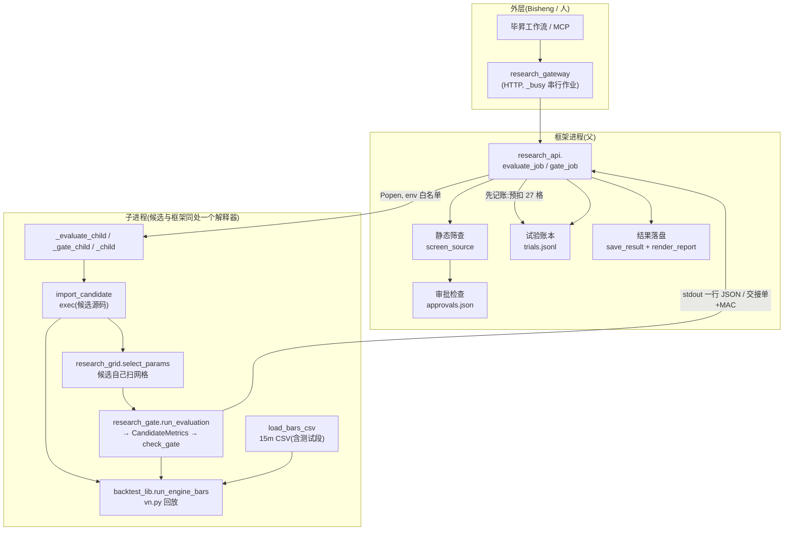
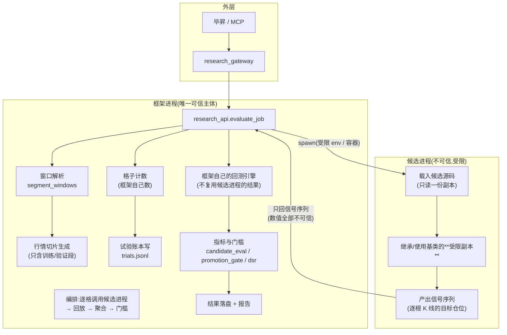
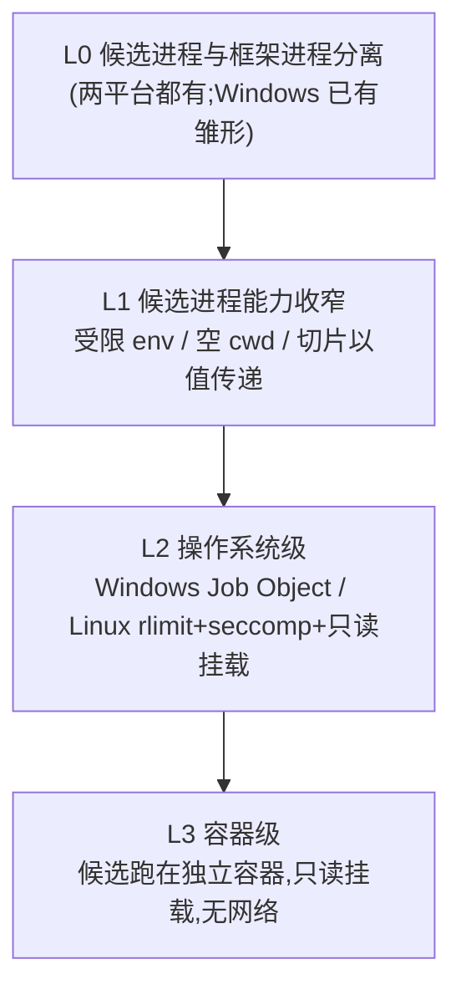
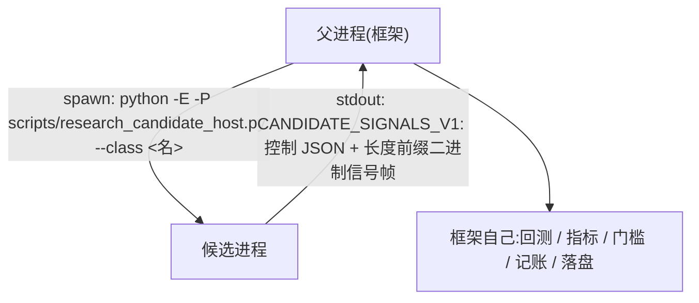
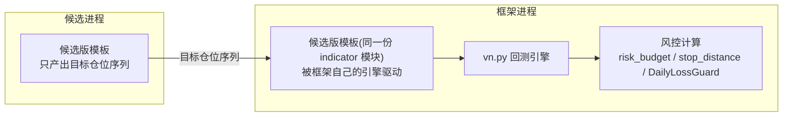
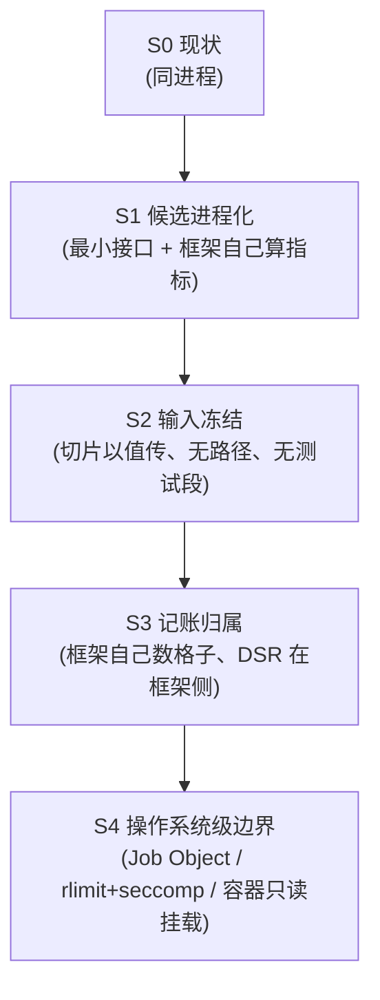

# ADR: 候选独立进程执行(把"候选只产出信号"变成架构约束)

- 状态:**待评审**(本文是设计方案,不是已采纳的决议;第 8 节的"需要用户拍板的点"未获确认前不进入实现)
- 日期:2026-11-15
- 跟踪:Issue [#29](https://github.com/laiyinyizao007/invest/issues/29)(本 Issue 的方案文档)
- 关联:`20261113-evolution-engine`(第 9 条 DSR 锁定、C3 冲突、候选同进程的残余登记)、
  `20261109-promotion-gate`(8 条门槛)、`20261112-candidate-evaluation`(样本外=滚动验证段)、
  `20261111-risk-floor-immutability`(风控底线不可优化)、`20261112-research-sandbox-groundwork`(纵深防御而非沙盒)

## 2026-11-25 现状核对(本节为修订,正文其余部分的行号与"未合并"表述以本节为准)

> 只更正**事实描述**,不改任何决定、阈值或防线口径;状态仍是"待评审"。核对基线:`docs/29-process-isolation-design` 分支当前工作树(已并入 main)。

**已变化的事实**

| 正文说法 | 现状(2026-11-25) |
|---|---|
| 账本"纯追加 JSONL,**没有哈希链**"、"同进程 `threading.Lock`,跨进程不加锁"(1.1、1.4、6.4、8.1) | 已有哈希链 + 外置锚点(`risk/ledger_chain.py`,每条带 `seq/prev/hash`)与**跨进程文件锁**(`chain.file_lock`);人工迁移/重置在 `risk/ledger_admin.py` + `scripts/research_ledger.py`。进程内 `threading.Lock` 仍在,但不再是唯一的串行手段 |
| `candidate_window` 审计钩子"不在 main"(1.1) | 已在 main:`scripts/research_sandbox.py::candidate_window` |
| PR #32(账本链/锚点/文件能力收口)与 PR #27(沙盒加固)"未合并"(第 8.2 节拍板点 5、第 12 节) | **均已合并**。拍板点 5 的依赖已满足,可关闭;S3 的账本改造直接基于现有链账本 |
| 评估只有一个品种(玉米) | 评估按品种选数据与规格(`product` 参数,白名单 `research_sandbox.PRODUCTS`,见 `20261124-per-product-evaluation`)。S2 的切片生成、测试段断言、格子计数都必须带 `product`;评估键不再恒为 `C15` |
| `evaluate_job` 是评估的单一入口(1.1、S1) | 评估已拆成 `evaluate_prepare`(同步前半段:校验、筛查、批准检查、试验预扣)与 `evaluate_run`(后台线程,慢的后半段),`evaluate_job` 只是包装;网关"启动即返回 + 按 `run_id` 取结果"(Issue #84)。**S1 退役三个子入口时必须保持这个两段形态**,否则异步评估会被破坏 |
| 滚动 24 小时提交额度 | 现为 20(`config/research_sandbox.json::iteration.max_iterations`) |
| 候选侧运行时包为 `scripts/candidate_runtime/`(5.3、7) | 工作树里实际落点是 `research/candidate/`,候选基类为 `SignalTemplate`,导入路径 `candidate.signal_template`(即拍板点 4 的"路线 A + 另起新名",**尚未获确认**) |

**行号漂移(以符号名为准,下表仅供定位)**

| 符号 | 文件 | 现行号 |
|---|---|---|
| `import_candidate` / `spawn_child` / `charge_trials` / `top_up_grid_trials` | `scripts/research_api.py` | 403 / 201 / 141 / 149 |
| `CtaTemplate` 子类硬检查 | `scripts/research_api.py` | 552 |
| `gate_job` / `evaluate_prepare` / `evaluate_run` / `evaluate_job` | `scripts/research_api.py` | 791 / 846 / 873 / 893 |
| `run_gate_child` / `run_evaluate_child` / `run_child` | `scripts/research_api.py` | 960 / 1004 / 1053 |
| `RepoImportGuard` / `safe_builtins` / `candidate_window` / `sandbox_env` / `screen_source` | `scripts/research_sandbox.py` | 1270 / 2039 / 2389 / 3328 / 2993 |
| `PROTECTED_RUNTIME_PACKAGES` / `check_class` / `check_instance_state` / `check_protected_state` / `check_market_data_integrity` | `risk/constitution.py` | 1534 / 1769 / 1423 / 1731 / 1856 |

**仍然成立(已逐条复核)**:`top_up_grid_trials` 仍按子进程自报格子数补记;预扣 `MIN_GRID_CELLS = 27`;`--prior-trials` 仍在(`research_api.py` 第 130/338/817/877 行);子进程结果通道仍是 `RESEARCH_RESULT_JSON:` 一行 JSON(交接单 + MAC 只在未合并的 `feat/21-stage3`);测试段起点仍是 `research_gate.TEST_SEGMENT_START` 与 `walk_forward_optimizer.TEST_SEGMENT_START` 两个相同的 `datetime(2024,1,1)`;`reconfigure_stdio()` 在 `scripts/research_console.py`;`grid.max_cells=343`、`min_round_trips=10`;PR #24 / Issue #21 仍 OPEN,故 `risk/ladder.py`、`map_elites.py`、`behavior.py` 仍不在 main。

**代码已先于决议走了两步(须在实现前确认)**:`scripts/research_candidate_spec.py` 用 AST 静态读 `param_grid`、读不出即 `SpecError` fail-closed(对应拍板点 2);候选基类另起新名 `SignalTemplate`(对应拍板点 4 的 A1)。二者已于 2026-11-26 获用户确认(拍板点 1、3 仍未决:1 留到 S3,3 待 S1 切换完成后单独评审)。

## 背景

PR #24(Issue #21)的 G8 复审连续五轮没有收敛(Issue #29 正文记的分数:38 → 32 → 35 → 33 → 34,要求 ≥ 45),
根因始终是同一个:**候选代码与框架代码跑在同一个子进程里**。
> 分数口径以 **Issue #29 正文**为准(五轮:38/32/35/33/34)。该分支 ADR 里对应的复核轮次是
> 第 27 轮 38/50、第 30 轮 32/50、第 31 轮 35/50、第 32 轮 33/50、第 33 轮 34/50。
> (与提纲里"四轮 38→36→35→36"的说法不一致,本文按 Issue 正文与 ADR 记的分歧如实写。)

逐条已实测确认的后果(证据在**未合并分支**上:`origin/feat/21-stage3` 的
`docs/adr/20261113-evolution-engine.md` 第 27~34 轮补记,与 `origin/feat/31-fs-capability` 的
"候选文件读写能力收口(Issue #31)"一节;`main` 上的同一份 ADR 只记到第 26 轮):

1. 候选能改写框架的模块状态:`research_grid.validate_grid`、`backtest_lib.run_engine_bars`
   这些模块不在 `risk/constitution.py` 的 `PROTECTED_RUNTIME_PACKAGES` 里,改写后子进程可以扫远多于账本记录的格子数。
2. 候选能改写框架算出来的数字:结果文件、序列化器、评估输入(`wf.build_windows`)都在同一进程里,
   codex 实测"候选劫持 `json.dumps` 后,框架在伪造的 payload 上算出真 MAC,父层验签通过并采信 `oos_sharpe=42`"。
3. 候选能读写磁盘:行情 CSV(含测试段与封存前向留出集)、试验账本 `trials.jsonl`、批准账本 `approvals.json`。
4. 候选能读本机配置与凭据文件:子进程环境是**白名单**过滤过的(`rs.sandbox_env` / `ENV_ALLOW`,
   不含 `CTP_*`/`WEBHOOK_*`/`LIVE_*`),但**同进程内候选能直接 `open()` 本机任意文件**——
   包括 `data/` 下的行情 CSV(含测试段与封存前向留出集)、两本账本、以及本机上的 `.env`
   (`.env` 不在环境白名单里,但**文件本身在磁盘上**,候选自己 open 就读得到);
   `import bootstrap` 还会 `chdir` 到仓库根、把仓库根插进 `sys.path`、并 `import vnpy.trader.setting`。
   候选还能执行任意命令(pickle 反序列化链)。
5. 同进程内**没有任何一条通道能证明"这句话是框架说的"**:结果文件、stderr、退出码,候选都能自己写。

逐条堵"写法"没有理由收敛到 ≥ 45(第 32/33 轮补记已经写了这条趋势判断)。
真正闭合只能靠**候选放到独立进程执行**——这正是本 Issue。

## 本方案要达成的目标(与 Issue #29 一致)

- 候选只负责产出**信号**;回测、评估、记账、结果落盘、指标计算全部由**框架进程**独立完成。
- 框架进程**不信任候选进程的任何自报数字**:候选返回的数字一律不可信,框架只把它当作"要执行的交易动作序列"。
- 候选进程拿不到:真实行情文件路径、测试段数据、交接单与 MAC 密钥、框架模块对象。
- 既有阈值一个都不动:DSR ≥ 0.95、可疑夏普上限 3.0、η = 1.10。
  (另两个数字——**查询预算 60** 与 **4×4=16 格**——只存在于未合并的 `origin/feat/21-stage3`
  (`risk/ladder.py:64` 的 `DEFAULT_QUERY_BUDGET = 60`、`risk/behavior.py` 的 16 格),
  **main 上没有**;main 侧的对应物是 `config/research_sandbox.json` 的 `grid.max_cells = 343`
  与 `grid.min_round_trips = 10`。本方案同样不改这两个分支上的数。)

---

## 1. 现状事实(先核实代码,不凭描述)

> 核实基线:本仓库 `main`(commit `96959a2`)。另有两条未合并的分支与本方案相关,下文逐一标注:
> `origin/feat/21-stage3`(PR #24,Issue #21 的阶段 3 实现,含第 27~34 轮补记)、
> `origin/feat/31-fs-capability`(PR #32,Issue #31,含 `risk/ledger_chain.py` 与 `candidate_window` 审计钩子)。
> **这些分支上的文件在 `main` 上并不存在**(例如 `risk/ledger_chain.py`、`scripts/research_ledger.py`、
> `risk/ladder.py`、`risk/map_elites.py` 均只在分支上)。本文凡涉及它们的结论,都注明"该分支上"。

### 1.1 关键接点清单

| 接点 | 文件:行(main) | 实际行为(核实结果) |
|---|---|---|
| `import_candidate` | `scripts/research_api.py:394-506` | 在**子进程内**编译并 `exec` 候选源码;同一函数里做哈希核对、静态筛查、`RepoImportGuard` 构造、`safe_builtins` 注入、受保护对象指纹前后比对、运行时类校验 |
| `run_child` | `scripts/research_api.py:939-972` | 子进程入口:自己复查路径/审批/参数 → `import_candidate` → `run_backtest` → 回传 `{stats, pnls}` |
| `run_gate_child` | `scripts/research_api.py:861-898` | 子进程入口:复查 → `import_candidate` → `load_bars_csv` → `run_gate`(含随机对照与成本翻倍)→ 回传**已算好的 metrics** |
| `run_evaluate_child` | `scripts/research_api.py:901-936` | 子进程入口:复查 → `import_candidate` → `load_bars_csv` → `run_evaluation`(选参 + 门槛)→ 回传**已算好的 metrics 与选参结果** |
| `spawn_child` | `scripts/research_api.py:192-211`(main 版)/ 分支 `feat/21-stage3` 上已改为交接单 + MAC | main 上:子进程 stdout 里取最后一行 `RESEARCH_RESULT_JSON:` 前缀的内容作为结果;分支上改为父进程造随机临时目录 + 随机 MAC 密钥的**交接单**,经 stdin 交给子进程,结果写文件并附 MAC,父进程验签 |
| `evaluate_job` | `scripts/research_api.py:764-799` | 父进程:读账本 `prior` → `charge_trials("grid_cell", MIN_GRID_CELLS=27)` 预扣 → 起子进程 → 回传后按**子进程自报的** `trials.grid_cells` 补记差额(`top_up_grid_trials`,`scripts/research_api.py:140-147`) |
| `safe_builtins` | `scripts/research_sandbox.py:1765-1823` | 候选执行时的最小内建集合:去掉 `UNSAFE_BUILTINS`,`__import__` 换成受限导入器(黑名单 → 路径裁决 → 导入白名单 → 配置准入审计) |
| `RepoImportGuard` | `scripts/research_sandbox.py:1076+` | 按**路径**裁决候选的 import:仓库内非白名单目录拒绝;白名单目录还要满足"候选运行前就存在且此后没被改过";仓库外(站点包)同样要求运行前就存在 |
| `candidate_window` | ~~不在 main~~ **(2026-11-25 更正:已合并进 main,`scripts/research_sandbox.py::candidate_window`)** | 审计钩子窗口(`sys.addaudithook`):窗口内拒写模式 `open`、`os.remove/rename`、subprocess、socket、pickle.find_class 等;窗口外不判定。**只拦写与能力,不拦读** |
| `research_grid.validate_grid` | `scripts/research_grid.py:57-85` | 校验候选声明的 `param_grid`:恰好 3 个参数、每个 3~10 个取值、严格递增、不含受保护参数、格子数 ≤ `max_cells` |
| `research_gate.run_gate` / `run_evaluation` | `scripts/research_gate.py:45-115` | 在**子进程内**跑候选回测(基准 + 成本翻倍 + 200 次随机对照)、聚合成 `CandidateMetrics`、调 `check_gate` |
| `backtest_lib.run_engine_bars` | `scripts/backtest_lib.py:98-141` | 用 vn.py `BacktestingEngine` 真实回放;回放后核对风控底线、框架对象指纹、行情容器完整性 |
| `risk/trial_ledger.py` | (写本文时 78 行;**2026-11-25 更正**:现已带哈希链 + 外置锚点 + 跨进程文件锁,见上方"现状核对") | 追加式 JSONL;`KINDS = ("submission","grid_cell","gate_run")`;只增不减;损坏/超限 fail-closed;~~同进程内 `threading.Lock` 串行,跨进程不加锁~~(该限制已被 `chain.file_lock` 取代) |
| `risk/dsr.py` | `risk/dsr.py:47-69` | `deflated_sharpe(daily_returns, n_trials)`;V 取零假设理论值 `1/(T-1)`;非有限输入一律返回 0.0 |
| `risk/constitution.py` | `PROTECTED_RUNTIME_PACKAGES`(第 1432 行)= `risk`、`strategies`、`vnpy_ctastrategy`、`vnpy.trader.constant/object/utility` | 运行时指纹只覆盖这几个包;**`scripts.*`(含 `research_grid`、`research_gate`、`backtest_lib`、`walk_forward_optimizer`)**不在其中 |

### 1.2 当前数据流



### 1.3 信任边界在哪(现状)

**现状:只有一条边界——"人读过代码并批准"(人工审批)。** 除此之外全是纵深防御:

- 候选在**子进程**里跑(不是框架主进程),环境变量走白名单(`rs.sandbox_env`,`ENV_ALLOW` 白名单不含 `CTP_*`/`WEBHOOK_*`/`LIVE_*`)。
- 但候选与**回测编排、指标计算、随机对照、网格扫描**在**同一个解释器**里:
  `run_evaluate_child` 先 `import_candidate`(候选代码此刻起在进程内),再 `load_bars_csv`,再 `run_evaluation`。
- 于是候选可以:`import`/`monkey-patch` 框架模块(第 21~26 轮实测的逃逸)、
  在导入期改写 `wf.build_windows` 让验证窗口塌成选参窗口(第 32 轮实测)、
  劫持 `json.dumps` 让框架在伪造 body 上算真 MAC(第 32 轮实测)、直接读写行情 CSV 与两本账本
  (Issue #31 实测,证据在未合并的 `origin/feat/31-fs-capability` 上)。
- 结果通道的 MAC **只证明"通道没被截断"**,证明不了"结果是真的"——因为**候选在同一进程里能读到交接单(含 MAC 密钥)**。
  第 31 轮 codex 已明确更正过这句(原写"伪造一定被检测"**不成立**)。

### 1.4 记账口径的现状事实

- 试验次数由**框架父进程**在起子进程**之前**记账(`charge_trials`),这一点已经做对了:
  超时、崩溃、后半段异常都不会让试验免费(`scripts/research_api.py:132-137` 的注释明写)。
- 但**格子数**的**上界**来自两处不可信来源:
  ① 预扣的 `MIN_GRID_CELLS = 27`(最小合法网格);
  ② 子进程**自报**的 `trials.grid_cells`,父进程只在它 > 27 时补记差额(`top_up_grid_trials`)。
  `select_params` 里真正跑的格子数是 `len(scores)`,而 `validate_grid` 本身可以被候选改写
  (`scripts/research_grid.py` 不在 `PROTECTED_RUNTIME_PACKAGES` 里),所以"实际扫了多少格"框架不知道。
- DSR 的 N 就是这个数:`risk/candidate_eval.py:66-69` 的 `n_trials` → `risk/dsr.py:47`。
  N 偏小 ⇒ DSR 偏松 ⇒ **悄悄放松已锁定的 DSR ≥ 0.95**。这就是 Issue 里"改写 `validate_grid` → 试验次数少记"的机制。
- 账本本身(~~main 上的 `risk/trial_ledger.py` 是纯追加 JSONL,没有哈希链~~ **2026-11-25 更正:PR #32 已合并,现有哈希链 + 外置锚点**;下面几句是写本文时的状态,留作溯源)。
  哈希链 + 外置锚点在 `origin/feat/31-fs-capability` 分支上(`risk/ledger_chain.py`、`risk/ledger_admin.py`、
  `scripts/research_ledger.py`),**尚未合并进 main**。该分支的 `risk/ledger_chain.py` 文件头已写明:
  "真正的外部锚点需要另一个信任域(Issue #29 独立进程 / 容器只读挂载);这里没有"。

---

## 2. 目标架构

### 2.1 职责切分

**候选进程只做一件事:把"行情切片 + 参数"映射成"信号序列"。**

它不做回测、不算夏普、不算 DSR、不写账本、不写结果文件、不落盘任何东西。

### 2.2 目标数据流



关键差别:箭头 `SIG --> API` 之外**没有第二条从候选进程指向框架的通道**。候选进程不产出任何指标,
框架拿到的每一个数字都是框架自己算的。

### 2.3 哪些量由谁算(核心表)

| 量 | 当前(main) | 目标 |
|---|---|---|
| 试验次数 N(DSR 用) | 框架预扣 27 + **子进程自报** `grid_cells` 补记 | **框架自己数**:网格由框架解析候选源码里的 `param_grid` 字面量并按 `max_cells` 截断后**在框架侧展开成格子清单**,N = 清单长度。候选报多少都不采信 |
| 实际跑了多少格 | 候选进程内部计数 | 框架的格子清单长度(= 计划跑的数量)。候选中途死掉 ⇒ 按清单全量计(保守方向) |
| 日收益序列 | 候选进程内 vn.py 回测 | 框架进程内 vn.py 回测(框架自己驱动引擎,只把"信号"喂进去) |
| 夏普 / 回撤 / 往返笔数 | 子进程算,父进程采信 | 框架算 |
| DSR | 子进程算,父进程采信 | 框架算(输入是框架自己的日收益序列与框架自己的 N) |
| `check_gate` 判定 | 子进程算 | 框架算 |
| 随机入场对照 | 子进程跑 200 次 | 框架跑 200 次(随机对照类是**框架自己的**代码,不在候选进程里) |
| 成本翻倍压力 | 子进程跑 | 框架跑 |
| 参数高原判定 | 子进程算(`research_grid` + `risk/plateau`) | 框架算(候选只提供"这一格的信号",分数由框架的回测给出) |
| 结果文件 / 报告 | 父进程落盘(内容是子进程给的) | 框架落盘(内容全部是框架算的) |
| 候选的 `metrics` / `stats` / `pnls` | 子进程自报 | **取消这类字段**:候选进程不再产出任何指标 |
| 试验账本 | 父进程写(但格子数不可信) | 框架写(格子数框架自己知道) |
| 候选能否改写框架模块状态 | 能(同进程) | **不能**(不同进程,不同解释器) |
| 候选能否读测试段 | 能(同进程 + 能读 CSV) | 不能(见第 4 节) |

> 表里"试验次数"一行是本方案最重要的一格:它把"候选自报的数字"从信任链上彻底摘掉。

---

## 3. 候选进程的最小接口

### 3.1 输入(框架给候选的)

候选进程**只**接收三类输入:

1. **行情切片**:一段 `BarData` 序列(OHLCV + 时间戳),由框架从数据源读出后**在内存里**传给候选。
   - 只含**训练段或滚动验证段**;测试段(2024-01-01 起)与封存前向留出集**根本不在切片里**。
   - 切片以**值**传递(序列化后的数组),候选拿不到原始文件路径,也拿不到文件句柄。
2. **参数**:本次要评估的那一格的参数字典(`{"fast_window": 8, "slow_window": 20, ...}`)。
   - 受保护参数(`risk_budget` 等)由**框架**在构造时就已经挡住,不会出现在这里。
3. **元信息**:品种、窗口起止、周期、以及"用哪个候选类"的标识。

**候选进程拿不到的东西**(逐条对应 Issue 的验收标准):

| 拿不到 | 怎么保证 |
|---|---|
| 真实行情文件路径 | 切片以数组传;子进程 cwd 设为一个空的临时目录;不传路径 |
| 测试段数据 | 框架在生成切片时按 `segment_windows` 的 `test` 起点硬切;切片本身不含 |
| 交接单与 MAC 密钥 | **交接单机制整体取消**(见第 4.4 节):新架构里没有"候选交回结果文件"这件事 |
| 框架模块对象 | 不同进程;候选进程的 `sys.path` 里**没有仓库根**(见第 4.3 节) |
| 本机凭据 | 环境变量白名单(沿用 `rs.sandbox_env`);候选进程不 import `bootstrap` —— 它的模块级副作用是 `os.chdir(仓库根)` + 把仓库根插进 `sys.path` + `import vnpy.trader.setting`(核实 `scripts/bootstrap.py:25-42`)。**注意**:`.env` **不是** import 时加载的,只在显式调用 `bootstrap.load_env()` 时才 `load_dotenv`(全仓库 8 处调用点,`backtest_lib.py`/`optimize.py` 都不调用)—— 所以"import bootstrap 就等于载入 .env"是错的说法 |

### 3.2 输出(候选给框架的)

**只有一种东西:信号序列。**

- 形态:与输入切片**等长**的序列,每根 K 线一个 `int`,取值 `{+1, 0, -1}`(目标方向:多/空/平)。
- 或者(等价、更贴近现有候选写法):一个**逐根回调**的"目标仓位"序列。
- 语义:**"在这根 K 线收盘时,策略希望持有的方向"**。框架据此驱动自己的回测引擎。

**候选返回的数字一律不可信。** 框架对这条序列只做三件事:

1. **形状校验**:长度必须等于切片长度;每项必须是 `{+1, 0, -1}` 之一;越界 ⇒ 整格判失败(不是"截断后继续")。
2. **当作交易意图**:喂给框架自己的 vn.py 引擎,产生成交、持仓、成本、日收益。
3. **不读任何其他字段**:候选若多返回 `{"sharpe": 42}`,框架**直接丢弃**(并可记一条审计)。

> 为什么不设计成"候选返回一个 `entry_signal` 函数由框架调用"?——那要么跨进程 RPC 逐根 K 线调用(开销与复杂度),
> 要么共享内存/共享解释器(等于放弃隔离)。**一次性传完整信号序列**是唯一在两平台都简单可靠的形态。

### 3.3 载体选择

| 载体 | 评价 |
|---|---|
| **stdin/stdout 管道 + 长度前缀二进制帧**(推荐) | 跨平台、无共享内存、无文件、无端口;天然单向;父进程用 `Popen(..., stdin=PIPE, stdout=PIPE)` 即可。**协议要带长度前缀**(4 字节大端)+ 紧凑 `int8` 数组,而不是一行 JSON —— 网格全跑时序列总量约 11 MB(第 9.1 节 R1),JSON 行不现实。控制消息(切片头、错误)用 JSON,信号数据用二进制块 |
| 临时文件 + 路径 | 候选能拿路径 ⇒ 候选能改写/替换 ⇒ 回到"结果文件可伪造"的老路。**不采用** |
| 共享内存 | Windows 与 Linux 实现差异大;需要额外的生命周期与竞态处理。**不采用** |
| 本地 socket / HTTP | 需要监听端口、鉴权、端口分配;在 `internal: true` 的研究网络里可行但比管道复杂。**暂不采用**(将来若要跨容器再评估) |
| pickle 序列化 | **绝对不采用**:反序列化即执行,是 Issue 里点名的攻击面 |

**定稿:stdin/stdout 管道;控制面 JSON(带固定前缀)、数据面长度前缀二进制帧;帧长与总字节数由父进程设上限。**
（若实现时坚持用纯 JSON 行,则必须把"一次只跑一格"作为强制约束——那会让每格重传一次切片,开销不可接受。）

---

## 4. 进程边界怎么划

### 4.1 两平台的现实约束

| | Windows(本机开发) | Linux(容器部署) |
|---|---|---|
| 现有形态 | 直接跑 `python scripts/research_api.py` | `docker-compose.research.yml` 起 `invest-research-gateway` 容器 |
| 容器可用性 | Docker Desktop 可用,但**开发主路径不是容器** | 容器就是部署形态 |
| 进程级资源限制 | Job Object(可设内存/CPU/进程数/杀树) | `setrlimit` + cgroup |
| 文件系统限制 | ACL / 只读挂载弱,ACL 粒度粗 | 只读 bind mount 干净好用 |
| 网络隔离 | Windows Firewall 规则(机器级,副作用大) | compose 的 `internal: true` + 不加网络 |

**结论:不能只做容器版。** 开发主路径在 Windows,若只有容器方案,Windows 上的评估路径就完全没有边界,
等于"本地跑的那条路"仍是同进程。方案必须**在两平台都有可执行的边界**,只是强度不同。

### 4.2 分层边界(强度递增)



- **L0 是本方案的地基,也是唯一必须先落地的一层。** 它单独就把"候选改写框架模块状态"
  和"候选伪造指标"变成不可能——这两条是五轮复审里分数起不来的主因。
- L1~L3 是纵深防御的加固,可在 L0 落地后按平台分批推进。

### 4.3 L0+L1:候选进程怎么起(跨平台最小可用形态)

现状 `spawn_child`(`scripts/research_api.py:192`)已经用 `Popen` 起子进程,只是那个子进程里同时跑着框架逻辑。
改造点很小:



候选进程的约束:

- cwd = 一个空的临时目录(不是仓库根)。
- env = `rs.sandbox_env(os.environ)` 白名单(沿用,已排除 `CTP_*`/`WEBHOOK_*`/`LIVE_*`)。
- 候选源码以**源码文本**经 stdin 传入(或写到临时目录下的只读副本),不传仓库内路径。
- 不传任何行情文件路径:切片由父进程从内存读出后序列化进 stdin。
- stdout 只认固定前缀 `CANDIDATE_SIGNALS_V1:` 的控制消息与随后的长度前缀二进制帧;其余输出丢弃或只进本机日志。

要点:

1. **启动标志(本机实测,不是推理)**:
   - `python -I`(`isolated`)**会把用户 site-packages 一并去掉** → 本机实测 `python -I -c "import numpy, talib"`
     报 `ModuleNotFoundError`(`numpy`/`talib` 装在用户目录 `AppData\Roaming\Python\Python313\site-packages`)。
     **所以 `-I` 不能用**——候选需要 talib 算指标。
   - 正确组合是 **`-E -P`**(Python ≥ 3.11;本仓库 CI 用 3.12,满足):
     `-E` 忽略 `PYTHONPATH`/`PYTHONHOME` 等环境注入(实测:`PYTHONPATH=… python -E -P` 的 `sys.path` 里没有该目录),
     `-P` **不把脚本所在目录/当前目录**加进 `sys.path`(实测:`sys.path[0]` 是标准库 zip,不是脚本目录)。
     **实测 `python -E -P -c "import numpy, talib"` 成功** —— 既拿到了 site-packages,又切断了目录注入。
   - 于是:仓库根**不会**在候选进程的 `sys.path` 上 → `import risk.xxx`、`import research_grid`、
     `import scripts.backtest_lib` 直接 ImportError。这是"候选拿不到框架模块对象"最省事也最可靠的一层。
   - **注意**:`candidate_runtime` 包本身要能被候选 import,宿主脚本必须**显式**把
     `scripts/candidate_runtime/` 的绝对路径加进 `sys.path`。
     加的是**包目录本身**,不是 `scripts/` —— 否则 `import research_grid` 反而能成功。
     这条要在实现时用一条探针钉住(`import research_grid` 必须失败,`import candidate_runtime` 必须成功)。
2. **候选源码怎么送**:父进程读到的字节(与审批哈希同源)直接经 stdin 传给候选宿主脚本,
   候选宿主 `exec` 的是**父进程读过的那一份**,不再二次读文件(顺带消灭 TOCTOU)。
3. **`sys.path` 怎么办**:候选通常需要 `from strategies.trend_atr_15m_strategy import TrendAtr15mStrategy`。
   - 折中方案:候选宿主把**基类的一个受限副本**放进候选进程的 `sys.path`(见第 5.3 节),该副本只含
     指标计算与入场/出场模板逻辑,**不含**任何风控计算、不含 `risk` 包、不含回测编排。
   - 这样候选能继承基类,又碰不到框架。
4. **cwd**:设成空临时目录。候选拿不到"相对路径猜仓库根"(`os.getcwd()` 也没意义)。
   Windows 上 cwd 必须是存在的目录,`tempfile.mkdtemp()` 满足。
5. **继承的句柄**:`Popen` 默认 `close_fds=True`(Windows 上 Python 3.7+ 同样默认关闭除标准句柄外的继承),
   父进程的行情文件句柄**不会**被继承。要显式核对并加测试。
6. **不 import `bootstrap`**:候选宿主脚本自己不 import `bootstrap`。理由是它的**模块级副作用**:
   `os.chdir(仓库根)`、把仓库根 `sys.path.insert(0, …)`、`import vnpy.trader.setting`
   (核实 `scripts/bootstrap.py:25-42`)—— 前两条会把仓库根重新变成候选的可达路径。
   (`.env` 的加载与 import 无关,只在显式 `bootstrap.load_env()` 时发生,见第 3.1 节表格。)
   候选宿主只用标准库 + numpy + ta-lib。
7. **stdout 编码要自己钉**:`-E` 会**连 `PYTHONIOENCODING` 一起忽略**(实测:`PYTHONIOENCODING=utf-8 python -E -P`
   的 `sys.stdout.encoding` 是 `cp1252`,不带 `-E` 才是 `utf-8`)。
   → 候选宿主必须在入口调 `scripts/research_console.py::reconfigure_stdio()`(该函数已存在,
   把 stdout/stderr 重配成 utf-8 + `errors="replace"`),否则 Windows 上 JSON 协议会编码错乱。
   → 同理,父进程传给子进程的 env 里 `PYTHONIOENCODING=utf-8` 在 `-E` 下**无效**,
   协议解析必须以宿主自己重配后的字节为准。
8. **加 `-B`**:禁止候选进程写 `.pyc`(`-B` 与 `-E -P` 兼容,实测通过)。
   否则候选能在自己的 site-packages/临时目录里落字节码,徒增"伪造 .pyc"一类问题。
9. **管道容量与死锁**:父进程必须**先写完 stdin 再读 stdout**,且切片要控制体积。
   15 分钟玉米全量约 3.2 万根 K 线(核实:ADR 记 C 品种 32 540 根)。
   → **协议不能是"一行 JSON"**(第 9.1 节 R1 已经指出:网格全跑时序列总量约 11 MB,一行 JSON 不现实)。
   → 落地方案:**管道 + 长度前缀的二进制帧**(4 字节大端长度 + 紧凑 `int8` 数组),
     父进程用 `communicate()` 收发;并在父进程侧对帧长度与总字节数设上限(超过即拒绝该格)。

### 4.4 L1:交接单与 MAC 机制的去向

`feat/21-stage3` 分支上那套"父进程造随机临时目录 + 随机 MAC 密钥的交接单、子进程写结果文件、父进程验签"
在新架构里**整体取消**:

- 新架构里**候选进程不回传结果文件**,只回传信号序列(在 stdout 的一行 JSON 里)。
- 信号序列本身不需要签名:它**不是指标**,框架拿它去跑自己的回测。候选伪造一串信号只能得到
  "自己的一组交易",算出来的夏普仍然由框架从行情与成本独立算出。
- 候选伪造信号的能力被限制在"选一组对自己有利的交易"这一层——这正是候选本来就应该被允许做的事
  (否则没法做策略搜索);框架防的是"伪造指标",不是"选交易"。
- 序列的**形状**(长度、取值域)由框架严格校验;越界即整格失败。

> 保留一句:如果将来要保留"结果文件"这条通道(比如给人工审阅用),仍建议用 MAC;
> 但它**不再是信任链的一部分**,只是防"传输被截断"。

### 4.5 L2/L3:进程能力的操作系统级收窄

**Windows(Job Object)**
- 用 `CreateJobObject` + `AssignProcessToJobObject`,设置:
  `JOB_OBJECT_LIMIT_ACTIVE_PROCESS = 1`(禁止再开子进程)、
  `JOB_OBJECT_LIMIT_PROCESS_MEMORY`、`JOB_OBJECT_LIMIT_JOB_TIME`、
  `JOB_OBJECT_LIMIT_KILL_ON_JOB_CLOSE`(父进程死了候选一起死)。
- 句柄继承:`CreateProcess` 时传 `bInheritHandles=FALSE` + 显式 `STARTUPINFOEX` 的
  `PROC_THREAD_ATTRIBUTE_HANDLE_LIST`,只传标准句柄。
- 落地形态:Python 里可用 `pywin32` 的 `win32job`,或直接 `ctypes` 调 `kernel32`。
  本仓库**未引入 pywin32**(现状依赖见 `requirements.txt`),需评估是加依赖还是走 `ctypes`。
- 现状 `kill_tree`(`scripts/research_api.py:89`)已经处理了"venv 的 python.exe 是启动器、要杀整棵树",
  与 Job Object 的 `KILL_ON_JOB_CLOSE` 互补。

**Linux(rlimit / seccomp / 只读挂载)**
- `setrlimit`:`RLIMIT_AS`(内存)、`RLIMIT_CPU`、`RLIMIT_NOFILE`、`RLIMIT_NPROC`(=1,即不能再 fork)。
- `seccomp`:用 `prctl(PR_SET_NO_NEW_PRIVS, 1)` + `seccomp` BPF 过滤,禁掉 `execve`、`fork`、`clone`、
  `socket`、`connect`、`ptrace`、`openat`(非白名单路径)等系统调用。
  纯 Python 实现较痛苦,通常要 `libseccomp` 或 `python-seccomp`;**需评估依赖**。
- 只读挂载:compose 里给候选单独一个 service,`read_only: true`,只读挂载行情目录,
  可写目录只挂一个空 tmpfs(`/tmp`),**不挂** `data/research`(账本)、**不挂** `data/research-control`(批准账本)、
  **不挂** `.env`、**不挂** `.vntrader`(sqlite 库)。

**"读不到测试段"怎么保证(两平台共同的关键)**
- 框架侧生成切片时按 `segment_windows` 的 `test` 起点硬切,并在生成后**断言**切片里没有
  `datetime >= test_start` 的 K 线(与 `scripts/research_gate.py:33-37` 的 `slice_bars` 同一把尺子)。
- 候选进程内**没有**行情 CSV 的路径,也没有仓库根,更没有 `.vntrader/database.db` 与 `config/`。
  → 候选**没有任何途径**拿到测试段:文件不在它的 `sys.path` 上,不在它的 cwd 上,不在它的环境里。
- 候选进程的 `open()` 能力:L1 阶段靠"没有路径"就够(它连文件名都不知道);L2/L3 阶段再加
  `openat` 白名单(只允许候选自己的临时目录)把"猜路径"也堵死。
  → **诚实的边界**:L1 只保证"不知道路径就拿不到";真正的"路径不可知"依赖 L2/L3 的只读挂载与路径白名单。

---

## 5. 最难的一点:候选在受限进程里连策略基类都继承不了怎么办

这是本方案唯一的**真难点**,必须正面回答,不能含糊带过。

### 5.1 问题的精确形态

现有候选的写法(核实自 `pending_strategies/atr_breakout_15m_2atr.py`):

```python
from strategies.trend_atr_15m_strategy import TrendAtr15mStrategy

class Candidate(TrendAtr15mStrategy):
    parameters = TrendAtr15mStrategy.parameters + ["breakout_n"]
    param_grid = {...}

    def entry_signal(self) -> int:
        upper, lower = self.am.donchian(n, array=True)   # ← 依赖基类的 ArrayManager
        atr_now = self.am.atr(self.fast_window)
        ...
        return 1
```

它依赖基类提供的三样东西:

1. `self.am`(`ArrayManager`):`sma`/`atr`/`donchian`/`close`/`count` 等指标接口。
2. **入场时序语义**:`on_bar` 里"收盘产生信号、下一根开盘成交";`atr_value` 在 `entry_signal` 之前算好;
   `self.pos`/`self.trading` 等状态。
3. `parameters` / `param_grid` 的**声明位置**:挂在类上,框架靠 `getattr(candidate_cls, "param_grid")` 读。

而基类 `strategies/trend_atr_strategy.py` 直接 `from vnpy.trader.utility import ArrayManager, BarGenerator, ...`
拉进 vnpy 交易栈,`from risk.risk_guard import DailyLossGuard, TrailingStop, stop_distance, within_budget`
拉进全部风控计算(`risk_budget`、`stop_distance`、`within_budget`、`DailyLossGuard`、`TrailingStop`)。
(核实:基类本身**不** import `bootstrap`;`import bootstrap` 发生在 `scripts/backtest_lib.py:9` 与
`scripts/optimize.py:23` 这类框架侧脚本里。它的模块级副作用是 `chdir` 到仓库根 + 把仓库根插进 `sys.path`
+ `import vnpy.trader.setting`(`scripts/bootstrap.py:25-42`);`.env` 只在显式 `bootstrap.load_env()` 时加载。)

**如果候选进程连基类都继承不了,现有候选全部写不出来,整个进化引擎就没有输入了。**
这就是 Issue 里点名的"最难的一点"。

### 5.2 三条候选路线(评估后选一条)

| 路线 | 做法 | 优点 | 缺点 | 结论 |
|---|---|---|---|---|
| **A. 基类副本** | 把基类**拆成两份**:一份"框架版"(带风控,留在框架进程),一份"候选版"(只含指标与信号模板,不含任何风控计算),候选进程用候选版 | 候选写法**几乎**不变(见下方"代价的准确形态");风控计算物理上不在候选进程里 | 要维护两份基类,漂移风险;候选版仍需 `ArrayManager` | **采纳为主线** |
| **B. 纯函数信号** | 约定候选只写 `def signal(bars, params) -> list[int]`,不继承任何类 | 最干净,边界最硬 | 现有候选全部要重写;`self.am` 这类指标访问要另给一套 API;与 `risk/constitution.py` 的"必须继承模板家族"运行时校验**直接冲突** | 作为**长期备选**,本轮不采纳 |
| **C. 候选进程里跑完整基类** | 候选进程照旧 import 完整 `strategies` 包(含风控) | 改动最小 | 风控代码又回到候选进程;候选可改写基类 ⇒ 老问题复发 | **不采纳** |

### 5.3 路线 A 的具体设计

**新增两个模块**(新名字,避免与现有 `strategies/` 混淆):

- `scripts/candidate_runtime/indicators.py`:**从 `strategies/` 里抽出**的纯指标计算
  (`ArrayManager` 的等价实现 + `sma`/`atr`/`donchian`/`close` 等)。
  - 依赖:**numpy + ta-lib**(不是纯标准库——`ArrayManager` 的指标方法底层是 `talib`,
    核实 `vnpy/trader/utility.py:15`)。
  - **不依赖** vnpy 交易栈、**不依赖** `risk` 包、**不依赖** `bootstrap`、**不依赖** `.env`。
  - 它必须是**框架版与候选版共用**的同一份代码 —— 否则候选算的 `atr` 与框架算的 `atr` 会有细微差异,
    门槛数字会漂。这是"数值口径单一来源"的要求,不是风格问题。
- `scripts/candidate_runtime/signal_template.py`:**候选版的入场/出场模板**
  - 只含:指标窗口维护、`entry_signal` 的默认实现(双均线)、`atr_value` 的计算时点、
    "收盘出信号、下一根开盘成交"这条时序契约。
  - **不含**:`risk_budget`、`stop_distance`、`within_budget`、`DailyLossGuard`、`TrailingStop`、
    `cta_engine`、`send_order`、`sync_data`。
  - 也就是说:**风控底线物理上不在候选进程里**,候选想改也改不到——这比"检测到改写"强一个量级,
    与 ADR `20261111-risk-floor-immutability` 的意图一致(底线是约束,不是变量)。

**框架版与候选版的分工**(框架版仍留在框架进程):



关键点:**框架进程里跑的是"候选版模板 + 框架自己的风控 + 框架自己的引擎"**,
候选进程里跑的是"候选版模板 + 候选自己的代码",两者唯一的耦合是**信号序列**。
候选代码只影响序列;序列只影响交易;交易只影响指标;指标全部由框架算。

**候选进程仍然需要 `vnpy` 吗?**
- 不需要 vnpy **交易栈**,但**需要 talib**:`vnpy.trader.utility.ArrayManager` 的
  `sma`/`atr`/`donchian` 等方法底层是 `talib`(C 扩展,`vnpy/trader/utility.py:15` 的 `import talib`)。
  核实:`vnpy.trader.utility` 本身**不** import `bootstrap`,**不**加载 `.env`
  (只 import `json/sys/datetime/pathlib/collections/decimal/math/typing/numpy/talib/zoneinfo` 与
  `vnpy.trader.object`/`constant`/`locale`)——所以"只要 talib+numpy,不需要整套 vnpy"是成立的。
- 因此 `scripts/candidate_runtime/indicators.py` 的依赖是 **numpy + ta-lib**,
  **不是纯标准库**(第 5.3 节初稿里写的"仅标准库 + numpy"**不准确**,此处更正)。
- ta-lib 是 C 扩展,候选进程的镜像/环境必须带它(`docker/research/requirements.txt` 里已有 `ta-lib`)。
  在 Windows 上,`ta-lib` 的 wheel 安装是已知的坑(需先装 C 库)——**这是实现前要实测的一步**。
- 好处仍然成立:候选进程**不需要 vnpy 交易栈、不需要 CTP 库、不需要读 `.env`**,
  `docker/research` 里候选侧的镜像可以比网关侧更小。
  (注意:"不需要读 `.env`"指**不需要把凭据载入环境**;`.env` 文件本身是否在候选进程的可达路径内,
  由 S4 的挂载/路径边界决定,不由这条保证。)
- 代价:候选版的 `BarData` 与 vn.py 的 `BarData` 字段必须对齐(字段名与语义),框架在喂数据时做一次转换。
  这是一次性的机械工作,且可用测试锁住(同一段 K 线,两套 `BarData` 的字段逐一相等)。

**`parameters` / `param_grid` 怎么声明与读取**
- 候选进程仍然可以 `class Candidate(SignalTemplate): parameters = [...]`、`param_grid = {...}`。
- 但**框架不再信任候选进程报上来的网格**:框架用**静态解析**(AST)在候选源码里读 `param_grid` 字面量
  ——这份源码是父进程自己读过、算过哈希的那一份。读不出(动态构造)⇒ **fail-closed**:拒绝评估,
  并给出"请把 `param_grid` 写成字面量"的明确原因。
  - 这条比现在的"读不出就按 `max_cells` 保守记账"更严,但方向是**拒绝而不是放水**,与 fail-closed 口径一致。
  - 副作用:动态网格的候选不再能评估。**须在第 8 节列为需要用户拍板的点**(是否允许"按 `max_cells` 全额记账"作为退路)。
- 网格的**参数名合法性**由框架侧 `research_grid.validate_grid` 的同等规则检查
  (3 个轴、每个 3~10 个取值、严格递增、不含受保护参数、格子数 ≤ `max_cells`)。
  候选进程里的候选版模板**不再重复做**这件事(它没有可信的账本可写)。

### 5.4 一个必须承认的落差:候选在候选进程里"看得见"的指标

现状候选在**框架进程**里跑,它能看见框架的 `ArrayManager`,还能通过 `self.cta_engine` 看见引擎状态。
新架构下候选进程里的候选**看不见**引擎,只能自己维护一份指标窗口。

- 这带来一个**语义差**:框架用"候选版模板 + 引擎"算出的序列,必须与候选进程里候选自己算出的序列**一致**,
  否则框架"喂信号给候选版模板"这一步就没有意义(框架会用自己的指标重算一遍,候选的逻辑就被覆盖了)。
- **解法**:框架**不重算指标**。框架的引擎直接**采用候选给的序列**当目标仓位,
  指标计算只在候选进程里发生一次。框架只负责:把行情喂进去、按序列产生成交与成本、算夏普/回撤/DSR。
  → 于是"候选版模板在框架进程里也需要"这一点变成**不必要**。
- 修正后的分工:
  - **候选进程**:候选代码 + 候选版模板 + 指标模块 ⇒ 产出目标仓位序列。**全部指标计算在这里发生**。
  - **框架进程**:把序列变成交易(成交价、下一根开盘成交、成本、滑点、合约乘数)⇒ 日收益序列 ⇒ 夏普/回撤/DSR/门槛。
- 这样"同一份指标代码两处用"的问题消失(指标只在候选进程算一次),
  但**多出一个新问题**:框架如何保证它按序列撮合出来的交易与候选预期的交易一致?
  → 由**框架自己的撮合器**定义(这是框架的权威口径),候选只是"给出方向",不参与撮合。
  这与现状一致:现状也是 vn.py 引擎负责撮合。

> 代价要说清楚:**指标计算跑在候选进程里**,这意味着候选进程里算的 `atr` 等数值也是"候选侧产出"的值。
> 但**它们不直接进入门槛**——门槛用的夏普/回撤来自框架用行情与成本重算的日收益。
> 唯一受影响的量是:候选自己怎么用指标决定方向。这本来就是候选的自由度,框架不设防。

### 5.5 与现有运行时校验的关系

`risk/constitution.py` 的三层校验(静态筛查 / 运行时类校验 / 参数校验)在候选进程里**基本失去意义**:

- **静态筛查**(`screen_source`):候选进程与框架进程分离后,静态筛查不再是"边界",但**仍然值得保留**:
  它能在候选进容器前就挡掉明显不合规的写法,并且给审批页的人一份可读的报告。
  → **保留**,但把文档里的措辞从"防线"降级为"提交前提示 + 少一类事故"。
- **运行时类校验**(`check_class`:必须继承模板家族、不得重写白名单以外的模板成员):
  在新架构里,候选**不在框架进程里**,所以"改写框架的类"根本做不到;这条校验的对象变了
  ——它应当改成校验"候选是否继承了**候选版模板**、是否只重写了允许重写的成员"。
  → **改造保留**(判据的参照系从"框架模板"换成"候选版模板")。
- **两条会直接挡死候选的硬约束,必须与上面这条一起改**(原稿只提了 `check_class`,漏了前一条):
  1. `scripts/research_api.py:500-502`:`if not (isinstance(candidate, type) and issubclass(candidate, CtaTemplate)):
     raise JobError(EXIT_REFUSED, …)` —— 候选类**必须是 `vnpy_ctastrategy.CtaTemplate` 的子类**,
     否则直接拒绝。候选版模板换了继承链 ⇒ 这条必须同步改成"必须是候选版模板的子类",
     否则**所有候选都会被拒**。
  2. `risk/constitution.py:1667-1675` `check_class`:`root = family_root(template);
     if not (isinstance(candidate, type) and issubclass(candidate, root)): return ["候选类必须继承模板家族 …"]`
     —— 这条的参照系(模板家族根)也要换成候选版模板。
  → 两条**必须同时改**,否则候选在框架侧就被拒,连子进程都进不去。
  → 实现时要有探针钉住:候选版模板的子类**通过**、不继承它的类**被拒**且拒绝理由指向"继承"这一条。
- **参数校验**(`check_params`):**完全保留**,而且更重要 —— 参数在框架侧由框架自己塞进候选进程,
  候选改不了;但"调用方请求里带受保护参数"这条要继续在框架入口挡住。
- **受保护对象指纹**(`snapshot_protected_state` / `check_protected_state`):
  在新架构下**候选碰不到框架对象**,所以"候选改写了框架对象"这条检测**不再需要**。
  → **可以删**(连同 `backtest_lib._assert_risk_floor_intact` 里对框架对象指纹的那一段)。
  但**实例状态核对**(`check_instance_state`:熔断阈值/合约乘数/风险预算在回测途中被改写)
  **仍要保留** —— 那是防"候选改自己的实例"呀?不,候选改自己的实例属性在新架构下同样无害:
  候选改的只是它自己那份模板实例,而它的产出只有信号序列。
  → 所以运行时第三/四/五层在新架构下**都可以删**。这会显著简化代码,也是本方案的一个附带收益。
  **但要小心**:这些层在**框架自己的**模板实例上还有意义吗?框架跑的是引擎,风控计算在框架侧,
  框架侧的模板实例没人能改(候选不在这个进程)。→ **确认可删**。列为第 7 节的"迁移后可删"清单。

---

## 6. 记账与门槛的归属

### 6.1 试验次数由框架独立数

**新口径(目标):**

1. 框架在**候选进程启动之前**,从候选源码(AST)解析出 `param_grid` 字面量。
2. 框架用 `research_grid.validate_grid` 的同等规则校验(轴数、取值数、单调性、受保护参数、格子数上限)。
3. 框架**自己把网格展开成格子清单**(`research_grid.cells`),清单长度 = 计划评估的格子数。
4. 框架按清单长度**一次性记账**:`record_trials(path, "grid_cell", len(cells))`。
   - 语义从"预扣最小值、事后按子进程自报补记"变成"**按框架自己的清单记满**"。
   - 候选中途崩溃/超时 ⇒ **清单全量已记**(保守方向:多记,不少记)。
5. 候选报上来的任何"我跑了多少格"**不读**。

**与 C3 冲突的关系(必须说清):**
第 34 轮补记里,C3(DSR ≥ 0.95 与可疑夏普上限 3.0 在样本量下互斥)与"崩溃轮按 `max_cells` 全额记账"
被列为直接冲突项。新口径**不需要**按 `max_cells` 记账,而是按**框架解析出的真实网格**记账——
这比 `max_cells`(343)细,比"27"准。对 C3 的压力方向:

- 现状(少记):N 偏小 ⇒ DSR 偏松 ⇒ 门槛偏松。
- 新口径:N 准确 ⇒ DSR 变严 ⇒ **C3 冲突会更明显**(第一轮就需要 ≥ 3.03 年化夏普,而上限是 3.0)。

这是**如实承认的代价**:新架构让 DSR 门槛第一次真正生效,于是"C3 让门槛几乎不可达"从"理论冲突"
变成"现实阻塞"。**必须在第 8 节列为需要用户拍板的点**——这正是 ADR 里已登记的三个候选解法
(按家族累计 / 更长 OOS / 重新审视可疑上限)的触发时机。

**另有一条待裁决的取舍**:网格读不出(动态构造)时,
- 方案(i):**拒绝评估**(fail-closed,严格方向);
- 方案(ii):按 `max_cells` 全额记账后仍评估(保守记账方向,与第 33 轮"死掉按保守值补记"同族)。
→ **建议方案(i)**,但两条都改变现状行为,列入待拍板。

### 6.2 DSR 的 N 从哪来

- N = `risk/trial_ledger.total_trials(trials.jsonl)` **在框架进程里读**(父进程,不是候选进程)。
- 现状 `--prior-trials` 这个命令行参数**取消**:它现在由父进程传给子进程,子进程拿来算 DSR。
  新架构下 **DSR 由框架进程算**,不需要把 N 传给任何候选进程。
  → **这条同时消灭了 `main` 上 ADR 已登记的残余**(第 7 轮 codex 提出、记在
  `docs/adr/20261113-evolution-engine.md` 的"隐藏子入口仍然信任调用方给的 `--prior-trials`"):
  "隐藏子入口仍然信任调用方给的 `--prior-trials`…… 直接调用可以无限次白嫖评估而不增加试验次数"。
  在新架构下,子入口不再存在(候选进程不做评估),这条**结构性消失**。
- DSR 的另一个输入(样本外日收益序列)也由框架算:框架用自己的撮合结果。
- N 的**唯一写入者**是框架进程(账本文件对候选进程不可见,见第 6.4 节)。

### 6.3 崩溃 / 超时怎么记

| 情形 | 记账 | 结果 |
|---|---|---|
| 候选进程正常返回序列 | 已按清单记满 | 照常评估 |
| 候选进程崩溃 / 非零退出 | 已按清单记满(不清退) | 该格判失败,整轮评估失败(fail-closed),失败原因回传给诊断通道 |
| 候选进程超时被杀 | 已按清单记满 | 同上;超时原因与已用时长回传 |
| 序列形状非法(长度/取值越界) | 已按清单记满 | 该格判失败 |
| 网格静态解析不出来 | 按待拍板口径(建议:拒绝,且记 1 次 `submission`) | 拒绝评估 |
| 账本损坏 | 现有 `TrialLedgerError` fail-closed | 拒绝评估 |

**没有"试验免费"的情形**:所有失败都发生在记账之后。
唯一要新增的记账点是"网格读不出来"这种**根本没进候选进程**的拒绝 —— 它现在也会消耗一次提交机会
(建议记 `submission` 1 次),理由是"候选的形式本身就是一个被尝试的假设"。

### 6.4 账本锚点与人工重置怎么配合

> **2026-11-25 更正**:下面"现状(main)"与"未合并分支"两段是写本文时的状态。PR #32 已合并,
> 链、锚点、admin 入口、跨进程文件锁现在**都在 main**,本节"落地次序"一条的前提已满足。

现状(写本文时的 main):
- `risk/trial_ledger.py`:纯追加 JSONL,`KINDS = ("submission","grid_cell","gate_run")`,
  同进程 `threading.Lock` 串行,**跨进程不加锁**(文件头第 9~10 行明写这是已知限制)。

当时未合并的分支(`origin/feat/31-fs-capability`,Issue #31 / PR #32;**现已合并**)上已有:
- `risk/ledger_chain.py`:每条记录带 `seq`/`prev`/`hash`,`hash = sha256(prev + "|" + 规范化 JSON)`;
  锚点文件在**账本目录之外**的 `data/ledger_anchor/`,读侧逐条核链 + 核锚点头。
- `risk/ledger_admin.py` + `scripts/research_ledger.py`:迁移(migrate)与人工重置(reset),
  重置保留链上有效前缀、原文件备份、审计日志。
- 该分支文件头已写明:**"真正的外部锚点需要另一个信任域(Issue #29 独立进程 / 容器只读挂载);这里没有。"**

**本方案与它的配合关系:**

1. 新架构**给账本提供了一个真正的外部信任域**:账本文件在候选进程**不可见、不可写**
   (Windows 上靠"候选进程没有该路径" + L2 的 Job Object/ACL;Linux 上靠只读挂载)。
   → 候选不再能写 `trials.jsonl`,**账本防篡改从"纵深防御"升级为"结构保证"**。
2. 锚点目录也应与账本目录**分离**,且**对候选进程不可见**。若两者都在同一个可写挂载里,
   锚点就退化回"同一个信任域"(该分支文件头已如实指出这点)。
3. **人工重置的口径不变**(`migrate` / `reset`,保留有效前缀、原文件备份、审计日志、`--add-trials` 补记)。
   新架构下重置**更安全**:候选既不能写账本也不能写锚点,不能靠"改一处"来骗读侧。
   但**同时改账本与锚点**这条残余**依然存在**(该分支已有用例
   `test_known_residual_forging_ledger_and_anchor_together_is_not_detected` 钉住)。
   → 本方案**不解决**这条残余(需要密钥或只增外部存储,超出本 Issue 范围),如实登记。
4. **落地次序建议**:本 Issue 的实现应**基于 PR #32 合并后的账本**(有链、有锚点、有 admin 入口)来做,
   否则要写两遍账本改造。→ 这构成对 Issue 依赖项的**补充建议**(Issue 现在写的是"先合 PR #27")。

### 6.5 门槛归属

- `risk/promotion_gate.py::check_gate` 与 `risk/dsr.py::deflated_sharpe` 的调用点**从子进程移到框架进程**。
- 阈值**一个都不动**:`min_dsr=0.95`、`max_suspicious_sharpe=3.0`、`min_oos_sharpe=1.5`、
  `max_drawdown_pct=20.0`、`max_drawdown_yuan=2000.0`、`min_round_trips=150`、
  `min_random_percentile=95.0`、`min_stress_sharpe=1.0`、`min_sharpe_ci_lower=0.0`、
  η = 1.10(这 9 条 + η 全部在 main 的 `risk/promotion_gate.py:25-33` 与
  `docs/adr/20261113-evolution-engine.md:151`)。
  **分支侧另两个数**(查询预算 60、4×4=16 格)只在 `origin/feat/21-stage3` 上,本方案同样不动。
- **随机入场对照**(`strategies/random_entry_15m_strategy.py`)是**框架自己的**代码,
  新架构下它跑在框架进程里 —— 这顺带解决一条旧残余:
  现在随机对照跑在候选同进程,候选理论上能改写对照策略的行为。
- **参数高原**(`risk/plateau.py`)的判定输入是"各格子的得分",得分由框架自己的回测给出 ⇒ 判定在框架侧。

---

## 7. 迁移路径

分四步,每步都有**可判定的验收标准**与**可回退点**。设计原则:
**先把"候选改不了框架状态"做成,再动别的**;每一步做完都仍然可以停下来交付。



### S1 候选进程化(让"候选改不了框架状态"成立)

**做什么**
- 新增候选宿主脚本(候选进程入口):只吃 stdin 的源码与切片,只吐 stdout 的信号序列。
- 新增 `scripts/candidate_runtime/`:`indicators.py` + `signal_template.py`(第 5.3 节)。
- 新增框架侧模块:把 vn.py 回测从"候选类"改成"**信号序列驱动**"。
  - 框架侧需要一个能"按序列开平仓"的模板类(框架自己的,不是候选的),它复用同一份 `indicators.py` 的撮合口径。
- `research_api.py`:`spawn_child` 改为"起候选进程";`run_child`/`run_gate_child`/`run_evaluate_child`
  这三个子入口**整体退役**(它们的职责回到父进程)。
- `research_gate.py`:`run_gate`/`run_evaluation` 改为接收"信号序列"而不是"候选类",
  随机对照改成框架自己的类。

**验收标准**
1. 候选进程与框架进程**不同 pid**,且候选进程里 `import research_grid` / `import risk` / `import scripts.backtest_lib`
   全部 ImportError(可用一条动态探针在候选进程内验证)。
2. 候选进程里 `os.getcwd()` 不是仓库根;`sys.path` 不含仓库根。
3. 候选在候选进程里 `import numpy` 并写一个文件到 `os.getcwd()` ⇒ 写成功(临时目录可写),
   但**框架进程的任何文件都没被改**(用框架侧哈希快照比对)。
4. **端到端等价性**:同一候选、同一参数、同一窗口,新旧两条路径给出的**夏普/回撤/往返笔数相同**
   (允许浮点末位差异)。这是 S1 最重要的一条:证明拆进程没有改变策略语义。
5. 候选报一个伪造的 `{"sharpe": 42}` 字段 ⇒ 框架**丢弃**它,落盘结果里的夏普仍由框架算出(动态探针)。

**可回退点**:S1 做成**双路径并存**(feature flag:旧的同进程路径保留但默认关),
S1 出问题就翻回旧路径,不影响现有 `evaluate`/`gate` 的可用性。

### S2 输入冻结(让"候选读不到测试段"成立)

**做什么**
- 框架侧:切片生成器,从内存读行情并**只取训练/验证段**,断言不含 `datetime >= test_start`。
  - **尺子必须用门槛路径现有的那把**,不能换成 `segment_windows`:
    - 现状测试段起点是 **两个 2024-01-01 常量** —— `scripts/research_gate.py:17` 的 `TEST_SEGMENT_START`
      与 `scripts/walk_forward_optimizer.py:48` 的同名常量(有测试锁定两者一致),加上
      `walk_forward_optimizer.py:94-110` 里写死的 W1~W3 窗口;`scripts/research_gate.py::slice_bars` 用的就是前者。
    - **不要用 `scripts/segment_windows.py` 的 `windows_for(key)`**:那是给日线复权品种
      (`CADJ`/`MAADJ`)用的另一套切分,`WINDOWS["test"]` 起点是 **2023-01-01**(只有 `WINDOWS_ADJ` 才是 2024-01-01)。
      而门槛路径用的 key 是 `walk_forward_optimizer.KEY = "C15"`,`windows_for("C15")["test"][0]` = **2023-01-01**
      —— 与门槛路径的 2024-01-01 **不是同一个值**。照它切会把候选放进去年更早的一段数据,
      等于换了一把尺子(方向更保守,但与"同一把尺子"的前提不符,且会让历史结果不可比)。
    - 结论:切片断言直接用 `research_gate.TEST_SEGMENT_START`,并在测试里锁它与
      `walk_forward_optimizer.TEST_SEGMENT_START` 相等(现状已有这条锁定,迁移后不能丢)。
- 候选进程不再收到任何路径:源码与切片都走 stdin;cwd 设为空临时目录。
- 候选宿主脚本**不 import `bootstrap`**。

**验收标准**
1. 候选进程内 `open()` 任何 `C:\Dev\data\invest\...` 或仓库内路径 ⇒ 失败(文件不存在于该进程的可见范围)。
2. 候选进程内读不到 `config/test_segment_usage.json`、`data/research-control/approvals.json`、
   `data/research/trials.jsonl`(文件不存在)。
3. 候选拿到的切片里**不含 2024-01-01 及之后**的 K 线(框架侧断言 + 候选侧长度/时间戳抽查)。
4. 候选进程环境变量里**没有** `CTP_*` / `WEBHOOK_*` / `LIVE_*` / 毕昇 API key(沿用 `rs.sandbox_env` + 已知凭据值清单抽查)。
5. 候选进程里 `os.environ` 看不到 `.env` 的内容(候选宿主不 `load_env`)——
   但这只挡住"环境变量里的"凭据;`.env` **文件本身**在磁盘上,候选若能 `open()` 到它照样能读。
   所以这条的真正保证来自 S4 的只读挂载 / 路径不可达,不是来自环境变量。

**可回退点**:S2 只改"数据怎么送",不改回测语义;出问题时可退回"路径方式送切片"作为临时形态
(带 S2 的验收标准失效的显式警告),但**不得**退回"给候选进程完整仓库"。

### S3 记账归属(让"假 body 不可能"成立 + 试验次数框架自己数)

**做什么**
- 框架侧 AST 解析 `param_grid` 字面量 → 框架自己展开格子清单 → 框架自己记账(第 6.1 节)。
- DSR、门槛判定、随机对照、成本翻倍、参数高原判定全部在框架进程。
- 取消 `--prior-trials`;取消子入口(`_child`/`_gate_child`/`_evaluate_child`)。
- 取消交接单与 MAC 通道(第 4.4 节)。

**验收标准**
1. 候选源码里把 `param_grid` 改成 5000 格 ⇒ 框架按 `max_cells`(343)截断并**记 343 格**,
   实际跑的格子数 ≤ 343;账本里 `grid_cell` 的 count ≥ 实际跑过的格子数。
2. 候选进程中途被杀 ⇒ 账本里 `grid_cell` 的 count **等于框架的清单长度**(不因崩溃变少)。
3. 候选报 `{"trials": {"grid_cells": 1}}` ⇒ 框架**不采信**,账本 count 不被改成 1。
4. 候选进程被直接以"像子入口那样"的参数调用 ⇒ 它的输出**只可能是信号序列**,
   框架侧没有"把它的输出当 metrics 解析"的代码路径(用一条 AST 不变量测试钉住:
   框架侧不出现 `body["metrics"]` 这类从候选输出读指标的写法)。
5. 连续两次 `evaluate` 的 DSR 的 N 严格递增,且**等于**框架自己记的账(比对账本与结果文件里的 `n_trials`)。

**可回退点**:S3 若发现 DSR 变严导致门槛全线不过(这是 C3 的现实表现),
**回退的选项不是"少记试验"**(那等于放水),而是按第 8 节请用户裁决 C3 的三个解法。

### S4 操作系统级边界

**做什么**
- Windows:Job Object(`ACTIVE_PROCESS=1`、内存/时间上限、`KILL_ON_JOB_CLOSE`、句柄白名单)。
- Linux:`setrlimit` + `PR_SET_NO_NEW_PRIVS` + seccomp 过滤 + compose 里候选单独 service
  (`read_only: true`、只读挂载行情、`/tmp` tmpfs 可写、不挂 `data/research` 与 `data/research-control`)。
- 账本与锚点目录对候选不可见/不可写(第 6.4 节)。

**验收标准**
1. 候选进程里 `os.fork()` / `subprocess.Popen` ⇒ 失败(Job Object / `RLIMIT_NPROC=1`)。
2. 候选进程里建 socket 连外网 ⇒ 失败(Linux 容器 `internal: true`;Windows 需另设策略)。
3. 候选进程里写 `data/research/trials.jsonl` / `data/research-control/approvals.json` ⇒ 失败。
4. 父进程被杀 ⇒ 候选进程随之死(`KILL_ON_JOB_CLOSE` / 容器进程组)。
5. 候选进程 RSS 超过上限 ⇒ 被杀,记为失败(已按清单记满试验)。

**可回退点**:S4 是纯加固,关掉 Job Object / seccomp 即可回退到 S3 的语义(但边界变弱,须在文档与批准页注明)。

### 迁移后**可以删掉**的现有防线(避免新旧两套并存)

| 现有机制 | 文件:行 | 处置 | 理由 |
|---|---|---|---|
| 受保护对象身份指纹(运行时第四层) | `risk/constitution.py::snapshot_protected_state` / `check_protected_state`;调用点 `scripts/research_api.py:483,496`、`scripts/backtest_lib.py:198-202,226` | **删** | 候选不在框架进程,改不到框架对象 |
| 实例状态核对(运行时第三层) | `risk/constitution.py::check_instance_state`;调用点 `scripts/backtest_lib.py::_assert_risk_floor_intact` | **删**(或降级为框架自检) | 候选改的是自己那份实例,只影响它自己的信号;框架侧的风控计算没人能改 |
| 行情容器完整性核对(运行时第五层) | `risk/constitution.py::check_market_data_integrity` / `MarketDataWatch`;`scripts/backtest_lib.py::_install_market_baseline` | **删** | 候选拿不到行情容器(它在候选进程里没有引擎) |
| 三个子入口 `_child`/`_gate_child`/`_evaluate_child` | `scripts/research_api.py:861-972` | **删** | 职责回到父进程;顺带消灭"直接调用子入口白嫖评估"这条残余 |
| `--prior-trials` 参数与传递 | `scripts/research_api.py:328-347`(`child_int_args`)、`:736`、`:787` | **删** | DSR 在框架侧算 |
| 交接单 + MAC 通道 | 分支 `feat/21-stage3` 的 `scripts/research_api.py::_make_handoff`/`_read_child_result`/`_make_channel` | **删** | 候选不回传结果,只回传信号序列 |
| `top_up_grid_trials`(按子进程自报补记) | `scripts/research_api.py:140-147` | **删** | 框架自己知道清单长度 |
| `check_result_bounds`(结果合理性上界) | 分支 `feat/21-stage3` 的 `scripts/research_api.py` | **删或保留为纵深防御** | 候选不再自报指标;但若保留子进程结果的兜底解析,仍可留作兜底。**建议随通道一起删** |
| 候选进程内的静态筛查作为"边界"的表述 | `scripts/research_sandbox.py::screen_source` | **保留但降级措辞** | 改为"提交前提示",不再宣称是防线 |
| 候选进程内的 `safe_builtins` / `RepoImportGuard` / 受限导入器 | `scripts/research_sandbox.py:1765+`、`1076+` | **可保留也可删** | 候选进程里没有框架代码可 import,这些机制的保护对象(框架模块)**已经不在那个进程里了**;保留成本低(代码已在),但**文档上不能再称为防线**。建议保留(纵深防御),但明确它防的是"候选误伤自己"而非"候选攻陷框架" |
| `candidate_window` 审计钩子(分支 `feat/31-fs-capability`) | 该分支 `scripts/research_sandbox.py:2146` | **保留在框架侧(结果落盘等),候选侧可删** | 候选侧不再有框架要保护的东西 |

**必须保留的**(不能删):

| 机制 | 理由 |
|---|---|
| **人工审批(读源码 + 完整 sha256)** | Issue 的核心前提不因隔离而消失;隔离解决的是"已批准但恶意/有 bug 的代码"的破坏面,不解决"人没看过就运行" |
| 静态筛查(`screen_source`) | 提交前提示 + 少一类事故;批准页要给人看 |
| 参数校验(`check_params` / `check_params_allowed`) | 受保护参数不得由调用方指定,与隔离无关 |
| 运行时类校验(`check_class`,判据换成候选版模板) | 保证候选确实继承了候选版模板、只重写允许的成员 |
| 试验账本(`risk/trial_ledger.py`)与哈希链/锚点(PR #32) | DSR 的 N 的唯一来源 |
| 门槛数值(`risk/promotion_gate.py::GateThresholds`) | 一个都不动 |
| DSR 实现(`risk/dsr.py`) | 公式与口径不动,只换调用位置 |
| 窗口常量(`scripts/segment_windows.py`)与 `slice_bars` 的测试段断言 | 新架构下它是"切片不含测试段"的唯一依据 |
| 结果脱敏(`rs.scrub_text` / `scrub_model_visible`)与三条模型可见通道 | 与隔离无关,但候选的异常文本仍会进模型上下文 |
| 迭代上限与额度(`iteration.max_iterations`,网关 `_busy`) | 与隔离无关 |

---

## 8. 对现有 ADR 结论的影响

### 8.1 核对结果

| ADR | 既有结论 | 是否受影响 | 说明 |
|---|---|---|---|
| `20261113-evolution-engine` | **第 9 条 DSR ≥ 0.95 锁定** | **不受影响**(数值) | 阈值不动。但 DSR 的 **N 的计算位置**从"父进程预扣 + 子进程自报补记"变成"框架自己数" ⇒ N 变准 ⇒ DSR 变严 ⇒ **C3 冲突会更明显**(见下)。这是 ADR 已登记的取舍,不是新问题 |
| `20261113-evolution-engine` | **C3:DSR 门槛在样本量下几乎不可达**(第 15 轮 codex 发现,待用户裁决)—— **该结论只在未合并的 `origin/feat/21-stage3` 上,main 的 ADR 只记到第 26 轮、不含 C3** | **受正面影响,但需重新裁决** | 新架构让 DSR 第一次真正生效,C3 从"理论冲突"变成"现实阻塞"。ADR 已列出三个解法(①按家族累计 ②更长 OOS/多品种 ③重新审视可疑上限 3.0)。**本 Issue 不改任何阈值**,但把裁决时机提前到了实现之前。合并 PR #24 时 C3 一并进 main |
| `20261113-evolution-engine` | **「候选与框架同进程」是残余风险**(第 27~34 轮反复登记,明写"真正闭合只能靠候选独立进程执行")—— **同样只在 `origin/feat/21-stage3` 上,main 的 ADR 无此残余登记** | **正是本 Issue 要闭合的对象** | 本 ADR 的这一条残余登记**不需要修订**,而是被本方案兑现。第 8 节的"需拍板"里不含它 |
| `20261113-evolution-engine` | **试验记账规则**(每格计 1 次、先记账再跑失败不退、全局累计、账本由可信父进程读写、子进程只收 `--prior-trials`、跨进程不加锁) | **部分需要修订** | "先记账再跑、失败不退、全局累计"三条**不变**;"子进程只收 `--prior-trials`"这条**失效**(不再有子进程);"跨进程不加锁"这条**由 PR #32 的哈希链 + 跨进程锁取代**;"网格数由子进程自报"这条**必须改成框架自己数**(第 6.1 节)。**归属说明**:前四条在 main 的 ADR `:36` 逐字可查,"网格数由子进程自报"是 `feat/21-stage3` 分支第 25 轮起的补记,**main 上没有** |
| `20261113-evolution-engine` | **阶段 3 修订:反馈按信息来源分层、梯子量化、DSR 不选父代** | **不受影响** | 梯子/揭示层在网关侧,与候选进程无关 |
| `20261113-evolution-engine` | **阶段 1 DSR 的 V 用理论值 1/(T-1)**;阶段 3 计划改经验方差 | **不受影响** | 公式不动,只换调用位置 |
| `20261113-evolution-engine` | **PBO 延后**及其重启触发条件 | **不受影响** | |
| `20261109-promotion-gate` | **8 条门槛;阈值不得事后放宽**(该 ADR 的门槛表只有 8 条;第 9 条 DSR 登记在 `20261113-evolution-engine` 与 `risk/promotion_gate.py::GateThresholds.min_dsr`) | **不受影响** | 阈值与 `check_gate` 语义一字不改,只是调用点从子进程挪到框架进程 |
| `20261112-candidate-evaluation` | **样本外 = 滚动验证段;测试段不可达;门槛数值不放宽** | **不受影响,但"测试段不可达"的实现机制升级** | 现状是"框架不把测试段喂给评估";新机制是"测试段根本没进候选进程的切片"。同一纪律,更强的保证 |
| `20261111-risk-floor-immutability` | **风控底线不可优化;底线是约束不是变量** | **强化(不是修订)** | 新架构下风控计算**物理上不在候选进程里**。这与 ADR 意图一致,不需要改结论,但 ADR 里"靠运行时检测候选改写底线"的表述需要补一句"新架构下底线不与候选同处一进程" |
| `20261112-research-sandbox-groundwork` / `20261112-research-sandbox-config-and-approval` | **纵深防御,不是沙盒;容器隔离已落地;真正边界是人工审批 + 容器隔离** | **部分需要修订措辞** | 现状容器隔离是"网关与沙盒一起在容器里";新架构下候选进程要么在同容器内的独立受限进程(Windows 开发路径),要么在独立容器(S4)。ADR 里"容器隔离已落地"这句话的含义要重述 |
| `20261110-bisheng-ai-researcher` | **两层架构:外层 LLM / 内层确定性内核** | **不受影响** | 新架构完全落在内层 |

### 8.2 需要用户拍板的点(G6:修订既有 ADR 结论须用户确认)

> 下面 5 条**都不由本方案单方面决定**。第 1~3 条涉及修订 `20261113-evolution-engine` 的既有结论。

**拍板点 1:C3 冲突的裁决(最关键)。**
新架构让 DSR 的 N 变准 ⇒ DSR 第一次真正生效 ⇒ 按 ADR 已登记的数字,第一轮就需要 ≥ 3.03 年化夏普,
而"可疑夏普上限"是 3.0。**两条已锁定的门槛互相排斥。**
选项(ADR 已列,本 Issue 不新增):
① 试验次数按**家族**累计而不是全局累计(需要阶段 3 的谱系落地才能做);
② 更长的样本外或汇合多个品种(与 PBO 重启触发条件同源);
③ 重新审视可疑上限 3.0(它的本意是拦伪造,不拦真策略——而**新架构恰好让"拦伪造"不再需要靠这个上限**:
伪造已被结构性堵死)。
**建议 ③ + ②**,但两者都要新 ADR,且都不得在看到新候选结果后决定。

**拍板点 2:"网格静态读不出"时怎么办。**(2026-11-25 注:工作树里 `scripts/research_candidate_spec.py` 已按 fail-closed 预写。**2026-11-26 用户确认:读不出即拒绝评估(fail-closed),不按 `max_cells` 记满**;拒绝原因须可读,提示"请把 `param_grid` 写成字面量"。)
现状是"读不出 ⇒ 按 `max_cells` 保守记账"。新口径建议 **fail-closed 拒绝评估**。
两者都改变现状行为(一个是更严的记账,一个是更严的拒绝),请确认取哪条。

**拍板点 3:运行时三层(实例状态 / 框架对象指纹 / 行情容器完整性)是否按第 7 节的清单删除。**
它们在同进程架构下是主防线,在新架构下**保护对象已不在候选进程**。
删掉能显著简化代码;保留则是一层无对象的空转(而且会让评审误以为还有防线)。
本方案建议删,但这是"减少防线"的动作,按 G6 需明确确认。

**拍板点 4:候选基类路线(第 5.2 节)。**(2026-11-25 注:工作树里 `research/candidate/` 已按"路线 A + 另起新名 `SignalTemplate`"预写,**2026-11-26 用户确认:采纳路线 A + 另起新名 `SignalTemplate`**;它是候选格式的 breaking change,毕昇提示词与 `pending_strategies/*` 须与 S1 一起同步落地。)
建议采纳**路线 A(基类副本)**;路线 B(纯函数信号)更干净但与
`risk/constitution.py` 的"必须继承模板家族"运行时校验直接冲突,且现有候选全部要重写。
需确认路线 A 可接受(尤其"候选版模板不含风控计算"这一取舍)。
**同时要拍板 A 内部的一个子取舍**(原稿把两件事混成一件,这里拆开):
**A1. 受限副本用同名包 `strategies/` 还是另起新名?**
- 同名:现存 4 个候选**一字不改**即可 import(它们对仓库的依赖只有那一行 import)——
  但候选进程里有个与框架同名同形的 `strategies` 包,两处模板容易混;
  `check_class` 的"模板家族根"判定也要整体换基准。
- 另起新名:候选源码那行 import 要改,`parameters` 声明要从表达式改成字面量
  (第 9.1 节 R3 已列),毕昇提示词模板要改 → **候选格式 breaking change**。
- **本方案建议另起新名**(名字不同才不会在评审与排障时把两份模板搞混),
  并把 breaking change 的成本如实计入人天。
**A2. 候选版模板不含风控计算** —— 这条是路线 A 的核心,建议照第 5.3 节执行。

**拍板点 5:本 Issue 的依赖项要补一条。**(**2026-11-25:已满足,可关闭**——PR #27 与 PR #32 均已合并。)
Issue 现在写"先合并 PR #27"。但本方案的实施**强烈依赖 PR #32(Issue #31)**
——账本的哈希链 + 锚点 + 人工重置入口都在那个分支上;没有它,本方案要写两遍账本改造。
建议把依赖改为"先合 PR #27 与 PR #32"。

---

## 9. 风险与未解问题(诚实清单)

### 9.1 本方案自身引入的新风险

**R1 · 进程间传数据的开销。**
- 每次评估要传:候选源码(几 KB)+ 行情切片(15 分钟玉米全量约 3.2 万根 K 线)。
  JSON 编码后大约几 MB 量级,每个候选进程一次。
- 一次 `evaluate` 要跑**网格格子数**(最多 343)次候选进程?——**取决于实现选择**:
  - 若"一个候选进程跑完整个网格"(回传 N 条序列):传输量小(行情只传一次),但候选进程要在进程内循环;
  - 若"每格一个候选进程":传输量 = 格子数 × 行情量,**开销大**。
- **建议**:一个候选进程负责**整个网格**(行情只传一次),回传 `格子 → 序列` 的映射;
  框架逐格做回测与记账。序列总量 = 格子数 × 窗口长度(343 × 3.2 万 × 1 字节 ≈ 11 MB,若用紧凑编码)。
  → **载体上要重新考虑**:11 MB 走 stdout 单行 JSON 不现实。
  **修正**:改成**长度前缀的二进制帧**(4 字节大端长度 + 紧凑 `int8` 数组),
  而不是"一行 JSON"。这一点**必须在实现前定死**,否则协议会被 JSON 的体积卡死。
- **未解**:一次 `evaluate` 的总耗时增量未实测。当前 `gate.timeout_seconds=3600`、`grid.timeout_seconds=1800`,
  余量看起来够,但**没有基准数据**。→ 列为 S1 的验收项(记录新旧耗时对比)。

**R2 · 信号语义与框架回测引擎的耦合。**
- 候选给出的是"目标仓位序列",框架要把它变成成交。
  **时序契约必须写死**:候选在第 i 根 K 线**收盘后**给出信号,框架在第 i+1 根**开盘**成交。
  这与 `strategies/trend_atr_strategy.py` 的现状(`_send_entry` 用 `bar.close_price ± atr` 挂限价单,
  下一根开盘成交)不完全一致 —— 现状是**限价单**,不是"下一根开盘价"。
  → **新架构必须选定一种并写进契约**,否则新旧结果会有系统性差异。
  本方案建议:框架侧保留现状的**限价单 + 下一根开盘成交**口径(与 `run_engine_bars` 一致),
  候选侧只表达"方向",成交细节全在框架。
- **指标口径**:候选在候选进程里算 `atr`/`sma`;框架不做指标,只做撮合与指标。
  → 候选算错指标(比如用错窗口)会体现为"信号不好",而不是"门槛算错"。这是可接受的语义。
  但**候选的 `entry_signal` 默认实现**与框架的指标实现必须是同一份代码,否则新旧路径不等价(见 5.3 节)。

**R3 · 候选在受限进程里连策略基类都继承不了(最难的一点)。**
第 5 节给了路线 A 的完整方案与验收标准。这里补充**仍然残留的难点**:
- 现有候选源码写的是 `from strategies.trend_atr_15m_strategy import TrendAtr15mStrategy`。
  新架构下候选进程里**没有** `strategies` 包(它带风控与 vnpy)。
  → 候选源码**必须改**成 import 候选版模板。**这是一次候选格式的 breaking change**,
  所有现存候选(`pending_strategies/` 下 4 个)都要改,毕昇的提示词模板也要改。
  → **这是本方案最大的落地成本,必须明确写出来**,不能装作"零改动"。
- **代价的准确形态(更正)**:breaking change 之所以产生,是因为本方案**选择让候选版模板另起新名**
  (第 5.3 节开头的要求)。**它不是"受限进程"的技术必然** —— 现存 4 个候选对仓库的依赖**只有那一行 import**
  (核实 `pending_strategies/*.py:1` 各自唯一的 import 行);若把受限副本以**同名包 `strategies/`**
  放进候选进程的 `sys.path`,候选源码**一字不改**也能 import 成功。
  → 真正的取舍是:**同名副本**(候选零改动)vs **另起新名**(候选要改,但不与 `strategies` 包重名混淆、
  且 `check_class` 的"模板家族根"判定能整体换基准)。本方案选后者,把代价如实记在这里,
  **不把它说成不可省的硬约束**。这直接关系到拍板点 4 的取舍口径。
- 候选版模板与框架版模板的**漂移**:两份模板的指标/时序逻辑若不一致,新旧路径就不等价。
  → 必须有"同一段 K 线、同一参数,新旧两条路径给出**逐根相同**的信号序列"这条测试。
- **`parameters` 声明是表达式,不是字面量(方案缺的一块)**:
  现存 4 个候选全部写成 `parameters = TrendAtr15mStrategy.parameters + ["breakout_n"]`,
  而基类的 `parameters` 含受保护项(`strategies/trend_atr_strategy.py:69-73`:
  `fast_window / slow_window / atr_mult / atr_window / risk_budget / take_profit_r / max_daily_losses / history_vt_symbol`)。
  `param_grid` 在现存候选里**确实都是字面量 dict**(AST 方案可行),但 `parameters` 不是。
  → 新架构下 `parameters` 必须**由候选版模板重新内联**(候选写 `parameters = [...]` 字面量),
  或者由框架侧注入受保护参数。这一条是**第二处候选源码 breaking change**,原稿漏了。
  → 与第 5.5 节"参数校验完全保留"之间还缺衔接:框架侧注入与候选侧声明如何对齐,
  要在实现前定死(否则候选声明的参数集与框架实际传参不一致,`param_grid` 里出现框架没传的参数就会静默取默认值)。

**R4 · 候选进程拿不到 `numpy` 怎么办。**
`ALLOWED_MODULE_ROOTS` 里有 numpy/pandas(白名单),但 `origin/feat/31-fs-capability` 分支把它们移出了默认白名单
(Issue #31 的裁决:白名单里的 numpy/pandas 给的是**函数级能力**:`np.memmap`/`pd.read_pickle` 能写出 pickle 字节)。
新架构下:候选进程里**没有** `risk`、没有账本、没有行情文件路径 ⇒ numpy 的危险能力大幅缩水
(但 `np.memmap` 仍能写它自己进程的文件、仍能 `pickle` 载荷)。
→ 建议:**候选进程允许 numpy**(候选需要它算指标),但**候选进程里没有值得偷的东西**,
  且进程退出即销毁。pandas 则**不装**(只读 CSV 用不到,而 `read_pickle` 是纯风险)。
  这条**须在实现前定**,并写进 ADR。

**R5 · 框架侧"信号 → 交易"的撮合器是新的、未被审过的代码。**
新架构引入了一个**新的、可被候选影响的执行面**:候选的序列直接决定成交。
审核压力从"审核沙盒"转移到"审核撮合器 + 审核序列契约"。
→ 需要把撮合器写得极简、可测,并配"序列形状/时序"的双向探针。

**R6 · 双路径并存期的分叉。**
S1 建议保留旧的同进程路径作回退。**两套并存就是 Issue 说的"新旧两套"**。
→ 缓解:S1 的旧路径**默认关闭**、加显眼的"此路径无隔离"的告警日志、并在批准页上标注;
  S1 验收通过后**立刻删掉旧路径**(不留"以后可能要回来"的分支)。

### 9.2 本方案**不解决**的残余(须如实登记)

1. **人工审批仍是第一道闸。** 隔离不替代"人读过代码"。
2. **候选仍可读本机上它有权限读的一切**(L1 阶段):S4 之前,候选进程里"没有路径"只是让它**猜不到**;
   一旦它猜到(比如从环境变量、比如用户目录里恰好有同名文件),仍可能读到。
   → S4 的只读挂载/路径白名单才是硬保证。
3. **候选仍可拒绝工作**:候选可以永远返回"空序列"(等价于"不做任何交易"),
   于是"看起来很保守"的候选会得到低回撤。门槛里的"往返 ≥ 150"与"夏普 ≥ 1.5"会挡住它,
   但"随机对照分位 ≥ 95%"这一条在"候选从不交易"时是**退化**的(分位 0)。
   → 现状已经如此,新架构不改变。
4. **候选可以"针对已知窗口调参"**:候选进程仍然跑在验证窗口的行情上,
   仍可能通过某种渠道把窗口信息编码进信号序列(例如按窗口内的极值选方向)。
   梯子/揭示层限制的是**框架给外层的输出**,管不到候选内部的编码。
   → 这是 `20261113-evolution-engine` 第 16 轮已登记的"梯子防的是自适应泄漏,不是恶意外传",**不解决**。
5. **同时改账本与锚点**这条残余(第 6.4 节)不解决。
6. **窗口内的过拟合**没有多重检验校正(ADR 已登记,阶段 3 的代价)。
7. **候选进程被 GIL/调度影响的确定性**:候选进程每次重新起,若候选用了未固定的随机数
   (`random` 未设种子),信号会不可复现。→ 需要在候选宿主里**固定种子**或拒绝未固定种子的候选。
   **这是新引入的确定性问题**(同进程时随机状态在同一个解释器里,也不可控,但至少可复现性表现不同)。
   → 列为待实现时定夺。

### 9.3 我**没法从代码里核实**的

- 候选进程在 Windows 上用 Job Object 的实际效果(本机未实测;`pywin32` 与 `ctypes` 两条路都没试过)。
- seccomp 过滤在 Python 解释器里的可用性与性能代价(未实测;`python-seccomp` 的维护状态未核实)。
- `evaluate` 在新架构下的实际耗时(没有基准数据)。

**更正一条**:原文把"毕昇提示词对 `strategies.*` 基类的依赖"也列进"没法核实",这不成立——
`tools/bisheng/build_v3.py` 的 `SYSTEM_CODE` 里**逐字写死了**候选模板
(`from strategies.trend_atr_15m_strategy import TrendAtr15mStrategy`、
`parameters = TrendAtr15mStrategy.parameters + ["breakout_n"]`、三轴 `param_grid` 规则,
核实 `tools/bisheng/build_v3.py:23,27-36`),依赖是**确凿的**,这直接支撑"提示词模板也要改"这条代价。
反而是 `tools/bisheng/templates.json` **核实不了**——它是 `.gitignore` 排除的本地产物,不在仓库里。
所以这一条的形态是:**已知依赖确实存在且范围清楚;未知的只是本机那份生成产物的具体内容**。

---

## 10. 工作量估计

**依据说明**:下列人天是按"参照本仓库同类改动的实际规模"估的,不是拍脑袋。
本仓库最近两次同量级改动的**实测规模**(用 `git diff --shortstat` 核过):
- Issue #26 沙盒加固(PR #27,合并提交 `ba325e0` 相对第一父提交):**16 个文件、5943 行新增、69 行删除**
  —— 其中 `scripts/research_sandbox.py` 约 +1603、`tests/` 8 个文件合计约 +3545、ADR 约 +724。
- Issue #31 文件能力收口(PR #32,`origin/feat/31-fs-capability` 相对 `origin/main`):
  **21 个文件、3359 行新增、63 行删除** —— 其中 `tests/test_fs_capability_closure.py` 约 +1761、
  `risk/ledger_chain.py` +205、`risk/ledger_admin.py` +202、`scripts/research_ledger.py` +114、
  `scripts/research_sandbox.py` +469。
  两条都经过 8~12 轮 codex 复审,累计投入远超 10 人天。
  (原稿把这两条估成"8 文件 / 2600 行"与"8 文件 / 300 行",**低估了 2 倍与 10 倍** —— 会直接压低下面的人天区间,故按实测值改。)
- `scripts/research_sandbox.py` 现约 2856 行、`risk/constitution.py` 约 1972 行 —— 这两个文件是本方案的
  主要改动面(大量删除)。

| 阶段 | 涉及文件(新增/修改/删除) | 规模估计 | 测试策略 | 人天 |
|---|---|---|---|---|
| **S1** 候选进程化 | 新增:`scripts/research_candidate_host.py`(候选宿主)、`scripts/candidate_runtime/indicators.py`、`scripts/candidate_runtime/signal_template.py`、`scripts/research_signal_runner.py`(框架侧序列驱动回测)<br>改:`scripts/research_api.py`(删三个子入口、改 `spawn_child`)、`scripts/research_gate.py`(改 `run_gate`/`run_evaluation` 的入参)、`scripts/research_config.py`(新增超时/体积上限配置)<br>删:`scripts/research_api.py` 的子入口相关代码 | 新增 ≈ 900~1200 行;修改 ≈ 400 行;删除 ≈ 250 行 | ①**等价性测试**:同一候选新旧路径的信号序列**逐根相同**、夏普/回撤/往返相同<br>②**双向探针**:候选进程内 `import risk` / `import research_grid` / `open(仓库路径)` / `os.getcwd()` 全部失败(拦截侧)+ 正常的 `import math`/`import numpy` 成功(放行侧)<br>③**变异验证**:把候选进程的环境改成可 import 仓库 → 探针必须变红 | 8~12 |
| **S2** 输入冻结 | 新增:`scripts/research_signal_slice.py`(切片生成 + 测试段断言)<br>改:`scripts/research_api.py`(切片生成与传递)、`docker/research/Dockerfile`(候选侧不装 pandas) | 新增 ≈ 250 行;修改 ≈ 150 行 | ①切片长度与时间戳断言(2024-01-01 之后 0 根)<br>②候选进程内读各敏感路径全部 FileNotFoundError<br>③**变异验证**:把切片的测试段过滤去掉 → 探针变红 | 4~6 |
| **S3** 记账归属 | 新增:`scripts/research_grid_plan.py`(AST 解析 `param_grid` + 展开格子清单)<br>改:`scripts/research_api.py`(记账口径、DSR 调用点迁移)、`risk/candidate_eval.py` 与 `risk/dsr.py` 的调用点、`scripts/research_gate.py`<br>删:`top_up_grid_trials`、`--prior-trials`、三个子入口 | 新增 ≈ 350 行;修改 ≈ 300 行;删除 ≈ 200 行 | ①账本 count ≥ 实际跑的格子数(四种情形:正常/崩溃/超时/自报造假)<br>②框架侧 AST 不变量:不存在"从候选输出读 metrics"的代码路径<br>③**变异验证**:把记账改回"按自报数" → 探针变红 | 5~8 |
| **S4** 操作系统级边界 | 新增:`scripts/research_process_guard.py`(Windows Job Object via ctypes 或 pywin32;Linux rlimit+seccomp)<br>改:`docker-compose.research.yml`(候选独立 service)、`docker/research/Dockerfile`、`.gitignore` | 新增 ≈ 400~600 行;修改 ≈ 150 行 | ①候选 `fork`/`Popen`/socket 全部失败<br>②父进程死 → 候选死<br>③RSS 超限被杀<br>④候选写账本/批准账本失败<br>⑤**变异验证**:去掉 Job Object 的 `ACTIVE_PROCESS=1` → 探针变红 | 6~10 |
| **收尾** 文档与一致性 | 改:`CHANGELOG.md`、`PROJECTWIKI.md`、`docs/architecture.md` §4、`docs/adr/20261113-evolution-engine.md`(按拍板结果修订)、`tools/check_constitution_history.py`(若有引用) | ≈ 200 行 | 文档里每条"已闭合"的说法都要有对应探针用例 | 2~3 |
| **合计** | | | | **25~39 人天** |

**加上复审成本**:按本仓库的历史(Issue #26 与 #31 都是 8~12 轮 codex 复审才收敛),
G8 双轮复审本身要预留 **10~20 人天**。**总投入估计 35~60 人天**。

**测试策略的总原则**(与 Issue 验收标准一致):
- **每条边界配双向动态探针**:一条"应当被拦住"的用例 + 一条"应当被放行"的用例。
  只测拦截侧会造成"把所有东西都拒掉"的假通过(本仓库第 26 轮已经吃过这个亏:
  `test_known_residual_*` 系列的写法值得沿用)。
- **每条规则配变异验证**:把规则改回旧行为,对应用例必须变红。
  本仓库已有成熟范式(第 26~33 轮的变异表),直接沿用格式。
- **不允许"静态推理当证据"**:本仓库的教训反复是"纯静态推理必漏,每条新规则都配放行+拦截双向探针"
  (见记忆条目「静态黑名单规则要用动态探针实测」)。

---

## 11. 验收标准(汇总,供评审)

| # | 标准 | 判定方式 |
|---|---|---|
| A1 | 候选进程与框架进程不同 pid;候选进程内 `import risk` / `import research_grid` / `import scripts.backtest_lib` 全部失败 | 动态探针(在候选进程内执行) |
| A2 | 候选进程内读不到测试段数据、账本、批准账本、行情文件路径、本机凭据 | 动态探针(逐路径 FileNotFoundError) |
| A3 | 候选返回的任何数字都不进入框架的指标计算 | 框架侧 AST 不变量 + 端到端探针(候选报 `sharpe=42`,落盘结果的夏普不变) |
| A4 | 框架独立算指标:夏普/回撤/往返/DSR/门槛判定全部在框架进程 | 代码路径核对 + 探针(框架进程 `sys.modules` 里没有候选代码) |
| A5 | 试验次数由框架独立数:账本 count ≥ 实际跑的格子数,在崩溃/超时/自报造假三种情形下都成立 | 账本比对 + 变异验证 |
| A6 | 既有阈值一个都不动:DSR ≥ 0.95、可疑夏普上限 3.0、η = 1.10(以及分支侧的预算 60、16 格) | `GateThresholds` 快照测试 + ADR 逐条核对 |
| A7 | 新旧两条路径给出**逐根相同**的信号序列与相同的夏普/回撤/往返 | 等价性测试(同候选、同参数、同窗口) |
| A8 | 每条边界都有放行 + 拦截双向探针与变异验证 | 测试清单逐条核对 |
| A9 | G8 两轮独立复审 ≥ 45/50 | 双轮 codex 复审 |

---

## 12. 未决与下一步

- 本文档**不含实现代码**;所有伪代码仅示意。
- 第 8.2 节的 5 个拍板点需用户确认后,本 ADR 才能从"待评审"转为"已采纳"。
- 建议的实现次序:先做 S1(价值最高、风险最低),S1 验收通过后评审 S2;S3 涉及阈值效果(C3),
  必须在拍板点 1 有结论之后;S4 是纯加固。
- **依赖**:本 Issue 应补充依赖 PR #32(账本哈希链 + 锚点 + 人工重置入口),否则账本改造要写两遍。


---

## S1 实施记录(2026-11-26)

> 事实记录,不是新的决定。S1 的做法见 `docs/plans/20261126-candidate-process-s1-plan.md`。

**状态**:S1 已实现,**配置开关 `isolation.candidate_process` 默认关**,默认路径仍是候选与框架同进程。隔离只在开关打开时成立;
S2~S4 没有做。本 ADR 的整体状态仍是"待评审"(拍板点 1、3 未决)。

### 实测数字(写进 ADR 的原计划里只有估计)
| 项 | 实测 |
|---|---|
| `python -E -P -c "import numpy, talib"`(Windows,Python 3.13.7,numpy 2.3.3、talib 0.8.3) | 通过,`sys.path` 无仓库路径 |
| 单次候选进程启动 | 1.02~1.36 秒,均值约 1.1 秒 |
| 15 分钟全量(3.2 万根)的帧体积 | 约 2.1 MB(66 字节/根),远低于 `MAX_FRAME_BYTES` |
| 真实玉米数据完整评估耗时(27 格选参 + 门槛 + 20 次随机对照) | 旧 37.7 秒 / 新 71.8 秒,约 1.9 倍;125 格网格约 92 秒 / 340 秒(3.7 倍) |

### 验收标准
| | 结果 | 证据 |
|---|---|---|
| A1 候选进程里 import `risk` / `research_grid` / `scripts.backtest_lib` 等全部失败 | 通过 | `tests/test_candidate_process_isolation.py`,经**生产启动器**观测 |
| A2 cwd/`sys.path`/`argv`/`orig_argv`/调用栈帧文件名/环境变量里没有仓库路径与凭据 | 通过 | 同上;**探针实测抓到 `orig_argv` 与 `co_filename` 两处泄露**,已改为 `-c` 按源码文本起宿主 |
| A3 候选能写自己的临时 cwd,框架文件哈希不变,cwd 评估后被清掉 | 通过 | 同上 |
| A4 新旧两条路径给出相同绩效 | 通过(合成 K 线:逐日盈亏序列完全相等,含成本翻倍;**真实玉米数据**:选参/三个验证窗口/随机对照/失败原因/试验账本逐项相同) | `tests/test_candidate_process_equivalence.py` + 一次真实数据人工核对 |
| A5 候选伪造指标/响应被丢弃 | 通过 | 候选自写响应帧 ⇒ 多余字节被拒;AST 不变量:框架只读响应头的 magic/status/error |

变异验证(仓库副本里 16 项,每项都对应一条被测规则)全部变红且红在各自的断言上,无幸存者。

### 实施中发现并修正的问题
1. 按路径起宿主会泄露仓库路径(见 A2)。
2. `pack_signals` 对 -1 抛 `ValueError`(int8 补码)。
3. `spec` 把网格整数转成 float,候选拿 `20.0` 当窗口长度会出错,也使新旧路径对同一份源码给出不同参数。
4. 候选类体里写的默认值(如 `atr_mult = 2.0`)会改变框架模板的止损距离:新路径框架侧必须采用同样的有效参数,并对其过受保护参数检查(类体写 `risk_budget = 1e9` 不得生效)。
5. 容器镜像漏拷 `research/`,开关在容器里一开就坏;已补 `COPY research ./research`。
6. 测试夹具:`Path.write_text` 在 Windows 写 CRLF,与按文本算的哈希对不上(产品代码的哈希核对是对的)。

### 已知局限(如实)
- **S1 的候选进程仍能 import 用户 site-packages 里的库(含 vnpy)**,没有 OS 级的文件/网络限制;靠的是"不知道仓库路径 + 环境白名单 + 空 cwd"。真正的限制属于 S4(Job Object / 容器只读挂载)。
- **有状态候选新旧不等价**:旧模板只在空仓时调用 `entry_signal`,候选可读 `self.pos`/框架 ATR;新模板每根 K 线都算,且看不到这些。等价性只对无状态候选成立。
- **候选格式 breaking change**:基类换成 `SignalTemplate`,`parameters` 与 `param_grid` 必须是字面量(`Base.parameters + [...]` 这类表达式被拒)。
- 新路径**不再做成员级的"只重写允许成员"检查**(旧 `check_class`):候选改不到框架状态是靠进程边界,不是靠这条检查;旧路径的 `check_class`/`CtaTemplate` 硬检查原样保留。
- 旧防线 S1 **一条都没删**(拍板点 3 仍待 S1 切换完成后单独评审)。
- 毕昇写码提示词**尚未切换**;开关打开前须同步,并保证提示词与开关同时切换(开关关着时新格式候选会被静态筛查拒绝)。
- 新路径约慢 1.9 倍(进程启动);125 格网格约 340 秒,仍在 `grid.timeout_seconds=1800` 之内。若以后网格更大再评估常驻宿主。
- **候选进程可起脱离的后台子进程**:正常退出路径不会清理它们(`finally` 只在宿主还活着时杀整棵树;超时与输出超限才会杀)。Job Object / `KILL_ON_JOB_CLOSE` 属于 S4,S1 没有。
- **框架只认类体里的字面量默认值**:候选在**方法里**动态改写 `self.atr_mult` 之类框架参数,框架不知道,框架侧止损仍按类体字面量算。类体里这些名字写成表达式(`atr_mult = 1.5 * 2`)会被拒绝评估(见下),但方法里的动态改写查不出来——它只影响候选自己的信号,不影响框架的风控与门槛。

### 实施中发现并修正的问题(续,G8 第一轮前的自查)
7. **类体默认值悄悄丢掉**:原先 `_parse_defaults` 只认 `Assign` 且必须是 `Constant`;`atr_mult: float = 2.5`(注解赋值)、`atr_mult = -2.5`(一元运算)、`atr_mult = 1.5 * 2`(表达式)都被**静默跳过**,框架侧于是用模板默认值算止损,而旧路径里候选类属性直接生效——同一份源码两条路径止损不同,没有任何报错(fail-open)。现改为:认注解赋值与负数字面量;读不成字面量的类体赋值记入 `CandidateSpec.nonliteral`,**框架参数名撞上就拒绝评估**(`check_framework_defaults`,fail-closed)。候选自己的额外参数写成表达式不受影响。
8. 测试里用 `pytest.importorskip("vnpy_ctastrategy")` 放在 `import bootstrap` 之前:`importorskip` 真的会导入,把 `vnpy.trader.database` 先加载,`bootstrap` 随后因「必须先于 database 导入」而炸——只在换文件顺序时才现形。改用不导入的 `importlib.util.find_spec` 判断。

9. **候选声明的 AST 解析必须与运行时生效的一致**(G8 codex 审查,经本地复现):类体重复赋值(框架取第一次、运行时生效最后一次)、块内赋值、`+=`、元组解包、`__init__` 等特殊方法、嵌套类、模块级改写类或重绑定类名/基类名(含 `from x import SignalTemplate`、`def SignalTemplate`、`import *`)——真实风险是 `parameters` 重复赋值让网格轴对候选毫无作用,相邻格子信号相同,**参数高原被人为做平**。现改为结构白名单,一律拒绝评估。`locals()` / `setattr` / `metaclass=` 由静态筛查拦,不重复实现。
10. `decode_json` 对深层嵌套 JSON 抛 `RecursionError`(不是 `JSONDecodeError`),会让一个非契约异常逃出启动器 ⇒ 包成协议错误。
11. stderr 上限只在轮询里核对,退出后不核对,且 `read_bytes()[-1500:]` 先整体读入内存 ⇒ 退出后补核对,改读尾部。
12. **新子入口缺静态筛查**(自查与 codex 独立发现同一条 High):旧子入口在 `import_candidate` 里再筛一遍;自动批准账里的代码甚至没人读过,静态筛查是唯一一道看代码的闸 ⇒ 补上(`candidate` 导入根只在此路径放行)。
13. 回给模型的 `SpecError` 文字含候选可控的标识符 ⇒ 改为 `SpecError.public` 固定说明,完整信息只写本机 stderr;`--cls` 不再回显;启动失败消息不再回显 `OSError`;框架侧失败 message 过 `scrub_text`。
14. 子入口读候选改用 `read_candidate`(`utf-8-sig`、读失败是拒绝而不是失败),与旧路径一致。
15. **POSIX/容器下候选宿主会成孤儿**:宿主是自己会话的组长,框架子进程被 `proc.kill()` 时它不在进程组里。改用 `prctl(PR_SET_PDEATHSIG)`,并经 `CANDIDATE_PARENT_PID` 核对 `getppid()` 防「父进程在 prctl 之前就死了」的竞态。**在 WSL(Linux)里先红后绿实证**。
16. 杀进程之后的 `wait()` 一律带 timeout(`_reap`);兜底分支 kill 之后等待;POSIX 杀进程组;`rmtree` 清不掉不再静默。
17. **候选环境里一直带着 `INVEST_C15_DATA`(含测试段的行情 CSV 的绝对路径)与 `RESEARCH_SANDBOX_CONFIG`**:`sandbox_env` 的白名单为旧路径的评估子进程放行了它们,候选宿主不需要 ⇒ 启动器剔除。候选只要有任一文件读原语就知道测试段数据在哪,这条对"测试段只看一次"的纪律有实际意义。
18. 回放缓存键加 K 线内容指纹(含 volume/turnover/open_interest);`signals_to_map` 补长度、取值域、时间戳缺失校验;受保护参数检查提前到起任何候选进程之前。

## G8 复核记录(2026-11-26)

**结论先行**:G8 要求的"两轮独立复核"**没有凑齐**。第一轮阻塞;第二轮是同一个评审者(codex)的多轮意见,加上我对每一条的本地核实。终评 **40/50,低于 45**,按 G8 档位是"需小修"(35–44),**不是**可发布。未发现 critical/high。

| | 结果 |
|---|---|
| 第一轮 `zen codereview` | **阻塞,未取得任何专家结论**。`gemini-2.5-pro` 返回 `429 RESOURCE_EXHAUSTED`(免费档配额耗尽,约 22 小时后恢复);`gemini-3-pro-preview` 返回 `404`(模型已下线);`gemini-3.1-pro-preview` 当前 API key 不可用。工具虽返回 `code_review_complete: true`,内容只是回显我自己的发现,**不是**独立复核。未用 flash 系列凑数(已知只会泛泛认可)。 |
| 第二轮 `clink → codex` | 首次(含运行探针的宽提示)**1800 秒超时**(`return_code: null`)。收窄为"只读推理、禁止执行、编号问题"后取得结论:进程管理(101s)、spec+回放(121s)、子入口(140s)、终轮复核+评分 **37/50**(290s)、修复后复核+评分 **40/50**(948s)。 |
| 终评 | 代码质量 9、安全 7、性能 7、架构 8、文档 9,合计 **40/50**。扣分:安全 −2 为已声明的"无 OS 级限制、宿主内无运行期围栏"(S4 债务),−1 为新残余;性能 −3 为每格一次进程启动(约 1.9 倍);架构 −2 为受保护参数校验散在多处、interval 硬编码、协议兜底重复实现。 |

**发现与处置**(F = 逐条核对修复是否成立;M/L = 终轮新发现)

| | 处置 |
|---|---|
| F1 stderr / F2 嵌套 JSON / F3 兜底杀进程 / F5 类体默认值 / F6 回放对齐 / F7 缺筛查 / F8 回显标识符 / F9 读法 / F10 启动失败回显 | 修复成立(见上面第 9~18 条) |
| F4 声明解析"读到的 ≠ 生效的" | 修复后仍有 `import`/`def` 重绑定基类名的遗漏 ⇒ 补(第 9 条) |
| M1 孤儿宿主(含 prctl 前的竞态) | 修,Linux 实证 |
| M3 `wait()` 无上限 / M4 受保护参数检查太晚 | 修;M4 的"软失败"在字面写法上本来就被静态筛查先拦了,仍把检查提前并单独钉住 |
| L5 指纹字段 / L7 重绑定 | 修 |
| **M2 新子入口不开 `rs.candidate_window()`** | **不采纳,理由经复核部分成立**:新路径里框架进程不执行候选代码,框架侧开窗约束不到候选,还要给起宿主的 `Popen` 开口子。**但 codex 指出的另一半成立**:`candidate_window` 同时是候选的运行期围栏,这层围栏随候选搬进宿主进程后是**零**(宿主无钩子、真内建 exec),只剩静态筛查。这笔账记为 S4 债务,不是"没有需要保护的东西" |
| L6 `public` 靠短语反查 | 不改:输出限死在固定串内,候选最多影响"选哪一条" |
| L8 `interval="15m"` 硬编码 | 不改:当前全部品种都是 15 分钟;加非 15 分钟品种前须改 |
| codex 的两处误判 | `self.bar.datetime`:`CtaTemplate` 里没有该属性(源码核实),引擎在 `on_bar` 前设置 `engine.datetime`(A4 逐日盈亏完全相等也证明了对齐);第一轮把"记账格子数与实际不符"当作重复赋值的影响——不对,格子由框架展开,真正的风险是 `parameters` 重复让网格轴无作用 |

**变异验证**:本轮共 48 项变异见证(其中 2 项在 WSL 里对 Linux 专属行为手工做),全部被各自断言抓住;其中 1 项初次幸存(只测了辅助函数、没测调用点),补测试后抓住。`check_mutations --verify` 23/23。

**追加的已知局限**(上面第 8 节之外)
- **宿主进程内没有任何运行期围栏**(无审计钩子、真内建 exec、无 `RepoImportGuard`),旧路径里这一层在候选进程里是有的。S1 的候选只受静态筛查 + 进程边界约束。属 S4 债务。
- `CANDIDATE_PARENT_PID` 核对只在 Linux;macOS 上孤儿路径未闭合(部署目标是 Linux 容器)。
- `_reap` 超时只打警告、不再升级杀;非字面量类体默认值走 `SpecError`(退出码 0 + 结构化错误),旧路径是"拒绝 = 2",口径不完全一致。
- 研究侧 CI 不装 talib/vnpy:A1~A3 边界探针与 A4 等价性在 CI 里**跳过**;POSIX 孤儿测试与 spec/协议/回放的纯函数测试在 CI 里**真跑**。
