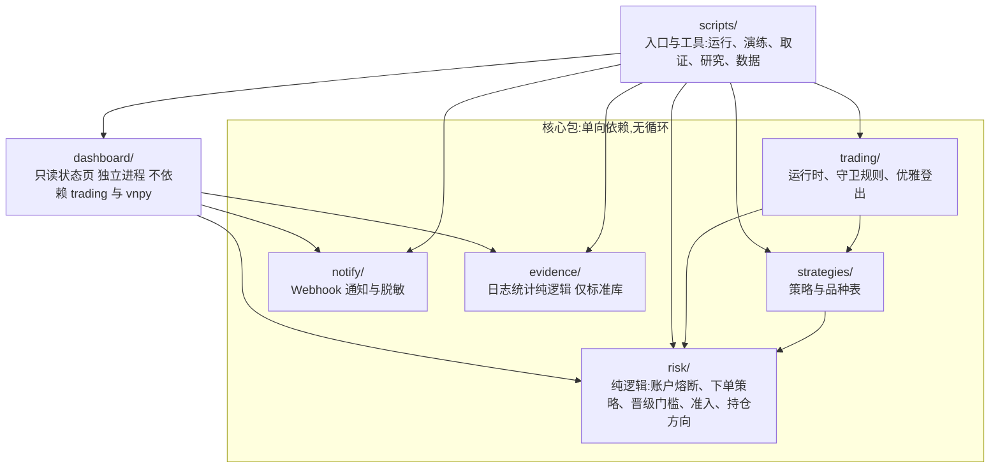
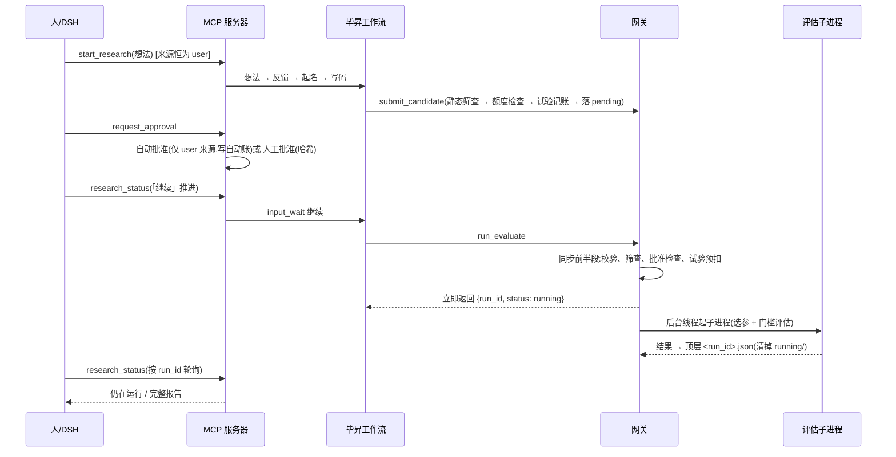

# 架构总图:分层、状态归属、隔离机制与已知局限台账

## Batch B 脚本层整理（Issue #12）

- `scripts/bootstrap.py` 是脚本入口的环境与 vn.py 状态边界；需要隔离状态的入口在导入 vn.py 日志模块前调用 `isolate_state()`。
- `ctp_tools/collector.py` 与 `ctp_tools/penetration.py` 只承载可复用的 CTP 采集、持仓检查、穿透式测试逻辑，不包含 CLI 入口；连接环境闸门仍由 `scripts/collect_reject_texts.py` 与 `scripts/penetration_check.py` 负责。
- `notify.webhook.redact()` 是统一脱敏实现，最短替换长度为 3 个字符，长值优先替换。
- 测试通过 `pyproject.toml` 的 `pythonpath` 统一加载项目根目录、`scripts` 和 `tests`，不再在测试文件中手工注入路径。

> 交易日历与统一交易时段表不属于本批，保留在后续 Batch D；本批不改变 `trading/runtime.py` 与 `risk/account_guard.py` 的交易日边界逻辑。


> 本页是 `PROJECTWIKI.md` §2 的补充:wiki §2.1 画"数据怎么流",这里画**代码怎么分层、磁盘状态归谁、哪些东西不能碰、哪些局限还没解决**。
> 事实来源:2026-11-11 的架构审视(import 图逐文件核对)。目标架构与规划位见 `docs/roadmap.md`。

## 0. 目标 vs 现状:逐节点实现矩阵

> 2026-11-11 逐节点核对代码得出。**IMPL** = 代码存在;**PART** = 代码在但未验证/不完整;**PLAN** = 只有设计,无代码。
> 本表是"实现了多少"的单一出处,每轮改动后更新;证据列给的都是可点开的文件路径。
> 目标架构与阶段划分见 `docs/roadmap.md` §2.2–§2.6。

### 数据层
| 节点 | 状态 | 证据 / 缺口 |
|---|---|---|
| bootstrap | IMPL | `scripts/bootstrap.py`(工作目录、`TZ`、`.vntrader`);提供 `isolate_state()` 与 `load_env()`，入口按需在 vn.py 日志导入前调用 |
| fetch_data | IMPL | `scripts/fetch_data.py`(按时间戳去重,可重复跑);**无调度** |
| import_minute / derived | IMPL | `scripts/import_minute.py`、`scripts/build_continuous.py`(换月派生在这里) |
| SCHED 增量调度 | PART | `scripts/record_market_incremental.py` 提供有界、可重入的 `fetch_data.py` 短任务；由 `@goodandready/dsh-cron@0.3.43` 调度，长期前台任务被生命周期闸门明确排除 |
| RECC CTP tick 录制 | PART | `scripts/record_market_data.py` + `scripts/record_market_data_wrapper.py` 接入官方 `vnpy_datarecorder`、独立 `.vntrader_record/database.db` 和本地生命周期控制（dummy worker 实测通过）；合约信息只能从交易前置查询，故采用受限交易前置连接（仅认证+查合约，发单/查账户硬性禁止，见 ADR 修订）；SimNow 第二套 7x24 已验证连接/合约/订阅/tick/优雅停止，但行情时间不可信、正式库 0 行；SimNow 第一套前置交易时段录制已验收（2026-11-12 夜盘，数据自洽、自动重连正常）；**DSH 重启实测与国信测试环境未验证；「连接成功但不订阅」已加 `stalled` 检测与 watchdog 重启** |

### 策略与研究
| 节点 | 状态 | 证据 / 缺口 |
|---|---|---|
| backtest_lib / optimize / optimize_15m / walk_forward_optimizer | IMPL | `scripts/backtest_lib.py`、`scripts/optimize.py`、`scripts/optimize_15m.py`、`scripts/walk_forward_optimizer.py`;`walk_forward_optimizer.py` **无 `--test` 开关**;`optimize.py`/`optimize_15m.py` 的 `--test` 经 `segment_ledger.py` 登记,重复使用即拒绝 |
| 随机入场对照 | IMPL | `strategies/random_entry_strategy.py` |
| 晋级门槛 | IMPL(已接入沙盒) | `risk/promotion_gate.py::check_gate`;由研究沙盒 `gate`/`evaluate`(`scripts/research_gate.py`)调用;`parameter_on_plateau` 由 `risk/plateau.py` 在选参时计算;旧优化脚本(`optimize.py`)仍未自动过闸 |
| PP 参数平原 / PBO/DSR | PART | 参数平原 IMPL(`risk/plateau.py` + `scripts/research_grid.py`);PBO/DSR PLAN |
| TPE(Optuna)/ MRO(`optimizer/` 包) | PLAN | 无 Optuna、无 `optimizer/` 目录 |
| RSA 研究沙盒 API(CLI + HTTP 网关 + 容器) | IMPL | `scripts/research_api.py`、`research_gateway.py`、`docker-compose.research.yml`、`docker/research/`;端到端经毕昇容器 → 沙盒容器实测;**威胁模型:纵深防御而非完整隔离**(见 ADR) |
| 候选独立进程执行 | PLAN(设计方案待评审) | ADR `20261115-candidate-process-isolation.md`,Issue [#29](https://github.com/laiyinyizao007/invest/issues/29):候选只产出信号序列,回测/评估/记账/落盘/指标全部由框架进程独立完成;试验次数改由框架自己数;**未改动任何已锁定阈值**;含 5 个需用户拍板的点 |
| SBX 骨架目录 | PART | `pending_strategies/` 已落地(候选源码的落点;网关容器另有 `data/research`、`data/ledger_anchor` 两个可写挂载,候选代码自身的写权限靠审计钩子白名单限制);`approved/` 与骨架模板未做 |
| 外层 Bisheng AI 研究员 | PART | 本机部署(仅 127.0.0.1);工具与工作流 v3、无 LLM 联调工作流已建;**LLM 节点联调待额度**;`tools/bisheng/` |
| 诊断书 / 候选评估 / 中文报告 | IMPL | `risk/diagnosis.py`、`risk/candidate_eval.py`、`risk/report.py`(纯函数) |
| RTR MetaRouter | PLAN | 零代码 |
| 评估异步化(启动即返回 + 按 run_id 取结果) | IMPL(端到端验证) | `scripts/research_gateway.py::_start_evaluate`、`scripts/research_api.py::evaluate_prepare/evaluate_run`、`scripts/research_sandbox.py::write_running/mark_interrupted/acquire_results_lock`;Issue #84,`docs/adr/20261125-pipeline-e2e-smoke.md` |
| 想法来源强制(联网来源禁止自动批准) | IMPL | `scripts/research_sandbox.py::AUTO_APPROVABLE_PROVENANCE`、`_record_row`;`tools/research_mcp/server.py`;Issue #88。**目前没有出厂代码传 `web`**,防线保护的是之后接入的宿主机驱动器 |
| 有界活动驱动器 | PLAN | Issue #90;方案见 `docs/plans/20261125-autonomous-research-plan.md` |
| 候选多周期指标(框架扩展) | PLAN | Issue #91 |
| 联网想法采集与净化 / 新数据封存段 | PLAN | 前者在驱动器之后,后者等用户补购 2026-06 之后分钟线;见 `docs/roadmap.md` §2.9 |

### 风控与守卫
| 节点 | 状态 | 证据 / 缺口 |
|---|---|---|
| risk_guard(预算/移动止损/连亏熔断) | IMPL | `risk/risk_guard.py` |
| account_guard(双层熔断) | IMPL | `risk/account_guard.py`;`trading_day()` 按 `hour >= 20` 且**只跳周末**,不认法定节假日 |
| order_policy(废单分级) | PART | `risk/order_policy.py` 三级分类;码表只有 8 个实测/官方背书码,其余靠关键词回退 |
| live_admission / positions | IMPL | `risk/live_admission.py`、`risk/positions.py`(净持仓方向 fail-closed) |
| 保证金占比风控 | PLAN | 无 |
| 周期性 `ReqQryOrder` 对账 | PLAN | 无 |

### 运行与运维
| 节点 | 状态 | 证据 / 缺口 |
|---|---|---|
| runtime(启动五步/对账/看门狗) | IMPL(夜盘演练验证) | `trading/runtime.py`;2026-11-12 夜盘 SimNow 实测通过:成交回报延迟、行情停更看门狗、真实切网的断线/重连、当日熔断、硬锁定与重启拒绝;**未验证**:废单文本补采、kill -9 重启、撮合差异;退出登出在重连后有一次原生崩溃待复现 |
| guard_rule | IMPL | `trading/guard_rule.py`;失败态的紧急平仓不自动恢复(见 §4 局限台账) |
| CTP / SimNow | IMPL(第一套前置) | 启动管道、演练六场景、行情录制均在第一套前置通过;国信测试环境未连 |
| Docker + GB18030 locale + HEALTHCHECK | IMPL | `Dockerfile`、`docker-compose.yml` |
| drill.py 六场景 | IMPL | 2026-11-12 夜盘全部通过,`docs/simnow-drills.md`;`disconnect` 要求 `--external-cut`(宿主机真实切网),没给则跳过;`--trace` 诊断埋点(`scripts/drill_trace.py`)。`latency` 对行情活跃度敏感 |
| notify 落盘待补发队列 | IMPL | `notify/webhook.py`(`WEBHOOK_OUTBOX`);单测 + 真实 HTTP 断网恢复测试 + 真实 Telegram 补发验证;真实切网复测待做 |
| simnow_guard | IMPL | `scripts/simnow_guard.py` |
| unattended_report | PART | `scripts/unattended_report.py`;连续 5 天证据未攒齐。纯逻辑已抽到 `evidence/logstats.py`(与状态页共用) |
| 状态页(只读 Web 监控面板)阶段① | IMPL | `dashboard/`(派生自 vnpy_webtrader 1.1.0,MIT)+ `scripts/status_server.py`;独立进程、仅回环、全 GET;ADR `20261112-status-dashboard.md`,契约 `docs/web/`。**前端尚未构建**(`dashboard/static/` 为空,显示占位页);阶段②-⑤ 为 PLAN |
| CAL 交易日历 | PLAN | 无节假日逻辑 |
| RM 主力换月自动化 | PLAN | rolls 数据离线生成,运行时无人校验 `LIVE_VT_SYMBOL` |
| 统一时段表 `risk/sessions.py` | PLAN | 时段定义散在 4 处,语义各异(见 §1 已知违例) |

### 通知
| 节点 | 状态 | 证据 / 缺口 |
|---|---|---|
| webhook(队列/重试/去重/脱敏) | IMPL | `notify/webhook.py`;真实飞书 webhook 从未验证(`.env` 里 URL 为空) |
| CTRL `/stop_all` 反向控制 | PLAN | 无接收端 |

### 合规工具
| 节点 | 状态 | 证据 / 缺口 |
|---|---|---|
| broker_test / broker_evidence / broker_report / penetration_check / collect_terminal_info | IMPL | `scripts/` 下五个脚本 |
| 2.1 断网演练 | PART | 半自动(`--interactive` 提示操作者断网) |
| 5.2 批量撤单 | PLAN | 无 |
| 证据里记录前置地址/BrokerID/AppID | PLAN | `broker_test.py` 目前只用 `LIVE_VT_SYMBOL` |

### 外层与基础设施
| 节点 | 状态 |
|---|---|
| Bisheng 外层(BSN / KB / MEM / 独立 compose) | PLAN(零代码) |
| 日历 / 调度 | PLAN |

### 实现比例(粗估,PART 记半)
数据 ~60% · 策略研究 ~70% · 风控守卫 ~85% · 运行运维 ~70% 节点但**对真实交易所验证仅 ~40%** · 通知 50% · 合规工具 ~80% · 外层 0%。

### 依赖顺序(先做这些,再往上加功能)
`统一时段表 + 日历` → `假期感知的熔断边界` → `换月校验` → `调度` → `数据积累` → `月度重估`;
`门槛的 parameter_on_plateau 计算来源` → `参数平原/过拟合检验` → 门槛全自动;
`共享包 ctp_tools / isolate_state / load_env` → `scripts/` 分目录 → `研究沙盒 API` → `Bisheng 外层`。

## 1. 分层与允许的 import 方向



`dashboard/` 只依赖 `evidence/`、`notify/`(脱敏)、`risk/account_guard`(阈值默认值)——都是纯标准库路径;**绝不 import `trading` / `vnpy` / `bootstrap`**(`tests/test_dashboard_boundaries.py` 用 AST 与新进程加载检查强制)。交易路径对面板零依赖:杀掉面板不影响交易。

规则:**只向下依赖**——`risk` 不依赖任何同级以上的包;`trading` 可用 `risk`、`strategies`;`scripts` 可用全部;核心包**不得** import `scripts/`。
现状(2026-11-11 核对):核心包符合,无循环、无反向依赖。

**已知违例(都在 `scripts/` 内,不影响实盘路径)**:

| 违例 | 位置 | 处置 |
|---|---|---|
| 脚本把另一个脚本当库用 | `broker_test`→`penetration_check`→`collect_reject_texts`(`Collector`/`close_engine`/`check_positions`/`in_trading_session`/`redact`/`check_target`) | 迁到共享包,见 `docs/roadmap.md` §2.6「ctp_tools 共享层」 |
| 脱敏实现三份 | `notify/webhook.py`(最短 4 位)、`penetration_check.redact`(最短 3 位)、`broker_evidence._redact`(同前) | 统一出处,见路线图 |
| `TEMP_DIR` 隔离与 `.env` 加载复制粘贴 | `drill.py`、`broker_test.py`(后者有 `ISOLATED` 自检,前者没有);`load_dotenv` 散在 7 个入口 | 同上 |
| 测试靠 `sys.path.insert(0, 'scripts')` | 约 25 个测试文件 | 改为 `pyproject.toml`/`conftest.py` 的 `pythonpath` |
| 交易时段定义 4 处且语义各异 | `strategies/trend_atr_strategy.py::ENTRY_SESSIONS`、`collect_reject_texts.py`、`drill.py`、`risk/account_guard.py`(`hour >= 20`) | 等 SimNow 实测后并入交易日历(路线图规划位 CAL) |

## 2. 磁盘状态归属表

| 路径 | 谁写 | 谁读 | 谁**不得**碰 |
|---|---|---|---|
| `data/state/account_guard.json` | `trading/guard_rule`(实盘/SimNow 运行时)、`scripts/unlock_account.py`(解锁,运行中拒绝) | 运行时启动恢复 | 演练、取证、测试(它们必须用隔离目录) |
| `data/state/pause_trading.flag` | `scripts/pause_trading.py` | 守卫规则每次 `check_allowed` | — |
| `data/state/promotion_approval.json` | `scripts/record_promotion.py`(仅晋级门槛全过) | `scripts/run_headless.py` 连接生产 API 前 | 任何自动流程不得代写 |
| `data/state/heartbeat` | 运行时(无头) | 容器健康检查 | — |
| `.vntrader/` | vn.py 引擎、`bootstrap.py` 建目录 | 回测、CTA | 录制入口 |
| `.vntrader_record/` | 官方 DataRecorder 录制入口（已实现，真实录制待验收） | 录制状态与独立 database.db | 回测、交易运行时、演练、取证 |
| `.vntrader_drill/` | `scripts/drill.py` | 演练自身 | 实盘、录制入口 |
| `.vntrader_brokertest/` | `scripts/broker_test.py` | 取证自身 | 实盘 |
| `data/broker_test/<时间戳>/` | `scripts/broker_test.py`、`broker_report.py` | 报告生成 | 不入库(含测试账号);国信模板同样不入库 |
| `docs/simnow-drills.md`、`docs/reject-texts-simnow.md`、`docs/unattended-log.md` | `drill.py`/`collect_reject_texts.py`/`unattended_report.py` 按标记区重写 | 人读 | 手工改标记区内的内容;`simnow-drills.md` **尚不存在**——演练还没实跑,首次运行时由脚本生成 |
| `data/`(行情/CSV/derived)、`runtime/` | 数据脚本、运行时 | 研究与回测 | 不入库 |

## 3. 隔离机制(为什么演练/取证不会污染实盘)

1. **`TEMP_DIR` 改写**:`drill.py`、`broker_test.py` 在导入 vn.py 日志模块**之前**把 `vnpy.trader.utility.TEMP_DIR` 指向各自目录,日志与引擎临时文件随之隔离。
   导入顺序是硬约束:`bootstrap` → 改写 `TEMP_DIR` → 其余 vn.py 导入。`broker_test` 带 `ISOLATED` 自检并有"全新进程"测试;`drill` 暂无自检(路线图登记)。
2. **`state_file` 重定向**:`rule.update_setting({"state_file": ...})` 让熔断/硬锁定状态落到隔离目录,不写真实 `data/state/account_guard.json`。
3. **环境门禁**:`broker_test`/`penetration_check` 只认 `CTP_ENVIRONMENT=测试`、**无条件拒绝生产 API**;`drill`/`collect_reject_texts` 用 `--confirm-simnow` 并校验 SimNow 地址。
4. **晋级闸门**:生产 API 需要 `promotion_approval.json`,只在晋级门槛全部通过时由 `record_promotion.py` 写出。

## 4. 已知局限台账(逐条链接回 ADR)

| 局限 | 来源 | 状态 | 触发条件 / 去向 |
|---|---|---|---|
| **净持仓(`Direction.NET`)方向不明** | `adr/20261109-account-risk-lock.md` | **已做 fail-closed**:对账/漂移检测拒绝启动或告警,紧急平仓不猜方向直接升级人工(`risk/positions.py`);**局限**:空仓启动证明不了账户形态,失败的紧急平仓不自动恢复(见 ADR,已登记路线图) | 账户是否真会回报 NET **未实测**——SimNow/国信测试环境验证后在 ADR 记录结论;若会出现再做真正的净持仓支持 |
| 交易日按周末顺延,不处理法定节假日 | `adr/20261109-account-risk-lock.md` | 未解决 | 交易日历(路线图规划位 CAL) |
| 回撤口径含浮动盈亏,出入金会被当成盈亏 | 同上 | 未解决 | 运维约定:出入金前后先停机 |
| 废单文本/持仓回报时序/撤单失败/断线重连/夜盘跨日未在真实 CTP 验证 | `adr/20261109-deployment-and-live-mode.md` §6 | 待 SimNow 实测 | `docs/runbook-simnow.md` 第 5 节 |
| 主力换月需人工更新 `LIVE_VT_SYMBOL` | 同上 | 未解决 | 换月移仓(roadmap) |
| 晋级门槛夏普下界在现有数据上几乎不可能通过 | `adr/20261110-baseline-15m.md` | 事先承认 | 更长样本外/多品种/小额实盘记录,**不放宽门槛** |
| 单品种、一套复权方式、成交模型无排队/盘口冲击 | `adr/20261110-baseline-15m.md`、`adr/20261110-walk-forward-optimizer.md` | 事先承认 | 多品种数据(需补购郑商所数据) |
| `parameter_on_plateau` 由调用方提供 | `adr/20261111-discipline-enforcement.md` | 人工判断 | 参数平原卷积(roadmap §2.6) |
| 别的终端下的单是否以 reference 为空回报**未实测** | 同上(codex H1) | 待实测 | runbook 第 5 节第 11 项;周期性 `ReqQryOrder` 对账(roadmap §2.6) |
| 非策略委托仅进程存活期间检测;算法单/价差子单 reference 前缀不同 | 同上 | 未解决 | 无头启用算法单时扩白名单(roadmap §2.6) |
| 准入文件防误操作、不防恶意 | 同上 | 设计取舍 | — |
| 5.2 批量撤单、2.1 全自动断网演练未做;证据图是渲染图非界面截图 | `adr/20261111-broker-test-compliance.md` | 待国信确认 | roadmap §2.6;国信书面确认(`docs/live-readiness.md` C3) |

## 5. 研究系统(外层)现状架构(2026-11-25 核对)

> 这一节只写**已经合并、已经验证过的**现状;计划与待办在 `docs/roadmap.md` §2.9 与 `docs/plans/20261125-autonomous-research-plan.md`。
> 研究系统与交易路径**完全分离**:候选策略只产出研究结论,不接触真实委托、CTP 凭据与 `.env` 交易段(第一设计公理见 `docs/roadmap.md` §2.2)。

### 5.1 部件与信任边界

```mermaid
flowchart LR
  subgraph HOST[本机宿主机]
    USER[人 / DSH 助手]
    MCP[研究 MCP 服务器<br/>tools/research_mcp/server.py<br/>会话状态 .local/research-mcp/sessions.json]
    BS[毕昇工作流 v3<br/>127.0.0.1:7860<br/>起名·写码两个 LLM 节点]
    DER[(派生行情 CSV<br/>derived/*_15m_adj.csv<br/>只读挂载)]
    CTRL[(批准账 / 自动批准账<br/>data/research-control<br/>网关只读)]
  end
  subgraph NET[research_net 内部网络 无外网]
    GW[研究沙盒网关<br/>scripts/research_gateway.py :8765<br/>令牌鉴权 只读根文件系统]
    CH[评估子进程<br/>候选在受限窗口内执行]
  end
  RES[(data/research<br/>试验账本 提交账本 结果 running/ 尝试记录)]
  USER -->|start_research / research_status / request_approval| MCP
  MCP -->|开放 API| BS
  BS -->|submit_candidate / get_recent_failures / run_evaluate<br/>(毕昇后端额外接入 research_net 才能调网关)| GW
  GW -->|批准检查通过后起子进程| CH
  CH -->|读| DER
  GW -->|读| CTRL
  GW -->|写| RES
  MCP -->|写批准账 自动账须过来源检查| CTRL
  MCP -->|按 run_id 读结果| RES
```

- **网络边界**:网关容器在 `internal: true` 的网络里**没有外网**;候选代码被静态筛查(禁 socket/urllib/requests 等)和运行期审计钩子双重限制。毕昇后端与宿主机能联网,但**不是研究沙盒的一部分**。
- **DSH 研究会话**没有联网/fetch/bash 工具(`research-profile-allowlist.json` 白名单),只有 research-mcp 的 3 个工具。
- **批准链**:候选代码要先有批准记录(哈希绑定文件内容)才能被评估。人工批准写人工账;自动批准写**独立的自动账**(`via=auto-research`),运行侧(装载门、实盘准入)**不读自动账**。

### 5.2 候选策略的"框架"分四层

| 层 | 内容 | 谁能改 |
|---|---|---|
| 候选层 | 继承 `TrendAtr15mStrategy` 的类;只写 `entry_signal()`(返回 +1/-1/0)与**恰好 3 个**参数的 `param_grid`(每个参数 3~10 个严格递增的取值,且参数名须登记进类的 `parameters`);只看**单一品种**自己的 15 分钟价、量、持仓量 | 模型每次生成 |
| 执行与风控层 | **出场方式与仓位由框架固定**:ATR 移动止损、当日连亏熔断;每笔固定 1 手,**止损距离 × 合约乘数 × 1 手超过单笔风险预算(300 元,受不可变宪法保护)就放弃该笔交易**(不是按预算定手数,也不会缩小止损去迁就预算)。候选只能在宪法允许的范围内调参数——例如可以启用可选的固定止盈 `take_profit_r`(默认 0 = 不启用),风险预算等受保护参数不可改 | 开发(不可降级,走审查) |
| 评估层 | 选参窗口选参 → 滚动验证窗口上跑门槛:成本翻倍、200 次随机入场对照、参数高原、DSR(分母 = 试验账本累计) | 开发(不可降级) |
| 治理层 | 沙盒筛查与审计钩子、批准账、哈希链账本与外置锚点、测试段台账、网关 | 开发(不可降级);**循环不得自改** |

> 候选层的**表达能力有限**(出场固定、单品种、无多周期、无外部数据)是框架现状,不是想法本身的问题;扩展路线见 `docs/roadmap.md` §2.9。

### 5.3 一轮研究的流程



要点:毕昇工具对网关的读超时硬编码 30 秒,所以评估是**启动即返回 + 按 run_id 取结果**;检查全在请求线程里做完,后台线程只做慢的那半段,不可能绕过检查。

### 5.4 状态归属(研究侧)

| 路径 | 谁写 | 说明 |
|---|---|---|
| `data/research/trials.jsonl` | 网关(`risk/trial_ledger`) | 试验账本,哈希链 + 外置锚点;**只增不减**;DSR 的分母 |
| `data/research/submissions.jsonl` | 网关 | 滚动 24 小时提交额度(现 20) |
| `data/research/<run_id>.json` | 网关评估线程 | 最终结果;顶层 `*.json` 是看板/反馈/清单的唯一来源 |
| `data/research/running/<run_id>.json` | 网关 | 运行中/失败/被中断状态;**不进结果清单** |
| `data/research/attempts.jsonl` | MCP 服务器 | 每次尝试的哈希链记录(含来源 `provenance`、被拒的尝试) |
| `data/research-control/approvals.json` | 批准通道(页面/回贴/CLI) | 人工批准账,运行侧信任 |
| `data/research-control/auto_approvals.json` | MCP 服务器(仅 `user` 来源) | 自动批准账,**运行侧不读** |
| `data/ledger_anchor/` | 账本写入者 | 各账本的外置锚点(键 = 相对路径哈希,宿主机与容器一致) |
| `config/test_segment_usage.json` | 测试段台账 | 记录哪些测试段已被看过(只看一次) |
| `pending_strategies/` | 网关 | 候选源码落点。注:网关容器另有 `data/research`、`data/ledger_anchor` 两个可写挂载;**候选代码自身**的写权限靠运行期审计钩子的白名单限制 |
| `.local/research-mcp/sessions.json` | MCP 服务器 | 当前会话(单槽位) |

### 5.5 已知局限(如实)

- **静态筛查是黑名单,不是隔离**;候选与框架同进程执行(多轮 codex 实测有绕过)。独立进程隔离只有设计(#29,待评审),**没有实现**。
- **自动批准意味着模型生成的代码不经人读就在本机沙盒执行**(用户已接受,见 `docs/adr/20261123-research-auto-approval.md`)。`provenance` 强制(Issue #88)保证联网来源想法进不了自动账,但目前出厂代码没有任何地方传 `web`;该防线成立的前提是自动批准只在没有联网工具的研究 profile 里开,`deployment_problem()` 目前只告警。
- **容器内锚点目录与账本同在可写区**,候选"够不到锚点"靠沙盒写入白名单,不是独立信任域(见 `risk/ledger_chain.py` 头注释)。
- 统计功效:现有分钟线按品种约 5.3~6.2 年(C15 约 5.9 年,V15 约 5.3 年,EG15 约 6.2 年),试验账本累计 765,DSR 分母已很大;单个短窗口几乎不可能通过。**合法结论多半是"证明不了有优势"**。
- 数据:网关评估用的派生 15 分钟复权数据六个品种都止于 2026-06-15;免费源只有 C/EB/PP 自 2026-08-28 起的原始 15 分钟线(约 2.4 个月,与 06-15 之间有空档,未复权),V/EG/M 没有。
