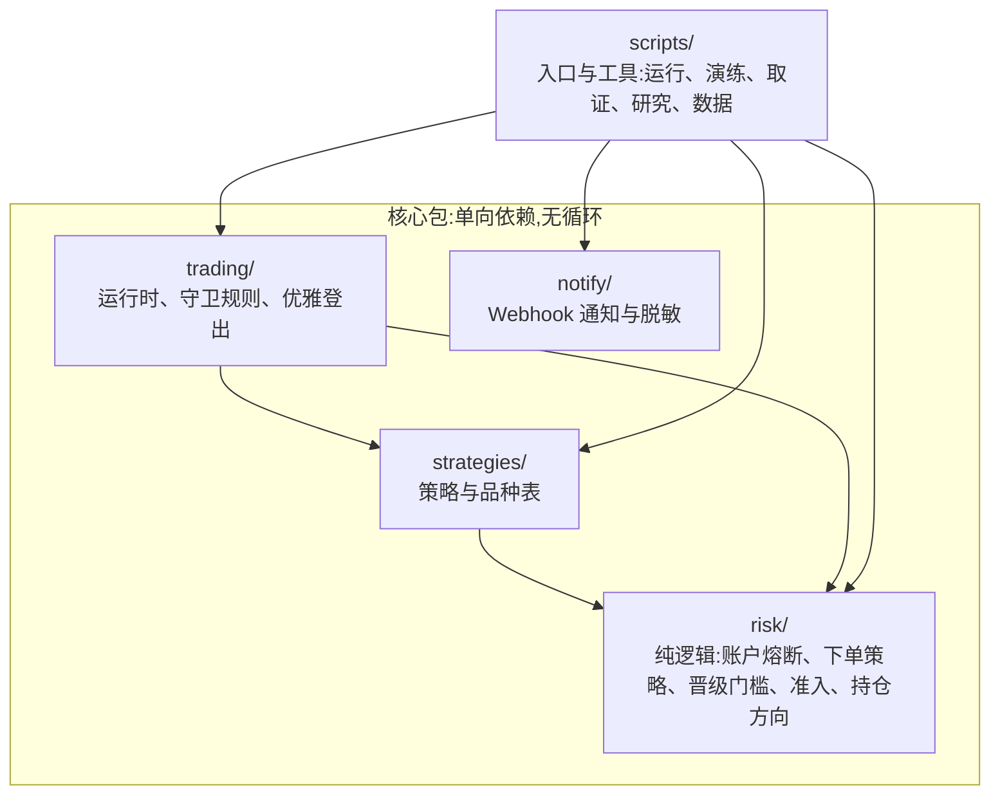

# 架构总图:分层、状态归属、隔离机制与已知局限台账

> 本页是 `PROJECTWIKI.md` §2 的补充:wiki §2.1 画"数据怎么流",这里画**代码怎么分层、磁盘状态归谁、哪些东西不能碰、哪些局限还没解决**。
> 事实来源:2026-11-11 的架构审视(import 图逐文件核对)。目标架构与规划位见 `docs/roadmap.md`。

## 0. 目标 vs 现状:逐节点实现矩阵

> 2026-11-11 逐节点核对代码得出。**IMPL** = 代码存在;**PART** = 代码在但未验证/不完整;**PLAN** = 只有设计,无代码。
> 本表是"实现了多少"的单一出处,每轮改动后更新;证据列给的都是可点开的文件路径。
> 目标架构与阶段划分见 `docs/roadmap.md` §2.2–§2.6。

### 数据层
| 节点 | 状态 | 证据 / 缺口 |
|---|---|---|
| bootstrap | IMPL | `scripts/bootstrap.py`(导入副作用:工作目录、`TZ`、`.vntrader`);`isolate_state()`/`load_env()` 尚未抽成 |
| fetch_data | IMPL | `scripts/fetch_data.py`(按时间戳去重,可重复跑);**无调度** |
| import_minute / derived | IMPL | `scripts/import_minute.py`、`scripts/build_continuous.py`(换月派生在这里) |
| SCHED 增量调度 | PLAN | 无 cron / 计划任务 |
| RECC CTP tick 录制 | PLAN | 无 `DataRecorder` |

### 策略与研究
| 节点 | 状态 | 证据 / 缺口 |
|---|---|---|
| backtest_lib / optimize / optimize_15m / walk_forward_optimizer | IMPL | `scripts/backtest_lib.py`、`scripts/optimize.py`、`scripts/optimize_15m.py`、`scripts/walk_forward_optimizer.py`;优化器**无 `--test` 开关**,测试段使用靠人工纪律 |
| 随机入场对照 | IMPL | `strategies/random_entry_strategy.py` |
| 晋级门槛 | IMPL(未接线) | `risk/promotion_gate.py::check_gate`;只被 `scripts/record_promotion.py`、`risk/live_admission.py` 消费,**未接入优化脚本**;`parameter_on_plateau` 由调用方传入,无计算来源 |
| PP 参数平原/PBO/DSR | PLAN | 只有布尔字段 |
| TPE(Optuna)/ MRO(`optimizer/` 包) | PLAN | 无 Optuna、无 `optimizer/` 目录 |
| RSA 研究沙盒 API / SBX 骨架目录 / RTR MetaRouter | PLAN | 零代码 |

### 风控与守卫
| 节点 | 状态 | 证据 / 缺口 |
|---|---|---|
| risk_guard(预算/移动止损/连亏熔断) | IMPL | `risk/risk_guard.py` |
| account_guard(双层熔断) | IMPL | `risk/account_guard.py`;`trading_day()` 按 `hour >= 20` 且**只跳周末**,不认法定节假日 |
| order_policy(废单分级) | PART | `risk/order_policy.py` 三级分类;码表只有 8 个实测/官方背书码,其余靠关键词回退 |
| live_admission / positions | IMPL | `risk/live_admission.py`、`risk/positions.py`(净持仓方向 fail-closed) |
| 保证金占比风控 | PLAN | 无 |
| 周期性 `ReqQryOrder` 对账 | PLAN | 无 |

### 运行与运维
| 节点 | 状态 | 证据 / 缺口 |
|---|---|---|
| runtime(启动五步/对账/看门狗) | IMPL(仅假网关) | `trading/runtime.py`;废单/撤单/断线/夜盘跨日未在真实 CTP 验证 |
| guard_rule | IMPL | `trading/guard_rule.py`;失败态的紧急平仓不自动恢复(见 §4 局限台账) |
| CTP / SimNow | PART | 启动管道跑通一次;其余路径未验证 |
| Docker + GB18030 locale + HEALTHCHECK | IMPL | `Dockerfile`、`docker-compose.yml` |
| drill.py 六场景 | PART | 代码完成,**从未实跑**(`docs/simnow-drills.md` 尚不存在,首次实跑时生成) |
| simnow_guard | IMPL | `scripts/simnow_guard.py` |
| unattended_report | PART | `scripts/unattended_report.py`;连续 5 天证据未攒齐 |
| CAL 交易日历 | PLAN | 无节假日逻辑 |
| RM 主力换月自动化 | PLAN | rolls 数据离线生成,运行时无人校验 `LIVE_VT_SYMBOL` |
| 统一时段表 `risk/sessions.py` | PLAN | 时段定义散在 4 处,语义各异(见 §1 已知违例) |

### 通知
| 节点 | 状态 | 证据 / 缺口 |
|---|---|---|
| webhook(队列/重试/去重/脱敏) | IMPL | `notify/webhook.py`;真实飞书 webhook 从未验证(`.env` 里 URL 为空) |
| CTRL `/stop_all` 反向控制 | PLAN | 无接收端 |

### 合规工具
| 节点 | 状态 | 证据 / 缺口 |
|---|---|---|
| broker_test / broker_evidence / broker_report / penetration_check / collect_terminal_info | IMPL | `scripts/` 下五个脚本 |
| 2.1 断网演练 | PART | 半自动(`--interactive` 提示操作者断网) |
| 5.2 批量撤单 | PLAN | 无 |
| 证据里记录前置地址/BrokerID/AppID | PLAN | `broker_test.py` 目前只用 `LIVE_VT_SYMBOL` |

### 外层与基础设施
| 节点 | 状态 |
|---|---|
| Bisheng 外层(BSN / KB / MEM / 独立 compose) | PLAN(零代码) |
| 日历 / 调度 | PLAN |

### 实现比例(粗估,PART 记半)
数据 ~60% · 策略研究 ~70% · 风控守卫 ~85% · 运行运维 ~70% 节点但**对真实交易所验证仅 ~40%** · 通知 50% · 合规工具 ~80% · 外层 0%。

### 依赖顺序(先做这些,再往上加功能)
`统一时段表 + 日历` → `假期感知的熔断边界` → `换月校验` → `调度` → `数据积累` → `月度重估`;
`门槛的 parameter_on_plateau 计算来源` → `参数平原/过拟合检验` → 门槛全自动;
`共享包 ctp_tools / isolate_state / load_env` → `scripts/` 分目录 → `研究沙盒 API` → `Bisheng 外层`。

## 1. 分层与允许的 import 方向

规则:**只向下依赖**——`risk` 不依赖任何同级以上的包;`trading` 可用 `risk`、`strategies`;`scripts` 可用全部;核心包**不得** import `scripts/`。
现状(2026-11-11 核对):核心包符合,无循环、无反向依赖。

**已知违例(都在 `scripts/` 内,不影响实盘路径)**:

| 违例 | 位置 | 处置 |
|---|---|---|
| 脚本把另一个脚本当库用 | `broker_test`→`penetration_check`→`collect_reject_texts`(`Collector`/`close_engine`/`check_positions`/`in_trading_session`/`redact`/`check_target`) | 迁到共享包,见 `docs/roadmap.md` §2.6「ctp_tools 共享层」 |
| 脱敏实现三份 | `notify/webhook.py`(最短 4 位)、`penetration_check.redact`(最短 3 位)、`broker_evidence._redact`(同前) | 统一出处,见路线图 |
| `TEMP_DIR` 隔离与 `.env` 加载复制粘贴 | `drill.py`、`broker_test.py`(后者有 `ISOLATED` 自检,前者没有);`load_dotenv` 散在 7 个入口 | 同上 |
| 测试靠 `sys.path.insert(0, 'scripts')` | 约 25 个测试文件 | 改为 `pyproject.toml`/`conftest.py` 的 `pythonpath` |
| 交易时段定义 4 处且语义各异 | `strategies/trend_atr_strategy.py::ENTRY_SESSIONS`、`collect_reject_texts.py`、`drill.py`、`risk/account_guard.py`(`hour >= 20`) | 等 SimNow 实测后并入交易日历(路线图规划位 CAL) |

## 2. 磁盘状态归属表

| 路径 | 谁写 | 谁读 | 谁**不得**碰 |
|---|---|---|---|
| `data/state/account_guard.json` | `trading/guard_rule`(实盘/SimNow 运行时)、`scripts/unlock_account.py`(解锁,运行中拒绝) | 运行时启动恢复 | 演练、取证、测试(它们必须用隔离目录) |
| `data/state/pause_trading.flag` | `scripts/pause_trading.py` | 守卫规则每次 `check_allowed` | — |
| `data/state/promotion_approval.json` | `scripts/record_promotion.py`(仅晋级门槛全过) | `scripts/run_headless.py` 连接生产 API 前 | 任何自动流程不得代写 |
| `data/state/heartbeat` | 运行时(无头) | 容器健康检查 | — |
| `.vntrader/` | vn.py 引擎、`bootstrap.py` 建目录 | 回测、CTA | — |
| `.vntrader_drill/` | `scripts/drill.py` | 演练自身 | 实盘 |
| `.vntrader_brokertest/` | `scripts/broker_test.py` | 取证自身 | 实盘 |
| `data/broker_test/<时间戳>/` | `scripts/broker_test.py`、`broker_report.py` | 报告生成 | 不入库(含测试账号);国信模板同样不入库 |
| `docs/simnow-drills.md`、`docs/reject-texts-simnow.md`、`docs/unattended-log.md` | `drill.py`/`collect_reject_texts.py`/`unattended_report.py` 按标记区重写 | 人读 | 手工改标记区内的内容;`simnow-drills.md` **尚不存在**——演练还没实跑,首次运行时由脚本生成 |
| `data/`(行情/CSV/derived)、`runtime/` | 数据脚本、运行时 | 研究与回测 | 不入库 |

## 3. 隔离机制(为什么演练/取证不会污染实盘)

1. **`TEMP_DIR` 改写**:`drill.py`、`broker_test.py` 在导入 vn.py 日志模块**之前**把 `vnpy.trader.utility.TEMP_DIR` 指向各自目录,日志与引擎临时文件随之隔离。
   导入顺序是硬约束:`bootstrap` → 改写 `TEMP_DIR` → 其余 vn.py 导入。`broker_test` 带 `ISOLATED` 自检并有"全新进程"测试;`drill` 暂无自检(路线图登记)。
2. **`state_file` 重定向**:`rule.update_setting({"state_file": ...})` 让熔断/硬锁定状态落到隔离目录,不写真实 `data/state/account_guard.json`。
3. **环境门禁**:`broker_test`/`penetration_check` 只认 `CTP_ENVIRONMENT=测试`、**无条件拒绝生产 API**;`drill`/`collect_reject_texts` 用 `--confirm-simnow` 并校验 SimNow 地址。
4. **晋级闸门**:生产 API 需要 `promotion_approval.json`,只在晋级门槛全部通过时由 `record_promotion.py` 写出。

## 4. 已知局限台账(逐条链接回 ADR)

| 局限 | 来源 | 状态 | 触发条件 / 去向 |
|---|---|---|---|
| **净持仓(`Direction.NET`)方向不明** | `adr/20261109-account-risk-lock.md` | **已做 fail-closed**:对账/漂移检测拒绝启动或告警,紧急平仓不猜方向直接升级人工(`risk/positions.py`);**局限**:空仓启动证明不了账户形态,失败的紧急平仓不自动恢复(见 ADR,已登记路线图) | 账户是否真会回报 NET **未实测**——SimNow/国信测试环境验证后在 ADR 记录结论;若会出现再做真正的净持仓支持 |
| 交易日按周末顺延,不处理法定节假日 | `adr/20261109-account-risk-lock.md` | 未解决 | 交易日历(路线图规划位 CAL) |
| 回撤口径含浮动盈亏,出入金会被当成盈亏 | 同上 | 未解决 | 运维约定:出入金前后先停机 |
| 废单文本/持仓回报时序/撤单失败/断线重连/夜盘跨日未在真实 CTP 验证 | `adr/20261109-deployment-and-live-mode.md` §6 | 待 SimNow 实测 | `docs/runbook-simnow.md` 第 5 节 |
| 主力换月需人工更新 `LIVE_VT_SYMBOL` | 同上 | 未解决 | 换月移仓(roadmap) |
| 晋级门槛夏普下界在现有数据上几乎不可能通过 | `adr/20261110-baseline-15m.md` | 事先承认 | 更长样本外/多品种/小额实盘记录,**不放宽门槛** |
| 单品种、一套复权方式、成交模型无排队/盘口冲击 | `adr/20261110-baseline-15m.md`、`adr/20261110-walk-forward-optimizer.md` | 事先承认 | 多品种数据(需补购郑商所数据) |
| `parameter_on_plateau` 由调用方提供 | `adr/20261111-discipline-enforcement.md` | 人工判断 | 参数平原卷积(roadmap §2.6) |
| 别的终端下的单是否以 reference 为空回报**未实测** | 同上(codex H1) | 待实测 | runbook 第 5 节第 11 项;周期性 `ReqQryOrder` 对账(roadmap §2.6) |
| 非策略委托仅进程存活期间检测;算法单/价差子单 reference 前缀不同 | 同上 | 未解决 | 无头启用算法单时扩白名单(roadmap §2.6) |
| 准入文件防误操作、不防恶意 | 同上 | 设计取舍 | — |
| 5.2 批量撤单、2.1 全自动断网演练未做;证据图是渲染图非界面截图 | `adr/20261111-broker-test-compliance.md` | 待国信确认 | roadmap §2.6;国信书面确认(`docs/live-readiness.md` C3) |
