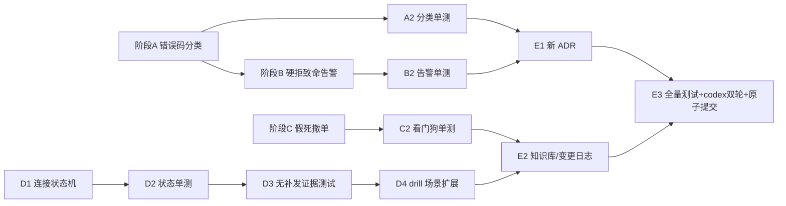

# 计划:CTP 废单处理增强与断线/假死看门狗 — 极限压力测试前置改造

> 阶段:P2 制定方案(plan-down 技能产出;Phase 0 方法清晰度判定 = 方法模糊,
> Phase 1 外部澄清受环境限制见文末,Phase 2 经 planner 两步分解)
> 关联:Issue #1;基线 572 测试通过 / 89% 覆盖率;不连接任何实盘,全部离线 FakeGateway 验证。

## 1. 前提纠正:用户指令中的两个不存在

用户原始 Next Action 是「重写 `on_error` 和 `on_disconnected` 回调函数」,并引用 `global_risk_manager.py`。
经源码核实,这两个前提在本项目技术栈中不成立:

1. **vn.py 4.5 的 `BaseGateway` 没有 `on_error` / `on_disconnected` 回调**。
   它只暴露 `on_event/on_tick/on_trade/on_order/on_position/on_account/on_quote/on_log/on_contract/write_log`。
   CTP 的错误与断线**全部以 `EVENT_LOG` 文本**到达,本项目等价入口是:
   - `trading/runtime.py::_on_log`(给人看的网关告警通道)
   - `trading/guard_rule.py::_on_log`(废单分类用的精确措辞通道)
2. **仓库里没有 `global_risk_manager.py`**。熔断的实际承载者是 `risk/account_guard.py`(双层熔断状态机)
   与 `trading/guard_rule.py`(挂在发单链上的规则),断头台演练(600 元当日熔断)已由它们完整实现。

因此本计划不改写不存在的回调,而是在两条真实通道(EVENT_LOG 文本 + 定时器看门狗)上补齐四个演练的缺口。

## 2. 四个极限演练的现状盘点(已实现 vs 缺口)

| 演练 | 现状 | 缺口 |
|------|------|------|
| ① 拔网线 | `runtime._on_log` 已对「连接断开」发 ERROR、对「登录成功」发恢复通知;`scripts/drill.py::scenario_disconnect` 验证告警与自动重连;框架层 `CtpTdApi.send_order` 断连即返回 `""` 不排队,策略 `pending_entry` 一次性消费不重试 | 无显式 td/md 连接状态机;无离线证据测试证明「断线期间信号不补发、重连无一窝蜂」 |
| ② 废单轰炸 | 软硬拒绝分类、未知 fail-closed 为 HARD、硬拒/风暴 → 当日禁开仓 + 撤全部开仓单、开仓单永不重试 | 分类只认关键词不认 CTP 数字错误码;硬拒锁定告警措辞泛泛(「委托被拒」/「当日禁止开仓」),没有「严重错误:资金不足,已停止策略」式的致命语义 |
| ③ 假死看门狗 | 交易时段 60s 无 Tick 发 WARN「行情停更」,300s 节流再告警 | **只告警不撤单**,演练要求强行撤掉所有挂单 |
| ④ 断头台 | 完整实现:`account_guard` 边沿触发 DAILY 锁定 → `_on_lock_event` 撤单 + 可选平仓 + FATAL/ERROR 通知;drill 有 daily-loss/hard-lock 场景 | 仅补端到端测试与文档核对,不改逻辑 |

## 3. 改造任务分解

### 阶段 A — 错误码优先的废单分类(纯逻辑,无 vn.py 依赖)

- **A1 `risk/order_policy.py`**
  - 新增 `extract_ctp_error_code(text: str | None) -> int | None`:正则锚定「代码」前缀,
    兼容全角/半角冒号(`代码[:：]\s*(\d+)`),只取首个数字码;无匹配返回 None。
  - 新增 `CTP_ERROR_KIND: dict[int, RejectKind]`,**只收录有 SimNow 实测或官方文档背书的码**:
    `21`(资金不足/席位未连接)、`81`(价格超涨跌停)、`63`(权限/授权)、`32`(报单字段非法)、
    `33`(合约交易状态不允许)、`14`(合约不存在)、`30`(报单已撤)、`31`(报单已成)→ 全部 HARD。
    软类码表**留空并注释「待 SimNow 实测填充,不凭记忆写码」**。
  - `classify_reject` 改为三级决策且签名不变:
    抽码 → 码表命中直接定论 → 未命中回退现有 HARD/SOFT 关键词 → 仍未知一律 HARD。
    关键效果:实测文本「代码:21…该交易席位未连接到交易所」虽含软关键词「连接」,码表优先判 HARD。
- **A2 `tests/test_account_guard.py` 新增用例**
  `test_extract_error_code_*`(半角/全角冒号、无码、多数字只取代码后首个)、
  `test_error_code_overrides_soft_keyword`(21 + 「连接」= HARD)、
  `test_unknown_code_falls_back_to_keywords`、`test_unknown_text_is_hard`、码表各码参数化用例。
- 验收:`risk/order_policy.py` 保持 100% 覆盖率(该模块现行口径),全程离线。

### 阶段 B — 硬拒绝的致命告警语义(依赖 A1)

- **B1 `trading/guard_rule.py::_handle_reject` / `_lock_daily`**
  - 开仓单硬拒绝锁定时,告警升级为带原因与错误码的 FATAL 级语义,标题形如
    「严重错误:{原因摘要},已停止策略开仓并撤销挂单」;原因摘要优先带提取出的错误码。
  - 平仓拒单路径**维持现状**(只告警、永不锁离场),不得出现「已停止」措辞。
  - 软拒绝风暴路径措辞保持「当日禁止开仓」不变。
- **B2 `tests/test_guard_integration.py` 新增用例**
  硬拒告警含错误码与「已停止」语义、平仓硬拒不出现该措辞、软拒风暴告警不变、
  现有 `test_unknown_reject_text_locks_opening_for_the_day` 等回归保持绿。

### 阶段 C — 假死看门狗强制撤开仓单(与 A/B 无依赖,可并行)

- **C1 `trading/runtime.py`**
  - `RuntimeConfig` 新增 `stale_cancel_open_orders: bool = True`(默认开,保留一键回退到只告警)。
  - `_on_timer` 停更块改边沿触发:
    首次越过 `tick_stale_seconds` → ERROR「行情假死」+ 调 rule 撤单**单一入口**
    (在 `guard_rule.py` 新增公开方法,如 `cancel_open_orders_on_stale_tick(reason)`,
    内部复用私有 `_cancel_all_open_orders` —— 它已用 `CLOSING_OFFSETS` 排除全部平仓单,
    FLATTEN_REF 紧急平仓单天然不会被撤),置 `_stale_cancel_fired = True`;
    新 Tick 到达(`_on_tick`)复位该标志,允许下一次假死再次边沿触发;
    原 300s 节流的周期 WARN 保留。
  - 仅交易时段内生效(沿用 `_in_trading_session()`),首个 Tick 之前不触发的旧行为保留。
- **C2 `tests/test_runtime.py` 新增用例**
  61s 触发且只撤开仓单(平仓单不动)、新 Tick 复位后可二次触发、开关关闭时维持旧 WARN 行为、
  非交易时段不触发、紧急平仓进行中不误撤(构造 FLATTEN_REF 活跃单)。

### 阶段 D — 断线连接状态机与「无积压补发」证据(可与 C 并行编码)

- **D1 `trading/runtime.py` 连接状态**
  - 新增 td/md 各自的两态(连接/断开)状态,由 `_on_log` 精确措辞驱动:
    「交易服务器连接断开」/「行情服务器连接断开」→ 对应通道断开告警(边沿,重复日志不重复通知);
    「交易服务器登录成功」/「行情服务器登录成功」→ 对应通道恢复。
    **只能以「登录成功」作为恢复凭据**(「连接成功」但未认证的中间日志不驱动状态,避免告警抖动)。
    现状合并式 `_login_notified` 单次通知改为按通道状态迁移;同网关过滤保留。
- **D2 `tests/test_runtime.py` 新增用例**
  td/md 分别迁移、他网关日志忽略、重复断开只告警一次、两通道分别恢复各通知一次、
  「连接成功」中间态不触发恢复通知。
- **D3 离线证据测试(新建 `tests/test_disconnect_signal.py`)**
  - `tests/fakes.py::FakeGateway` 增加 `disconnected` 模式:`send_order` 返回 `""`
    并写 INFO 日志「委托请求发送失败,错误代码:{n}」(复现 `CtpTdApi` 断连快速失败)。
  - 用例:策略存 `pending_entry` → 置断连模式 → 交易时段推 Tick 触发 `_place_pending_entry`
    → 断言网关 `sent` 无新增、`pending_entry is None`(一次性消费)→ 恢复连接再推 Tick
    → 断言仍无任何订单补发。这就是演练 ①(c)「不会一窝蜂全发出去」的可重复离线证据。
- **D4 `scripts/drill.py::scenario_disconnect`**
  details 增加「断线期间信号无积压补发」采集项(SimNow 侧记录连接状态时间线与告警序列;
  信号语义的确定性证明放在 D3 离线测试,演练只做现场印证);`tests/test_drill.py` 同步断言新 details 键。

### 阶段 E — 文档、质量门与提交(依赖 A–D 全部完成)

- **E1 新 ADR** `docs/adr/20261110-ctp-error-code-and-watchdog-policy.md`:
  错误码优先 + 关键词回退 + fail-closed 的三级分类;假死撤单只撤开仓、与平仓状态机互斥;
  「vn.py 无 on_error/on_disconnected,EVENT_LOG 文本是唯一错误通道」的架构事实。
- **E2 知识库同原子更新**
  `PROJECTWIKI.md` §5 增量补:order_policy 码表与三级分类、runtime 连接状态机与假死撤单、
  drill 新证据项;`CHANGELOG.md` 记 Added/Changed;
  并记录 G11 偏离:Gemini CLI 报 `ProjectIdRequiredError`、simple-gemini 不可用,文档/测试由主模型代笔。
- **E3 质量门**
  全量 `pytest tests -q --cov` 覆盖率 ≥ 85%(现 89%);
  codex 双轮审查(第一轮 `mcp__zen__codereview` 工作流,第二轮 `mcp__zen__clink` codex CLI;
  若 clink 环境仍失败,如实记录「第二轮外部验证不可用」,不伪装完成);
  Conventional Commits,带 `refs #1` 与 `Co-Authored-By: Claude Code <noreply@anthropic.com>`,
  代码 + PROJECTWIKI + CHANGELOG + ADR 同一原子提交。

## 4. 依赖关系

可并行轨:A/B 轨、C 轨、D 轨互相无代码依赖;E 轨必须最后汇聚。

## 5. 三个最高风险点(planner 复核确认)

1. **假死撤单与紧急平仓状态机竞争**:定时器与 flatten 重试并发时可能撤掉刚重发的平仓单。
   护栏:撤单只走 rule 单一入口,复用已排除 `CLOSING_OFFSETS` 的 `_cancel_all_open_orders`,
   C2 专门构造 FLATTEN_REF 活跃单验证互斥。
2. **错误码正则误匹配**:日志可能含多个数字(断线原因 n、委托请求错误代码 n)。
   护栏:锚定「代码」前缀取首个,全/半角冒号兼容,A2 用多数字文本固定该行为。
3. **断线告警抖动**:CTP 重连刷「连接成功」但尚未登录的中间日志。
   护栏:只认「登录成功」为恢复凭据,状态按 td/md 分通道边沿迁移,D2 覆盖中间态用例。

## 6. 验收标准(DoD)

- [ ] 阶段 A–D 全部用例落地,全量 pytest 绿,总覆盖率 ≥ 85% 且 `risk/order_policy.py` 保持 100%
- [ ] 四个演练均有对应自动化证据:① D3+D4 ② A/B ③ C2 ④ 既有场景回归 + 端到端核对
- [ ] 无任何实盘连接;FakeGateway 离线复现 CTP 行为(先回报后 INFO 日志、断连快速失败)
- [ ] ADR + PROJECTWIKI + CHANGELOG 与代码同一原子提交,Conventional Commits 含 refs #1
- [ ] codex 双轮审查完成或环境限制被如实记录;G11 偏离写入 CHANGELOG
- [ ] 全部文件 UTF-8 无 BOM,对话与文档不含任何凭据/连接串敏感信息

## 7. 回滚方案

- 行为开关:`stale_cancel_open_orders=False` 可即时把假死处置回退为「只告警」;
  错误码分类对无码文本完全走旧关键词路径,删除码表即恢复旧行为。
- 提交级回滚:单一原子提交,`git revert` 即可整体撤销,无数据库/状态文件格式变更
  (不触碰 `data/state/account_guard.json` 结构)。

## 执行日志(P3,2026-11-10)

- [x] **阶段 A 完成**:order_policy 三级分类(码表 8 码 + 正则抽码 + 关键词回退),新增 11 个分类/抽码用例;order_policy 覆盖率保持 100%。
- [x] **阶段 B 完成**:硬拒绝 FATAL「严重错误,已停止策略开仓」带错误码;平仓拒单不出现「已停止」;新增 4 个集成用例。
- [x] **阶段 C 完成**:`stale_cancel_open_orders` 开关(默认开)+ 边沿触发强撤 + 新 Tick 复位;rule 公开入口复用 offset 过滤;新增 5 个运行时用例(含开关回退、非交易时段、紧急平仓互斥)。
- [x] **阶段 D 完成**:td/md 连接状态机(只认登录成功为恢复凭据)+ `connection_state` 属性;FakeGateway disconnected 模式;新建 test_disconnect_signal.py(3 用例)锁定无补发语义;drill disconnect 场景新增 3 个证据项 + 2 个演练测试。
- [x] **阶段 E(文档)完成**:新 ADR、PROJECTWIKI §3/§5 增量、CHANGELOG(含 G11 偏离);全量 608 通过 / 89% 覆盖(基线 572 / 89%)。
- [x] codex 双轮审查完成。第一轮 `mcp__zen__codereview` 因 gemini-2.5-pro 免费额度 429 不可用,
  由主模型自审 + 第二轮 clink codex CLI(17 分钟、含内联动态复现)承担外部验证。第二轮发现并已修复:
  **H1** 跨时段重入假死误报误撤(运行时时段边沿重新武装)、**M1** 锁定后重复 FATAL(仅锁定转换时发一次)、
  规则 120s 超时含休市时间的同类既有问题(注入 `session_active`,休市不计时、重入拨零);
  新增 3 个回归测试,全量 611 通过 / 89%,order_policy 保持 100%。Low 项处置:plan.md 不进提交(L1);
  码表外码 WARN 埋点(L2)留待 SimNow 补样本时一并做;L3/L4 不改(语义无误)。
- [x] 第二轮 clink codex CLI 复核完成(动态验证夜盘重入/休市启动/失败早退三路径,无 High/Medium);
  4 条 Low 全部处置(节流清理收窄开仓单、规则时段基线同步、补 3 个仓库级测试、值班手册说明),
  全量 **614 通过 / 89%**,双轮外部验证闭环,进入原子提交。

## 8. 外部验证限制(如实记录)

- Phase 1 原计划经 gemini CLI(clink)做方法澄清,Gemini CLI 持续报
  `ProjectIdRequiredError`(缺 `GOOGLE_CLOUD_PROJECT`),该路径不可用;
  改派 codex CLI 的后台任务随上一会话消亡、无输出产出。
- 方法澄清实际由 gemini-2.5-flash(Phase 0,判定「方法模糊」)与 planner(gemini-3-pro-preview,
  两步分解)完成;设计依据全部来自本仓库源码与 SimNow 实测文档 `docs/reject-texts-simnow.md`,
  未凭记忆编写任何 CTP 错误码。
