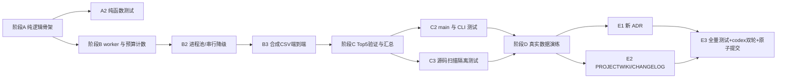

> **【已归档】** 本计划已执行完毕:提交 `6cd0fad`(Issue #3,已关闭),决策沿用 `docs/adr/20261110-walk-forward-optimizer.md`。
> 原位置为仓库根目录 `plan.md`,2026-11-11 原样迁入,正文未改,仅供追溯。

# 计划:Walk-Forward 滚动优化器 scripts/walk_forward_optimizer.py

> 阶段:P2 制定方案(plan-down 技能产出;Phase 0 方法清晰度判定 = Method Clear,跳过 Phase 1;
> Phase 2 经 zen planner 两步分解,模型 gemini-3-pro-preview;Phase 3 主模型落盘)
> 关联:Issue #1;基线 614 测试通过 / 89% 覆盖率;全程离线,不连接任何实盘/外部服务。
> 旧计划(CTP 废单/看门狗改造,已随提交 46615c1 落地)归档至 `docs/plans/20261110-guard-watchdog-plan.md`。

## 1. 目标与不可违背的纪律

新建独立无界面脚本 `scripts/walk_forward_optimizer.py`,基于 vn.py `BacktestingEngine`
(本项目经 `scripts/backtest_lib.py` 封装的 CtaBacktester 内核)对 15 分钟基准策略
`TrendAtr15mStrategy` 做滚动窗口 Walk-Forward 优化:

1. 窗口函数化:核心函数接收 `train_start/train_end`、`validation_start/validation_end`,不写死单一切片;
2. 多进程网格:训练段内对 fast/slow 两维网格寻优,目标 `sharpe_ratio`;
3. Top5 外推:训练段夏普前 5 名参数自动在对应验证段回测,打印验证段夏普与最大回撤;
4. 测试段物理隔离:脚本中不得出现任何触碰 2024-01 之后数据的调用代码,也不提供 `--test` 类开关;
5. 300 元单笔亏损硬预算在全部回测中生效(`risk_budget=300.0` 固定,不是网格维度),并报告预算弃单率。

数据事实(已核实):可用数据只有玉米 C 的 15 分钟复权 CSV
(`C:\Dev\data\invest\derived\C_15m_adj.csv`,32540 根,2020-07-22 起,仓库外);
测试段 2024-01~2026-06 已被 15m 基线消费过一次(ADR `20261110-baseline-15m`),
本次滚动窗口严格限定在 **2020-07 ~ 2023-12**。

## 2. 五项设计决策(Phase 0/2 待定项的最终推荐)

### D1 滚动窗口:训练 24 个月 / 验证 6 个月 / 步长 6 个月,共 3 个窗口

| 窗口 | 训练段 | 验证段 |
|------|--------|--------|
| W1 | 2020-07-22 ~ 2022-06-30 | 2022-07-01 ~ 2022-12-31 |
| W2 | 2021-01-01 ~ 2022-12-31 | 2023-01-01 ~ 2023-06-30 |
| W3 | 2021-07-01 ~ 2023-06-30 | 2023-07-01 ~ 2023-12-31 |

- 三个验证段互不重叠且各自严格晚于本窗口训练段;训练段跨窗口重叠是 Walk-Forward 的正常形态;
- 所有窗口结束日 ≤ 2023-12-31,与测试段之间不留灰色地带;
- 样本量:15m K 线约 5500 根/年,训练段约 1.1 万根、验证段约 2750 根;沿用现行 `MIN_FILLS=100`
  成交笔数门槛,不足门槛的参数组合不参与排名;若某窗口有效组合少于 5 个,该窗口标记
  `INSUFFICIENT` 并如实报告,不凑数、不放宽门槛。

### D2 atr_mult 固定为类默认 1.5,不进网格

- 用户只指定了 fast(约 10-30)与 slow(约 30-90)两个维度;策略类默认
  `fast_window=10 / slow_window=40 / atr_mult=1.5 / atr_window=14 / risk_budget=300.0`
  (`strategies/trend_atr_strategy.py:53-57`);
- 二维网格把单窗口组合数压到约 31 个(见 D3),降低多重检验过拟合面,也让"均线快慢"这一
  单一假设的检验更干净;固定值与默认值一致,结果可与基线直接对照;
- 网格常量:`FAST = [10, 14, 18, 22, 26, 30]`、`SLOW = [40, 50, 60, 70, 80, 90]`,
  保留 `slow >= 2 × fast` 过滤(与 `optimize_15m.py` 同口径),过滤后 31 组;
  每参数组形如 `{"fast_window": f, "slow_window": s, "atr_mult": 1.5}`,**不含 risk_budget 键**,
  即始终走策略类默认 300 元。

### D3 多进程:自建 ProcessPoolExecutor + 模块级 worker,不用 vn.py OptimizationSetting

- vn.py 自带 `OptimizationSetting.run_optimization` 依赖数据库数据与内部 Pool;本项目 15m K 线
  从不入库(只做内存回放),无法直接套用;
- 方案:模块级函数 `_backtest_one(data_file, params, start_iso, end_iso, cost_multiplier) -> dict`,
  入参全部是 str/dict/数值(pickle 安全),worker 内部自行 `load_bars_csv` 并经
  `run_backtest_bars` 回放——回测内核仍是 vn.py BacktestingEngine,满足"基于 CtaBacktester";
- `ProcessPoolExecutor(max_workers=N)`;`--workers 1` 时走进程内串行循环(不建池),
  作为测试与调试的确定性降级路径;入口必须有 `if __name__ == "__main__"` 保护(Windows spawn);
- 每进程独立 `@lru_cache` 按 CSV 路径缓存 K 线(32540 行,内存可忽略),不依赖
  `optimize_15m.py` 中会被 main 改写的模块级 `DATA_FILE` 全局量;
- 规模:3 窗口 × (31 组训练 + 5 组验证)= 108 次回测,单次回测秒级,可接受。

### D4 Top5 排名与平局:确定性多级排序

仅 `fills >= 100` 的组合有资格入选,排序键依次为:
`sharpe 降序 → maxdd_yuan 升序 → fills 降序 → fast_window 升序 → slow_window 升序`。
末两级保证完全平局时结果仍然确定、可复现;取前 5 名代入本窗口验证段。

### D5 输出与汇总口径

- 控制台逐窗口打印:窗口区间、训练段有效组合数、Top5 参数与训练夏普、
  各自验证段的 sharpe / maxdd_pct / maxdd_yuan / fills / 往返笔数 / 预算弃单率;
- 落盘 `data/results/walk_forward_C15.csv`:全部训练组合(带 window 标签与 score)
  + 各窗口 Top5 验证行,供事后复核;
- 跨窗口汇总:各窗口第一名的验证夏普均值/中位数、最差验证最大回撤(元)、
  验证夏普为正的窗口占比、Top5 的 `skipped_by_budget / 开仓尝试次数` 弃单率;
- 不使用邻域平滑 `smoothed()`:Walk-Forward 的训练/验证必须用同一把朴素尺子(原始夏普),
  平滑只属于 `optimize_15m.py` 的单窗口选参场景;
- 夏普口径警告随输出打印:vn.py 按自然日分组 ×240 年化,15m 数据上只做同口径排序,
  不可解释为年化收益(沿用 `optimize_15m.py` 现有注释口径)。

## 3. 测试段隔离的三层护栏

1. **常量硬断言**:模块级 `TEST_SEGMENT_START = datetime(2024, 1, 1)`,
   窗口构建函数对每个 end 做 `assert end < TEST_SEGMENT_START`,违例抛 `ValueError`;
2. **API 级测试**:构造结束日 ≥ 2024-01-01 的窗口调用公开函数,断言抛 `ValueError`;
3. **源码扫描测试**:测试直接读取 `scripts/walk_forward_optimizer.py` 源码,
   断言 "2024"/"2025"/"2026" 字样只允许出现在 `TEST_SEGMENT_START` 定义处,
   从文本层面证明不存在测试段调用代码或隐藏开关。

## 4. 任务分解(按顺序执行)

### 阶段 A — 纯逻辑骨架(无回测依赖)

- **A1 `scripts/walk_forward_optimizer.py` 新建**:模块 docstring(纪律与口径说明)、
  常量(`TEST_SEGMENT_START`、窗口边界常量、`FAST/SLOW/MIN_FILLS/TOP_N`)、
  `build_windows() -> list[Window]`(含隔离断言)、`grid() -> list[dict]`
  (slow≥2fast 过滤、atr_mult 固定 1.5、无 risk_budget 键)、
  `rank(rows) -> list[dict]`(D4 多级排序 + 门槛过滤 + 不足 5 个的 INSUFFICIENT 语义)。
- **A2 `tests/test_walk_forward_optimizer.py` 新建**:窗口结构(3 个、验证段互斥、
  全部早于 2024)、隔离断言正反两例、网格内容与过滤、排名平局确定性、INSUFFICIENT 分支。
- 验收:纯函数测试全绿,不启动任何回测。

### 阶段 B — 多进程回测 worker(依赖 A)

- **B1** 模块级 `_backtest_one(...)`:复用 `backtest_lib.load_bars_csv/run_backtest_bars`;
  返回 dict 在 `optimize_15m.evaluate` 现有字段(return_pct/maxdd_pct/maxdd_yuan/sharpe/
  round_trips/fills/net_pnl/total_cost)之外,增加 `skipped_by_budget` 与开仓尝试次数字段。
  实现时先读 `backtest_lib.run_backtest_bars` 确认回测后如何取到策略实例
  (预期经 engine 持有);若现有封装取不到计数器,允许在 `backtest_lib.py` 做**最小增量改造**
  (只增返回值/辅助函数,不改既有签名与行为),并补对应单测。
- **B2** `run_grid(data_file, window, workers)`:workers=1 进程内串行;否则
  ProcessPoolExecutor 提交全部组合,收集结果保持参数可追溯;`main()` 加 `if __name__` 保护。
- **B3 测试**:合成迷你 15m CSV(写 tmp_path,字段与真实 CSV 同构)、monkeypatch 网格为
  2~3 组、workers=1 端到端跑通一个微型窗口,断言结果字段齐全且含弃单计数;
  另加 worker 入参 pickle 安全性测试(spawn 约束的静态保证)。
- 验收:微型端到端绿;不触碰真实数据路径之外的任何文件。

### 阶段 C — Top5 验证、汇总与 CLI(依赖 B)

- **C1** `validate_top5(window, top5, workers)`:对 Top5 逐组跑验证段;
  `summarize(...)` 产出 D5 跨窗口汇总;`main(argv)` 提供 `--data/--workers/--output` 参数,
  默认数据路径与 `optimize_15m.py` 一致,输出 CSV 到 `data/results/walk_forward_C15.csv`。
- **C2 测试**:用合成 CSV 跑完整 main(monkeypatch 窗口与网格),断言退出码 0、
  CSV 含训练行与验证行、控制台汇总含规定字段;`--workers 1` 与并行路径共用同一核心函数。
- **C3 源码扫描隔离测试**(第 3 节护栏 3)落地。
- 验收:新模块覆盖率 ≥ 85%;全量 `pytest tests -q --cov` 保持 614+ 新用例全绿、总覆盖率不降。

### 阶段 D — 真实数据演练运行(依赖 C,只读仓库外 CSV)

- **D1** 用真实 `C_15m_adj.csv` 完整跑一次 3 窗口流程,保存控制台输出与结果 CSV;
  如实记录结果(含负面结果与 INSUFFICIENT/高空仓率情形),**不得**根据结果回头调网格或窗口;
  本次运行本身就是交付物,后续若再跑属于新的研究决策。
- 验收:输出中无任何 2024+ 日期;108 次回测(3×31 训练 + 3×5 验证)全部完成或失败原因被如实报告。

### 阶段 E — 文档、质量门与原子提交(依赖 A–D)

- **E1 新 ADR** `docs/adr/20261110-walk-forward-optimizer.md`:窗口方案与理由、
  atr_mult/risk_budget 固定的取舍、不用 vn.py OptimizationSetting 的原因(数据不入库 + spawn)、
  同口径夏普限制、测试段单次消费纪律与三层隔离护栏、300 元预算弃单率的解读方式。
- **E2 知识库同原子更新**:`PROJECTWIKI.md` 增量补 walk_forward 模块章节与数据流;
  `CHANGELOG.md` 记 Added;G11 偏离如实记录(Gemini CLI 仍报 ProjectIdRequiredError 时,
  测试/文档由主模型代笔,codex 双轮审查不变)。
- **E3 质量门**:全量 pytest + 覆盖率 ≥ 85%;codex 双轮审查
  (第一轮 `mcp__zen__codereview` 工作流,第二轮 `mcp__zen__clink` codex CLI;
  环境不可用则如实记录,不伪装完成);
  Conventional Commits,信息带 `refs #1` 与 `Co-Authored-By: Claude Code <noreply@anthropic.com>`,
  代码 + 测试 + ADR + PROJECTWIKI + CHANGELOG 同一原子提交;`.env`、仓库外数据、
  `data/results/` 产物不得进入提交。

## 5. 依赖关系

## 6. 最高风险点与护栏

| # | 风险 | 护栏 |
|---|------|------|
| 1 | Windows spawn 下 worker 不可 pickle(lambda/闭包/模块全局态) | worker 严格模块级、入参只含基础类型;`__main__` 保护;pickle 安全测试;workers=1 串行降级 |
| 2 | 测试段泄漏(隐藏开关/日期写错) | 常量硬断言 + API 级反例测试 + 源码扫描测试,三层独立保证 |
| 3 | 未来函数/窗口重叠污染 | 验证段起点严格晚于训练段终点;验证段之间互斥;选参只读取训练段指标,测试逐窗口断言边界 |
| 4 | 样本不足(fills<100)导致夏普无统计意义 | 门槛过滤 + INSUFFICIENT 显式标记,不凑数;报告往返笔数与现行 150 笔提示口径 |
| 5 | 300 元预算导致大面积/全部空仓,结果看似"无优势"实为"无法交易" | 每次回测输出 skipped_by_budget 弃单率;空仓率本身作为结论如实呈现,不修改预算、不缩小止损 |
| 6 | 为改善结果而反复调网格/窗口(变相消费验证段) | 网格与窗口在 P2 一次锁定写入本计划;D1 后任何参数调整需新 ADR,CHANGELOG 留痕 |
| 7 | backtest_lib 取 skipped_by_budget 需改封装 | 允许最小增量、禁止改既有签名;配套单测锁定旧行为不变 |

## 7. 验收标准(DoD)

- [ ] `scripts/walk_forward_optimizer.py` 落地:窗口函数化、多进程网格、Top5 自动验证、
  汇总与 CSV 输出齐全;脚本内无任何 2024+ 数据调用(三层护栏测试通过)
- [ ] `tests/test_walk_forward_optimizer.py` 覆盖窗口/隔离/网格/排名/worker/CLI/源码扫描,
  新模块覆盖率 ≥ 85%,全量测试绿且总覆盖率不低于现行 89%
- [ ] 真实数据演练完成并如实记录;risk_budget 始终为 300,弃单率有报告
- [ ] ADR + PROJECTWIKI + CHANGELOG 与代码同一原子提交,Conventional Commits 含 refs #1
- [ ] codex 双轮审查完成或环境限制被如实记录;G11 偏离写入 CHANGELOG
- [ ] 全部文件 UTF-8 无 BOM;对话、日志、文档不含凭据/连接串;仓库外数据不入库不入提交

## 执行日志(P3,2026-11-10)

- [x] **阶段 A 完成**:`walk_forward_optimizer.py` 纯逻辑骨架(Window 数据类、build_windows 3 窗口、
  grid 31 组、rank 确定性多级排序、TEST_SEGMENT_START 硬断言);测试覆盖窗口结构、隔离反例、网格内容、
  排名平局、INSUFFICIENT 分支。
- [x] **阶段 B 完成**:模块级 `_backtest_one`(基础类型入参、每进程 lru_cache、经 run_engine_bars
  取 `engine.strategy.skipped_by_budget`,未改 backtest_lib 既有签名);`map_backtests` 串行/注入 executor/
  真实 ProcessPoolExecutor 三条路径均有测试;pickle 安全自证。
- [x] **阶段 C 完成**:run_window 训练→Top5→验证全流程、summarize 跨窗口聚合、CLI(main 端到端测试)、
  源码扫描隔离测试;全量 **631 通过**(614+17),新模块覆盖率 99%(仅剩 `__main__` 守卫行),总覆盖率 87%(门禁 85%)。
- [x] **阶段 D 完成**:108 次回测(串行 + 4 进程并行各一次,数值完全一致)。结果全负:
  训练段最优夏普 -1.29~-3.21,15 组验证夏普全部为负,正夏普窗口 0%,最差验证回撤 -2773 元,
  预算弃单率 0%(atr_mult=1.5 下止损均在 300 元内)。演练中发现并修复 vn.py 回撤金额带负号导致的
  两个统计 bug(汇总最差回撤被 0 吞掉、排名平局键方向反),补回归测试后重跑。
- [x] **阶段 E 完成**:codex 双轮审查闭环。第一轮 codereview(工作流):无 Critical/High,
  1 Medium(lru_cache maxsize)经核对不采纳。第二轮 clink codex CLI(833 秒,真实 spawn 动态探针):
  无 Critical/High,隔离护栏经伪造 2024 窗口实测不可绕过;3 Medium + 9 Low,处置如下——
  **采纳修复**:M1 单进程池贯穿全部窗口(原实现 6 池 ×24 次 spawn 重读 CSV)、M2 真实 spawn 冒烟测试、
  M3 summarize 非有限夏普防御(nan_to_num 事实写入 ADR)、L1 回测切片断言、L2 奇数 fills 用例、
  L4 Window __post_init__、L5 tz-aware 归一化、L7 假数据回撤符号、L8 workers 校验/空结果不写 CSV、
  L9 INSUFFICIENT 汇总计数;**走 ADR 说明**:L3 弃单率三类误读场景、L6 源码扫描"防误改提示网"定位;
  **不采纳**:第一轮 lru_cache maxsize(None)(单 --data 路径无抖动场景)。全量 **643 通过**/88%
  (webhook 一个 timing 型测试首轮偶发失败,单独运行即过,与本次改动无关,复跑全绿),新模块 99%。
- [x] **原子提交完成**:6cd0fad(6 文件 +1076 行,refs #3),plan.md 与 docs/plans/ 按前例不进提交;
  推送 origin/main 待用户授权。

## 8. 回滚方案

- 本次为**纯增量**:新增 1 个脚本、1 个测试文件、1 个 ADR 与文档增量;
  不改任何实盘/运行时代码(`trading/`、`risk/`、`strategies/` 零改动,
  `backtest_lib.py` 仅可能做向后兼容的最小增量);
- 回滚 = 单个原子提交 `git revert`;无数据库/状态文件格式变更;
  `data/results/walk_forward_C15.csv` 是研究产物,不纳入版本控制,删除不影响代码。
