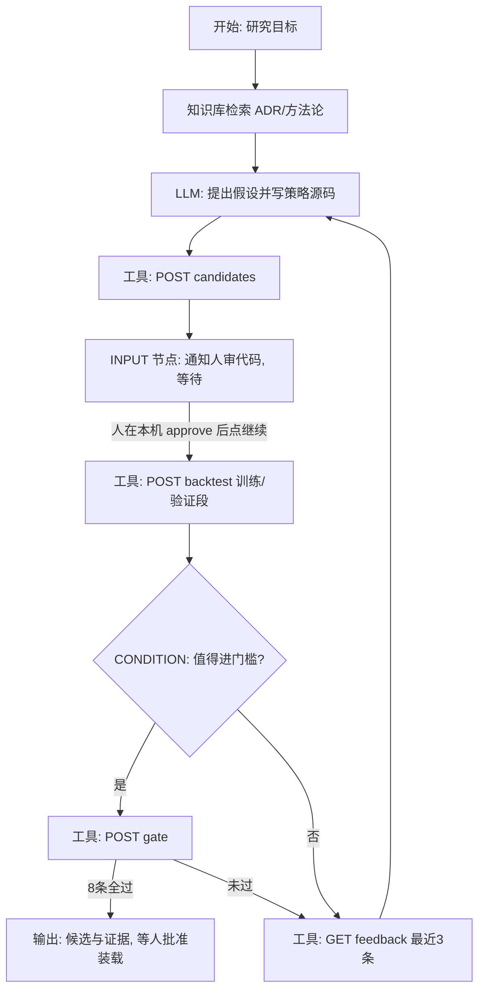

# 设计草案:毕昇接入研究沙盒(阶段四 4b 的接口与工作流规格)

- 状态:**已确认(2026-11-12)**:四个问题全部同意,并要求全部参数配置化。决议见 ADR `20261112-research-sandbox-config-and-approval.md`;配置见 `config/research_sandbox.json`
- 日期:2026-11-12
- 关联:`docs/adr/20261110-bisheng-ai-researcher.md`(边界与安全约束)、`docs/adr/20261112-research-sandbox-groundwork.md`、`docs/adr/20261112-candidate-evaluation.md`
- 依据(已核对毕昇源码 v3.0.0-beta5):
  - 工作流有 `INPUT` 节点,**引擎编译时把所有 INPUT 节点加入 `interrupt_before`**,执行到此必然暂停等人提交(`docs/architecture/03-workflow-engine.md`)——这是现成的 HITL 节点。
  - 有 `CONDITION` 条件分支,循环工作流的 `recursion_limit` 按节点数动态计算——可做「假设→回测→读诊断→迭代」的环,并有上限。
  - 自定义工具走 `tool` 模块(`gpts_tools`),可挂工具节点;工具接口形态按 OpenAPI 描述,**这一点还没在界面里实测,属待验证**。

## 一、现状与缺口

| 层 | 现状 | 缺口 |
|---|---|---|
| 毕昇 | 本机已部署,仅本机可访问,Code 节点关闭,知识库 `invest-研究资料` 已入库 | 没有任何工具 |
| 内层 CLI | `data` / `backtest` / `gate` / `results` 可用 | **只能在本机命令行调用**,毕昇在容器里,调不到 |
| 候选策略落地 | 人把文件放进 `pending_strategies/` | 外层没有受控的提交通道 |
| 人工审批 | `--confirm-reviewed` 是命令行开关 | 经 HTTP 后,这个开关会变成「调用方自己声明」,等于失效 |

## 二、需要新增的东西

### 1. 薄 HTTP 网关 `scripts/research_gateway.py`(FastAPI 单文件)

只做适配,**不写任何研究逻辑**,全部转调 `research_api` / `research_sandbox` / `research_gate`。端点即白名单:

| 端点 | 语义 | 转调 |
|---|---|---|
| `GET /research/data` | 数据段与测试段消费状态 | `cmd_data` |
| `POST /research/candidates` | 提交候选策略源码,落 `pending_strategies/` | 新增(见下) |
| `POST /research/backtest` | 沙盒回测(训练/验证段) | `cmd_backtest` |
| `POST /research/gate` | 门槛评估 | `cmd_gate` |
| `GET /research/results/{run_id}` | 结果与诊断书 | `rs.load_result` |
| `GET /research/feedback` | 最近 3 次失败的结构化 Trace | 新增(见下「硬记忆预算」) |

**明确不存在**:下单、查账户、改风控、连 CTP、访问测试段、`approved/` 的写入。负向测试:枚举应用的全部路由,断言只有上表这些。

### 2. 提交通道 `POST /research/candidates`

- 请求:`{name, source}`。网关先 `screen_source`,不通过直接 400;文件名限 `^[a-z0-9_]{1,40}\.py$`;大小上限(建议 64 KB);只写 `pending_strategies/`,**绝不覆盖已存在文件**(同名返回 409,要求换名),不写 `approved/`。
- 返回:`{name, sha256}`。

### 3. 人工审批绑定到代码哈希,而不是调用方声明

问题:HTTP 之后 `--confirm-reviewed` 不可信。方案:
- 新增本机 CLI `research_api.py approve <name>`:**人**读过代码后执行,把当前文件的 `sha256` 追加进 `data/research/approvals.json`。
- 网关的 `backtest` / `gate` 只在该文件的 `sha256` 出现在 approvals 里时才运行;文件被改动后哈希变化,批准自动失效。
- 外层(毕昇)**没有任何端点能写 approvals**。这样「代码运行前由人读过」从一个自述开关变成一个只有人能触发、绑定到具体内容的动作。
- 毕昇工作流里的 INPUT 节点负责「通知人去审、等人回来」,但真正的批准动作在本机 CLI,不经过毕昇。

### 4. 硬记忆预算放在服务端

研究资料 §6.3-② 要求只携带最近 3 次失败 Trace。毕昇工作流变量没有现成的 `deque(maxlen=3)`;若靠提示词约束,模型可以无视。
改为:网关维护失败记录,`GET /research/feedback` **最多返回最近 3 条**(诊断书最弱维度 + 门槛失败条目,不含源码全文)。工作流想多拿也拿不到。

### 5. 鉴权与网络

- 网关监听范围:只让毕昇容器可达。**待实测**:Docker Desktop 下容器经 `host.docker.internal` 能否访问宿主 `127.0.0.1` 上的服务;不能则绑定 Docker 网桥地址,仍不得监听 `0.0.0.0` 到局域网。
- 令牌:网关自己的 Bearer 令牌,放在独立文件(不用 invest 的 `.env`,不含任何 CTP 变量);网关进程环境变量里没有 CTP 段(部署层验证,ADR 安全约束 5)。
- 不开 CORS;请求体大小限制;每分钟请求数限制。

## 三、毕昇工作流形态

- 环的上限由 `recursion_limit` 与一个显式「最大轮数」变量共同限制,不允许无限迭代。
- 「通过」的终点**只是输出证据**。移入 `approved/` 与装载永远由人手工完成,工作流里没有这一步。

## 四、安全:必须正视的缺口

1. **主机侧执行**:人批准后,策略仍以当前用户权限在本机运行,静态筛查可被刻意绕过。人读过代码是前提,但读 LLM 生成的代码并不总能发现隐蔽写法。
   - 4b(有人逐个批准)可接受。
   - **4c(自动连续迭代)不可接受**:必须先做容器级隔离——无网络、仅只读挂载数据、无 `.env`、资源限额。
2. **外发面**:毕昇调用 LLM 时,工作流上下文会发给所配置的模型提供方(MiniMax 等)。提交给毕昇的任何内容都按「会外发」对待;网关返回给毕昇的结果里不得含本机路径、账号、令牌。
3. **提示注入**:知识库与回测结果里的文本会进入 LLM 上下文。网关返回的字段限定为结构化数值与固定枚举文案,不回传策略代码中的自由文本。

## 五、实施顺序

| 步 | 内容 | 需要用户 |
|---|---|---|
| 1 | ADR:网关与批准机制 | 确认本草案 |
| 2 | `approve` CLI + approvals 校验(含单测) | 否 |
| 3 | `research_gateway.py`(含路由白名单负向测试、鉴权、限流) | 否 |
| 4 | 实测容器到宿主的连通方式,定监听地址 | 否(我可测) |
| 5 | 在毕昇界面添加工具(OpenAPI 导入)并搭工作流 | **是**(界面操作,我可给出可导入的 OpenAPI 文件) |
| 6 | 断耦演练:停掉毕昇,内层交易与风控不受影响 | 否 |
| 7 | 4b 退出验收:至少 1 个候选由外层驱动走完 提交→审批→回测→门槛→人工批准 | 是 |

## 六、需要你回答

1. 同意把批准动作做成「本机 CLI + 哈希绑定」,而不是网关里的开关吗?
2. 失败 Trace 由服务端限制最近 3 条,可以吗?
3. 工作流的「最大迭代轮数」你想设多少(建议 5)?
4. 4c 的容器隔离作为硬前置,同意吗?在它做完之前,不做任何无人值守的连续迭代。
