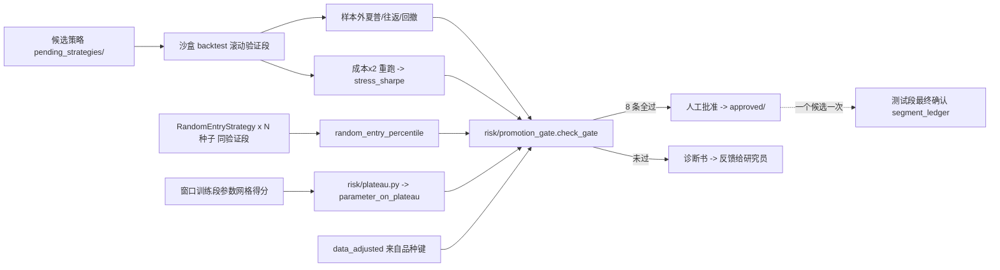

# 设计草案:候选评估数据流(把晋级门槛接进研究流程)

- 状态:**已确认(2026-11-12)**:决策点 1 按建议;决策点 2 选 A;决策点 3 N 参数化(默认 200)。决议见 ADR `20261112-candidate-evaluation.md`
- 日期:2026-11-12
- 关联:`docs/adr/20261109-promotion-gate.md`、`docs/adr/20261110-walk-forward-optimizer.md`、`docs/adr/20261112-research-sandbox-groundwork.md`

## 要解决什么

`risk/promotion_gate.py::check_gate` 需要 8 个输入,但优化器和沙盒 CLI 只产出训练/验证段的绩效行。
"哪一段算样本外""随机对照怎么跑""成本翻倍怎么跑"都还没有定义,所以门槛至今没有被任何研究流程自动调用。

## 门槛输入从哪来

| 门槛输入 | 来源 | 现状 |
|---|---|---|
| `oos_sharpe`、`oos_years`、`round_trips`、回撤 | **滚动样本外**:Walk-Forward 的各验证段拼接 | 15m 有 `walk_forward_optimizer.py`;日线没有 |
| `random_entry_percentile` | 在**同一批验证段**上,用 `RandomEntryStrategy`(出场相同,入场随机)跑 N 个种子,取候选夏普的分位数 | 策略已有,批量跑与分位数计算没有 |
| `stress_sharpe` | 同一批验证段,成本 ×2(`cost_multiplier=2.0`) | 15m 的 `run_engine_bars` 支持;日线 `run_engine` 不支持 |
| `data_adjusted` | 品种键是 `CADJ` / `MAADJ` / `C15` 即为真 | 现成 |
| `parameter_on_plateau` | `risk/plateau.py`,输入为窗口训练段的参数网格得分 | 本次已落地,未接线 |

## 决策点(需要你拍板)

**1. 样本外用什么,是否动用"只看一次"的测试段?**
- 建议:**门槛评估只用滚动验证段**,不用测试段。测试段留作门槛全过之后的最终确认,走 `segment_ledger` 登记,一个候选一次。
- 理由:用测试段做筛选等于把它消费在尚未过关的候选上。
- 代价:滚动验证段只有 2022-07 ~ 2023-12(15m)或 2022 ~ 2023(日线),样本短。

**2. 门槛是否注定过不了?**
- 门槛要求样本外往返 ≥ 150。日线趋势策略在 CADJ 训练段 3.5 年只有约 6 笔往返(实测);15m 基准验证段约百笔量级。
- 这意味着**日线策略按现有门槛几乎不可能通过**,15m 也勉强。这不是接线的 bug,而是门槛如实反映"样本不够"。
- 选项 A:保持门槛不动,如实输出"未通过:往返不足",这符合 ADR "不得事后放宽"。(建议)
- 选项 B:先补数据(购买分钟线或等 CTP 自录积累),再谈通过。
- 不建议:为了让候选"能过"而调低 150。

**3. 随机对照的种子数 N**
- 建议 N=200,固定种子序列(0..199)保证可复现;N 越大分位数越稳,但每次评估耗时线性增加。
- 要先测一次日线/15m 单次回测耗时再定最终 N,可能需要进程池并行(`walk_forward_optimizer.map_backtests` 已有)。

**4. 新增什么入口**
- `scripts/research_api.py gate --run-id ...` 读取沙盒回测结果并补跑随机/成本翻倍,调用 `check_gate`,输出 8 条结果与诊断书。
- 前提:沙盒 `backtest` 需要先支持 15m 品种和 `cost_multiplier`;日线需要给 `run_engine` 加 `cost_multiplier` 参数。

## 数据流

## 不做什么

- 不放宽任何门槛数值;不用测试段筛候选;不引入 CPCV、每日自动优化(`docs/roadmap.md` §2.4 "明确不做")。
- 不在本草案阶段写代码。

## 需要你回答

1. 决策点 1:滚动验证段做评估、测试段留作最终确认——同意吗?
2. 决策点 2:选 A(如实输出未通过)还是先走 B(补数据)?
3. 决策点 3:N=200 作为起点,可以吗?
