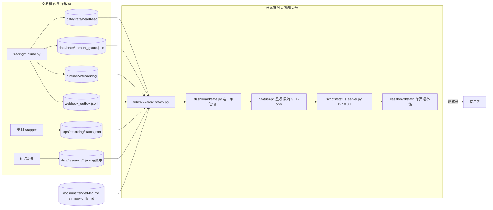
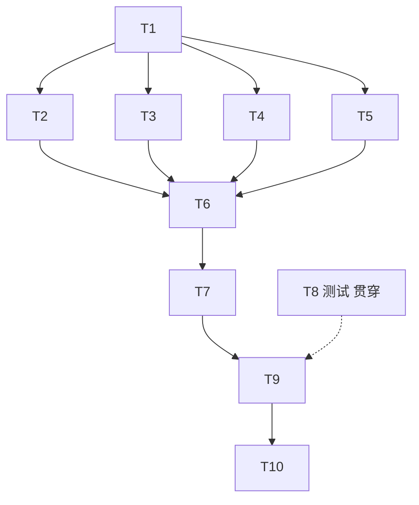

# 计划:只读状态页(Web 监控面板)阶段①

- 状态:**待执行**(ADR 待确认后开工)
- 决策依据:`docs/adr/20261112-status-dashboard.md`(含否决 `vnpy_webtrader` 的理由与"明确不做"清单)
- 关联:Issue #1;`docs/roadmap.md` §2.5

## 目标

让使用者在浏览器里看到交易系统各部分的真实状态,不再靠翻日志。**只读、独立进程、不碰交易进程**。
阶段②(实时持仓/资金/行情)与阶段③(仅「暂停开仓」)只登记触发条件,本计划不做。

## 范围

**做**:`dashboard/` 纯逻辑包、`scripts/status_server.py` 薄 HTTP 层、`dashboard/static/` 静态单页、测试、文档同步。
**不做**:任何写操作;发单、撤单、连接、改风控、解锁、批准策略;嵌入 `RpcServer`;公网或内网穿透;取代 `unattended_report.py` 的证据生成。

## 标准符合性

- G1:代码与 PROJECTWIKI / CHANGELOG 同一原子提交。
- G4:架构图用 Mermaid;接口契约与实现一致(提供 OpenAPI 文件并加"文件路由 == 实现路由"测试,同 `research-gateway.openapi.json` 做法)。
- G5 / G7:不读 `.env`;账号掩码;日志与告警经 `notify.webhook.redact`;令牌不进版本库。
- G8:代码生成后两轮审查(`mcp__zen__codereview` + codex),评分 ≥45/50 才收尾。
- G9:覆盖率 ≥85%。
- 个人信息只放 `.env`:测试里的账号、姓名一律虚构。
- Conventional Commits,提交带 `(ref #1)`。

## 架构

虚线以外的箭头全部是**文件读取**;面板到交易进程没有任何调用、共享锁或网络连接。

## 模块边界与复用

| 层 | 内容 | 复用 |
|---|---|---|
| `dashboard/collectors.py` | 每个来源一个函数 `(paths, now) -> Section`,`state ∈ ok/stale/missing/corrupt/unknown` | `unattended_report`:`collect_days`、`parse_day_log`、`heartbeat_state`、`heartbeat_day`、`longest_clean_streak`、`missing_weekdays`、`acceptance_checklist`;`record_market_data_wrapper.read_json` 及 stalled 判定;`research_sandbox.load_result` / `is_approved` |
| `dashboard/safe.py` | 账号掩码、`redact`、相对路径、截断 | `notify.webhook.redact`(脱敏唯一出处) |
| `scripts/status_server.py` | `StatusApp`(纯逻辑,便于单测)+ `ThreadingHTTPServer` | 令牌文件与限流写法同 `research_gateway.py` |
| `dashboard/static/` | `index.html`、`app.js`、`style.css` | — |

暂停标志文件名:面板自己定义常量(不 import `trading`),加测试断言与 `trading.guard_rule.PAUSE_FLAG_NAME` 相等。

## 端点(阶段①全部 GET/HEAD)

`/` 静态页 · `/api/overview` 各区块状态灯聚合 · `/api/trading` 心跳、风控状态、暂停标志、实盘准入文件是否存在 · `/api/alerts` 待补发队列(条数、最老一条年龄)与近期异常 · `/api/days` 无人值守每日表与验收清单 · `/api/recording` · `/api/research` 提交额度 used/limit、最近运行摘要、批准数 · `/api/docs/<key>` 键白名单(`unattended-log`、`simnow-drills`),**按键取文件,不接受路径**。

## 任务

### 阶段 1:文档先行
- [ ] **T1** ADR 获确认;roadmap §2.5 登记规划位;architecture 分层图加入口
  - 依赖:无;验收:ADR 状态改为"已采纳",含备选与"明确不做"

### 阶段 2:数据层(T2 T3 T4 T5 可并行)
- [ ] **T2** collectors-交易:心跳 mtime、`account_guard.json`(缺失/损坏降级;原子替换读到半截 JSON 时重试一次)、pause flag、`promotion_approval.json` 存在性
  - 依赖:T1;验收:缺失/空/损坏/权限错误各自得到正确 `state`,不抛异常
- [ ] **T3** collectors-运行证据:days / alerts(复用 `unattended_report`,日志按 mtime 缓存,单次读取限字节)、待补发队列
  - 依赖:T1;验收:大日志下单次请求耗时有上限;缓存命中不重复解析
- [ ] **T4** collectors-录制 / 研究 / 文档:录制 `status.json` 多态、提交账本与结果摘要、docs 白名单读取
  - 依赖:T1;验收:录制 stalled 与心跳过期被识别为非 ok
- [ ] **T5** `safe.py` 净化层 + 属性测试
  - 依赖:T1;验收:任意输入字符串经净化后不含账号原文、令牌样式、`CTP_` 变量名样式、绝对路径

### 阶段 3:服务层
- [ ] **T6** `StatusApp` + 服务入口:鉴权、限流、GET/HEAD-only、路由白名单、区块级 try/except、令牌文件自动生成(`data/state/status.token`)、拒绝非回环监听、安全响应头(含 CSP)
  - 依赖:T2–T5;验收:见 T8

### 阶段 4:前端
- [ ] **T7** 单页:总状态灯 + 各区块卡片;每块显示数据时间与"距今";本机时区与北京时间并列;轮询 8 秒;`textContent` 渲染;令牌 `sessionStorage`
  - 依赖:T6;验收:离线可打开;静态资源不含 `innerHTML` 与外链

### 阶段 5:验证(T8 贯穿全程)
- [ ] **T8** 测试矩阵
  - 路由枚举:方法集合 == {GET, HEAD};未知路径 404;OpenAPI 文件路由 == 实现路由
  - 鉴权:无令牌/错令牌 401,响应不泄露令牌信息;超限 429
  - 脱敏:账号、令牌、`CTP_` 样式、绝对路径不出现在任何响应
  - 降级:每个来源缺失/空/损坏/权限错误 → 区块 `state` 正确,整体仍 200
  - 路径穿越:`/api/docs/..%2f..%2f.env`、`/api/docs/C:\...` 一律 404;静态路由只服务白名单文件名
  - 过期语义:心跳 mtime 超阈值 → `stale`,总灯不为绿
  - 边界:`dashboard/` 不 import `trading` / `vnpy`(AST);暂停标志常量与 trading 一致
  - 覆盖率 ≥85%
- [ ] **T9** 实机验收:用真实 `runtime/data` 与 `.ops` 状态启动,逐卡片核对(可用 playwright 截图);故意删除/损坏一个文件确认降级;**杀掉面板进程,确认交易心跳不变**
  - 依赖:T7、T8
- [ ] **T10** 文档同步与审查:PROJECTWIKI 节点表、CHANGELOG、README 用法、architecture、runbook「状态页」小节;G8 双轮审查
  - 依赖:T9;验收:评分 ≥45/50,文档与代码同一原子提交

## 后续阶段(只登记)

- **阶段② 实时持仓/资金/最新行情**:触发 = ① 稳定使用 ≥1 周且无降级误报。先写 ADR 比较 (a) 运行时周期性原子写状态 JSON、面板只读(交易进程不新增网络监听,仅多一次磁盘写;倾向) 与 (b) 只读 RPC(交易进程内开 ZeroMQ 监听,默认无鉴权加密)。
- **阶段③ 仅「暂停开仓」**:触发 = ① 稳定 + 用户明确要求。前置 = 独立写令牌、防 CSRF、审计日志、二次确认。**永不提供**发单/撤单/连接/改风控/解锁。

## 风险与缓解

| 风险 | 影响 | 概率 | 缓解 |
|---|---|---|---|
| 假安心:过期或缺失数据显示为绿色 | 高 | 中 | 多态 `state`;总灯取最差;显示数据年龄;过期语义有测试 |
| 敏感信息泄露(账号、令牌、本机路径、对端返回文本) | 高 | 中 | 唯一净化出口 + 属性测试;不读 `.env`;响应全量扫描测试 |
| 日志注入 / XSS | 中 | 中 | 前端只用 `textContent`;服务端截断;CSP `default-src 'self'` |
| 读到写了一半的文件 | 低 | 中 | 状态文件为原子替换;读取失败重试一次后降级为 `corrupt` |
| Windows 文件锁、大日志拖慢 | 中 | 中 | 只读打开;按 mtime 缓存;限制单次读取字节数 |
| 面板拖累交易 | 高 | 低 | 独立进程;不共享锁;不 import 交易代码;验收时杀面板确认交易不受影响 |
| 范围蔓延成控制台 | 高 | 中 | ADR"明确不做"清单;路由枚举测试把边界变成可执行约束 |
| 时区混淆(本机太平洋时间 vs 北京时间) | 中 | 高 | 本机时区与北京时间并列显示 |

## 验收标准

- [ ] T8 全部通过,覆盖率 ≥85%
- [ ] T9 实机逐卡片核对;删除/损坏文件时显示降级而非"正常";杀面板后交易心跳不变
- [ ] G8 两轮审查 ≥45/50
- [ ] ADR、PROJECTWIKI、CHANGELOG、roadmap、architecture、README、runbook 同步,且与代码同一原子提交

## 评审记录

- 方法清晰度:用户采纳了"三步方案"(只读状态页 → 只读实时数据 → 仅安全控制),判定为方法明确,未走澄清与多模型共识环节。
- planner 分解与专家校验:2026-11-12,`gemini-2.5-pro` 发起、`gemini-3-pro-preview` 完成校验(工具返回完成,未附带修改意见;不能当作独立审查结论,正式审查在 T10 的 G8 双轮)。
- 事实核对:`vnpy_webtrader` 1.1.0 安装包(路由、鉴权、前端规模、RPC 注册项)与本仓库状态文件格式(`account_guard.json` 键、心跳机制、可复用函数)均为本次实际读取,而非凭记忆。

## 修订记录

- 2026-11-12 初版。
