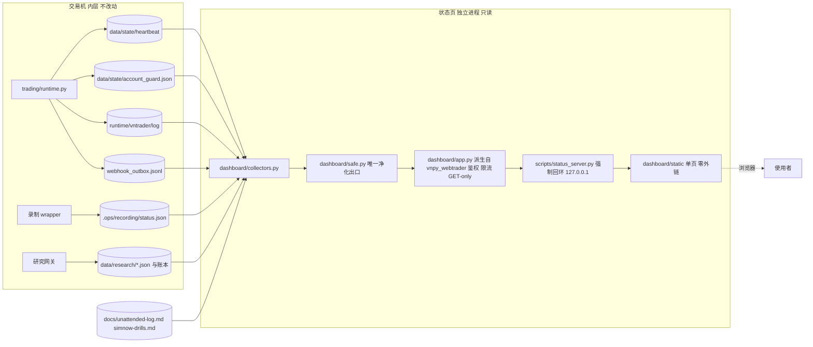
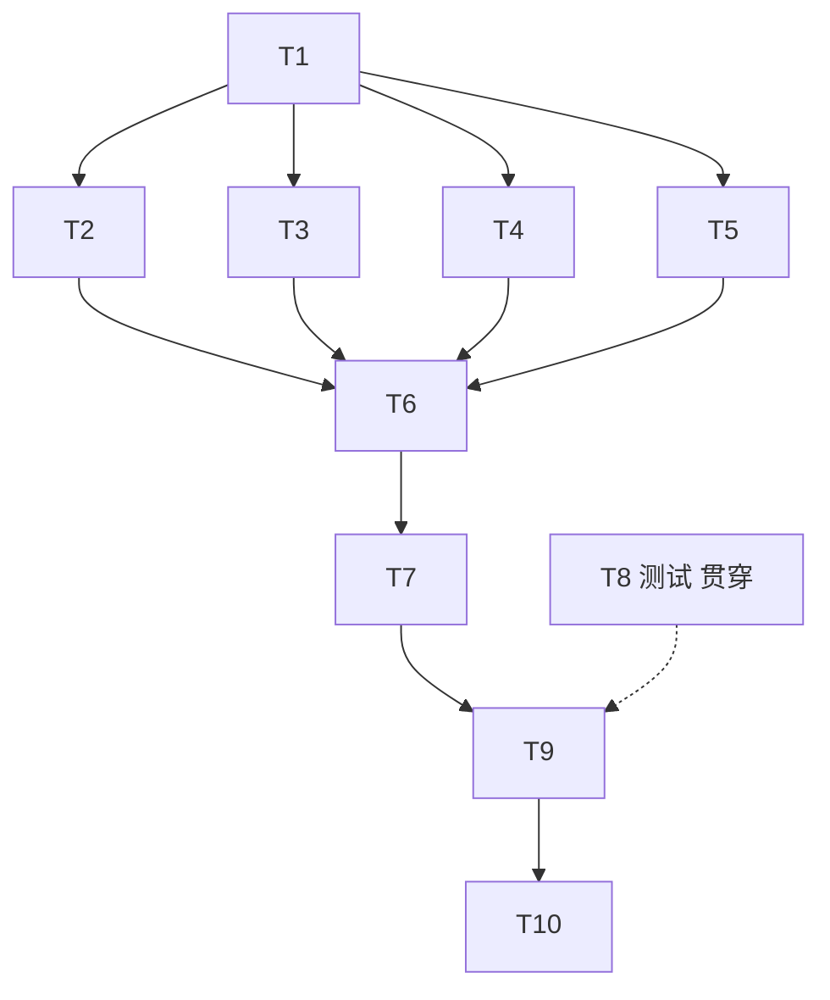

# 计划:只读状态页(Web 监控面板)阶段①

- 状态:**后端已实现(T1–T6、T8 完成;T7 前端与 T9 的浏览器核对待前端;T10 的 G8 双轮审查未全部完成,见文末『执行记录』)**
- 决策依据:`docs/adr/20261112-status-dashboard.md`(**fork 并改造 `vnpy_webtrader` 1.1.0 后端**:逐项处置表、FastAPI 默认行为的处理、依赖隔离、"明确不做"清单)
- 关联:Issue #1;`docs/roadmap.md` §2.5

## 目标

让使用者在浏览器里看到交易系统各部分的真实状态,不再靠翻日志。**只读、独立进程、不碰交易进程**。
阶段②(实时持仓/资金/行情)与阶段③(仅「暂停开仓」)只登记触发条件,本计划不做。

## 范围

**做**:`dashboard/` 纯逻辑包、`dashboard/app.py`(派生自上游 `web.py` 的 FastAPI 应用)、`scripts/status_server.py` 入口、`dashboard/static/` 静态单页、`dashboard/NOTICE-vnpy_webtrader.md`、`requirements-dashboard.txt`、测试、文档同步。
**不做**:任何写操作;发单、撤单、连接、改风控、解锁、批准策略;嵌入 `RpcServer`;公网或内网穿透;取代 `unattended_report.py` 的证据生成。

## 标准符合性

- G1:代码与 PROJECTWIKI / CHANGELOG 同一原子提交。
- G4:架构图用 Mermaid;接口契约与实现一致(提供 OpenAPI 文件并加"文件路由 == 实现路由"测试,同 `research-gateway.openapi.json` 做法)。
- G5 / G7:不读 `.env`;账号掩码;日志与告警经 `notify.webhook.redact`;令牌不进版本库。
- 许可证:上游 MIT,保留版权声明与许可证全文(`dashboard/NOTICE-vnpy_webtrader.md`),派生文件头部注明来源,测试断言其存在。
- 依赖隔离:Web 依赖只进 `requirements-dashboard.txt`,不进 `requirements.txt`、不进交易镜像。
- G8:代码生成后两轮审查(`mcp__zen__codereview` + codex),评分 ≥45/50 才收尾。
- G9:覆盖率 ≥85%。
- 个人信息只放 `.env`:测试里的账号、姓名一律虚构。
- Conventional Commits,提交带 `(ref #1)`。

## 架构

虚线以外的箭头全部是**文件读取**;面板到交易进程没有任何调用、共享锁或网络连接。

## 模块边界与复用

| 层 | 内容 | 复用 |
|---|---|---|
| `dashboard/collectors.py` | 每个来源一个函数 `(paths, now) -> Section`,`state ∈ ok/stale/missing/corrupt/unknown` | `unattended_report`:`collect_days`、`parse_day_log`、`heartbeat_state`、`heartbeat_day`、`longest_clean_streak`、`missing_weekdays`、`acceptance_checklist`;`record_market_data_wrapper.read_json` 及 stalled 判定;`research_sandbox.load_result` / `is_approved` |
| `dashboard/safe.py` | 账号掩码、`redact`、相对路径、截断 | `notify.webhook.redact`(脱敏唯一出处) |
| `dashboard/app.py` + `scripts/status_server.py` | FastAPI 应用(**派生自上游 `web.py`**,按 ADR『fork 范围』处置)+ uvicorn 入口(强制回环地址)。路由层只做适配,取数与判断全在 `collectors` | 令牌文件与限流写法同 `research_gateway.py`;上游只保留应用骨架与静态托管模式 |
| `dashboard/static/` | `index.html`、`app.js`、`style.css` | — |

暂停标志文件名:面板自己定义常量(不 import `trading`),加测试断言与 `trading.guard_rule.PAUSE_FLAG_NAME` 相等。

## 端点(阶段①全部 GET/HEAD)

`/` 静态页 · `/api/overview` 各区块状态灯聚合 · `/api/trading` 心跳、风控状态、暂停标志、实盘准入文件是否存在 · `/api/alerts` 待补发队列(条数、最老一条年龄)与近期异常 · `/api/days` 无人值守每日表与验收清单 · `/api/recording` · `/api/research` 提交额度 used/limit、最近运行摘要、批准数 · `/api/docs/<key>` 键白名单(`unattended-log`、`simnow-drills`),**按键取文件,不接受路径**。

## 任务

### 阶段 1:文档先行
- [x] **T1** ADR 获确认;roadmap §2.5 登记规划位;architecture 分层图加入口
  - 依赖:无;验收:ADR 状态改为"已采纳",含备选与"明确不做"

### 阶段 2:数据层(T2 T3 T4 T5 可并行)
- [x] **T2** collectors-交易:心跳**内容**(epoch 秒;内容非法或时间戳在未来 = `corrupt`,**不退回文件 mtime**——初版设计用 mtime,G8 审查证明那会把垃圾文件显示成『运行中』)、`account_guard.json`(缺失/损坏降级;原子替换读到半截 JSON 时重试一次;**有独立的年龄**,落后 >180 秒即 `stale`)、pause flag、`promotion_approval.json` 存在性
  - 依赖:T1;验收:缺失/空/损坏/权限错误各自得到正确 `state`,不抛异常
- [x] **T3** collectors-运行证据:days / alerts(复用 `evidence/logstats.py`——从 `unattended_report` 抽出的纯逻辑;**增量解析**:记住解析器与已读偏移,只处理新增字节,开头+末尾指纹确认只是追加;只统计含可解析时间戳的日志)、待补发队列(限 5 MB)
  - 依赖:T1;验收:大日志下单次请求耗时有上限(实测 60 MB 日志追加后约 15 毫秒,与日志大小无关);缓存命中不重复读取
- [x] **T4** collectors-录制 / 研究 / 文档:录制 `status.json` 多态、提交账本与结果摘要、docs 白名单读取
  - 依赖:T1;验收:录制 stalled 与心跳过期被识别为非 ok
- [x] **T5** `safe.py` 净化层 + 属性测试
  - 依赖:T1;验收:任意输入字符串经净化后不含账号原文、令牌样式、`CTP_` 变量名样式、绝对路径

### 阶段 3:服务层
- [x] **T6** fork 并改造(`dashboard/app.py` + `scripts/status_server.py`),拆为子任务:
  - **T6a 谱系**:`dashboard/NOTICE-vnpy_webtrader.md`(版本 1.1.0、安装包 SHA-256、MIT 全文、处置表);派生文件头部注明来源
  - **T6b 剥离**:删除 `POST /token`、`/tick` 订阅、`POST/DELETE /order`、WebSocket 与 `rpc_callback`、`RpcClient`、全部 `vnpy.*` import、passlib / python-jose / python-multipart 依赖
  - **T6c 鉴权**:令牌文件(`data/dashboard/status.token`,面板专属目录,不存在则安全随机生成)+ 常量时间比较 + 每分钟限流
  - **T6d 路由**:契约里阶段①的接口;区块级 try/except;GET/HEAD-only
  - **T6e FastAPI 默认行为**:关闭 `/docs` `/redoc` `/openapi.json` 与斜杠重定向;统一异常处理器输出 `{"error","code"}` 且不回显请求内容(422/404/405/500);中间件加 CSP / `nosniff` / `no-store`;405 带 `Allow`
  - **T6f 入口**:拒绝非回环地址;静态托管只服务构建清单内的文件
  - **T6g 依赖**:新建 `requirements-dashboard.txt`(`fastapi`、`uvicorn`;测试另需 `httpx`),交易侧 `requirements.txt` 与 Dockerfile 不变
  - 依赖:T2–T5;验收:见 T8

### 阶段 4:前端
- [ ] **T7**(前端由前端同事在 Lovable 构建,见 `20261112-web-frontend-lovable-plan.md`)单页:总状态灯 + 各区块卡片;每块显示数据时间与"距今";本机时区与北京时间并列;轮询 8 秒;`textContent` 渲染;令牌 `sessionStorage`
  - 依赖:T6;验收:离线可打开;静态资源不含 `innerHTML` 与外链

### 阶段 5:验证(T8 贯穿全程)
- [x] **T8** 测试矩阵
  - 路由枚举:方法集合 == {GET, HEAD};未知路径 404;OpenAPI 文件路由 == 实现路由
  - 鉴权:无令牌/错令牌 401,响应不泄露令牌信息;超限 429
  - 脱敏:账号、令牌、`CTP_` 样式、绝对路径不出现在任何响应
  - 降级:每个来源缺失/空/损坏/权限错误 → 区块 `state` 正确,整体仍 200
  - 路径穿越:`/api/docs/..%2f..%2f.env`、`/api/docs/C:\...` 一律 404;静态路由只服务白名单文件名
  - 过期语义:心跳内容的时间戳超阈值 → `stale`;内容非法 / 时间戳在未来 → `corrupt`;风控状态文件独立超阈值 → `stale`(即使心跳新鲜);总灯在以上情形都不为绿。垃圾日志、空日志、`stopped` 无终态时间、损坏的批准记录同样不得为 `ok`
  - 变异检查:对 app / collectors / safe / auth / config 植入 40 余种破坏(绕过鉴权、关限流、关净化、不校验哈希、令牌写回交易目录、垃圾心跳退回 mtime……),全部被测试抓住;过程中发现并补上 6 处测试盲区
  - 边界:`dashboard/` 不 import `trading` / `vnpy`(AST);暂停标志常量与 trading 一致
  - fork:应用的**实际路由集合**(`app.routes`)== 契约阶段①的路径集合 + 静态页,且无任何委托类、`/token`、`/docs` 类路由;`/docs` `/redoc` `/openapi.json` 返回 404;非 GET 返回 405 且 JSON 为契约 Error 形状;校验错误(422)不回显输入;`NOTICE-vnpy_webtrader.md` 存在且含 MIT 全文与版权人;`requirements.txt` 与 Dockerfile 不含 fastapi/uvicorn
  - 覆盖率 ≥85%
- [ ] **T9**(后端部分已完成:两次真实数据启动、交易侧目录树快照;『浏览器逐卡片核对』依赖 T7)实机验收:用真实 `runtime/data` 与 `.ops` 状态启动,逐卡片核对(可用 playwright 截图);故意删除/损坏一个文件确认降级;**杀掉面板进程,确认交易心跳不变**
  - 依赖:T7、T8
- [ ] **T10**(文档已同步;G8 双轮审查未全部完成,见『执行记录』)文档同步与审查:PROJECTWIKI 节点表、CHANGELOG、README 用法、architecture、runbook「状态页」小节;G8 双轮审查
  - 依赖:T9;验收:评分 ≥45/50,文档与代码同一原子提交

## 后续阶段(只登记)

- **阶段② 实时持仓/资金/最新行情**:触发 = ① 稳定使用 ≥1 周且无降级误报。先写 ADR 比较 (a) 运行时周期性原子写状态 JSON、面板只读(交易进程不新增网络监听,仅多一次磁盘写;倾向) 与 (b) 只读 RPC(交易进程内开 ZeroMQ 监听,默认无鉴权加密)。
- **阶段③ 仅「暂停开仓」**:触发 = ① 稳定 + 用户明确要求。前置 = 独立写令牌、防 CSRF、审计日志、二次确认。**永不提供**发单/撤单/连接/改风控/解锁。

## 风险与缓解

| 风险 | 影响 | 概率 | 缓解 |
|---|---|---|---|
| 假安心:过期或缺失数据显示为绿色 | 高 | 中 | 多态 `state`;总灯取最差;显示数据年龄;过期语义有测试 |
| 敏感信息泄露(账号、令牌、本机路径、对端返回文本) | 高 | 中 | 唯一净化出口 + 属性测试;不读 `.env`;响应全量扫描测试 |
| 日志注入 / XSS | 中 | 中 | 前端只用 `textContent`;服务端截断;CSP `default-src 'self'` |
| 读到写了一半的文件 | 低 | 中 | 状态文件为原子替换;读取失败重试一次后降级为 `corrupt` |
| Windows 文件锁、大日志拖慢 | 中 | 中 | 只读打开;按 mtime 缓存;限制单次读取字节数 |
| 面板拖累交易 | 高 | 低 | 独立进程;不共享锁;不 import 交易代码;验收时杀面板确认交易不受影响 |
| FastAPI 默认行为与契约冲突(自动文档暴露、422 回显输入、斜杠重定向、默认响应体) | 中 | 高 | T6e 显式处理并有测试;被默认行为反复绊倒时回退到完全自写后端(ADR 备选) |
| 上游残留的危险代码被误引入(委托、订阅、RPC) | 高 | 低 | T6b 删除;路由集合测试 + `dashboard/` 禁 import `vnpy` 的 AST 测试;委托类路径正则测试(`test_web_contract.py` 已有) |
| 新增 Web 依赖污染交易环境或镜像 | 中 | 中 | `requirements-dashboard.txt` 隔离;测试断言交易侧依赖文件不含 Web 包 |
| 上游后续安全修复未跟进 | 低 | 中 | 记录版本与 SHA-256;升级 vnpy 大版本时顺带复查 |
| 范围蔓延成控制台 | 高 | 中 | ADR"明确不做"清单;路由枚举测试把边界变成可执行约束 |
| 时区混淆(本机太平洋时间 vs 北京时间) | 中 | 高 | 本机时区与北京时间并列显示 |

## 验收标准

- [ ] T8 全部通过,覆盖率 ≥85%
- [ ] T9 实机逐卡片核对;删除/损坏文件时显示降级而非"正常";杀面板后交易心跳不变
- [ ] G8 两轮审查 ≥45/50
- [ ] ADR、PROJECTWIKI、CHANGELOG、roadmap、architecture、README、runbook 同步,且与代码同一原子提交

## 评审记录

- 方法清晰度:用户采纳了"三步方案"(只读状态页 → 只读实时数据 → 仅安全控制),判定为方法明确,未走澄清与多模型共识环节。
- planner 分解与专家校验:2026-11-12,`gemini-2.5-pro` 发起、`gemini-3-pro-preview` 完成校验(工具返回完成,未附带修改意见;不能当作独立审查结论,正式审查在 T10 的 G8 双轮)。
- fork 决定(2026-11-12,用户):由『不使用』改为『fork 并改造』;核对上游许可证为 MIT、依赖为 fastapi / passlib / python-jose / python-multipart / uvicorn / websockets / vnpy(本环境均未安装);据此新增 T6a–T6g 与依赖隔离。
- 事实核对:`vnpy_webtrader` 1.1.0 安装包(路由、鉴权、前端规模、RPC 注册项)与本仓库状态文件格式(`account_guard.json` 键、心跳机制、可复用函数)均为本次实际读取,而非凭记忆。

## 执行记录(2026-11-12 至 11-13)

**完成情况**:后端阶段①全部实现并提交(`dashboard/`、`scripts/status_server.py`、`evidence/`、`notify/redact.py`、`requirements-dashboard.txt`)。
全仓库测试最近一次全量运行 1754 通过、1 跳过(Windows 上不适用的 POSIX 权限位)。

**与计划的偏离**(都已写回 ADR 与契约):
- `unattended_report.py` 的纯逻辑抽到 `evidence/logstats.py`(原因:该脚本经 `bootstrap` 间接加载 vnpy),并新增可增量喂入的 `DayLogParser`。
- `notify.redact` 抽成无第三方依赖的 `notify/redact.py`(原因:`notify.webhook` 顶部 import `requests`,不在 `requirements-dashboard.txt` 里)。
- 令牌文件默认位置由 `data/state/status.token` 改为 `data/dashboard/status.token`,并由配置层强制『不得位于任何交易侧目录树』(G8 第 2 轮 Critical)。
- 鉴权由按路径前缀判断改为每个 API 路由自带的 FastAPI 依赖;限流分为已鉴权 / 鉴权失败两个桶;`HEAD` 只验证令牌与路由、不执行采集。
- 新增读取上限(状态 JSON 2 MB、心跳 1 KB、账本 2 MB、队列 5 MB),超限判 `corrupt` 而不截断。

**真实数据验证发现的缺陷**(构造数据的测试发现不了,均已修复并有回归测试):别的进程新建的 0 字节日志让页面显示『刚更新』;
净化层把 `passed` 当密码键;日志增量解析的指纹只看末尾 64 字节会被替换文件骗过。

**G8 双轮审查的真实状态——没有走完,不得写成『已通过』**:
- 第 1 轮(`mcp__zen__codereview`,外部专家 gemini-2.5-pro):**未完成**。第 2 步返回 `429 RESOURCE_EXHAUSTED`(免费额度耗尽,约 5.5 小时后恢复)。
  该轮实际只有作者自己的对抗性调查(中间件绕过、路径穿越、ReDoS、框架行为),**没有外部验证**。
- 第 2 轮(`mcp__zen__clink` → codex):**已完成两次调用**。
  - 第一次(审查 `61bdb4a` 之前的代码):提出 1 Critical / 6 High / 3 Medium / 1 Low,全部处理并做了变异检查。
  - 第二次(复核,基线 `2b38c18`,耗时约 19 分钟):确认 #2、#5、#7、#9、#10、#11 的目标修复**有效**;#1、#3、#4、#6、#8、#12 **仅部分堵住**;
    并提出 **4 条 High、6 条 Medium 的新问题**。综合评分 **6.0 / 10**(安全 6.5、正确性 5.0、可维护性 7.0)。
    它的结论:**在日志缓存、日志可信度和账户采样时间修复前,不建议把该面板作为唯一的无人值守安全依据。**
- 因此 G8 的『评分 ≥45/50』这条验收**未满足**(codex 6.0/10 折算远低于门槛),T10 保持未勾选。待办见下方『codex 复核后的未修问题』。

**已知未做**:Windows 8.3 短文件名 / 保留设备名 / NTFS 备用数据流的专门测试(run_id 与文件名受严格正则约束,这些写法无法通过,但没有直接测试);
阶段②–⑤ 的后端;前端(T7)。

### codex 复核后的问题清单(2026-11-13;**1、2、3、10 已修复,其余 6 项仍未修**)

作者已对照源码确认成立的标 ✔;其余是 codex 的复现结果,**作者尚未独立复现**,处理时先写复现测试。
**已修复**的在条目开头标 ✅(提交 `fa7a5cd`,附修复方式与证据)。

**High(假安心类)**
1. ✅ ✔ **增量日志缓存仍可被欺骗**:指纹只覆盖头 64 + 尾 64 字节;保持这 128 字节不变而改写中间的**同长度**内容(如把 12 个 ASCII 字节换成同为 12 字节的『启动失败』),缓存命中且不读任何新字节,严重事件永久不显示。本质与已修的 SHA 缓存问题相同。头尾抽样不构成『只追加』的证明。建议:同尺寸但 mtime 变化必须全量重解析;或校验整个旧前缀的哈希/分块哈希;无法证明只追加就 fail-closed(全量解析或降为 unknown)。
   **修复**:校验整个已读前缀的 SHA-256(哈希对象在追加时增量 update、不重读);codex 的两个复现场景(同长度改写;改写且变长)都有测试;没变的日志零成本,只碰 mtime 内容没变也命中缓存。**代价**:60 MB 日志追加后约 104 毫秒(抽样版 23 毫秒;无证明的全量解析约 24 秒)。
2. ✅ ✔ **日志可信度门槛过松**:一行形如 `2026-11-12 09:00:00 | INFO | boot` 的合规行加任意垃圾,整个文件被判『干净的一天』(`_parse_ts` 只看前 19 字符);已有一个正常日志时,另一个损坏日志被静默排除而不是报 `corrupt`(`_unreadable_logs` 只在 `days` 为空时用)。建议:校验完整记录格式与文件名日期一致性;无论有无其他正常日志都统计并暴露不可识别文件。
   **修复**:记录必须匹配『时间 | 级别 | 来源 | 内容』完整形状;首条记录日期必须等于文件名日期;记录占非空行不低于 20%(容忍 traceback 续行);有不可识别日志时无论有无其他正常日志都降为 `unknown`(严重事件仍优先 `critical`)。6 份真实日志(含 8.7 万行)全部可信,codex 的复现输入全部不可信。`_parse_ts` 与 `unattended_report` 行为不变。
3. ✅ ✔ **日志文件的未来 mtime 被当作『刚更新』**:`models.freshness()` 用 `max(now - as_of, 0)`,心跳与风控文件已有未来时间检查,日志没有。建议:未来检查放进共用的 `freshness()`,超出时钟误差即 `corrupt`/`unknown`。
   **修复**:`freshness()` 统一做未来检查(超出 60 秒容忍即 `corrupt`);严重事件是日志内容,不因时间戳异常而被隐藏。
4. **风控文件 mtime ≠ 账户数据采样时间**:`AccountGuard.update()` 每 60 秒无条件重写文件,但不能证明传入的权益是新采样的;网关断开后 vn.py 若仍保留缓存的账户对象,旧权益会继续刷新文件 mtime,面板显示『新鲜』。建议(涉及交易侧改动,需单独评估与 ADR):状态文件增加 `account_sampled_at`(只在收到新账户事件时更新)与 `saved_at`。

**Medium**
5. **令牌发布的无硬链接回退**会先发布 0 字节目标文件(崩溃后永久遇到短令牌);`fsync` 失败时遗留含令牌的临时文件(清理 `finally` 只包围发布阶段)。建议:外层从创建临时文件起就 `finally` 清理;无法原子发布时 fail-closed。
6. **面板首次导入会在 `risk/` 写 `__pycache__`**(入口在禁用 bytecode 之前就导入本地模块),『只读』承诺没覆盖 Python 自身写盘;令牌拒绝列表遗漏仓库里实际存在的 `.vntrader_drill` / `.vntrader_brokertest` / `.vntrader_probe`(✔ 已核对目录存在)。建议:入口最先 `sys.dont_write_bytecode = True` 并用 `python -B`;令牌改为『只允许在专属目录』的白名单而不是易漏的拒绝列表;新增『全新源码副本启动后交易侧树不变』的测试。
7. **非法 UTF-8 与 `NaN`/`Infinity` 被当作合法**:`decode(errors="replace")` 把字节损坏变成替换字符;`json.loads` 默认接受非标准常量。建议:严格 UTF-8 + `parse_constant` 抛错,一律 `corrupt`。
8. **研究结果只验证『是 dict』**:`{}` 被显示为正常的 `backtest`(未知 `kind` 也静默改成 `backtest`);只检查最近 N 个文件。建议:对运行结果建立严格 schema。
9. **净化层仍漏编码 UNC / 双重编码路径**(`%5C%5Cserver%5Cshare`、`%255C...`、`%252Fhome%252F...`)。建议:对检测副本做有界的一到两轮 percent-decode 再检测。
10. ✅ ✔ **增量解析对『无末尾换行』的最后一行与全量解析不等价**:进程在写入严重事件后崩溃、最后一行没有换行,事件会一直留在 `_pending` 里不显示。建议:`snapshot()` 在解析器副本上临时 `finish()`。我之前的测试把『feed 阶段半行不计』断言成了正确行为,但没考虑崩溃场景。
   **修复**:`snapshot()` 在副本上处理尾行,不改变解析器自身状态(补全换行后不重复计数)。**此前所有等价性测试的数据都以换行结尾、从未覆盖过尾行**——已补上无结尾换行的逐切分点与随机切分测试。

**轻微**:OpenAPI 只声明 GET,代码还支持 HEAD(契约正文已说明,建议在 OpenAPI 里显式登记)。

**处理顺序建议**:1、2、3、10 已完成;**剩余**:6、7(只读承诺的边界)、5、8、9;4 需要先决定是否改交易侧。

## 修订记录

- 2026-11-13 补充『执行记录』:勾选 T1–T6、T8;T7 / T9 / T10 保持未勾选并注明原因;如实记录 G8 审查的真实状态。

- 2026-11-12 初版。
- 2026-11-12 按用户决定改为 fork `vnpy_webtrader` 后端:更新决策依据、范围、架构图、模块边界,T6 拆为 T6a–T6g,补测试项与风险。
- 2026-11-13 记录 codex 复核结果(综合 6.0/10),列出 10 条未修问题;G8 验收未满足。
- 2026-11-13 修复其中 1、2、3、10(提交 `fa7a5cd`);其余 6 项仍未修,**修复后尚未再次交由 codex 复核**,G8 验收仍未满足。
