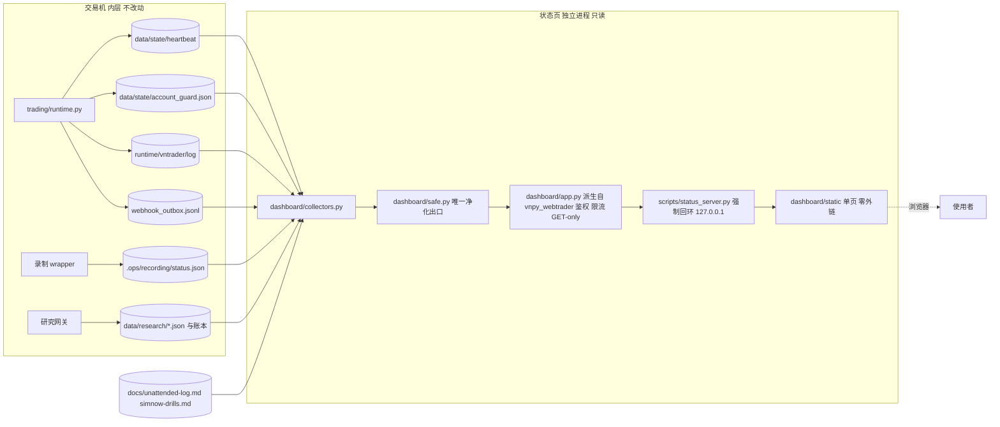
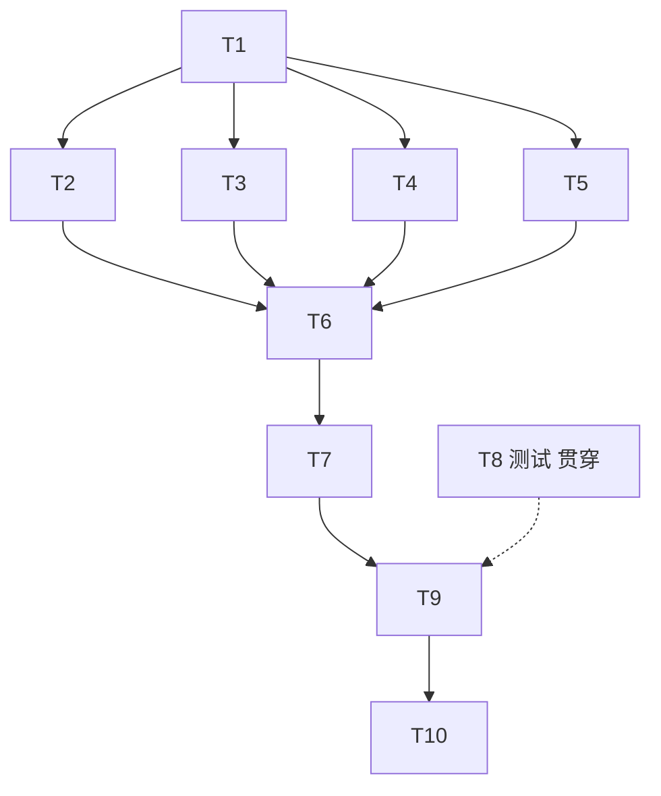

# 计划:只读状态页(Web 监控面板)阶段①

- 状态:**后端已实现(T1–T6、T8 完成;T7 前端与 T9 的浏览器核对待前端;T10 的 G8 双轮审查未全部完成,见文末『执行记录』)**
- 决策依据:`docs/adr/20261112-status-dashboard.md`(**fork 并改造 `vnpy_webtrader` 1.1.0 后端**:逐项处置表、FastAPI 默认行为的处理、依赖隔离、"明确不做"清单)
- 关联:Issue #1;`docs/roadmap.md` §2.5

## 目标

让使用者在浏览器里看到交易系统各部分的真实状态,不再靠翻日志。**只读、独立进程、不碰交易进程**。
阶段②(实时持仓/资金/行情)与阶段③(仅「暂停开仓」)只登记触发条件,本计划不做。

## 范围

**做**:`dashboard/` 纯逻辑包、`dashboard/app.py`(派生自上游 `web.py` 的 FastAPI 应用)、`scripts/status_server.py` 入口、`dashboard/static/` 静态单页、`dashboard/NOTICE-vnpy_webtrader.md`、`requirements-dashboard.txt`、测试、文档同步。
**不做**:任何写操作;发单、撤单、连接、改风控、解锁、批准策略;嵌入 `RpcServer`;公网或内网穿透;取代 `unattended_report.py` 的证据生成。

## 标准符合性

- G1:代码与 PROJECTWIKI / CHANGELOG 同一原子提交。
- G4:架构图用 Mermaid;接口契约与实现一致(提供 OpenAPI 文件并加"文件路由 == 实现路由"测试,同 `research-gateway.openapi.json` 做法)。
- G5 / G7:不读 `.env`;账号掩码;日志与告警经 `notify.webhook.redact`;令牌不进版本库。
- 许可证:上游 MIT,保留版权声明与许可证全文(`dashboard/NOTICE-vnpy_webtrader.md`),派生文件头部注明来源,测试断言其存在。
- 依赖隔离:Web 依赖只进 `requirements-dashboard.txt`,不进 `requirements.txt`、不进交易镜像。
- G8:代码生成后两轮审查(`mcp__zen__codereview` + codex),评分 ≥45/50 才收尾。
- G9:覆盖率 ≥85%。
- 个人信息只放 `.env`:测试里的账号、姓名一律虚构。
- Conventional Commits,提交带 `(ref #1)`。

## 架构

虚线以外的箭头全部是**文件读取**;面板到交易进程没有任何调用、共享锁或网络连接。

## 模块边界与复用

| 层 | 内容 | 复用 |
|---|---|---|
| `dashboard/collectors.py` | 每个来源一个函数 `(paths, now) -> Section`,`state ∈ ok/stale/missing/corrupt/unknown` | `unattended_report`:`collect_days`、`parse_day_log`、`heartbeat_state`、`heartbeat_day`、`longest_clean_streak`、`missing_weekdays`、`acceptance_checklist`;`record_market_data_wrapper.read_json` 及 stalled 判定;`research_sandbox.load_result` / `is_approved` |
| `dashboard/safe.py` | 账号掩码、`redact`、相对路径、截断 | `notify.webhook.redact`(脱敏唯一出处) |
| `dashboard/app.py` + `scripts/status_server.py` | FastAPI 应用(**派生自上游 `web.py`**,按 ADR『fork 范围』处置)+ uvicorn 入口(强制回环地址)。路由层只做适配,取数与判断全在 `collectors` | 令牌文件与限流写法同 `research_gateway.py`;上游只保留应用骨架与静态托管模式 |
| `dashboard/static/` | `index.html`、`app.js`、`style.css` | — |

暂停标志文件名:面板自己定义常量(不 import `trading`),加测试断言与 `trading.guard_rule.PAUSE_FLAG_NAME` 相等。

## 端点(阶段①全部 GET/HEAD)

`/` 静态页 · `/api/overview` 各区块状态灯聚合 · `/api/trading` 心跳、风控状态、暂停标志、实盘准入文件是否存在 · `/api/alerts` 待补发队列(条数、最老一条年龄)与近期异常 · `/api/days` 无人值守每日表与验收清单 · `/api/recording` · `/api/research` 提交额度 used/limit、最近运行摘要、批准数 · `/api/docs/<key>` 键白名单(`unattended-log`、`simnow-drills`),**按键取文件,不接受路径**。

## 任务

### 阶段 1:文档先行
- [x] **T1** ADR 获确认;roadmap §2.5 登记规划位;architecture 分层图加入口
  - 依赖:无;验收:ADR 状态改为"已采纳",含备选与"明确不做"

### 阶段 2:数据层(T2 T3 T4 T5 可并行)
- [x] **T2** collectors-交易:心跳**内容**(epoch 秒;内容非法或时间戳在未来 = `corrupt`,**不退回文件 mtime**——初版设计用 mtime,G8 审查证明那会把垃圾文件显示成『运行中』)、`account_guard.json`(缺失/损坏降级;原子替换读到半截 JSON 时重试一次;**有独立的年龄**,落后 >180 秒即 `stale`)、pause flag、`promotion_approval.json` 存在性
  - 依赖:T1;验收:缺失/空/损坏/权限错误各自得到正确 `state`,不抛异常
- [x] **T3** collectors-运行证据:days / alerts(复用 `evidence/logstats.py`——从 `unattended_report` 抽出的纯逻辑;**增量解析**:记住解析器与已读偏移,只处理新增字节,开头+末尾指纹确认只是追加;只统计含可解析时间戳的日志)、待补发队列(限 5 MB)
  - 依赖:T1;验收:大日志下单次请求耗时有上限(实测 60 MB 日志追加后约 15 毫秒,与日志大小无关);缓存命中不重复读取
- [x] **T4** collectors-录制 / 研究 / 文档:录制 `status.json` 多态、提交账本与结果摘要、docs 白名单读取
  - 依赖:T1;验收:录制 stalled 与心跳过期被识别为非 ok
- [x] **T5** `safe.py` 净化层 + 属性测试
  - 依赖:T1;验收:任意输入字符串经净化后不含账号原文、令牌样式、`CTP_` 变量名样式、绝对路径

### 阶段 3:服务层
- [x] **T6** fork 并改造(`dashboard/app.py` + `scripts/status_server.py`),拆为子任务:
  - **T6a 谱系**:`dashboard/NOTICE-vnpy_webtrader.md`(版本 1.1.0、安装包 SHA-256、MIT 全文、处置表);派生文件头部注明来源
  - **T6b 剥离**:删除 `POST /token`、`/tick` 订阅、`POST/DELETE /order`、WebSocket 与 `rpc_callback`、`RpcClient`、全部 `vnpy.*` import、passlib / python-jose / python-multipart 依赖
  - **T6c 鉴权**:令牌文件(`data/dashboard/status.token`,面板专属目录,不存在则安全随机生成)+ 常量时间比较 + 每分钟限流
  - **T6d 路由**:契约里阶段①的接口;区块级 try/except;GET/HEAD-only
  - **T6e FastAPI 默认行为**:关闭 `/docs` `/redoc` `/openapi.json` 与斜杠重定向;统一异常处理器输出 `{"error","code"}` 且不回显请求内容(422/404/405/500);中间件加 CSP / `nosniff` / `no-store`;405 带 `Allow`
  - **T6f 入口**:拒绝非回环地址;静态托管只服务构建清单内的文件
  - **T6g 依赖**:新建 `requirements-dashboard.txt`(`fastapi`、`uvicorn`;测试另需 `httpx`),交易侧 `requirements.txt` 与 Dockerfile 不变
  - 依赖:T2–T5;验收:见 T8

### 阶段 4:前端
- [ ] **T7**(前端由前端同事在 Lovable 构建,见 `20261112-web-frontend-lovable-plan.md`)单页:总状态灯 + 各区块卡片;每块显示数据时间与"距今";本机时区与北京时间并列;轮询 8 秒;`textContent` 渲染;令牌 `sessionStorage`
  - 依赖:T6;验收:离线可打开;静态资源不含 `innerHTML` 与外链

### 阶段 5:验证(T8 贯穿全程)
- [x] **T8** 测试矩阵
  - 路由枚举:方法集合 == {GET, HEAD};未知路径 404;OpenAPI 文件路由 == 实现路由
  - 鉴权:无令牌/错令牌 401,响应不泄露令牌信息;超限 429
  - 脱敏:账号、令牌、`CTP_` 样式、绝对路径不出现在任何响应
  - 降级:每个来源缺失/空/损坏/权限错误 → 区块 `state` 正确,整体仍 200
  - 路径穿越:`/api/docs/..%2f..%2f.env`、`/api/docs/C:\...` 一律 404;静态路由只服务白名单文件名
  - 过期语义:心跳内容的时间戳超阈值 → `stale`;内容非法 / 时间戳在未来 → `corrupt`;风控状态文件独立超阈值 → `stale`(即使心跳新鲜);总灯在以上情形都不为绿。垃圾日志、空日志、`stopped` 无终态时间、损坏的批准记录同样不得为 `ok`
  - 变异检查:对 app / collectors / safe / auth / config 植入 40 余种破坏(绕过鉴权、关限流、关净化、不校验哈希、令牌写回交易目录、垃圾心跳退回 mtime……),全部被测试抓住;过程中发现并补上 6 处测试盲区
  - 边界:`dashboard/` 不 import `trading` / `vnpy`(AST);暂停标志常量与 trading 一致
  - fork:应用的**实际路由集合**(`app.routes`)== 契约阶段①的路径集合 + 静态页,且无任何委托类、`/token`、`/docs` 类路由;`/docs` `/redoc` `/openapi.json` 返回 404;非 GET 返回 405 且 JSON 为契约 Error 形状;校验错误(422)不回显输入;`NOTICE-vnpy_webtrader.md` 存在且含 MIT 全文与版权人;`requirements.txt` 与 Dockerfile 不含 fastapi/uvicorn
  - 覆盖率 ≥85%
- [ ] **T9**(后端部分已完成:两次真实数据启动、交易侧目录树快照;『浏览器逐卡片核对』依赖 T7)实机验收:用真实 `runtime/data` 与 `.ops` 状态启动,逐卡片核对(可用 playwright 截图);故意删除/损坏一个文件确认降级;**杀掉面板进程,确认交易心跳不变**
  - 依赖:T7、T8
- [ ] **T10**(文档已同步;G8 双轮审查未全部完成,见『执行记录』)文档同步与审查:PROJECTWIKI 节点表、CHANGELOG、README 用法、architecture、runbook「状态页」小节;G8 双轮审查
  - 依赖:T9;验收:评分 ≥45/50,文档与代码同一原子提交

### 进化引擎三视图(2026-11-13;读取侧与前端文档已就绪)

范围:阶段④的只读视图——进化曲线、参数热力图、代码与变异日志。**进化回路由毕昇工作流承载,面板只读**。
ADR:`docs/adr/20261113-evolution-dashboard.md`。

- [x] **E1 ADR**:分工(毕昇跑 / 面板看)、谱系字段、明确不做(面板不注入变异、不批准)、变异输入方案(结构化诊断、质量多样性、反思不回灌)、PBO 与 DSR 不做的裁决。
- [x] **E2 契约**:`status-api.openapi.json` 新增 6 个接口(x-phase 4)与 11 个数据模型:
  `/api/research/evolution`、`.../{campaign_id}/curve`、`.../{campaign_id}/log`、
  `/api/research/runs/{run_id}/heatmap`、`/api/research/candidates/{sha256}/code`、`.../diff`。
- [x] **E3 读取侧**:`dashboard/evolution.py`(台账校验、曲线聚合与提示标志、热力图切片、源码与差异)+ `dashboard/collectors.py` 的对应函数;28 个测试;输出与契约示例同形(有对照测试)。
- [x] **E4 示例数据**:12 份 fixture(空战役、停滞、过拟合嫌疑、无效格、平原、源码缺失、差异不可用)+ manifest;种子重新生成;契约测试通过。
- [x] **E5 前端文档**:`docs/web/08-evolution-views.md`(三视图规格、"怎么看好坏"、组件、验收清单);
  `01-product-spec.md` §9.5、`02-api-contract.md`、`04-phases.md`、`06-design-system.md` 组件清单、
  `07-lovable-prompts.md` 新增 P15–P17、`README.md` 阅读顺序与现状。
- [x] **E6 路由注册**:6 个接口按『契约先行、路由随阶段上线』的约定,用配置开关 `evolution.enabled` 实现:为真时才注册进 `dashboard/app.py`,默认关闭(阶段①的路由严格只注册阶段①接口,这条不变);`GET /api/meta` 的 `capabilities.evolution` 随之告诉前端是否显示入口。台账损坏返回 503(数据不可信)而不是 404(没有数据),两者可区分。
- [ ] **E7 引擎侧数据**:台账 `data/research/evolution/<campaign>.jsonl` 与热力图 `data/research/heatmaps/<run_id>.json` 由引擎会话阶段 3 产出(已与其对齐格式)。

**当前状态**:读取侧与前端文档就绪,**数据还没有**——线上取不到是如实状态,前端用示例数据开发。

## 后续阶段(只登记)

- **阶段② 实时持仓/资金/最新行情**:触发 = ① 稳定使用 ≥1 周且无降级误报。先写 ADR 比较 (a) 运行时周期性原子写状态 JSON、面板只读(交易进程不新增网络监听,仅多一次磁盘写;倾向) 与 (b) 只读 RPC(交易进程内开 ZeroMQ 监听,默认无鉴权加密)。
- **阶段③ 仅「暂停开仓」**:触发 = ① 稳定 + 用户明确要求。前置 = 独立写令牌、防 CSRF、审计日志、二次确认。**永不提供**发单/撤单/连接/改风控/解锁。
- **阶段④ 进化三视图**:读取侧与前端文档已就绪(见上);依赖引擎侧产出台账与热力图文件。

## 风险与缓解

| 风险 | 影响 | 概率 | 缓解 |
|---|---|---|---|
| 假安心:过期或缺失数据显示为绿色 | 高 | 中 | 多态 `state`;总灯取最差;显示数据年龄;过期语义有测试 |
| 敏感信息泄露(账号、令牌、本机路径、对端返回文本) | 高 | 中 | 唯一净化出口 + 属性测试;不读 `.env`;响应全量扫描测试 |
| 日志注入 / XSS | 中 | 中 | 前端只用 `textContent`;服务端截断;CSP `default-src 'self'` |
| 读到写了一半的文件 | 低 | 中 | 状态文件为原子替换;读取失败重试一次后降级为 `corrupt` |
| Windows 文件锁、大日志拖慢 | 中 | 中 | 只读打开;按 mtime 缓存;限制单次读取字节数 |
| 面板拖累交易 | 高 | 低 | 独立进程;不共享锁;不 import 交易代码;验收时杀面板确认交易不受影响 |
| FastAPI 默认行为与契约冲突(自动文档暴露、422 回显输入、斜杠重定向、默认响应体) | 中 | 高 | T6e 显式处理并有测试;被默认行为反复绊倒时回退到完全自写后端(ADR 备选) |
| 上游残留的危险代码被误引入(委托、订阅、RPC) | 高 | 低 | T6b 删除;路由集合测试 + `dashboard/` 禁 import `vnpy` 的 AST 测试;委托类路径正则测试(`test_web_contract.py` 已有) |
| 新增 Web 依赖污染交易环境或镜像 | 中 | 中 | `requirements-dashboard.txt` 隔离;测试断言交易侧依赖文件不含 Web 包 |
| 上游后续安全修复未跟进 | 低 | 中 | 记录版本与 SHA-256;升级 vnpy 大版本时顺带复查 |
| 范围蔓延成控制台 | 高 | 中 | ADR"明确不做"清单;路由枚举测试把边界变成可执行约束 |
| 时区混淆(本机太平洋时间 vs 北京时间) | 中 | 高 | 本机时区与北京时间并列显示 |

## 验收标准

- [ ] T8 全部通过,覆盖率 ≥85%
- [ ] T9 实机逐卡片核对;删除/损坏文件时显示降级而非"正常";杀面板后交易心跳不变
- [ ] G8 两轮审查 ≥45/50
- [ ] ADR、PROJECTWIKI、CHANGELOG、roadmap、architecture、README、runbook 同步,且与代码同一原子提交

## 评审记录

- 方法清晰度:用户采纳了"三步方案"(只读状态页 → 只读实时数据 → 仅安全控制),判定为方法明确,未走澄清与多模型共识环节。
- planner 分解与专家校验:2026-11-12,`gemini-2.5-pro` 发起、`gemini-3-pro-preview` 完成校验(工具返回完成,未附带修改意见;不能当作独立审查结论,正式审查在 T10 的 G8 双轮)。
- fork 决定(2026-11-12,用户):由『不使用』改为『fork 并改造』;核对上游许可证为 MIT、依赖为 fastapi / passlib / python-jose / python-multipart / uvicorn / websockets / vnpy(本环境均未安装);据此新增 T6a–T6g 与依赖隔离。
- 事实核对:`vnpy_webtrader` 1.1.0 安装包(路由、鉴权、前端规模、RPC 注册项)与本仓库状态文件格式(`account_guard.json` 键、心跳机制、可复用函数)均为本次实际读取,而非凭记忆。

## 执行记录(2026-11-12 至 11-13)

**完成情况**:后端阶段①全部实现并提交(`dashboard/`、`scripts/status_server.py`、`evidence/`、`notify/redact.py`、`requirements-dashboard.txt`)。
全仓库测试最近一次全量运行 1754 通过、1 跳过(Windows 上不适用的 POSIX 权限位)。

**与计划的偏离**(都已写回 ADR 与契约):
- `unattended_report.py` 的纯逻辑抽到 `evidence/logstats.py`(原因:该脚本经 `bootstrap` 间接加载 vnpy),并新增可增量喂入的 `DayLogParser`。
- `notify.redact` 抽成无第三方依赖的 `notify/redact.py`(原因:`notify.webhook` 顶部 import `requests`,不在 `requirements-dashboard.txt` 里)。
- 令牌文件默认位置由 `data/state/status.token` 改为 `data/dashboard/status.token`,并由配置层强制『不得位于任何交易侧目录树』(G8 第 2 轮 Critical)。
- 鉴权由按路径前缀判断改为每个 API 路由自带的 FastAPI 依赖;限流分为已鉴权 / 鉴权失败两个桶;`HEAD` 只验证令牌与路由、不执行采集。
- 新增读取上限(状态 JSON 2 MB、心跳 1 KB、账本 2 MB、队列 5 MB),超限判 `corrupt` 而不截断。

**真实数据验证发现的缺陷**(构造数据的测试发现不了,均已修复并有回归测试):别的进程新建的 0 字节日志让页面显示『刚更新』;
净化层把 `passed` 当密码键;日志增量解析的指纹只看末尾 64 字节会被替换文件骗过。

**G8 双轮审查的真实状态——没有走完,不得写成『已通过』**:
- 第 1 轮(`mcp__zen__codereview`,外部专家 gemini-2.5-pro):**未完成**。第 2 步返回 `429 RESOURCE_EXHAUSTED`(免费额度耗尽,约 5.5 小时后恢复)。
  该轮实际只有作者自己的对抗性调查(中间件绕过、路径穿越、ReDoS、框架行为),**没有外部验证**。
- 第 2 轮(`mcp__zen__clink` → codex):**已完成两次调用**。
  - 第一次(审查 `61bdb4a` 之前的代码):提出 1 Critical / 6 High / 3 Medium / 1 Low,全部处理并做了变异检查。
  - 第二次(复核,基线 `2b38c18`,耗时约 19 分钟):确认 #2、#5、#7、#9、#10、#11 的目标修复**有效**;#1、#3、#4、#6、#8、#12 **仅部分堵住**;
    并提出 **4 条 High、6 条 Medium 的新问题**。综合评分 **6.0 / 10**(安全 6.5、正确性 5.0、可维护性 7.0)。
    它的结论:**在日志缓存、日志可信度和账户采样时间修复前,不建议把该面板作为唯一的无人值守安全依据。**
- 因此 G8 的『评分 ≥45/50』这条验收**未满足**(codex 6.0/10 折算远低于门槛),T10 保持未勾选。待办见下方『codex 复核后的未修问题』。

**已知未做**:Windows 8.3 短文件名 / 保留设备名 / NTFS 备用数据流的专门测试(run_id 与文件名受严格正则约束,这些写法无法通过,但没有直接测试);
阶段②–⑤ 的后端;前端(T7)。

### codex 复核后的问题清单(2026-11-13;**10 项均已修改,等待 codex 再次复核**)

作者已对照源码确认成立的标 ✔;其余是 codex 的复现结果,**作者尚未独立复现**,处理时先写复现测试。
**已修复**的在条目开头标 ✅(提交 `fa7a5cd`,附修复方式与证据)。

**High(假安心类)**
1. ✅ ✔ **增量日志缓存仍可被欺骗**:指纹只覆盖头 64 + 尾 64 字节;保持这 128 字节不变而改写中间的**同长度**内容(如把 12 个 ASCII 字节换成同为 12 字节的『启动失败』),缓存命中且不读任何新字节,严重事件永久不显示。本质与已修的 SHA 缓存问题相同。头尾抽样不构成『只追加』的证明。建议:同尺寸但 mtime 变化必须全量重解析;或校验整个旧前缀的哈希/分块哈希;无法证明只追加就 fail-closed(全量解析或降为 unknown)。
   **修复**:校验整个已读前缀的 SHA-256(哈希对象在追加时增量 update、不重读);codex 的两个复现场景(同长度改写;改写且变长)都有测试;没变的日志零成本,只碰 mtime 内容没变也命中缓存。**代价**:60 MB 日志追加后约 104 毫秒(抽样版 23 毫秒;无证明的全量解析约 24 秒)。
2. ✅ ✔ **日志可信度门槛过松**:一行形如 `2026-11-12 09:00:00 | INFO | boot` 的合规行加任意垃圾,整个文件被判『干净的一天』(`_parse_ts` 只看前 19 字符);已有一个正常日志时,另一个损坏日志被静默排除而不是报 `corrupt`(`_unreadable_logs` 只在 `days` 为空时用)。建议:校验完整记录格式与文件名日期一致性;无论有无其他正常日志都统计并暴露不可识别文件。
   **修复**:记录必须匹配『时间 | 级别 | 来源 | 内容』完整形状;首条记录日期必须等于文件名日期;记录占非空行不低于 20%(容忍 traceback 续行);有不可识别日志时无论有无其他正常日志都降为 `unknown`(严重事件仍优先 `critical`)。6 份真实日志(含 8.7 万行)全部可信,codex 的复现输入全部不可信。`_parse_ts` 与 `unattended_report` 行为不变。
3. ✅ ✔ **日志文件的未来 mtime 被当作『刚更新』**:`models.freshness()` 用 `max(now - as_of, 0)`,心跳与风控文件已有未来时间检查,日志没有。建议:未来检查放进共用的 `freshness()`,超出时钟误差即 `corrupt`/`unknown`。
   **修复**:`freshness()` 统一做未来检查(超出 60 秒容忍即 `corrupt`);严重事件是日志内容,不因时间戳异常而被隐藏。
4. ✅ **风控文件 mtime ≠ 账户数据采样时间**:`AccountGuard.update()` 每 60 秒无条件重写文件,但不能证明传入的权益是新采样的;网关断开后 vn.py 若仍保留缓存的账户对象,旧权益会继续刷新文件 mtime,面板显示『新鲜』。建议(涉及交易侧改动,需单独评估与 ADR):状态文件增加 `account_sampled_at`(只在收到新账户事件时更新)与 `saved_at`。

**Medium**
5. ✅ **令牌发布的无硬链接回退**会先发布 0 字节目标文件(崩溃后永久遇到短令牌);`fsync` 失败时遗留含令牌的临时文件(清理 `finally` 只包围发布阶段)。建议:外层从创建临时文件起就 `finally` 清理;无法原子发布时 fail-closed。
6. ✅ **面板首次导入会在 `risk/` 写 `__pycache__`**(入口在禁用 bytecode 之前就导入本地模块),『只读』承诺没覆盖 Python 自身写盘;令牌拒绝列表遗漏仓库里实际存在的 `.vntrader_drill` / `.vntrader_brokertest` / `.vntrader_probe`(✔ 已核对目录存在)。建议:入口最先 `sys.dont_write_bytecode = True` 并用 `python -B`;令牌改为『只允许在专属目录』的白名单而不是易漏的拒绝列表;新增『全新源码副本启动后交易侧树不变』的测试。
   **修复**:`scripts/status_server.py` 在导入任何项目模块之前 `sys.dont_write_bytecode = True`;令牌位置改为白名单(只许 `data/dashboard/` 之下,删除交易侧目录拒绝名单);测试在不含 `__pycache__` 的源码副本里跑入口 `--check`,断言整份副本没有任何 `__pycache__` / `.pyc`(修复前该测试失败)。
7. ✅ **非法 UTF-8 与 `NaN`/`Infinity` 被当作合法**:`decode(errors="replace")` 把字节损坏变成替换字符;`json.loads` 默认接受非标准常量。建议:严格 UTF-8 + `parse_constant` 抛错,一律 `corrupt`。
   **修复**:`read_text_limited` 严格解码,非法字节抛 `BadEncoding`(与 `TooLarge` 同属 `Untrusted`,调用方一律按 corrupt);`read_json` 用 `parse_constant` 拒绝 `NaN`/`Infinity`。复现测试(JSON 字符串内的非法字节、未使用字段里的 `NaN`、含非法字节的待补发队列)修复前全部失败。**范围说明**:日志按『记录形状』判可信(非法字节让记录行不匹配),文档页只用于展示,二者仍用替换解码。
8. ✅ **研究结果只验证『是 dict』**:`{}` 被显示为正常的 `backtest`(未知 `kind` 也静默改成 `backtest`);只检查最近 N 个文件。建议:对运行结果建立严格 schema。
9. ✅ **净化层仍漏编码 UNC / 双重编码路径**(`%5C%5Cserver%5Cshare`、`%255C...`、`%252Fhome%252F...`)。建议:对检测副本做有界的一到两轮 percent-decode 再检测。
   **修复**:含百分号编码的片段对检测副本做至多 2 轮解码,解码后出现 UNC / 盘符 / POSIX 系统路径才整段替换为 `<path>`(原文没有路径的 `%E4%B8%AD`、`%20` 不受影响)。**顺带修了一个已存在的误伤**:盘符正则缺前置边界,`https://` 里的 `s://` 被当成盘符,URL 会被写成 `http<path>`。**范围**:更深的嵌套(3 层及以上)不处理。
10. ✅ ✔ **增量解析对『无末尾换行』的最后一行与全量解析不等价**:进程在写入严重事件后崩溃、最后一行没有换行,事件会一直留在 `_pending` 里不显示。建议:`snapshot()` 在解析器副本上临时 `finish()`。我之前的测试把『feed 阶段半行不计』断言成了正确行为,但没考虑崩溃场景。
   **修复**:`snapshot()` 在副本上处理尾行,不改变解析器自身状态(补全换行后不重复计数)。**此前所有等价性测试的数据都以换行结尾、从未覆盖过尾行**——已补上无结尾换行的逐切分点与随机切分测试。

**轻微**:OpenAPI 只声明 GET,代码还支持 HEAD(契约正文已说明,建议在 OpenAPI 里显式登记)。

**状态**:10 项均已修改并有复现测试;codex 第一次复核后得 6.0/10,第二次复核(针对 4–9 的修复)得 36.5/50(约 7.3/10),见下节;第二次复核的新发现已修改,**尚未第三次复核**,G8 验收仍未满足。

### codex 第二次复核(2026-11-13;综合 36.5/50 ≈ 7.3/10,无 Critical,3 High + 3 Medium;上一轮 6.0/10)

对 4/5/6/7/8/9 的修复复核结论:#5 已修好;#4、#6、#7、#8、#9 部分修好。新发现及处理(**均已修改并有复现测试,尚未第三次复核**):

| 严重度 | 问题 | 处理 |
|---|---|---|
| High | #4 重启后 `AccountGuard.update(sampled_at=None)` 回退到 now,vn.py 缓存的旧账户被写成『刚采样』;`_load()` 不恢复 `sampled_at`;空 `account_id` 时任意账户的回报都刷新 | `sampled_at=None` 保持原值(绝不用 now 顶替);`_load()` 恢复带时区的 `sampled_at`(坏值丢弃,**不触发『状态文件损坏→硬锁定』**);规则按账户号分别记录回报时间;换账户时清空 |
| High | #6 `data/dashboard` 是指向 `data/state` 的 junction 时,白名单被一并解析到 `data/state`,令牌写进交易状态目录(codex 实测) | 按**字面路径**比较;令牌目录到项目根的每一级不得是符号链接/junction;解析后位置再核对;创建令牌前 `verify_token_location` 再验一次(TOCTOU) |
| High | #7 日志仍用 `errors="replace"`:坏字节落在『当日熔断』中间时,关键字不匹配、日志却仍可信且干净(codex 实测) | `DayLogParser` 严格解码,非法字节使日志不可信;例外:无换行的最后一行以不完整多字节字符结尾(崩溃写到一半)不算损坏 |
| Medium | #7 `1e999` 被解析为 `inf`;深层嵌套 JSON 抛 `RecursionError` 致 500 | 统一解析入口 `models.loads`:拒绝非有限数,`RecursionError` 按损坏处理 |
| Medium | #8 只有 `kind/strategy_file/passed` 的残缺文件仍显示『通过』 | 要求 `run_id`(等于文件名)、`.py` basename、64 位十六进制 sha、非空 `report`、`ran_at`;策略报错须有 `error`;gate/evaluate 须有 `failures`;backtest 须有非空 `stats` |
| Medium | #9 带空格的引号路径只遮前半段;紧贴字母的盘符;`%u` 编码;三层编码;全角冒号/斜杠 | 引号路径整段替换;盘符规则改为『后接反斜杠或单个正斜杠』(仍不误伤 `https://`);检测副本解码至稳定(最多 4 轮)并处理 `%uXXXX`;全角路径字符单独识别 |

**范围说明**:未带引号且含空格的路径无法可靠判定边界,仍只能遮住空格之前的部分;更深于 4 层的编码不处理。
codex 的 junction 复现脚本被其沙箱策略拒绝,它改用 Python 实测,结论成立;本项目的测试用 `mklink /J` 创建 junction(创建不了就跳过)。
**#4 的实际做法**(用户已同意改交易侧):`risk/account_guard.py::update()` 增加 `sampled_at` 参数,风控文件写入 `sampled_at`(带时区 ISO);`trading/guard_rule.py` 新增 `EVENT_ACCOUNT` 处理,记录『本账户资金回报到达』的时刻并传入——这样网关断开后,即使风控进程仍每分钟落盘,采样时间也不再前进。该字段只供可观测,不参与任何熔断判断,不改任何阈值。面板按采样时间算 `guard.age_seconds`;旧格式文件(没有该字段)判 `stale` 并说明『无法确认采样时间』,**交易进程需重启才会开始写入**;`sampled_at` 无时区或格式非法 → `corrupt`(无时区会被当作 UTC,而风控进程写本地时间,差 8 小时)。

### codex 第三次复核(2026-11-13;综合 42.5/50 ≈ 8.5/10;无 Critical,1 High + 3 Medium + 1 Low)

评分走势:第一次 6.0/10 → 第二次 36.5/50 → 第三次 42.5/50。#4(采样时间)被判**完整修好**:重启后旧时间保持并最终 stale、按账户记录、换账户清空、坏 `sampled_at` 不触发硬锁定、熔断逻辑未受影响。

| 严重度 | 问题 | 处理 |
|---|---|---|
| High | 日志最后一行停在多字节字符中间:被截掉的可能正是『硬锁定』的最后一个字,例外分支曾判为可信且干净(codex 实测) | 该日志判**不可信**(`_truncated_tail`);不是永久坏编码——后续追加使字符补全后重新解析即恢复可信 |
| Medium | 令牌:`verify_token_location` 与实际创建之间仍有 TOCTOU(codex 实测:检查后把目录换成 junction,令牌写入 `data/state`) | **不能在 Python 层彻底消除**(需要目录句柄 + no-follow 创建)。**明确威胁模型**:对项目目录有写权限的本地攻击者视为受信任;二次检查只缩小窗口,不声称消除。见状态页 ADR 修订记录 |
| Medium | 运行结果仍接受 `strategy_error`+`passed=true`、未知 `status`、非法 `ran_at` | `status` 只允许缺省或 `strategy_error`;`strategy_error` 须 `passed=false` 且 `error` 含字符串 `type`/`message`;`ran_at` 须是合法时间;通过 ⇔ `failures` 为空 |
| Medium | 路径净化:无引号含空格路径只遮前半段;全角盘符字母判断是字符串成员测试(非范围);零宽字符拆开路径;五层编码;URL 里的 `a:/b` 被误伤 | 反斜杠路径目录名允许单个空格(其后必须还有反斜杠);全角字母按『是否 ASCII』判断;先剥离零宽/方向控制字符;解码至稳定最多 8 轮;正斜杠盘符要求前面不是字母数字/斜杠/点(`file:///C:/` 例外) |
| Low | `Path.is_junction` 仅 Python 3.12+ | 缺失时退回 `st_file_attributes` 的 reparse point 位;不存在的路径不算链接 |

**仍存在的已知局限**(已写明,不是遗漏):
- 无引号且路径含空格但空格后没有反斜杠的写法仍只遮到空格前(引号包围的路径整段替换);
- POSIX 无引号含空格路径同理;
- **超过 8 层的百分号编码不处理**(实测 `%25` 嵌套 30 层仍漏)——这是有意的上限,不是无限解码;
- 令牌创建的文件系统竞态(见上)。
### codex 第四次复核(2026-11-13;综合 **43.7/50 ≈ 8.7/10**;无 Critical / High,3 个 Medium + 1 个 Low 已修)

评分走势:6.0/10 → 36.5/50 → 42.5/50 → **43.7/50**。`is_junction` 的旧 Python 回退被确认**已修好**
(真实 junction 属性 0x410,含 0x400 reparse point 位)。3 个 Medium 已修:

| 严重度 | 问题 | 处理 |
|---|---|---|
| Medium | 尾行前缀检测过宽:在整个尾行里搜关键字前缀,『当前权益 10000』里的『当』(『当日熔断』的前缀)就让普通日志判为不可信;已完整识别的『当日熔断』『平仓缺少行情』也会因共享前缀被整份排除,严重级别降成 unknown | 只看**行尾**是否以关键字真前缀结尾(截断只能发生在行尾),且只看消息部分(记录头不算);关键字已完整出现的行不算 |
| Medium | 研究结果仍允许矛盾字段:成功的 gate/evaluate 可带 `error`;`error` 的 type/message 可为空;backtest 可带 `passed` | 成功的运行不许带 `error`;`error` 内容不许为空;backtest 不许带 `passed`;展示层只对 gate/evaluate 给 `passed` |
| Medium | 编码路径检测没组合新增的规则:URL 编码的无盘符根路径(`%5CUsers%5C...`)、被 `%25` 包裹的 `%u005c`、编码后的全角路径都绕过 | 每轮解码后再做一次 `%u` 转换;检查完整的五条规则(UNC / 盘符 / 无盘符根路径 / 全角 / POSIX);全角规则沿用『必须含全角字符』的判断,否则 `https://` 会被误伤 |

codex 另指出一个**测试覆盖缺口**(不是实现缺陷):`is_junction` 回退分支没有被真正测到——在 Python 3.13 上
删掉 `Path.is_junction` 并不能删掉底层 `PathBase` 的实现。已补:用一个没有 `is_junction` 方法的路径对象直接走这条分支。

**仍未达到『≥45 可发布』档**;本批修改后**尚未第五次复核**。

### codex 第五次复核(2026-11-13;综合 **44.6/50 ≈ 8.9/10**;无 Critical / High,2 个 Medium + 2 个 Low)

评分走势:6.0/10 → 36.5/50 → 42.5/50 → 43.7/50 → **44.6/50**。第四轮的 3 个 Medium 中,
**尾行前缀检测**与**研究结果矛盾字段**被判为**已修好**;**编码路径检测**仍部分修好(零宽字符的其它形态未覆盖)。

| 严重度 | 问题 | 处理 |
|---|---|---|
| Medium | 超过 50 个战役时,未检查的战役不影响区块级别:第 51 个台账损坏时区块仍 `ok`/`level=ok`/`message=None`,只剩一行伪提示 | 区块改为 `warn`;`message` 与 `reasons` 说明未检查数量;headline 显示『已检查 N/M 个战役』;`total`/`checked`/`unscanned` 单独给出,不再把提示伪装成一行可点的战役 |
| Medium | 零宽字符仍能拆开**无盘符根路径**与**全角路径**(盘符路径早已容忍,形态不一致) | 这两种形态也容忍零宽/方向控制字符;编码路径解码后复用同一套规则 |
| Low | 战役摘要缓存与候选源码缓存都能在『同长度改写并恢复 mtime』后返回旧数据 | 战役摘要改用**内容哈希**作缓存键;候选源码**直接重新哈希**(候选只有几十个、每个 ≤256 KB,不值得缓存,审阅接口给出磁盘上已不存在的代码比慢更糟) |
| Low | `MAX_CAMPAIGNS_SUMMARIZED` 重复定义三次 | 合并为一处 |

codex 同时确认已修好的:尾行前缀检测(含真实日志语料零误判)、研究结果的成功/失败/策略报错互斥、
编码路径的三个既有绕过、待审目录取沙盒配置、热力图外部链接检查、`DayStats.clean` 要求可信、缺天口径。

**仍未达到『≥45 可发布』档**;本批修改后**尚未第六次复核**。

第六次复核的几次尝试都遇到 codex 的 429 限流(配额反复耗尽),**未取到结果**。等待期间我按本地对抗性审查(三个敌对视角)补修了若干处,都有复现测试;但这**不能替代** codex 的独立复核,所以**不宣称达到『≥45 可发布』**,也不把 44.6 分当成已通过。

### codex 第六次复核(2026-11-13;综合 **42.8/50**;无 Critical,但**本轮提交自身引入了一个 High**)

评分走势:6.0/10 → 36.5/50 → 42.5/50 → 43.7/50 → 44.6/50 → **42.8/50**(降了 1.8 分:上一轮的 4 项都修好了,
但我自己引入的 High 把分拉了回去)。上一轮的 2 Medium + 2 Low 被判为**已修好**(零宽字符的四个绕过全部挡住、缓存改用内容哈希、
常量已合并、`log_limit` 已接上、真实日志语料零误判)。

| 严重度 | 问题 | 处理 |
|---|---|---|
| **High** | **回测 stats 键集用错**:落盘的 `stats` 是 `scripts/research_api.py` 投影后的 row(含 `round_trips`),不是 vnpy 原始统计(含 `total_trade_count`)。结果**每一个真实回测都被判成损坏、从列表消失、详情接口 404**,研究区块永久显示 warn | 投影函数 `backtest_stats_row` 提到 `risk/report.py`(面板与沙盒都能 import 的地方),**沙盒写、面板校验、测试夹具共用同一份**;夹具改为从真实投影生成,不再手写形状 |
| Medium | 『未检查战役』的 warn 修在了 `Result.level`,而端点只返回 Section(没有 level 字段)、契约规定前端『先看 state』→ 卡片仍是绿的 | 落到 `state=unknown`(有未检查或有损坏台账时),`message`/`reasons` 说明原因;文档同步 |
| Medium | 停滞提示拿**全局最好**当基准:窗口内的最好值等于全局最好时判定恒成立 → 20 代持续提升的战役也被说成停滞 | 基准改为**窗口之前的历史最好**(窗口内没进步才算停滞);战役开头没有更早的代时用窗口第一代 |
| Low | 文案方向反了(未检查的是字典序靠后的)、`log_limit` 仍被写死的 200 截断、目录名中间夹零宽字符仍绕过、根路径规则对散文误伤 | 前三项已修;散文误伤是路径形态本身(中文散文里 `\Users` 前面是汉字,已被 `\w` 边界挡住,英文散文里的 `\Users\...` 确实是路径) |

**教训(写在这里,以后别再犯)**:校验规则与**产出规则**必须同源。此前面板另写了一份 stats 键集,写成了 vnpy 的原始字段,
而落盘的是投影后的字段——测试夹具也照着那份错的写,所以套件全绿也证明不了真实产出能过。
现在夹具从真实投影路径生成,面板用 `risk.report` 里的同一份键集。

### codex 第七次复核(2026-11-13;综合 **44.5/50**;无 Critical;指定的 1 High + 2 Medium + 3 Low **全部修好**)

评分走势:6.0/10 → 36.5 → 42.5 → 43.7 → 44.6 → 42.8 → **44.5/50**。上一轮的 High(回测 stats 键集)被判**彻底修好**:
真实落盘形状能通过校验、能进列表、详情接口 200;vnpy 原始形状被拒(正确,沙盒从不写它);投影与原实现 5 组输入逐字段一致;
`dashboard → risk.report` 的新依赖不引入任何 vnpy/trading 模块。

新发现 1 Medium + 2 Low,均已修:

| 严重度 | 问题 | 处理 |
|---|---|---|
| Medium | **『有数据没显示』只落在 `message`,`state` 仍是 `ok`** ——契约规定前端『先看 state』,`ok` 会渲染成绿卡片。而且 days 里**不可信的那天在表和缺天清单里都不出现**(用户根本看不到那天存在) | days / alerts / research 三块统一到 `state=unknown`(`data` 仍给得出读得出来的部分);days 的不可信那天**在表里可见**(带 `trusted=false`、`clean=false`,不进连续段);契约与前端指引同步 |
| Low | `evolution` 配置取值未在 `config.load` 校验:非法值让页面在请求时 500 | 启动时拒(`config.load` 的既定约定):`enabled` 必须是布尔,两个计数必须正整数,两个阈值必须非负有限数 |
| Low | 根路径规则对散文仍误伤(`normal \Users docs here`) | 沿用上轮,未加剧;**窄**:中文散文里 `\Users` 前面是汉字,已被 `\w` 边界挡住 |

### codex 第八次复核(2026-11-13;综合 **44.4/50**;无 Critical;指定的 1 Medium + 2 Low **全部修好**,新发现 1 Medium + 3 Low)

评分走势:6.0/10 → 36.5 → 42.5 → 43.7 → 44.6 → 42.8 → 44.5 → **44.4/50**。上一轮的三项被端到端 HTTP 验证为已修好:
days/alerts/research 在有内容读不出来时 `state=unknown`(data 仍保留;全部不可信时仍是 `corrupt`+`data=null`);
不可信那天在表里可见(`trusted=false`、`clean=false`),2 可信 + 1 不可信时连续段为 2、也不算「缺天」;
正常日志仍 `ok`、日志旧了仍 `stale`,未被误伤;13 组非法 `evolution` 取值全部在 `config.load` 被拒、入口 `--check` 退出码 2。

新发现 1 Medium + 3 Low,均已修:

| 严重度 | 问题 | 处理 |
|---|---|---|
| Medium | **research 的扫描上限仍只落在 `message`**:`unscanned` 放在 notes 里,`section_state` 只看 problems → 205 个结果文件时 `state=ok`(绿),而超出上限的旧结果**从未被校验**,落在上限之外的坏文件连提示都没有 | `unscanned` 计入 problems;`section_state = "unknown" if (problems or unscanned) else "ok"`(与 evolution、days 同一规矩) |
| Low | **days 的严重事件被最新那天的不可信遮蔽**:最新那天正在写时,前一天已确认的「硬锁定」在 days 卡片上从 critical 降成 unknown(alerts 与总览仍是 critical,不构成假安心,但这张专门展示日证据的卡片降级了) | 严重事件改判『**最新的有严重事件的天**』(`severe_days[-1]`),不再用『最新的天』 |
| Low | `07-lovable-prompts.md` 仍要求「无事件写『无异常』」——而 `trusted=false` 的行恰恰不能这么写(它是前端同事真正喂给 Lovable 的那份) | 补上渲染规则:`trusted=false` 显示「日志无法识别,这天无法判断」,`tail_uncertain=true` 显示「日志正在写入」 |
| Low | `02-api-contract.md:143` 关于 research「`state` 要么 ok 要么 missing / corrupt」已过时 | 更新为与其它区块一致的取值 |

### codex 第九次复核(2026-11-13;综合 **43.9/50**;无 Critical;指定的 1 Medium + 3 Low 中 3 项修好,1 项引入新问题)

评分走势:6.0/10 → 36.5 → 42.5 → 43.7 → 44.6 → 42.8 → 44.5 → **43.9/50**。codex 另做了一次**全局扫描**
(逐区块实测真实 HTTP 响应),结论:『有内容读不出来只落在 message』的情形已无遗漏;正常情形未被误伤
(research 未超限仍 ok、days 全干净仍 ok、recording stopped 仍 ok——契约 §10.2 明文要求)。

| 严重度 | 问题 | 处理 |
|---|---|---|
| Medium | **days 的严重事件判据被我从『最新一天』放宽到『历史任意一天』**:一次 43 天前的硬锁定会把总状态条**永久钉在 critical**,等到今天真的硬锁定时反而看不出来;而且同一份数据 days 说 critical、alerts 说 ok,两块打架 | 收回为『**最新的可信天**』(与 collect_alerts 同一口径):既不被历史钉死,又保留了『最新那天正在写时前一天的硬锁定仍要报』 |
| Low | research 超上限时同一句话在 message 里出现两遍 | 删掉重复的那句 |
| Low | 待审候选超出列出上限时措辞说『无法读取』,但文件其实是好的 | 改成『未列出』(不实陈述与本项目原则冲突) |
| Low | 契约里 overview 的 critical 判据未随实现更新 | 已更新 |

**顺带做的结构性改进**(codex 提过两次):`Section` 增加 **`level`** 字段。
`state` 说『内容能不能看』(missing/corrupt 时 data 为 null),`level` 说『徽标有多严重』——
这样前端才能区分『数据是坏的』(state=unknown)与『有些内容没列出来/没检查』(state=ok + level=warn)。
契约、24 份示例、种子、前端指引、规格文档全部同步。

### codex 第十次复核(2026-11-13;综合 **44.1/50**;无 Critical;上一轮的 1 Medium + 3 Low 中 2 项修好,1 项引入新问题)

评分走势:… → 43.9 → **44.1/50**。codex 确认:days 判据(最新的可信天)四个场景全过、与 alerts 口径一致;
`Section.level` 是本轮最有价值的结构修复(全部 `m.section()` 调用点都被 `Result` 包住、不会漏 level;
契约/示例/种子/真实响应四处一致;`state=unknown`(读不出来)与 `state=ok + level=warn`(没列全)语义未混)。

| 严重度 | 问题 | 处理 |
|---|---|---|
| Medium | **我批量按 state 推导 level,把 `trading-stale` / `trading-guard-stale` 两份样例写成 `warn`**,而真实实现对任何非 ok 的交易状态返回 `unknown`;而且我声称『跑真实实现再和样例比』**实际只做了 3/24 份** | 两份改为 `unknown`;测试改成**逐份**跑真实实现(搭文件树比对 state 与 level;阶段②③④⑤未实现的显式跳过并注明原因) |
| Medium | 待审候选超上限:措辞分支条件写反(拿溢出条数比 50),51–100 个候选时说『无法读取』是假话;溢出条数与真正读失败混在同一个变量;同一区块里待审候选超上限仍判 state=unknown | 拆成 `unreadable`(→unknown)与 `over_limit`(→ok+warn)两个计数,措辞『未列出』;候选改按 mtime 倒序 |
| Low | days-sample 的 state 与『有不可信那天 ⇒ unknown』矛盾;evolution 不在 overview 里;`Result.__post_init__` 的 setdefault 是死代码;连续天数写成『9/5 天』 | 全部已修 |

### codex 第十一次复核(2026-11-13;综合 **44.3/50**;无 Critical;指定的 Medium/Low 主体都真修好,但引入 1 High + 2 Medium)

| 严重度 | 问题 | 处理 |
|---|---|---|
| **High** | `/api/research/evolution` 的真实响应带 Section 外壳,而契约、样例、`api-types.ts` 是裸数据 → **真实响应通不过自己的契约**;前端按类型写 `resp.campaigns`,mock 有值、生产 `undefined` | 改成**裸数据**(与 curve/log/heatmap 一致),`state`/`level`/`message` 放进数据里,四个计数字段始终在;并补上**真实响应对 schema**的断言(此前只校验样例) |
| Medium | `recording-running` 样例的 `status="running"` 既不被实现接受、也不是录制进程会写的值;根因是测试不重放样例自己的 data | 改为 `recording`;契约与规格列出实际取值集合;测试改为重放样例 data |
| Medium | evolution 进 overview 后,契约/样例/类型/文档没同步;且 overview **无条件**采集 evolution(即使开关关着),损坏台账把总体拉成 warn(虚假告警);概览每 8 秒重算全部台账内容哈希(实测 329 MB) | 四处同步;按 `evolution.enabled` 门控采集;摘要缓存加 TTL(默认 30 秒,配置项 `evolution.summary_ttl`) |
| Low | `OPTIONAL` 常量是死代码 | 已删 |

**仍未达到『≥45 可发布』档**(44.3);本批修改后**尚未第十二次复核**。

**仍未达到『≥45 可发布』档**(44.3);本批修改后**尚未第十二次复核**。

**G8 状态**:codex 已完成**十一轮**独立复核,评分 6.0/10 → 36.5/50 → 42.5/50 → 43.7/50 → 44.6/50 → 42.8/50 → 44.5/50 → 44.4/50 → 43.9/50 → 44.1/50 → **44.3/50**,仍属『35–44 需小修』档,
**尚未达到『≥45 可发布』**。第十一轮的 1 High + 3 Medium 已全部修好(`8855e7a`、`40fe9bf`),等待第十二轮确认。
复核过程中遇到的实际障碍(如实记录):有一次跑满 30 分钟被超时掐断,多次遇到 429 限流,Gemini 通道的**每日**配额也一度用尽(提示 21 小时后恢复)。
复核在继续。**在拿到第九轮结论前不宣称通过。**

**这一轮我自己复核发现并修掉的**(都有复现测试):
1. 净化层把零宽/方向控制字符**从原文里全局删除**——那会改动与路径无关的服务器原文。改为让路径规则容忍它们,路径之外的原文一个字节不动(`5dfdc7f`)。
2. 净化在输出末尾才截断,输入多大就处理多大:600 KB 的百分号串要 300 毫秒(8 轮解码)。改为输入先截断(`fe3bc1c`)。
3. 上一条修完后又引入新问题:先截断会让**跨过截断点的秘密只露出前缀**(实测泄露 9 个字符)。改为先脱敏再截断(`c96a9a4`)。
4. 没有盘符的 Windows 根路径(`\Users\Alice\secret.env`)完全没被规则覆盖(`44aa1a9`)。
5. 进化读取侧自查:台账损坏时区块级别仍是 `ok`;「战役不存在」与「台账坏了」分不出来;热力图不校验格子下标越界与格子总数;台账一次性 `splitlines()` 的内存放大。

## 待用户确认:连续无异常天数的判定口径(2026-11-13 自查发现)

**现象**:实盘数据里 2026-11-10 与 2026-11-11 两天都只有**警告级**事件(`连接断开`),没有严重事件,
但状态页显示『连续无异常 0 天』。查 `evidence/logstats.py::longest_clean_streak`:
工作日只要当天有任何事件(包括警告)就打断连续段;而**周末**只有严重事件才打断(代码注释里的理由是
『否则连续 5 个交易日永远达不成』)。

**这不是我改出来的**:`clean` 的判定一直是『当天没有任何事件』,本次只是加上了『且日志可信』,连续段的口径没变。

**为什么这是个问题**:阶段一的验收标准是『连续 ≥ 5 个交易日无人值守』。按现在的口径,
一个正常的夜盘连接抖动就会打断连续段,这个标准在实际运行中可能几乎无法达成;
而放宽它又会抬高验收结论(与代码里『宁可少报不可多报』的原则相反)。

**不建议由我单方面改**:连续段是阶段一验收的**证据**,改口径等于改验收标准。需要你定:
(a) 保持现状(工作日任何事件都打断)——标准严,可能达不成;
(b) 与周末一致(只有严重事件打断)——标准宽,但要写清楚『警告不打断』;
(c) 折中:连接抖动这类**已知的、发生在非交易时段**的警告不打断,其它警告打断。

## 已知问题:测试套件偶发失败(与本轮改动无关)

全量跑下来,偶发(同一提交、单独跑通过、重跑全量也通过)失败的有这么几个:
`tests/test_recording_tools.py::test_wrapper_lock_is_released_by_os_when_holder_process_dies`、
`tests/test_drill.py::test_hard_lock_triggers_on_a_drawdown_and_stops_with_exit_code_zero`、
`tests/test_drill_trace.py::test_periodic_snapshot_runs_until_stopped_and_survives_errors`、
`tests/test_research_api.py::test_all_three_child_entrypoints_go_through_the_same_validation_function`、
`tests/test_runtime.py::test_run_returns_refusal_code_and_always_shuts_down`。

共同点:**都涉及子进程或时序**(杀进程等操作系统释放文件锁、等待定时器、读源码)。
机器负载高时(比如同时在跑 codex 复核)更容易触发。**不是这几轮改动引入的**,但会让『全量绿』这个信号变得不可靠——
需要的话可以给它们加标记(例如 `pytest.mark.flaky`)并在 CI 里重跑。

## 修订记录

- 2026-11-13 补充『执行记录』:勾选 T1–T6、T8;T7 / T9 / T10 保持未勾选并注明原因;如实记录 G8 审查的真实状态。

- 2026-11-12 初版。
- 2026-11-12 按用户决定改为 fork `vnpy_webtrader` 后端:更新决策依据、范围、架构图、模块边界,T6 拆为 T6a–T6g,补测试项与风险。
- 2026-11-13 记录 codex 复核结果(综合 6.0/10),列出 10 条未修问题;G8 验收未满足。
- 2026-11-13 修复其中 1、2、3、10(提交 `fa7a5cd`);其余 6 项仍未修,**修复后尚未再次交由 codex 复核**,G8 验收仍未满足。
- 2026-11-13 修复 6、7(只读承诺的边界:不写字节码、令牌白名单、严格解码、拒绝 NaN/Infinity)。
- 2026-11-13 修复 4、5、8、9(采样时间、令牌回退 fail-closed 与临时文件清理、运行结果 schema 校验与全量计数、编码路径净化)。
- 2026-11-13 codex 第十一次复核:**44.3/50**(响应形态与生产行为分叉的 High 已修,并补上『真实响应对契约』的断言)。
- 2026-11-13 codex 第十次复核:**44.1/50**(两份 trading stale 样例的 level 与逐份比对测试)。
- 2026-11-13 codex 第九次复核:**43.9/50**(指定的 3 项里 2 项修好;days 判据引入新问题已修;另做全局扫描确认无遗漏)。
- 2026-11-13 codex 第八次复核:**44.4/50**(指定的 3 项全部修好;新发现 1 Medium + 3 Low 也已修)。
- 2026-11-13 codex 第七次复核:**44.5/50**(指定的 1 High + 2 Medium + 3 Low 全部修好;新发现 1 Medium + 2 Low 也已修)。
- 2026-11-13 codex 第六次复核:**42.8/50**(无 Critical,但本轮引入了一个 High:回测 stats 键集用错,所有真实回测都被判成损坏);已修。
- 2026-11-13 codex 第五次复核:**44.6/50**(无 Critical/High,2 Medium + 2 Low 已修);第四轮的尾行检测与结果 schema 被判为已修好。
- 2026-11-13 codex 第四次复核:**43.7/50**(无 Critical/High,3 Medium + 1 Low 已修);前两次尝试曾因 30 分钟超时与 429 限流未取到结果。
- 2026-11-13 codex 第四次复核两次尝试都**未取到结果**(一次 30 分钟超时,一次 429 限流);Gemini 每日配额用尽。期间自查修掉 5 处(净化层删原文、净化 DoS、截断导致秘密泄露前缀、无盘符根路径、进化读取侧 4 处)。
- 2026-11-13 codex 第三次复核:42.5/50(≈8.5/10),无 Critical、1 High、3 Medium、1 Low;已逐条修改(尾行截断判不可信、结果 schema 加严、路径净化补洞、`is_junction` 兼容),令牌创建竞态写明威胁模型;**尚未第四次复核**。
- 2026-11-13 codex 第二次复核:36.5/50(≈7.3/10),无 Critical、3 High、3 Medium;随后逐条修改(重启采样时间、junction 白名单、日志严格解码、JSON 非有限数与深嵌套、运行结果 schema 加强、路径净化补洞),**尚未第三次复核**。
