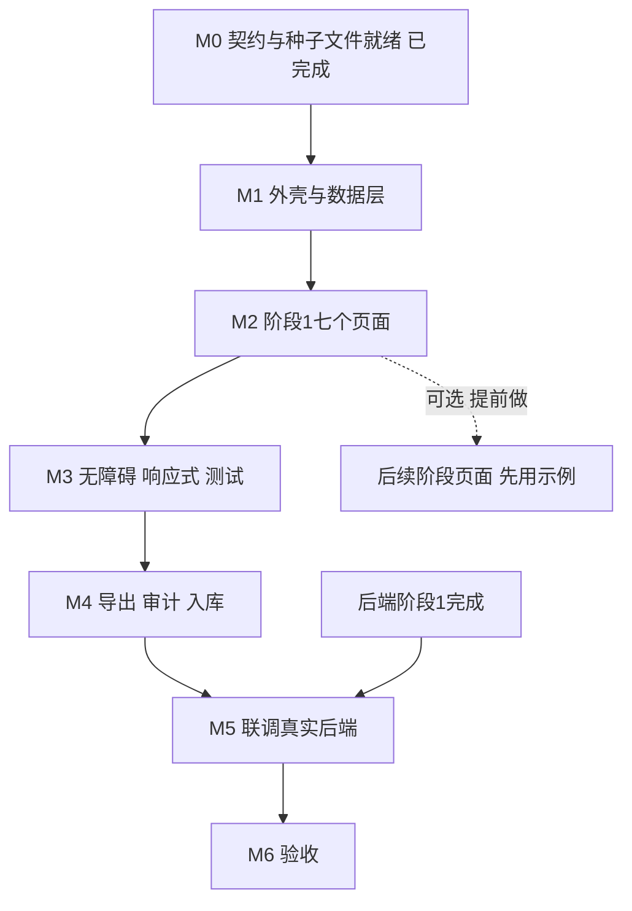

# 计划:状态页前端(React + Lovable)

- 状态:**待执行**(与后端阶段①计划 `20261112-status-dashboard-plan.md` 并行,以契约解耦)
- 决策依据:`docs/adr/20261112-status-dashboard.md`;前端规范 `docs/web/`(尤其 `03-frontend-handoff.md`、`05-lovable-guide.md`)
- 关联:Issue #1

## 目标

用 React + TypeScript + Tailwind CSS(Lovable 默认栈)做出状态页前端:深色冷调、Bento 网格、克制的玻璃拟态,**同时满足全部安全与正确性约束**。
前端开发全程只使用示例数据;真实后端联调在后端阶段①完成后进行。

## 范围

**做**:阶段①的七个页面与应用外壳(环境横幅、总状态条、令牌输入、主题、连接中断横幅)、通用状态组件、API 客户端(mock / http 双实现)、测试、导出审计、入库。
**先做示例、后上线**:阶段②到⑤的页面(契约与示例已备好),上线时机由后端阶段与 `meta.capabilities` 决定。
**不做**:任何交易类控件;Supabase 或任何后端服务;外部字体/CDN/统计;把 Lovable 当部署平台;把真实数据交给 Lovable。

## 与你的原设想的差异(如实记录)

| 原设想 | 本计划的处理 | 原因 |
|---|---|---|
| 彻底抛弃 PyQt、核心引擎无头运行 | 引擎早已无头(`scripts/run_headless.py`)。`run_gui.py` 保留为人工观察/调试用,不计划删除 | 删除无收益,调试时仍有用 |
| 用 `vnpy_webtrader` 暴露 REST + WebSocket | 后端按 ADR 『fork 并改造』:REST 保留,**阶段①②用轮询,WebSocket 删除** | 契约 `capabilities.stream=false`;推送是否需要在阶段②再评估 |
| 手机浏览器随时监控远程服务器 | 手机布局从第一天就要求可用;**远程访问属于阶段⑤**(VPN/限定局域网,不做公网穿透) | 暴露面与合规 |
| 毛玻璃 / 新拟态 | 玻璃拟态采用并有降级;**新拟态不用** | 新拟态靠低对比度浮雕,与可读性冲突(见 `06-design-system.md` §2.4) |
| 部署在 Lovable | Lovable 仅作开发环境;交付物是导出的静态文件,由本机状态服务托管 | 同源、回环地址、无 CORS;真实数据不出本机 |

## 标准符合性

- G5 / G7:真实数据与令牌不进入 Lovable 或任何第三方;示例全部虚构,契约测试断言示例不含真实账号前缀与绝对路径。
- G8:前端代码入库前,后端审计脚本 + 两轮审查(重点:状态语义、注入、令牌处理)。
- G9:前端单元/组件测试覆盖状态语义与安全相关渲染;不设固定百分比,但必须覆盖 `03-frontend-handoff.md` §3 的九条规则。
- G1:入库提交同步 CHANGELOG / PROJECTWIKI。

## 里程碑

| 里程碑 | 内容 | 对应提示词 | 退出标准 |
|---|---|---|---|
| M0 | OpenAPI、示例数据、`api-types.ts`、`mock-data.*.ts`、设计系统、审计脚本 | — | **已完成**:契约测试 47 条、审计测试 10 条通过;种子文件经 `tsc --strict` 编译通过 |
| M1 | 项目骨架、令牌与外壳、数据层与示例切换器、令牌输入与连接状态、通用状态组件 | P0–P4 | 各步验收点全部勾选 |
| M2 | 总览、交易与风控、告警与事件、无人值守、行情录制、研究沙盒、证据文档 | P5–P8 | 逐个示例核对;未知取值回退 unknown |
| M3 | 无障碍、响应式、主题、测试 | P9–P10 | 键盘可达、灰度可区分、首屏 ≤300 KB gzip、测试通过 |
| M4 | 同步到 Lovable 的 GitHub 仓库 → 本机 `npm ci && npm run build` → 审计 → 入库 | — | 审计 error=0;warn 逐条确认 |
| M5 | 用真实后端联调 | — | 前置:后端阶段①完成 |
| M6 | 验收清单(`03-frontend-handoff.md` §7) | — | 全部勾选 |

## 任务

### 阶段 1:准备(已完成)
- [x] **F1** OpenAPI 契约(阶段①–⑤)、40 个示例、契约测试
- [x] **F2** `api-types.ts` / `mock-data.*.ts` / `mock-manifest.json` 由契约生成,TypeScript 严格模式编译通过
- [x] **F3** 设计系统(令牌对比度实测达标)
- [x] **F4** `tools/audit_frontend_export.py` 与测试
- [x] **F5** Lovable 指南与提示词包

### 阶段 2:构建(在 Lovable)
- [ ] **F6** P0 项目开局与约束
  - 验收:无 Supabase、无外部脚本、七个占位路由
- [ ] **F7** P1 设计令牌与应用外壳
  - 依赖:F6;验收:无写死十六进制色、四种环境横幅可区分、手机宽度下无 `backdrop-filter`
- [ ] **F8** P2 类型、API 客户端、示例数据、示例切换器、轮询 Hook
  - 依赖:F7;验收:`fetch(` 只在 `src/api/`;`api-types.ts` 与仓库逐字节一致;生产产物不含切换器
- [ ] **F9** P3 令牌输入与连接状态
  - 依赖:F8;验收:令牌不在 URL / localStorage / 控制台
- [ ] **F10** P4 通用状态组件
  - 依赖:F8;验收:未知取值回退 unknown;注入测试通过
- [ ] **F11** P5–P8 七个页面
  - 依赖:F9、F10;验收:每页对其全部示例核对(见提示词包各步)
- [ ] **F12** P9 无障碍、响应式、主题
  - 依赖:F11
- [ ] **F13** P10 测试与收尾
  - 依赖:F12

### 阶段 3:入库
- [ ] **F14** 在 Lovable 里同步 GitHub;本机克隆 `npm ci && npm test && npm run build`
- [ ] **F15** 审计:`python tools/audit_frontend_export.py --dist dist --src src --api-dir src/api --strict`;error=0
  - 依赖:F14;失败则回到 F6–F13 修,**不得手改后绕过审计**
- [ ] **F16** 产物放入 `dashboard/static/`,源码放入 `dashboard/frontend/`;更新 CHANGELOG / PROJECTWIKI;提交
  - 依赖:F15

### 阶段 4:联调与验收
- [ ] **F17** 后端阶段①完成后本机联调(`VITE_API_MODE=http`);故意停掉交易进程、删除/损坏状态文件,确认页面显示过期/缺失/损坏而非正常
  - 依赖:F16 + 后端 T6、T9
- [ ] **F18** CSP 零违规检查(带真实响应头的服务下,控制台无违规);HTML 注入测试
- [ ] **F19** 验收清单 `03-frontend-handoff.md` §7 全部勾选
- [ ] **F20** G8 两轮审查(重点:状态语义、注入、令牌)

### 阶段 5:后续阶段页面(可选,不阻塞)
- [ ] **F21** P11–P14:阶段②到⑤的页面先用示例数据做出;导航入口由 `capabilities` 控制,后端对应阶段上线前不显示

## 风险与缓解

| 风险 | 影响 | 概率 | 缓解 |
|---|---|---|---|
| 真实数据或令牌被贴进 Lovable | 高 | 中 | 指南明令禁止;种子/示例全部虚构且有测试;令牌只在本机浏览器输入 |
| Lovable 导出物带外部脚本/Supabase/网络字体 | 高 | 高 | 项目约束 + P0 明令;**审计脚本是入库闸门**(已有测试,含 Lovable 风格的外部编辑脚本样例) |
| AI 生成的状态语义错误(缺失显示成正常、未知当 ok) | 高 | 中 | 每步验收点逐示例核对;组件测试覆盖未知取值回退;`03` §3 九条规则作评审清单 |
| 生成代码里直接 `fetch`、散落请求 | 中 | 高 | 审计脚本拦截;提示词规定唯一 API 客户端 |
| AI 擅自加交易类控件 | 高 | 低 | 项目约束第 6 条;审计脚本对相关文案告警;评审时逐页确认 |
| 契约变更后种子文件过期 | 中 | 中 | 种子由契约生成;契约变更流程见 `02` §11;`api-types.ts` 要求逐字节一致 |
| 玻璃效果在手机上卡顿/耗电 | 中 | 中 | 手机宽度关闭 `backdrop-filter`;降级规则有验收项 |
| Lovable 与 GitHub 双向同步造成覆盖 | 中 | 中 | 本机改动只在独立分支做,再合回;入库只复制导出的源码 |
| 视觉好看但对比度不足 | 中 | 中 | 令牌对比度已实测;主题切换后复查;灰度截图验收 |
| 前端体积超预算(Three.js / 图表库) | 低 | 中 | 首屏预算只算首页;图表按页面懒加载;阶段②才需要图表 |

## 验收标准

- [ ] M1–M4 退出标准全部满足
- [ ] 审计脚本 `--strict`:error=0,warn 逐条有结论
- [ ] CSP 零违规;HTML 注入测试通过;令牌不出现在 URL / localStorage / 控制台
- [ ] 对 `manifest.json` 里的每个示例渲染正确;未知 `state` 回退 unknown
- [ ] `03-frontend-handoff.md` §7 全部勾选
- [ ] G8 两轮审查通过

## 评审记录

- 方法清晰度:用户选定 React + Lovable,方法明确,未走澄清与多模型共识环节。
- 事实核对:Lovable 项目默认含外部编辑脚本与可能的 Supabase / 字体依赖,这一点基于对 Lovable 生成物的已知行为,**未在本环境实际生成项目验证**;因此把『导出后审计』设为强制闸门,而不是假设它们不存在。具体表现以你实际导出的项目为准。
- 已实测:设计令牌对比度(脚本计算,深浅两套均达 WCAG AA);`api-types.ts` 与示例数据经 `tsc --strict` 编译通过;审计脚本对模拟的 Lovable 风格导出物(外部脚本、内联脚本、Supabase、`innerHTML`、令牌入 `localStorage`)能正确拦截。

## 修订记录

- 2026-11-12 初版。
