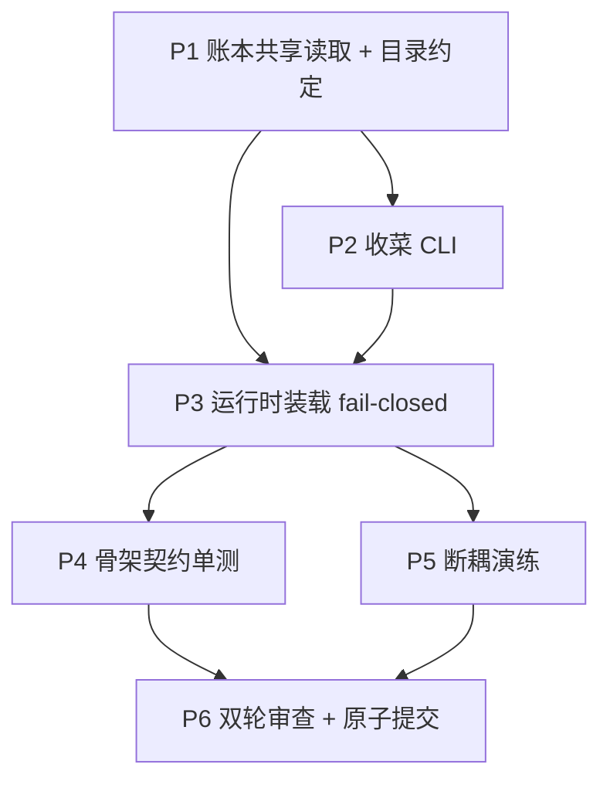

# Plan: 闭合沙盒状态机——`approved/` 目录、收菜动作、运行时装载 fail-closed

- **Issue**: [#34](https://github.com/laiyinyizao007/invest/issues/34)
- **分支**: `feat/34-approved-sandbox`（worktree `C:\Dev\projects\invest-34`，基于 `origin/main` @ `96959a2`）
- **阶段**: P2 → P3（方案已定，见 Issue 正文「设计要点」）
- **automation_mode**: true（用户以 `/goal` 指令要求一路推进，不在阶段间停下等确认）

## 1. 目标

让「人工批准」兑现它唯一的存在意义——**决定哪份代码有权被运行时执行**。

```
pending_strategies/  ──(人批准，写账本)──>  批准账本
                                              │
                                    (收菜，仅本机可触发)
                                              ↓
                                          approved/  ──(人工装载)──>  runtime
```

现状缺口（已核实，非推测）：

| 缺口 | 证据 |
|---|---|
| `approved/` 目录不存在 | `ls approved` → No such file or directory |
| 批准只写账本，无收菜动作 | `research_sandbox.record_approval` 只写 `data/research-control/approvals.json` |
| 运行时完全不认 `approved/` | `trading/runtime.py:312` 用 `cfg.strategy_class` 从 `strategies/` 装载；`runtime.py:121` 的 `cta.classes` 只注册 `TrendAtrStrategy` |
| roadmap 已登记该缺口 | `docs/roadmap.md` §2.5「pending 已落地，approved/ 与骨架模板未做」 |

## 2. 范围

### In-Scope
1. `approved/` 目录约定 + 收菜 CLI（本机人工触发）
2. 运行时从 `approved/` 装载，fail-closed 复核批准账本 + 宪法
3. 批准账本的轻量共享读取模块（研究侧与运行侧共用读，写入口仍唯一）
4. 策略骨架契约独立单测
5. 外层宕机断耦演练 + 证据文档
6. ADR + PROJECTWIKI + CHANGELOG 同一原子提交

### Out-of-Scope
- 4c 的「容器隔离放开」（需另行评审）
- MetaRouter 状态路由、Alpha Factory 双轨
- 晋级门槛口径变更、批准流程本身的改写（现有 TTY + 64 位哈希机制不动）
- 网关新增任何端点（**明确不做**：网关 docstring 禁止 approve 与写 `approved/`）

## 3. 硬约束（不可违反）

| 约束 | 落位 |
|---|---|
| 外层绝不接触实盘/凭据/`.env` 交易段；研究 API 是唯一通道 | 收菜**不新增网关端点**，网关根本 import 不到收菜模块 |
| 批准只能由本机人完成，模型不能代替 | 收菜 CLI 与批准 CLI 一样走 `sys.stdin.isatty()` + 完整 64 位哈希二次确认 |
| fail-closed：校验不过一律拒绝，不得回退默认值 | 装载失败 → `EXIT_STARTUP_FAILED`(3)，不回退到 `strategies/` |
| 风控底线永不优化 | 收菜不触碰任何风控参数；候选只能重写宪法白名单成员 |
| 不得放宽既有宪法/沙盒规则 | 收菜不得成为绕过宪法的后门 → 装载前复检宪法 |
| G1 文档与代码同一原子提交 | 末次提交同时含代码 + ADR + PROJECTWIKI + CHANGELOG |
| G8 双轮审查 ≥45/50 | 末次提交前必须过 `zen codereview` + codex CLI 两轮 |

## 4. 里程碑与任务分解

### P1 批准账本共享读取 + `approved/` 约定
**交付物**：`risk/approval_ledger.py`；`scripts/research_sandbox.py` 改为委托；目录约定文档
**验收**：`research_sandbox` 对同一账本文件的读取结果与共享模块**逐字一致**（回归锁）；写入口仍唯一

| 任务 | 改动 | 验收 |
|---|---|---|
| T-P1-1 | 新增 `risk/approval_ledger.py`：只读 `file_sha256(path)` / `load_approvals(file)` / `is_approved_sha(sha, file)`；异常类型 `ApprovalLedgerError(ValueError)`；**不含任何写入口** | 新模块无写函数（AST 断言） |
| T-P1-2 | `research_sandbox._load_approvals` 改为委托共享模块，把 `ApprovalLedgerError` 转成 `SandboxError`（**文案逐字不变**）；`file_sha256` / `is_approved_sha` 同样委托 | 既有研究侧测试全绿；新增 `test_approval_ledger_parity.py` 断言两路读取一致 |
| T-P1-3 | `scripts/research_config.py`：`paths` 增 `approved_dir: "approved"`；新增目录必须在 `RESERVED_DIRS`（已含 `approved`），且**不得**放宽既有受保护目录校验 | 配置校验测试全绿 |
| T-P1-4 | `docs/` 目录约定：状态机三态、每态的写入者与校验 | 文档与实现一致（G4） |

**依赖**：无。

### P2 本机收菜 CLI
**交付物**：`scripts/research_collect.py`
**验收**：四道校验的正反向测试全绿

| 任务 | 改动 | 验收 |
|---|---|---|
| T-P2-1 | `collect` 子命令：源文件必须位于 `pending_dir`，名字过 `candidates.name_pattern`；**账本未命中 → 拒绝** | `test_research_collect.py::test_collect_refuses_unapproved` |
| T-P2-2 | 收菜时**重算**源文件 sha256 与账本值比对（防 TOCTOU）；写入后**复算**目标文件 sha256，仍须等于账本值 | `::test_collect_refuses_changed_source` / `::test_collect_detects_copy_mismatch` |
| T-P2-3 | 目标路径固定 `approved/<原文件名>`，不接受任意路径参数；名字校验复用 `SAFE_NAME_PATTERNS_MUST_REJECT` 思路（拒 `../x.py`、`a/b.py`、`.py`、`x.txt`） | `::test_collect_rejects_path_traversal` |
| T-P2-4 | 原子写：唯一临时名（pid + uuid）+ `os.replace` + Windows 重试；与 `research_sandbox.record_approval` 同款写法 | `::test_collect_is_atomic` |
| T-P2-5 | 交互式二次确认：TTY 门 + 完整 64 位哈希（照抄批准流程的口径），非 TTY 一律拒 | `::test_collect_requires_tty` / `::test_collect_requires_full_sha` |
| T-P2-6 | `list` 子命令：列出 `approved/` 内容 + 账本状态（是否仍一致） | `::test_collect_list` |

**依赖**：P1。

### P3 运行时装载 fail-closed
**交付物**：`trading/runtime.py` 装载路径 + `risk/approved_guard.py`（或等价模块）
**验收**：能装则装、不能装则**拒绝启动**（非零码），绝不静默回退

| 任务 | 改动 | 验收 |
|---|---|---|
| T-P3-1 | `RuntimeConfig` 增 `approved_dir` / `approvals_file` / `approved_strategy_class`（均可为 `None`，`None` 时行为与今天**完全一致**） | 既有 runtime 测试全绿 |
| T-P3-2 | 装载函数：① 文件在 `approved/` 内 ② sha256 在账本 ③ 复算字节一致 ④ 宪法静态复检（`screen_source` + `check_params`，模板取 `config/immutable_constitution.json`）——任一不过即拒绝 | `test_approved_loading.py::test_refuses_when_not_in_ledger` / `::test_refuses_when_file_changed` / `::test_refuses_on_constitution_violation` |
| T-P3-3 | 装载成功后 `cta.classes` 注册该类；**失败时以 `EXIT_STARTUP_FAILED`(3) 退出**并给中文原因，绝不 `try/except` 回退到默认策略 | `::test_runtime_exits_nonzero_when_approved_load_fails` |
| T-P3-4 | 运行中风控底线核对（纵深防御）：启动后取 `snapshot_instance_state`，每根 bar 后比对熔断阈值/合约乘数/风险预算/ATR 窗口，不一致 → 告警 + 停机 | `::test_runtime_detects_runtime_rewrite` |
| T-P3-5 | 宪法第三层（运行中实例级）的取舍在 ADR 里**如实写明**：静态层已禁止引用 `guard`/`trail`/`cta_engine`，第三层是纵深防御 | ADR 有对应小节 |

**依赖**：P1、P2。

### P4 骨架契约独立单测
**交付物**：`tests/test_strategy_skeleton_contract.py`
**验收**：骨架不变量被独立锁住

| 任务 | 改动 | 验收 |
|---|---|---|
| T-P4-1 | 断言骨架 `strategies/trend_atr_15m_strategy.py` 的 `parameters` / `variables` 集合稳定（改骨架须改测试，明示这是契约面） | `::test_skeleton_parameters_contract` |
| T-P4-2 | 断言候选子类化骨架后仍受宪法约束：候选不得重写非白名单成员、不得引用风控对象 | `::test_skeleton_subclass_cannot_weaken_risk` |
| T-P4-3 | 断言多个候选可并存于 `approved/`（不同类名、不互相污染） | `::test_two_candidates_coexist` |

**依赖**：P3。

### P5 断耦演练 + 文档
**交付物**：`scripts/decoupling_drill.py`、`docs/decoupling-drill.md`
**验收**：可复跑，证据进文档

| 任务 | 改动 | 验收 |
|---|---|---|
| T-P5-1 | 演练脚本：起内层 runtime（用 `scripts/drill.py` 已有的 `NoopStrategy` + 假网关，不连真 CTP）→ 停外层（网关容器/毕昇）→ 断言内层心跳继续、状态文件继续刷新 → 恢复外层 | 脚本退出码语义明确 |
| T-P5-2 | 演练同时断言：外层进程环境**无** `CTP_*`（部署层 fail-closed 的实测） | 输出进证据表 |
| T-P5-3 | `docs/decoupling-drill.md` 写演练步骤、结果、局限（**不连真 CTP**，说明这是断耦证据不是实盘证据） | 文档如实 |

**依赖**：P3。

### P6 双轮审查与原子提交
| 任务 | 验收 |
|---|---|
| T-P6-1 | 第一轮：`mcp__zen__codereview` 工作流验证 | 记录问题与修复 |
| T-P6-2 | 第二轮：`mcp__zen__clink` → codex CLI 深度分析（安全/性能/架构/边界） | 5 维度评分 **≥45/50**，不足则继续修并复审 |
| T-P6-3 | 原子提交：代码 + ADR + PROJECTWIKI + CHANGELOG 同一 commit，`(ref #34)` | `git diff --cached --stat` 只含本 Issue 内容 |
| T-P6-4 | 建 PR，首行 `Closes #34` | PR 就绪 |

## 5. 依赖关系



## 6. 风险表

| 风险 | 影响 | 概率 | 缓解 |
|---|---|---|---|
| TOCTOU：批准后源文件被改 | 收进 `approved/` 的不是人看过的那份字节 | 中 | 收菜时重算 + 写入后复算，两道都过才落盘 |
| TOCTOU：收菜后 `approved/` 文件被改 | 运行时执行的不是批准过的字节 | 中 | 装载时复算 sha256 与账本比对；运行中定期复检 |
| 研究侧经某路径写入 `approved/` | 未批准的代码获得受信身份 | 低 | 收菜是**唯一**写入口；研究侧候选目录与 `approved/` 物理分离且 `approved` 在 `RESERVED_DIRS`；装载时账本命中是硬门 |
| 装载失败模式：起不来 vs 起来了但策略错 | 前者安全，后者危险 | 低 | 装载期只做「拒绝」，不做降级；运行中底线核对覆盖「起来了但被改写」 |
| 收菜 CLI 被并入 `research_api` → 网关同进程可达 | 网关可间接触发收菜 | 中 | **独立脚本**，网关 import 不到；ROUTES 不变 |
| `.gitignore` 与容器卷挂载冲突 | 容器内看不到 `approved/` | 中 | `approved/` 不入库；`docker-compose.yml` 增挂载；实盘走 Windows 运行机直跑（本就非容器） |
| 宪法复检在 runtime 侧的导入成本 | 启动变慢 | 低 | 宪法是纯 `ast` 模块，只在装载时跑一次 |
| `approved/` 与 `pending/` 同名文件歧义 | 装错文件 | 中 | 收菜目标名 = 源名；装载只看 `approved/`；`list` 子命令同时显示两处来源 |
| 账本无限增长 | 文件越来越大 | 低 | 本 Issue 不做清理；记录为遗留问题 |

## 7. 验收标准（对应 Issue #34 验收清单）

- [ ] `approved/` 目录约定落地；收菜 CLI 可用
- [ ] 收菜正反向测试：账本内 → 成功且字节一致；账本外 → 拒绝；批准后被改 → 拒绝；路径穿越 → 拒绝；非 TTY → 拒绝；哈希不全 → 拒绝
- [ ] 装载测试：账本内 → 通过；账本外 → **拒绝且非零退出**；事后被改 → 拒绝；宪法违规 → 拒绝
- [ ] 骨架契约独立单测通过
- [ ] 断耦演练可复跑，证据进 `docs/`
- [ ] 全量测试通过（`.venv/Scripts/python.exe -m pytest -q`）
- [ ] G8 双轮审查均 ≥45/50
- [ ] ADR + PROJECTWIKI + CHANGELOG 与代码同一原子提交

## 8. CLAUDE.md 规则落位

| 规则 | 落位 |
|---|---|
| G1 文档一等公民 | T-P6-3：代码 + ADR + PROJECTWIKI + CHANGELOG 同一原子提交 |
| G4 一致性（架构图用 Mermaid） | T-P1-4 文档里的状态机图用 Mermaid |
| G5 安全 | 收菜/装载全部 fail-closed；不新增网关能力 |
| G6 遵循既有 ADR | 批准流程（TTY + 64 位哈希）不改；宪法不改，只复用 |
| G7 敏感信息脱敏 | 收菜输出与 ADR 不含本机绝对路径以外的敏感信息；命令行输出遵循既有脱敏口径 |
| G8 双轮审查 | T-P6-1 / T-P6-2，≥45/50 |
| G9 测试覆盖率 | 目标 85%（最低 70%），新增模块必须有正反向测试 |
| G14 副作用登记 | 触碰 `pending_strategies/` 下三个候选文件属计划内修改；其余改动逐条登记 |

## 9. 已知取舍（如实记录，不掩盖）

1. **宪法第三层在运行时不做完整实例级复检**：静态层已禁止引用 `guard`/`trail`/`cta_engine`（连读都不许），运行中改写路径已被堵死；本 Issue 只做轻量底线核对（熔断阈值/乘数/预算/ATR 窗口），完整第三层留待有真实实盘实例后再评估。
2. **断耦演练不连真 CTP**：用 `drill.py` 的 `NoopStrategy` + 假网关，证明的是「外层宕机不阻断内层」，不是实盘证据。
3. **`approved/` 不入库**：未经审查的代码不进版本库；代价是容器镜像里没有它，靠卷挂载/运行机目录提供。

## 10. 审查记录

- **planner**：2026-11-14，两步分解完成（`continuation_id 7c0f028a-…`），确认方法与硬约束
- **codex（第一轮）**：待 T-P6-1
- **codex（第二轮）**：待 T-P6-2

## 11. 修订记录

- 2026-11-14：初版（Issue #34 设计要点 → planner 分解 → 本文件）
