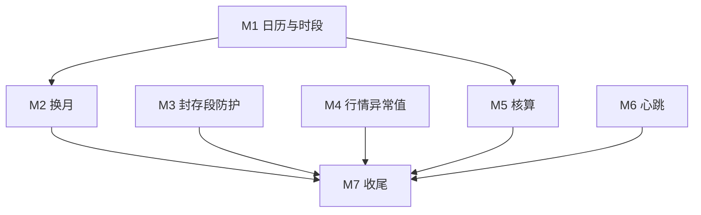

# Plan: 阶段 F-a 实盘就绪——新模块(不接线)

- Issue:[#54](https://github.com/laiyinyizao007/invest/issues/54);所属项目群「先完成 B–G 系统功能」(功能模型 `docs/web/trade/00-domain-model.md` v3,分支 `feat/53-web-terminal`)
- 生成方式:plan-down(Interactive + Clear:zen chat 判定方法清晰 → zen planner 分解)
- 拆分理由:PR #20(改 `trading/guard_rule.py`、`trading/runtime.py`、`risk/account_guard.py`、`scripts/drill.py` 等)与 #25(改 `strategies/trend_atr_strategy.py`)在途。F-a 只建新模块与测试;接线放到 F-b(待 #20/#25 合并后另开 Issue)

## Objective
把实盘就绪所需的 6 个能力做成**独立、可测、fail-closed** 的新模块。F-b 接线时只需调用它们,不再重写逻辑。

## Scope
### In-Scope
1. **交易日历 + 统一交易时段**:`risk/sessions.py`、`config/trading_calendar.json`、`tools/build_trading_calendar.py`
2. **主力换月**:`risk/roll.py`
3. **封存段防护**:`risk/holdout_guard.py`
4. **行情异常值判定**:`risk/tick_filter.py`
5. **核算**:`risk/accounting/`(权益历史、盈亏归因、结算单核对、滑点对比)
6. **外部心跳发送端**:`notify/heartbeat.py`

### Out-of-Scope(F-b)
- 接入 `guard_rule`、`runtime`、`account_guard`、`drill`、策略;替换现有 7 份时段定义
- `stop_all`;紧急平仓失败恢复;外部委托核对;结算单**取数**(vn.py 的 CTP 接口没有查询结算单的功能,需扩展网关)
- 行情异常值过滤的**启用策略与阈值 ADR**(F-a 只提供判定函数,参数由调用方传入)

## 关键设计决定(用户已确认)
- **交易日历数据**:用 AKShare 的新浪 A 股交易日历(仓库已安装 akshare 1.20.36;国内期货与证券交易所休市安排一致)生成**入库**的 `config/trading_calendar.json`,记录来源、抓取时间与覆盖区间。
  - 运行时只读这个文件,不联网,也不依赖 AKShare;
  - 生成时校验:周末不得是交易日;每年交易日数在合理区间;与上一版相比,只允许延长覆盖区间、不允许改动已有日期,否则需要人工确认。
- **表外日期**:一律判为「未知」,调用方按 fail-closed 处理;覆盖结束前 30 天开始告警。当前覆盖到 2026-12-31,2027 年安排公布后需重新生成。
- **节前无夜盘**:从日历推导。D 日有夜盘,当且仅当 D 是交易日,并且 D 与下一个交易日之间只隔着普通周末(或者紧邻)。
- **时段表**:只录入有依据的品种(现为 C、MA:日盘 9:00–10:15、10:30–11:30、13:30–15:00,夜盘 21:00–23:00)。表外品种一律报错,不猜。候选池品种(EB/EG/V/PP/M 等)要对照交易所公告核对后再加入。
- **交易日归属**:20:00 及以后归入下一个日历日,再顺延到第一个交易日。这与 `account_guard.trading_day` 和 `import_minute` 的口径一致,但改为按日历顺延,不再只跳过周末。

## Standards Compliance
- 全局:G1(CHANGELOG/PROJECTWIKI 同提交,提交以 `(ref #54)` 结尾);G4(Mermaid、文档与代码一致);G5(不新增依赖,AKShare 只用于离线生成);G8 双轮;G9 覆盖率 ≥85%
- 项目 CLAUDE.md:
  - 新的 `risk/*` 模块与 `config/trading_calendar.json` 加入 `tools/check_domain.py` 的不可降级清单(风控底线组;`holdout_guard` 归方法学闸门组),并同步 `tests/test_check_domain.py` 与 ADR 变异表(`check_mutations --verify`)
  - 研究侧会用到的 `holdout_guard`、`roll` 只依赖标准库(研究边界不变量)
  - 新防线都要有放行和拦截两个方向的测试,并做变异验证
- CI:新测试文件加入 `.github/workflows/research-guard.yml` 的 ruff 清单;不依赖 vnpy 的测试加入 pytest 清单

## Milestones / Task Breakdown
- [ ] **M1 交易日历与时段**
  - 生成脚本(用假数据源测试校验逻辑)+ 首版日历文件;
  - `sessions`:日期状态(交易/休市/未知)、前后交易日、有无夜盘、时段判定(开/闭/未知)、交易日归属、覆盖告警;
  - 验收:国庆、春节等节假日休市;节前无夜盘;周五有夜盘;表外为未知;损坏文件 fail-closed
- [ ] **M2 换月**(依赖 M1)
  - 主力选择规则与 `build_continuous._choose_main` 同源(复用,不另写一份);
  - 新浪代码 ↔ CTP 代码规范化(DCE 小写 4 位、CZCE 大写 3 位);
  - `validate_roll(live_vt_symbol, 日期, 持仓数据) → 一致/不一致/未知`
- [ ] **M3 封存段防护**
  - 常量 `HOLDOUT_START = 2026-06-15` 只定义在这一处;`check_range`/`filter_rows`/`assert_before`,越界抛错;
  - 封存段一次性确认台账仿照 `segment_ledger` 的写法;
  - 更新现有源码扫描测试的白名单
- [ ] **M4 行情异常值**
  - 纯函数 `classify(tick, prev, contract) → (ok | bad, 原因列表)`;
  - 检查项:超出涨跌停、相对前一笔的跳变超阈值、成交量/持仓量回退、时间偏差、价格与最小变动价位不对齐;阈值作为参数传入
- [ ] **M5 核算**(归属用 M1)
  - 权益历史原子追加(jsonl)与读取,损坏行跳过并计数;
  - 归因:按成交计算毛利、手续费(配置费率)、估计滑点 → 净额;
  - 结算单核对:输入已解析的结算单持仓与查询到的持仓,返回差异;
  - 滑点对比:下单时盘口价与成交价逐笔比较
- [ ] **M6 心跳发送端**
  - 载荷经 `notify.redact` 脱敏;按间隔节流;只发送;发送失败不抛异常、不影响调用方
- [ ] **M7 收尾**:分档清单与变异表、CI 清单、覆盖率、G8 双轮、CHANGELOG/PROJECTWIKI、PR

## Risk Management
| 风险 | 影响 | 对策 |
|---|---|---|
| 日历数据有误 | 高 | 来源可追溯;生成时校验;已有日期被改动需人工确认;表外 fail-closed |
| 2027 年数据未就绪 | 中 | 30 天告警;覆盖到期后依赖日历的功能拒绝运行(按用户决定) |
| 时段数据录错 | 高 | 只录有依据的品种,表外品种报错 |
| 封存段常量触发现有源码扫描测试 | 低 | 常量只在一处,并更新白名单 |
| 变异表计数变化 | 低 | 用 `check_mutations --verify` 重新核对并更新 ADR 表 |
| 与 #20/#25 冲突 | 中 | 不修改它们涉及的文件;提交前用 diff 核对 |

## Acceptance Criteria
- [ ] 6 个模块齐全,各自有放行和拦截两个方向的测试;新防线经变异验证
- [ ] 覆盖率 ≥85%(只统计新模块)
- [ ] 分档器、`check_mutations --verify`、CI ruff 清单、相关测试全绿
- [ ] 没有修改 #20/#25 涉及的文件
- [ ] G8 双轮;CHANGELOG/PROJECTWIKI 同提交

## 带到 F-b 的事项(接线时必须落实)
- 权益历史:交易进程独占文件并持进程锁(`EquityWriter` 只防同进程多线程);打开时 `skipped > 0` 要告警
- 交易日历:实盘接线前对照大商所/郑商所公告逐年核对,临时休市用 `manual_closed` 追加;覆盖告警接入启动检查与每日告警
- 行情异常值:取值、启用方式与坏数据处置另写 ADR(实盘路径)
- 结算单核对:需扩展 vn.py CTP 网关的结算单查询
- 换月校验:接入运行时启动,不一致或未知即拒绝启动;至少在一个真实换月窗口验证
- 封存段防护:接入数据读取入口(含日线 `*_1d_adj.csv`)
- 外部心跳:接入交易进程定时器;外部接收端不在本仓库
- 交易日历工作流:合并后用 workflow_dispatch 实跑一次,验证开 PR/Issue 与去重

## Review History
- 2026-11-17:zen chat(gemini-2.5-flash)判定方法清晰;zen planner 分解;用户确认日历数据源与表外日期策略
- 2026-11-17:G8 第 1 轮 zen codereview 返回旧批次缓存,改为人工逐文件自查(修 2 处);第 2 轮 codex 39/50 → 复核 44/50 → 复核 **45.5/50**(达发布线;每轮发现均逐条复现后修复)

## Revision Log
- 2026-11-17:初版
