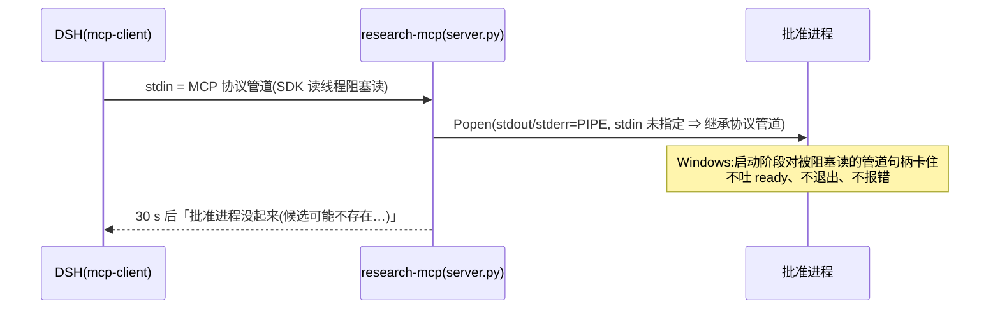
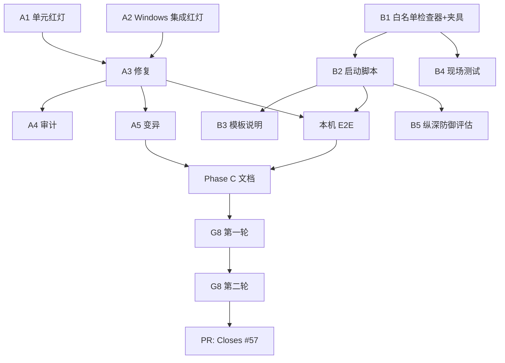

# Plan:Issue #57 —— 批准进程在 MCP 内启动即卡死 + DSH research 会话工具边界失效

- Issue:[#57](https://github.com/laiyinyizao007/invest/issues/57)
- 分支 / worktree:`fix/57-approval-stdin-and-research-profile` @ `../invest-57`(基于 `origin/main` 30375cb)
- 档位:**执行域(不可降级)**——改 `tools/research_mcp/server.py`(批准链)与研究边界测试;全套全局流程
- 生成:plan-down(第 0 步 chat:gemini-2.5-flash 判「Method Clear」;gemini-2.5-pro 返回 429 RESOURCE_EXHAUSTED 免费层额度为 0,已留档;planner 两步,专家校验 gemini-3-pro-preview)
- automation_mode:false(进 P3 须用户确认下方「结构化确认块」)

## 目标

1. **A**:`request_approval` 在 DSH(stdio MCP)里能正常拉起批准页;失败时提示能区分「候选不存在」「子进程退出」「子进程无响应」。
2. **B**:research 会话的模型可见工具**由环境保证**恰为三个——不依赖日常 Desktop profile 里装了什么。

## 非目标

- 批准方式升级为 DSH 原生审批卡片(另案)
- 毕昇侧任何改动
- 不改批准页本身的校验逻辑(哈希重算、CSRF、Origin 等)与 `record_approval` 写入者

## 根因(已复现,2026-11-19)



- 直接 spawn(无 MCP):0.4 s 拿到 ready;用 DSH 拉起的 MCP 进程的**原样环境**:同样正常 ⇒ 不是环境变量/斜杠/浏览器/控制台。
- 经 stdio 拉起 MCP 调 `request_approval`:**稳定 30.1 s 失败**;仅补 `stdin=DEVNULL`:拿到 ready ⇒ 根因确认。
- B:`dsh-agent-preset` 的配置只有 `id/name/description/order/plugins`,**没有**「不继承全局插件」;日常 Desktop profile 的全局插件(终端、桌面操控、子代理、记忆等)对所有 Preset 可见,实测 130+ 工具、file policy `danger-full-access`。11-14 的验证是在干净 profile 上做的。

## 规范对照

| 规则 | 本方案的落实 |
|---|---|
| 项目 CLAUDE.md §4 执行域 | P1→P2(本文件)→P3;Issue + worktree;G8 双轮;覆盖率 85% |
| §4 升档 7(文档主题) | ADR 第 3 条前提改写 = 改防线口径 ⇒ **代码与测试同改**,不只改文档 |
| §4 升档 8(削弱型) | 本方案只收紧,不放宽任何检查;边界检查器从黑名单改**白名单**(更严) |
| G1 | 代码与 ADR/CHANGELOG/PROJECTWIKI 同一 PR;commit 带 `(ref #57)`,PR 正文 `Closes #57` |
| G5 | 不新增依赖(`mcp` SDK 已在 `requirements-research.txt`) |
| G7 | 启动脚本不回显密钥;模型密钥从**不入库**的 env 文件读 |
| G8 | 第一轮 + 第二轮 clink→codex(zen codereview 有旧缓存问题,不用) |
| G9 | 新增/改动代码覆盖率 ≥85% |
| G12 | 结论沉淀到 memory |

## 任务分解

### Phase A —— 批准进程卡死

- [ ] **A1 红灯(单元,全平台)**:`test_request_approval_detaches_stdin`——`fake_popen` 捕获 kwargs,断言 `stdin is subprocess.DEVNULL`。修复前在 Linux CI 上也红。
- [ ] **A2 红灯(集成,仅 Windows)**:父进程的 stdin 是一条**被另一线程阻塞读**的管道,按 `server.py` 同样方式拉起 `research_approval_server.py --no-browser --timeout 10`(用临时 `INVEST_ROOT` + 夹具候选);不带 `stdin=DEVNULL` 时断言超时(记录现象),带上时断言 15 s 内拿到 `ready`。`skipif(sys.platform != "win32")`。**不新增生产代码接缝**(`--no-browser` 已存在,只在测试里直接调批准进程用)。
- [ ] **A3 修复**:`Popen(..., stdin=subprocess.DEVNULL)`;失败分支拆成三种提示:子进程报错事件(已有,含「候选不存在」)/ 子进程退出(`rc=…`)/ 子进程存活但无响应(超时)。提示仍过 `redact_for_model`,不含路径、URL、哈希。
- [ ] **A4 审计**:仓库内其它在 stdio 父进程下拉子进程的位置(目前 `server.py` 仅一处 `Popen`);结论写进 ADR。
- [ ] **A5 变异**:`tools/check_mutations.py` 增加一条「删掉 `stdin=subprocess.DEVNULL`」——A1 必须变红。

### Phase B —— 专用 research profile

- [ ] **B1 边界检查器(纯函数 + 夹具,全平台)**:`tools/research_mcp/profile_check.py`(或放进测试辅助),输入 `dsh --dump-config` 的 YAML,判定:
  - research Preset 段恰为 `[persona, research-mcp]`;
  - **白名单**:Preset 外每个**启用**条目都必须在显式白名单里(模型路由/LLM 提供方、harness 核心、UI、本地化等),否则失败——不用插件名黑名单(ADR 史上黑名单反复被绕);
  - `research-mcp` 之外没有任何启用的 `dsh-mcp-client` 条目。
  - 夹具:一份干净专用 profile 的组装结果(正例);一份复刻今天 130+ 工具的日常 profile(反例,必须判失败)。
- [ ] **B2 启动脚本**:`tools/research_mcp/start-research-dsh.ps1`——`DSH_HOME` 指向专用目录(默认 `%USERPROFILE%\.dsh-research`),首次自动用模板建 profile;启动前跑 `--dump-config` + B1 检查器,**不通过就拒绝启动**;模型密钥从参数给出的本地 env 文件读,不回显、不落盘。
- [ ] **B3 模板说明**:`dsh-research-preset.patch.yml` 头部写明「只能装进专用 DSH_HOME;装进带全局工具插件的 profile 即失去边界」。
- [ ] **B4 现场测试(本机 opt-in)**:设了 `DSH_RESEARCH_HOME` 且有 DSH CLI 时,对真实专用 profile 跑 B1;CI 跳过(无 DSH)。
- [ ] **B5 纵深防御(实现时评估)**:research-mcp 启动时若能识别自己不在专用 DSH_HOME 下则拒绝服务——取决于 DSH 是否把 `DSH_HOME` 传给 MCP 子进程;评估结论写进 ADR,做不了就登记为残留。
- [ ] **B6 本机清理(非仓库改动)**:从日常 Desktop profile 移除 research Preset(备份 `cordis.patch.yml.bak-20261119-research`);写入 ADR。

### Phase C —— 文档

- [ ] **C1 ADR** `docs/adr/20261113-dsh-research-entry-and-out-of-band-approval.md`:第 3 条「可核对的前提」改写为「由专用 profile + 启动前检查器保证」;新增「Issue #57 发现」节:根因、130+ 工具、模型曾用终端绕开 MCP 拉起批准页并写入记忆型「兜底」(已清理)、**未发生自批**(账本未变)、修法与残留。
- [ ] **C2 CHANGELOG**:`Fixed`(stdin 卡死)+ `Security`(边界由专用 profile 保证)。
- [ ] **C3 PROJECTWIKI**:research-mcp 模块的启动方式改为启动脚本。

### Phase D —— 验证与复核

- [ ] 研究侧测试文件全过;`ruff` 清单(`research-guard.yml`)纳入新文件
- [ ] `python tools/check_domain.py --diff origin/main` 记录档位;`python tools/check_mutations.py --verify`
- [ ] 覆盖率:改动/新增代码 ≥85%
- [ ] **本机 E2E**:专用 profile 的真实 DSH 会话——模型列出的工具恰为三个;`request_approval` 拉起批准页;人工批准后 `research_status` 推进到评估
- [ ] G8 第一轮(clink→codex)→ 修 → 第二轮(clink→codex);≥45 或残留风险经用户签字

## 依赖



A 与 B 相互独立,各自提交(`ref #57`),同一个 PR。

## 风险

| 风险 | 影响 | 概率 | 缓解 |
|---|---|---|---|
| R1 A2 在 Windows 上偶发慢/抖 | 中 | 中 | 15 s 上限、`--no-browser`、仅 Windows;Linux 由 A1 + A5 兜 |
| R2 A1 只是「kwargs 在不在」,重构可能空转 | 中 | 低 | A2 实测行为 + A5 变异钉死 |
| R3 检查器用名字黑名单会被新插件绕过 | 高 | 中 | 改**白名单**:未列入的启用条目一律失败 |
| R4 DSH 升级后默认条目变化 | 中 | 中 | 白名单会把新条目判失败(fail-closed);ADR 记录验证时的 DSH 版本 |
| R5 启动脚本泄露模型密钥 | 高 | 低 | 只从本地 env 文件读,不回显、不写盘;G7 |
| R6 用户仍习惯在日常 Desktop 里开 research | 高 | 中 | B6 从日常 profile 移除;persona 文案写明;B5 纵深防御 |

## 回滚

- 代码:revert PR(A/B 各自独立提交,可单独回滚)
- 本机:日常 profile 用 `.bak-20261119-research` 还原;专用 `DSH_HOME` 是新增目录,可整删
- 无数据迁移、无接口变更

## P3 进入条件(待用户确认)

**结构化确认块**(由用户填写/确认):

```
授权执行: 是/否
风险等级: 中(批准链;只收紧不放宽)
方案链接: plan.md(本文件)+ Issue #57
回滚可用: 是(见「回滚」)
```

**方案完备性 6/6**:

- [x] 接口:MCP 工具签名不变;仅失败提示文案细化
- [x] 数据:不动批准账本格式与写入者
- [x] 回滚:见上
- [x] 测试:A1/A2/A5/B1/B4 + 本机 E2E
- [x] 发布:同一 PR,`Closes #57`;CI `research-guard.yml` 覆盖新文件
- [x] 文档联动:ADR / CHANGELOG / PROJECTWIKI

## 评审记录

- 2026-11-19 plan-down:第 0 步 Method Clear(gemini-2.5-flash;gemini-2.5-pro 429 已留档);planner 两步完成,专家校验(gemini-3-pro-preview)无修改意见

## 修订记录

- 2026-11-19 初版
- 2026-11-19 修订(执行中,用户决定):**用户明确接受日常 Desktop 下的风险**。据此:
  - B5 由「research-mcp 在非专用 DSH_HOME 下拒绝启动」改为「照常服务 + 本机 stderr 提示」(`deployment_problem` 保留作判据);
  - B6 由「从日常 Desktop profile 移除 research Preset」改为「装回」(代码根暂指 worktree,合并后改回主检出);
  - 严格模式(启动脚本 + profile_check 白名单)保留为可选;
  - A5 原写「登记进 `tools/check_mutations.py`」——该脚本只管分档清单,不适用;改为当场变异验证(删 DEVNULL ⇒ A1、A2 变红)并记入 CHANGELOG;
  - 启动脚本的模型密钥改为只从 Desktop 凭据读 `MINIMAX_CN_API_KEY` 一项(用户要求「直接用 DSH 配的模型」);
  - 严格模式下「模型实际可见工具」的真实会话枚举未做(用户改走 Desktop),登记为残留。
  - A2 原写「自造『被阻塞读的管道』夹具」——匿名管道与 asyncio(overlapped)管道两种夹具在未修复代码上都**复现不出**卡死;改为 MCP 官方 stdio 客户端跑真实会话(仅 Windows),修复前 32.6 s 失败、修复后通过。
- 2026-11-19 G8 第 1 轮(codex A 41/50、B 39/50,无 Critical)后修订:模板显式转发 `DSH_HOME`(H);检查器改为与模板逐字段比对、展开 `cordis:group`、白名单记 id → 包名并核对 dsh-base 版本、拒绝非映射条目、递归查嵌套 MCP;日常 Desktop 的脱敏组装结果入库作回归夹具;ADR 旧段落标为历史快照。TOCTOU(检查与启动之间)登记为残留。
- 2026-11-20 G8 第 2/3 轮(codex 第 2 轮 A 44/50、B 45/50;第 3 轮 3 条 Low + 1 条 MEDIUM)后修订:
  - **MEDIUM 坐实**：「全局层会注册模型工具的只有 `tool-working-directory`」那句断言**是假的**
    ——`plugin-manager` 不叫 `tool-`,却在 `apply()` 里**无条件**注册了 `plugin_manager`
    ⇒ 计划里「白名单里没有会向模型注册工具的条目」这条前提不成立。
    处置:白名单新增 `model_tool_registrants` 一节(逐条记源码位置/注册了什么/判定),
    三个注册方(`plugin-manager`/`tool-working-directory`/`mcp-resources`)由 profile 补丁禁用并移出白名单;
    检查器加两条判据(组装结果那一路 + 白名单那一路);并加一条**源码级**可复算核对
    (重扫本机 DSH 包目录,含注册调用的包必须与清单**完全一致**)。
  - **A5 补成常驻变异**:上一条修订把 A5 降成「当场变异验证」⇒ **写下了却没人常跑**;
    现在它是 `tools/check_guard_mutations.py` 里的一条常驻变异(去掉 `stdin=subprocess.DEVNULL` ⇒ 见证用例变红),
    ADR 变异表同步 +1 行。
  - 问题数 54 → 60(三个注册方既不在白名单、又必须禁用 ⇒ 日常 Desktop 夹具多 6 项问题);
    文档里写的那个数由一条用例**取出来与实测对账**(漂了先红的是它)。
- 2026-11-20 G8 第 4 轮 codex(前两次 1800 s 超时,收窄范围后 62 s 跑完)判 40/50,两条「必须改」都落地:
  - **#1** 清单里 `package` 只存不用 ⇒ 补「注册方的包名必须与登记一致」这条判据(变异表 234 → 235)。
  - **#2** 插件条目只允许出现在三个地方(顶层 / 分组的 config 列表 / Preset 的 config.plugins);
    此前 `_flatten` 只展开分组 ⇒ 补一条**形状**判据:普通条目的 config 里嵌着「看起来像插件条目的列表」⇒ 判失败
    (变异表 235 → 236)。形状判据的**实测依据**:日常 Desktop 组装 266 条目里带 `id`+`name` 的映射 501 个,
    顶层 241 个,其余全在分组或 Preset 里。
  - **残留(如实登记)**:白名单**自证**——把 `decision` 改成 `child-only` 再把 id 加进 `enabled_global`,
    检查器里的规则都不会红;这是白名单式设计固有的边界,外部锚点是「`tools/research_mcp/` 在不可降级清单里」。
- 2026-11-20 G8 第 5 轮 codex(只审第 4 轮那两处增量)判 **44/50**、**无「必须改」**:
  两条增量都被判为没有绕过路径(包名核对只会追加「证据过期」信号;形状规则保守且覆盖面完整)。
  唯一一条**可选加固**已落地:把形状规则依赖的两条**实测**假设(条目必带 `id`+`name`、必作为 `config` 下的
  列表元素)写进 `profile_check.py` 的模块说明与 `_entry_like_lists()` 文档串,并写明「DSH 升级时必须同步复核
  判据宽度」。**没有新增判据 ⇒ 变异表仍是 236 条。**
