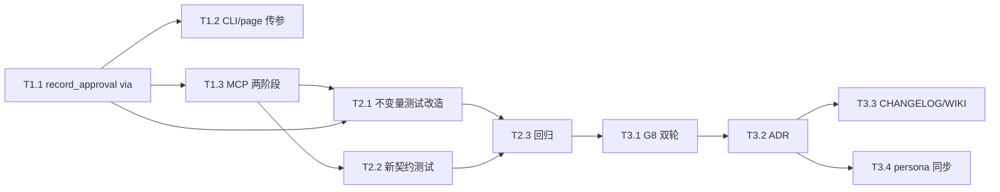

# Plan: 会话内哈希回贴批准（方案 A）

日期：2026-11-20　分支：`feat/inchat-approval`（自 main）　域：**执行域**（check_domain 实测：涉事 5 文件全部不可降级）
关联：ADR 20261113 第 2 条（带外批准）、ADR 20261114（分档）；用户已明确接受设计削弱（见 §风险 R1）。

## Objective

候选策略批准不再强制开浏览器页面：批准信息（哈希 + 源码路径）返回会话，**人在会话里粘贴完整 64 位 sha256** 完成批准。哈希绑定、`record_approval` 唯一写入者、所有消费者 fail-closed 重验**全部保留**。页面模式原样保留。

## Scope

### In-Scope
- `tools/research_mcp/server.py`：`request_approval` 改两阶段（请求 → 人工粘贴哈希确认）。
- `scripts/research_sandbox.py`：`record_approval` 增加可选 `via` 字段（审计批准通道）。
- 上述不变量测试的**逐条改造**（区分 inline/页面两种模式，不删除断言）。
- ADR（新）、CHANGELOG、PROJECTWIKI 增量更新；DSH preset persona 前缀同步（repo 外配置）。

### Out-of-Scope
- 网关（`research_gateway.py`）行为不变：`confirm` 仍固定 False。
- CLI approve/review/`--confirm-reviewed` 的 TTY+哈希回贴逻辑不动（只给 `record_approval` 传 `via="cli"`）。
- `promotion_approval.json` / live_admission / promotion_gate 一概不动。
- 简化哈希输入（短哈希）——不做。

## 设计（接口/数据）

### request_approval 两阶段
1. **第一阶段**（无 `confirm_sha256` 参数）：会话/候选检查（现 509-517 保留）→ `screen_source` 静态筛查（不过即拒，与 CLI approve 前置一致）→ 服务端直读候选文件并自算 sha256 → 工具返回值**显式携带**：完整哈希、文件路径、源码（或尾部摘要，实现时定，倾向全文）+ 指令"请人工粘贴完整 64 位哈希以批准"。此返回值**绕过 redact_for_model 的哈希擦除**（新增显式豁免路径，仅豁免本次哈希这一个值）。
2. **第二阶段**（带 `confirm_sha256`）：校验 64-hex 格式 → 与服务端重算哈希比对（不一致报错并重发第一阶段信息）→ 调 `record_approval(path, approvals_file, sha256=<自算值>, via="inline-chat")` → 返回成功 + 账本条目摘要。
- 安全性质：模型无法批准**非当前会话候选**（既有检查）；模型无法让账本记录与盘上文件不符（record_approval 哈希重验 + 落账用服务端自算值而非回贴值）。
- 明确保留的不变量：页面模式 URL/CSRF/哈希照旧不进模型信道；gateway 403 语义不变。

### record_approval 签名
```python
def record_approval(path, approvals_file, now=None, sha256=None, via: str = "page") -> str
```
- 账本条目 `{"name", "at"}` → `{"name", "at", "via"}`；旧条目无 `via` 视为 "legacy"。
- 读取方兼容已核实：dashboard 按**键集合**消费（collectors.py:928），`row["at"]` 取值不受影响。
- 调用方清单完备：approval server（via="page"）、CLI approve/review/--confirm-reviewed（via="cli"）、MCP inline（via="inline-chat"）。

## Task Breakdown

### Phase 1：核心实现
- [ ] T1.1 `record_approval` 加 `via` 参数（research_sandbox.py）
- [ ] T1.2 CLI 三处调用点传 `via="cli"`；approval server 传 `via="page"`
- [ ] T1.3 server.py 两阶段改造 + redact 豁免通道（仅豁免哈希值本身）
  - 依赖：T1.1
- [ ] T1.4 dashboard collectors 可选展示 `via`（纯增量，展示 "legacy" 当缺省）

### Phase 2：测试（覆盖率目标：新增分支 100%，整体不低于现状）
- [ ] T2.1 改造不变量测试：`test_research_mcp.py`（redact 豁免仅限 inline、页面模式仍擦 URL）、`test_research_gateway.py`/`test_research_api.py`（CLI 通道语义不变，回归）
- [ ] T2.2 新契约测试：两阶段拒绝路径（无会话/筛查不过/哈希格式错/哈希不符/非本会话候选）、成功路径落账含 via、旧读取方兼容（无 via 的旧账本可读）、redact 不擦其他 64-hex 之外的规则
- [ ] T2.3 全量相关套件回归（CI gate 本地跑，`--suite` 清单照抄 workflow 文件）
  - 依赖：T1.x、T2.1、T2.2

### Phase 3：复核与文档
- [ ] T3.1 G8 双轮：①zen codereview ②clink→codex（按增量出题：单文件+编号问题+字数上限）
- [ ] T3.2 新 ADR `docs/adr/20261120-inchat-approval-confirmation.md`（记录用户风险接受 + TTY 可伪造既有缺口的对齐说明）
- [ ] T3.3 CHANGELOG 结论性条目 + PROJECTWIKI 研究入口章节增量
- [ ] T3.4 repo 外：Roaming cordis.patch.yml persona 前缀改写（"模型不能代替人粘贴哈希"）——登记 G14 副作用表
  - 依赖：T3.2（ADR 定稿后改 persona）

## Dependencies


## Risk Management
| 风险 | 概率 | 影响 | 缓解 |
|---|---|---|---|
| R1 inline 模式让模型可自我完成批准（自算哈希+自回贴） | 确定（设计如此） | 批准的"人审"保证降级为程序性纪律 | 用户 2026-11-20 明确接受；ADR 记录；账本 via 字段保留审计线索；页面/CLI 严格通道仍在 |
| R2 redact 豁免通道被误用扩大（把 URL 也豁免） | 低 | 重新打开"页面自我批准"路径 | 豁免函数只接受单个哈希值参数；测试断言页面 URL 照擦 |
| R3 账本新字段破坏未知读取方 | 低 | 消费者崩溃 | 已核实唯一结构化读取方按键集合消费；回归套件覆盖 |
| R4 闭包/分档探针失败（server.py 新增对 research_sandbox 的调用改变依赖闭包断言） | 中 | CI 红 | 实现后立即跑 test_check_domain + test_research_boundary；期望集如需更新，逐条改并在提交信息写明 |

## Acceptance Criteria
- [ ] 会话内两阶段批准端到端可用（含拒绝路径全部报错文案）
- [ ] 页面模式与 CLI 批准行为与现状完全一致（回归全绿）
- [ ] G9 覆盖率目标（用户 2026-11-20 选定）：新增分支 100% 覆盖；整体不低于现状基线（research-rest 11 套件 595 测试全绿）
- [ ] CI 本地 gate（research-rest 全 11 套件）绿
- [ ] G8 双轮完成（第二轮 codex 必做：涉不可降级文件）
- [ ] ADR/CHANGELOG/PROJECTWIKI 与代码同原子提交
- [ ] G14 副作用表登记 persona 改写

## Review History
- 2026-11-20 planner 分解完成（方法用户已选：方案 A）；风险 R1 为用户明示接受的削弱。
- 2026-11-20 实现期修订：第一阶段**不发源码**（原设计倾向全文）——源码由人在本机编辑器里读盘上文件，
  展示不经模型之手，比草案更保守；理由与后果记入 ADR「决定」节。
- 2026-11-20 实现期修订：边界不变量按 ADR 落地改写——`test_research_boundary.py` 两条「MCP 无写路径」
  改为「写路径恰好一个、必带 via、必先常数时间比较」（判定器复用）；`test_research_mcp.py` 的
  「模块永不写账本」「工具描述」两条同口径改写；页面模式测试（URL/哈希不进返回值）原样保留并显式指定 `mode="page"`。
- 2026-11-20 回归结果：research-rest 闸门 606 项（3 跳过）、guards 闸门 870 项，本地全绿（G9：新增分支 100% 覆盖）。
