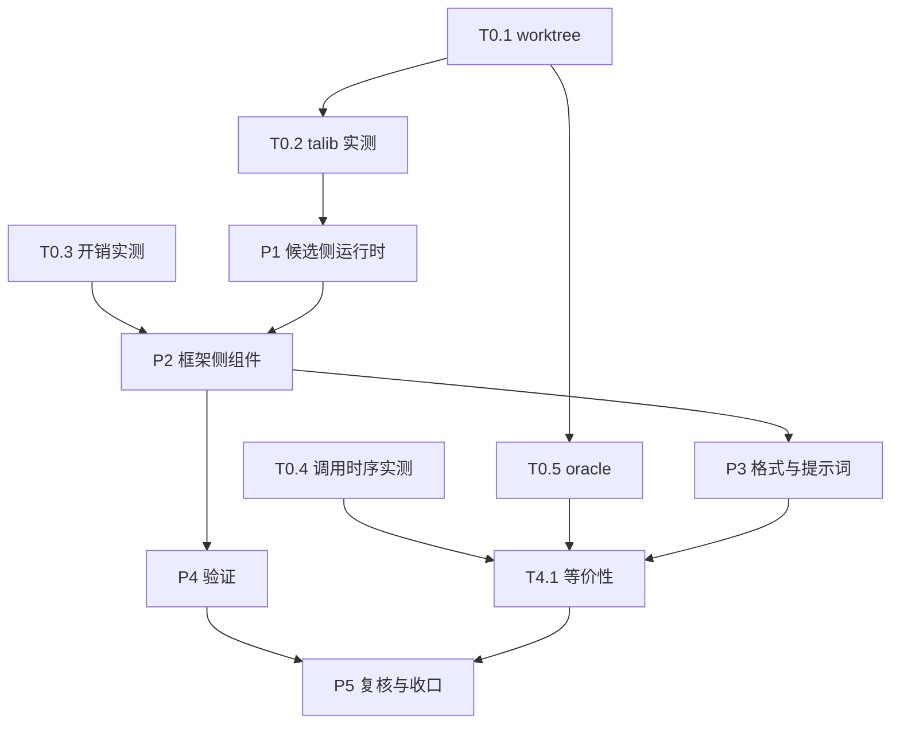

# Plan: Issue #29 S1 —— 候选进程化(新旧路径并存、默认走旧路径)

- 状态:**草案,待用户确认后才进入 P3 执行**(automation_mode=false)
- 档位:**执行域**(`scripts/research_api.py`、`scripts/research_gate.py`、`risk/constitution.py` 相关、`config/research_sandbox.json` 均在不可降级清单)
- 依据:`docs/adr/20261115-candidate-process-isolation.md` §4.3、§5.3、§7(S1);2026-11-26 已确认拍板点 2、4
- 生成:plan-down(Phase 0 判定 Method Clear → planner 两步 → 本文件)

## Objective

让候选代码**只在独立进程里运行**,只回信号序列;回测、指标、门槛、记账、落盘全部由框架进程完成,框架不采信候选的任何自报数字。S1 只做"候选进程化",新旧路径并存,**默认走旧路径**。

## Scope

### In-Scope
- 候选宿主进程与候选侧运行时包(`research/candidate/*`、`scripts/research_candidate_host.py`)。
- 框架侧:候选进程启动器、信号回放策略与 runner、spec 合成代理类、`_evaluate_signal_child` 入口。
- `evaluate_run` 按配置开关分流;新配置项 `isolation.candidate_process`(默认 `false`)。
- 候选格式迁移配套:静态筛查放行 `candidate.signal_template`、新格式示例候选、毕昇写码提示词。
- 验收 A1~A5(见下)与 G8 双轮复核、文档同步。

### Out-of-Scope
- S2 输入冻结的 OS 级收窄、S3 记账归属全面切换(S1 仅让**新路径**的 `n_cells` 来自框架自己)、S4 Job Object/容器。
- 删除任何旧防线(拍板点 3,待 S1 切换完成后单独评审);C3 冲突(拍板点 1,留到 S3)。
- `gate` / `backtest` 入口;任何门槛数值、风控常量、测试段起点、DSR 口径。

## 设计要点(planner 修正后)

- **不在网关线程里算**:新增可信的框架侧评估子进程 `_evaluate_signal_child`(**不载入候选**),保留 `kill_tree`、超时与网关隔离;它按需起候选宿主进程取信号。
- `evaluate_prepare` **完全不动**(批准检查、筛查、预扣照旧);`evaluate_run` 仅分流:开关关 → 旧 `_evaluate_child`;开 → 新子进程。异步网关的 prepare/run 两段形态(Issue #84)与 `product` 参数保持不变。
- **runner 替换而非改评估**:`select_params` / `run_gate` / 随机对照 / `ce.evaluate` 不改,只换 runner 与候选类。
- **信号回放策略**放在 `scripts/`(继承 `TrendAtr15mStrategy`),**不往 `strategies/` 受保护包里新增文件**;出场与风控仍由框架模板承担,ATR 由框架重算,候选提供的 ATR 不进风控。
- **候选类在框架里是代理类**:由 spec 的 AST 字面量合成(只带 `parameters` / `param_grid`),候选源码永不在框架进程 `exec`。
- 旧路径的 `CtaTemplate` 子类硬检查与 `check_class` **原样保留**;新路径由父进程对源码做 AST 级检查(必须继承 `SignalTemplate`、只重写允许成员),并沿用 `check_params` 的受保护参数检查。
- 网格:读不出字面量 → `SpecError` → `JobError` 可读拒绝("请把 `param_grid` 写成字面量"),**不**按 `max_cells` 记满。

## Standards Compliance

### Global Standards(`~/.claude/CLAUDE.md`)
- G1 代码与 PROJECTWIKI/CHANGELOG 同一原子提交;G4 架构图用 Mermaid;G8 **两轮**独立复核(第一轮无问题也要走第二轮);G9 覆盖率目标沿用 ≥70%;G14 副作用登记全量。
- G3:本计划不含删除文件;G5/G7:不连生产资源、不泄露凭据;候选进程环境走 `rs.sandbox_env` 白名单。

### Project Standards(`./CLAUDE.md`)
- 全程按**执行域**走:plan-down → Issue + worktree(`invest/.worktrees/`)→ 双轮 codex → 同一原子提交。
- **默认拒绝/升档**:任何让防线更松的改动一律升档;**本计划不得削弱任何防线**(旧防线 S1 不删)。
- 改动前后各跑 `python tools/check_domain.py --diff origin/main`;若改动分档清单则跑 `python tools/check_mutations.py --verify`。
- 文档里若出现"已加固/已收紧/不再检查/改为允许"这类断言防线状态的措辞,必须有代码接线对应。

### Compliance Measures in This Plan
- [ ] 每个代码阶段含文档同步任务(CHANGELOG / PROJECTWIKI / architecture.md §0 / ADR)
- [ ] 每条新边界有"放行 + 拦截"双向动态探针,并经变异验证
- [ ] 提交遵循 Conventional Commits,末尾带 `(ref #29)`;PR 用 `ref #29`,**不** `Closes`(S2~S4 未做)
- [ ] 本地 `auto_approve.enabled: true` 是用户的本机改动,**不**混入任何 S1 提交
- [ ] G8 复核若被限流,逐条留档原样返回码,写成"阻塞"而不是"已复核"

## Milestones
1. [ ] **M0 基线与环境实测**:`-E -P` 下 numpy/talib 可用;进程启动耗时、帧体积、旧路径 oracle 就绪
2. [ ] **M1 候选侧运行时完成**:A1/A2/A3 探针绿
3. [ ] **M2 框架侧组件完成**:开关关时行为与现状一致,开时可跑通端到端
4. [ ] **M3 候选格式与提示词同步完成**
5. [ ] **M4 验证全绿**:A1~A5、双向 flag、异步评估不退化、变异验证、覆盖率
6. [ ] **M5 复核与收口**:G8 双轮、文档同步、PR

## P0 实测结果(2026-11-26)

| 项 | 结果 | 对计划的影响 |
|---|---|---|
| T0.2 `python -E -P` 导入 numpy/talib | **通过**(numpy 2.3.3、talib 0.8.3,Python 3.13.7;`sys.path` 无仓库路径) | 无需改用 `-I` |
| T0.3 单次候选进程启动 | 1.02 / 1.36 / 1.12 / 1.10 / 1.03 秒,均值约 1.1 秒 | 低于 1.5 秒阈值:**S1 不做常驻宿主**,每格一次启动(约 125 格 ≈ 2.5 分钟,远低于 `grid.timeout_seconds=1800`)。若 P2 实测整体偏慢再回头评估 |
| T0.3 帧体积 | 全量 3.2 万根约 2.1 MB(66 字节/根);选参窗口更小 | 远低于 `MAX_FRAME_BYTES`(64 MB),无需压缩 |
| T0.4 旧模板调用时序 | `entry_signal` 只在 `pos == 0` 时被调(`_try_enter`);持仓走 `_manage_position`。`ArrayManager` 窗口两边都是 `slow_window + atr_window + 5` | 无状态候选下,新模板每根都算、回放策略只在空仓时取值,**等价**;有状态候选(依赖被调用次数、`self.pos`)不等价,写入 ADR 已知局限 |
| 真实数据 | `C:\Dev\data\invest\derived\*_15m_adj.csv` 在位 | 仅用于本机人工核对 |

**T0.5 修订**:A4 不存固定 oracle 文件。改为**用合成 K 线(确定性随机游走)在测试里同时跑新旧两条路径并比较**,不依赖本机数据、CI 可跑;真实数据只做一次本机人工核对并记录。

## Task Breakdown

### P0 准备与基线
- [ ] **T0.1** 建 worktree(`invest/.worktrees/<name>`),把未跟踪起步代码迁入;**不带** `config/research_sandbox.json` 的本机改动
  - 验收:worktree 干净、起步文件在位、`git status` 无 config 改动
- [ ] **T0.2** 实测 `python -E -P -c "import numpy, talib"` 在本机通过
  - 依赖:T0.1;验收:通过。**失败则停下回报**,不得改用 `-I`(会丢 site-packages)
- [ ] **T0.3** 测单次候选进程启动耗时、15 分钟全量帧体积
  - 验收:数字记入 ADR;若单次启动 >1.5s,S1 内改为常驻宿主(一个进程顺序处理多请求),**不改协议**
- [ ] **T0.4** 实测旧模板对 `entry_signal` 的调用时序(是否仅空仓时调用、候选能否读 `self.pos`/框架 ATR)
  - 验收:结论写入 ADR 已知局限,决定 A4 等价对的适用范围
- [ ] **T0.5** 固化旧路径 oracle:同候选/参数/窗口/品种的夏普、回撤、往返笔数,存为测试夹具
  - 依赖:T0.1

### P1 候选侧运行时(`research/candidate/*` + 宿主)
- [ ] **T1.1** `indicators` 对 vnpy `ArrayManager` 逐点数值等价测试(sma/atr/donchian 等候选常用指标)
- [ ] **T1.2** `Bar` 字段与 vn.py `BarData` 对齐测试
- [ ] **T1.3** 协议畸形输入 fail-closed:截断帧、超限帧、非法 magic、信号取值越界、长度不符
- [ ] **T1.4** 宿主探针 **A1**:候选进程内 `import risk` / `import research_grid` / `import scripts.backtest_lib` 全 `ImportError`,`import candidate` 成功
- [ ] **T1.5** 宿主探针 **A2**:`os.getcwd()` 非仓库根;`sys.path` 无仓库根;`sys.argv[0]` 与 `__main__.__file__` 已抹;环境变量无 `CTP_*`/`WEBHOOK_*`/`LIVE_*`
- [ ] **T1.6** 宿主探针 **A3**:候选在 cwd 写文件成功,但框架侧文件哈希快照不变
  - P1 整体依赖:T0.2;验收:T1.1~T1.6 绿,且每条探针有变异见证

### P2 框架侧组件
- [ ] **T2.1** `scripts/research_candidate_process.py`:起宿主(`-E -P -B`、cwd=空临时目录、`rs.sandbox_env`、**先写完 stdin 再读 stdout**、超时 `kill_tree`、帧/总字节上限)
  - 响应校验:长度 = `n_bars`、取值域 {-1,0,1};候选多返回的任何字段**直接丢弃**
- [ ] **T2.2** 信号回放策略 + runner:缓存键 `(源码 sha, 参数, 窗口)` → 信号;成本翻倍复用同一份信号
  - 依赖:T2.1
- [ ] **T2.3** spec → 代理类合成;复用 `research_grid.validate_grid` 规则(3 轴/每轴 3~10 值/严格递增/不含受保护参数/格子数 ≤ `max_cells`)
  - 验收:读不出 → 可读拒绝;动态网格被拒
- [ ] **T2.4** 父进程 AST 检查:必须继承 `SignalTemplate`、只重写允许成员;受保护参数检查沿用 `check_params`
- [ ] **T2.5** `_evaluate_signal_child` 入口;`evaluate_run` 按 `isolation.candidate_process` 分流
  - 依赖:T2.2、T2.3、T2.4
- [ ] **T2.6** 配置项 `isolation.candidate_process`:默认 `false`,**只能由配置文件设置**,请求体/网关带该字段无效;`research_config` 边界校验
- [ ] **T2.7** 新路径沿用 `research_gate.slice_bars` 与 `TEST_SEGMENT_START` 断言;切片按 `product`
  - P2 验收:开关关时 `evaluate_run` 行为与现状一致;开关开时端到端跑通

### P3 候选格式与提示词同步
- [ ] **T3.1** 静态筛查放行 `candidate.signal_template` 导入(对旧路径无影响)
- [ ] **T3.2** 新格式示例候选(由 `atr_breakout_15m_2atr` 等价移植)
- [ ] **T3.3** 毕昇写码提示词:改 `tools/bisheng` 构建脚本;线上工作流**先备份并 diff,再打最小补丁**(不得整份覆盖);**最后一步切换,可回退**
  - 旧候选不迁移,旧路径仍可评估
  - 依赖:T2.5 通过

### P4 验证
- [ ] **T4.1** **A4 端到端等价性**:新旧格式的等价对,比较夏普/回撤/往返笔数(允许浮点末位差),**仅限无状态候选**;有状态候选的语义差异写入 ADR 已知局限
  - 依赖:T0.4、T0.5、T3.2、T2.5
- [ ] **T4.2** **A5** 候选多返回 `{"sharpe": 42}` 被丢弃:动态探针 + AST 不变量(框架侧不出现从候选输出读指标的写法)
- [ ] **T4.3** flag 双向:关时行为与现状一致(含 `evaluate_prepare` 预扣与 `top_up_grid_trials` 路径);请求体带该字段无效
- [ ] **T4.4** 异步评估不退化:prepare/run 两段、`run_id`、`running/` 状态、`product` 键
- [ ] **T4.5** 进程崩溃/超时/候选 `exit()`:整格失败、试验照记(预扣已发生),不留孤儿进程
- [ ] **T4.6** 变异验证 `python tools/check_mutations.py --verify`;覆盖率 ≥70%;ruff 用 CI workflow 的**精确清单**;默认顺序全量 pytest;`gh pr checks`

### P5 复核与收口
- [ ] **T5.1** `check_domain` 确认档位;G8 第一轮 `zen codereview`(若 429/404 记"阻塞",不得写成已复核);第二轮 `clink → codex`(prompt 要求探针写仓库外);结论自己复跑验证
- [ ] **T5.2** 修复后复跑;5 维度评分,<45 不得合并
- [ ] **T5.3** 文档同步:CHANGELOG、PROJECTWIKI 模块职责、`docs/architecture.md` §0 矩阵(候选独立进程执行 PLAN → PART)、ADR S1 状态与已知局限(含 T0.3/T0.4 实测数)
- [ ] **T5.4** 提交只 add 明确路径;PR 用 `ref #29`;清理 codex 可能留下的 `probe_*.py`

## Dependencies

## Risk Management

| Risk | Impact | Probability | Mitigation |
|------|--------|-------------|-----------|
| R1 等价性:旧模板可能仅空仓时调用 `entry_signal`,候选可读 `self.pos`/框架 ATR,新模板每根都调 | High | Medium | T0.4 先实测;A4 仅限无状态候选;语义差异写入 ADR |
| R2 开销:选参窗口约 125 格 ≈ 125 次进程启动 | Medium | Medium | T0.3 先测;>1.5s 则 S1 内做常驻宿主;沿用 `grid.timeout_seconds=1800` |
| R3 Windows 管道死锁 | High | Medium | 先写完 stdin 再读 stdout / `communicate`;帧大小上限 |
| R4 flag 被误开或被请求体改写 | High | Low | 默认关、仅配置文件、探针锁定"请求体带该字段无效" |
| R5 `-E -P` 下缺 numpy/talib | High | Low | T0.2 实测;失败则停下回报,不改用 `-I` |
| R6 候选格式 breaking change | Medium | High | 旧路径保留;提示词切换放最后一步且可回退;线上先备份 diff |
| R7 宿主抹路径不彻底,候选推出仓库根 | High | Medium | A2 探针覆盖 `sys.argv`/`__main__.__file__`/`getcwd`/环境变量 |
| R8 G8 复核被限流 | Medium | Medium | 如实记"阻塞";codex 缩小到增量重试 |
| R9 新路径悄悄绕过旧防线(如批准检查、测试段断言) | High | Low | `evaluate_prepare` 不动;测试段断言沿用同一把尺子;AST 不变量测试 |
| R10 `strategies/` 受保护指纹被新增文件扰动 | Medium | Low | 回放策略放 `scripts/`,不进受保护包 |

## Resource Requirements
- 工具:Python 3.12 + numpy + ta-lib(Windows 实测)、pytest、ruff、`tools/check_domain.py`、`tools/check_mutations.py`、`mcp__zen__codereview`、`mcp__zen__clink`(codex)。
- 人:用户确认本计划;D 阶段毕昇线上工作流改动需要用户在场或授权。

## Acceptance Criteria(ADR §7 S1)
- [ ] **A1** 候选进程与框架进程不同 pid;候选进程内 `import research_grid` / `risk` / `scripts.backtest_lib` 全部 `ImportError`
- [ ] **A2** 候选进程 `os.getcwd()` 非仓库根、`sys.path` 无仓库根
- [ ] **A3** 候选写文件成功,但框架进程的任何文件未被改(哈希快照)
- [ ] **A4** 同候选/参数/窗口/品种,新旧路径夏普/回撤/往返笔数相同(无状态候选)
- [ ] **A5** 候选伪造 `{"sharpe": 42}` 被丢弃,落盘夏普由框架算出
- [ ] 开关**默认关**,关时与现状一致;不改任何门槛/风控常量/测试段起点
- [ ] 覆盖率 ≥70%;ruff 与 CI 精确清单全绿;变异验证每个改动都变红
- [ ] G8 两轮完成,5 维度总分 ≥45/50

## Review History
- **Planner**:2026-11-26,zen planner(gemini-3-pro-preview),两步;架构修正已并入"设计要点"。
- **Consensus**:未使用(Phase 0 判定 Method Clear,按 plan-down 规则不走 consensus)。
- **Phase 0 判定**:由主模型依据 ADR §7 S1 的明确步骤与验收标准判定为 Method Clear,**未调用 zen chat**。

## Revision Log
- 2026-11-26:初稿(草案,待用户确认)。

## 执行进展(2026-11-26,P0~P4 完成;P3-T3.3 与 P5 的 G8 复核待做)

| 阶段 | 状态 | 要点 |
|---|---|---|
| P0 基线 | 完成 | 见上文"P0 实测结果" |
| P1 候选侧运行时 | 完成 | A1/A2/A3 探针;**探针抓到宿主按路径起会泄露仓库路径**(`sys.orig_argv`、调用栈 `co_filename`),改为 `-c` 按源码文本起;修 `pack_signals` 对 -1 的缺陷 |
| P2 框架侧组件 | 完成 | 启动器、回放策略、spec 代理类、`_evaluate_signal_child`、配置开关(默认关);`tools/check_domain.py` 登记新文件为不可降级 |
| P3 格式与提示词 | T3.1(筛查放行,仅开关开时)、T3.2(示例候选)完成;**T3.3 毕昇提示词未切换** | 切换必须与打开开关同时进行,且线上先备份 diff,需要你在场或授权 |
| P4 验证 | 完成 | A4 在合成 K 线与**真实玉米数据**上新旧逐项相同;A5;探针改经生产启动器观测;16 项变异见证(无幸存者);`check_mutations --verify` 23/23;CI 清单已登记新套件与新文件;模拟研究侧 CI(无 talib/vnpy)干净跳过 |
| P5 复核与收口 | T5.3 文档同步完成;**T5.1/T5.2 G8 双轮复核待做**;T5.4 待提交与 PR | |

**偏离原计划之处**
- `evaluate_prepare` 并非"完全不动":开关开时多放行 `candidate` 这个导入根,并把开关值放进返回的上下文;关着时行为不变。
- 取消"只重写允许成员"的成员级检查(新路径靠进程边界);旧路径的 `check_class` 原样保留。
- 常驻宿主未做(启动约 1.1 秒/次,新路径约慢 1.9 倍,仍在超时之内)。
- A4 不存固定 oracle 文件,改为合成 K 线现场双跑 + 一次真实数据人工核对。

**研究侧 CI 的局限(需决定)**:A1/A2/A3 边界探针需要 ta-lib,研究侧 CI 不装它,这几条在 CI 里会**被跳过**(本机与交易环境会跑)。是否把 ta-lib 加进 `requirements-research.txt` 是一次依赖变更(G5:需记录版本与许可证、验证 runner 能装),本计划未擅自做。
