# 目标架构、演进路线与规划位

> 本文件由 `PROJECTWIKI.md` 拆出(2026-11-11,Issue #7),内容原样迁移自原 §2.2、§2.4、§2.5,**章节编号沿用原编号**,
> 以保证既有 ADR 里的「PROJECTWIKI §2.x」引用仍可对应。新增登记项与已处理技术债归档在末尾(§2.6、§2.7)。
> **图例**:本文件描述的是**目标**,不是现状——图中虚线/标「规划」的节点**尚未实现**(外层 Bisheng 为零代码)。
> 现状数据流见 `PROJECTWIKI.md` §2.1;方法论依据见 `docs/methodology-mapping.md`。

### 2.2 目标分层架构:内层 vn.py 流程引擎 + 外层 Bisheng AI 策略研究员

> 决策:`docs/adr/20261110-bisheng-ai-researcher.md`(2026-11-10 采纳);方法论依据:`docs/期货交易复盘与人性反思-要点梳理.md` §6。
> **当前状态:只有本节设计与 ADR,没有任何外层代码**;外层组件全部为规划位(阶段三/四,见 §2.4 与 §2.5)。

**第一设计公理**:内层必须能在 Bisheng 完全宕机的情况下独立完成交易与风控——AI 研究员是可选增益,不是交易路径依赖。

**边界铁律**:外层绝不接触实盘交易、真实发单、CTP 凭据、`.env` 交易段;唯一交互通道是下表的**研究沙盒 API 端点白名单**;`risk/promotion_gate.py` 是候选策略进入视野的唯一闸门。

**研究沙盒 API 端点白名单**(**已实现**:CLI + HTTP 网关,容器隔离;实际端点以 `docs/research-gateway.openapi.json` 为准,下表为最初设计):

| 端点 | 语义 | 对应内层函数 |
|---|---|---|
| `/research/backtest` | 提交沙盒回测(策略文件须位于 pending 目录) | `scripts/backtest_lib.py::run_engine_bars` |
| `/research/optimize` | 触发 walk-forward 滚动寻优(日期断言照常生效) | `scripts/walk_forward_optimizer.py` 公开函数 |
| `/research/gate` | 查询候选的晋级 8 条结果 | `risk/promotion_gate.py::check_gate` |
| `/research/results` | 查询结果摘要与 Trace 式诊断书 | 结果文件读取 + 确定性诊断逻辑 |
| `/research/data` | 列出可用数据段及其「测试段已消费」状态 | 数据清单 |

**实际实现的端点(2026-11-12)**:`GET /research/data`(数据段、测试段消费状态、迭代额度)、`POST /research/candidates`(只写 `pending_strategies/`;滚动窗口内最多提交 N 个)、`POST /research/backtest`、`POST /research/gate`、`POST /research/evaluate`(候选声明 `param_grid`:服务端先选参再做门槛评估)、`GET /research/feedback`(最近 N 条失败 Trace)、`GET /research/results/{run_id}`。**批准不在其中**,只能由人在本机 `research_api.py review/approve` 完成,批准绑定代码哈希。

**明确不存在的端点**:任何下单、查账户、改风控参数、连 CTP 的能力——网关进程从部署层就拿不到 CTP 段环境变量(fail-closed 于部署层,不靠代码自律)。

**形态演进(已完成)**:CLI(`scripts/research_api.py`)→ 薄 HTTP 网关(`scripts/research_gateway.py`,标准库实现、无新增依赖)→ 容器隔离。业务逻辑全部留在纯逻辑层,网关只做适配,不写任何研究逻辑。

**安全约束落位**(研究资料 §6.2/§6.3 → 工程):

| 研究资料条目 | 两层落位 |
|---|---|
| 模板限制(§6.2-1):LLM 只写信号函数,风控写死 | 内层只读资产:策略骨架模板由人维护、有独立单测;LLM 产出只能继承该骨架 |
| 沙盒状态机(§6.3-①)Pending→Approved→Executing | 目录即状态:`pending_strategies/`(LLM 唯一可写)→ walk-forward + gate 全过 + **人工批准** → `approved/`(runtime 只认);装载永远人工,fail-closed |
| 硬记忆预算(§6.3-②)`deque(maxlen=3)` | 外层工作流约束:只携带最近 3 次失败的结构化 Trace,内层零代码 |
| Trace 弱点挖掘(§6.3-③) | 内层确定性「诊断书」:回撤/次数/连亏/夏普四维,可单测;LLM 拿具象 Trace 定向改进 |
| 平台 CVE-2026-82278(Code 节点 RCE) | Bisheng 版本 ≥2.6.0、仅内网监听、禁用 Code 节点、与交易 compose 物理分离(见 ADR 安全约束) |

目标分层架构图(实线 = 已实现;虚线 = 规划位):

```mermaid
flowchart TB
  classDef planned fill:#fafafa,stroke:#999,stroke-dasharray:4 3,color:#777

  %% ═══════════ 内层 ① 数据层 ═══════════
  subgraph D[内层 ① 数据层]
    BS[scripts/bootstrap.py] -.-> FD
    BS --> IM
    FD[scripts/fetch_data.py 新浪日线+分钟增量]
    IM[scripts/import_minute.py 购买 DCE 1 分钟]
    FD --> DB[(.vntrader/database.db)]
    FD --> CSV[(data/csv)]
    IM --> DER[(derived 复权连续 1d/15m/rolls)]
    SCHED[增量调度器 规划位→阶段二]:::planned
    SCHED -. 定时触发 .-> FD
    RECC[CTP 行情自录 规划位→阶段二起]:::planned
    RECC -. 新样本外数据 .-> DER
  end

  %% ═══════════ 内层 ② 研究层 ═══════════
  subgraph R[内层 ② 研究层（纯逻辑,离线可复现）]
    DB --> BL
    CSV --> BL
    DER --> BL
    BL[scripts/backtest_lib.py 统一成本/异常哨兵]
    BL --> OPT[scripts/optimize.py 日线基准]
    BL --> O15[scripts/optimize_15m.py 15m 三段基准]
    BL --> WFO[scripts/walk_forward_optimizer.py 滚动窗口+三层隔离]
    ST0[strategies/random_entry_strategy.py 随机对照] --> BL
    PG[risk/promotion_gate.py 晋级 8 条·唯一闸门] -. 门槛检查 .-> OPT
    PG -.- O15
    PG -.- WFO
    PP[参数平原 已实现 risk/plateau.py;PBO/DSR 规划位→阶段三]
    PP -. 强化第 8 条 .-> PG
    TPE[Optuna TPE 规划位→阶段三]:::planned
    TPE -. 候选生成 .-> WFO
    MRO[月度滚动重估引擎 optimizer/ 预留 规划位→阶段三]:::planned
    MRO -. 周期调用 .-> WFO
    RSA[研究沙盒 API CLI+HTTP 网关 容器隔离 已实现]
    RSA -. 白名单端点 .-> BL
    RSA -.- WFO
    RSA -.- PG
  end

  %% ═══════════ 内层 ③ 策略层 ═══════════
  subgraph S[内层 ③ 策略层]
    ST[strategies/trend_atr_strategy.py 日线]
    ST15[strategies/trend_atr_15m_strategy.py 15m]
    INS[strategies/instruments.py 成本口径]
    SBX[策略骨架模板+pending/approved 沙盒 规划位→阶段四]:::planned
    SBX -. gate 通过+人工批准后 .-> ST15
    RTR[MetaRouter 状态路由 规划位→阶段四]:::planned
    RTR -. 启停路由 .-> ST15
  end
  ST --> BL
  ST15 --> BL
  INS --> BL

  %% ═══════════ 内层 ④ 风控层 ═══════════
  subgraph G[内层 ④ 风控层（平仓永远放行）]
    RG[risk/risk_guard.py 预算/移动止损/连亏熔断] --> ST
    AG[risk/account_guard.py 600/2000 双层熔断]
    OP[risk/order_policy.py CTP 错误码三级分类]
    SR[trading/safe_risk.py 平仓跳过计数]
  end

  %% ═══════════ 内层 ⑤ 执行层 ═══════════
  subgraph E[内层 ⑤ 执行层]
    RH[scripts/run_headless.py 无头入口 退出码 0/2/3/4]
    RT[trading/runtime.py 五步启动/三重对账/看门狗]
    GR[trading/guard_rule.py 挂 riskmanager 检查链]
    CTP[CTP 网关 / SimNow / 实盘]
    CAL[交易日历/节假日 规划位→阶段二]:::planned
    RM[主力换月自动化 规划位→阶段二]:::planned
  end
  RH --> RT
  RT --> ST
  RT --> GR
  GR --> AG
  GR --> OP
  GR --> SR
  RT --> WH
  RT --> CTP
  GR -. 拦截开仓/紧急平仓 .-> CTP
  CAL -. 熔断边界 .-> GR
  RM -. 合约切换 .-> RT

  %% ═══════════ 内层 ⑥ 消息层 ═══════════
  subgraph N[内层 ⑥ 消息层（Webhook 即伪前端）]
    WH[notify/webhook.py 队列/重试/去重/脱敏]
    CTRL[反向控制 /stop_all 规划位→阶段三]:::planned
    CTRL -. 撤单+锁引擎 .-> RT
  end

  %% ═══════════ 内层 ⑦ 部署与验收层 ═══════════
  subgraph P[内层 ⑦ 部署与验收层]
    DK[Dockerfile + compose GB18030 locale/心跳 HEALTHCHECK]
    DR[scripts/drill.py 混沌演练六场景]
    SG[scripts/simnow_guard.py 地址白名单]
    UR[scripts/unattended_report.py 每日证据]
    LOG[(vn.py 每日日志+心跳)]
  end
  DK --> RH
  DR -. 独立状态目录 .-> CTP
  SG --> DR
  DR -.-> DRDOC[(docs/simnow-drills.md 尚未生成<br/>演练首次实跑时写出)]
  LOG --> UR
  WH --> UR
  UR --> URDOC[(docs/unattended-log.md)]

  %% ═══════════ 外层:AI 策略研究员(与内层物理隔离) ═══════════
  subgraph AI[外层 ⑧ AI 策略研究员（Bisheng）规划位→阶段四]
    BSN[Bisheng 工作流/Agent 假设→调工具→读诊断→迭代<br/>HITL 人工审批节点<br/>本机已部署·工作流 v3 已建·LLM 联调待额度]:::planned
    KB[(Bisheng 知识库 ADR/要点梳理/成绩单<br/>即上下文投喂)]:::planned
    MEM[反馈记忆 deque maxlen=3<br/>只带最近 3 次失败 Trace]:::planned
  end
  KB -. 上下文 .-> BSN
  BSN -. 唯一通道·研究沙盒 API 白名单端点 .-> RSA
  BSN -. 产出策略代码·仅落 pending 目录 .-> SBX
  MEM -. 结构化反馈 .-> BSN
```

**图例与注解**:
- 实线 = 已实现,节点路径与 §2.1 现状图一致;`-.->` = 规划位,进入实现前须先补 ADR(沿用「脚本与 ADR 同一原子提交」先例);
- **实线只表示"代码存在",不表示"已验证"**:如 `DRDOC`(演练结果文档)尚未生成,`CTP` 只在启动管道上实测过;逐节点的实现/验证程度见 `docs/architecture.md` §0;
- `PG`(晋级门槛)**未接入优化脚本**:目前只有 `scripts/record_promotion.py` 与 `risk/live_admission.py` 消费它,优化器不会自动过闸;门槛的 `parameter_on_plateau` 由调用方提供(人工判断),计算来源见 §2.6;
- GUI(`scripts/run_gui.py`)故意不画——§4 已定性「图形界面不是运行方式」,目标架构是无头架构;
- **外层子图没有任何指向执行层/风控层/CTP 的连线——图形本身就是边界契约**;
- 规划位组件只在 §2.5 登记表文字预留,不建空目录、不写占位文件。

### 2.4 差距与演进路线

> **声明:每个阶段的验收都只是通道/能力验收,不是策略准入。**`docs/live-readiness.md` 的结论先行仍然成立:晋级门槛 8 条一项未过,不应该上实盘;实盘切换需用户另行明确授权。
> 与 live-readiness 的对应:阶段一 = B 段全项;阶段二 = A 段工程性前置 + C 段并行(人工);阶段三 = A 段晋级门槛的规模化支撑;阶段四超出 live-readiness 范围(能力扩张,非准入条件)。

**阶段一:SimNow 实测验收闭环(当前,最高优先级)**
- 内容:drill.py 六场景在交易时段/夜盘实跑并回填 `docs/simnow-drills.md`;runbook §5 十项全部实测回填;`--probe-webhook` 真机自检通过;连续 ≥5 交易日无人值守(含夜盘与周末)逐日核对证据表;借废单轰炸场景补采 4 类废单文本入 `docs/reject-texts-simnow.md` 与 `risk/order_policy.py` 硬码表。
- 验收:live-readiness B 段三项全勾;废单关键词表 ≥6 条实测;心跳连续 5 交易日无中断。
- 退出:B 段全勾 → 阶段二;若熔断/看门狗实跑暴露 bug,修复后 **5 天计数从零重新开始**(不折算)。
- **进度(2026-11-12 夜盘)**:
  - ✅ drill.py 六场景全部通过并回填 `docs/simnow-drills.md`(含**真实切断网络**的 `disconnect`:行情停更看门狗 61 秒告警 → CTP 心跳超时约 121 秒报断线 → 恢复后约 2 秒自动重连;切断 30 秒 CTP 无感知)。
  - ✅ `--probe-webhook` 真机自检与夜盘告警送达已验证(Telegram);✅ 断网期间告警丢失的缺口已用落盘待补发队列修复(**真实切网复测待做**)。
  - ✅ 行情录制第一套前置交易时段验收(Tick/1 分钟 K 线入库、自动重连)与「已连接却不订阅」的 `stalled` 检测;⏳ DSH 重启实测、国信测试环境未做。
  - ⏳ 未完成:连续 ≥5 交易日无人值守;废单关键词表补采(≥6 条实测);runbook §5 其余项。
  - ❓ 待复现/待修:退出登出 `logout_ctp` 在重连后出现过一次原生段错误(139);`latency` 在清淡行情下 30 秒未成交,需更激进挂价或活跃时段重测。

**阶段一并行数据基础设施副线（2026-11-11 起，与阶段一主线并行）**
- 内容:官方 vn.py DataRecorder 录制 C/MA 具体合约的 Tick 与 1 分钟 Bar，写入独立 `.vntrader_record/database.db`;增量入口复用 `scripts/fetch_data.py`，由 `scripts/record_market_incremental.py` 提供有界、可重入短任务，再由 DSH cron 触发 `ensure`/`watchdog`。该副线不改变阶段一 SimNow 交易验收主线，也不构成策略准入证据。
- 生命周期边界:`@goodandready/dsh-cron@0.3.43` 的外部运行器有界超时，不能直接承载长期 DataRecorder；采用 wrapper 独立 child。DSH Desktop 关闭期间不承诺继续录制。详见 `docs/adr/20261111-market-recording-and-dsh-orchestration.md`。
- 验收:先完成 dummy worker 的 Windows 进程树、停止、PID 重用、DSH 重启/关闭实测；再做 SimNow/国信测试 profile 的离线自检和明确授权后的行情验收。未完成实测前不得宣称常驻录制已验收。

**阶段二:多品种与交易工程自动化(阶段一退出后启动;C 段人工认证并行)**
- 内容:主力换月自动化(fail-closed 校验,见 §2.5);交易日历/节假日模块;回测成本换期货公司真实费率(依赖 C 段拿到费率表);多品种复权连续数据消费与扩充(阶段三触发条件①的积累)。
- 验收:换月校验在至少一次真实换月窗口 fail-closed 拦截验证;成本口径更新并重跑基准(**结论可能是负面上修,如实记录,不回头改门槛**)。阶段一副线的连续调度证据作为输入，但不替代本阶段工程验收。
- 退出:技术债表中「换月/节假日/成本」三条标记已处理。

**阶段三:月度滚动寻优引擎化 + 研究沙盒 API 固化(触发条件驱动,不排日期)**
- 进入条件(2026-11-10 共识,三条件同时满足):①≥2 个品种的复权连续数据可用;②实盘运行且产生月度换参需求;③分钟/日线数据厚度支持新窗口。若长期不满足,本阶段保持规划位不动——**这本身是正确状态,不是停滞**。
- 内容:`walk_forward_optimizer.py` 提升为 `optimizer/` 包 + 月度调度 + 新 ADR;参数平原卷积接入晋级门槛第 8 条;试验次数扩大后引入 PBO/DSR;反向控制 /stop_all(前置 = 阶段一 webhook 验证通过 + 无人值守常态化);研究沙盒 API 两步固化——CLI 先行(月度调度器可直接调 CLI),被真实使用后固化为薄 HTTP 网关。**API 固化是 Bisheng 接入(阶段四)的硬前置**。
- 铁律(进新 ADR):**风控底线永不优化**——只有入场参数可寻优,3% 止损/300 元预算/双层断头台必须像钢铁一样固化在代码里。
- 验收:月度重估输出经人工确认后才允许换参,换参前后策略行为变化有 webhook 播报与日志证据;网关端点白名单通过负向测试;网关进程环境变量中无 CTP 段(部署层验证);pending 策略调用 gate 的路径有集成测试。
- 退出:至少一个完整月度周期由 API 驱动完成;API 契约文档化(§6 API 手册新增小节)。
- **进度(2026-11-12)**:研究沙盒 API 固化(CLI + HTTP 网关 + 容器隔离)与参数平原判定**已提前完成**(偏离原定时序,见 ADR `20261112-research-sandbox-groundwork`);月度重估引擎、PBO/DSR、反向控制 /stop_all 仍为规划位。

**阶段四:Bisheng AI 研究员接入 + 状态路由与 Alpha Factory(远期,不给时间承诺)**
- 进入条件:阶段三 API 固化 + 阶段一退出 + 多品种数据就位。理由:①外层价值密度取决于内层质量——未经 SimNow 校准的沙盒会放大过拟合与撮合失真;②边界 API 是安全前提——没有固化白名单端点,边界铁律无法在部署层强制;③Bisheng 资源需求(≥8 核/32GB)需要独立部署决策(ADR 未决项)。
- 三步接入(每步独立可停,前一步稳定才进下一步):
  - **4a 人工驱动 CLI**(可无 Bisheng):人用研究沙盒 CLI 跑完整研究循环;模板与 pending/approved 约定落地并有单测。退出:至少完整走通 2 个候选。
  - **4b Bisheng 工具调用 + HITL**:Agent 调研究 API(触发回测/读诊断书/查 gate);每个候选进入 approved 前经 HITL 人工确认;反馈记忆 maxlen=3 生效。退出:≥1 个候选由外层驱动走完 pending→gate→人工批准全流程;外层宕机不影响内层交易(断耦演练)。
  - **4c 闭环自动化**:Agent 连续迭代,自动收菜到 approved/,**装载仍需人工**;Alpha Factory 双轨并跑;所有 LLM 产出留痕(工作流日志可回放)。
- **进度(2026-11-12)**:4a 内层部分已完成(CLI、pending 目录、批准绑定哈希、`review`、选参 + 门槛评估、迭代上限、中文报告);4b 部分:毕昇已本机部署(仅 127.0.0.1,Code 节点关闭),工具 `invest 研究沙盒网关` 已导入,工作流 v3(想法→读失败反馈→检索研究资料→LLM 写候选→提交→本机批准→选参 + 评估)已建,无 LLM 联调工作流已实跑通过,**LLM 节点端到端联调待模型额度**;4c 的容器隔离前置已满足但**未放开**,需另行评审。
- 状态路由(MetaRouter)与 Alpha Factory 双轨在本阶段后半段展开,进入条件:≥2 个通过晋级门槛且风格相反的策略并存。

**§4 技术债条目去向**(§4 原表不动,此处只标去向):

| §4 技术债条目 | 去向 |
|---|---|
| 未在真实 CTP/SimNow 上验证(最高) | 阶段一 |
| 演练脚本已就绪但未实跑(最高) | 阶段一 |
| 飞书真实 webhook 未验证 | 阶段一 |
| 无人值守只跑 1 天 | 阶段一 |
| 废单关键词表只覆盖 2 条实测文本 | 阶段一(借 drill 废单轰炸采回) |
| 主力合约换月需人工更新 | 阶段二(规划位 RM;换月派生数据实际在 `scripts/build_continuous.py`) |
| 交易日不处理法定节假日 | 阶段二(规划位 CAL) |
| 回测成本是假设值 | 阶段二(依赖 C 段拿真实费率) |
| 缺少自动化调度 | 阶段二(规划位 SCHED) |
| 分钟线历史不足 / 复权数据历史较短 | **不进路线图**——数据资产边界,§4 保留;新样本外唯一出路 = 补购或 CTP 自录(规划位 RECC) |
| 15 分钟基准的测试段已被使用一次 | **不进路线图**——永久性研究纪律,ADR 已锁;仅作为阶段三触发条件③「数据变厚」的理由之一 |
| 本地止损依赖进程存活 / 停止单引擎本地触发 | **接受的风险**(见 §2.5 末) |
| 其余(夏普口径、统计效力、跳空、DailyLossGuard、CSV-only、turnover、OHLC 等) | 保留 §4 原位,目标架构不吸收 |

**明确不做**(防止被反复重新提出;研究资料原文与既有 ADR 已给出理由):
- CPCV——研究资料原文「底层改动太大暂不碰」;
- **每日自动优化**——研究资料 §3.5 明确反对(「散户爆仓的捷径」),与 promotion-gate ADR「不得事后放宽」精神一致;
- 自建前端(Web 面板/Vue/React/Streamlit)——§5.3 四条理由;
- 手机 app 自动化下单——§1 非目标。

### 2.5 规划位组件登记表

> 约定:**不建空目录、不写占位文件**;触发条件满足时按「新 ADR + 代码同一原子提交」落地(先例:`scripts/walk_forward_optimizer.py` 与其 ADR)。空目录会诱导「填空式开发」,恰恰破坏触发条件的护栏作用。

| 规划位 | 预留位置(触发时) | 触发条件 | 来源 |
|---|---|---|---|
| 月度滚动重估引擎 | `scripts/walk_forward_optimizer.py` 提升为 `optimizer/` 包 + 调度入口 + 新 ADR | 三条件同时满足:①≥2 品种复权连续数据;②实盘月度换参需求;③数据厚度支持新窗口 | 2026-11-10 共识 |
| Optuna TPE 寻优 | 并入 `walk_forward_optimizer.py` 或其旁新脚本(不改 `optimize.py` 已定案口径) | 参数维度 >2 或组合空间 > 数百,网格不再可行 | 要点梳理 §3.5 |
| 参数平原卷积 / PBO / DSR — **参数平原(3×3×3 邻域)已落地于 `risk/plateau.py` 与选参;PBO/DSR 仍规划位** | 同上;参数平原强化晋级门槛第 8 条 | 有合格候选实测第 8 条;或试验次数扩大到 DSR 惩罚有统计意义 | 要点梳理 §3.5 |
| 研究沙盒 API(CLI→HTTP) — **已落地(2026-11-12)** | `scripts/research_api.py`、`research_gateway.py`、`research_sandbox.py`、`research_gate.py`、`research_grid.py`、`research_config.py`;容器 `docker-compose.research.yml`;契约 `docs/research-gateway.openapi.json` | — | ADR bisheng-ai-researcher、`20261112-research-sandbox-*` |
| 策略骨架模板 + pending/approved 沙盒 — **pending 已落地,approved/ 与骨架模板未做** | `strategies/` 内模板文件 + `pending_strategies/`/`approved/` 目录约定 + 新 ADR | 阶段四 4a 启动前 | 要点梳理 §6.3-① |
| Bisheng 外层 — **已本机部署(2026-11-12),工作流 v3 已建,LLM 联调待额度** | 独立 compose 文件(与交易 compose 完全分离,不共享网络与 `.env`) | 阶段四 4b(前置 = 阶段三 API 固化);版本 ≥2.6.0、仅内网、禁用 Code 节点 | ADR bisheng-ai-researcher |
| 反馈记忆 maxlen=3 — **已落地为服务端限制**(`feedback.limit`,网关 `GET /research/feedback`) | Bisheng 工作流设计约束(内层零代码) | 阶段四 4b | 要点梳理 §6.3-② |
| 反向控制 /stop_all | `notify/webhook.py` 增加接收侧 + `trading/runtime.py` 暴露停机钩子 + **新 ADR**(指令来源校验/白名单/误触防护) | 阶段三;前置 = webhook 真机验证通过 + 无人值守常态化 | 要点梳理 §5.3 |
| MetaRouter 状态路由 | `strategies/` 内新策略类(路由器本身就是一个 CtaTemplate 策略,不建 router/ 目录) | ≥2 个通过晋级门槛且风格相反的策略并存 | 要点梳理 §6.5 |
| Alpha Factory / Agent 工作流 | `scripts/` 新常驻脚本 + 沙盒目录约定 + 新 ADR;**不给时间承诺** | 阶段三引擎化稳定运行 + ≥2 品种/策略的验证管道复用经验 | 要点梳理 §6.1–6.4 |
| 增量调度器 | DSH `@goodandready/dsh-cron` 短任务 `ensure`/`watchdog`，不写 Python 常驻调度器；生命周期边界见 `docs/adr/20261111-market-recording-and-dsh-orchestration.md` | 阶段一并行副线立即建设；先完成 dummy worker Windows 生命周期实测 | §4「缺自动化调度」/Issue #13 |
| 只读状态页(Web 监控面板) | `dashboard/` 纯逻辑包 + `scripts/status_server.py` + 静态单页;只读文件、独立进程、仅监听 127.0.0.1;实时持仓/资金(阶段②)与「暂停开仓」(阶段③)另立 ADR | 阶段一并行副线;ADR 确认后开工,计划见 `docs/plans/20261112-status-dashboard-plan.md` | `docs/adr/20261112-status-dashboard.md` |
| 交易日历/节假日 | 独立小模块供 `trading/guard_rule.py` 查询;手维护交易所日历表,不引第三方库 | 进入实盘准备(D 段)前必须完成;SimNow 阶段优先级低 | §4「节假日不处理」 |
| 主力换月自动化 | 扩展 `scripts/build_continuous.py` 的 rolls 派生逻辑(换月数据实际在这里生成,不在 `import_minute.py`)→ runtime 校验 `LIVE_VT_SYMBOL` 与 rolls 一致,不一致即拒绝启动(fail-closed) | 通过 SimNow 验收、进入实盘准备前 | §4「换月需人工」 |
| CTP 行情自录 | 官方 `vnpy_datarecorder` 独立无头进程，数据写 `.vntrader_record/database.db`；由 wrapper + DSH 短任务 `ensure`/`watchdog` 管理，不挂交易 runtime | 阶段一并行副线；先完成生命周期实测，再做 SimNow/国信测试 profile 验收 | 要点梳理 §3.1 / Issue #13 |

**接受的风险**(有意不设规划位,避免虚假承诺):本地止损依赖进程存活——vn.py 停止单是引擎本地触发的,进程退出即失效;缓解 = 固定 1 手轻仓 + 行情假死看门狗 + 进程退出发 FATAL。研究资料未提供交易所端条件单的可行方案,标记为接受的风险而非规划位。

### 2.6 新增登记项(2026-11-11,依据复盘研究资料深挖与纪律机制补缺)

| 规划位 | 预留位置(触发时) | 触发条件 | 来源 |
|---|---|---|---|
| 保证金占比实时风控 | `trading/guard_rule.py` 新规则:资金使用率超过阈值(研究资料建议 <30%)时告警/拒绝开仓,读 CTP 账户的保证金与可用资金 | 多品种/多策略并发(阶段三)或本金变化;固定 1 手单品种时该约束恒成立,暂无必要 | 要点梳理 §2 |
| 跳空/夜盘滑点验收 | `docs/runbook-simnow.md` 第 5 节新增实测项 + `scripts/drill.py` 场景:夜盘跳空下止损单实际成交价与预算的偏离 | 阶段一实测完成后;真实滑点最终以小额实盘为准(SimNow 撮合偏理想) | 原文「跳空极端局」;§4「预算约束不了跳空」 |
| `parameter_on_plateau` 的计算来源 — **计算已落地(2026-11-12)** | `risk/plateau.py::parameter_on_plateau`(邻域均值 > 0 且至少一半格子得分为正);**尚未接入优化脚本/门槛调用方**,见 ADR `20261112-research-sandbox-groundwork` | — | `docs/adr/20261111-discipline-enforcement.md` 已知局限 |
| 周期性 `ReqQryOrder` 对账 | `trading/runtime.py` 定时查询委托,与本会话委托号对账,补上外部终端下单的检测 | runbook 第 5 节第 11 项实测发现收不到外部会话的委托回报 | 同上 ADR(codex 审查 H1) |
| 非策略委托白名单扩展 | `trading/guard_rule.py::STRATEGY_REF_PREFIX` 由单个前缀扩为集合(`AlgoTrading_`/`SpreadTrading_`) | 无头路径启用算法单/价差应用 | 同上 ADR |
| 测试段使用次数持久化 — **已落地(2026-11-12)** | `scripts/segment_ledger.py` + 入库登记 `config/test_segment_usage.json`;`optimize.py`/`optimize_15m.py` 的 `--test` 先查后登记再运行,重复即拒绝;15 分钟基准测试段已补登记。`walk_forward_optimizer.py` 无 `--test`,不适用 | — | §4「测试段只看一次靠人工纪律」 |
| 批量撤单入口(国信 5.2,选测) | 操作员入口(类似 `pause_trading.py`,请求文件由运行时消费)撤销全部未成交开仓单 | 国信要求该选测项,或需要应急一键撤单时 | `docs/adr/20261111-broker-test-compliance.md` |
| 连接断开的全自动演练(国信 2.1) | `scripts/broker_test.py` 中程序化断开交易连接并断言告警与恢复 | 取证运行器已落地(Issue #9),现为半自动(`--interactive` 提示操作者断网/恢复);全自动需可靠的断连注入手段 | 同上 |
| 紧急平仓失败态的恢复与限频提醒;持仓模式做成显式启动不变量 | `trading/guard_rule.py` 失败态继续观察持仓,确认空仓后发 `flat=True`、限频重复 FATAL;`RuntimeConfig` 增持仓模式并在启动时核对 | SimNow 实测出账户形态结论之后;涉及紧急平仓状态机(实盘安全路径) | codex 审查 2026-11-11,见 `docs/adr/20261109-account-risk-lock.md` |
| 脚本层去重:PART — 共享实现已下沉并由两个 CLI 使用；函数拆分与脚本间通知依赖仍待后续整理 | 新包 `ctp_tools/`(位于 `scripts/` 之外),`bootstrap.py` 增 `isolate_state(name)`(含 `ISOLATED` 自检,`drill.py` 同样获得)与 `load_env()` | 下一批重构(Issue 另开);剩余违例见 `docs/architecture.md` §1 | 架构审视 2026-11-11 |
| 统一交易时段表(`risk/sessions.py`) | 取代 4 处各自定义的时段;与交易日历 CAL 合并 | SimNow 实测完成后;涉及 `runtime.py`/`account_guard.py` 实盘路径 | 同上 |
| `scripts/` 分子目录(data/research/ops/broker) | 重组目录并同步 README、runbook、Dockerfile、测试导入 | 共享包与去重完成之后最后做 | 同上 |
| 取证证据里记录前置地址与 BrokerID — **已落地(2026-11-12)** | `scripts/broker_test.py` 每次运行向证据目录的 `connection.json` 追加环境、交易/行情前置、BrokerID、AppID(掩码),不含账号密码授权码;单独成文件以免破坏 `evidence.json` 的列表格式 | — | 同上 ADR §5(脚本无法用握手判别环境,只能留痕) |

| 退出登出 `logout_ctp` 在重连后的原生段错误 | `trading/graceful_exit.py` 发 `ReqUserLogout` 前确认通道会话稳定(例如重连后冷却),或跳过刚重连的通道 | 2026-11-12 夜盘完整 `all` 里出现一次(退出码 139,栈在 `graceful_exit.py:38`),单独跑 `disconnect`/`hard-lock` 退出都正常;需在交易时段用 `drill.py --trace` 反复复现后再改实盘退出路径 | `docs/simnow-drills.md` |
| `latency` 演练挂价 | `scripts/drill.py` 买价由卖一价改为卖一加若干跳,或只在活跃时段跑 | 夜盘后段清淡行情下按卖一价挂的买单 30 秒未成交(已安全撤单);下个活跃时段重测并决定 | 同上 |
| 通知待补发队列的真实切网复测 | 在 `drill.py disconnect` 切网期间,验证断网产生的「行情假死/网关连接断开」恢复后经 Telegram 补发 | 下一个交易时段 | 同上 ADR 之外的演练记录 |
| 迭代额度按「批准」而非「提交」计数 | `scripts/research_gateway.py` 提交账本已记 sha256,可扩展 | 若发现 LLM 提交过多无法评估 | ADR `20261112-research-sandbox-config-and-approval` |

### 2.7 已处理技术债归档(原 §4 表中的行,原文不改)

> 这些行已被解决或与保留行重复,从 `PROJECTWIKI.md` §4 移出以免状态页混入历史;保留原文以便追溯。

| 项 | 说明 | 优先级 |
|---|---|---|
| 旧回测基于未复权数据 | 已量化(换月价差玉米中位 44 点、甲醇 75 点)并**在复权数据上重做**:玉米训练段夏普为正仅 11%、选出的参数训练/验证均为负;甲醇无法开仓。旧结论作废,新结论仍是"无法证明优势" | 已处理 |
| 容器内连通 SimNow 未验证 | **已于 2026-11-10 实测通过**(连接→授权→登录→结算确认→合约表→策略初始化→订阅→healthy→优雅退出 0);关键前提是镜像里必须有 `zh_CN.GB18030` locale,见下一行 | 已处理 |
| 容器必须自带 `zh_CN.GB18030` locale | `vnpy_ctp` 的 `toUtf()` 硬编码 `std::locale("zh_CN.GB18030")`;slim 镜像默认没有该 locale,CTP 回调线程会抛异常并 abort 整个进程(无 CTP 错误日志)。Dockerfile 已加 `locales` + `localedef -i zh_CN -f GB18030 zh_CN.GB18030`;详见 `docs/runbook-simnow.md` §10.1 | 已处理 |
| 停止单是引擎本地触发 | vn.py CTA 停止单不是交易所委托,断线时不执行;实盘须跑在稳定服务器并加行情停更检测 | 高 |
