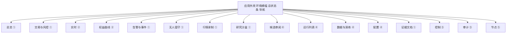

# 01 产品规格

面向前端与产品。本文说**页面要展示什么、异常时怎么显示**;接口细节见 [`02-api-contract.md`](02-api-contract.md) 与 OpenAPI 文件。
阶段标记:①②③④⑤ 对应 [`04-phases.md`](04-phases.md);标 ① 的先做。

## 1. 使用者与场景

| 使用者 | 场景 | 最想一眼看到 |
|---|---|---|
| 系统所有者(唯一的主要使用者) | 开盘前、收盘后、夜里被手机告警叫醒时 | 交易进程活着吗?有没有触发熔断或硬锁定?告警送达了吗? |
| 同一人,在验收期 | 每天检查无人值守是否连续、有无遗漏 | 连续几天无异常?哪天出了什么事? |
| 同一人,在研究期 | 看沙盒里的候选策略和评估结果 | 额度还剩几个?最近一次评估为什么没通过? |
| 将来的协作者(阶段⑤) | 只看不动 | 同上,但权限受限 |

**最关键的场景是『半夜被叫醒,30 秒内判断严重程度』。** 所以首页必须把最坏的情况放在最显眼处,文字比颜色重要。

## 2. 设计原则

1. **不假安心。** 看不到数据时说『不知道』,不要说『正常』。过期、缺失、损坏都是独立的、醒目的状态。
2. **最坏的放最前。** 总览按严重程度排序,不按固定顺序。
3. **文字 + 图标 + 颜色三重编码。** 只靠颜色的信息一律不合格(色盲、夜间低亮度、截图传播)。
4. **显示数据的年龄。** 每块数据都有『N 秒前』;超过阈值变成过期态。
5. **只读就是只读。** 没有任何看起来像『能操作交易』的控件。
6. **服务器已经算好的不要再算。** 级别、盈亏、回撤直接展示。

## 3. 信息架构

导航按『先看什么』分组:**监控**(总览、交易与风控、实时、权益曲线、告警与事件)、**验收**(无人值守、行情录制、证据文档)、**研究**(研究沙盒、候选审阅、运行列表、数据与演练)、**系统**(配置、控制、审计、节点)。未启用的页面不出现在导航里(依据 `capabilities`)。

## 4. 应用外壳(所有页面共有)

### 4.1 环境横幅(常驻,不可关闭)

页面顶部一条横幅,显示 `meta.environment.display`,并按 `label` 区分外观:

| label | 显示 | 外观 |
|---|---|---|
| `simnow` | SimNow 模拟盘 | 中性色 |
| `guoxin-test` | 国信测试环境 | 中性色,与 simnow 可区分 |
| `live` | 实盘 | **强对比警示色 + 『实盘』字样**,必须一眼和模拟盘区分 |
| `unknown` | 环境未知 | 警示色 + 『环境未知,请勿据此判断』 |

理由:混淆模拟盘和实盘是这类系统最危险的错误之一。横幅不随页面滚动消失。

### 4.2 总状态条(常驻)

显示 `overview.level` 和最多 3 条 `reasons`(点击跳转对应页面):

| level | 文案 | 含义 |
|---|---|---|
| `ok` | 一切正常 | 所有区块新鲜且无异常 |
| `warn` | 需要关注 | 有警告级事件、待补发告警、录制停滞等 |
| `critical` | 严重 | 硬锁定、当日熔断、紧急平仓失败、对账失败等 |
| `unknown` | 无法判断 | 关键数据缺失、过期,或**有内容读不出来**(例如心跳文件不存在、某天的日志读不懂) |

**`unknown` 不能画成 `ok` 的变体。** 用独立的灰色 + 问号图标 + 文案『无法判断』。

### 4.3 时间显示

- 所有时间以**北京时间(Asia/Shanghai)为主**,括号内给浏览器本地时间(两者相同时省略)。原因:交易按北京时间,开发机在太平洋时间,已经因此混淆过。
- 每个区块标题旁显示 `as_of` 的相对时间,如『4 秒前』;悬停显示绝对时间。
- 绝对时间格式 `2026-11-13 08:30:00`(24 小时制,不带 AM/PM)。

### 4.4 数字显示

| 类型 | 规则 |
|---|---|
| 金额(元) | 千分位,2 位小数,后缀『元』;负数用『−』号(不是连字符) |
| 盈亏 | 必须带符号(`+129.50` / `−129.50`)。颜色按国内习惯可选**红涨绿跌**或相反,做成设置项;**无论哪种,符号和文字不能省,且不得与状态灯的红/绿混淆**(状态用图标+文字区分) |
| 百分比 | 1 位小数 |
| 手数 | 整数 |
| 缺失值 | `—`(破折号),不要显示 0 或空白 |

### 4.5 全局状态组件

| 组件 | 用途 |
|---|---|
| 区块头 | 标题 + 状态徽标(新鲜/过期/缺失/损坏/未知)+ 『N 秒前』 |
| 过期态 | 内容保留但整体降低对比度并加『数据已过期』徽标;**不得**继续用绿色 |
| 缺失/损坏态 | 不渲染内容,显示 `section.message` 并说明可能原因 |
| 连接中断横幅 | 连续 3 次请求失败后出现:『与状态服务的连接中断,以下数据可能已过期』,并停止显示『N 秒前』的动画刷新 |
| 空态 | 数据新鲜但确实为空(如无告警):明确写『无』,与缺失区分 |

## 5. 状态语义对照(全页面通用)

| `state` | 含义 | 展示 |
|---|---|---|
| `ok` | 数据新鲜、可解析 | 正常展示 |
| `stale` | 数据存在但超过 `stale_after_seconds` | 过期态,仍可看内容 |
| `missing` | 数据来源不存在 | 缺失态;**不等于故障**(也许那个进程本来就没开),措辞中性:『未找到数据来源』 |
| `corrupt` | 来源存在但读不出 | 损坏态;措辞:『数据来源损坏或正在被写入,已自动重试』 |
| 其它/未知取值 | 后端新增了前端不认识的状态 | **按 `unknown` 渲染**,不得当作 `ok` |

`level`(总体)与 `state`(区块)是两个维度:一个区块可以 `state=ok` 但内容是 `critical`(数据新鲜,但账户已硬锁定)。

## 6. 页面规格:阶段①

每页写明:目的、数据来源、内容、异常态、交互。示例数据在 `fixtures/`。

### 6.1 总览 ①
- **目的**:30 秒内判断严重程度。
- **数据**:`GET /api/overview`(+ `GET /api/meta`)。示例:`overview-ok`、`overview-warn-unknown`、`overview-critical`。
- **内容**:
  1. 环境横幅 + 总状态条(见 §4)。
  2. 五张摘要卡:交易与风控、告警、无人值守、行情录制、研究沙盒。每张显示 `headline`、区块状态徽标、右上『N 秒前』;点击进入对应页。
     徽标用 `sections[n].level`(ok/warn/critical/unknown),不是 `state`——`state` 决定**内容能不能看**,`level` 决定**徽标**。例如『有些内容没列出来/没检查』是 `state=ok` + `level=warn`(内容照常显示,加警示徽标),而『有数据读不出来』是 `state=unknown`(内容仍给得出读得出来的部分,但要提示『部分数据无法读取』)。
  3. 卡片排序:按 `sections[n].level` 的严重程度 `critical` → `unknown` → `warn` → `ok`;同级别按固定顺序。
     **注意 `unknown` 比 `warn` 更严重**(服务器的口径:『不知道』比『知道有点问题』更危险,总状态条也是这么排的)。
- **异常**:任一区块 `missing/corrupt` 时,该卡显示缺失/损坏态,且总状态条不得为 `ok`。
- **交互**:自动刷新(间隔取 `meta.polling_hint_seconds`);标签页隐藏时暂停。

### 6.2 交易与风控 ①
- **目的**:回答『交易进程活着吗?风控处于什么状态?』
- **数据**:`GET /api/trading`。示例:`trading-ok`、`trading-stale`、`trading-missing`、`trading-corrupt`、`trading-hard-locked`、`trading-paused`。
- **内容**:
  | 区域 | 字段 | 说明 |
  |---|---|---|
  | 进程 | `heartbeat.process` / `last_beat_at` / `age_seconds` | `running`=绿+『运行中』;`stopped`=『已停止 N 小时』(**中性警示**,不是红色:进程可能本来就没开);`unknown`=『无法判断』 |
  | 账户 | `guard.account_masked` | 只显示服务器给的脱敏值,**不得**尝试还原 |
  | 权益 | `last_equity` / `peak_equity` / `day_start_equity` | 三个数并排;下方一条以 `day_start_equity` 为基准的当日盈亏 |
  | 当日盈亏 | `daily_pnl` 与 `limits.daily_loss_yuan` | **进度条**:已亏 / 当日熔断线;接近(≥80%)变警示 |
  | 回撤 | `drawdown_from_peak` 与 `limits.hard_drawdown_yuan` | 同上,对累计死线 |
  | 熔断 | `daily_locked_day` | 非空且等于今天 → 『今日已熔断:禁止新开仓』(严重) |
  | 硬锁定 | `hard_locked` / `hard_reason` | 为真 → 页面顶部整幅『账户已硬锁定』(严重),原因原文显示 |
  | 暂停 | `pause.paused` / `since` | 『已手动暂停开仓,平仓照常』 |
  | 实盘准入 | `live_admission.approved` | 文字说明『已存在实盘准入批准文件』;**不等于正在实盘**,措辞要避免误导 |
- **异常**:`missing` → 『未找到交易进程的状态文件(进程未启动,或状态页不在交易机上)』;`stale` → 保留数字但标过期,且不显示『运行中』。
- **交互**:无写操作(阶段①)。

### 6.3 告警与事件 ①
- **目的**:告警送达了吗?最近发生过什么?
- **数据**:`GET /api/alerts`。示例:`alerts-empty`、`alerts-events`。
- **内容**:
  1. 待补发队列:`outbox.pending` 条,最老一条 `oldest_age_seconds`。`pending>0` 提示『有告警因断网等原因尚未送达手机』(警告)。
  2. 近期事件列表:`recent[]`,按日期倒序、`severe` 在前;每行 日期 / 级别徽标(『严重』『警告』)/ 事件名 / 次数。
- **空态**:队列为 0 且无事件 → 『无待补发,近期无异常事件』(区别于缺失)。

### 6.4 无人值守 ①
- **目的**:验收期每天看一眼:连续几天无异常?
- **数据**:`GET /api/days?limit=14`。示例:`days-sample`(**含一天 `trusted=false` 的样例**,供前端看这种行怎么渲染)。
- **内容**:
  1. 顶部进度:`longest_clean_streak` / `required_streak`(如『1 / 5 天』)。
  2. 每日表:日期、启动次数、成交笔数(0 显示 `—`)、事件(徽标列表,『无异常』用文字)、心跳。`has_severe` 的行整行加严重标记。
     每行还有两个标记:`trusted`(false = 那天的日志不可信,**这一行不能显示成『无异常』**)与 `tail_uncertain`
     (true = 只是最后一行还没写完,文件可能正在写)。不可信的行要给出提示(如『日志无法识别,这天无法判断』),
     **不要**把它当成『无异常』,也不要当成『缺天』。
  3. 验收清单:`checklist[]`,`checked` 为 `true/false/null`,**`null` 显示『需人工核对』而不是未勾选**。
  4. `missing_weekdays`:『以下工作日没有日志:…』。
     **口径**:按**实际存在的日志**算——某天有日志但内容不可信(损坏、尾部写到一半)时,它算『有日志但不可信』,
     不算『缺天』。两种情况都不能被算作『无异常』,但文案不要混为一谈。
- **每天的『无异常』**:只有当天**没有事件**、**且日志可信**才算无异常。日志不可信时(比如进程正好崩在写一半的行上),
  那天不计入连续无异常,并在页面上说明原因——『没看到事件』不等于『没有事件』。
- **提示**:本页是证据展示,不是证据生成;不提供导出以外的操作。

### 6.5 行情录制 ①
- **目的**:录制进程是否在正常入库。
- **数据**:`GET /api/recording`。示例:`recording-running`、`recording-stalled`、`recording-missing`。
- **内容**:进程状态(`status`:running / stalled / starting …)、合约列表、最近 tick / bar 时间、最后错误、数据警告。
- **异常**:`status=stalled` → 警告:『已连接但没有订阅到任何合约』;`missing` → 『录制未启动,或不在本机』。
- **注意**:`last_tick` 为空是正常现象(非交易时段),不要标红;要结合 `status` 判断。

### 6.6 研究沙盒 ①
- **目的**:AI/人提交的候选策略进展。
- **数据**:`GET /api/research`;点击某次运行 → `GET /api/research/runs/{run_id}`。示例:`research-sample`、`run-evaluate`。
- **内容**:
  1. 迭代额度:`used / limit`(滚动 `window_hours` 小时),满额时显示『约 N 小时后释放』。
  2. 待审候选:`pending[]` 名称、**完整哈希**(`sha256`,服务端给全的,显示时可只取前 8 位)、是否已批准。**按修改时间倒序**(最近的候选在最前,审阅新提交时最容易漏的就是它)。**本页没有『批准』按钮**;批准只能在本机终端由人执行。
     候选超过显示上限时,区块的 `level` 是 `warn`、`message` 说明『有 N 个待审候选未列出』;真的有候选读不出来时 `state` 是 `unknown`。
  3. 最近运行:`recent_runs[]`,**最近的 10 条**(按运行时间倒序)。`passed` 为 `false` 用『未通过』、`null` 用『未判定』(只有 backtest 没有『通过』这个概念,`passed` 恒为 `null`)。
     服务端会校验最近 200 份结果文件;更早的没被校验时,区块 `level` 是 `warn` 并说明『有 N 个运行结果未检查』。
  4. 运行详情:`report` 是**确定性中文报告纯文本**,按原样显示(保留换行,等宽字体),下方列 `failures`。`metrics` / `diagnosis` 等对象阶段①只做键值表,不做图表(图表在阶段④)。
- **安全**:`report` 中可能含策略报错信息,**按纯文本渲染**,不得解析为 HTML 或 Markdown 链接。

### 6.7 证据文档 ①
- **目的**:直接阅读 `unattended-log` 与 `simnow-drills` 两份验收证据。
- **数据**:`GET /api/docs/{key}`。示例:`doc-unattended`。
- **内容**:Markdown 渲染。**必须使用禁用原始 HTML 的渲染器**(如 markdown-it 的 `html:false`),并配单元测试:文档里的 `<script>` 必须显示为文字。链接一律不可点击出站(只允许站内锚点)。
- **`truncated`**:文档超过大小上限会被截断。**为 `true` 时必须显示『已截断』提示**——半篇运行手册看起来是完整的一篇,人会照着缺步骤的操作。
- **键白名单**:只有这两个 key;不提供任意文件浏览。

## 7. 页面规格:阶段②(实时数据)

前置:运行时周期性把持仓、资金、最新行情**原子写成快照文件**,面板只读(详见 `04-phases.md`)。`capabilities.live` / `equity` 为真时才出现。

### 7.1 实时 ②
- **数据**:`GET /api/live`(过期阈值默认 15 秒)。示例:`live-sample`、`live-stale`、`live-missing`。
- **内容**:资金卡(权益、可用、保证金、冻结)、持仓表、当前挂单表、当日成交表、最新行情表。
- **异常**:快照过期时**所有数字置灰并整页加『实时数据已过期 N 秒』横幅**;持仓、资金过期比没有更危险(会被当成当前值),所以过期态必须比其它页面更醒目。
- **只读**:表格行没有任何操作按钮;不提供『平仓』『撤单』。
- **刷新**:`polling_hint_seconds`(阶段②默认 5 秒)。

### 7.2 权益曲线 ②
- **数据**:`GET /api/equity?interval=5m`(可选 `1m/5m/1h/1d`,`from/to`)。示例:`equity-sample`。
- **内容**:折线图,`day_start_equity` 画一条水平基线;可叠加当日熔断线(`daily_loss_yuan`)与累计死线。
- **图表要求**:纵轴不得截断到误导(默认包含基线与最近峰值);悬停显示时间与数值;无数据段不要用直线连接(显示断点)。

## 8. 页面规格:阶段③(安全控制)

前置:用户明确要求;独立写令牌、CSRF 防护、审计。`capabilities.control` 为真且当前角色为 `operator` 以上才出现。

### 8.1 控制 ③
- **唯一操作:暂停新开仓。** 语义:新开仓一律被拒绝,平仓与持仓管理照常。
- **流程**(两步确认,防误触):
  1. 点『暂停开仓』→ 弹出确认层,说明影响,要求填写原因(≤200 字,必填)。
  2. 输入确认词 `PAUSE`(与请求体 `confirm` 字段一致)→ 提交。
  3. 成功后显示 `since` 与审计编号;失败显示服务器的 `error`,不重试。
- **解除暂停**:默认**不在网页开放**(只显示『请在交易机上执行 `pause_trading.py` 解除』)。是否开放由阶段③ ADR 决定;若开放,走同样的两步确认(确认词 `RESUME`)。
- **永远没有**:发单、撤单、平仓、连接、改参数、解锁账户。设计评审时发现任何类似入口一律拒绝。

### 8.2 审计 ③
- **数据**:`GET /api/audit`。示例:`audit-sample`。
- **内容**:控制操作时间线:时间、操作者、动作、原因、结果(成功/被拒)、来源地址(已打码)。只读,不可删除。

## 9. 页面规格:阶段④(研究与数据视图,全部只读)

### 9.1 候选审阅 ④
- **数据**:`GET /api/research/candidates/{name}`。示例:`candidate-view`。
- **内容**:文件名、完整哈希、静态筛查结果(通过/未通过及原因)、**带行号的完整源码**(等宽、`textContent` 渲染)、批准状态。
- **批准**:页面只显示 `review_command`(带『复制』按钮),说明『请在本机终端读完代码后执行』。**没有批准按钮**——批准的价值就在于由人在本机读过代码。

### 9.2 运行列表 ④
- **数据**:`GET /api/research/runs?kind=&cursor=&limit=`。示例:`runs-list`。
- **内容**:分页表(游标分页),可按 `kind` 筛选;点击进入运行详情(同 §6.6),并可把 `metrics.windows` 等画成图表(后端补充序列字段后)。

### 9.3 数据与演练 ④
- **数据**:`GET /api/data/segments`、`GET /api/drills`、`GET /api/recording/quality`。示例:`data-segments`、`drills-sample`、`recording-quality`。
- **内容**:数据段表(**测试段是否已被消费**要显眼:已消费的测试段不能再用于最终确认);演练六场景结果;每个合约每天的 K 线完整率(不完整日标警示)。

### 9.4 配置 ④
- **数据**:`GET /api/config`。示例:`config-view`。
- **内容**:生效的风控预算、合约、阈值。**只读展示,不是编辑器**;不含任何凭据、地址、路径。

### 9.5 进化(曲线 / 热力图 / 变异日志) ④
- **数据**:`GET /api/research/evolution`、`.../curve`、`.../log`、`GET /api/research/runs/{run_id}/heatmap`、`GET /api/research/candidates/{sha256}/code|diff`。
  示例:`evolution-list`、`evolution-curve`、`evolution-curve-stagnant`、`evolution-log`、`evolution-heatmap`、`evolution-heatmap-plateau`、`candidate-code`、`candidate-diff`。
- **内容**:三个视图合成一个页面(左上曲线、右上热力图、下方日志与代码)。
- **谁在产生数据**:进化回路由**毕昇工作流**承载;面板只读,不驱动进化。
- **写操作**:**没有**。页面上不得出现注入变异、淘汰、批准、回滚任何按钮。
- **完整规格**见 [`08-evolution-views.md`](08-evolution-views.md)(含"怎么看好坏"与验收清单)。

## 10. 页面规格:阶段⑤(远程与多节点)

### 10.1 节点 ⑤
- **数据**:`GET /api/nodes`、`GET /api/whoami`。示例:`nodes-sample`、`whoami`。
- **内容**:各节点(交易机、录制机、研究机)的环境、级别、最后上报时间、是否可达;`reachable=false` 显示『失联』并算入总体级别 `unknown`。
- **角色**:`viewer` 只读;`operator` 额外可见阶段③控制;`admin` 保留。导航与按钮按 `whoami.role` 与 `capabilities` 双重过滤。

## 11. 通用要求

### 11.1 无障碍(WCAG 2.2 AA)
- 对比度:正文 ≥4.5:1,大字与图标 ≥3:1;夜间/暗色主题同样满足。
- 键盘:全部可操作元素可 Tab 到达,焦点可见;弹层有焦点陷阱且可 Esc 关闭。
- 屏幕阅读器:状态徽标有文字(不能只有图标);表格有表头关联;自动刷新用 `aria-live="polite"` 且**状态从 ok 变为 critical 时用 `assertive`**。
- 动效:尊重 `prefers-reduced-motion`;不用闪烁。

### 11.2 响应式
- 桌面优先(≥1280px 完整布局)。
- ≥768px 平板:双栏降为单栏,表格可横向滚动。
- 手机(<768px):**总览与告警页必须可用**(半夜用手机看);其余页面可降级为可读即可。

### 11.3 主题
- 默认深色(夜间使用多)与浅色两套,跟随系统并可手动切换;选择存 `localStorage`(**仅存主题等偏好,不存令牌和数据**)。

### 11.4 文案
- 简体中文;界面文案集中在一个字典文件,便于统一修改。
- 措辞中性、不夸张:用『已停止』『无法判断』,不用『崩溃』『危险』渲染气氛;严重事件靠级别与位置突出,不靠感叹号。
- 避免交易终端用语(『下单』『买入』『卖出』按钮)。展示成交记录时用『开仓/平仓』描述事实,不做动作按钮。

### 11.5 性能与可靠性
- 首屏 JS ≤ 300 KB(gzip);无外部请求。
- 轮询:取 `meta.polling_hint_seconds`;标签页隐藏时暂停;请求失败指数退避(上限 60 秒);同一时刻每个端点只有一个在途请求。
- 服务器返回 429 时遵守 `Retry-After`。

### 11.6 国际化
- 当前只有 zh-CN。字符串集中管理,不拼接句子(便于将来翻译)。时间、数字用 `Intl` API。
