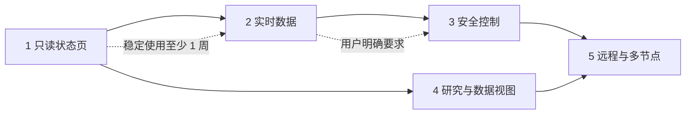

# 04 分阶段规划

总览见 [`README.md`](README.md)。本文说明五个阶段各自的范围、后端前置、触发条件和风险。
**每进入一个阶段,先确认对应 ADR,再开工。** 阶段①的详细任务分解在 `docs/plans/20261112-status-dashboard-plan.md`。

## 阶段① 只读状态页

| 项 | 内容 |
|---|---|
| 目标 | 把现在的黑盒打开:交易进程、风控、告警、无人值守、录制、研究、证据文档 |
| 页面 | 总览、交易与风控、告警与事件、无人值守、行情录制、研究沙盒、证据文档 |
| 接口 | `meta`、`overview`、`trading`、`alerts`、`days`、`recording`、`research`、`research/runs/{id}`、`docs/{key}`,全部 GET |
| 数据来源 | 心跳文件、风控状态 JSON、暂停标志、实盘准入文件、每日日志、待补发队列、录制状态、研究账本与结果、两份证据文档 |
| 后端工作 | `dashboard/` 纯逻辑包(collectors + 净化层)、`scripts/status_server.py`(鉴权、限流、GET-only、静态托管、安全响应头)、状态页配置文件(环境标签、阈值、端口) |
| 对交易系统的改动 | **零**。不改交易进程,不新增依赖 |
| 触发条件 | ADR 获确认 |
| 退出标准 | 计划文档 T8 测试矩阵通过;实机逐页核对;杀掉面板后交易心跳不变;G8 双轮审查 ≥45/50 |
| 风险 | 假安心(过期显示成正常)、敏感信息泄露、日志注入。缓解见 ADR 与计划 |
| 局限(要如实告知使用者) | 看不到实时持仓与资金,只有风控文件里的权益快照;面板必须与交易运行时在**同一台机器** |

**环境标签从哪来**:阶段①不读 `.env`,环境(simnow/guoxin-test/live)由状态页**自己的配置文件**指定,`meta.environment` 返回它。配置错了会显示错环境——所以部署清单里要有『核对环境标签』一步,阶段②起由运行时写出的快照自带环境标识,消除人工配置。

## 阶段② 实时数据与权益曲线

| 项 | 内容 |
|---|---|
| 目标 | 看到实时资金、持仓、挂单、当日成交、最新行情,以及权益曲线 |
| 页面 | 实时、权益曲线;总览与交易页增加实时摘要 |
| 接口 | `live`、`equity` |
| 取数方案 | **(a) 运行时周期性把这些数据原子写成状态 JSON,面板只读**(倾向);(b) 只读 RPC。详见下 |
| 后端工作 | ① 运行时增加『快照写出』(只写磁盘,间隔约 5 秒,原子替换,带环境标识与时间);② 面板读取快照并脱敏;③ 面板把权益点追加到**自己的数据目录**(`data/state/dashboard/equity.ndjson`)并按间隔降采样 |
| 对交易系统的改动 | **小且单向**:增加一次只写磁盘的动作。不新增网络监听,不新增读取依赖 |
| 触发条件 | 阶段①稳定使用 ≥1 周,无降级误报 |
| 需要的 ADR | 是:论证 (a) vs (b);快照字段与频率;写失败时的行为(绝不能影响交易) |
| 风险 | 快照写入拖慢交易线程(缓解:放独立线程/事件回调里批量写,失败静默计数,不抛异常);快照过期被当作当前值(缓解:15 秒过期 + 整页醒目过期条);快照含账户信息(缓解:字段白名单 + 脱敏) |

**为什么倾向 (a) 而不是 RPC**:RPC(ZeroMQ)要求交易进程内开监听端口并持续向外推数据,vn.py 的 RPC 默认无鉴权、无加密;(a) 不新增任何网络面,交易进程崩溃时面板只是看到快照变旧,故障模式清晰可读。代价是实时性受限于写入间隔(秒级),对监控足够。

## 阶段③ 安全控制(仅『暂停开仓』)

| 项 | 内容 |
|---|---|
| 目标 | 在不碰命令行的情况下紧急拦住新开仓 |
| 页面 | 控制、审计 |
| 接口 | `POST /api/control/pause`、`GET /api/audit`;`resume` 默认关闭 |
| 后端工作 | 写令牌与角色;CSRF;确认词;审计日志(追加写、不可改);写入 `pause_trading.flag`(复用现有机制,不新增交易侧代码) |
| 对交易系统的改动 | **零**(风控规则本来就在轮询这个标志文件) |
| 触发条件 | 阶段①稳定 + **用户明确要求** |
| 需要的 ADR | 是:是否开放网页解除;写令牌管理;审计保存期 |
| 永不提供 | 发单、撤单、平仓、连接、改风控参数、解锁账户、批准/装载策略 |
| 风险 | 误触(缓解:两步确认 + 必填原因);令牌泄露(缓解:写令牌独立于只读令牌、仅本机/内网、限流、审计);**解除暂停比暂停更危险**(缓解:默认只允许本机命令行解除) |

**为什么只开放『暂停』**:暂停是**降低风险**的方向(拒绝新开仓,平仓照常),误触的代价小;解除、发单、撤单都是**增加风险**的方向,不应通过网页暴露。

## 阶段④ 研究与数据视图(全部只读)

| 项 | 内容 |
|---|---|
| 目标 | 让研究沙盒、数据资产、演练和录制质量可见 |
| 页面 | 候选审阅、运行列表、数据与演练、配置 |
| 接口 | `research/candidates/{name}`、`research/runs`、`data/segments`、`drills`、`recording/quality`、`config` |
| 后端工作 | ① 候选审阅视图(带行号源码 + 静态筛查 + 哈希);② 运行列表游标分页;③ 数据段/测试段消费状态;④ 演练结果**结构化**(现在只在 Markdown 里,需要让演练脚本同时写 JSON);⑤ 录制 K 线完整性统计(新采集器);⑥ 脱敏配置视图 |
| 对交易系统的改动 | 零(④ 演练 JSON 属于演练脚本,不在交易路径) |
| 触发条件 | 阶段①稳定;可与②③并行 |
| 前置/依赖 | 运行结果若要画图表,需沙盒结果补充序列字段(净值/滚动窗口夏普等),属研究侧改动 |
| 需要的 ADR | 候选审阅视图的边界:**网页不提供批准按钮**——批准的价值在于人在本机读过代码(见 `20261112-research-sandbox-config-and-approval.md`) |
| 风险 | 源码视图泄露策略思路(仅本机访问,风险低);Markdown/源码渲染注入(已在前端约束中规定) |

## 阶段⑤ 远程访问与多节点

| 项 | 内容 |
|---|---|
| 目标 | 经局域网/VPN 访问;多人只读;一页看多台机器(交易机、录制机、研究机) |
| 页面 | 节点;全局增加登录与角色 |
| 接口 | `nodes`、`whoami` |
| 后端工作 | ① TLS(反向代理);② 每用户令牌与角色(viewer/operator/admin);③ 聚合器:拉取各节点的状态页 API 并汇总级别;④ 每节点独立令牌;⑤ 审计覆盖登录 |
| 对交易系统的改动 | 零 |
| 触发条件 | 确有远程/多机需求(例如实盘机与开发机分离后,需要在开发机上看实盘机) |
| 需要的 ADR | 是:网络边界(**不做公网穿透**,只走 VPN/限定局域网);令牌与角色模型;聚合器的失败语义 |
| 风险 | 暴露面扩大(缓解:默认仍只监听回环,开放需显式配置 + TLS + 限流 + 审计);聚合器把『失联』误判为『正常』(缓解:失联计入 `unknown`) |

**关于树莓派方案**:状态页后端是纯 Python,可以跑在树莓派上做主控节点;但交易进程(CTP 库只有 x86_64)必须留在运行机上。树莓派读不到运行机的文件,所以需要阶段⑤的聚合模式(树莓派拉取运行机上状态页的 API),而不是直接读文件。

## 候选池(未排期,不承诺)

- 手机推送/深链接:Telegram 告警里带状态页链接(需先解决远程访问)。
- 数据导出:无人值守每日表导出 CSV/PDF 作为验收留痕。
- 暗色/高对比度主题细化、打印样式。
- 与毕昇工作流的只读联动视图。
- 参数平原热力图、策略族谱树:需要后端先暴露数据(选参网格得分矩阵;候选的父子关系与变异说明),见 `docs/roadmap.md` §2.8;归入阶段④。
- PBO / DSR 指标卡:指标实现之前不预留位置。

**已评估后明确不做**(防止重复提出,理由见 ADR `20261112-status-dashboard.md` 与 `20261111-risk-floor-immutability.md`):网页一键全平/紧急制动、网页批准/拒绝/回滚策略、网页改风控阈值、公网穿透(Cloudflare Tunnel 等)、需要 Node 运行时的前端部署形态。

## 跨阶段的不变量

无论哪个阶段,下列条件都必须保持,并有测试守护:

1. 状态页进程崩溃或被杀,交易进程不受影响。
2. 契约里没有下单/撤单/连接/改风控/解锁/批准类路径(`tests/test_web_contract.py`)。
3. 阶段①的接口全部是 GET。
4. 写操作集合恰好是 `pause` 与 `resume`。
5. 所有响应经过唯一的净化出口;不读取 `.env`。
6. 缺失/过期/损坏的数据永远不显示为正常。
