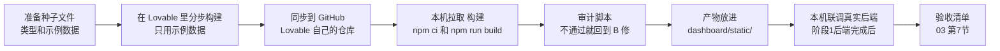

# 05 用 Lovable 构建前端:使用指南

本页说明怎样在 Lovable 里把状态页前端做出来,**同时不破坏安全约束**。提示词在 [`07-lovable-prompts.md`](07-lovable-prompts.md),视觉规范在 [`06-design-system.md`](06-design-system.md)。
技术栈确定为 **React + TypeScript + Tailwind CSS**(Lovable 的默认栈,另含 Vite、shadcn/ui、React Router)。

## 1. 先看清三个风险

Lovable 是在云端生成和托管项目的工具。它的默认行为和我们的约束有三处冲突,这决定了整套流程:

| 风险 | 为什么是问题 | 对策 |
|---|---|---|
| **真实数据不能进 Lovable** | Lovable 的预览与托管在第三方云上;账户权益、持仓、风控状态、策略源码、令牌一旦被粘贴进对话或让预览页去请求真实服务,就离开了你的机器 | **Lovable 里只使用示例数据(`lovable-seed/`)。** 不粘贴真实令牌、真实响应、真实日志。不让 Lovable 预览指向你的真实状态服务 |
| **生成物默认带外部依赖** | Lovable 项目常含外部编辑脚本、可能接 Supabase 后端、可能引入统计或网络字体。这与我们的 CSP(`default-src 'self'`)和『零外部请求』冲突 | 提示词里明令禁止;**导出后必须跑审计脚本**(§4),不通过不入库 |
| **托管在 lovable.app 不等于我们的部署** | 真正的页面由我们的状态服务在本机提供(同源、回环地址、无 CORS)。放在 lovable.app 的页面访问不到本机服务,也不应该访问 | Lovable 只是**开发环境**;交付物是导出的源码,经本机构建成静态文件放进 `dashboard/static/` |

> 一句话:**把 Lovable 当成『带 AI 的前端开发 IDE』,不是部署平台,也不是数据通道。**

## 2. 总流程



| 步骤 | 做什么 | 产出 |
|---|---|---|
| A | 把 `docs/web/lovable-seed/` 的类型与示例数据准备好;决定首批做哪些页面 | 种子文件 |
| B | 按 [`07-lovable-prompts.md`](07-lovable-prompts.md) 一步一步给 Lovable 下指令;**每步结束都对照该步的验收点** | 能在预览里用示例数据跑通的前端 |
| C | 用 Lovable 的 GitHub 同步,把项目推到一个**你自己的、与 invest 仓库分开的**仓库 | Lovable 项目仓库 |
| D | 本机克隆 Lovable 仓库,`npm ci` → `npm run build` | `dist/` |
| E | `python tools/audit_frontend_export.py --dist dist --src src --strict` | 审计报告 |
| F | 把 `dist/` 内容拷到 invest 仓库 `dashboard/static/`,源码放 `dashboard/frontend/` | 入库提交 |
| G | 后端阶段①完成后,本机启动真实服务,浏览器访问回环地址 | 联调 |
| H | 逐条过 `03-frontend-handoff.md` §7 | 验收 |

**为什么用两个仓库**:Lovable 需要对它的项目仓库有读写权限;invest 仓库含交易代码和文档,不应给第三方工具授权。源码入库是单向的(从 Lovable 仓库复制过来),invest 仓库对 Lovable 不可见。

## 3. 在 Lovable 里的配置与纪律

### 3.1 项目开局检查
新建项目后第一件事(提示词见 07 的 P0):
- **不启用 Supabase 集成**,也不要接受 Lovable 提示『需要后端/数据库/登录』时的任何建议。本项目没有后端数据库,登录就是一个令牌输入框。
- 不启用任何第三方登录、支付、分析、地图、字体服务。
- 如果你的 Lovable 版本提供『项目知识 / 自定义指令』设置,把 §3.3 的『项目约束』整段粘进去,这样后续每条指令都会带着它。没有这个功能就在每个阶段的第一条指令里重复一次。

### 3.2 数据只用示例
- 前端有一层 **API 客户端**(07 的 P2),它有两种实现:`mock`(从 `mock-data.*.ts` 取示例)和 `http`(请求同源的 `/api/*`)。由构建时环境变量 `VITE_API_MODE` 选择,默认 `mock`。
- 在 Lovable 里始终是 `mock`。`http` 实现只在本机联调时打开。
- 示例数据里**没有任何真实信息**(账号是虚构的 `12****34`,金额是演示值),可以放心粘贴。

### 3.3 项目约束(可粘贴进『项目知识』)

```
这是一个只读为主的交易系统监控页,不是交易终端。技术栈:React + TypeScript + Tailwind CSS + shadcn/ui + React Router。

硬性约束(任何情况下不得违反):
1. 不使用 Supabase,不新增任何后端、数据库、登录服务;不接任何分析、统计、错误上报服务。
2. 不加载任何外部资源:无 CDN、无网络字体(用系统字体栈)、无外链图片、无外部脚本。
3. 不使用 dangerouslySetInnerHTML、innerHTML、document.write、eval、new Function。服务器返回的文本一律作为纯文本渲染。
4. 所有网络请求只发生在 src/api/ 目录里的唯一 API 客户端中。组件里不得直接 fetch。
5. 令牌只存 sessionStorage 并通过 Authorization 头发送;不进 URL,不进 localStorage,不打印到控制台。localStorage 只允许存主题偏好。
6. 页面上不得出现任何下单、撤单、平仓、一键全平、紧急制动、连接、订阅、改风控参数、解锁账户、批准/拒绝/回滚策略的按钮、表单或菜单。唯一可能的写操作是『暂停开仓』(阶段3),且需两步确认。
7. 数据缺失、过期、损坏、未知时,绝不能显示为"正常"。未知的 state / level 取值一律按 unknown 渲染。
8. 状态必须同时用 图标 + 颜色 + 文字 表达;颜色全部来自设计令牌,组件里不写十六进制。
9. 所有时间以北京时间为主显示;年龄(N 秒前)直接用服务器给的 age_seconds,不用浏览器时钟重算。
10. 界面文案全部集中在 src/i18n/zh-CN.ts,不在组件里写死中文句子。
接口契约与示例以 src/api/types.ts 和 src/api/mock-data.*.ts 为准,不得自行发明接口或字段。
```

### 3.4 每一步之后
- 在预览里把各个示例状态都点一遍(用示例切换器,见 07 P2)。
- 对照该步的验收点;**不合格就让 Lovable 修,不要往下走**。AI 生成的代码容易『看起来对』,状态语义类的错误要靠逐个示例肉眼核对。
- 每完成一个阶段性目标,在 Lovable 里打一个版本标记(或 GitHub tag),方便回退。

## 4. 导出后的审计闸门

在 Lovable 仓库的本机克隆里:

```bash
npm ci
npm run build
python <invest>/tools/audit_frontend_export.py --dist dist --src src --api-dir src/api --strict
```

审计脚本检查:
- **dist**:任何外部 URL(含已知的 Lovable 编辑脚本域名、Supabase、Google 字体、统计、CDN)、内联 `<script>`、外链 `<script>`/`<link>`、`eval` / `new Function`;
- **src**:`dangerouslySetInnerHTML` / `innerHTML` / `v-html` / `document.write`、令牌写入 `localStorage`、Supabase 与统计类依赖、API 客户端之外的 `fetch` / `axios` / `XMLHttpRequest`、交易类文案(按钮/菜单,解释性文字可人工忽略)。

`error` 必须清零;`--strict` 下 `warn` 也需要人工确认。**不通过的导出物不得入库。**
常见修复:
| 报告 | 处理 |
|---|---|
| `cdn.gpteng.co` 或其它 Lovable 域名的脚本 | 从 `index.html` 删除该行;让 Lovable 以后不再生成(在项目约束里强调) |
| Google Fonts | 删除 `@import` / `<link>`,改系统字体栈 |
| `lovable-tagger` 警告 | 只应在开发构建启用(`vite.config` 里 `mode === 'development'`);确认产物里没有 `data-lov-*` 属性 |
| 令牌写入 localStorage | 改 `sessionStorage` |
| 组件里直接 `fetch` | 挪进 `src/api/` |

> 审计脚本能拦住**已知**问题,不能证明没有问题。验收仍要做 CSP 零违规检查(在带 CSP 的真实服务下打开,控制台无违规)和 HTML 注入测试(`03-frontend-handoff.md` §2.2–2.3)。

## 5. 联调真实后端(阶段①后端完成后)

1. 本机启动状态服务(强制回环地址,令牌文件由后端生成)。
2. 用 `VITE_API_MODE=http` 构建的产物放进 `dashboard/static/`,浏览器访问服务地址,在令牌输入框输入本机的只读令牌。
3. **令牌只在本机浏览器里输入**,不要在 Lovable 里输入或粘贴。
4. 逐页核对:真实数据与示例的形状一致;故意停掉交易进程、删掉状态文件,确认页面显示 `stale` / `missing` 而不是正常。

## 6. 范围与顺序建议

先做**阶段①的七个页面**和应用外壳(环境横幅、总状态条、令牌输入、主题、连接中断横幅)。
阶段②到⑤的页面可以先用示例数据做出来(契约和示例已齐全),但**在对应后端阶段上线前不得在导航里显示**(依据 `meta.capabilities`)。
建议顺序:外壳 → 总览 → 交易与风控 → 告警与事件 → 无人值守 → 行情录制 → 研究沙盒 → 证据文档 → 无障碍与响应式 → 导出审计。

## 7. 常见问题

**Lovable 说要接 Supabase / 要加登录页怎么办?** 拒绝。回复:『本项目不使用任何后端服务,登录就是一个令牌输入框,令牌放 sessionStorage。』

**预览里怎么看 `stale`、`critical` 这些状态?** 07 的 P2 要求做一个仅开发用的『示例切换器』(右下角抽屉,生产构建里不包含),可以选任意示例。

**能不能让 Lovable 直接读我们的 OpenAPI 文件?** 可以把 `status-api.openapi.json` 粘进对话作为参考,但真正约束代码的是 `api-types.ts`(已由 OpenAPI 生成并通过 TypeScript 严格模式编译)。契约变了就重新生成这两个种子文件。

**Lovable 生成的代码太乱怎么办?** 让它按功能拆文件(07 的每一步都规定了目录);必要时在本机用编辑器重构,再回推 GitHub。注意 Lovable 与 GitHub 是双向同步,本机改动推回后 Lovable 会看到。

**设计想改(例如换强调色)?** 只改 `06-design-system.md` 的令牌并重新核对对比度,再让 Lovable 更新令牌文件,不要在组件里改颜色。
