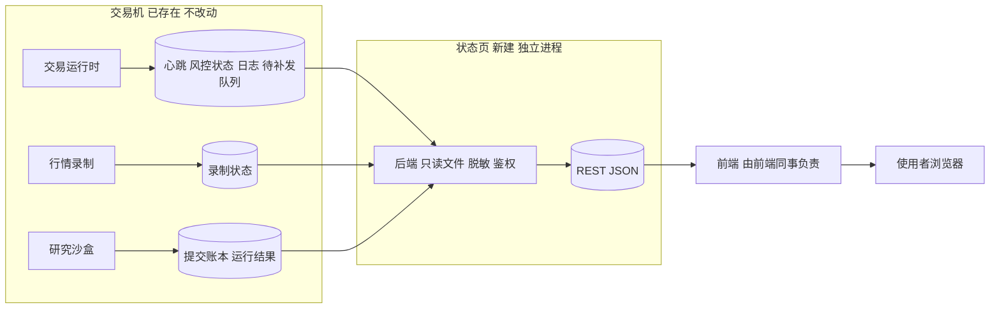
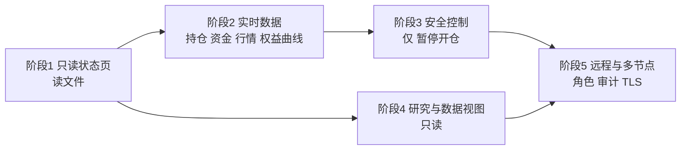

# 状态页(Web 端)总体规划

> 给前端同事:**你不需要读交易代码**。你需要的全部信息都在本目录:页面怎么做、接口长什么样、有哪些示例数据、交付标准是什么。
> 先读本页,再按下面的顺序读。

## 这是什么

invest 是一套自动交易系统(vn.py + CTP)。交易、风控、录制、研究这些进程都跑在命令行里,状态散在文件和日志中,使用者看不见。
状态页是一个**只读为主**的网页,让人一眼看出:交易进程活着吗、风控有没有触发、告警有没有送达、录制正常吗、研究沙盒在干什么。

**最重要的一条:它是监控页,不是交易终端。** 页面上没有、也永远不会有下单、撤单、连接柜台、改风控参数的入口(见 `docs/adr/20261112-status-dashboard.md` 的「明确不做」)。

## 阅读顺序

| 顺序 | 文件 | 谁读 | 内容 |
|---|---|---|---|
| 1 | 本页 | 所有人 | 全貌、分工、阶段 |
| 2 | [`01-product-spec.md`](01-product-spec.md) | 前端、产品 | 信息架构、每个页面的内容、状态与交互、文案、视觉约束 |
| 3 | [`02-api-contract.md`](02-api-contract.md) | 前端、后端 | 通用约定:鉴权、区块模型、错误、时间、轮询、写操作规则 |
| 4 | [`status-api.openapi.json`](status-api.openapi.json) | 前端、后端 | **机器可读的契约**,22 个接口、37 个数据模型,每个接口标注阶段与角色 |
| 5 | [`fixtures/`](fixtures/) | 前端 | 40 个示例响应(含缺失、过期、损坏、硬锁定等异常状态)+ `manifest.json` |
| 6 | [`03-frontend-handoff.md`](03-frontend-handoff.md) | 前端 | 技术约束、安全清单、目录与构建、联调流程、验收清单 |
| 7 | [`04-phases.md`](04-phases.md) | 所有人 | 五个阶段各自的范围、前置条件、后端工作、风险 |
| 8 | [`05-lovable-guide.md`](05-lovable-guide.md) | **用 Lovable 构建前端的人** | 风险(真实数据不能进 Lovable、导出物默认带外部依赖)、总流程、项目约束、导出审计、联调 |
| 9 | [`06-design-system.md`](06-design-system.md) | 前端、设计 | 设计令牌(对比度实测)、玻璃拟态规则与降级、状态的视觉表达、Bento 布局、组件清单 |
| 10 | [`07-lovable-prompts.md`](07-lovable-prompts.md) | 用 Lovable 的人 | P0–P14 提示词包,每步带验收点;偏离约束时的纠正话术 |
| 11 | [`lovable-seed/`](lovable-seed/) | 用 Lovable 的人 | 由契约生成的 `api-types.ts`、示例数据、示例清单(经 TypeScript 严格模式编译通过) |

契约由测试守住:`tests/test_web_contract.py` 校验每个示例都符合 OpenAPI 里的模型,并校验 `lovable-seed/` 与契约同步(不同步则失败,重新生成:`python tools/webgen/gen_lovable_seed.py`)。前端导出物入库前必须通过 `tools/audit_frontend_export.py`。**改接口先改 OpenAPI 和示例,测试通过再改实现。**

## 全貌

后端负责读文件、判断状态、脱敏、鉴权;前端负责把这些展示清楚,并且**不伪造也不美化数据**。

## 分工

| 事项 | 后端(我们) | 前端(你) |
|---|---|---|
| 读取状态文件、判断 ok/stale/missing/corrupt | ✅ | — |
| 脱敏(账号、令牌、路径) | ✅ | 不得再把它们拼回来;不缓存到持久存储 |
| 总体级别 `level`、`reasons` | ✅ 服务器算好 | 直接展示,不自己重算 |
| 盈亏、回撤等派生数字 | ✅ 服务器算好 | 只做格式化 |
| 页面、布局、交互、文案、响应式 | — | ✅ |
| 轮询、断线提示、过期提示 | — | ✅ |
| 令牌输入与保管 | 校验 | ✅ 仅 `sessionStorage` |
| 示例数据与契约 | ✅ 维护 | 用它们联调;发现契约问题提 Issue |
| 构建产物 | 部署 | ✅ 产出静态文件 |

## 阶段总览

| 阶段 | 新增什么 | 新增页面 | 状态 |
|---|---|---|---|
| ① | 状态页骨架,全部读文件 | 总览、交易与风控、告警与事件、无人值守、行情录制、研究沙盒、证据文档 | **先做** |
| ② | 实时持仓、资金、挂单、成交、最新行情;权益曲线 | 实时、权益 | 触发条件满足后 |
| ③ | 仅「暂停开仓」,带审计 | 控制、审计 | 需用户明确要求 |
| ④ | 候选策略审阅、运行列表、数据段、演练、录制完整性、配置 | 候选审阅、运行列表、数据与演练、配置 | 与②③可并行 |
| ⑤ | 经局域网/VPN 访问、角色、多节点汇总 | 节点 | 远期 |

前端可以**一次性按全部阶段设计**,但上线是分阶段的:`GET /api/meta` 返回的 `capabilities` 决定哪些页面和按钮可见。未启用的能力不显示入口,也不显示灰色按钮占位。

## 不能碰的红线(前端也要遵守)

1. 页面上**不得出现**下单、撤单、连接、修改风控参数、解锁账户、批准策略的按钮或表单,即使后端将来某个阶段开放了相关能力的一部分。唯一的写操作是阶段③的「暂停开仓」。
2. **数据缺失或过期不得显示为正常。** 绿色只能表示『数据新鲜且确实正常』。
3. 不得调用 `status-api.openapi.json` 之外的任何接口,不得加载任何外部资源(CDN、字体、统计脚本)。
4. 令牌只放 `sessionStorage` 和 `Authorization` 头;不进 URL、不进 `localStorage`、不进日志。
5. 服务器返回的任何文本(日志行、告警、报告)都按**纯文本**显示,不得当 HTML 渲染。

## 现状

- 契约、示例数据(40 个)、契约测试、设计系统、Lovable 提示词包都已就绪,可以立即开始用示例数据做前端。
- **阶段①后端已实现**(2026-11-12):`python scripts/status_server.py` 在本机 `127.0.0.1:8770` 提供全部阶段①接口,令牌自动生成在 `data/dashboard/status.token`(不入库,内容不打印)。
  前端联调时让浏览器访问该地址,在令牌输入框里粘贴令牌。后端尚未对接前端构建产物,`/` 显示占位页。
- 后端的真实行为比示例数据更严格,**前端要按下面几点处理**(都已写进契约 `02-api-contract.md` §10.1,并有对应示例):
  - `state=corrupt` 的触发条件比想象的多:心跳内容非法或时间在未来、日志存在但读不懂、批准记录损坏、录制 `stopped` 却没有终态时间。
  - **进程在跑不等于数据新鲜**:示例 `trading-guard-stale` 里 `heartbeat.process=running`,但风控状态文件已落后一天,区块是 `stale`——权益、盈亏不能当作当前值。先看区块 `state` 和各块自己的年龄,不要只看 `heartbeat.process`。
  - `HEAD` 只验证令牌,恒 200,不反映数据是否存在;不要用它做健康检查。
  - 总体级别里,录制与研究是可选子系统:未部署(`state=missing`)时不计入总体级别,但它们的卡片仍要显示『缺失』。
- **后端有已知未修的问题,联调时请不要把它当作完全可信的数据源**:G8 审查的 codex 复核(综合 6.0/10)指出的日志路径 4 项已修复,仍有 6 项未修(风控文件时间戳语义、`__pycache__` 写入、严格解码、研究结果结构校验等),可能造成『看起来正常其实不是』的情形。这些是后端要修的,**不影响前端按契约开发**;但前端的『状态语义』测试(未知取值回退 unknown、过期不显示绿色)不能因为『后端会保证』而省略。
- 后端任务分解、执行记录与未修问题清单见 `docs/plans/20261112-status-dashboard-plan.md`。
- 阶段②–⑤ 的后端尚未开始。
